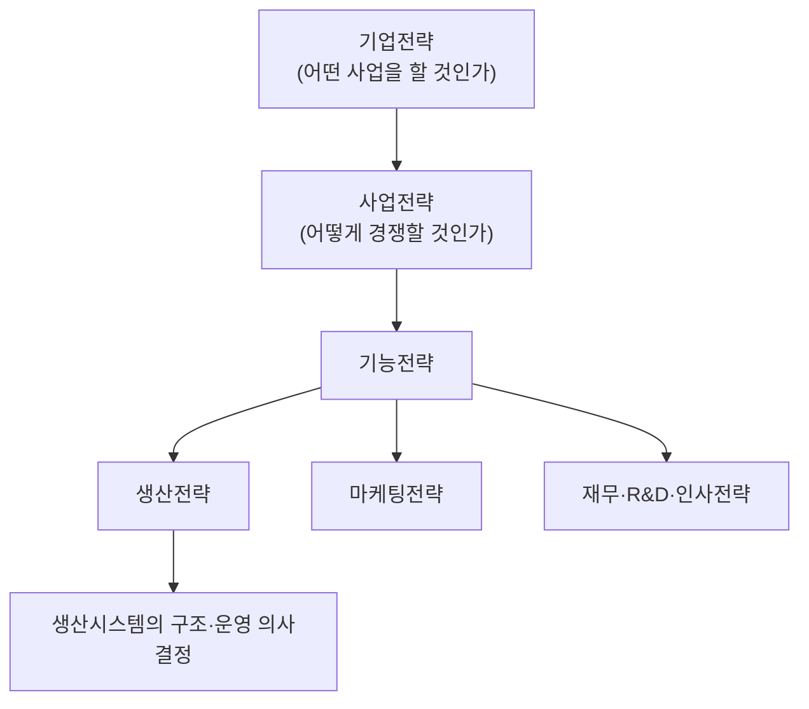
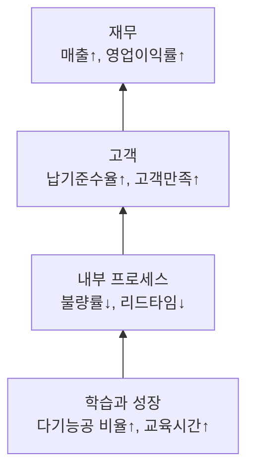

# 1.1 경쟁우위 생산전략

!!! info "출제기준"
    **1. 생산전략** › **1. 경쟁우위 생산전략**

## 출제 경향

총 **38문항** 출제 (1교시 단답형 8 · 2~4교시 논술형 30) · 최근 10개 회차(109~139회) 8문항 · 최근 출제 제139회

| 주제 | 출제 수 | 출제 회차 |
|---|:-:|---|
| 1.1.1 생산전략과 생산운영전략의 개념 | 8 | 65회, 68회, 70회, 73회, 100회, 121회, 127회, 139회 |
| 1.1.2 경쟁우선순위와 경쟁우위 요소 | 5 | 85회, 88회, 97회, 100회, 106회 |
| 1.1.3 포터의 본원적 경쟁전략 | 3 | 79회, 94회, 106회 |
| 1.1.4 생산시스템 포지셔닝과 집중화 공장 | 4 | 91회, 103회, 112회, 124회 |
| 1.1.5 대량맞춤생산과 플랫폼 전략 | 3 | 79회, 82회, 106회 |
| 1.1.6 제품수명주기에 따른 생산전략 | 2 | 79회, 100회 |
| 1.1.7 성과측정: BSC·KPI·CSF | 12 | 63회, 70회, 71회, 76회, 79회, 85회, 91회, 100회, 121회, 124회, 130회 |
| 1.1.8 구조조정 전략(다운사이징·리엔지니어링) | 1 | 82회 |

## 목차

1. [생산전략과 생산운영전략의 개념](#t11-1)
2. [경쟁우선순위와 경쟁우위 요소](#t11-2)
3. [포터의 본원적 경쟁전략](#t11-3)
4. [생산시스템 포지셔닝과 집중화 공장](#t11-4)
5. [대량맞춤생산과 플랫폼 전략](#t11-5)
6. [제품수명주기에 따른 생산전략](#t11-6)
7. [성과측정: BSC·KPI·CSF](#t11-7)
8. [구조조정 전략(다운사이징·리엔지니어링)](#t11-8)

## 1.1.1 생산전략과 생산운영전략의 개념 {#t11-1}

### 생산전략의 정의와 위상

**생산전략(Operations/Manufacturing Strategy)**은 기업전략·사업전략이 요구하는 경쟁우위를 생산기능이 어떻게 뒷받침할지를 정하는 **기능전략**이다. 생산시스템의 구조와 운영에 관한 장기적·일관된 의사결정의 패턴이라고 할 수 있다.
W. Skinner(1969)는 「Manufacturing — Missing Link in Corporate Strategy」에서 생산이 단순 실행부서가 아니라 전략의 핵심 연결고리라고 지적했다.

### 생산관리의 목표

| 목표 | 의미 | 대표 지표 |
|---|---|---|
| 품질(Q) | 요구 품질을 일관되게 충족 | 불량률(ppm), 수율, 고객 클레임 |
| 원가(C) | 최소 비용으로 생산 | 단위당 제조원가, 생산성 |
| 납기(D) | 필요한 시기·수량을 신속·정확하게 공급 | 리드타임, 납기준수율 |
| 유연성(F) | 제품·수량·일정 변화에 대응 | 준비교체시간, 신제품 도입기간 |

최근에는 **안전(S)·환경(E)**을 더해 QCDF+SE로 확장하기도 한다.

### 생산 의사결정의 범주 (Hayes & Wheelwright)

생산전략은 다음 두 범주의 의사결정이 서로 일관되도록 하는 것이다.

| 구분 | 구조적 의사결정(Structure) | 하부구조 의사결정(Infrastructure) |
|---|---|---|
| 성격 | 대규모 투자, 장기적, 번복 어려움 | 운영 시스템·관리 방식, 비교적 단기적 |
| 항목 | ① 생산능력(규모·시기·유형) ② 시설(입지·규모·전문화) ③ 공정기술(설비·자동화 수준) ④ 수직적 통합(자가생산/외주) ⑤ 공급망·소싱 | ① 인력(숙련·보상·직무설계) ② 품질관리 시스템 ③ 생산계획·자재통제 ④ 조직구조 ⑤ 성과측정·신제품 개발 체계 |

### 장기·단기 의사결정

| 관점 | 의사결정 사항 |
|---|---|
| 장기(전략·설계) | 제품 선정과 설계, 공정 선택, 생산능력 계획, 입지 선정, 설비배치, 직무설계, 수직적 통합 |
| 중기(전술) | 총괄생산계획, 인력 수준, 외주 계획 |
| 단기(운영) | 기준생산계획(MPS)·일정계획, 재고관리, 품질관리, 설비보전, 작업배정 |

!!! note "생산기능 내 3가지 의사결정 구조 (121회)"
    위 표의 세 계층을 그대로 쓴다. ① **전략적 의사결정**(장기, 최고경영층: 제품·공정·능력·입지) ② **전술적 의사결정**(중기, 중간관리층: 총괄계획·인력·외주) ③ **운영 계획·통제 의사결정**(단기, 현장: 일정·재고·품질·보전). 계층이 내려갈수록 기간은 짧고 구체적이며, 상위 결정이 하위 결정의 제약조건이 된다.
    참고로 R. Schroeder는 생산기능의 의사결정 **영역**을 공정·생산능력·재고·인력·품질의 5가지로 분류한다. 문제의 "구조"가 계층을 묻는지 영역을 묻는지 서두에서 밝히고 답한다.

### 경영비전(MV)과 장기경영계획 (65·68회)

- **경영비전(Management Vision)**: 기업이 중장기적으로 도달하고자 하는 **바람직한 미래상**이다. 미션(존재 이유)·핵심가치와 함께 전략 수립의 출발점이 되며, 구체성·공유성·도전성을 갖춰야 한다. 비전 → 전략 → 목표(KPI) → 실행계획으로 구체화되고 BSC로 관리한다([1.1.7](#t11-7)).
- **장기경영계획**: 비전 달성을 위한 3~10년 단위 계획이다. 전략계획(장기) → 중기계획 → 연간 실행계획(단기)으로 연동하며, 환경 변화에 맞춰 매년 갱신하는 **연동(rolling) 방식**이 일반적이다.

### 생산전략 수립의 입력자료와 절차

- **입력자료**: 기업·사업전략과 목표, 시장·고객 요구(주문획득요인), 경쟁사 분석, 내부 역량(설비·기술·인력), 외부 환경(기술 변화·규제), 제품 특성(수요량·다양성·수명주기)
- **T. Hill의 5단계 수립 절차**: ① 기업 목표 → ② 마케팅 전략 → ③ 주문획득·적격요인 결정 → ④ 공정 선택(구조) → ⑤ 하부구조 설계
- **장기경영계획의 의의**: 환경 변화에 대한 사전 대응, 자원의 전략적 배분, 부문 간 목표 통합, 성과 평가의 기준 제공

!!! tip "답안 작성 포인트"
    - 서론에서 **기업전략–사업전략–생산전략**의 계층 그림을 그리고, 생산전략은 "경쟁우선순위를 생산 의사결정으로 바꾸는 것"이라고 정의한다.
    - 139회처럼 "구조/하부구조 각 5개"를 물으면 위 표를 그대로 쓰되, 항목마다 **결정 내용 + 경쟁우위와의 연결**을 한 줄씩 붙인다.
    - 결론은 "구조와 하부구조의 **적합성(fit)과 일관성**이 경쟁우위의 원천"으로 맺는다.
    - 결론 예: "구조 결정은 번복이 어려운 하드웨어, 하부구조 결정은 그것을 움직이는 소프트웨어다. 스마트공장 투자(구조)도 인력·데이터·성과관리(하부구조)가 따라가지 않으면 효과가 없으므로, 두 범주를 경쟁우선순위 하나로 정렬해야 한다."

??? example "관련 기출 8문항 (65회, 68회, 70회, 73회, 100회, 121회, 127회, 139회)"

    - **제65회(2001) 2교시 1번** · 25점  
      장기경영 계획의 의의(意義)를 설명하시오.
    - **제68회(2002) 1교시 2번** · 10점  
      MV(Management vision) : 경영비젼
    - **제70회(2003) 2교시 2번** · 25점  
      생산정책은 생산관리의 목표를 어떻게 달성할 것인가를 결정한다. 생산관리의 목표는 무엇이며, 생산정책은 어떤분야에 대해서 결정하여야 하는지 설명하시오.
    - **제73회(2004) 3교시 4번** · 25점  
      생산전략 수립을 위한 입력자료(in put data)에 대하여 설명하시오.
    - **제100회(2013) 1교시 7번** · 10점  
      생산관리의 목표
    - **제121회(2020) 2교시 2번** · 25점  
      생산운영전략(Operation Strategy)과 관련하여 다음 물음에 답하시오.

        ??? quote "문제 전문"

            생산운영전략(Operation Strategy)과 관련하여 다음 물음에 답하시오.  
            1) 생산운영전략의 의미를 설명하시오.  
            2) 생산기능 내의 3가지 의사결정 구조를 설명하시오.  
    - **제127회(2022) 2교시 6번** · 25점  
      생산시스템의 구조와 운영에서 장기적 관점의 의사결정 사항과 단기적 관점의 의사결정 사항에 대하여 각각 설명하시오.
    - **제139회(2026) 4교시 3번** · 25점  
      기업의 생산 의사결정 유형을 생산 구조 결정과 생산 하부구조 결정으로 구분하여 범주별 유형을 각각 5개씩 제시하고 설명하시오.

## 1.1.2 경쟁우선순위와 경쟁우위 요소 {#t11-2}

### 경쟁우선순위(Competitive Priorities)

생산시스템이 시장에서 경쟁하기 위해 갖춰야 할 능력의 우선순위다. Krajewski & Ritzman은 **4가지 범주를 9가지 세부 요소**로 나눈다(97회 기출).

| 범주 | 세부 요소 | 의미 |
|---|---|---|
| 원가 | ① 저원가 운영 | 자원 낭비를 줄여 단위원가를 최소화 |
| 품질 | ② 최고 품질(top quality) | 고성능·고기능의 우수한 설계 품질 |
| | ③ 일관된 품질(consistent quality) | 설계 사양에 맞는 제품을 지속적으로 생산(적합 품질) |
| 시간 | ④ 납기 속도(delivery speed) | 주문에서 인도까지의 시간 단축 |
| | ⑤ 납기 준수(on-time delivery) | 약속한 납기를 지키는 신뢰성 |
| | ⑥ 개발 속도(development speed) | 아이디어에서 출시까지의 시간 단축 |
| 유연성 | ⑦ 고객화(customization) | 개별 고객의 요구에 맞춘 제품·서비스 제공 |
| | ⑧ 다양성(variety) | 다양한 제품을 효율적으로 처리 |
| | ⑨ 수량 유연성(volume flexibility) | 수요량 변동에 맞춰 생산량을 신속히 조정 |

!!! note "경쟁전략변수 (100회)"
    출제 표현이 달라도 핵심은 같다. **원가·품질·납기(시간)·유연성**에 **서비스·혁신(신제품)·환경**을 더해 설명한다.

### 주문적격요인과 주문획득요인 (Terry Hill)

| 구분 | 주문적격요인(Order Qualifiers) | 주문획득요인(Order Winners) |
|---|---|---|
| 정의 | 시장에 진입해 고객의 **고려 대상이 되기 위한 최소 조건** | 경쟁사 대비 **주문을 따내게 하는 결정적 요인** |
| 미충족 시 | 주문 상실(order loser) | 경쟁 열위 |
| 초과 달성 효과 | 거의 없음 | 클수록 시장점유율 증가 |
| 예시(스마트폰) | 기본 품질·안전 인증·적정 가격대 | 카메라 성능·브랜드·디자인 |

- **동태성**: 시간이 지나면 획득요인이 적격요인으로 바뀐다(예: 과거 품질은 획득요인 → 현재는 적격요인). 제품수명주기 단계별로 달라진다.
- **중요성**: ① 마케팅과 생산의 공통 언어가 된다. ② 생산능력·공정 투자의 우선순위를 정한다. ③ 시장·제품군별로 다르므로 **집중화 공장** 설계의 근거가 된다.

### 상충(Trade-off) 모델과 누적(Sand Cone) 모델

- **상충 모델(Skinner)**: 모든 우선순위를 동시에 최고로 달성할 수 없으므로 선택하고 집중해야 한다.
- **누적 모델(Ferdows & De Meyer, 1990)**: 능력은 **품질 → 신뢰성(납기) → 속도·유연성 → 원가** 순으로 쌓인다. 품질이라는 기반 위에 다른 능력이 누적된다.

### 시간기반경쟁(TBC)과 시간단축경영 (106회)

시간을 원가·품질과 같은 전략 수단으로 보고 모든 프로세스의 시간을 줄여 경쟁우위를 얻는 전략이다(G. Stalk, 1988).

| 고려 영역 | 단축 대상 | 실행 수단 |
|---|---|---|
| ① 신제품 개발 | 개발·출시 시간 | 동시공학(CE), 모듈러 설계, 디지털 설계 |
| ② 생산 | 제조 리드타임 | JIT, 준비교체 단축(SMED), 소로트화, 병목 관리 |
| ③ 공급망·물류 | 조달·배송 시간 | SCM 정보 공유, VMI, 크로스도킹 |
| ④ 고객 대응 | 주문 처리·서비스 시간 | 주문 프로세스 재설계, 정보시스템(ERP·CRM) |

성공 조건: 부문 간 협업 조직(CFT), 프로세스 중심 사고, 정보화, 시간 기반 성과지표(리드타임·회전율).

!!! tip "답안 작성 포인트"
    - 97회형(4범주 9요소)은 **표 하나로 끝낸다**. 표에 "생산시스템 요구능력" 열을 추가하면 고득점이다.
    - Hill의 개념은 정의 → 차이 비교표 → **동태성** → 생산전략에서의 의미 순으로 쓴다.
    - 상충 모델과 누적 모델을 함께 언급해 이론의 폭을 보여 준다.
    - 최근 경향으로 **지속가능성(ESG·탄소)과 공급망 회복력(resilience)**을 새 경쟁우선순위로 덧붙이면 차별화된다.
    - 결론 예: "경쟁우선순위는 시장마다, 제품수명주기 단계마다 달라지므로 주문획득요인을 주기적으로 재점검하고, 생산시스템 능력을 그 순서대로 누적해 개발해야 한다."

??? example "관련 기출 5문항 (85회, 88회, 97회, 100회, 106회)"

    - **제85회(2008) 4교시 5번** · 25점  
      어떤 제품이나 서비스가 시장에서 소비자에게 선택받기 위해서는 여러 바람직한 특성을 갖추어야 한다. 이것들을 설명하는 용어로 주문적격조건(order qualifiers)과 주문획득조건(order winners)이 있는데, Terry Hill 교수에 의해 제안된 이 용어들을 정의하고, 그 차이점 및 개념들의 중요성을 설명하시오.
    - **제88회(2009) 3교시 6번** · 25점  
      경쟁우위 확보를 위한 생산전략 수립에 요구되는 경쟁우위요소 4가지를 설명하시오.
    - **제97회(2012) 4교시 2번** · 25점  
      생산시스템이 전체 기업에게 경쟁우위를 제공하기 위해서는 경쟁우선순위(competitive priorities)를 정하여 생산시스템의 능력을 경쟁우선순위에 맞도록 개발하는 전략이 필요하다.

        ??? quote "문제 전문"

            생산시스템이 전체 기업에게 경쟁우위를 제공하기 위해서는 경쟁우선순위(competitive priorities)를 정하여 생산시스템의 능력을 경쟁우선순위에 맞도록 개발하는 전략이 필요하다.  
            1) 경쟁우선순위 요소의 4가지를 9가지로 세분하여 나타내시오.  
            2) 각각의 세분화 된 내용이 갖는 의미를 설명하시오.  
    - **제100회(2013) 2교시 4번** · 25점  
      기업의 경쟁력을 결정해 주는 경쟁전략변수를 나열하고 설명하시오.
    - **제106회(2015) 4교시 6번** · 25점  
      시간은 비용, 생산성, 품질, 혁신에 버금가는 중요한 전략수단이다. 기업의 경쟁력 제고를 위해 시간단축경영을 하고자 할 때 고려되어야 할 4가지 사항에 대하여 설명하시오.

## 1.1.3 포터의 본원적 경쟁전략 {#t11-3}

### 개념

M. Porter(1980)는 경쟁우위의 원천(**저원가 vs 차별화**)과 경쟁 범위(**넓은 시장 vs 좁은 시장**)의 조합으로 세 가지 본원적 전략을 제시했다.

| 경쟁 범위 \ 경쟁우위 | 저원가 | 차별화 |
|---|---|---|
| 넓은 시장(산업 전체) | ① **원가우위 전략** | ② **차별화 전략** |
| 좁은 시장(특정 세분시장) | ③-a 원가 집중화 | ③-b 차별화 집중화 |

### 전략별 특징과 생산 측면의 요구사항

| 구분 | 원가우위 | 차별화 | 집중화 |
|---|---|---|---|
| 핵심 | 업계 최저 원가 | 고객이 인정하는 독특한 가치 | 특정 고객·지역·제품군에 자원 집중 |
| 생산 시스템 | 표준화·대량생산, 전용설비, 자동화, 라인 배치 | 유연설비, 고품질 공정, 다품종 생산 | 세분시장에 맞춘 전문화 공장 |
| 핵심 역량 | 규모의 경제, 학습곡선, 공정 혁신, 구매력 | R&D·설계, 품질, 브랜드, 서비스 | 고객 밀착, 틈새시장 전문성 |
| 성과 지표 | 단위원가, 생산성, 가동률 | 품질 수준, 신제품 비율, 고객만족 | 세분시장 점유율·수익성 |
| 위험 | 기술 변화로 원가 우위 상실, 저가 모방 | 차별화 비용 과다, 고객 가치 인식 하락 | 세분시장 축소, 대형 경쟁사 진입 |
| 사례 | 저가 항공사, 대형 할인점 | 프리미엄 가전, 명품 | 고급 스포츠카, 특수 산업용 부품 |

!!! warning "어중간한 상태(Stuck in the middle)"
    원가와 차별화 어느 쪽에도 우위가 없으면 수익성이 가장 낮다. 다만 최근에는 린·대량맞춤생산처럼 **원가와 차별화를 동시에 추구하는 하이브리드 전략**도 가능하다는 견해가 있다.

!!! tip "답안 작성 포인트"
    - 2×2 매트릭스 그림으로 시작하고, 위 비교표를 **생산관리자 관점**(설비·공정·인력·지표)으로 채운다.
    - 결론에서 Porter 전략과 **경쟁우선순위**를 연결한다(원가우위 ↔ 저원가 운영, 차별화 ↔ 품질·유연성).
    - 10점 단답형(106회)은 매트릭스와 세 전략의 한 줄 정의, 위험 요소 정도로 충분하다.
    - 산업 매력도 분석(5 Forces)은 [1.5.1](05-business-environment.md#t15-1)과 연결해 "5 Forces로 산업을 분석하고 본원적 전략으로 대응한다"고 쓰면 흐름이 생긴다.
    - 결론 예: "전략 선택보다 중요한 것은 생산시스템이 그 전략과 일관되는 것이다. 원가우위는 표준화·자동화, 차별화는 유연성·품질 역량으로 뒷받침하고, 대량맞춤생산·디지털 기술로 두 우위를 함께 추구하는 방향이 바람직하다."

??? example "관련 기출 3문항 (79회, 94회, 106회)"

    - **제79회(2006) 3교시 1번** · 25점  
      사업전략의 세 가지 유형인 저원가(비용우위)전략, 차별화전략 및 시장집중화전략에 대해 설명하시오.
    - **제94회(2011) 2교시 1번** · 25점  
      포터(M. porter)가 제시한 사업전략수준에서의 3가지 전략에 대하여 설명하시오.
    - **제106회(2015) 1교시 3번** · 10점  
      포터(M. E. Porter)의 3가지 본원적 경쟁전략

## 1.1.4 생산시스템 포지셔닝과 집중화 공장 {#t11-4}

### 제품-공정 매트릭스와 포지셔닝 전략

**포지셔닝 전략**은 제품의 수요 특성(다양성·수량)에 맞게 생산 공정 유형을 정하는 것이다. Hayes & Wheelwright(1979)의 **제품-공정 매트릭스**에서 대각선 위에 위치하는 것이 효율적이다.

| 공정 유형 \ 제품 구조 | 소량·다품종(주문품) | 중량·다품종 | 대량·소품종 | 초대량·표준품 |
|---|---|---|---|---|
| 개별 생산(Job Shop) | ● 인쇄소, 금형 | | | |
| 배치 생산(Batch) | | ● 기계부품 | | |
| 조립라인(Line) | | | ● 자동차, 가전 | |
| 연속 생산(Continuous) | | | | ● 정유, 제지 |

### 공정중심 vs 제품중심 (103회·106회·124회)

| 구분 | 공정중심(Process Focus) | 제품중심(Product Focus) |
|---|---|---|
| **전략적 선택** | 다품종 소량, 주문생산(MTO), 유연성·품질로 경쟁 | 소품종 대량, 계획생산(MTS), 원가로 경쟁 |
| **설계 의사결정** | 범용설비, 공정별(기능별) 배치, 숙련된 다기능 인력, 소규모 능력 단위 | 전용·자동화 설비, 제품별(라인) 배치, 단순 반복 작업, 대규모 능력 |
| **운영 의사결정** | 복잡한 일정계획, 높은 재공재고, 작업 흐름이 불규칙, 높은 단위원가 | 단순한 일정계획, 낮은 재고, 흐름이 연속적, 낮은 단위원가 |

생산방식 전략(MTS·ATO·MTO·ETO)은 [1.2 생산구조와 방식](02-production-system-layout.md)에서 자세히 다룬다.

### 제조기업의 전략적 역할 4단계 (Wheelwright & Hayes)

| 단계 | 명칭 | 생산기능의 역할 | 운영 특성 |
|---|---|---|---|
| 1 | 내부 중립(Internally Neutral) | 생산의 부정적 영향 최소화 | 외부 전문가에 의존, 사후 대응, 생산은 단순 실행 부서 |
| 2 | 외부 중립(Externally Neutral) | 경쟁사와 **동등한 수준** 확보 | 업계 관행 추종, 벤치마킹, 자본 투자로 격차 해소 |
| 3 | 내부 지원(Internally Supportive) | **사업전략을 적극 지원** | 생산전략을 사업전략과 정렬, 장기 투자 계획 |
| 4 | 외부 지원(Externally Supportive) | 생산이 **경쟁우위의 원천** | 생산 역량이 사업전략을 주도, 혁신 선도 |

### 집중화 공장(Focused Factory)

W. Skinner(1974)가 제안했다. 한 공장이 **제한된 제품·시장·기술·과업 목표**에만 집중하도록 해서, 모든 것을 잘하려는 공장보다 높은 성과를 내게 하는 개념이다.

- **집중 기준**: 제품군, 시장(고객), 공정 기술, 생산량, 경쟁우선순위(원가형/유연성형)
- **공장 내 공장(Plant Within a Plant, PWP)**: 기존 공장을 독립된 소단위로 나눠 각각을 집중화
- **효과**: 관리의 단순화, 학습효과, 경쟁우선순위의 명확화, 원가·품질 개선
- **유의점**: 지나친 세분화에 따른 중복 투자, 수요 변화 시 유연성 저하

!!! tip "답안 작성 포인트"
    - 포지셔닝 문제는 **제품-공정 매트릭스 그림**을 반드시 넣는다. 대각선을 벗어나면 비효율이 생긴다는 점을 쓴다.
    - 103회형은 문제에서 준 **전략–설계–운영 3단 구조**를 표의 행으로 그대로 사용한다.
    - Wheelwright & Hayes 4단계는 단계명(영문 병기) + 역할 + 운영 특성 표로 정리하고, "1→4단계로 발전해야 한다"로 결론짓는다.
    - 공정 유형별 특징은 [1.2.1](02-production-system-layout.md#t12-1), 배치 유형은 [1.2.4](02-production-system-layout.md#t12-4)와 연결한다.
    - 결론 예: "한 공장에 성격이 다른 제품을 섞으면 대각선을 벗어나 비효율이 생기므로, 제품군·경쟁우선순위별로 공장 내 공장(PWP)을 구성해 포지셔닝과 생산방식을 일치시켜야 한다."

??? example "관련 기출 4문항 (91회, 103회, 112회, 124회)"

    - **제91회(2010) 3교시 6번** · 25점  
      Wheelwright & Hayes가 제시한 제조기업의 성장단계에 따른 단계별 내용과 운영특성을 기술하시오.
    - **제103회(2014) 3교시 6번** · 25점  
      생산시스템을 경쟁우위의 수단으로 한다는 것은 전략, 설계, 운영의 의사결정이 일관되고 서로 연결되는 것이 필요하다. 전략적 선택(1순위), 설계의사결정(2순위), 운영의사결정(3순위)의 항목을 공정중심생산방식과 제품중심생산방식으로 구분하여 설명하시오.
    - **제112회(2017) 1교시 10번** · 10점  
      집중화 공장(Focused Factory)
    - **제124회(2021) 4교시 3번** · 25점  
      생산시스템의 포지셔닝 전략과 생산방식 전략에 대하여 설명하시오.

## 1.1.5 대량맞춤생산과 플랫폼 전략 {#t11-5}

### 대량맞춤생산(Mass Customization)

**정의**: 대량생산 수준의 낮은 원가와 짧은 납기로 **개별 고객의 요구에 맞춘 제품**을 제공하는 생산 방식이다. S. Davis(1987)가 용어를 처음 썼고, J. Pine(1993)이 체계화했다.

**도입이 필요한 이유 (79회)**

1. 고객 요구의 다양화·개성화로 표준품 대량생산의 한계
2. 제품수명주기 단축과 다품종화
3. 정보기술(웹 주문, 제품 구성기)과 유연생산기술(FMS, 3D 프린팅)의 발전
4. 차별화와 원가우위를 동시에 확보해 Porter의 상충관계를 극복
5. 주문 기반 생산으로 재고 감소

**실현 수단**

| 수단 | 내용 |
|---|---|
| 모듈화 | 표준 모듈의 조합으로 다양한 최종 제품 구성 |
| 지연 차별화(Postponement) | 공통 공정은 미리 하고, 차별화 공정을 주문 시점까지 늦춤(예: 베네통 염색 지연) |
| 유연생산시스템 | 준비교체 없이 다품종을 처리하는 설비·셀 생산 |
| 고객 참여 설계 | 웹 구성기(configurator)로 고객이 사양 선택 |
| 정보 통합 | 주문–설계–생산–물류의 실시간 연계(ERP·MES) |

**Gilmore & Pine의 4가지 유형**: 협업형(고객과 함께 설계), 적응형(고객이 스스로 조정), 외형형(포장·표시만 맞춤), 투명형(고객이 모르게 맞춤)

**대량생산과 대량맞춤생산 비교**

| 구분 | 대량생산(Mass Production) | 대량맞춤생산(Mass Customization) |
|---|---|---|
| 목표 | 표준품을 낮은 원가로 대량 공급 | 개별 요구 제품을 대량생산 수준의 원가·납기로 공급 |
| 경제성 원천 | 규모의 경제 | 규모의 경제 + 범위의 경제(모듈 공유) |
| 제품 | 소수 표준 모델, 긴 수명주기 | 모듈 조합의 다양한 사양, 짧은 수명주기 |
| 생산방식 | MTS, 전용 라인 | ATO·MTO, 유연 셀·혼류 라인, 지연 차별화 |
| 수요 대응 | 예측 기반 Push, 완제품 재고 | 주문 기반 Pull, 모듈 재고 |
| 정보 | 단방향(생산 → 시장) | 고객 주문 정보가 설계·생산에 실시간 반영 |

**성공 조건**: 모듈러 제품 설계([7.2.5](../07-support-technology/02-product-development.md#t72-5)), 고객 요구 파악 역량(제품 구성기·데이터 분석), 유연한 공정과 짧은 준비교체, 공급망의 신속 대응([2.3.4](../02-operations-logistics/03-scm.md#t23-4)). 최근에는 스마트공장(디지털 트윈·AI 일정계획)과 3D 프린팅으로 **배치 사이즈 1(lot size one)** 생산이 확대되고 있다.

### 생산재고전략 (106회)

| 전략 | 고객 주문 시점 | 경쟁요소 | 예 |
|---|---|---|---|
| 계획생산(MTS) | 완제품 재고에서 출하 | 원가, 납기 속도 | 생활용품, 식품 |
| 주문조립(ATO) | 모듈 재고를 주문 후 조립 | 납기 + 다양성 | PC, 자동차 옵션 |
| 주문생산(MTO) | 주문 후 생산 착수 | 고객화, 품질 | 산업용 기계, 맞춤 가구 |

대량맞춤생산은 주로 **ATO 방식**과 모듈화·지연 차별화로 구현한다.

### 제품 플랫폼 전략과 Beach Head 전략 (82회)

**제품 플랫폼**은 여러 제품이 공유하는 공통 설계·부품·공정의 집합이다. Meyer & Lehnerd는 시장 세분화 그리드로 플랫폼 활용 전략을 분류한다.

| 전략 | 내용 |
|---|---|
| 세분시장 특화(Niche-specific) | 세분시장마다 별도 플랫폼 → 공유 효과 없음 |
| 수평적 활용(Horizontal leverage) | 같은 가격·성능 계층에서 **다른 세분시장**으로 확장 |
| 수직적 확장(Vertical scaling) | 같은 세분시장 안에서 **저가↔고가 계층**으로 확장 |
| **교두보(Beach Head)** | 한 세분시장에 저원가 플랫폼으로 먼저 진입(교두보 확보)한 뒤 **수평 + 수직으로 동시에 확장** |

Beach Head 전략은 글로벌 시장에서 초기 투자 위험을 줄이고 플랫폼 공유로 개발비·원가를 낮춘다. 성공하려면 처음부터 확장성 있는 플랫폼 아키텍처를 설계해야 한다.

!!! tip "답안 작성 포인트"
    - 대량맞춤생산은 **정의 → 필요성 → 실현 수단 → 유형 → 성공 조건**의 5단 구성을 쓴다.
    - "대량생산 vs 대량맞춤생산" 비교표(목표·제품·공정·조직)를 넣으면 좋다.
    - Beach Head 문제는 세분시장 그리드(가로: 세분시장, 세로: 가격·성능 계층)를 그려 확장 방향을 화살표로 표시한다.
    - 결론 예: "대량맞춤생산은 설비 투자보다 **모듈러 설계와 정보 통합**이 먼저다. CODP를 고객 쪽으로 최대한 늦추고(지연 차별화), 스마트공장 데이터로 주문–생산을 연결해 원가와 고객화를 함께 달성해야 한다."

??? example "관련 기출 3문항 (79회, 82회, 106회)"

    - **제79회(2006) 2교시 1번** · 25점  
      매스커스터마이제이션(Mass Customization)에 대하여 정의하고 도입이 필요한 이유를 설명하시오.
    - **제82회(2007) 2교시 1번** · 25점  
      Global Market을 대상으로 경쟁력우위를 위한 제품과 제조 Platform 전략 유형 중 Beach Head 전략에 대해 설명하시오.
    - **제106회(2015) 2교시 4번** · 25점  
      생산전략과 관련한 다음 각 물음에 답하시오.

        ??? quote "문제 전문"

            생산전략과 관련한 다음 각 물음에 답하시오.  
            (1) 제품중심 및 공정중심 생산공정에 대하여 각각 설명하시오.  
            (2) 제품의 수요특성에 따른 3가지 생산재고전략에 대하여 설명하시오.  
            (3) 대량맞춤생산(Mass Customization)에 대하여 설명하시오.  

## 1.1.6 제품수명주기에 따른 생산전략 {#t11-6}

### 제품수명주기(PLC)와 생산전략의 연계

제품이 시장에 나와 사라질 때까지 **도입기 → 성장기 → 성숙기 → 쇠퇴기**를 거치며, 단계마다 경쟁 요소와 적합한 생산 방식이 달라진다. 이는 제품-공정 매트릭스의 **대각선을 따라 공정이 이동**하는 것으로 볼 수 있다.

| 구분 | 도입기 | 성장기 | 성숙기 | 쇠퇴기 |
|---|---|---|---|---|
| 수요 | 적고 불확실 | 급증 | 최대·안정 | 감소 |
| 경쟁 요소(주문획득요인) | 설계·성능·혁신 | 납기·가용성·품질 | **원가**·신뢰성 | 원가 |
| 제품 특성 | 설계 변경 잦음, 다양 | 표준화 진행 | 표준화, 소수 모델 | 품목 축소 |
| 생산 방식 | 개별·소량 배치(Job Shop) | 배치 → 라인 전환 | 대량 라인·자동화 | 기존 설비 활용, 외주화 |
| 생산능력 | 소규모·유연 | **선제적 능력 확장** | 최적 규모 유지 | 능력 축소 |
| 생산관리 중점 | 품질·설계 안정화 | 생산능력 확보, 공정 표준화 | 원가절감, 공정 개선, 생산성 | 재고 최소화, 철수 시점 결정 |

### 단계별 생산전략 유형 (79회)

- **도입기 – 유연성 전략**: 범용설비, 숙련 인력, 시제품·소량 생산으로 설계 변경에 대응
- **성장기 – 능력 확장 전략**: 수요를 앞서는 설비 투자, 공정 표준화, 공급망 확보
- **성숙기 – 원가우위 전략**: 자동화, 규모의 경제, 학습곡선, VE·원가절감
- **쇠퇴기 – 수확·철수 전략**: 신규 투자 억제, 품목 정리, 외주화, 설비 전용

!!! tip "답안 작성 포인트"
    - S자 PLC 곡선(매출·이익)을 그리고, 그 아래에 단계별 표를 붙인다.
    - 제품-공정 매트릭스와 연결해서 "PLC 진행에 따라 공정이 Job Shop → 연속 생산으로 이동한다"고 설명하면 차별화된다.
    - PLC 자체(5단계, 매출·이익 특성)는 [1.5.2 제품수명주기](05-business-environment.md#t15-2)에서도 다룬다.
    - 결론 예: "PLC 단계에 맞춰 공정을 미리 전환하지 못하면 성장기에는 능력 부족, 성숙기에는 원가 열위가 생긴다. 제품 포트폴리오(BCG)와 생산능력 계획을 연동해 단계 전환 시점을 선제적으로 관리해야 한다."

??? example "관련 기출 2문항 (79회, 100회)"

    - **제79회(2006) 2교시 2번** · 25점  
      제품라이프사이클에 따른 생산전략 유형을 기술하시오.
    - **제100회(2013) 3교시 2번** · 25점  
      제품의 수명주기(Life Cycle)에 따라 생산방식이 달라진다. 수명주기의 각 단계별 적합한 생산방식의 선택에 대하여 설명하시오.

## 1.1.7 성과측정: BSC·KPI·CSF {#t11-7}

### 재무적 성과지표의 한계

1. **과거 지향적**(후행 지표): 결과만 보여 주고 원인을 설명하지 못함
2. **단기 성과 치중**: R&D·교육 같은 장기 투자를 줄이는 유인
3. **무형자산 미반영**: 고객 관계, 인적 역량, 프로세스 능력 측정 불가
4. **전략과의 연계 부족**: 전략 실행 정도를 측정하지 못함
5. 현장 구성원이 이해하고 행동으로 옮기기 어려움

### 균형성과표(BSC, Balanced Scorecard)

R. Kaplan & D. Norton(1992)이 제안했다. 비전과 전략을 **4가지 관점의 목표·지표로 바꾸어** 재무·비재무, 선행·후행, 내부·외부 지표의 균형을 맞추는 전략경영 시스템이다.

**구성요소**: 비전·전략 → 전략목표 → 핵심성과지표(KPI) → 목표치(Target) → 실행과제(Initiative), 그리고 이들을 인과관계로 연결한 **전략맵(Strategy Map)**

| 관점 | 핵심 질문 | 제조기업 전략목표(예) | 성과지표(예) |
|---|---|---|---|
| 재무 | 주주에게 어떻게 보여야 하는가? | 수익성 향상, 원가 절감 | 영업이익률, ROI, EVA, 제조원가율 |
| 고객 | 고객에게 어떻게 보여야 하는가? | 고객만족, 납기 신뢰성 | 고객만족도, 납기준수율(OTD), 클레임 건수, 시장점유율 |
| 내부 프로세스 | 어떤 프로세스에서 탁월해야 하는가? | 품질·생산성 혁신, 리드타임 단축 | 불량률(ppm), OEE, 제조 리드타임, 재고회전율, 신제품 개발기간 |
| 학습과 성장 | 어떻게 변화·개선 능력을 키울 것인가? | 인적 역량, 정보시스템, 개선 문화 | 1인당 교육시간, 다기능공 비율, 제안 건수, 직원만족도 |

**인과관계 (76회)**: 학습과 성장 → 내부 프로세스 → 고객 → 재무 순으로 영향을 준다. 하위 관점은 **선행지표**, 재무는 **후행지표**다.

인과관계 분석 방법: 전략맵 작성 → 지표 간 가설 설정 → 상관·회귀분석 등으로 검증 → 지표 체계 보완

**BSC 도입 절차**: ① 비전·전략 명확화 → ② 4관점별 전략목표 설정 → ③ 전략맵으로 인과관계 연결 → ④ KPI·목표치 설정 → ⑤ 실행과제 선정과 예산 배분 → ⑥ 부서·개인으로 연쇄 전개(cascading) → ⑦ 보상 연계와 정기 검토(피드백·학습)

**BSC 도입 시 유의점(실패 요인)**: 지표 과다로 초점 상실, 인과관계 없는 지표 나열, 재무 지표 편중, 현장 데이터 수집 부담, 보상과의 단절, 일회성 도입 후 미갱신

!!! note "최근 경향: 지표 체계의 확장"
    - **ESG 관점 추가**: 4관점에 지속가능성(탄소배출량, 에너지 원단위, 재해율, 협력사 ESG 평가)을 별도 관점이나 내부 프로세스 지표로 넣는 사례가 늘고 있다([7.5.1](../07-support-technology/05-trends.md#t75-1)).
    - **스마트공장 연계**: MES·IoT 데이터로 OEE([3.5.3](../03-process-control/05-maintenance.md#t35-3)), 불량률, 리드타임을 실시간 대시보드로 측정해 KPI 집계 부담을 줄이고 선행지표 관리를 강화한다.

### 핵심성과지표(KPI)와 핵심성공요인(CSF)

- **CSF(Critical Success Factor)**: 목표 달성을 위해 **반드시 잘해야 하는 소수의 핵심 영역**(J. Rockart, 1979). 예: "납기 신뢰성 확보"
- **KPI(Key Performance Indicator)**: CSF의 달성 정도를 측정하는 **정량 지표**. 예: 납기준수율 98% 이상
- 관계: 비전·전략 → CSF 도출 → CSF별 KPI 설정 → 목표·실행 관리
- **좋은 KPI의 조건(SMART)**: 구체적(Specific), 측정 가능(Measurable), 달성 가능(Achievable), 전략과 관련(Relevant), 기한 명시(Time-bound)

**제조기업의 주요 KPI (79회·100회)**

| 영역 | KPI |
|---|---|
| 품질 | 공정 불량률(ppm), 직행률(FTY), 고객 클레임 건수, 공정능력지수(Cpk) |
| 원가·생산성 | 단위당 제조원가, 노동생산성(UPH), 원단위, 원가절감률 |
| 설비 | 설비종합효율(OEE), MTBF, MTTR |
| 납기·물류 | 납기준수율(OTD), 제조 리드타임, 재고회전율 |
| 안전·환경 | 재해율, 에너지 원단위, 탄소배출량 |

### 생산성과 목표별 평가지표 (70회·91회)

| 성과 목표 | 하위 평가지표 |
|---|---|
| 품질 | 불량률, 수율, 고객 반품률, 품질비용 |
| 원가 | 단위원가, 노동·설비 생산성, 재고회전율 |
| 신속성(Speed) | 제조 리드타임, 주문처리 시간, 신제품 개발기간 |
| 확실성(Dependability) | 납기준수율, 일정 달성률 |
| 유연성(Flexibility) | 준비교체시간, 제품 믹스 수, 수량 변동 대응 범위 |

**생산 유연성의 유형 (100회 1교시)** — N. Slack
① 제품 유연성(신제품 도입) ② 믹스 유연성(제품 조합 변경) ③ 수량 유연성(생산량 증감) ④ 납기 유연성(일정 변경)

!!! tip "답안 작성 포인트"
    - BSC 문제는 출제 빈도가 가장 높다(12문항). **재무지표 한계 → BSC 정의 → 4관점 표 → 전략맵(인과관계) → 도입 시 유의점** 순서를 기본 틀로 외운다.
    - 문제에서 산업(제조, 린, 지식근로자)을 지정하면 표의 지표를 그 상황에 맞게 바꾼다. 예: 지식근로자(71회)는 지식 공유 건수, 특허·제안 건수, 역량 평가 점수
    - 도입 시 유의점: 최고경영자 의지, 지표 수 적정화(관점별 3~5개), 보상과 연계, 정기적 재검토
    - KPI·CSF 10점(79·100·124회)은 **정의(Rockart) → CSF–KPI 관계 → SMART 조건 → 제조 KPI 예시**의 4줄로 쓴다.
    - 결론 예: "BSC는 측정 도구가 아니라 전략 실행 도구다. 학습·성장의 선행지표가 재무 성과로 이어지는 인과 고리를 데이터로 검증하고, ESG·스마트공장 지표를 반영해 지속적으로 갱신해야 한다."

??? example "관련 기출 12문항 (63회, 70회, 71회, 76회, 79회, 85회, 91회, 100회, 121회, 124회, 130회)"

    - **제63회(2001) 4교시 5번** · 25점  
      기업의 사업성과를 재무지표 관점에서 뿐 아니라 경영시스템 전반에 걸쳐 측정할 수 있는 균형적인 성과지표 산출방안에 대하여 설명하시오.
    - **제70회(2003) 4교시 2번** · 25점  
      생산시스템에서는 생산성과 목표인 품질. 원가, 신속성, 확실성, 유연성등이 주요 평가요소가 된다. 이러한 생산성과 목표에 구체적인 평가지표를 들어 설명하시오.
    - **제71회(2003) 3교시 2번** · 25점  
      지식근로자의 생산성 향상을 위하여 성과관리가 필요합니다. 이를 위하여 BSC(Balanced Score Card)의 관점을 측정기준으로 하여 측정지표를 열거해보시오.
    - **제76회(2005) 4교시 2번** · 25점  
      BSC성과지표간의 인과관계 분석에 관하여 설명하시오.
    - **제79회(2006) 1교시 10번** · 10점  
      핵심성과지표(KPI)
    - **제85회(2008) 2교시 4번** · 25점  
      전통적 성과측정 도구인 재무적 성과지표의 한계를 극복하고자 경영전략과 연계된 성과측정시스템이 필요하게 되어 BSC(Balanced Score Card)가 등장하였다. 재무적 성과지표의 한계를 열거하고, BSC 구성요소 및 4가지 관점별 전략목표에 대해 설명하시오.
    - **제91회(2010) 4교시 1번** · 25점  
      제조(생산)시스템의 성과를 평가하는 주요평가지표와 하위평가지표들을 설명하시오.
    - **제100회(2013) 1교시 3번** · 10점  
      제조기업에서 중요시되고 있는 KPI
    - **제100회(2013) 1교시 12번** · 10점  
      생산의 유연성과 관련된 경쟁능력 변수
    - **제121회(2020) 2교시 1번** · 25점  
      BSC(Balanced Score Card)의 4가지 관리지표 영역을 구분하고 각각의 전략목표와 성과지표에 대하여 설명하시오.
    - **제124회(2021) 1교시 8번** · 10점  
      CSF(Critical Success Factor)
    - **제130회(2023) 2교시 3번** · 25점  
      글로벌 린(Lean) 시스템의 성공적 구축을 위한 전사적 활동의 일환인 BSC(Balance Score Card, 균형성과표)의 4가지 관점(재무, 고객, 학습, 프로세스)에서 제조기업의 경영전략 방향을 설명하고, 각각에 해당하는 성과지표를 쓰시오.

## 1.1.8 구조조정 전략(다운사이징·리엔지니어링) {#t11-8}

### 개념 비교 (82회)

| 구분 | 다운사이징(Downsizing) | 리엔지니어링(Re-engineering) | 라이트사이징(Rightsizing) |
|---|---|---|---|
| 정의 | 인력·조직·사업 규모를 **축소**해 비용을 줄이는 전략 | 업무 프로세스를 **근본적으로 다시 생각하고 급진적으로 재설계**해 원가·품질·서비스·속도를 극적으로 향상(Hammer & Champy, 1993) | 사업·조직을 핵심역량 중심의 **적정 규모로 재조정**(축소뿐 아니라 확대도 포함) |
| 초점 | 규모(인원, 계층) | 프로세스 | 적합성(핵심역량) |
| 접근 | 하향식 감축 | 백지 상태(clean slate)에서 재설계 | 사업 포트폴리오 재편, 아웃소싱 |
| 기대 효과 | 단기 비용 절감, 의사결정 단계 축소 | 리드타임·원가의 획기적 개선 | 경쟁력 있는 구조 확보, 자원 집중 |
| 위험 | 사기 저하, 핵심 인재·노하우 유출, 생존자 증후군 | 높은 실패율, 저항, IT 투자 부담 | 핵심역량 판단 오류 |

### 사례

- **다운사이징**: 1990년대 초 IBM, GM 등의 대규모 감원과 계층 축소. 비용은 줄였지만 역량 상실 문제도 드러났다.
- **리엔지니어링**: Ford의 매입대금 지급 프로세스. 송장 없는 지급(invoiceless processing)으로 바꿔 담당 인원을 약 500명에서 125명으로 75% 줄였다. IBM Credit은 신용 승인 기간을 7일에서 4시간으로 단축했다.
- **라이트사이징**: 비핵심 공정은 외주화하고 핵심 공정에는 투자를 늘려 적정 규모로 재편한다(예: 제조기업의 물류 3PL 위탁과 R&D 확대).

!!! tip "답안 작성 포인트"
    - 세 전략을 **비교표 하나**로 정리하고, 각 전략에 사례를 하나씩 붙인다.
    - 결론에서 "단순 감축(다운사이징)보다 **프로세스 혁신(리엔지니어링)과 적정화(라이트사이징)**가 지속 가능한 경쟁우위를 만든다"고 맺는다.
    - BPR은 [7.4.4 혁신활동과 변화관리](../07-support-technology/04-production-innovation.md#t74-4)와 함께 공부한다.
    - 결론 예: "구조조정은 감축이 목적이 아니라 핵심역량에 자원을 재배치하는 수단이다. 최근에는 디지털 전환(DX)을 통한 프로세스 재설계가 리엔지니어링의 현대적 형태이며, 인력 재교육(reskilling)을 병행해야 생존자 증후군을 줄일 수 있다."

??? example "관련 기출 1문항 (82회)"

    - **제82회(2007) 2교시 5번** · 25점  
      기업의 생산전략 중에서 다운사이징(Downsizing)전략, 리엔지니어링(Re-engineering)전략, 라이트사이징(Rightsizing)전략에 대한 개념과 각각에 대하여 구체적인 사례나 제품을 통하여 특징을 설명하시오.

## 답안 작성 예시

!!! example "25점 예시: 제139회 4교시 3번 — 생산 의사결정을 구조 결정과 하부구조 결정으로 구분하여 범주별 유형 5개씩 설명"

    **1. 개요**

    - 생산전략 = 사업전략의 경쟁우선순위를 생산 의사결정의 일관된 패턴으로 바꾸는 기능전략(Skinner, 1969)
    - Hayes & Wheelwright는 생산 의사결정을 **구조(Structure)**와 **하부구조(Infrastructure)**로 구분
    - [그림] 기업전략–사업전략–기능전략–생산전략 계층도

    **2. 본론**

    - (1) 두 범주의 비교: [표] 성격(투자 규모·기간·번복 가능성)
    - (2) 구조 결정 5개: 생산능력·시설(입지)·공정기술·수직적 통합·공급망 — 항목마다 "결정 내용 + 연결되는 경쟁우선순위" 한 줄
    - (3) 하부구조 결정 5개: 인력·품질 시스템·생산계획/자재통제·조직·성과측정(신제품 개발) — 같은 형식
    - (4) 적용 예: 원가우위형 공장(전용 라인·대규모 능력 + 표준작업·OEE 관리) vs 유연성형 공장(범용 셀 + 다기능공·MES)
    - 차별화: 각 결정을 **원가·품질·납기·유연성** 중 무엇을 지원하는지 열 하나로 표시

    **3. 결론(기술사 의견)**

    - 구조와 하부구조의 **적합성(fit)과 일관성**이 경쟁우위의 원천
    - 스마트공장 투자(구조)는 데이터 역량·인력 재교육·KPI 체계(하부구조)와 함께 설계해야 효과
    - 정기적으로 주문획득요인을 재점검해 두 범주를 재정렬

!!! example "25점 예시: 제130회 2교시 3번 — 글로벌 린 시스템 구축을 위한 BSC 4관점별 경영전략 방향과 성과지표"

    **1. 개요**

    - 재무지표의 한계(후행·단기·무형자산 미반영) → BSC 등장(Kaplan & Norton, 1992)
    - 린 시스템 = 낭비 제거와 흐름 중심 생산([7.4.2](../07-support-technology/04-production-innovation.md#t74-2)); BSC는 린 활동을 전략과 연결하는 성과관리 틀

    **2. 본론**

    - (1) BSC 구성요소: 비전 → 전략목표 → KPI → 목표치 → 실행과제
    - (2) 4관점별 전략 방향과 지표: [표] 4관점 표를 린 관점으로 변환
        - 재무: 원가 절감·재고자산 축소 → 제조원가율, 재고회전율, 현금회전일수
        - 고객: 납기 신뢰성·리드타임 단축 → OTD, 고객 리드타임, 클레임 ppm
        - 프로세스: 흐름·품질 내재화 → 제조 리드타임, OEE, 직행률, 준비교체시간
        - 학습·성장: 개선 문화·다기능화 → 제안 건수, 다기능공 비율, 린 교육시간
    - (3) [그림] 전략맵: 학습·성장 → 프로세스 → 고객 → 재무 인과 화살표
    - 차별화: "글로벌" 조건을 반영해 해외 공장 간 **공통 KPI 정의와 벤치마킹**을 언급

    **3. 결론(기술사 의견)**

    - 관점별 3~5개로 지표를 줄이고 보상과 연계, 분기별 재검토
    - MES·IoT로 KPI를 실시간 수집하고 ESG 지표(탄소·에너지 원단위)를 추가해 지속가능 린으로 확장
