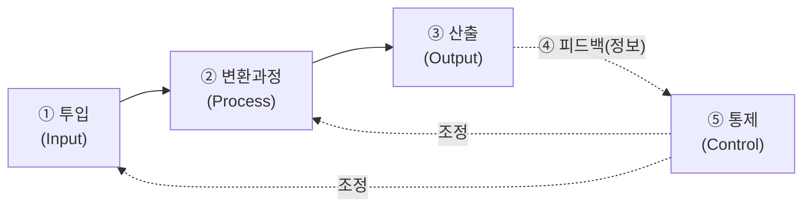
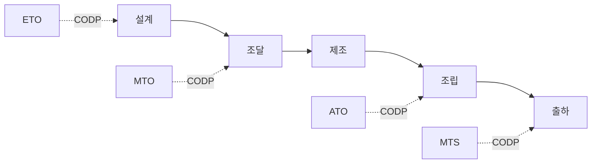
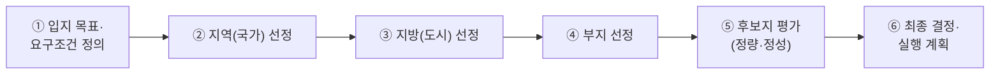
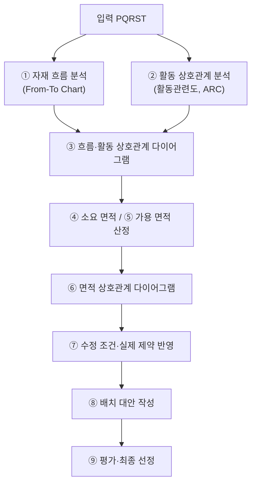
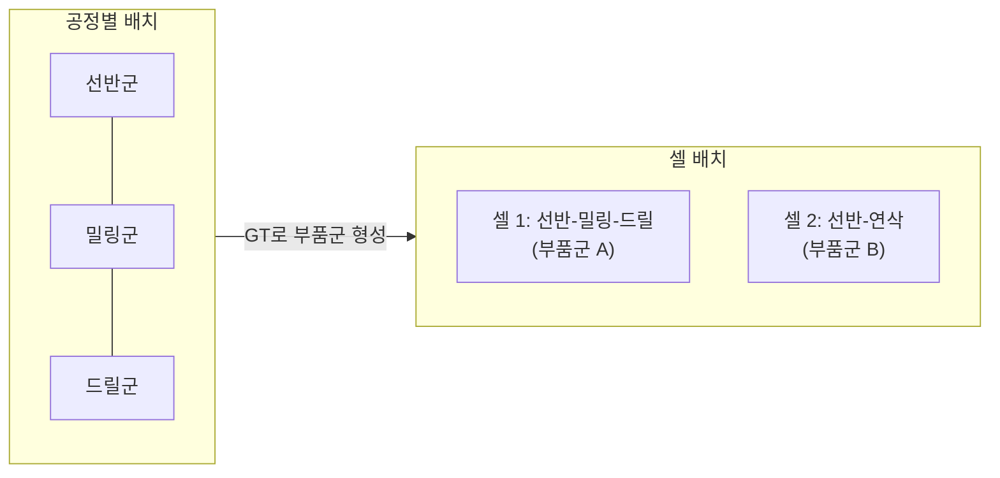

# 1.2 생산구조와 방식(Layout)

!!! info "출제기준"
    **1. 생산전략** › **2. 생산구조와 방식(Layout)**

## 출제 경향

총 **66문항** 출제 (1교시 단답형 21 · 2~4교시 논술형 45) · 최근 10개 회차(109~139회) 25문항 · 최근 출제 제139회

| 주제 | 출제 수 | 출제 회차 |
|---|:-:|---|
| 1.2.1 생산시스템의 유형과 발전(테일러·포드) | 9 | 88회, 100회, 103회, 127회, 133회, 136회, 139회 |
| 1.2.2 주문 형태별 생산방식(MTS·ATO·MTO·ETO) | 10 | 65회, 70회, 73회, 79회, 88회, 94회, 100회, 115회, 121회 |
| 1.2.3 공장입지 선정 | 11 | 63회, 65회, 70회, 73회, 79회, 85회, 100회, 103회, 112회, 121회, 139회 |
| 1.2.4 설비배치의 기본 유형 | 10 | 68회, 76회, 88회, 97회, 121회, 124회, 133회, 136회, 139회 |
| 1.2.5 SLP·P-Q 분석·활동관련도 | 9 | 63회, 67회, 70회, 76회, 85회, 91회, 121회, 124회 |
| 1.2.6 셀 생산·GT·U라인 | 11 | 65회, 67회, 76회, 85회, 106회, 109회, 124회, 127회, 130회, 133회, 139회 |
| 1.2.7 다품종 소량생산과 모듈 생산 | 6 | 63회, 70회, 79회, 109회, 112회 |

## 목차

1. [생산시스템의 유형과 발전(테일러·포드)](#t12-1)
2. [주문 형태별 생산방식(MTS·ATO·MTO·ETO)](#t12-2)
3. [공장입지 선정](#t12-3)
4. [설비배치의 기본 유형](#t12-4)
5. [SLP·P-Q 분석·활동관련도](#t12-5)
6. [셀 생산·GT·U라인](#t12-6)
7. [다품종 소량생산과 모듈 생산](#t12-7)

## 1.2.1 생산시스템의 유형과 발전(테일러·포드) {#t12-1}

### 생산시스템의 모형 (103회)

생산시스템은 투입물을 변환해 가치 있는 산출물을 만드는 시스템이다. 프로세스 관점의 **5가지 기본요소**는 다음과 같다.

| 요소 | 의미 | 구내식당 예시 |
|---|---|---|
| ① 투입 | 인력·자재·설비·자본·정보(4M+I) | 식자재, 조리사·영양사, 주방 설비, 메뉴 정보 |
| ② 변환과정 | 물리적·화학적 가공, 조립, 서비스 제공 | 손질 → 조리 → 배식 |
| ③ 산출 | 제품·서비스 | 식사 제공, 고객 만족 |
| ④ 피드백 | 산출 결과에 대한 정보 수집 | 만족도 조사, 잔반량, 식수 인원 |
| ⑤ 통제 | 목표 대비 차이를 분석해 투입·과정을 조정 | 메뉴·식자재 발주량 조정, 위생·원가 관리 |

### 생산시스템의 기본유형 (100회·139회)

제품의 **다양성(Variety)과 생산량(Volume)**에 따라 다음과 같이 나눈다.

| 유형 | 다양성/생산량 | 특징 | 제조 사례 |
|---|---|---|---|
| 프로젝트 생산 | 단일품/극소량 | 제품이 고정되고 자원이 이동, 일정관리 중심 | 선박, 플랜트, 교량 |
| 개별 생산(Job Shop) | 다품종/소량 | 범용설비, 공정별 배치, 숙련공, 주문생산 | 금형, 특수 기계, 시제품 |
| 배치 생산(Batch) | 중품종/중량 | 로트 단위로 반복 생산, 준비교체 발생 | 의약품, 기계부품, 의류 |
| 라인(대량) 생산 | 소품종/대량 | 전용설비, 제품별 배치, 흐름작업 | 자동차, 가전, 휴대폰 |
| 연속 생산 | 단일품/초대량 | 장치산업, 24시간 연속 가동, 자동화 | 정유, 석유화학, 제지, 철강 |

139회처럼 **4가지**로 물으면 프로젝트를 빼고 개별·배치·라인·연속으로 답한다.

### 단속생산과 연속생산 (133회)

| 특성 | 단속생산(Intermittent) | 연속생산(Continuous) |
|---|---|---|
| 생산시기 | 주문생산(MTO) | 예측(계획)생산(MTS) |
| 품종과 생산량 | 다품종 소량 | 소품종 대량 |
| 생산속도 | 느림, 정체·대기 많음 | 빠름, 흐름이 일정 |
| 단위당 생산원가 | 높음 | 낮음(규모의 경제) |
| 기계설비 | 범용설비, 공정별 배치 | 전용설비, 제품별 배치 |

### 테일러 시스템과 포드 시스템 (103·127·133·136회)

| 구분 | 테일러 시스템(과학적 관리법) | 포드 시스템(대량생산방식) |
|---|---|---|
| 시기·인물 | F. W. Taylor, 1911 『과학적 관리의 원칙』 | H. Ford, 1913 하이랜드파크 공장 |
| 핵심 | **과업관리**: 시간·동작 연구로 하루 표준작업량(과업) 설정 | **동시관리**: 컨베이어 라인으로 전 공정을 같은 속도로 동기화 |
| 주요 내용 | 시간연구·동작연구, 차별적 성과급제, 기능식 직장제도, 작업지도표, 과학적 선발·훈련 | 이동조립법(컨베이어), 생산 표준화 3S, 고임금·저가격(Fordism), 대량생산 |
| 장점 | 작업의 과학화·표준화, 능률 향상, 표준시간 개념 확립 | 원가 대폭 절감(T형 차 가격 인하), 생산성 향상, 대중 소비 시대 개막 |
| 단점 | 인간을 기계처럼 취급, 노동 강화, 노동조합의 반발, 개인 단위 관리 | 아래 결점 참고 |

**포드의 생산 표준화 3원칙(3S)**

1. **표준화(Standardization)**: 부품·제품·작업방법의 규격 통일, 호환성 부품
2. **단순화(Simplification)**: 제품 종류와 작업 내용의 단순화(T형 단일 차종)
3. **전문화(Specialization)**: 설비·공구·작업자의 전문화, 분업

**포드 시스템의 결점과 대안**

| 결점 | 대안 |
|---|---|
| 제품 다양성 부족(단일 차종) → 다양한 고객 요구에 대응 불가 | 혼류생산, 모듈 생산, 대량맞춤생산 |
| 전용설비로 설비가 고정 → 모델 변경 시 막대한 비용, 유연성 결여 | 유연생산시스템(FMS), 범용·소형 설비 |
| 단순 반복 작업 → 노동 소외, 단조로움, 이직·결근 증가 | 직무확대·직무충실화, 다기능화, 자율작업팀 |
| 한 공정 정지 시 전체 라인 정지, 라인 불균형 손실 | 라인밸런싱, 셀 생산, 자働化(이상 시 정지·개선) |
| 거대한 고정비 → 불황·수요 감소에 취약 | 적정 규모 설비, JIT·린 생산, 외주 활용 |
| 대량 재고·품질 문제의 사후 검사 | JIT, 품질의 공정 내 확보(TQM) |

### 생산시스템의 발전 흐름

| 시기 | 생산 패러다임 | 핵심 개념 | 경쟁 초점 |
|---|---|---|---|
| ~19세기 | 수공업 생산 | 숙련공의 개별 제작 | 품질(장인 기술) |
| 1910년대 | 과학적 관리(테일러) | 과업관리, 표준시간 | 작업 능률 |
| 1910~60년대 | 대량생산(포드) | 3S, 컨베이어 동시관리 | 원가(규모의 경제) |
| 1970~80년대 | 도요타 생산방식·린 | JIT, 자働化, 낭비 제거 | 원가 + 품질 + 유연성 |
| 1990년대 | 대량맞춤·셀 생산·FMS | 모듈화, 지연 차별화 | 고객화 + 속도 |
| 2010년대~ | 스마트공장(Industry 4.0) | CPS, IoT, AI, 디지털 트윈 | 데이터 기반 자율 최적화, 지속가능성 |

테일러의 과학적 관리법은 [5.1.8](../05-work-measurement/01-method-time-study.md#t51-8), TPS·린은 [7.4.1](../07-support-technology/04-production-innovation.md#t74-1), 스마트공장은 [7.1.2](../07-support-technology/01-it-smart-factory.md#t71-2)에서 자세히 다룬다. 88회 포지셔닝(공정중심·제품중심) 문제는 [1.1.4](01-competitive-strategy.md#t11-4)의 비교표로 답한다.

!!! tip "답안 작성 포인트"
    - 포드 시스템은 최근 5년 동안 3번(127·133·136회) 나왔다. **3S → 동시관리 → 결점 → 대안** 표를 통째로 외운다.
    - 결점-대안을 **1:1로 짝지은 표**가 채점자에게 가장 잘 읽힌다. 결론에서 "포드 시스템 → 도요타 생산방식(TPS) → 셀 생산·대량맞춤생산"으로의 발전 흐름을 언급한다.
    - 생산시스템 모형 문제는 반드시 그림을 그리고, 문제가 준 사례(구내식당)로 표를 채운다.
    - 결론 예: "포드 시스템이 확립한 표준화·흐름생산의 원리는 지금도 유효하다. 다만 다양성과 유연성의 한계를 TPS·셀 생산·모듈화로 보완했고, 오늘날에는 스마트공장 기술로 대량생산의 효율과 개별 맞춤을 함께 달성하는 방향으로 발전하고 있다."

??? example "관련 기출 9문항 (88회, 100회, 103회, 127회, 133회, 136회, 139회)"

    - **제88회(2009) 4교시 4번** · 25점  
      생산시스템의 포지셔닝(positioning) 전략에서 공정중심전략(process focus strategy)과 제품중심전략(product focus strategy)의 차이점과 각각에 적합한 제품군을 설명하시오.
    - **제100회(2013) 1교시 11번** · 10점  
      생산시스템의 5가지 기본유형
    - **제103회(2014) 2교시 1번** · 25점  
      생산시스템의 모형을 프로세스 관점에서 5가지 기본요소로 나누어 그림으로 나타내고, 각 기본요소에 대해 회사 구내식당을 예로 들어 설명하시오.
    - **제103회(2014) 4교시 5번** · 25점  
      포드시스템은 생산표준화를 중심으로 대량생산의 동적 논리를 실증하였음은 생산관리 합리화의 견지에서 볼 때 높이 평가할 만하다. 반면 포드시스템은 커다란 결점도 가지고 있다. 이러한 결점 사항들을 요약하여 설명하고, 대안을 제시하시오.
    - **제127회(2022) 1교시 1번** · 10점  
      테일러(F. W. Taylor)의 과학적 관리와 포드(H. Ford) 대량생산방식의 주요 내용과 각각의 장·단점
    - **제133회(2024) 1교시 1번** · 10점  
      헨리 포드의 생산 표준화 및 포드시스템의 결점과 대안
    - **제133회(2024) 4교시 4번** · 25점  
      단속생산과 연속생산을 5가지 특성(생산시기, 품종과 생산량, 생산속도, 단위당 생산 원가, 기계설비)으로 각각 비교하여 설명하시오.
    - **제136회(2025) 3교시 2번** · 25점  
      포드(Ford)시스템의 생산표준화 3원칙과 포드 대량 생산시스템이 지닌 단점(결점)을 설명하시오.
    - **제139회(2026) 3교시 3번** · 25점  
      생산활동별 생산방식을 제품의 다양성(Variety)과 생산량(Volume)을 기준으로 크게 4가지로 분류하고, 각 생산방식에 대한 특징과 주요 제조 사례를 설명하시오.

## 1.2.2 주문 형태별 생산방식(MTS·ATO·MTO·ETO) {#t12-2}

### 고객주문 분리점(CODP)에 따른 생산방식

**고객주문 분리점(CODP, Customer Order Decoupling Point)**은 예측에 따라 움직이는 활동과 고객 주문에 따라 움직이는 활동이 나뉘는 지점이다. CODP가 어디에 있느냐(어디에 재고를 두느냐)에 따라 생산방식이 달라진다.

| 구분 | ETO(주문설계생산) | MTO(주문생산) | ATO(주문조립생산) | MTS(계획생산) |
|---|---|---|---|---|
| 개념 | 주문을 받은 뒤 **설계부터** 시작 | 표준 설계로 **주문 후 제조** 착수 | 모듈·부품을 미리 만들어 두고 **주문 후 조립** | 수요예측으로 **완제품을 미리 생산**해 재고에서 출하 |
| 재고 위치 | 거의 없음 | 원자재 | 모듈·반제품 | 완제품 |
| 고객 리드타임 | 매우 김 | 김 | 짧음 | 즉시 |
| 고객화 정도 | 매우 높음 | 높음 | 중간(옵션 조합) | 낮음(표준품) |
| 주요 경쟁요소 | 설계·기술력, 품질, 프로젝트 관리 | 고객화, 납기 준수, 유연성 | 납기 속도 + 다양성 | 원가, 제품 가용성(즉납) |
| 고객수요 만족 방법 | 고객과 공동 설계, 프로젝트 일정관리(PERT/CPM) | 정확한 납기 약속, 생산능력·일정 관리 | 모듈화·공용화, 모듈 재고의 수요예측, 신속한 최종 조립 | 정확한 수요예측, 안전재고, 유통망 관리 |
| 핵심 관리 대상 | 설계 리드타임 | 주문잔고·생산능력 | 모듈 재고와 최종 조립 능력 | 완제품 재고 수준 |
| 예 | 선박, 플랜트, 특수 설비 | 산업용 기계, 맞춤 가구 | PC(델), 자동차 옵션, 레스토랑 | 생활용품, 식음료, 가전 표준품 |

### ATO와 MTS 비교 (70회)

- **MTS**는 재고로 즉시 공급할 수 있지만, 예측이 틀리면 **재고 과잉이나 품절**이 생기고 품목이 늘수록 재고 부담이 급증한다.
- **ATO**는 모듈 수준에서 재고를 두므로 **적은 재고로 많은 최종 제품 조합**을 공급할 수 있다(예: 모듈 10종 × 3단계 = 1,000가지 조합). 단, 최종 조립 능력과 모듈 표준화가 전제된다.
- 수요 변동이 크고 제품 변형이 많을수록 MTS → ATO로 옮기는 것이 유리하다(지연 차별화 전략).

### CODP 위치 결정과 Push-Pull

- CODP **상류**는 예측 기반 Push(규모의 경제·효율), **하류**는 주문 기반 Pull(고객화·대응성)로 운영한다. 공급체인 관점의 Push-Pull 경계는 [2.3.3](../02-operations-logistics/03-scm.md#t23-3)과 같은 개념이다.
- CODP를 고객 쪽(MTS)으로 옮길수록 리드타임은 짧아지지만 재고 위험이 커지고, 상류(ETO·MTO)로 옮길수록 재고는 줄지만 리드타임이 길어진다.
- **결정 기준**: 고객 허용 리드타임(D)과 생산 리드타임(P)의 비교. \( P/D \le 1 \)이면 MTO가 가능하고, \( P/D > 1 \)이면 그 차이만큼의 공정을 예측으로 미리 진행해야 한다(CODP를 하류로 이동).
- 같은 공장에서도 제품군별로 MTS·ATO·MTO를 혼용하는 **하이브리드 운영**이 일반적이다.

!!! tip "답안 작성 포인트"
    - 이 주제는 10점·25점으로 10번 출제됐다. **CODP 그림 + 4방식 비교표**가 정답의 뼈대다.
    - 100·121회는 문장이 똑같은 반복 출제다. "고객수요 만족 방법"과 "주요 경쟁요소" 행을 반드시 표에 넣는다.
    - 10점 단답형은 개념, 재고 위치, 경쟁요소, 예시의 네 줄로 정리한다.
    - 결론 예: "생산방식은 고객 허용 리드타임과 생산 리드타임의 비(P/D)로 정해지는 CODP 선택 문제다. 모듈화와 지연 차별화로 CODP를 최적 위치에 두고, 제품군별로 생산방식을 혼용해 재고와 납기의 균형을 잡아야 한다."

??? example "관련 기출 10문항 (65회, 70회, 73회, 79회, 88회, 94회, 100회, 115회, 121회)"

    - **제65회(2001) 1교시 11번** · 10점  
      ATO(Assemble to Order)
    - **제70회(2003) 1교시 13번** · 10점  
      MTO(Make to Order)
    - **제70회(2003) 4교시 1번** · 25점  
      주문조립(assemble to order) 전략과 예측생산(make to stock) 전략을 비교하여 설명하시오
    - **제73회(2004) 1교시 12번** · 10점  
      MTO(Make To Order)
    - **제79회(2006) 1교시 9번** · 10점  
      MTS(Make to Stock)
    - **제88회(2009) 1교시 8번** · 10점  
      MTO(Make To Order), ATO(Assembly To Order), MTS(Make To Stock)를 비교 설명하시오.
    - **제94회(2011) 2교시 3번** · 25점  
      다음 제시한 3가지 생산전략의 기본개념에 대하여 설명하시오.

        ??? quote "문제 전문"

            다음 제시한 3가지 생산전략의 기본개념에 대하여 설명하시오.  
            \- ATO(Assembly To Order)  
            \- MTO(Make To Order)  
            \- MTS(Make To Stock)  
    - **제100회(2013) 2교시 6번** · 25점  
      생산전략의 일환으로 고객요구 납기에 따른 생산방식은 4종류가 있다. 각 생산방식별 고객수요를 만족시키기 위한 방법과 주요 경쟁요소에 대하여 설명하시오.
    - **제115회(2018) 3교시 5번** · 25점  
      ETO(Engineering To Oder), ATO(Assembly To Order), MTO(Make To Oder), MTS(Make To Stock)의 기본 개념과 주요 경쟁요소를 설명하시오.
    - **제121회(2020) 4교시 5번** · 25점  
      생산전략의 일환으로 고객요구 납기에 따른 생산방식은 4가지가 있다. 각 생산방식별 고객수요를 만족시키기 위한 방법과 주요 경쟁요소에 대하여 설명하시오.

## 1.2.3 공장입지 선정 {#t12-3}

### 입지 요인 (63·73·103·112회)

| 구분 | 입지 요인 |
|---|---|
| 자연적 요인 | 기후, 지형·지질, 용수(공업용수), 부지 면적·확장성, 자연재해 위험 |
| 경제적 요인 | 시장 근접성, 원자재 조달, 노동력(양·질·임금), 수송 여건(도로·항만·철도), 용지 가격, 에너지·유틸리티, 세제·투자 인센티브, 관련 산업 집적(클러스터) |
| 사회적 요인 | 지역사회의 태도, 법규·용도지역 규제, 환경 규제, 노사관계, 생활환경(주거·교육·의료), 정치적 안정성 |

**산업 특성별 지향성**: 원료 지향(시멘트, 제철) / 시장 지향(음료, 제빵) / 노동 지향(섬유, 조립) / 동력 지향(알루미늄) / 집적 지향(반도체, 자동차 부품)

### 입지 선정 과정 (79회)

### 입지 평가 기법

| 기법 | 내용 |
|---|---|
| **요인평가법(Factor Rating)** | 입지 요인별 가중치를 정하고 후보지마다 요인 점수를 매긴 뒤 **가중 합계**가 가장 큰 곳을 선택 |
| 손익분기 입지분석 | 후보지별 고정비·변동비로 총비용 직선을 그려 생산량 구간별 최저비용 입지를 결정 |
| 무게중심법 | 수요지 좌표와 물동량으로 수송비를 최소화하는 위치 계산: \( C_x = \dfrac{\sum d_{ix} V_i}{\sum V_i},\ C_y = \dfrac{\sum d_{iy} V_i}{\sum V_i} \) |
| 수송계획법 | 여러 공장·수요지 간 총수송비를 최소화하는 입지 결정 |
| AHP | 정성 요인이 많을 때 쌍대비교로 가중치와 대안을 평가 |

**손익분기 입지분석**: 후보지 \( i \)의 총비용 \( TC_i = F_i + v_i Q \). 두 후보지의 총비용이 같아지는 교차 생산량은 \( Q = \dfrac{F_2 - F_1}{v_1 - v_2} \)이며, 예상 생산량이 어느 구간에 속하는지로 입지를 고른다([6.1.2](../06-cost-engineering-economy/01-feasibility.md#t61-2)). 수송계획법은 [6.4.2](../06-cost-engineering-economy/04-operations-research.md#t64-2), AHP는 [6.4.4](../06-cost-engineering-economy/04-operations-research.md#t64-4)를 참고한다.

### 요인평가법 풀이 (85회)

가중치: 원자재 0.30, 노동력 0.35, 시장 0.15, 부지가격 0.20

| 요인(가중치) | 부산 | 대구 | 인천 | 광주 | 대전 |
|---|:-:|:-:|:-:|:-:|:-:|
| 원자재 조달 (0.30) | 4 → 1.20 | 8 → 2.40 | 9 → 2.70 | 6 → 1.80 | 5 → 1.50 |
| 노동력 확보 (0.35) | 7 → 2.45 | 6 → 2.10 | 5 → 1.75 | 8 → 2.80 | 7 → 2.45 |
| 시장 근접도 (0.15) | 9 → 1.35 | 5 → 0.75 | 7 → 1.05 | 8 → 1.20 | 6 → 0.90 |
| 부지 가격 (0.20) | 4 → 0.80 | 5 → 1.00 | 6 → 1.20 | 7 → 1.40 | 6 → 1.20 |
| **가중 합계** | 5.80 | 6.25 | 6.70 | **7.20** | 6.05 |

→ **광주(7.20점)**를 최종 입지로 선정한다. 다음 순위는 인천(6.70)이다.

### 요인평가법 풀이 (121회)

점수 환산: 우수 10, 좋음 8, 보통 6, 나쁨 4 / 투자이익률 20% → 10, 15% → 8, 10% → 6

| 입지요인(가중치) | 가 | 나 | 다 |
|---|:-:|:-:|:-:|
| 지역사회의 태도 (0.2) | 10 → 2.0 | 8 → 1.6 | 6 → 1.2 |
| 노동력의 공급 (0.2) | 6 → 1.2 | 8 → 1.6 | 10 → 2.0 |
| 수송의 편의성 (0.2) | 6 → 1.2 | 6 → 1.2 | 8 → 1.6 |
| 생활비 수준 (0.1) | 4 → 0.4 | 10 → 1.0 | 6 → 0.6 |
| 공급업자 근접성 (0.1) | 8 → 0.8 | 4 → 0.4 | 10 → 1.0 |
| 예상 투자이익률 (0.2) | 8 → 1.6 | 10 → 2.0 | 6 → 1.2 |
| **가중 합계** | 7.2 | **7.8** | 7.6 |

→ **나 입지(7.8점)**가 가장 바람직하다. 단, 다 입지(7.6)와 차이가 작으므로 가중치를 바꿔 보는 **민감도 분석**과 정성 요인 검토를 덧붙이면 좋다.

### 해외 입지 (70·100·139회)

**해외 생산의 이유**: 생산원가 절감(인건비·세제), 현지 시장 접근과 고객 대응, 무역장벽(관세·쿼터) 회피, 자원·원자재 확보, 기술·인재 획득, 환율 위험 분산

| 고려 요소 | 세부 고려사항 |
|---|---|
| 원가 | 인건비와 상승률, 물류비, 세금·투자 인센티브, 에너지 비용 |
| 품질 | 인력의 숙련도·교육 수준, 현지 협력업체의 역량, 품질 인프라 |
| 물류 | 항만·도로 인프라, 시장·본사까지의 리드타임, 통관 효율 |
| 법규·제도 | 외국인 투자법, 노동법, 환경 규제, FTA·원산지 규정, 지식재산권 보호 |
| 정치·경제 리스크 | 정치 안정성, 환율 변동, 송금 제한, 공급망 리스크(지정학) |
| 사회·문화 | 언어·관습, 노사 문화, 주재원 생활 여건 |

**해외 진출의 단계별 의사결정 프로세스 (139회)**: ① 진출 목적·전략 수립 → ② 후보 국가 선정(거시환경 분석: PEST, 시장·원가) → ③ 지역·부지 선정(요인평가법) → ④ 진출 형태 결정(수출 → 라이선싱 → 합작투자 → 단독투자 순으로 통제력·위험 증가) → ⑤ 사업 타당성·경제성 분석 → ⑥ 실행과 현지화(인력·공급망 구축)

**서비스 시설 입지 예 – 자동차 정비공장 (65회)**: 고객 접근성(교통량, 도로 접근), 가시성, 부지 면적·형상(작업장·주차 공간), 용도지역과 환경 규제(폐유·소음), 부품 공급 여건, 경쟁 업소 분포, 인력 확보

!!! tip "답안 작성 포인트"
    - 계산 문제(85·121회)는 **가중 점수표**를 그리고 최고점 대안을 고른 뒤, 민감도 분석이나 정성 요인 검토로 한 줄 보완한다.
    - 해외 입지는 문제가 제시한 축(원가·품질·물류·법규)을 표의 행으로 그대로 쓰고, 최근 경향인 **공급망 리스크·ESG 규제(탄소국경조정 등)**를 덧붙인다.
    - 최근 키워드: 리쇼어링·니어쇼어링·프렌드쇼어링(공급망 재편), 재생에너지 조달 가능성(RE100), 현지 생산 요건(원산지 규정·보조금 조건)
    - 결론 예: "입지는 한번 정하면 수십 년간 원가 구조를 결정하는 구조적 의사결정이다. 정량 평가(요인평가법·손익분기)에 정성 리스크(지정학·ESG 규제)를 더하고, 시나리오별 민감도 분석으로 결정의 견고성을 확인해야 한다."

??? example "관련 기출 11문항 (63회, 65회, 70회, 73회, 79회, 85회, 100회, 103회, 112회, 121회, 139회)"

    - **제63회(2001) 2교시 2번** · 25점  
      공장입지 선정시 고려해야 할 자연, 경제, 사회적 요인을 구체적으로 열거하시오.
    - **제65회(2001) 3교시 4번** · 25점  
      귀하가 자동차 정비 공장을 세운다면 공장부지의 평가요소를 설명하시오.
    - **제70회(2003) 2교시 6번** · 25점  
      해외에 생산(사업) 입지를 정할 때 고려해야 할 사항에 대하여 설명하시오.
    - **제73회(2004) 2교시 5번** · 25점  
      공장 입지 결정에 영향을 미치는 요인들에 대하여 설명하시오.
    - **제79회(2006) 4교시 1번** · 25점  
      공장입지 선정과정을 설명하시오.
    - **제85회(2008) 2교시 1번** · 25점  
      국내 식품가공 업체인 B사는 지방에 공장을 증축하려고 한다. 현지답사 등을 통한 기초 조사 후 부산, 대구, 인천, 광주, 대전 다섯 군데가 후보지로 결정되었다. 공장 입지선정을 위한 의사결정 요인으로 원자재 조달, 노동력 확보, 시장 근접도, 공장부지 가격을 선정하였으며, 각각의 요인에 대해 0.3, 0.35, 0.15, 0.2의 가중치를 두었다. 각 후보지에 대하여 요인별로 0점에서부터 10점까지로 평가되어 해당 점수가 다음과 같이 주어졌을 때, 공장 후보지의 최종 대안을 결정하시오.

        ??? quote "문제 전문"

            국내 식품가공 업체인 B사는 지방에 공장을 증축하려고 한다. 현지답사 등을 통한 기초 조사 후 부산, 대구, 인천, 광주, 대전 다섯 군데가 후보지로 결정되었다. 공장 입지선정을 위한 의사결정 요인으로 원자재 조달, 노동력 확보, 시장 근접도, 공장부지 가격을 선정하였으며, 각각의 요인에 대해 0.3, 0.35, 0.15, 0.2의 가중치를 두었다. 각 후보지에 대하여 요인별로 0점에서부터 10점까지로 평가되어 해당 점수가 다음과 같이 주어졌을 때, 공장 후보지의 최종 대안을 결정하시오.  
            [표] 요인 | 가중치 | 부산 | 대구 | 인천 | 광주 | 대전  
            원자재 조달 | 0.30 | 4 | 8 | 9 | 6 | 5  
            노동력 확보 | 0.35 | 7 | 6 | 5 | 8 | 7  
            시장 근접도 | 0.15 | 9 | 5 | 7 | 8 | 6  
            공장부지 가격 | 0.20 | 4 | 5 | 6 | 7 | 6  
    - **제100회(2013) 4교시 1번** · 25점  
      해외에서 생산(사업)을 하는 이유와 해외생산(사업)의 공장입지를 선정할 때 고려사항(원가, 품질, 물류, 법규 등)에 대하여 설명하시오.
    - **제103회(2014) 1교시 10번** · 10점  
      시설입지를 결정하는데 고려해야 할 요소에 대하여 7가지만 설명하시오.
    - **제112회(2017) 1교시 13번** · 10점  
      제조공장의 입지요인
    - **제121회(2020) 3교시 5번** · 25점  
      부품 회사에서 새로운 공장시설의 입지로 세 가지 대안(가, 나, 다)을 고려하고 있다. 각 대안에 대한 자료는 아래와 같다. 10점 만점으로 하여 우수 = 10, 좋음 = 8, 보통 = 6, 나쁨 = 4로 하고 투자이익률도 같은 원리로 20% = 10, 15% = 8, 10% = 6점의 점수를 부여하기로 한다. 다음 물음에 답하시오.

        ??? quote "문제 전문"

            부품 회사에서 새로운 공장시설의 입지로 세 가지 대안(가, 나, 다)을 고려하고 있다. 각 대안에 대한 자료는 아래와 같다. 10점 만점으로 하여 우수 = 10, 좋음 = 8, 보통 = 6, 나쁨 = 4로 하고 투자이익률도 같은 원리로 20% = 10, 15% = 8, 10% = 6점의 점수를 부여하기로 한다. 다음 물음에 답하시오.  
            [표] 입지요인 | 가중치 | 가 | 나 | 다 (공장시설의 입지)  
            (1) 지역사회의 태도 | 0.2 | 우수 | 좋음 | 보통  
            (2) 노동력의 공급 | 0.2 | 보통 | 좋음 | 우수  
            (3) 수송의 편의성 | 0.2 | 보통 | 보통 | 좋음  
            (4) 생활비수준 | 0.1 | 나쁨 | 우수 | 보통  
            (5) 공급업자에의 근접성 | 0.1 | 좋음 | 나쁨 | 우수  
            (6) 예상투자이익률 | 0.2 | 15% | 20% | 10%  
            1) 요인평가법의 개념에 대하여 설명하시오.  
            2) 각 입지에 대하여 평가 점수를 구하시오.  
            3) 어떤 대안이 가장 바람직한지 평가하시오.  
    - **제139회(2026) 2교시 3번** · 25점  
      해외공장 입지를 선정할 때 고려해야 할 핵심 요소를 선정하여 요소별 고려 사항을 설명하고, 해외 진출의 단계별 의사결정 프로세스를 설명하시오.

## 1.2.4 설비배치의 기본 유형 {#t12-4}

### 설비배치의 기본 유형

| 구분 | 제품별 배치(Product, 라인) | 공정별 배치(Process, 기능) | 위치고정형 배치(Fixed Position) | 혼합형 배치(그룹·셀) |
|---|---|---|---|---|
| 개념 | 제품의 공정 순서대로 설비를 일렬 배치 | 같은 기능의 설비를 한곳에 모아 배치 | 제품은 고정, 자원(인력·설비)이 이동 | 유사 부품군 가공에 필요한 설비를 셀로 묶어 배치 |
| 생산형태 | 소품종 대량, 연속생산 | 다품종 소량, 단속생산 | 단일품, 프로젝트 생산 | 중품종 중량 |
| 생산물의 흐름 | 단순·일정, 일방향 | 복잡·불규칙, 역류 발생 | 흐름 없음(자원이 이동) | 셀 내 단순 흐름 |
| 운반비용 | 낮음(자동 운반) | 높음 | 자원 이동 비용 발생 | 중간 |
| 시설이용률 | 낮음(라인 불균형 시) | 높음(설비 공유) | 낮음 | 중간 |
| 생산설비 | 전용설비 | 범용설비 | 이동식 범용설비 | 소형·범용설비 |
| 예 | 자동차 조립, 음료 | 기계가공 공장, 병원 | 조선, 항공기, 건설 | 부품 가공 셀 |

### 유형별 장점과 단점 (88·121·139회)

| 유형 | 장점 | 단점 |
|---|---|---|
| 제품별 | ① 단위원가 낮음 ② 재공재고·운반 최소 ③ 공정관리·훈련이 단순 | ① 제품 변경에 비유연 ② 한 설비 고장 시 전체 정지 ③ 단조로운 작업, 설비투자 큼 |
| 공정별 | ① 다양한 제품에 유연 ② 범용설비로 투자 적음 ③ 설비 고장 영향이 작고 숙련도 향상 | ① 운반비·재공재고 큼 ② 일정계획·공정관리 복잡 ③ 리드타임 길고 단위원가 높음 |
| 위치고정형 | ① 제품 이동이 없어 파손 위험 적음 ② 설계 변경에 유연 ③ 작업자의 성취감 | ① 인력·설비 이동 비용 ② 작업 공간 제약과 설비 이용률 낮음 ③ 일정 조정이 어려움 |
| 혼합형(셀) | ① 리드타임·재공 단축 ② 다품종에 대응하면서 흐름생산 효과 ③ 품질 책임 명확 | ① 부품군 형성이 어려움 ② 설비 중복 투자 ③ 다기능공 필요 |

### 수요 구조와 배치방식의 적합성 (76·97회)

| 수요 패턴 | 적합한 배치 | 공정관리 특징 |
|---|---|---|
| 극소량(단일품) | 위치고정형 | 프로젝트 관리(PERT/CPM), 자원 일정 조정 |
| 다품종 소량 | 공정별 | 개별 일정계획, 작업순서 결정, 진도관리, 재공 관리가 핵심 |
| 중품종 중량 | 혼합형(GT·셀) | 부품군별 일정계획, 셀 단위 자율관리 |
| 소품종 다량·표준품 대량 | 제품별 | 라인밸런싱, 흐름 관리, 단순한 일정계획 |

### 설비배치의 원칙 (139회)

1. **종합적 조화의 원칙**: 사람·자재·설비·공간을 전체 최적으로 통합
2. **최단 거리의 원칙**: 운반 거리를 최소화
3. **흐름의 원칙**: 역류·정체 없이 공정 순서대로 원활하게 흐르도록
4. **입체 공간 활용의 원칙**: 높이를 포함한 공간을 효율적으로 사용
5. **안전·만족의 원칙**: 작업자의 안전과 쾌적한 작업환경
6. **유연성의 원칙**: 제품·수량 변화와 확장에 쉽게 대응

**라인밸런스 효율(139회 3번)**

\[
E_b = \frac{\sum t_i}{n \times C} \times 100\%,\qquad \text{불균형 손실률} = 1 - E_b
\]

\( \sum t_i \): 작업요소 시간의 합, \( n \): 작업장 수, \( C \): 사이클타임(가장 긴 작업장 시간 또는 피치타임). 예: 작업 시간 합 40분, 작업장 5개, 사이클타임 10분이면 \( E_b = 40/(5 \times 10) = 80\% \), 불균형 손실률 20%. 자세한 계산은 [3.2.3 라인밸런싱](../03-process-control/02-process-design.md#t32-3)에서 다룬다.

### 경제적 관점에서 본 Job Shop 배치 (124회)

- **비용이 적은 부분**: 범용설비라 초기 투자가 작고, 설비를 공유하므로 이용률이 높다.
- **비용이 많은 부분**: 운반비, 재공재고 보유비, 일정계획·진도관리 같은 관리비, 준비교체 손실, 숙련 인건비가 커서 **단위원가가 높다**.
- 손익분기 관점에서 고정비는 낮고 변동비는 높으므로 **생산량이 적을 때 유리**하다.

### 소기업 신규공장 배치 계획의 고려 요소 (68회)

제품과 생산량(P-Q 분석), 공정 흐름, 설비의 종류·크기, 인원과 작업 공간, 운반 방법, 원자재·제품 보관 공간, 유틸리티(전기·용수·공기), 안전·소방·환경 법규, 향후 확장성, 예산

### 설비배치의 최근 경향

| 경향 | 내용 |
|---|---|
| 재구성 가능 배치 | 이동식 설비·모듈형 작업대·AGV/AMR 운반으로 제품 변경 시 배치를 빠르게 재구성 |
| 디지털 트윈 배치 시뮬레이션 | 3D 모델과 공정 시뮬레이션으로 병목·동선·안전을 사전 검증 후 시공 |
| 혼류·셀 혼합형 | 라인의 효율과 셀의 유연성을 결합한 하이브리드 배치 |
| 안전·인간공학·ESG | 협동로봇 작업 공간 분리, 에너지 동선 최소화, 작업자 부담 감소 |

!!! tip "답안 작성 포인트"
    - 설비배치는 최근 4회 연속 출제(124·133·136·139회)된 **최빈출 주제**다. 비교표 하나에 개념·5특성·장단점·예시를 담는 연습을 한다.
    - 133회처럼 비교 기준(5개 특성)을 주면 그 기준을 표의 행으로 그대로 쓴다.
    - 유형마다 간단한 배치 그림(일렬 / 기능별 블록 / 중앙 고정 / 셀)을 그리면 고득점에 유리하다.
    - 결론 예: "배치는 P-Q 분석으로 품목군별 수요 구조를 파악해 정해야 하며, 한 공장 안에서도 A군은 라인, B군은 셀, C군은 공정별로 혼합 배치하는 것이 현실적이다. 디지털 트윈으로 사전 검증하고 재구성 가능한 배치로 변화에 대비해야 한다."

??? example "관련 기출 10문항 (68회, 76회, 88회, 97회, 121회, 124회, 133회, 136회, 139회)"

    - **제68회(2002) 2교시 2번** · 25점  
      대량생산방식(Mass. Production System)과 개별 생산방식(Job-Shop Production System)에 적합한 공장배치 형태를 비교하여 설명하시오.
    - **제68회(2002) 4교시 3번** · 25점  
      종업원 40명 정도인 소기업이 신규공장을 건축하기 위하여 공장배치 계획을 수립중이다. 이때 고려해야 할 요소들을 설명해보시오.
    - **제76회(2005) 4교시 5번** · 25점  
      수요패턴(극소량, 다품종소량, 소품종다량, 표준품대량)에 따라 적합한 설비배치방식의 관계를 나타내고, 각 설비배치방식별 공정관리특징에 대하여 논하시오.
    - **제88회(2009) 4교시 2번** · 25점  
      설비배치의 기본 4가지 유형에 대해 특징과 장ㆍ단점에 대해서 설명하시오.
    - **제97회(2012) 2교시 1번** · 25점  
      생산시스템의 설계에 있어서 설비배치에 관한 다음 사항에 대하여 설명하시오.

        ??? quote "문제 전문"

            생산시스템의 설계에 있어서 설비배치에 관한 다음 사항에 대하여 설명하시오.  
            1) 설비배치 방식의 기본적인 유형  
            2) 설비배치 유형별 공정관리의 특징  
            3) 설비배치 유형별 생산제품의 형태  
            4) 제품의 수요구조와 설비배치방식 간의 적합성 관계  
    - **제121회(2020) 3교시 3번** · 25점  
      공장 설비배치에서 제품(라인)별 배치, 공정(기능)별 배치, 위치고정형(프로젝트)배치 및 혼합형(그룹)배치로 구분한다. 각각의 장점 및 단점을 설명하시오.
    - **제124회(2021) 1교시 11번** · 10점  
      경제적관점에서의 Job Shop 설비배치 특징
    - **제133회(2024) 3교시 3번** · 25점  
      설비배치의 기본유형은 제품별, 공정별, 위치고정형 배치로 구분할 수 있다. 설비배치의 기본유형을 5개의 특성(생산형태, 생산물의 흐름, 운반비용, 시설이용률, 생산설비)으로 구분하여 각각 비교 설명하시오.
    - **제136회(2025) 2교시 1번** · 25점  
      설비배치의 4가지 유형을 설명하시오.
    - **제139회(2026) 2교시 1번** · 25점  
      시설 및 설비배치에 대하여 다음의 물음에 답하시오.

        ??? quote "문제 전문"

            시설 및 설비배치에 대하여 다음의 물음에 답하시오.  
            1) 시설 및 설비배치의 일반적인 원칙을 3가지만 쓰시오.  
            2) 제품별 배치, 공정별 배치, 고정위치형 배치의 장점과 단점을 각각 3가지씩 쓰시오.  
            3) 라인밸런스 효율을 측정하는 식을 제시하고 설명하시오.  

## 1.2.5 SLP·P-Q 분석·활동관련도 {#t12-5}

### SLP(Systematic Layout Planning, 체계적 배치계획)

R. Muther(1961)가 개발한 단계적 설비배치 절차다.

**입력 요소 (PQRST, 63·70회)**

| 요소 | 의미 | 분석 내용 |
|---|---|---|
| P (Product) | 제품·자재 | 무엇을 만드는가 |
| Q (Quantity) | 생산량 | 얼마나 만드는가 (P-Q 분석) |
| R (Routing) | 공정 경로 | 어떤 순서로 만드는가 |
| S (Supporting service) | 보조 서비스 | 창고·유틸리티·사무실 등 지원 시설 |
| T (Time) | 시간 | 언제, 얼마나 빨리 만드는가 |

**SLP 절차 (67·124회)**

### 활동관련도(ARC)의 근접도 (121회)

| 기호 | 근접도 | 의미 |
|:-:|---|---|
| A | Absolutely necessary | 절대적으로 근접 필요 |
| E | Especially important | 특히 중요 |
| I | Important | 중요 |
| O | Ordinary closeness | 보통의 근접 |
| U | Unimportant | 근접 불필요 |
| X | Undesirable | 근접하면 안 됨(근접 금지) |

5가지로 물으면 A·E·I·O·U를 쓰고, X를 보충해 적는다. 근접 이유(자재 흐름, 인원 공유, 소음·안전 등)도 번호로 함께 표시한다.

### P-Q 분석 (63·76·85회)

**정의**: 품목(P)별 생산량(Q)을 큰 순서로 늘어놓은 파레토 형태의 그래프다. 품목군을 생산량에 따라 나누고, 영역마다 적합한 배치·설비 형태를 정한다.

**방법**: ① 품목별 생산량 집계 → ② 생산량 내림차순 정렬 → ③ P-Q 곡선 작성 → ④ 누적 비율로 A·B·C 영역 구분 → ⑤ 영역별 배치 결정

| 영역 | 품목 특성 | 전통적 설비배치 | 자동화 생산시스템 |
|---|---|---|---|
| A (소품종 다량) | 소수 품목이 생산량 대부분 | 제품별(라인) 배치 | 트랜스퍼 라인, 전용 자동화 라인 |
| B (중품종 중량) | 중간 | 혼합형(GT·셀) 배치 | FMS, FMC(유연생산셀) |
| C (다품종 소량) | 다수 품목, 각각 소량 | 공정별 배치 | 단독 NC·CNC 설비, 머시닝센터 |

### From-To Chart 풀이 (91회)

각 제품을 1단위씩 생산한다고 보고 공정 간 이동 횟수를 집계한다(R: 원자재, F: 완성).

| From \ To | A | B | C | F |
|:-:|:-:|:-:|:-:|:-:|
| R | 3 | | 2 | |
| A | | 3 | 1 | |
| B | | | 1 | 4 |
| C | 1 | 2 | | 1 |

기계를 일렬로 놓고 인접 간격을 1로 할 때, 배치안별 총 이동거리(이동 횟수 × 거리)는 다음과 같다.

| 배치안 | 총 이동거리 | 역류 이동 |
|---|:-:|---|
| R–A–B–C–F | 28 | C→B 2회, C→A 1회 |
| R–C–A–B–F | 26 | A→C 1회, B→C 1회 |
| **R–A–C–B–F** | **24** | B→C 1회, C→A 1회 |

→ **R–A–C–B–F** 순서가 이동거리가 가장 짧다. 이동 횟수가 많은 쌍(R→A, A→B, B→F, C→B)을 인접하게 놓고 역류를 최소화한 결과다.

### 배치 대안의 평가와 컴퓨터 기법

- **평가 기준**: 총 운반거리(흐름량 × 거리), 근접도 점수(ARC 등급 충족도), 소요 면적, 투자비, 유연성·확장성, 안전
- **컴퓨터 배치 기법**: 개선형 **CRAFT**(기존 배치에서 부서 교환으로 운반비 감소), 구성형 **CORELAP·ALDEP**(활동관련도를 바탕으로 배치를 새로 구성). 최근에는 시뮬레이션·디지털 트윈으로 대안을 비교한다.

!!! tip "답안 작성 포인트"
    - SLP는 **PQRST → 절차 흐름도 → ARC 근접도**의 세 덩어리로 쓴다. 절차 흐름도는 반드시 그림으로 그린다.
    - P-Q 분석은 곡선 그림에 A·B·C 영역을 표시하고, 영역별 배치를 "전통 배치 / 자동화 시스템" 두 열로 대응시킨다(63·85회 공통).
    - From-To 문제는 **이동 횟수표 → 배치안별 이동거리 비교 → 최적안** 순서로 풀이 과정을 보여 준다.

??? example "관련 기출 9문항 (63회, 67회, 70회, 76회, 85회, 91회, 121회, 124회)"

    - **제63회(2001) 1교시 5번** · 10점  
      SLP 입력요소
    - **제63회(2001) 3교시 5번** · 25점  
      전통적 생산설비 배치 형태와 자동화 생산시스템 형태와의 관계를 P-Q분석에 의해 크게 3가지 영역으로 구분하고, 생산 형태의 특징에 대해 쓰시오.
    - **제67회(2002) 4교시 1번** · 25점  
      체계적 배치기법(SLP)을 설명하시오.
    - **제70회(2003) 1교시 2번** · 10점  
      SLP 입력요소
    - **제76회(2005) 2교시 2번** · 25점  
      P-Q 분석의 정의, 방법 및 배치에 대하여 기술하시오.
    - **제85회(2008) 4교시 1번** · 25점  
      1) 전통적 설비배치를 P-Q Chart에 의거 설명하시오.

        ??? quote "문제 전문"

            1) 전통적 설비배치를 P-Q Chart에 의거 설명하시오.  
            2) 자동화 설비 system을 P-Q Chart에 의거 설명하시오.  
    - **제91회(2010) 2교시 2번** · 25점  
      S기계(주) 부산공장에서는 5종류의 제품을 생산하고 있는데 이들 제품별 제조공정순서는 다음과 같다. 이 경우 이들 5개의 제품을 효율적으로 생산할 수 있는(즉, 이동거리를 최소화 하는) 각 기계의 배치방안을 From-To Chart를 이용하여 결정하시오.

        ??? quote "문제 전문"

            S기계(주) 부산공장에서는 5종류의 제품을 생산하고 있는데 이들 제품별 제조공정순서는 다음과 같다. 이 경우 이들 5개의 제품을 효율적으로 생산할 수 있는(즉, 이동거리를 최소화 하는) 각 기계의 배치방안을 From-To Chart를 이용하여 결정하시오.  
            [표] 제품 | 제조공정순서  
            1 | R-C-B-F  
            2 | R-A-B-C-F  
            3 | R-A-B-F  
            4 | R-A-C-B-F  
            5 | R-C-A-B-F  
    - **제121회(2020) 1교시 2번** · 10점  
      공장 배치 활동관련도(Activity Relationship Chart)의 근접도 5가지
    - **제124회(2021) 1교시 12번** · 10점  
      SLP(Systematic Layout Planning)

## 1.2.6 셀 생산·GT·U라인 {#t12-6}

### 그룹 테크놀로지(GT, Group Technology)

**정의**: 형상·치수·가공 공정이 비슷한 부품들을 **부품군(Part Family)**으로 묶어 설계·생산의 효율을 높이는 기법이다(Mitrofanov, Burbidge).

- **부품군 형성 방법**: ① 육안 분류 ② 분류·코딩 시스템(Opitz, MICLASS) ③ 생산흐름분석(PFA: 부품-기계 행렬을 재배열해 군집화)
- **효과**: 설계 표준화·재활용, 준비교체 감소, 셀 생산의 기반, 공정계획 자동화(CAPP), 리드타임·재공 감소

### 셀 생산방식(Cellular Manufacturing)

**정의**: 부품군 가공에 필요한 **서로 다른 설비를 한 셀에 모아** 한 셀 안에서 부품을 완성하는 방식이다. 조립 분야에서는 1명이나 소수 작업자가 여러 공정을 맡아 완제품을 만드는 **조립 셀**(1인 완결형, 분할형, 순회형)을 뜻한다.

**셀 생산의 이점 (85·109·127회)**

| 구분 | 이점 |
|---|---|
| 현장관리 측면 | 리드타임·재공재고 감소, 운반·공간 절감, 품질 책임 명확, 준비교체 감소, 문제의 가시화 |
| 경영 측면 | 다품종·수요변동 대응력, 설비투자 감소(컨베이어 불필요), 다기능화로 인력 유연성, 작업자의 성취감·동기 향상 |

**단점**: 다기능공 육성 부담, 설비 중복 투자, 셀 간 부하 불균형, 부품군 형성이 어려운 경우 적용 곤란

**성공 전제조건 (76·85·109·127회)**

1. **다기능공 육성**과 평가·보상 체계
2. 부품군을 형성할 수 있을 만큼의 **제품·공정 유사성**
3. **준비교체 시간 단축**(SMED)
4. **자재 공급 체계**: 물류 지원 인력(물 거미), 키트(SPS) 공급
5. 표준작업 설정과 셀 단위 자율관리
6. 경영자의 의지와 조직 차원의 지원

### 조립라인 셀 생산의 개선 방법 (124회)

| 영역 | 개선 방법 |
|---|---|
| 제조라인 | ① U자형·소형 셀로 재배치(1개 흐름) ② 이동식·소형 작업대, 공용 지그로 모델 전환 용이화 |
| 자재투입 | ① 세트(키트) 공급(SPS)으로 피킹 작업 제거 ② 전담 물류 인력의 정시·정량 순회 공급, 셀 외부(후면)에서 보충 |
| 조달방식 | ① 간판·JIT 납품으로 소로트 다빈도 조달 ② 공급자 재고관리(VMI), 협력사와 생산계획 공유 |

### U자 라인 (67회)

- **필요성**: 입구와 출구가 같은 곳에 있어 한 작업자가 투입과 완성을 함께 맡을 수 있다. 생산량 변동에 따라 **작업자 수를 탄력적으로 조정(소인화)**할 수 있다.
- **실현 원칙**: 입구·출구 일치, 1개 흐름, 반시계 방향 흐름, 다공정 담당(다기능공), 서서 하는 작업, 소형·저가 설비, 설비 간 간격 최소화
- **적합 범위**: 다품종 중소량, 수요 변동이 큰 라인, 수작업 비중이 높은 조립·가공
- **효과**: 생산성 향상, 인원 유연성, 재공·공간 감소, 작업자 간 협력(상호 지원)

### 모듈러 셀과 유연생산시스템(FMS)

- **모듈러 셀 (65회)**: 표준화된 셀 단위(모듈)를 조합·재구성해 제품·수량 변화에 대응하는 방식. 셀을 추가·제거해 능력을 조정한다.
- **FMS (139회)**: NC·머시닝센터 같은 자동화 설비, 자동 운반 장치(AGV·컨베이어), 중앙 컴퓨터 제어를 통합해 **중품종 중량**을 자동으로 유연하게 생산하는 시스템이다. 자세한 내용은 [4.5.2 유연생산시스템](../04-facility-management/05-factory-automation.md#t45-2)에서 다룬다.

| 구분 | GT | 셀 제조 | FMS |
|---|---|---|---|
| 성격 | 분류 철학·기법 | GT를 적용한 배치·생산 방식 | 셀의 자동화·컴퓨터 통합 형태 |
| 핵심 | 부품군 형성 | 이종 설비의 셀 구성 | 자동 가공 + 자동 운반 + 컴퓨터 제어 |
| 인력 | – | 다기능공 중심 | 무인·소인 운전 |

!!! tip "답안 작성 포인트"
    - 셀 생산은 11문항으로 1.2에서 가장 많이 나왔다. **정의 → 이점(현장/경영) → 단점 → 성공 전제조건 → 결론**의 틀을 외운다.
    - 139회처럼 GT·셀·FMS를 함께 물으면 마지막 비교표로 관계를 정리한다(GT가 기반 → 셀 → 자동화된 FMS).
    - 공정별 배치에서 셀 배치로 바뀌는 그림을 넣으면 개념 전달이 빠르다.
    - 성공 조건의 준비교체 단축은 [3.6.2 SMED](../03-process-control/06-process-improvement.md#t36-2), 다기능화는 [1.4.3](04-workforce-job-design.md#t14-3)과 연결한다.
    - 결론 예: "셀 생산은 설비가 아니라 사람과 운영 체계의 혁신이다. 다기능공 육성·자재 공급 체계·표준작업이 함께 갖춰져야 하며, 최근에는 협동로봇과 MES 실시간 모니터링을 결합한 스마트 셀로 발전하고 있다."

??? example "관련 기출 11문항 (65회, 67회, 76회, 85회, 106회, 109회, 124회, 127회, 130회, 133회, 139회)"

    - **제65회(2001) 3교시 5번** · 25점  
      다품종 소량생산 방식에서 각광받고 있는 모듈러 셀(Modular Cell) 방식에 대해 설명하시오.
    - **제67회(2002) 2교시 3번** · 25점  
      U자 Line 레이아웃의 필요성, 실현원칙, 적합한 범위와 효과를 기술하시오.
    - **제76회(2005) 4교시 3번** · 25점  
      Cell생산방식의 정의, 장점, 적용시 전제조건 및 효과에 대하여 설명하시오.
    - **제85회(2008) 2교시 3번** · 25점  
      대량생산 시스템이 컨베이어생산방식에서 셀생산방식(혹은 U라인생산방식)으로 발전되어 오고 있다.

        ??? quote "문제 전문"

            대량생산 시스템이 컨베이어생산방식에서 셀생산방식(혹은 U라인생산방식)으로 발전되어 오고 있다.  
            1) 셀생산방식의 이점(현장관리측면의 이점과 경영측면의 이점)은 어떤 것들이 있는가?  
            2) 셀생산방식을 성공시키기 위한 전제조건(혹은 발생문제에 대한 대응책)은 어떤 것이 있는가?  
    - **제106회(2015) 1교시 7번** · 10점  
      CMS(Cellular Manufacturing System)
    - **제109회(2016) 4교시 3번** · 25점  
      셀(cell) 생산방식에 대해서 설명하고 이 방식이 성공하기 위한 전제조건 4가지와 셀 생산방식을 통해서 얻을 수 있는 이점 3가지만 설명하시오.
    - **제124회(2021) 2교시 5번** · 25점  
      조립라인의 셀 생산방식에서 제조라인, 자재투입, 조달방식의 개선방법을 각각 2가지씩 설명하시오.
    - **제127회(2022) 3교시 1번** · 25점  
      셀생산방식의 개념, 장·단점, 성공조건에 대하여 설명하시오.
    - **제130회(2023) 1교시 4번** · 10점  
      GT와 Cell Manufacturing에 대하여 설명하시오.
    - **제133회(2024) 1교시 6번** · 10점  
      그룹테크놀러지(Group Technology)
    - **제139회(2026) 1교시 3번** · 10점  
      그룹 테크놀로지, 셀 제조방식, 유연 생산시스템에 대하여 각각 설명하시오.

## 1.2.7 다품종 소량생산과 모듈 생산 {#t12-7}

### 다품종 소량생산 (63·109·112회)

**특징**

- 고객 주문 중심(MTO), 품목 수가 많고 품목당 로트가 작다.
- 품목마다 공정 경로가 다르고 범용설비를 공정별로 배치한다.
- 설계 변경이 잦고 납기가 다양하다.

**생산관리상의 문제점**

| 영역 | 문제점 |
|---|---|
| 생산·설비 | 준비교체가 잦아 설비 가동률 저하 |
| 일정·납기 | 일정계획이 복잡하고 부하 변동이 커서 납기 지연 |
| 재고 | 재공재고 증가, 자재 품목 수가 많아 관리 복잡 |
| 원가 | 표준시간·원가 산정이 어렵고 단위원가가 높음 |
| 인력·품질 | 숙련 의존도가 높고 작업 표준화가 어려워 품질 편차 발생 |

**해결책과 관리기법**

| 문제 | 관리기법 |
|---|---|
| 잦은 준비교체 | 준비교체 시간 단축(SMED), GT로 유사 부품 연속 가공 |
| 복잡한 흐름 | 셀 생산·U라인, GT 배치 |
| 품목 다양성 | 부품 표준화·공용화, 모듈화, VRP(Variety Reduction Program) |
| 일정·납기 | MRP·ERP, APS 기반 일정계획, 부하 평준화, 혼류생산 |
| 공정 가시성 | MES로 실시간 진도관리, 눈으로 보는 관리 |
| 인력 | 다기능화, 표준작업서 정비 |

### 모듈 생산 (63·70회)

**정의**: 제품을 기능 단위의 **모듈**로 나누고, 모듈을 별도 서브라인이나 협력업체에서 미리 조립한 뒤 최종 라인에서 결합하는 생산 방식이다. 자동차의 운전석(콕핏), 프런트엔드, 섀시 모듈이 대표적이다.

**효과**: 최종 조립라인 단축, 조립 공수·리드타임 감소, 품질 책임 단위의 명확화, 모듈 조합으로 다양한 사양 대응(대량맞춤생산의 기반)

### 일관생산방식과 모듈 생산방식 비교 (79회)

| 구분 | 일관생산방식(Conveyor Line) | 모듈 생산방식 |
|---|---|---|
| 개념 | 모든 부품을 하나의 긴 라인에서 순서대로 조립 | 모듈을 따로 조립해 최종 라인에서 결합 |
| 라인 길이·인원 | 길고 작업자가 많음 | 메인라인이 짧고 인원 적음 |
| 설비투자 | 대규모 전용 라인 | 메인라인 투자 감소, 모듈 라인으로 분산 |
| 유연성 | 낮음(모델 변경 어려움) | 높음(모듈 교체로 사양 대응) |
| 품질 | 최종 검사 의존 | 모듈 단위로 검사·책임 |
| 협력업체 역할 | 단품 부품 공급 | 모듈 설계·조립까지 담당(역할 확대) |
| 리드타임 | 김 | 병렬 조립으로 단축 |

!!! tip "답안 작성 포인트"
    - 다품종 소량은 **특징 → 문제점 → 관리기법**의 3단 구성이 그대로 출제된다(109·112회). 문제점과 관리기법을 1:1로 대응시킨 표가 효과적이다.
    - 결론에서 GT·셀 생산·모듈화·정보화(MES·APS)를 묶어 "다품종 소량에서도 흐름생산의 효과를 얻는 방향"으로 정리한다.
    - 모듈 설계·VRP는 [7.2.5](../07-support-technology/02-product-development.md#t72-5), APS는 [7.1.6](../07-support-technology/01-it-smart-factory.md#t71-6)과 연결한다.
    - 결론 예: "다품종 소량의 문제는 '다양성의 비용'이다. 설계 단계의 표준화·모듈화로 다양성 자체를 줄이고, 생산 단계에서는 GT·셀·SMED로 흐름을 만들며, APS·MES로 복잡한 일정을 데이터로 관리해야 한다."

??? example "관련 기출 6문항 (63회, 70회, 79회, 109회, 112회)"

    - **제63회(2001) 1교시 12번** · 10점  
      Modular 생산
    - **제63회(2001) 2교시 1번** · 25점  
      다품종 소량 생산기업이 당면하고 있는 문제점을 열거하고 해결책을 제시하시오.
    - **제70회(2003) 1교시 9번** · 10점  
      Modular 생산
    - **제79회(2006) 3교시 4번** · 25점  
      일관생산방식(Conveyor Line)과 모듈(Module) 생산방식의 개념 및 특징에 대해 비교 설명하시오.
    - **제109회(2016) 3교시 4번** · 25점  
      다품종소량생산에 대한 아래 사항을 설명하시오.

        ??? quote "문제 전문"

            다품종소량생산에 대한 아래 사항을 설명하시오.  
            (1) 특징  
            (2) 생산관리상의 문제점  
            (3) 관리기법  
    - **제112회(2017) 3교시 6번** · 25점  
      다품종소량 생산의 특징, 문제점과 관리방식에 대하여 각각 설명하시오.

## 답안 작성 예시

!!! example "25점 예시: 제139회 2교시 1번 — 설비배치의 일반 원칙 3가지, 제품별·공정별·고정위치형 배치의 장단점 각 3가지, 라인밸런스 효율 식"

    **1. 개요**

    - 설비배치 = 사람·자재·설비·공간을 생산 흐름에 맞게 최적 배열하는 구조적 의사결정(재배치 비용이 크므로 초기 설계가 중요)
    - 배치 유형은 P-Q 분석으로 본 수요 구조(다양성·생산량)에 따라 결정

    **2. 본론**

    - (1) 일반 원칙 3가지: 종합적 조화·최단 거리·흐름의 원칙(+ 입체 공간·안전·유연성은 한 줄로 보충)
    - (2) 3유형 장단점: [표] 유형별 장점·단점 각 3개 + [그림] 일렬 / 기능별 블록 / 중앙 고정 배치 도식
    - (3) 라인밸런스 효율: \( E_b = \sum t_i / (n \times C) \), 불균형 손실률 = \( 1 - E_b \), 수치 예 1줄(40분/5개×10분 = 80%)
    - (4) 효율 향상 방안: 작업 분할·재편성, 병목 공정 개선, 다기능 작업자 지원(U라인)
    - 차별화: 기준 5특성(생산형태·흐름·운반비·시설이용률·설비) 비교표를 한 줄 덧붙여 133회형까지 커버

    **3. 결론(기술사 의견)**

    - 실제 공장은 품목군별 혼합형 배치(A군 라인, B군 셀, C군 공정별)가 현실적
    - 디지털 트윈 배치 시뮬레이션·AGV/AMR로 재구성 가능한 배치를 지향

!!! example "25점 예시: 제127회 3교시 1번 — 셀 생산방식의 개념, 장·단점, 성공조건"

    **1. 개요**

    - 셀 생산 = GT로 형성한 부품군 가공에 필요한 이종 설비를 한 셀에 모아 셀 안에서 완성하는 방식(조립은 1인·소수 완결형)
    - 배경: 컨베이어 대량생산의 경직성 → 다품종·수요변동 대응 필요

    **2. 본론**

    - (1) [그림] 공정별 배치 → 셀 배치 전환도, 조립 셀 유형(1인 완결·분할·순회)
    - (2) 장점: [표] 현장관리 측면 / 경영 측면 이점
    - (3) 단점: 다기능공 육성 부담, 설비 중복, 셀 간 부하 불균형, 부품군 형성 곤란
    - (4) 성공조건 6가지: 다기능공·보상, 제품 유사성, SMED, 자재 공급(물 거미·SPS), 표준작업, 경영층 지원
    - (5) 관계 정리: [표] GT–셀–FMS 비교
    - 차별화: 단점마다 대응책을 1:1로 연결(예: 부하 불균형 → 셀 간 응원 체계·스킬 맵)

    **3. 결론(기술사 의견)**

    - 셀 생산의 성패는 설비보다 사람(다기능화)과 운영 체계에 달림
    - 협동로봇·MES 실시간 모니터링을 결합한 스마트 셀로 발전 방향 제시
