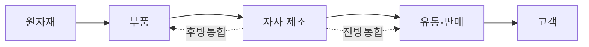

# 1.3 구매와 외주전략

!!! info "출제기준"
    **1. 생산전략** › **3. 구매와 외주전략**

## 출제 경향

총 **16문항** 출제 (1교시 단답형 7 · 2~4교시 논술형 9) · 최근 10개 회차(109~139회) 5문항 · 최근 출제 제130회

| 주제 | 출제 수 | 출제 회차 |
|---|:-:|---|
| 1.3.1 구매관리와 구매방식 | 6 | 65회, 79회, 82회, 85회, 97회, 103회 |
| 1.3.2 외주·아웃소싱 전략 | 4 | 71회, 76회, 124회, 130회 |
| 1.3.3 수직적 통합과 자가생산·외주 결정 | 3 | 106회, 115회, 130회 |
| 1.3.4 공급자 관계관리(SRM·JIT II) | 3 | 94회, 106회, 112회 |

## 목차

1. [구매관리와 구매방식](#t13-1)
2. [외주·아웃소싱 전략](#t13-2)
3. [수직적 통합과 자가생산·외주 결정](#t13-3)
4. [공급자 관계관리(SRM·JIT II)](#t13-4)

## 1.3.1 구매관리와 구매방식 {#t13-1}

### 구매관리의 개념과 목표

**구매관리**는 생산에 필요한 자재·부품·서비스를 **적정 품질·적정 수량·적정 가격·적정 시기·적정 공급자**(5R, 적정 장소를 더해 6R)로 조달하는 활동이다. 제조원가에서 재료비 비중이 50~70%에 이르므로, 구매관리는 원가 경쟁력에 직접 영향을 준다.

**구매 절차**: 구매 요구 → 공급자 탐색·선정 → 가격 결정·계약 → 발주 → 납기 관리(독촉) → 검수·입고 → 대금 지급 → 공급자 평가

### 집중구매와 분산구매 (82·103회)

| 구분 | 집중구매(본사 구매) | 분산구매(사업장 구매) |
|---|---|---|
| 개념 | 본사 구매부서가 전사 소요량을 모아 일괄 구매 | 각 공장·사업장이 필요한 자재를 직접 구매 |
| 장점 | ① 대량 구매로 **가격·조건 유리** ② 구매 절차·자재 **표준화** ③ 구매 인력·관리비 절감 ④ 공급자 관리 일원화 | ① 긴급 조달과 **신속한 대응** ② 현장 요구를 정확히 반영 ③ 지역 공급자 활용으로 운송비 절감 ④ 절차 간소 |
| 단점 | 절차 복잡, 긴급 대응 느림, 현장 실정 반영 미흡 | 구매력 분산으로 단가 상승, 중복 재고, 표준화 곤란 |
| 적합 품목 | 공통 자재, 고가·대량 품목, 원자재 | 소량·긴급 품목, 지역 특수 자재, 소모품 |

실무에서는 전략 품목은 집중구매, 일반 소모품은 분산구매로 나누는 **혼합 방식**을 많이 쓴다.

### 구매 품목의 전략적 분류 (Kraljic 매트릭스)

| 공급 위험 \ 수익 영향 | 낮음 | 높음 |
|---|---|---|
| **높음** | 병목 품목: 공급 확보 우선, 안전재고, 대체품 개발 | 전략 품목: 장기 파트너십, 공동 개발 |
| **낮음** | 일상 품목: 절차 간소화, 전자구매, 통합 구매 | 레버리지 품목: 경쟁 입찰, 구매력 활용 |

### 전략자재팀(Commodity Team) (65회)

**개념**: 구매·설계·품질·생산·원가 담당자로 구성된 **부서 횡단팀(CFT)**이 품목군(commodity)별로 조달 전략을 세우고 실행하는 조직이다.

**주요 활동**

1. 품목군별 지출 분석(spend analysis)과 조달 전략 수립
2. 공급자 수 최적화(통합)와 물량 집중으로 구매력 강화
3. 설계 단계 참여: 부품 표준화·공용화, VE로 원가 절감
4. 공급자 평가·육성과 장기 계약 체결
5. 시장·원자재 가격 동향 분석과 리스크 대응

**활동사례(예시)**: 전자회사의 커넥터 품목팀이 사업부별로 쓰던 유사 규격 커넥터를 공용 규격으로 통합하고, 공급사를 우수 업체 중심으로 줄여 물량을 집중했다. 그 결과 단가 인하, 재고 품목 수 감소, 품질 편차 축소 효과를 얻었다.

### 개발구매와 부서 참여 확대 (85회)

금형 납기를 줄이는 활동이 구매부서·금형업체만으로 한계에 부딪힌 이유는, **금형 리드타임의 대부분이 상류 단계(기획·설계)에서 결정되기 때문**이다.

| 참여 확대 원인 | 내용 |
|---|---|
| 잦은 사양 변경 | 마케팅의 요구 사양이 늦게 확정되거나 바뀌면 설계 변경 → 금형 수정 반복 |
| 설계 확정 지연 | 도면이 늦게 나오면 금형 발주가 늦어지고, 구매·업체 노력만으로 만회 불가 |
| 금형 수의 과다 | 부품 공용화·표준화는 설계부서만 결정할 수 있음 |
| 제조성 미반영 | 금형 제작이 어려운 형상은 설계 단계에서 DFM으로 개선해야 함 |
| 순차적 업무 구조 | 기획 → 설계 → 구매 → 금형의 직렬 구조를 동시공학(CE)으로 병렬화할 필요 |

→ 해결 방향: 마케팅·설계·구매·금형업체가 개발 초기부터 함께하는 **공급자 조기 참여(ESI)**와 동시공학 체계를 만든다.

### 구매가격 결정 방식 (97회)

| 방식 | 실행 방법 |
|---|---|
| 원가 기준(Cost-plus) | 공급자의 재료비·가공비·관리비를 분석하고 적정 이윤을 더해 가격을 산정(원가 분석표 요구) |
| 시장가격 기준 | 원자재·범용 부품은 시장 시세나 공시 가격을 기준으로 결정 |
| 경쟁입찰 | 공개·지명·제한 입찰로 여러 공급자의 제안을 받아 최저가 또는 종합 평가로 결정 |
| 견적 비교·협상(수의계약) | 2개 이상 견적을 비교한 뒤 협상으로 결정. 특수 품목·긴급 조달에 사용 |
| 목표원가 기준 | 판매가격에서 목표이익을 뺀 목표원가를 부품별로 배분하고, 공급자와 함께 원가 절감안을 찾아 맞춤 |
| 가격 연동(Escalation) | 원자재 지수·환율에 연동해 주기적으로 가격을 조정 |
| 역경매(e-Auction) | 온라인에서 공급자가 실시간으로 가격을 내려 입찰 |

### MRO 자재 (79회)

**MRO(Maintenance, Repair & Operation)**는 제품에 직접 들어가지 않는 유지·보수·운영용 소모성 자재(공구, 베어링, 윤활유, 안전용품, 사무용품 등)다.

- **특징**: 품목이 매우 많고 소량·반복 구매되며, 구매가격보다 **구매 처리 비용**이 상대적으로 크다.
- **관리 방안**: 품목 표준화와 코드 통합, 전자 카탈로그 구매, MRO 전문업체를 통한 통합 구매 대행, 공급자 재고관리(VMI)

!!! tip "답안 작성 포인트"
    - 집중·분산구매는 10점으로 반복 출제된다. **비교표 + 적합 품목 + 혼합 방식** 순으로 쓴다.
    - 85회 같은 사례형은 "원인 추정 → 해결 방향(ESI·CE)"의 구조로 답하고, 금형 리드타임이 상류 단계에서 결정된다는 핵심을 첫 문장에 둔다.
    - 구매 전략 문제에는 Kraljic 매트릭스를 그려 넣으면 이론의 깊이를 보여 줄 수 있다.

??? example "관련 기출 6문항 (65회, 79회, 82회, 85회, 97회, 103회)"

    - **제65회(2001) 2교시 5번** · 25점  
      전략자재팀(Commodity Team) 의 활동사례를 기술하시오.
    - **제79회(2006) 1교시 7번** · 10점  
      MRO(Maintenance Repair & Operating)
    - **제82회(2007) 1교시 2번** · 10점  
      구매관리에 있어 집중구매와 분산구매의 장점 2가지
    - **제85회(2008) 2교시 2번** · 25점  
      A전자회사에서 개발구매하는 김 과장은 전자레인지 개발납기지연의 요인인 금형 발주 및 제작의 납기단축이 개선대상이라는 사업부장의 지시를 받고 구매부서와 금형 업체와 공동으로 개선활동을 추진하였다. 그러나 추진활동의 한계로 납기 단축실적은 목표대비 저조한 것으로 나타났다. 따라서 차기 개선 프로젝트에서는 마케팅 및 제품설계부서의 참여를 요청할 것으로 결정하였는데 참여 확대 원인을 추정하여 기술하시오.
    - **제97회(2012) 3교시 1번** · 25점  
      자재의 조달 및 구매활동과정에서 구매가격을 결정하는 가격산정 방식을 열거하고, 각 방식별로 실행방법을 설명하시오.
    - **제103회(2014) 1교시 2번** · 10점  
      분산구매와 집중구매를 비교하여 설명하시오.

## 1.3.2 외주·아웃소싱 전략 {#t13-2}

### 외주(아웃소싱)의 목적 (76·124회)

외주는 기업이 수행하던 활동의 일부를 외부 전문기업에 맡기는 것이다.

1. **원가 절감**: 외부 전문업체의 규모의 경제·낮은 인건비 활용
2. **핵심역량 집중**: 비핵심 활동을 넘기고 핵심 기술·공정에 자원 집중
3. **생산능력 보완**: 수요가 일시적으로 늘 때 설비 투자 없이 대응
4. **전문 기술 활용**: 내부에 없는 기술·노하우 확보
5. **투자 위험 분산**과 고정비의 변동비화
6. 수요·기술 변화에 대한 **유연성** 확보

### 외주 전략의 이점과 위험 요소 (124회)

| 이점 | 위험 요소 |
|---|---|
| 원가 절감, 고정비 감소 | 핵심 기술·노하우 유출 |
| 핵심역량 집중 | 품질·납기에 대한 통제력 약화 |
| 생산능력·유연성 확보 | 공급자 의존과 교섭력 약화 |
| 외부 전문성 활용 | 거래·관리 비용 등 숨은 비용 |
| 투자 위험 분산 | 내부 역량의 공동화(空洞化) |
| | 공급 중단 리스크(부도·재해·지정학) |

**위험 대응**: 핵심/비핵심 구분을 명확히 하는 외주 정책, 공급자 평가·인증, 계약상 품질·납기·기밀 조항, 복수 공급처 확보, 정기 감사와 성과 관리

### 외주업체와의 관계: 계열화 vs 전문화 (71회)

| 구분 | 계열화 | 전문화 |
|---|---|---|
| 개념 | 특정 모기업에 전속되어 장기·안정적으로 거래 | 특정 기술·품목에 특화해 여러 고객과 거래 |
| 장점 | 안정적 공급, 품질·납기 협력 용이, 모기업의 기술 지도·자금 지원, 공동 개발 | 규모의 경제로 원가 경쟁력, 전문 기술 축적, 협력사의 자립성 |
| 단점 | 종속성 심화, 경쟁 부재로 원가 상승, 협력사의 혁신 의욕 저하 | 우선 공급 확보 어려움, 기술 유출 우려, 관계가 느슨함 |

### 교섭력 의존 관계 vs 공동생산자 관계 (76회)

| 구분 | 교섭력 의존 관계(대립적 관계) | 공동생산자 관계(파트너십) |
|---|---|---|
| 공급자 수 | 많음(경쟁 유도) | 적음(소수 정예) |
| 계약 기간 | 단기, 건별 | 장기 |
| 선정 기준 | 가격 중심 | 품질·기술·납기·신뢰 종합 |
| 정보 공유 | 최소 | 생산계획·설계 정보까지 공유 |
| 품질 보증 | 수입 검사 | 공급자 품질 보증(무검사 납품) |
| 설계 참여 | 없음 | 개발 초기부터 참여(ESI) |
| 이익 배분 | 제로섬 | 원가 절감 성과 공유(윈윈) |

JIT·린 생산이 확산되면서 **공동생산자 관계**가 중요해졌다. 다만 레버리지 품목처럼 경쟁이 효과적인 품목은 교섭력 관계가 적합할 수 있다.

### 동일 부품의 공급처가 많을 때의 단점 (130회)

1. 물량이 분산되어 **규모의 경제를 잃고 단가가 오름**
2. 공급처마다 공정이 달라 **품질 편차(산포)** 증가
3. 공급자 평가·감사·발주 등 **관리 비용** 증가
4. 공급자가 장기 투자·개선에 나설 유인이 줄어 **협력 관계 약화**
5. 설계 변경이나 기술 협력을 여러 곳과 해야 해 **대응 속도 저하**
6. 문제 발생 시 **추적성** 저하

→ 대안: 품목 특성에 맞는 **적정 공급처 수**(전략 품목은 1~2원화, 공급 위험 품목은 복수화)를 유지한다.

!!! tip "답안 작성 포인트"
    - 외주 문제는 **목적 → 이점·위험 → 위험 대응 → 바람직한 관계** 순으로 쓴다.
    - 관계 비교 문제(71·76회)는 비교 기준을 7개 안팎으로 잡은 표를 쓰고, 결론에서 "품목 특성에 따라 관계를 차별화"로 맺는다.

??? example "관련 기출 4문항 (71회, 76회, 124회, 130회)"

    - **제71회(2003) 2교시 6번** · 25점  
      자재조달을 위해 외주가공을 하는 경우에 외주업체와의 관계를 계열화 또는 전문화해야 하는데, 이에 대한 장․단점을 설명하시오.
    - **제76회(2005) 3교시 6번** · 25점  
      자재나 부품의 아웃소싱(Outsourcing)을 실시하는 목적을 논하시고, 협력기업과의 관계를 교섭력의존 관계와 공동생산자 관계로 구분하여 특징을 비교하시오.
    - **제124회(2021) 2교시 3번** · 25점  
      외주(Outsourcing) 전략의 이점과 위험요소를 설명하시오.
    - **제130회(2023) 1교시 7번** · 10점  
      외주 아웃소싱에서 동일부품의 공급처가 많을 때의 단점을 설명하시오.

## 1.3.3 수직적 통합과 자가생산·외주 결정 {#t13-3}

### 수직적 통합의 정의 (106·115·130회)

**수직적 통합(Vertical Integration)**은 원자재 → 부품 → 제조 → 유통 → 고객으로 이어지는 공급사슬의 앞·뒤 단계를 기업이 직접 소유하거나 내부화하는 전략이다. 자가생산 범위를 넓히는 의사결정이며, 생산전략의 **구조적 의사결정** 중 하나다.

### 유형과 사례 (130회)

| 유형 | 개념 | 사례 |
|---|---|---|
| **후방통합** (Backward) | 공급자 쪽(원자재·부품)으로 통합 | ① 테슬라의 배터리 셀 자체 생산 ② 애플의 자체 칩(Apple Silicon) 설계 ③ 스타벅스의 원두 로스팅 공장 직접 운영 |
| **전방통합** (Forward) | 고객 쪽(유통·판매)으로 통합 | ① 애플의 직영 매장(Apple Store) ② 의류 SPA 브랜드(자라)의 기획·생산·판매 일원화 ③ 정유사의 직영 주유소 |

### 수직적 통합이 유리한 시점 (115회)

- 공급자가 적고 **공급자의 교섭력이 강할 때**
- 핵심 부품의 **기술 보호·확보**가 경쟁우위의 원천일 때
- 공급이 불안정하거나 **품질·납기 통제**가 꼭 필요할 때
- 외부 거래 비용(탐색·협상·감시)이 클 때
- 내부 생산이 경제성을 갖출 만큼 **수요 규모가 클 때**
- 시장이 성장기에 있어 안정적인 공급망 확보가 중요할 때

### 장점과 단점

| 장점 | 단점 |
|---|---|
| 원가 절감(이윤 마진·거래비용 내부화) | 대규모 투자와 고정비 증가 |
| 공급 안정성, 품질·납기 통제 | 기술·수요 변화에 대한 유연성 저하 |
| 핵심 기술 보호와 차별화 | 핵심역량 분산, 관리 복잡성 |
| 시장 정보 확보(전방통합) | 내부 거래라 경쟁 압력이 없어 비효율 가능 |

### 자가생산·외주생산(Make or Buy) 결정 시 고려사항 (106회)

| 구분 | 고려사항 |
|---|---|
| 원가 | 총소유원가(TCO) 비교, 손익분기 생산량, 설비 투자비 |
| 전략 | 핵심역량 여부, 기술 보호 필요성, 장기적 유연성 |
| 생산능력 | 여유 능력 유무, 설비·인력 확보 가능성 |
| 품질·납기 | 품질 통제 필요성, 공급자의 납기 신뢰성 |
| 공급 시장 | 공급자 수와 역량, 공급 위험, 가격 안정성 |
| 기타 | 노사 관계, 법규, 기밀 유지 |

**손익분기 분석**: 자가생산 총비용 \( FC + VC_m \cdot Q \), 구매 총비용 \( P \cdot Q \)일 때

\[
Q^* = \frac{FC}{P - VC_m}
\]

수요량이 \( Q^* \)보다 크면 자가생산, 작으면 외주가 유리하다.
(예: 설비 고정비 2,000만 원, 자가 변동비 6,000원/개, 구매가 10,000원/개이면 \( Q^* = 20{,}000{,}000 / 4{,}000 = 5{,}000 \)개)

!!! tip "답안 작성 포인트"
    - 정의 → **공급사슬 그림(후방·전방 화살표)** → 유형별 사례 → 장단점 → 유리한 시점 순서로 쓴다.
    - 130회처럼 사례를 요구하면 국내외의 잘 알려진 기업 사례를 유형별로 3개씩 정확히 맞춘다.
    - Make or Buy는 정성 요인 표와 손익분기 식을 함께 써서 정량·정성 양면을 보여 준다.

??? example "관련 기출 3문항 (106회, 115회, 130회)"

    - **제106회(2015) 3교시 4번** · 25점  
      공급사슬과 관련하여 다음 각 물음에 답하시오.

        ??? quote "문제 전문"

            공급사슬과 관련하여 다음 각 물음에 답하시오.  
            (1) 수직적 통합(Vertical Integration)에 대하여 설명하시오.  
            (2) 자가생산 또는 외주생산 결정시 고려해야 할 사항들에 대하여 설명하시오.  
    - **제115회(2018) 4교시 4번** · 25점  
      공정을 결정하거나 설계할 때의 고려요인 중 수직적 통합(Vertical Integration)이 있다. 수직적 통합의 정의 및 유리한 시점, 후방통합(Backward Integration)과 전방통합(Forward Integration)에 대해 설명하시오.
    - **제130회(2023) 2교시 6번** · 25점  
      기업의 성장전략 중 수직적 통합의 정의와 2가지 유형을 설명하고, 각 유형별 사례를 3가지씩만 쓰시오.

## 1.3.4 공급자 관계관리(SRM·JIT II) {#t13-4}

### SRM(Supplier Relationship Management, 공급자 관계관리) (94회)

**정의**: 공급자를 전략적 중요도에 따라 분류하고, 선정·평가·협업·육성 전 과정을 체계적으로 관리해 공급망 전체의 가치를 높이는 경영 활동과 정보시스템이다. 고객 쪽의 CRM에 대응하는 개념이다.

**구성 요소**

1. **공급자 분류**: Kraljic 매트릭스 등으로 전략·레버리지·병목·일상 공급자 구분
2. **선정·평가**: 품질(Q), 원가(C), 납기(D), 기술(T), 재무 안정성, ESG 평가
3. **협업**: 공동 개발(ESI), 생산계획·수요 정보 공유, 공동 원가 절감
4. **성과 관리·육성**: 정기 평가, 등급별 인센티브, 기술 지도
5. **정보시스템**: 전자구매(e-Procurement), 공급자 포털, 계약·성과 데이터 관리

**효과**: 구매 원가 절감, 조달 리드타임 단축, 품질 향상, 공급 리스크 감소, 혁신 아이디어 확보

### JIT II (106·112회)

**정의**: 미국 **Bose社**(1987, Lance Dixon)가 처음 도입한 방식으로, **공급업체 직원(In-plant Representative)이 구매 기업에 상주**하면서 구매 담당자의 역할을 대신하는 공급자 협력 체계다.

**운영 방식**

- 공급자 상주 직원이 구매 기업의 생산계획을 보고 **직접 발주·납기 관리**
- 신제품 개발 회의에 참여해 **설계 단계부터 부품·원가 제안**
- 구매 기업의 정보시스템과 시설에 접근할 권한 부여

**효과**: 구매 업무와 인력 절감, 의사소통 지연 제거, 조달 리드타임·재고 감소, 개발 기간 단축, 공급자와의 신뢰 강화

**성공 조건**: 높은 상호 신뢰와 장기 계약, 기밀 보호 장치, 상주 직원의 전문성, 경영층 지원

| 구분 | JIT | JIT II |
|---|---|---|
| 초점 | 자재 흐름의 동기화(필요한 때 필요한 만큼) | 정보·인력 수준의 공급자 통합 |
| 공급자 역할 | 정시·소로트 납품 | 구매 기업 안에서 구매·계획 업무 수행 |
| 관계 | 장기 협력 | 파트너십이 더 깊은 형태(사실상 내부 조직화) |

!!! tip "답안 작성 포인트"
    - 세 문항 모두 10점 단답형이다. **정의(도입 배경) → 구성·운영 방식 → 효과 → 성공 조건**의 4줄 틀로 쓴다.
    - JIT II는 반드시 **Bose社 사례와 상주 직원(In-plant Rep)**이라는 키워드를 넣고, JIT와의 차이를 한 줄 덧붙인다.

??? example "관련 기출 3문항 (94회, 106회, 112회)"

    - **제94회(2011) 1교시 4번** · 10점  
      SRM(Supplier Relationship Management)
    - **제106회(2015) 1교시 4번** · 10점  
      JIT Ⅱ
    - **제112회(2017) 1교시 8번** · 10점  
      JIT II(Just In Time II)
