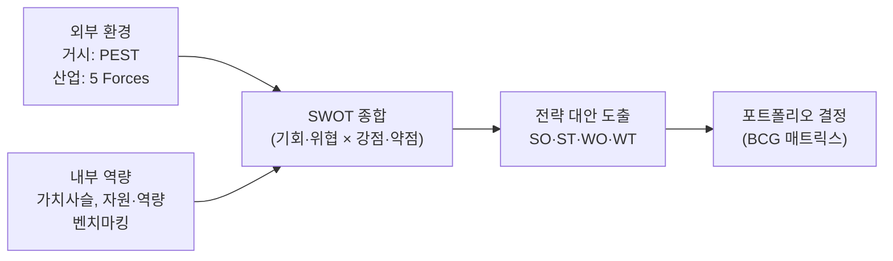
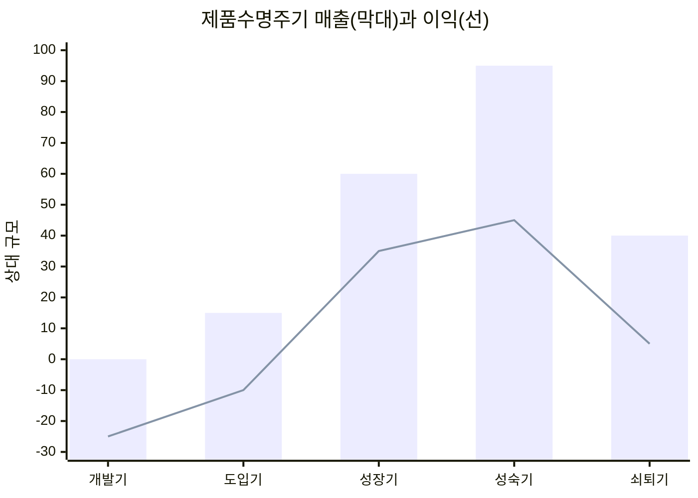
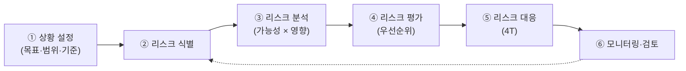

# 1.5 사업환경분석

!!! info "출제기준"
    **1. 생산전략** › **5. 사업환경분석**

## 출제 경향

총 **18문항** 출제 (1교시 단답형 11 · 2~4교시 논술형 7) · 최근 10개 회차(109~139회) 4문항 · 최근 출제 제133회

| 주제 | 출제 수 | 출제 회차 |
|---|:-:|---|
| 1.5.1 환경분석 기법(SWOT·5 Forces·BCG) | 6 | 65회, 79회, 85회, 91회, 100회, 121회 |
| 1.5.2 제품수명주기(PLC) | 6 | 68회, 70회, 85회, 94회, 109회, 121회 |
| 1.5.3 블루오션 전략 | 2 | 79회, 82회 |
| 1.5.4 마케팅 믹스(4P) | 1 | 97회 |
| 1.5.5 리스크 관리 | 2 | 106회, 133회 |
| 1.5.6 신규사업 기획 | 1 | 68회 |

## 목차

1. [환경분석 기법(SWOT·5 Forces·BCG)](#t15-1)
2. [제품수명주기(PLC)](#t15-2)
3. [블루오션 전략](#t15-3)
4. [마케팅 믹스(4P)](#t15-4)
5. [리스크 관리](#t15-5)
6. [신규사업 기획](#t15-6)

## 1.5.1 환경분석 기법(SWOT·5 Forces·BCG) {#t15-1}

### 사업환경분석의 체계

### 거시환경 분석: PEST(PESTEL)

| 요인 | 내용 | 제조업 예 |
|---|---|---|
| 정치(Political) | 정부 정책, 통상·관세, 지정학 | 공급망 재편, 보호무역, 보조금 |
| 경제(Economic) | 경기, 환율, 금리, 원자재 가격 | 원가 변동, 해외 생산 경제성 |
| 사회(Social) | 인구 구조, 가치관, 생활양식 | 고령화·인력난, 친환경 소비 |
| 기술(Technological) | 신기술, 기술 변화 속도 | AI·스마트공장, 전동화 |
| 환경(Environmental)·법(Legal) | 환경 규제, 안전·노동 법규 | 탄소중립·탄소국경조정, 중대재해 관련 법규 |

### SWOT 분석 (85회)

**정의**: 기업 내부의 **강점(Strength)·약점(Weakness)**과 외부 환경의 **기회(Opportunity)·위협(Threat)**을 분석해 전략을 도출하는 상황분석 기법이다.

| 내부 \ 외부 | 기회(O) | 위협(T) |
|---|---|---|
| **강점(S)** | **SO 전략(공격적 전략)**: 강점으로 기회를 살림 — 시장 확대, 신제품 출시 | **ST 전략(다각화 전략)**: 강점으로 위협을 피하거나 줄임 — 시장·제품 다각화 |
| **약점(W)** | **WO 전략(국면전환 전략)**: 약점을 보완해 기회를 잡음 — 제휴, 기술 도입 | **WT 전략(방어적 전략)**: 약점과 위협을 최소화 — 축소, 철수, 구조조정 |

- **절차**: 외부 환경 분석(PEST·5 Forces)으로 O·T 도출 → 내부 역량 분석(가치사슬·벤치마킹)으로 S·W 도출 → 교차 매트릭스로 전략 대안 도출 → 우선순위 결정
- **한계**: 요인 나열에 그치기 쉽고 주관적이며 정태적이다. 요인별 가중치 평가와 정기적 갱신으로 보완한다.

### 산업구조분석: Porter의 5 Forces (91·100회)

산업의 **수익성(매력도)**을 결정하는 다섯 가지 경쟁 요인이다(M. Porter, 1979).

| 요인 | 영향을 키우는 조건 |
|---|---|
| ① 기존 경쟁자 간의 경쟁 강도 | 경쟁자 수가 많고 비슷한 규모, 산업 성장 둔화, 높은 고정비, 낮은 차별화, 높은 철수 장벽 |
| ② 신규 진입자의 위협 | 낮은 진입장벽(규모의 경제·자본·유통망·규제·브랜드가 약함) |
| ③ 대체재의 위협 | 가격 대비 성능이 좋은 대체재, 낮은 전환 비용 |
| ④ 공급자의 교섭력 | 공급자 집중, 대체 공급원 부족, 높은 전환 비용, 공급자의 전방통합 가능성 |
| ⑤ 구매자의 교섭력 | 구매자 집중·대량 구매, 표준화된 제품, 낮은 전환 비용, 구매자의 후방통합 가능성 |

다섯 요인이 강할수록 산업의 평균 수익성은 낮아진다. 기업은 요인의 영향을 줄이는 위치를 찾거나(포지셔닝) 산업 구조 자체를 바꾸는 전략을 세운다.

### BCG 매트릭스와 제품 포트폴리오 관리 (79·121회)

**BCG 매트릭스**: 보스턴 컨설팅 그룹이 만든 기법으로, **시장성장률(세로축)**과 **상대적 시장점유율(가로축)**로 사업·제품을 네 가지로 나누고 자원 배분 전략을 정한다.

| 구분 | 시장성장률 / 상대점유율 | 특징 | 전략 |
|---|---|---|---|
| **Star(별)** | 높음 / 높음 | 성장 사업, 투자도 많이 필요 | 육성(Build)·유지 |
| **Cash Cow(현금젖소)** | 낮음 / 높음 | 성숙 사업, 현금 창출원 | 유지(Hold)·수확, 다른 사업에 자금 공급 |
| **Question Mark(물음표)** | 높음 / 낮음 | 성장 가능성 있으나 불확실 | 선별 투자로 Star 육성 또는 철수 |
| **Dog(개)** | 낮음 / 낮음 | 수익성 낮음 | 수확(Harvest)·철수(Divest) |

**바람직한 흐름**: Cash Cow에서 나온 자금으로 Question Mark를 Star로 키우고, Star는 시장이 성숙하면 Cash Cow가 된다.
**한계**: 두 변수만 쓰는 단순화, 시장 경계 정의의 어려움, 사업 간 시너지 무시 → 보완으로 GE-McKinsey 매트릭스(산업 매력도 × 사업 강점) 사용

**제품 포트폴리오 관리의 필요성 (79회)**

1. 한정된 경영 자원을 제품별로 **효율적으로 배분**
2. 제품 간 **현금흐름의 균형**(현금 창출 제품 ↔ 투자 필요 제품)
3. 제품수명주기가 다른 제품을 조합해 **지속 성장** 확보
4. 시장·제품 위험의 **분산**
5. 신제품 투자와 기존 제품 철수의 **우선순위 결정** 근거

### 벤치마킹 (65회)

**정의**: 최고 수준(Best Practice)의 기업이나 프로세스를 기준으로 삼아 자사와의 차이를 측정하고, 그 방법을 배워 성과를 개선하는 기법이다(1979년 Xerox가 처음 체계적으로 활용).

- **유형**: 내부 벤치마킹(사내 우수 부서), 경쟁 벤치마킹(직접 경쟁사), 기능 벤치마킹(같은 기능의 타 산업 우수 기업), 포괄적 벤치마킹(업종 무관 프로세스)
- **절차**: 대상 선정 → 벤치마킹 파트너 선정 → 자료 수집·성과 차이(Gap) 분석 → 개선 목표·실행 계획 수립 → 실행·재측정
- **유의점**: 단순 모방이 아니라 자사 환경에 맞게 적용, 결과(성과)보다 **프로세스**를 배워야 함

!!! tip "답안 작성 포인트"
    - 모두 10점 단답형이다. **정의(제창자) + 그림(매트릭스·5요인 도식) + 각 요소 한 줄 설명**이면 충분하다.
    - SWOT는 4가지 전략에 이름(공격·다각화·국면전환·방어)을 붙여 쓰고, BCG는 4분면 그림에 자금 흐름 화살표를 넣는다.
    - 5 Forces는 Porter의 본원적 전략([1.1.3](01-competitive-strategy.md#t11-3))과 짝을 이루므로 마지막 줄에 연결한다.
    - 10점 마무리 예: "환경분석 결과는 생산전략의 입력자료가 된다. 기회·위협을 경쟁우선순위로 바꾸어 생산능력·공정 투자 우선순위를 정하는 데 활용한다."

??? example "관련 기출 6문항 (65회, 79회, 85회, 91회, 100회, 121회)"

    - **제65회(2001) 1교시 3번** · 10점  
      Benchmarking
    - **제79회(2006) 1교시 11번** · 10점  
      제품포트폴리오 관리의 필요성
    - **제85회(2008) 1교시 11번** · 10점  
      기업의 전략적 상황분석 기법인 SWOT분석을 정의하고, 그에 따른 4가지 대응전략에 대하여 기술하시오.
    - **제91회(2010) 1교시 11번** · 10점  
      제조업의 경쟁전략 수립에 있어서 산업의 수익성을 결정하는 요인분석기법으로써 산업구조분석의 5가지 요소를 나열하시오.
    - **제100회(2013) 1교시 2번** · 10점  
      마이클 포터의 5 Forces Model
    - **제121회(2020) 1교시 6번** · 10점  
      BCG 매트릭스(BCG Matrix)

## 1.5.2 제품수명주기(PLC) {#t15-2}

### 제품수명주기(PLC)의 개념

**제품수명주기(Product Life Cycle)**는 제품이 시장에 나와서 사라질 때까지 매출과 이익이 변하는 과정을 단계로 나눈 것이다. 단계마다 고객·경쟁·이익 구조가 달라 마케팅·생산·개발 전략을 다르게 가져가야 한다.

**5단계 (85·109회)**: 개발기 → 도입기 → 성장기 → 성숙기 → 쇠퇴기
(개발기를 빼고 성숙기를 *성숙기·포화기*로 나눠 5단계로 보기도 한다.)

### 단계별 특징과 전략 (85·94·121회)

| 구분 | 개발기 | 도입기 | 성장기 | 성숙기 | 쇠퇴기 |
|---|---|---|---|---|---|
| 매출 | 없음 | 낮음, 완만 증가 | 급증 | 최고, 정체 | 감소 |
| 이익 | 적자(개발비) | 적자 | 흑자 전환, 증가 | 최고 → 감소 시작 | 감소 |
| 고객 | – | 혁신 수용자 | 조기 수용자 | 다수 수용자 | 지체 수용자 |
| 경쟁 | – | 거의 없음 | 증가 | 가장 치열 | 감소 |
| 마케팅 목표 | 제품 완성 | 인지도·시용 확대 | 점유율 확대 | 점유율 방어, 이익 극대화 | 비용 절감, 수확 |
| 제품 | 설계·시제품 | 기본형 | 품질 개선·변형 추가 | 다양화·차별화 | 품목 축소 |
| 가격 | – | 원가가산·초기 고가(또는 침투가격) | 침투 가격 | 경쟁 대응 가격 | 인하 |
| 유통·촉진 | – | 선택적 유통, 인지도 광고 | 유통 확대, 브랜드 광고 | 집약적 유통, 차별화 광고 | 선택적 유통, 최소 촉진 |
| 생산 | 시작품 | 소량·유연 생산 | 생산능력 확장 | 대량생산·원가절감 | 능력 축소·외주화 |

생산전략과의 연결은 [1.1.6 제품수명주기에 따른 생산전략](01-competitive-strategy.md#t11-6)을 함께 본다.

### PLC 연장 전략

성숙기에 이르면 수명을 늘리기 위해 다음을 시도한다.

- **시장 수정**: 새로운 고객층·지역(해외) 진출, 새로운 용도 개발
- **제품 수정**: 품질·기능·스타일 개선, 신모델 출시
- **마케팅 믹스 수정**: 가격 조정, 유통 경로 확대, 판촉 강화

**PLC 이론의 한계와 최근 경향**: 모든 제품이 S자 곡선을 따르지는 않고(유행형·주기형·연속 성장형 등), 기업의 마케팅 활동이 곡선 모양 자체를 바꿀 수 있다. 최근에는 PLC가 짧아지면서 신제품 개발 속도([7.2.1](../07-support-technology/02-product-development.md#t72-1))와 단계 전환에 맞춘 **유연한 생산능력**이 중요해졌고, 쇠퇴기 이후 회수·재활용까지 포함한 **순환경제 관점의 전 과정 관리**(PLM·LCA)가 요구된다.

### 컨설팅 상품의 PLC 사례 (68회)

| 단계 | 예상 문제점 | 해결 방안·대응 전략 |
|---|---|---|
| 도입기 | 인지도와 성공 사례(레퍼런스) 부족 | 시범 프로젝트, 성과 사례 공개, 전문가 네트워크 활용 |
| 성장기 | 경쟁 진입, 수요 급증으로 컨설턴트 부족·품질 편차 | 방법론 표준화, 컨설턴트 육성, 품질 관리 체계 |
| 성숙기 | 가격 경쟁, 차별성 약화 | 산업 특화·솔루션 결합(IT·교육)으로 고부가화, 고객 관계 강화 |
| 쇠퇴기 | 수요 감소, 상품 노후화 | 상품 리뉴얼(디지털 전환·ESG 등 새 주제), 철수 시점 판단, 포트폴리오 재편 |

!!! tip "답안 작성 포인트"
    - PLC는 6번 출제된 반복 주제다. **S자 곡선 그림 + 단계별 특징표**가 기본이고, 문제가 강조한 관점(매출·이익·경쟁, 제품개발, 생산전략)을 표의 행으로 넣는다.
    - "5단계"를 물으면 어떤 5단계를 쓰는지 서두에 밝히고(개발기 포함 또는 포화기 분리), PLC 연장 전략으로 결론을 맺는다.
    - 결론 예: "PLC가 짧아질수록 단계 전환을 예측해 개발·생산능력·마케팅을 선제적으로 움직여야 한다. 제품 포트폴리오(BCG)로 단계가 다른 제품을 조합하고, 쇠퇴기 제품은 회수·재활용까지 고려한 전 과정 관리로 마무리해야 한다."

??? example "관련 기출 6문항 (68회, 70회, 85회, 94회, 109회, 121회)"

    - **제68회(2002) 2교시 5번** · 25점  
      귀하의 컨설팅 상품을 제품수명의 주기를 고려하여 예상되는 문제점을 검토하고 해결 방안과 대응 전략을 수립해보시오.
    - **제70회(2003) 1교시 4번** · 10점  
      제품수명주기(Product Life Cycle)
    - **제85회(2008) 1교시 1번** · 10점  
      제품수명주기(Product Life Cycle) 5단계를 쓰고 단계별 특징(매출, 이익, 경쟁요소 등)을 설명하시오.
    - **제94회(2011) 3교시 4번** · 25점  
      제품개발이나 생산전략을 수립할 때, 고려하는 제품수명주기(PLC: Product Life Cycle)의 각 단계에 대하여 설명하시오.
    - **제109회(2016) 1교시 6번** · 10점  
      제품수명주기를 5가지 단계로 설명하시오.
    - **제121회(2020) 3교시 1번** · 25점  
      신제품 개발이나 생산전략 수립 시 고려하는 제품수명주기(Product Life Cycle)의 개념과 각 단계에 대하여 설명하시오.

## 1.5.3 블루오션 전략 {#t15-3}

### 레드오션과 블루오션 비교 (82회)

W. Chan Kim & R. Mauborgne(2005)이 제시했다. **레드오션**은 경쟁자들이 같은 시장에서 피 흘리며 싸우는 기존 시장이고, **블루오션**은 경쟁이 없는 새로운 시장 공간이다.

| 구분 | 레드오션 전략 | 블루오션 전략 |
|---|---|---|
| 시장 | 기존 시장 공간에서 경쟁 | 경쟁자 없는 새 시장 공간 창출 |
| 경쟁 | 경쟁자를 이기는 것이 목표 | 경쟁을 무의미하게 만듦 |
| 수요 | 기존 수요를 나눠 가짐 | 새로운 수요를 창출하고 장악 |
| 가치-비용 | 가치와 비용 사이 **상충관계** 인정 | 가치와 비용의 상충관계를 **깨뜨림** |
| 전략 선택 | 차별화 **또는** 저비용 중 하나 | 차별화 **와** 저비용 동시 추구 |

### 가치혁신(Value Innovation) — 블루오션 전략의 초석

**가치혁신**은 차별화와 저비용을 동시에 추구해 **구매자와 기업 모두의 가치를 비약적으로 높이는 것**이다. 기술 혁신보다 고객 가치의 재정의에 초점을 둔다.

**ERRC 그리드(4가지 액션 프레임워크)**

| 액션 | 질문 | 효과 |
|---|---|---|
| 제거(Eliminate) | 업계가 당연시하는 요소 중 없앨 것은? | 비용 ↓ |
| 감소(Reduce) | 업계 표준 이하로 줄일 요소는? | 비용 ↓ |
| 증가(Raise) | 업계 표준 이상으로 높일 요소는? | 가치 ↑ |
| 창조(Create) | 업계가 제공하지 않던 새 요소는? | 가치 ↑ |

**분석 도구**: 전략 캔버스(업계 경쟁 요소별 가치 곡선 비교), 6가지 경로 프레임워크(대체 산업, 전략 그룹, 구매자 체인, 보완재, 기능·감성, 시간 흐름)

**좋은 블루오션 전략의 3가지 특성**: ① **집중(Focus)**: 소수의 핵심 요소에 집중 ② **차별성(Divergence)**: 경쟁사와 다른 가치 곡선 ③ **강력한 슬로건(Compelling tagline)**: 고객에게 분명히 전달되는 메시지

**사례 — 태양의 서커스(Cirque du Soleil)**: 동물 공연·스타 곡예사를 **제거**하고, 위험·스릴은 **감소**시키며, 공연장 수준을 **증가**시키고, 테마·예술적 음악·무용을 **창조**했다. 서커스와 연극을 결합해 성인 관객이라는 새로운 수요를 만들었다.

!!! tip "답안 작성 포인트"
    - **비교표 → 가치혁신 그림(비용↓ + 구매자 가치↑ 교집합) → ERRC 표 → 사례** 순서로 쓴다.
    - 생산관리자 관점에서 "공정·원가 혁신으로 저비용을, 고객 가치 재정의로 차별화를 동시에 달성"한다는 결론을 붙인다.
    - 결론 예: "블루오션은 기술 혁신이 아니라 가치 혁신에서 나온다. ERRC로 원가 구조를 재설계하고 생산은 이를 뒷받침하는 공정 혁신(모듈화·원가절감)을 맡아야 하며, 모방이 쉬우므로 지속적인 가치 곡선 재검토가 필요하다."

??? example "관련 기출 2문항 (79회, 82회)"

    - **제79회(2006) 1교시 6번** · 10점  
      가치창출을 위한 블루오션(Blue Ocean)
    - **제82회(2007) 2교시 4번** · 25점  
      Blue Ocean 전략과 Red Ocean전략을 비교 설명하고 Blue Ocean전략의 가치혁신(Blue Ocean전략의 초석)에 대하여 설명하시오.

## 1.5.4 마케팅 믹스(4P) {#t15-4}

### 마케팅 믹스 4P (97회)

**마케팅 믹스**는 표적시장에서 마케팅 목표를 이루기 위해 기업이 통제할 수 있는 수단을 **일관되게 조합**한 것이다(E. J. McCarthy, 4P).

| 요소 | 의사결정 내용 |
|---|---|
| 제품(Product) | 품질, 기능, 디자인, 브랜드, 포장, 보증, 제품 라인 |
| 가격(Price) | 가격 수준, 할인, 지불 조건, 가격 전략(초기 고가·침투) |
| 유통(Place) | 유통 경로, 물류, 재고, 입지, 커버리지 |
| 촉진(Promotion) | 광고, 인적 판매, 판매 촉진, PR, 디지털 마케팅 |

- **믹스의 핵심**: 네 요소가 표적 고객과 포지셔닝에 맞게 **서로 일관성**을 가져야 한다(예: 고급 제품 + 고가 + 선택적 유통 + 이미지 광고).
- **선행 단계**: STP(시장 세분화 → 표적시장 선정 → 포지셔닝) 후에 4P를 설계한다.
- **고객 관점의 4C**(Lauterborn): 고객 가치(Customer value), 고객 비용(Cost), 편의성(Convenience), 소통(Communication)
- **서비스 마케팅 7P**: 4P + 사람(People), 프로세스(Process), 물리적 증거(Physical evidence)
- **생산관리와의 연계**: 제품(설계·품질), 가격(원가), 유통(재고·납기)이 생산 성과에 직접 의존한다.

!!! tip "답안 작성 포인트"
    - 10점 단답형은 **정의 → 4P 표 → 믹스의 일관성 → 4C·7P 확장** 순서로 쓴다.

??? example "관련 기출 1문항 (97회)"

    - **제97회(2012) 1교시 11번** · 10점  
      마케팅 믹스 요소인 4P의 믹스에 대하여 설명하시오.

## 1.5.5 리스크 관리 {#t15-5}

### 리스크 관리의 정의 (106회)

**리스크(Risk)**는 목표에 영향을 주는 불확실성이다(ISO 31000). **리스크 관리**는 기업 활동에 영향을 줄 수 있는 리스크를 체계적으로 **식별·분석·평가하고 대응**해, 손실을 최소화하고 기회를 살리는 관리 활동이다.

\[
\text{리스크 크기(위험도)} = \text{발생 가능성} \times \text{영향도(심각도)}
\]

### 리스크 관리 절차 (106·133회)

| 단계 | 주요 내용과 기법 |
|---|---|
| ① 상황 설정 | 목표, 관리 범위, 리스크 수용 기준 결정 |
| ② 식별 | 브레인스토밍, 체크리스트, 과거 사례, FMEA, What-if 분석 |
| ③ 분석 | 발생 가능성과 영향도를 정성·정량적으로 산정 |
| ④ 평가 | 리스크 매트릭스로 등급화, 수용 기준과 비교해 대응 우선순위 결정 |
| ⑤ 대응 | 4T 중 적절한 방안 선택, 대응 계획과 책임자 지정 |
| ⑥ 모니터링 | 잔류 리스크 감시, 새 리스크 확인, 전 과정에서 의사소통·협의 |

**리스크 매트릭스(예)**

| 가능성 \ 영향 | 낮음 | 중간 | 높음 |
|---|:-:|:-:|:-:|
| 높음 | 중 | 고 | **고** |
| 중간 | 저 | 중 | 고 |
| 낮음 | 저 | 저 | 중 |

### 전통적 처리 기술 4T (106·133회)

| 대응 방안 | 내용 | 제조 현장 예 |
|---|---|---|
| **회피**(Terminate / Avoid) | 리스크가 있는 활동을 하지 않음 | 위험한 공정·사업에서 철수, 유해 물질 사용 중단 |
| **감소**(Treat / Reduce) | 발생 가능성이나 영향을 줄임 | 예방보전, 이중화 설비, 공급처 복수화, 안전 장치 |
| **전가**(Transfer) | 리스크를 제3자에게 넘김 | 보험 가입, 외주 계약상 책임 이전, 헤지 |
| **보유**(Tolerate / Accept) | 리스크를 알고 받아들임 | 영향이 작은 리스크는 예비비로 대응 |

리스크 매트릭스와 4T의 대응: 위험도 **고** 영역은 회피·감소, 영향은 크지만 가능성이 낮은 영역은 전가(보험), 위험도 **저** 영역은 보유가 일반적이다.

### 제조기업의 리스크 유형과 최근 경향

| 유형 | 예 | 대응 수단 |
|---|---|---|
| 전략 리스크 | 기술 변화, 시장 축소, 경쟁 심화 | 환경분석(SWOT·PEST), 포트폴리오 관리 |
| 운영 리스크 | 설비 고장, 품질 사고, 산업재해 | TPM, FMEA, 안전보건경영시스템 |
| 공급망 리스크 | 원자재 공급 중단, 협력사 부도, 물류 차질 | 공급처 이원화, 안전재고, 공급망 가시성 |
| 재무 리스크 | 환율·금리·원자재 가격 변동 | 헤지, 가격 연동 계약 |
| 재해·ESG 리스크 | 자연재해, 화재, 감염병, 탄소 규제, 사이버 공격 | BCP(사업연속성계획, ISO 22301), 탄소 감축 로드맵, 정보보안 |

최근에는 개별 리스크를 따로 관리하지 않고 전사 차원에서 통합 관리하는 **전사적 리스크 관리(ERM)**와, 중단 시에도 핵심 업무를 유지·복구하는 **사업연속성관리(BCM)**가 강조된다. 설비 리스크 FMEA는 [5.4.8](../05-work-measurement/04-quality-management.md#t54-8)을 참고한다.

!!! tip "답안 작성 포인트"
    - **정의(ISO 31000) → 위험도 식 → 절차 흐름도 → 4T 표 → 리스크 매트릭스** 순서로 쓰면 두 문항 모두에 대응할 수 있다.
    - 4T는 영문(Terminate·Treat·Transfer·Tolerate)과 국문(회피·감소·전가·보유)을 함께 쓰고, 생산 현장 사례를 붙인다.
    - 설비·공법 단계의 리스크 관리는 [4.1.4 설비관리 시스템과 리스크 관리](../04-facility-management/01-equipment-planning.md#t41-4)에서도 출제된다.
    - 결론 예: "리스크 관리는 일회성 대책이 아니라 식별–평가–대응–모니터링의 순환 체계다. 공급망·재해·ESG 리스크가 커진 만큼 ERM과 BCP로 전사 통합 관리하고, IoT·AI 기반 조기경보로 선제 대응해야 한다."

??? example "관련 기출 2문항 (106회, 133회)"

    - **제106회(2015) 4교시 4번** · 25점  
      Risk Management와 관련하여 다음 각 물음에 답하시오.

        ??? quote "문제 전문"

            Risk Management와 관련하여 다음 각 물음에 답하시오.  
            (1) Risk Management의 정의를 쓰시오.  
            (2) Risk Management의 절차에 대하여 설명하시오.  
            (3) Risk Management의 전통적인 처리기술(4T)에 대하여 설명하시오.  
    - **제133회(2024) 4교시 5번** · 25점  
      리스크(Risk) 관리 단계와 리스크 대처 방안 4가지를 설명하시오.

## 1.5.6 신규사업 기획 {#t15-6}

### 성장 방향의 결정: Ansoff 매트릭스

기존 제품과 고객으로 성장의 한계에 부딪히면, 제품과 시장의 조합에서 새로운 방향을 찾는다.

| 시장 \ 제품 | 기존 제품 | 신제품 |
|---|---|---|
| **기존 시장** | 시장 침투(점유율 확대) | 제품 개발 |
| **신시장** | 시장 개발(신규 고객·지역) | **다각화**(신규사업) |

### 신규사업 프로젝트의 단계별 수행 방안 (68회)

| 단계 | 주요 활동 |
|---|---|
| ① 프로젝트 착수 | 목표·범위·일정 정의, 부서 횡단팀(CFT) 구성, 경영층 승인과 자원 확보 |
| ② 환경·역량 분석 | 거시 환경(PEST), 산업 매력도(5 Forces), 자사 핵심역량·SWOT 분석 |
| ③ 사업 기회 발굴 | 핵심역량과 연관된 사업 아이디어 도출(기술·시장 동향, 고객 미충족 요구) |
| ④ 사업 선정(스크리닝) | 시장 매력도·자사 적합성·위험도 기준으로 평가해 우선순위 결정 |
| ⑤ 타당성 분석 | 시장성·기술성·경제성(NPV·IRR·회수기간)·사업 수행 능력 검토 |
| ⑥ 사업계획 수립 | 진입 방식(자체 개발, 인수합병, 제휴) 결정, 투자·조직·일정 계획 |
| ⑦ 실행·시범 사업 | 파일럿으로 검증하고 단계별 점검(Stage-Gate)으로 계속 여부 판단 |
| ⑧ 모니터링·평가 | 성과지표(KPI) 관리, 계획 대비 차이 분석과 보완 |

사업 타당성 분석의 상세 내용은 [6.1.5 사업 타당성 분석](../06-cost-engineering-economy/01-feasibility.md#t61-5)에서 다룬다.

!!! tip "답안 작성 포인트"
    - Ansoff 매트릭스로 신규사업의 방향을 먼저 제시하고, **단계별 표**로 수행 방안을 쓴다.
    - 각 단계에 쓰는 도구(SWOT, 5 Forces, NPV, Stage-Gate)를 명시하면 체계적인 답안이 된다.
    - 결론 예: "신규사업은 기존 핵심역량과의 연관성이 성공 확률을 좌우한다. 단계별 관문(Stage-Gate)으로 투자 위험을 나누고, 탄소중립·디지털 전환 같은 메가트렌드에서 기회를 찾되 리스크 관리 체계를 함께 설계해야 한다."

??? example "관련 기출 1문항 (68회)"

    - **제68회(2002) 4교시 2번** · 25점  
      기존 제품과 고객으로는 회사의 발전에 한계를 인식한 최고 경영자가 귀하를 신규사업을 위한 프로젝트 책임자로 임명하였다. 어떻게 프로젝트를 수행할 것인지 그 방안을 단계적으로 설명하라.

## 답안 작성 예시

!!! example "25점 예시: 제133회 4교시 5번 — 리스크 관리 단계와 리스크 대처 방안 4가지"

    **1. 개요**

    - 리스크 = 목표에 영향을 주는 불확실성(ISO 31000), 위험도 = 발생 가능성 × 영향도
    - 공급망 위기·재해·ESG 규제로 제조기업의 리스크 관리 중요성 확대

    **2. 본론**

    - (1) 리스크 관리 단계: [그림] 상황 설정 → 식별 → 분석 → 평가 → 대응 → 모니터링 순환도, [표] 단계별 기법(FMEA·What-if·리스크 매트릭스)
    - (2) 대처 방안 4T: [표] 회피·감소·전가·보유 + 제조 현장 예
    - (3) 리스크 매트릭스와 4T 대응 관계: 고위험 → 회피·감소, 저빈도·고영향 → 전가, 저위험 → 보유
    - (4) 제조기업 적용: [표] 리스크 유형(전략·운영·공급망·재무·재해/ESG)별 대응 수단
    - 차별화: 공급망 리스크 사례(반도체 공급난)와 BCP(ISO 22301)를 한 줄 언급

    **3. 결론(기술사 의견)**

    - 개별 대응에서 전사적 리스크 관리(ERM)로 통합, 잔류 리스크 정기 검토
    - IoT·AI 기반 조기경보와 공급망 가시성 확보로 선제적 대응 체계 구축

!!! example "25점 예시: 제121회 3교시 1번 — 신제품 개발·생산전략 수립 시 고려하는 PLC의 개념과 각 단계"

    **1. 개요**

    - PLC = 제품이 출시되어 사라질 때까지 매출·이익이 변하는 과정을 단계화한 것
    - 단계마다 고객·경쟁·이익 구조가 달라 개발·생산·마케팅 전략을 달리해야 함

    **2. 본론**

    - (1) [그림] S자 PLC 곡선(매출·이익), 5단계 정의(개발기 포함 여부 명시)
    - (2) 단계별 특징: [표] 매출·이익·고객·경쟁·제품·가격·생산
    - (3) 신제품 개발 관점: 개발기 개발 속도(CE), 성장기 변형 모델, 성숙기 원가절감 설계(VE)
    - (4) 생산전략 관점: Job Shop → 배치 → 라인 → 축소·외주([1.1.6](01-competitive-strategy.md#t11-6) 표 연결)
    - (5) PLC 연장 전략: 시장·제품·마케팅 믹스 수정
    - 차별화: 제품-공정 매트릭스의 대각선 이동과 연결해 "PLC에 따라 공정이 바뀐다"를 강조

    **3. 결론(기술사 의견)**

    - PLC 단축 시대에는 단계 전환의 선제 관리와 유연한 생산능력이 핵심
    - BCG 포트폴리오로 단계가 다른 제품을 조합하고, 회수·재활용까지 전 과정 관리
