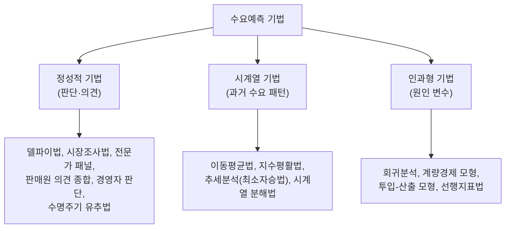
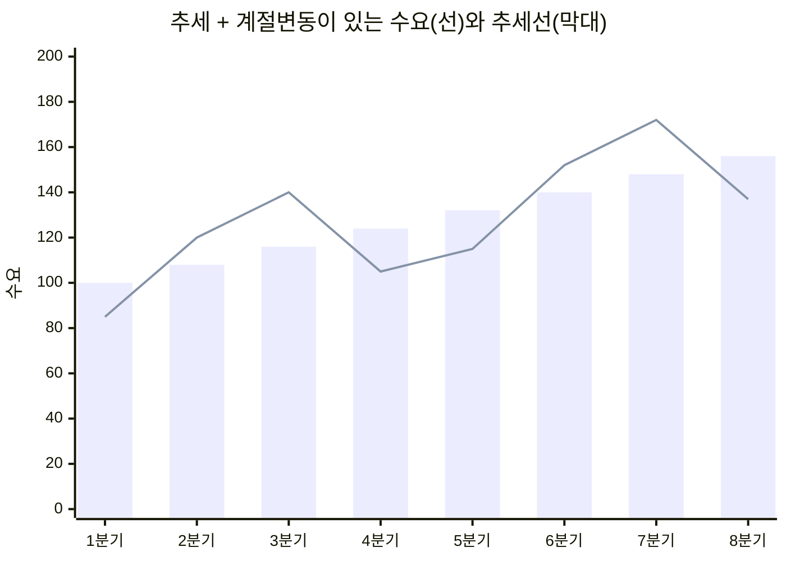

# 2.1 수요예측과 일정계획

!!! info "출제기준"
    **2. 생산운영 및 물류관리** › **1. 수요예측과 일정계획**

## 출제 경향

총 **28문항** 출제 (1교시 단답형 6 · 2~4교시 논술형 22) · 최근 10개 회차(109~139회) 8문항 · 최근 출제 제139회

| 주제 | 출제 수 | 출제 회차 |
|---|:-:|---|
| 2.1.1 수요예측의 개요와 정성적 기법 | 3 | 68회, 70회, 79회 |
| 2.1.2 시계열 예측(이동평균·지수평활) | 7 | 85회, 88회, 97회, 106회, 109회, 124회, 139회 |
| 2.1.3 예측오차와 추적지표 | 5 | 97회, 103회, 115회, 133회, 136회 |
| 2.1.4 작업순서 결정과 우선순위 규칙 | 8 | 63회, 70회, 73회, 88회, 94회, 106회, 121회, 136회 |
| 2.1.5 다수 기계 일정계획(존슨·Petrov) | 3 | 97회, 100회, 103회 |
| 2.1.6 일정계획 일반 | 2 | 63회, 67회 |

## 목차

1. [수요예측의 개요와 정성적 기법](#t21-1)
2. [시계열 예측(이동평균·지수평활)](#t21-2)
3. [예측오차와 추적지표](#t21-3)
4. [작업순서 결정과 우선순위 규칙](#t21-4)
5. [다수 기계 일정계획(존슨·Petrov)](#t21-5)
6. [일정계획 일반](#t21-6)

## 2.1.1 수요예측의 개요와 정성적 기법 {#t21-1}

### 수요예측의 의의

**수요예측**은 미래 일정 기간의 제품·서비스 수요량을 추정하는 것으로, 생산계획·재고·생산능력·인력·자금 계획의 **출발점**이다. 예측은 틀리기 마련이므로 예측 오차를 함께 관리해야 한다.

**부문별로 수요예측에 기반한 의사결정 (106회)**

| 부문 | 주요 의사결정 |
|---|---|
| 생산 | 생산능력 계획, 총괄생산계획, 기준생산계획(MPS), 재고 수준, 일정계획, 구매·조달 |
| 마케팅 | 판매 목표, 가격·판촉 계획, 유통·신제품 출시 시기 |
| 재무 | 예산 편성, 설비 투자, 자금 조달과 현금흐름 계획 |
| 인사 | 인력 채용·배치, 교육훈련, 초과근무·임시직 계획 |

### 수요예측 기법의 분류 (97·106회)

### 정성적 기법과 장단점 (68회)

| 기법 | 내용 | 장점 | 단점 |
|---|---|---|---|
| 델파이법 | 전문가들에게 익명 설문을 반복하며 의견을 수렴 | 권위·집단 압력 배제, 장기·신기술 예측에 적합 | 시간·비용 많음, 전문가 선정에 좌우 |
| 시장조사법 | 설문·면접·시험판매로 소비자 의견 조사 | 신제품 수요 파악, 비교적 정확 | 비용·시간 많음, 응답과 실제 구매의 차이 |
| 전문가(패널) 합의법 | 전문가·경영진이 토의로 합의 | 빠르고 저렴 | 영향력 있는 사람의 의견에 쏠림 |
| 판매원 의견 종합법 | 영업사원의 지역별 예측을 합산 | 현장 정보 반영, 지역·품목별 예측 | 낙관·비관 편향, 목표와 혼동 |
| 수명주기 유추법 | 유사 제품의 PLC 패턴을 참고 | 과거 자료가 없는 신제품에 사용 | 유사 제품 선택이 주관적 |

**델파이법의 절차 5단계 (97·133·139회)**

1. 예측 주제 결정과 조정자(진행자) 선정
2. 전문가 패널 선정(서로 익명 유지)
3. 1차 설문 실시와 응답 회수
4. 응답 결과(중앙값·사분위 범위·근거)를 요약해 피드백하고 **2차 이후 설문을 반복**
5. 의견이 수렴되면 결과를 종합해 최종 예측치 확정

### 재고관리·일정계획에 맞는 기법 (70회)

재고관리와 일정계획은 **단기간**에 **수많은 품목**을 **자주 반복**해서 예측해야 한다.

- **정성적 기법이 부적합한 이유**: 시간과 비용이 많이 들어 수많은 품목을 자주 반복 예측할 수 없고, 주관적이어서 일관성이 낮다. 주로 장기·신제품 예측용이다.
- **인과형 기법이 부적합한 이유**: 모형 구축과 설명변수 자료 수집에 비용이 크고, 설명변수 자체를 먼저 예측해야 한다. 주로 중장기·총량 예측에 쓴다.
- **적합한 기법**: 계산이 간단하고 자동화가 쉬운 **시계열 기법** — 단순·가중 이동평균, 단순 지수평활, 추세조정 지수평활(Holt), 계절지수법(Winters)

### 수요에 영향을 미치는 요인 (79회)

| 구분 | 요인 |
|---|---|
| 외부(통제 불가) | 경기·경제 상황, 소득 수준, 인구 구조, 경쟁사의 가격·신제품, 대체재·보완재, 계절·기후, 정책·규제, 소비자 기호·트렌드 |
| 내부(통제 가능) | 자사 가격, 광고·판촉, 제품 품질·디자인, 유통망, 신용 조건, 서비스 수준, 제품수명주기 단계 |

### 수요예측 방법 선정 시 고려사항 (133회)

예측 기간(단기·중기·장기), 과거 자료의 가용성과 양, 수요 패턴(수평·추세·계절), 요구되는 정확도, 예측 비용과 소요 시간, 예측 대상(개별 품목·총량), 사용자의 이해 용이성

!!! tip "답안 작성 포인트"
    - 분류 문제는 **3분류 트리 그림**으로 시작한다. 정성 / 시계열 / 인과형 각각에 기법을 3개 이상 쓴다.
    - 델파이법은 **익명성·반복·통제된 피드백·통계적 집계**의 4대 특징과 5단계 절차를 함께 외운다.
    - 70회형은 "단기·다품목·반복"이라는 재고·일정 예측의 특성을 먼저 쓰고, 그 특성과 맞지 않는 이유를 대비시킨다.

??? example "관련 기출 3문항 (68회, 70회, 79회)"

    - **제68회(2002) 2교시 6번** · 25점  
      수요예측을 위한 질적방법을 열거하고 장단점을 설명해보시오.
    - **제70회(2003) 2교시 3번** · 25점  
      수요예측에서, 정성적 기법과 인과형 모형은 재고관리와 일정계획에는 그 다지 유용하지 않다고 한다. 왜 그런지를 설명하시오. 그리고 적합한 예측기법을 나열하시오.
    - **제79회(2006) 2교시 3번** · 25점  
      수요에 영향을 미치는 요인에 대하여 설명하시오.

## 2.1.2 시계열 예측(이동평균·지수평활) {#t21-2}

### 시계열 변동의 4가지 유형 (124·133·139회)

시계열 자료 \( Y \)는 네 가지 변동으로 분해된다. 승법 모형: \( Y = T \times C \times S \times I \)

| 유형 | 의미 | 예 | 적합한 예측법 |
|---|---|---|---|
| 추세변동(T, Trend) | 장기간 꾸준히 증가·감소하는 경향 | 인구 증가에 따른 수요 증가 | 최소자승 추세선, 추세조정 지수평활(Holt) |
| 순환변동(C, Cycle) | 1년 이상 주기로 반복되는 경기 변동 | 경기 확장·수축 | 경기 선행지표, 인과형(회귀) 모형 |
| 계절변동(S, Seasonal) | 1년 안에서 주기적으로 반복 | 여름철 에어컨, 명절 수요 | 계절지수법, 시계열 분해법, Winters 모형 |
| 불규칙변동(I, Irregular) | 우연·돌발적 변동 | 파업, 재해, 일시 이벤트 | 예측 불가 → 이동평균·지수평활로 평활(제거) |

도식화 문제에서는 네 개의 작은 그래프(직선 상승 / 긴 파동 / 짧은 반복 파동 / 무작위 요동)를 나란히 그린다.

### 이동평균법 (88·109회)

**단순 이동평균**: 최근 \( n \)기간 실적의 평균을 다음 기간 예측치로 쓴다.

\[
F_{t+1} = \frac{A_t + A_{t-1} + \cdots + A_{t-n+1}}{n}
\]

**가중 이동평균**: 최근 자료에 큰 가중치를 준다(가중치 합 = 1).

\[
F_{t+1} = w_1 A_t + w_2 A_{t-1} + \cdots + w_n A_{t-n+1}
\]

- **의미**: \( n \)이 클수록 불규칙 변동을 잘 걸러내지만(평활 효과↑) 수요 변화에 늦게 반응한다. \( n \)이 작을수록 반대다.
- **용도**: 추세·계절성이 뚜렷하지 않은 **수평(안정) 수요**의 단기 예측

### 지수평활법 (88회)

**단순 지수평활**: 직전 예측치에 예측 오차의 일정 비율(\( \alpha \))만큼을 보정한다.

\[
F_{t+1} = F_t + \alpha (A_t - F_t) = \alpha A_t + (1 - \alpha) F_t \qquad (0 \le \alpha \le 1)
\]

- 과거 실적 전체에 **지수적으로 감소하는 가중치**를 주는 가중 이동평균과 같다.
- \( \alpha \)가 크면 최근 수요에 민감(변동·추세가 있는 수요), 작으면 평활 효과가 큼(안정 수요)
- 자료 저장이 적고 계산이 간단해 **다품목 단기 예측(재고관리)**에 널리 쓴다.

**추세조정 지수평활법(Holt 모형) (85회)**: 단순 지수평활은 추세가 있으면 예측이 계속 뒤처지므로(지연 오차) **수준과 추세를 따로 평활**한다.

\[
\begin{aligned}
S_t &= \alpha A_t + (1-\alpha)(S_{t-1} + T_{t-1}) && \text{(평활 수준)}\\
T_t &= \beta (S_t - S_{t-1}) + (1-\beta) T_{t-1} && \text{(평활 추세)}\\
F_{t+1} &= S_t + T_t && \text{(추세조정 예측치)}
\end{aligned}
\]

계절성까지 반영하려면 Winters 모형(수준·추세·계절 3중 평활)을 쓴다.

### 최소자승법(추세분석) (88회)

시간 \( X \)와 수요 \( Y \)의 관계를 직선 \( Y = a + bX \)로 놓고 오차 제곱합이 최소가 되도록 \( a, b \)를 구한다.

\[
b = \frac{n\sum XY - \sum X \sum Y}{n\sum X^2 - (\sum X)^2}, \qquad a = \frac{\sum Y - b\sum X}{n}
\]

\( X \)를 \( \sum X = 0 \)이 되도록 부호화하면 \( a = \sum Y / n,\ b = \sum XY / \sum X^2 \)로 간단해진다.
**용도**: 뚜렷한 **추세**가 있는 수요의 중기 예측

### 시계열 분해법 (97회)

시계열을 T·C·S·I로 분리해 각각을 예측한 뒤 다시 결합하는 방법이다.

1. 이동평균(예: 12개월 중심 이동평균)으로 T×C를 구함
2. 실적 ÷ 이동평균으로 계절지수(S)를 구함
3. 실적을 계절지수로 나눠 **계절 조정(탈계절화)**
4. 계절 조정 자료로 추세선을 구해 미래 추세를 예측
5. 추세 예측치 × 계절지수로 최종 예측(재계절화)

!!! tip "답안 작성 포인트"
    - 시계열 변동 유형은 **4가지 그래프 + 유형별 적합 기법** 표가 핵심이다(124·133·139회 반복).
    - 공식 문제는 식만 쓰지 말고 **기호 정의, 모수(\( n, \alpha \))의 의미, 용도**까지 쓴다.
    - 단순 지수평활에 추세가 있으면 예측이 늦어진다는 점을 들어 Holt 모형의 필요성을 설명하면 85회형에 대응된다.

??? example "관련 기출 7문항 (85회, 88회, 97회, 106회, 109회, 124회, 139회)"

    - **제85회(2008) 1교시 8번** · 10점  
      추세조정지수평활법(trend adjusted exponential smoothing)에 대해 설명하시오.
    - **제88회(2009) 1교시 4번** · 10점  
      수요예측 기법 중에서 1)이동평균법, 2)최소자승법, 3)지수평활법의 산출식과 각 기법의 용도를 설명하시오.
    - **제97회(2012) 2교시 2번** · 25점  
      경영 의사결정에 있어서 미래 계획을 수립하기 위한 수요예측에 대하여 다음 각 물음에 답하시오.

        ??? quote "문제 전문"

            경영 의사결정에 있어서 미래 계획을 수립하기 위한 수요예측에 대하여 다음 각 물음에 답하시오.  
            1) 수요예측 접근방법별로 기법의 종류를 나열하시오.  
            2) 수요예측 기법 중 델파이법과 시계열분해법에 대하여 설명하시오.  
    - **제106회(2015) 3교시 5번** · 25점  
      수요예측에 대한 다음 각 물음에 답하시오.

        ??? quote "문제 전문"

            수요예측에 대한 다음 각 물음에 답하시오.  
            (1) 공장관리에서 수요예측을 기반으로 하는 생산, 마케팅, 재무, 인사 부문에서 행하는 중요 의사결정들에 대하여 설명하시오.  
            (2) 수요 예측기법의 종류에 대하여 설명하시오.  
            (3) 시계열 예측기법에 대하여 설명하시오.  
    - **제109회(2016) 1교시 9번** · 10점  
      이동평균법을 구하는 공식을 쓰고, 그 의미에 대하여 설명하시오.
    - **제124회(2021) 4교시 4번** · 25점  
      시계열 수요자료로 인식할 수 있는 수요변동 형태와 수요예측 기법을 설명하시오.
    - **제139회(2026) 4교시 1번** · 25점  
      수요예측에 대하여 다음의 물음에 답하시오.

        ??? quote "문제 전문"

            수요예측에 대하여 다음의 물음에 답하시오.  
            1) 시계열변동의 추세변동, 순환변동, 계절변동, 불규칙변동에 대하여 도식화하여 설명하시오.  
            2) 정성적 예측법인 델파이법을 정의하고, 사용절차를 5단계로 구분하여 설명하시오.  

## 2.1.3 예측오차와 추적지표 {#t21-3}

### 예측오차 측정의 목적 (103회)

1. 예측 기법의 **정확도를 평가**하고 기법을 비교·선택
2. 예측의 **편향(bias)**을 찾아 모형을 수정
3. 모수(\( n, \alpha \))를 조정
4. 오차 크기를 바탕으로 **안전재고** 수준을 결정

### 오차 측정 지표

| 지표 | 공식 | 의미 |
|---|---|---|
| 예측오차 | \( e_t = A_t - F_t \) | (+)는 과소예측, (−)는 과대예측 |
| 누적예측오차(CFE, RSFE) | \( CFE = \sum e_t \) | 오차의 누적 → **편향** 판단(0에 가까울수록 좋음) |
| 평균절대오차(MAD) | \( MAD = \dfrac{\sum \lvert e_t \rvert}{n} \) | 오차의 평균 크기 → **정확도** |
| 평균제곱오차(MSE) | \( MSE = \dfrac{\sum e_t^2}{n} \) | 큰 오차에 더 큰 벌점 |
| 평균절대백분율오차(MAPE) | \( MAPE = \dfrac{100}{n}\sum \dfrac{\lvert e_t \rvert}{A_t} \) | 규모가 다른 품목 간 비교 |

### 추적지표(TS, Tracking Signal) (97·103·115·133회)

\[
TS = \frac{CFE}{MAD}
\]

- 예측이 **한쪽으로 치우치는지(편향)**를 감시하는 지표다. 오차가 무작위이면 CFE가 0 근처에 머물러 TS도 0 근처에 있다.
- **관리 한계**: 보통 \( \pm 4\,MAD \)(문제에 따라 \( \pm 3.75\,MAD \) 등)를 쓴다. TS가 한계를 벗어나면 **예측 모형을 재검토**한다.
- TS가 계속 (+)이면 과소예측, 계속 (−)이면 과대예측 경향이다.

### 지수평활계수 \( \alpha = 0.5 \)의 의미 (115회)

\( F_{t+1} = 0.5A_t + 0.5F_t \) — **최근 실적과 직전 예측에 같은 비중**을 둔다. 반응성과 평활 효과가 중간인 경우로, 비교적 큰 \( \alpha \)여서 수요 변화에 빠르게 반응하지만 불규칙 변동도 함께 따라간다.

### 풀이: 97회

MAD는 해당 월까지의 누적 평균으로 계산한다.

| 월 | 실제 | 예측 | 오차 | CFE | MAD | TS |
|:-:|:-:|:-:|:-:|:-:|:-:|:-:|
| 1 | 95 | 100 | −5 | −5 | 5.00 | −1.00 |
| 2 | 100 | 100 | 0 | −5 | 2.50 | −2.00 |
| 3 | 110 | 106 | 4 | −1 | 3.00 | −0.33 |
| 4 | 102 | 106 | −4 | −5 | 3.25 | −1.54 |
| 5 | 98 | 100 | −2 | −7 | 3.00 | −2.33 |
| 6 | 120 | 111 | 9 | 2 | 4.00 | 0.50 |

→ TS가 −2.33 ~ 0.50으로 \( \pm 4 \) 관리 한계 안에 있다. 부호도 (−)와 (+)가 섞여 있어 **뚜렷한 편향이 없고 예측이 적정**하다.

### 풀이: 103회

| 월 | 실제 | 예측 | 오차 | CFE | MAD | TS |
|:-:|:-:|:-:|:-:|:-:|:-:|:-:|
| 1 | 90 | 95 | −5 | −5 | 5.00 | −1.00 |
| 2 | 100 | 95 | 5 | 0 | 5.00 | 0.00 |
| 3 | 105 | 100 | 5 | 5 | 5.00 | 1.00 |
| 4 | 100 | 105 | −5 | 0 | 5.00 | 0.00 |
| 5 | 95 | 100 | −5 | −5 | 5.00 | −1.00 |
| 6 | 110 | 95 | 15 | 10 | 6.67 | 1.50 |

→ 6개월 CFE = 10, MAD = 6.67, TS = 1.50. 모든 TS가 \( \pm 4\,MAD \) 안에 있으므로 **예측 기법은 적정**하다. 다만 6월에 오차가 커졌으므로 수요가 늘어나는 추세인지 계속 관찰한다.

### 풀이: 115회 (단순 지수평활, \( \alpha = 0.5,\ F_1 = 300 \))

예측치: \( F_2 = 300 + 0.5(310 - 300) = 305 \), \( F_3 = 305 + 0.5(295 - 305) = 300 \), \( F_4 = 308 \), \( F_5 = 302 \), \( F_6 = 303 \)

| 월 | 실제 | 예측 | 오차 | CFE | MAD | TS |
|:-:|:-:|:-:|:-:|:-:|:-:|:-:|
| 1 | 310 | 300 | 10 | 10 | 10.0 | 1.00 |
| 2 | 295 | 305 | −10 | 0 | 10.0 | 0.00 |
| 3 | 316 | 300 | 16 | 16 | 12.0 | 1.33 |
| 4 | 296 | 308 | −12 | 4 | 12.0 | 0.33 |
| 5 | 304 | 302 | 2 | 6 | 10.0 | 0.60 |
| 6 | 299 | 303 | −4 | 2 | 9.0 | 0.22 |

→ TS 최댓값이 1.33으로 관리 한계 \( \pm 3.75 \) 안에 있으므로 **단순 지수평활법(\( \alpha = 0.5 \))을 적용할 수 있다**.

### 풀이: 136회 (3개월 가중 이동평균, 가중치 0.5·0.3·0.2)

- 5월: \( 0.5(62) + 0.3(50) + 0.2(38) = 53.6 \rightarrow 54 \)
- 6월: \( 0.5(42) + 0.3(62) + 0.2(50) = 49.6 \rightarrow 50 \)
- 7월: \( 0.5(28) + 0.3(42) + 0.2(62) = 39.0 \rightarrow 39 \)
- 8월: \( 0.5(48) + 0.3(28) + 0.2(42) = 40.8 \rightarrow 41 \)

| 월 | 실제 | 예측 | 오차 | CFE | MAD |
|:-:|:-:|:-:|:-:|:-:|:-:|
| 2 | 38 | 40 | −2 | −2 | 2 |
| 3 | 50 | 42 | 8 | 6 | 5 |
| 4 | 62 | 53 | 9 | 15 | 6 (6.33) |
| 5 | 42 | 54 | −12 | 3 | 8 (7.75) |
| 6 | 28 | 50 | −22 | −19 | 11 (10.60) |
| 7 | 48 | 39 | 9 | −10 | 10 (10.33) |
| 8 | 54 | 41 | 13 | 3 | 11 (10.71) |

(MAD는 2월부터의 누적 평균, 괄호 안은 반올림 전 값)

!!! tip "답안 작성 포인트"
    - 계산 문제는 **공식 → 완성된 표 → 판정(관리 한계와 비교) → 의미 해석** 순서로 쓴다.
    - MAD를 **누적 평균**으로 계산하는지 문제 조건을 확인한다. 기출은 대부분 해당 월까지의 누적 평균을 쓴다.
    - TS 판정에서는 한계 안·밖 여부와 함께 **부호의 연속성(편향 방향)**도 언급한다.

??? example "관련 기출 5문항 (97회, 103회, 115회, 133회, 136회)"

    - **제97회(2012) 4교시 6번** · 25점  
      수요예측기법에는 여러 가지가 있다. 예측의 효과를 높이기 위해 추적지표(TS: Tracking Signal)을 사용한다. 실제수요와 예측치가 아래 표와 같을 때 누적예측오차(CFE: Cumulative sum of Forecast Errors), 절대평균오차(MAD: Mean Absolute Deviation), 추적지표를 구하고, 추적지표의 값이 나타내는 의미를 설명하시오. (단, 추적지표는 소숫점 이하 셋째자리에서 반올림하시오.)

        ??? quote "문제 전문"

            수요예측기법에는 여러 가지가 있다. 예측의 효과를 높이기 위해 추적지표(TS: Tracking Signal)을 사용한다. 실제수요와 예측치가 아래 표와 같을 때 누적예측오차(CFE: Cumulative sum of Forecast Errors), 절대평균오차(MAD: Mean Absolute Deviation), 추적지표를 구하고, 추적지표의 값이 나타내는 의미를 설명하시오. (단, 추적지표는 소숫점 이하 셋째자리에서 반올림하시오.)  
            [표] 월 | 실제수요 | 예측치 | 누적예측오차 | 평균절대오차 | 추적지표  
            1 | 95 | 100 | | |  
            2 | 100 | 100 | | |  
            3 | 110 | 106 | | |  
            4 | 102 | 106 | | |  
            5 | 98 | 100 | | |  
            6 | 120 | 111 | | |  
    - **제103회(2014) 2교시 2번** · 25점  
      다음은 어느 회사의 판매품목에 대해 수요예측치와 실제판매량을 비교하여 나타낸 것이다.

        ??? quote "문제 전문"

            다음은 어느 회사의 판매품목에 대해 수요예측치와 실제판매량을 비교하여 나타낸 것이다.  
            [표] 월 | 1 | 2 | 3 | 4 | 5 | 6  
            실제판매량 | 90 | 100 | 105 | 100 | 95 | 110  
            수요예측치 | 95 | 95 | 100 | 105 | 100 | 95  
            1) 예측오차의 측정목적에 대하여 설명하시오.  
            2) 누적예측오차(Running sum of forecast error)와 절대평균오차(Mean absolute deviation)를 설명하고 각각의 값을 구하시오.  
            3) 추적지표(Tracking Signal)를 설명하고 계산한 후 그 계산 결과에 대해 ±4MAD 관리도법을 적용하여 평가하시오.  
    - **제115회(2018) 3교시 4번** · 25점  
      K사는 단순지수평활법(평활계수 α=0.5)으로 수요를 예측하여 생산계획을 수립하고자 한다. 이 방법이 당사에 적합한지를 평가하기 위해 다음 상반기 생산실적을 가지고 단순지수평활법으로 수요예측을 한 후 예측오차를 평가하여 적용여부를 결정하기로 하였다. 다음 물음에 답하시오.

        ??? quote "문제 전문"

            K사는 단순지수평활법(평활계수 α=0.5)으로 수요를 예측하여 생산계획을 수립하고자 한다. 이 방법이 당사에 적합한지를 평가하기 위해 다음 상반기 생산실적을 가지고 단순지수평활법으로 수요예측을 한 후 예측오차를 평가하여 적용여부를 결정하기로 하였다. 다음 물음에 답하시오.  
            [표] 월 | 1월 | 2월 | 3월 | 4월 | 5월 | 6월  
            수요 | 310 | 295 | 316 | 296 | 304 | 299  
            1) 평활계수 α=0.5라면 어떤 경우인지 설명하시오.  
            2) 2월부터 6월까지의 수요를 단순지수평활법으로 예측하여 다음 표를 완성하시오.  
            (단, 1월의 예측치는 300개이다.)  
            [표] 월 | 1월 | 2월 | 3월 | 4월 | 5월 | 6월  
            수요 | 310 | 295 | 316 | 296 | 304 | 299  
            예측치 | 300 | | | | |  
            3) 2)항의 예측치를 활용하여, 월별 누적예측오차(CFE: cumulative sum of forecasting error), 평균절대오차(MAD: mean absolute deviation), 추적지표(TS: tracking signal)를 계산하여 다음 표를 완성하시오.  
            [표] 월 | 실제수요 | 예측오차 | CFE | MAD | TS  
            1 | 310 | 10 | | |  
            2 | 295 | | | |  
            3 | 316 | | | |  
            4 | 296 | | | |  
            5 | 304 | | | |  
            6 | 299 | | | |  
            4) 월별 추적지표를 관리도법(±3.75MAD)을 적용하여, 단순지수평활법(평활계수 α=0.5)의 적용가능 여부를 결정하시오.  
    - **제133회(2024) 4교시 1번** · 25점  
      수요예측에 대하여 다음을 설명하시오.

        ??? quote "문제 전문"

            수요예측에 대하여 다음을 설명하시오.  
            1) 수요예측 방법 선정 시 고려사항  
            2) 시계열 변동의 4가지 유형과 유형별 수요 예측법  
            3) 델파이법  
            4) 추적 지표(Tracking Signal)  
    - **제136회(2025) 3교시 6번** · 25점  
      수요예측과 관련된 다음 질문에 답하시오.

        ??? quote "문제 전문"

            수요예측과 관련된 다음 질문에 답하시오.  
            [표] 월 | 실제수요 | 예측치 | 예측오차 | 누적예측오차 | 평균절대오차  
            2 | 38 | 40 | | |  
            3 | 50 | 42 | | |  
            4 | 62 | 53 | | |  
            5 | 42 | | | |  
            6 | 28 | | | |  
            7 | 48 | | | |  
            8 | 54 | | | |  
            (1) 3개월 가중 이동 평균법을 사용하여 5월부터 8월까지 예측치를 소수점 첫째 자리에서 반올림하여 구하시오.  
            (단, 가중치 최근: 0.5, 직전: 0.3, 그전: 0.2)  
            (2) 예측오차(Forecast Errors), 누적예측오차(Cumulative Sum of Forecast Errors), 평균절대오차(Mean Absolute Deviation)를 소수점 첫째 자리에서 반올림하여 구하시오.  

## 2.1.4 작업순서 결정과 우선순위 규칙 {#t21-4}

### 일정계획 수립에 필요한 요소 (73회)

작업(주문) 목록과 수량, 납기, 작업별 표준시간, 공정 순서(라우팅), 설비 능력과 부하, 자재 가용성, 작업자, 준비교체 시간, 우선순위 규칙

### 작업순서 결정의 평가 기준 (106회)

| 기준 | 정의 |
|---|---|
| 평균 흐름시간(Mean Flow Time) | 작업이 도착해 완료될 때까지 걸린 시간의 평균 |
| 평균 대기시간 | 작업이 처리를 기다린 시간의 평균(= 흐름시간 − 처리시간) |
| 평균 납기지연(Mean Tardiness) | 납기를 넘긴 시간 \( \max(0, C_j - d_j) \)의 평균 |
| 최대 지연(Maximum Lateness) | 완료시각 − 납기 \( (C_j - d_j) \)의 최댓값 |
| 지연 작업 수 | 납기를 지키지 못한 작업의 수 |
| 평균 재공품 수 | 시스템 안에 있는 평균 작업 수 |
| 총 완료시간(Makespan) | 마지막 작업이 끝나는 시각 |

### 우선순위 규칙의 종류와 특성 (106·136회)

| 규칙 | 기준 | 특성 |
|---|---|---|
| FCFS(선착순) | 먼저 도착한 작업부터 | 공정하고 간단, 효율은 낮음 |
| **SPT**(최단 처리시간) | 처리시간이 짧은 작업부터 | 단일 기계에서 **평균 흐름시간·평균 대기시간·평균 재공을 최소화** |
| **EDD**(최소 납기) | 납기가 빠른 작업부터 | 단일 기계에서 **최대 지연을 최소화** |
| LPT(최장 처리시간) | 처리시간이 긴 작업부터 | 큰 작업을 먼저 끝냄, 대체로 성과 나쁨 |
| MST·S(최소 여유시간) | 여유 = 납기 − 현재 − 잔여 처리시간이 작은 작업부터 | 납기 준수 지향 |
| **CR**(긴급률) | \( CR = \dfrac{\text{납기} - \text{현재일}}{\text{잔여 작업일수}} \)가 작은 작업부터 | CR < 1이면 이미 지연 상태, 동적으로 갱신 |
| S/RO | 여유시간 ÷ 잔여 공정 수가 작은 작업부터 | 여러 공정을 거치는 작업에 적합 |

### SPT 규칙의 이유와 결점 (70회)

- **이유**: 짧은 작업을 먼저 처리하면 뒤에서 기다리는 작업 수가 빨리 줄어든다. 그래서 단일 작업장에서 **평균 흐름시간과 재공품 재고가 최소**가 되고, 작업장 혼잡이 줄며, 고객이 평균적으로 가장 빨리 서비스를 받는다.
- **결점**: 처리시간이 긴 작업은 계속 뒤로 밀려 **크게 지연(기아 현상)**될 수 있고, 납기를 고려하지 않아 중요한 주문이 늦어질 수 있다. → 대기시간 상한을 두거나 납기 규칙과 혼합해 보완한다.

### 풀이: 63회 (현재일 = 0)

| 작업 | 작업일수 | 납기 | 여유(납기 − 작업일수) | CR(납기 ÷ 작업일수) |
|:-:|:-:|:-:|:-:|:-:|
| 1 | 6 | 9 | 3 | 1.50 |
| 2 | 12 | 1 | −11 | 0.08 |
| 3 | 3 | 11 | 8 | 3.67 |
| 4 | 10 | 19 | 9 | 1.90 |

| 규칙 | 작업순서 |
|---|---|
| SPT | 3 → 1 → 4 → 2 |
| EDD | 2 → 1 → 3 → 4 |
| MST(최소 여유) | 2 → 1 → 3 → 4 |
| CR | 2 → 1 → 4 → 3 |

### 풀이: 88회

처리시간 J1 3, J2 6, J3 9, J4 8, J5 5 / 납기 J1 4, J2 7, J3 6, J4 10, J5 5

| 스케줄 | 순서 | 완료시각 | 평균 흐름시간 | 평균 대기시간 | 평균 납기지연 | 최대 지연 |
|---|---|---|:-:|:-:|:-:|:-:|
| 스케줄 1 | J1→J2→J3→J4→J5 | 3, 9, 18, 26, 31 | 17.4 | 11.2 | 11.2 | 26 |
| 스케줄 2 | J5→J4→J3→J2→J1 | 5, 13, 22, 28, 31 | 19.8 | 13.6 | 13.4 | 27 |
| **SPT** | J1→J5→J2→J4→J3 | 3, 8, 14, 22, 31 | **15.6** | 9.4 | 9.4 | 25 |
| **EDD** | J1→J5→J3→J2→J4 | 3, 8, 17, 23, 31 | 16.4 | 10.2 | 10.2 | **21** |

→ 주어진 두 스케줄 중에서는 스케줄 1이 모든 기준에서 낫다. **평균 흐름시간은 SPT(15.6)**, **최대 지연은 EDD(21)**가 최소이므로 두 스케줄보다 개선된 스케줄이다.

### 풀이: 94회 (현재일 = 0)

| 작업 | 납기 | 작업시간 | 잔여 공정 | CR | 여유(S) | S/RO |
|:-:|:-:|:-:|:-:|:-:|:-:|:-:|
| J1 | 10 | 4 | 7 | 2.50 | 6 | 0.86 |
| J2 | 9 | 6 | 4 | 1.50 | 3 | 0.75 |
| J3 | 5 | 3 | 3 | 1.67 | 2 | 0.67 |

| 규칙 | SPT | CR | DD | S | S/RO |
|---|---|---|---|---|---|
| 작업순서 | J3→J1→J2 | J2→J3→J1 | J3→J2→J1 | J3→J2→J1 | J3→J2→J1 |

### 풀이: 121회

| 규칙 | 작업순서 | 완료시각 | 평균 진행시간 | 평균 납기지연 |
|---|---|---|:-:|:-:|
| 선착순(FCFS) | A→B→C→D→E | 10, 25, 37, 51, 67 | 38.0 | **10.2** |
| 최소 작업시간(SPT) | A→C→D→B→E | 10, 22, 36, 51, 67 | **37.2** | 10.8 |
| 최소 납기(EDD) | A→B→C→D→E | 10, 25, 37, 51, 67 | 38.0 | **10.2** |
| 최소 여유시간 | A→B→D→C→E | 10, 25, 39, 51, 67 | 38.4 | 10.6 |

(선착순의 납기지연: C 8, D 21, E 22일 → 51 ÷ 5 = 10.2일)

→ **평균 진행시간 최소: SPT 규칙(37.2일)**, **평균 납기지연 최소: 선착순·최소 납기 규칙(10.2일)**. 이 문제는 도착 순서가 납기 순서와 같아 선착순과 EDD의 결과가 같다.

!!! tip "답안 작성 포인트"
    - 계산 문제는 **규칙별 순서 → 완료시각 → 평가지표 표 → 판정**의 틀로 쓴다. 완료시각 열을 표에 넣어 과정을 보여 준다.
    - "SPT는 평균 흐름시간 최소, EDD는 최대 지연 최소"라는 **이론적 성질**을 결론에 꼭 쓴다.
    - CR·여유시간은 현재일을 문제 조건에서 확인하고(없으면 0으로 가정한다고 밝힘) 계산한다.

??? example "관련 기출 8문항 (63회, 70회, 73회, 88회, 94회, 106회, 121회, 136회)"

    - **제63회(2001) 3교시 6번** · 25점  
      단일설비 일정계획(Scheduling)시 다음과 같은 작업배정 규칙에 의해 작업순서를 결정(Sequencing) 하시오.

        ??? quote "문제 전문"

            단일설비 일정계획(Scheduling)시 다음과 같은 작업배정 규칙에 의해 작업순서를 결정(Sequencing) 하시오.  
            [표] 작업번호 | 작업일수 | 납기일수  
            1 | 6 | 9  
            2 | 12 | 1  
            3 | 3 | 11  
            4 | 10 | 19  
            1) SPT에 의한 작업순위  
            2) EDD에 의한 작업순위  
            3) MST에 의한 작업순위  
            4) CR에 의한 작업순위  
    - **제70회(2003) 2교시 5번** · 25점  
      한 개의 작업장을 거치는 경우, 재공품 재고와 작업정체가 최소가 되고, 작업장이 덜 혼잡해지며 고객에게 평균적으로 가장 빠른 서비스를 제고알 수 있는 작업 우선순위 규칙은 무엇이며, 그 이유와 이 규칙의 결점에 대하여 설명하시오.
    - **제73회(2004) 1교시 5번** · 10점  
      일정계획(Scheduling) 수립에 필요한 요소
    - **제88회(2009) 2교시 2번** · 25점  
      하나의 기계에서 처리해야 할 5개의 작업에 대해 아래의 스케줄1과 스케줄2가 있다. 두개 스케줄을 최대지연(maximum lateness), 평균순수지연(mean tardiness), 평균흐름시간(mean flow time), 평균대기시간(mean waiting time) 측면에서 비교 분석하시오. 그리고 평균흐름시간과 최대지연의 측면에서 주어진 스케줄보다 더 개선된 스케줄이 있으면 제시하시오.

        ??? quote "문제 전문"

            하나의 기계에서 처리해야 할 5개의 작업에 대해 아래의 스케줄1과 스케줄2가 있다. 두개 스케줄을 최대지연(maximum lateness), 평균순수지연(mean tardiness), 평균흐름시간(mean flow time), 평균대기시간(mean waiting time) 측면에서 비교 분석하시오. 그리고 평균흐름시간과 최대지연의 측면에서 주어진 스케줄보다 더 개선된 스케줄이 있으면 제시하시오.  
            [표] (단위:시간) 구분 \\ 작업명 | J1 | J2 | J3 | J4 | J5  
            처리시간 | 3 | 6 | 9 | 8 | 5  
            납기 | 4 | 7 | 6 | 10 | 5  
            스케줄1 : J1 → J2 → J3 → J4 → J5  
            스케줄2 : J5 → J4 → J3 → J2 → J1  
    - **제94회(2011) 2교시 2번** · 25점  
      표와 같이 작업의 납기와 작업시간이 주어졌을 때, 다음에 제시된 우선순위규칙을 사용하여 각각의 규칙별 작업순서를 결정하시오.

        ??? quote "문제 전문"

            표와 같이 작업의 납기와 작업시간이 주어졌을 때, 다음에 제시된 우선순위규칙을 사용하여 각각의 규칙별 작업순서를 결정하시오.  
            [표] 작업 | 도착순서 | 납기(일) | 작업시간(일) | 잔여작업(공정) 수  
            J1 | 1 | 10 | 4 | 7  
            J2 | 2 | 9 | 6 | 4  
            J3 | 3 | 5 | 3 | 3  
            \- 최단처리시간법(SPT)  
            \- 긴급률법(CR)  
            \- 납기순법(DD)  
            \- 최소여유시간법(S)  
            \- 잔여작업 최소여유시간 우선법(S/RO)  
    - **제106회(2015) 2교시 6번** · 25점  
      개별생산 공장에서 작업순서 결정과 관련한 다음 각 물음에 답하시오.

        ??? quote "문제 전문"

            개별생산 공장에서 작업순서 결정과 관련한 다음 각 물음에 답하시오.  
            (1) 작업순서 결정의 평가기준에 대하여 설명하시오.  
            (2) 작업순서 결정규칙의 종류 및 그 특성에 대하여 설명하시오.  
    - **제121회(2020) 3교시 6번** · 25점  
      다음 표와 같이 작업 5가지 주문이 순서대로 접수되었다. 선착순, 최소 작업시간, 최소 납기, 최소 여유시간 등 4가지 우선순위규칙을 활용하여 작업 순서를 정할 때 다음 물음에 답하시오.

        ??? quote "문제 전문"

            다음 표와 같이 작업 5가지 주문이 순서대로 접수되었다. 선착순, 최소 작업시간, 최소 납기, 최소 여유시간 등 4가지 우선순위규칙을 활용하여 작업 순서를 정할 때 다음 물음에 답하시오.  
            [표] 작업 | 도착 순서 | 납기(일) | 작업시간(일) | 여유시간(일)  
            A | 1 | 10 | 10 | 0  
            B | 2 | 25 | 15 | 10  
            C | 3 | 29 | 12 | 17  
            D | 4 | 30 | 14 | 16  
            E | 5 | 45 | 16 | 29  
            1) 선착순 규칙의 평균 진행시간과 평균 납기 지연일수를 구하시오.  
            2) 최소 작업시간 규칙의 평균 진행시간과 평균 납기 지연일수를 구하시오.  
            3) 최소 납기 규칙의 평균 진행시간과 평균 납기 지연일수를 구하시오.  
            4) 최소 여유시간 규칙의 평균 진행시간과 평균 납기 지연일수를 구하시오.  
            5) 평균 진행시간 최소 및 평균 납기 지연 최소의 규칙을 판정하시오.  
    - **제136회(2025) 4교시 1번** · 25점  
      스케쥴링(Scheduling)시 생산현장에서 사용하는 우선순위규칙(Priority Rule)인 FCFS(First Come First Served), SPT(Shortest Processing Time), EDD(Earliest Due Date)를 각각 설명하시오.

## 2.1.5 다수 기계 일정계획(존슨·Petrov) {#t21-5}

### 존슨의 법칙(Johnson's Rule) (97·103회)

**개념**: \( n \)개 작업이 모두 **기계 1 → 기계 2의 같은 순서**로 가공될 때(2단계 흐름공정), **총 완료시간(makespan)을 최소화**하는 작업순서를 구하는 방법이다(S. M. Johnson, 1954).

**적용 방법**

1. 모든 작업의 기계 1, 기계 2 가공시간 중 **가장 작은 값**을 찾는다.
2. 그 값이 **기계 1**에 있으면 그 작업을 **가능한 앞**에, **기계 2**에 있으면 **가능한 뒤**에 배치한다.
3. 배치한 작업을 지우고, 모든 작업이 배치될 때까지 1~2를 반복한다(동점이면 임의 선택).

**전제 조건**: 모든 작업의 가공 순서가 같고, 한 기계는 한 번에 한 작업만 처리하며, 가공시간이 확정적이고, 작업 도중 중단이 없다.

### 풀이: 97회

| 작업 | A | B | C | D | E |
|---|:-:|:-:|:-:|:-:|:-:|
| 기계 1 | 6 | 11 | 10 | 5 | 8 |
| 기계 2 | 2 | 4 | 7 | 7 | 9 |

배치 과정: A(기계 2, 2) → 맨 뒤 / B(기계 2, 4) → 뒤에서 둘째 / D(기계 1, 5) → 맨 앞 / C(기계 2, 7) → 뒤에서 셋째 / E → 남은 자리

**최적 순서: D → E → C → B → A**

| 작업 | 기계 1 (시작–완료) | 기계 2 (시작–완료) |
|:-:|:-:|:-:|
| D | 0 – 5 | 5 – 12 |
| E | 5 – 13 | 13 – 22 |
| C | 13 – 23 | 23 – 30 |
| B | 23 – 34 | 34 – 38 |
| A | 34 – 40 | 40 – **42** |

→ **최소 총 완료시간 = 42시간**

### 3대 기계로의 확장과 Petrov 방법 (100회)

기계가 A → B → C 3대이면, 다음 조건 중 하나를 만족할 때 두 대의 **가상 기계**로 바꿔 존슨의 법칙을 적용할 수 있다.

\[
\min A_i \ge \max B_i \quad \text{또는} \quad \min C_i \ge \max B_i
\]

\[
P_{1i} = A_i + B_i, \qquad P_{2i} = B_i + C_i
\]

**Petrov 방법**은 이를 일반화한 것으로, \( m \)대의 기계를 앞쪽 절반의 합(\( P_1 \))과 뒤쪽 절반의 합(\( P_2 \))으로 묶는다(\( m \)이 홀수이면 가운데 기계를 양쪽에 모두 포함).

### 풀이: 100회

조건 확인: \( \min A = 3 \ge \max B = 2 \) → 존슨 법칙 적용 가능

| 작업 | A | B | C | \( P_1 = A+B \) | \( P_2 = B+C \) |
|:-:|:-:|:-:|:-:|:-:|:-:|
| J1 | 4 | 2 | 1 | 6 | 3 |
| J2 | 7 | 1 | 1 | 8 | 2 |
| J3 | 5 | 2 | 3 | 7 | 5 |
| J4 | 3 | 0 | 9 | 3 | 9 |
| J5 | 3 | 2 | 2 | 5 | 4 |

배치 과정: J2(\( P_2 \) 2) → 맨 뒤 / J4(\( P_1 \) 3) → 맨 앞 / J1(\( P_2 \) 3) → 뒤에서 둘째 / J5(\( P_2 \) 4) → 뒤에서 셋째 / J3 → 남은 자리

**최적 순서: J4 → J3 → J5 → J1 → J2**

| 작업 | 기계 A 완료 | 기계 B 완료 | 기계 C 완료 |
|:-:|:-:|:-:|:-:|
| J4 | 3 | 3 | 12 |
| J3 | 8 | 10 | 15 |
| J5 | 11 | 13 | 17 |
| J1 | 15 | 17 | 18 |
| J2 | 22 | 23 | **24** |

→ **최소 총 처리시간 = 24**

!!! tip "답안 작성 포인트"
    - 존슨 법칙은 **개념 → 적용 절차 → 전제 조건**을 쓰고, 계산 문제는 **배치 과정 → 최적 순서 → 기계별 시작·완료 시각표(또는 간트 차트)**로 보여 준다.
    - 3대 기계 문제는 먼저 **적용 조건(\( \min A \ge \max B \))을 확인**하는 문장을 반드시 넣는다.

??? example "관련 기출 3문항 (97회, 100회, 103회)"

    - **제97회(2012) 1교시 12번** · 10점  
      A∼E 5개의 작업은 모두 기계 1과 기계 2를 순차적으로 거쳐 작업을 하게 된다. 작업순서계획의 수립에 있어 존슨의 법칙을 적용하여 가공순서를 결정하고, 최적화된 전체 작업완료시간을 구하시오.

        ??? quote "문제 전문"

            A∼E 5개의 작업은 모두 기계 1과 기계 2를 순차적으로 거쳐 작업을 하게 된다. 작업순서계획의 수립에 있어 존슨의 법칙을 적용하여 가공순서를 결정하고, 최적화된 전체 작업완료시간을 구하시오.  
            [표] (단위 : 시간) 기계 \\ 작업 | A작업 | B작업 | C작업 | D작업 | E작업  
            기계 1 | 6 | 11 | 10 | 5 | 8  
            기계 2 | 2 | 4 | 7 | 7 | 9  
    - **제100회(2013) 3교시 5번** · 25점  
      A, B, C 3대의 기계를 거쳐야 하는 5개 작업(J1∼J5)의 기계별 가공시간이 다음 표와 같을 때 Petrov 방법을 사용하여, 총 처리시간을 최소화(SPT법)하는 가공순서와 이때의 총 처리시간을 구하시오.

        ??? quote "문제 전문"

            A, B, C 3대의 기계를 거쳐야 하는 5개 작업(J1∼J5)의 기계별 가공시간이 다음 표와 같을 때 Petrov 방법을 사용하여, 총 처리시간을 최소화(SPT법)하는 가공순서와 이때의 총 처리시간을 구하시오.  
            [표] 작업 \\ 기계 | A | B | C  
            J1 | 4 | 2 | 1  
            J2 | 7 | 1 | 1  
            J3 | 5 | 2 | 3  
            J4 | 3 | 0 | 9  
            J5 | 3 | 2 | 2  
    - **제103회(2014) 1교시 11번** · 10점  
      Johnson's Rule(존슨법)의 개념과 적용방법을 설명하시오.

## 2.1.6 일정계획 일반 {#t21-6}

### 일정계획 관점의 생산 합리화 방안 (63회)

| 영역 | 합리화 방안 |
|---|---|
| 계획의 정확성 | 정확한 수요예측과 기준생산계획(MPS), 표준시간 정비 |
| 능력과 부하 | 능력소요계획(CRP)으로 부하를 미리 확인하고 **부하 평준화** |
| 순서 결정 | 목적(흐름시간·납기)에 맞는 우선순위 규칙 적용 |
| 로트·준비교체 | 경제적 로트 결정, 준비교체 시간 단축으로 소로트화 |
| 병목 관리 | 병목 공정 중심의 일정계획(TOC의 DBR) |
| 흐름 개선 | 혼류·평준화 생산, 셀 생산으로 정체 감소 |
| 정보화 | APS로 제약 기반 최적 일정, MES로 실시간 진도관리와 일정 재수립 |
| 인력 | 다기능화로 부하 변동에 맞춘 인력 재배치 |

### 순서 의존 준비시간 문제 (67회)

색상을 바꿀 때마다 준비시간이 앞뒤 색상에 따라 달라지는 문제는 **외판원 문제(TSP)**와 같은 구조다. 작업 수가 적으면 모든 순서를 열거하고, 많으면 **최근접 이웃법**(현재 색상에서 준비시간이 가장 짧은 색상을 다음으로 선택) 같은 휴리스틱을 쓴다.

**풀이**: 5가지 색상의 모든 순서(120가지)를 비교하면 총 준비시간의 최솟값은 **6**이다.

| 순서 | 준비시간 | 합계 |
|---|---|:-:|
| **푸른색 → 회색 → 갈색 → 하얀색 → 붉은색** | 1 + 2 + 2 + 1 | **6** |
| **하얀색 → 푸른색 → 회색 → 갈색 → 붉은색** | 1 + 1 + 2 + 2 | **6** |
| (문제 예시) 붉은색 → 하얀색 → 갈색 → 푸른색 → 회색 | 4 + 1 + 2 + 1 | 8 |

→ 최적 순서는 두 가지이며, 문제 예시보다 준비시간을 2만큼 줄일 수 있다.

!!! tip "답안 작성 포인트"
    - 합리화 방안은 **계획 → 능력 → 순서 → 실행·통제**의 흐름으로 묶어 쓰면 체계적이다.
    - 준비시간 문제는 "TSP 구조"임을 밝히고, 열거법이나 최근접 이웃법으로 푼 과정을 보여 준다.

??? example "관련 기출 2문항 (63회, 67회)"

    - **제63회(2001) 4교시 1번** · 25점  
      일정계획 관점에서 생산의 합리화를 추구할 수 있는 방안에 대해 설명하시오.
    - **제67회(2002) 3교시 5번** · 25점  
      여러 가지 천을 염색하는데 있어 각 색깔에 따라 염색기계를 Cleaning 해야 하기 때문에 색깔을 바꿀때마다 표와 같은 많은 준비시간이 소요되었다. 가장 빠른 준비시간에 의거 각 색깔을 염색할 수 있도록 5개의 색깔별로 순서를 정하시오.

        ??? quote "문제 전문"

            여러 가지 천을 염색하는데 있어 각 색깔에 따라 염색기계를 Cleaning 해야 하기 때문에 색깔을 바꿀때마다 표와 같은 많은 준비시간이 소요되었다. 가장 빠른 준비시간에 의거 각 색깔을 염색할 수 있도록 5개의 색깔별로 순서를 정하시오.  
            예) 붉은색 → 하얀색 → 갈색 → 푸른색 → 회색 총 시간  
            [표] FROM/To | 회색 | 갈색 | 푸른색 | 하얀색 | 붉은색  
            회색 | 0 | 2 | 2 | 4 | 3  
            갈색 | 1 | 0 | 2 | 2 | 2  
            푸른색 | 1 | 3 | 0 | 4 | 3  
            하얀색 | 1 | 1 | 1 | 0 | 1  
            붉은색 | 2 | 3 | 3 | 4 | 0  
