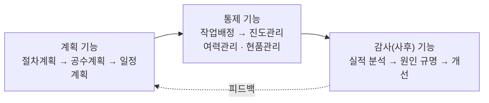
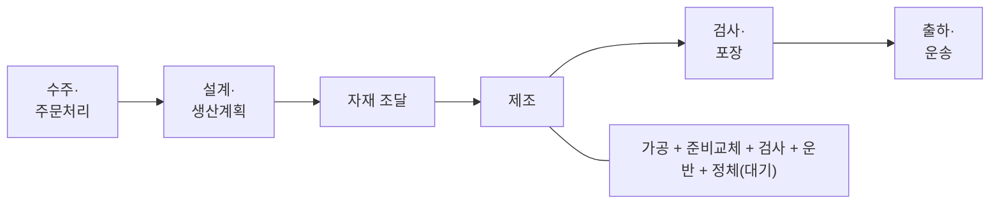
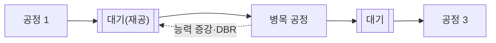
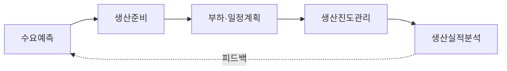

# 2.2 프로세스 진도관리

!!! info "출제기준"
    **2. 생산운영 및 물류관리** › **2. 프로세스 진도관리**

## 출제 경향

총 **14문항** 출제 (1교시 단답형 4 · 2~4교시 논술형 10) · 최근 10개 회차(109~139회) 4문항 · 최근 출제 제133회

| 주제 | 출제 수 | 출제 회차 |
|---|:-:|---|
| 2.2.1 생산통제와 공정관리 기능 | 3 | 94회, 97회, 112회 |
| 2.2.2 생산기간(리드타임) 단축 | 6 | 68회, 71회, 85회, 100회, 109회 |
| 2.2.3 공정대기의 원인과 대책 | 3 | 70회, 79회, 127회 |
| 2.2.4 주문잔고 관리 | 1 | 133회 |
| 2.2.5 예측생산 시스템의 관리 단계 | 1 | 76회 |

## 목차

1. [생산통제와 공정관리 기능](#t22-1)
2. [생산기간(리드타임) 단축](#t22-2)
3. [공정대기의 원인과 대책](#t22-3)
4. [주문잔고 관리](#t22-4)
5. [예측생산 시스템의 관리 단계](#t22-5)

## 2.2.1 생산통제와 공정관리 기능 {#t22-1}

### 공정관리의 기능

**공정관리**는 정해진 품질의 제품을 필요한 수량만큼, 납기 안에, 최소 비용으로 생산하도록 생산 활동을 **계획하고 통제하는** 관리 활동이다.

| 기능 | 세부 기능 | 내용 |
|---|---|---|
| 계획 | 절차계획(Routing) | 작업 순서·방법·설비·표준시간 결정 |
| | 공수계획(부하·능력 계획) | 필요 공수(부하)와 보유 능력을 비교해 조정 |
| | 일정계획 | 작업별 착수·완료 일정 결정(대·중·소 일정) |
| 통제 | 작업배정(Dispatching) | 일정계획에 따라 작업 지시서를 발행하고 작업 착수 |
| | 진도관리(Follow-up) | 작업 진척을 추적해 계획 대비 지연을 찾아 조치(독촉) |
| | 여력관리 | 능력과 부하의 차이(여력)를 파악해 인력·설비를 재배치 |
| | 현품관리 | 재공품의 수량·위치·상태를 파악하고 관리 |
| 감사 | 실적관리·사후처리 | 계획 대비 실적 분석, 차이의 원인 규명, 다음 계획에 반영 |

### 생산통제 기능 (94·112회)

**생산통제**는 계획된 생산량과 실제 생산량의 차이가 생기지 않도록 실적을 측정·비교하고 시정 조치를 하는 활동이다.

**통제 절차**: 계획(표준) 설정 → 실적 측정 → 계획과 비교해 차이 파악 → 원인 분석 → 시정 조치 → 계획에 피드백

**112회 "통제 기능 4가지"**는 다음으로 답한다.

1. **작업배정**: 작업 순서와 우선순위에 따라 작업자·설비에 작업을 할당하고 작업표·지시서 발행
2. **진도관리**: 진척 상황을 간트 차트·누적 생산 그래프·MES로 추적하고, 지연 작업은 독촉·우선순위 변경·잔업으로 만회
3. **여력관리**: 부하와 능력의 차이를 조정 — 부하 > 능력이면 잔업·외주·작업 이관, 부하 < 능력이면 작업 앞당기기·교육
4. **현품관리**: 재공품의 흐름·수량·보관 위치를 관리해 분실·과잉 재공·혼입 방지

### 진도차이의 발생 원인 (97회)

| 단계 | 원인 |
|---|---|
| 계획 단계 | 표준시간·작업 공수의 부정확, 능력·부하 계획의 오류, 무리한 일정(여유 미반영), 수요예측과 자재 소요 계산의 오류, 공정 간 일정 불균형 |
| 실시 단계 | 설비 고장, 자재 결품·입고 지연, 불량·재작업, 작업자 결근, 긴급 주문의 끼어들기, 설계 변경, 준비교체 지연, 작업 지시 착오 |

**진도관리 도구**: 간트 차트(계획 막대와 실적 막대 비교), 누적 생산 그래프(계획선 vs 실적선), 작업 진도표, 간판, MES 실시간 모니터링

| 진도차이 원인(97회) | 대책 |
|---|---|
| 표준시간·공수 부정확 | 시간연구로 표준시간 정비, 실적 기반 갱신 |
| 능력·부하 계획 오류 | 능력소요계획(CRP)으로 사전 부하 점검, 여유 반영 |
| 설비 고장 | 예방보전·TPM, 예비 설비 |
| 자재 결품 | MRP 정확도 향상, 결품 사전 경보 |
| 불량·재작업 | 공정 내 품질 확보, 실수방지 |
| 긴급 주문·설계 변경 | 동결 구간 운영, 변경 관리 절차 |

### 생산 형태별 통제 방식

| 구분 | 주문(개별)생산 | 연속(반복)생산 |
|---|---|---|
| 통제 방식 | **주문 통제**(Order Control): 주문·로트별로 진도 추적 | **흐름 통제**(Flow Control): 라인의 시간당 산출량·속도 관리 |
| 중점 | 작업배정·진도관리·납기 독촉 | 라인밸런싱, 투입 속도, 설비 가동률 |
| 도구 | 작업 지시서, 간트 차트, 우선순위 규칙 | 생산 속도 관리판, 누적 생산 그래프, 간판 |

### 최근 동향

MES의 실시간 실적 수집으로 진도관리가 "사후 독촉"에서 **실시간 이상 감지·자동 재일정**으로 바뀌고 있다. 디지털 트윈으로 지연의 파급 영향을 시뮬레이션하고, APS가 재일정안을 제시한다 → [2.5.1](05-mes.md#t25-1), [3.1.4](../03-process-control/01-production-planning.md#t31-4)

!!! tip "답안 작성 포인트"
    - 공정관리 기능은 **계획 → 통제 → 감사의 순환 그림**을 먼저 그리고 세부 기능 표를 붙인다.
    - 진도차이 원인은 문제가 요구한 대로 **계획 단계 / 실시 단계**로 나눠 각각 4~5개를 쓰고, 대책을 한 줄씩 덧붙인다.
    - 결론 예: "생산통제는 계획-실적 차이를 줄이는 PDCA 순환이며, MES 기반 실시간 진도관리와 APS 재일정으로 **사후 통제에서 예방 통제로** 전환해야 한다."

??? example "관련 기출 3문항 (94회, 97회, 112회)"

    - **제94회(2011) 3교시 2번** · 25점  
      계획된 생산량과 실제 생산량의 차이가 생기지 않도록 실시하는 생산통제 기능에 대하여 설명하시오.
    - **제97회(2012) 1교시 7번** · 10점  
      생산의 진도관리에 있어서 진도차이의 발생 원인을 계획단계와 실시단계로 구분하여 설명하시오.
    - **제112회(2017) 4교시 2번** · 25점  
      공정관리에서 통제기능에 관한 4가지만 설명하시오.

## 2.2.2 생산기간(리드타임) 단축 {#t22-2}

### 생산기간(리드타임)의 정의와 구성 (68·85·109회)

- **고객 리드타임**: 수주부터 고객에게 인도할 때까지의 기간
- **제조(생산) 리드타임**: 원재료가 공정에 투입되어 완제품이 될 때까지의 기간

| 구성 요소 | 내용 |
|---|---|
| 가공시간 | 실제로 부가가치가 생기는 시간 |
| 준비시간 | 금형·치공구 교체, 조정 |
| 검사시간 | 품질 검사 |
| 운반시간 | 공정 간 이동 |
| **정체(대기)시간** | 공정 대기, 로트 대기, 운반·검사 대기 — 일반적으로 **리드타임의 대부분**을 차지 |

**제조 리드타임 공식**(공정 수 \( n_o \), 준비시간 \( T_{su} \), 로트 크기 \( Q \), 단위 가공시간 \( T_c \), 비가공시간 \( T_{no} \))

\[
MLT = n_o \left( T_{su} + Q \cdot T_c + T_{no} \right)
\]

→ 공정 수, 준비시간, 로트 크기, 비가공시간(정체)을 줄이는 것이 리드타임 단축의 기본 방향이다.

### 제조 리드타임의 기능 (100회)

1. **납기 약속의 근거**: 고객에게 제시하는 납기를 정하는 기준
2. **재공재고 수준 결정**: Little의 법칙 \( WIP = TH \times LT \) — 같은 처리량이면 리드타임이 길수록 재공이 많아짐
3. **계획의 기준**: MRP에서 착수 시점을 정하는 리드타임 오프셋
4. **원가와 자금**: 재고 유지비·운전자금에 영향
5. **경쟁 수단**: 시간 기반 경쟁(TBC)의 핵심 지표

### 리드타임 단축의 필요성 (109회)

납기 경쟁력 강화, 재고·자금 부담 감소, 예측 기간이 짧아져 **예측 정확도 향상**, 시장 변화에 대한 유연성, 불량의 조기 발견, 고객 만족

### 단축 방법

| 대상 | 단축 방법 |
|---|---|
| 가공시간 | 공정·작업방법 개선, 설비 성능 향상·자동화, 공정 통합·병렬화 |
| 준비시간 | 준비교체 시간 단축(SMED: 외준비화, 클램프 개선) |
| 정체시간 | 소로트화·1개 흐름, 이동로트 분할(오버래핑), 병목 해소, 라인밸런싱, 평준화 |
| 운반시간 | 공정 순서대로 배치(셀·라인), 운반 거리 단축 |
| 검사시간 | 공정 내 품질 확보(자주검사, 실수방지), 검사 통합 |
| 사무·설계 | 주문처리 정보화(ERP), 설계 표준화·모듈화, 동시공학 |
| 조달 | 장납기 자재 선행 발주, 협력사 JIT 납품·VMI, 표준 부품 재고 |

### 납기 50일 → 35일 단축 방안 (68·71회)

단계별 현행·목표 일수는 **예시**이며, 각 단계의 개선 방안이 핵심이다.

| 단계 | 현행(예) | 목표(예) | 영향 문제 | 개선 방안 |
|---|:-:|:-:|---|---|
| 수주·주문처리 | 3일 | 1일 | 사양 확인 지연, 수작업 결재 | 사양 표준 체크리스트, 전자 결재, ERP 수주 처리 |
| 설계·생산계획 | 10일 | 7일 | 설계 변경, 순차 업무 | 표준·모듈 설계, 설계 도중 장납기 자재 선발주(동시공학) |
| 자재 조달 | 15일 | 10일 | 장납기 부품, 결품 | 공용 부품 상시 재고, 협력사와 정보 공유·VMI, 복수 공급처 |
| 제조 | 15일 | 11일 | 큰 로트·공정 대기, 병목 | 소로트화, 병목 능력 보강, SMED, 우선순위 일정계획 |
| 검사·포장 | 4일 | 3일 | 최종 검사 대기 | 공정 내 검사, 검사·포장 병행 |
| 출하·운송 | 3일 | 3일 | – | 출하 일정 사전 확정, 운송 예약 |
| **합계** | **50일** | **35일** | | 30% 단축 |

추가로 단계 간 **병렬화(오버래핑)**, 진도관리 강화(MES), 부서 횡단팀(CFT)을 통한 전 과정 관리가 필요하다.

### 리드타임 분석 도구와 지표

- **가치흐름도(VSM)**: 수주부터 출하까지 물자·정보 흐름을 그려 부가가치 시간과 정체를 드러낸다 → [7.4.2](../07-support-technology/04-production-innovation.md#t74-2)
- **공정 사이클 효율(PCE)**: 부가가치 시간 ÷ 총 리드타임. 많은 공장에서 낮게 나타나 정체 감소의 여지가 큼을 보여 준다.
- **Little의 법칙 예**: 처리량 100개/일, 재공 1,000개이면 리드타임 = 1,000 ÷ 100 = 10일 → 재공을 500개로 줄이면 5일
- **시간 기반 경쟁(TBC)**: G. Stalk(1988)가 제시한 개념으로, 리드타임 단축 자체를 경쟁우위로 삼는다.

!!! tip "답안 작성 포인트"
    - **정의 → 구성 그림 → MLT 공식 → 구성 요소별 단축 방법 표**가 기본 틀이다. 정체시간이 대부분이라는 점을 강조한다.
    - 68·71회 같은 사례형은 수주부터 납품까지 **단계별 표(문제점 + 개선안)**로 답하고, 단계별 목표 일수를 배분해 목표 달성을 보여 준다.
    - Little의 법칙을 쓰면 리드타임과 재공재고의 관계를 정량적으로 설명할 수 있다.
    - 연관 주제: SMED [3.6.2](../03-process-control/06-process-improvement.md#t36-2), 병목 개선 [3.6.3](../03-process-control/06-process-improvement.md#t36-3), 동시공학 [7.2.3](../07-support-technology/02-product-development.md#t72-3)
    - 결론 예: "리드타임의 대부분은 정체시간이므로 VSM으로 정체를 가시화하고 소로트·병목 해소·정보화를 결합해 **시간 기반 경쟁력**을 확보해야 한다."

??? example "관련 기출 6문항 (68회, 71회, 85회, 100회, 109회)"

    - **제68회(2002) 3교시 2번** · 25점  
      생산기간(Lead Time)의 구성 요소를 고려하여 생산기간의 합리적인 단축방안을 설명하시오.
    - **제68회(2002) 3교시 3번** · 25점  
      고객이 기존의 50일 납기를 35일로 단축해 줄 것을 요구하였다. 이를 위한 방안을 수주에서부터 납품(제품 인도)까지 모든 활동을 대상으로 구체적으로 작성하시오.
    - **제71회(2003) 3교시 6번** · 25점  
      수주에서 납품까지 생산기간에 영향을 미치는 문제들을 각 활동 단계별로 열거하고 개선 방안을 설명하시오.
    - **제85회(2008) 1교시 4번** · 10점  
      제조공정상에 있어서의(원재료부터 제품까지의 사내물류) 생산리드타임(Lead Time)과 단축방법에 대해서 설명하시오.
    - **제100회(2013) 4교시 3번** · 25점  
      생산관리 측면에서 제조리드타임의 기능과 이를 단축하기 위한 공정개선 방법에 대하여 설명하시오.
    - **제109회(2016) 1교시 12번** · 10점  
      생산기간의 정의, 구성 및 단축 필요성에 대하여 각각 설명하시오.

## 2.2.3 공정대기의 원인과 대책 {#t22-3}

### 공정대기의 개념

**공정대기(정체)**는 재공품이 다음 공정에서 가공되지 못하고 공정 사이에서 기다리는 현상이다. 부가가치 없이 리드타임과 재공재고만 늘린다.

| 종류 | 내용 |
|---|---|
| 공정 대기 | 앞 로트가 처리 중이어서 다음 로트가 기다림 |
| 로트 대기 | 로트 안의 다른 제품이 모두 가공될 때까지 기다림 |
| 운반·검사 대기 | 운반 수단이나 검사를 기다림 |

### 공정관리 기능 3가지 (127회)

① **계획 기능**(절차·공수·일정계획) ② **통제 기능**(작업배정·진도관리·여력관리·현품관리) ③ **감사 기능**(실적 분석과 개선) — 자세한 내용은 [2.2.1](#t22-1) 참조

### 발생 원인과 대책 (70·79·127회)

| 구분 | 발생 원인 | 대책 |
|---|---|---|
| 능력 | 공정 간 능력 불균형(병목 공정) | 라인밸런싱, 병목 공정 능력 증강, 병목 우선 일정(DBR) |
| 로트 | 로트 크기가 큼, 로트 단위 이동 | 소로트화, 1개 흐름, 이동로트 분할 |
| 일정계획 | 착수 시기·순서의 불합리, 부하 변동 | 부하 평준화, 우선순위 규칙, 착수량 통제 |
| 설비 | 고장, 긴 준비교체 | 예방보전·TPM, SMED |
| 자재 | 결품, 입고 지연 | MRP 정비, JIT 조달, 안전재고 |
| 인력 | 결근, 숙련 부족 | 다기능화, 지원 체계 |
| 운반·검사 | 운반 지연, 검사 대기 | 배치 개선, 자동 운반, 공정 내 검사 |
| 품질 | 불량·재작업 | 공정 내 품질 확보, 실수방지 |

### 대기행렬 관점의 이해

공정을 대기행렬로 보면 설비 가동률(\( \rho \))이 100%에 가까워질수록 대기시간이 급격히 늘고, 도착·처리시간의 **변동**이 클수록 대기도 커진다. 따라서 "가동률 극대화"만 추구하면 공정대기가 늘어나므로, 병목 이외 공정은 여유 능력을 두고 변동(고장·불량·준비교체)을 줄이는 것이 대책의 원리다 → [6.4.3](../06-cost-engineering-economy/04-operations-research.md#t64-3)

!!! tip "답안 작성 포인트"
    - 원인과 대책을 **같은 행에 1:1로 대응**시킨 표가 가장 효과적이다.
    - 결론 예: "공정대기는 능력 불균형·큰 로트·변동의 결과이므로, TOC로 병목을 관리하고 JIT 흐름 생산과 MES 실시간 재공 추적으로 근본 대책을 세워야 한다."
    - 서두에 "공정대기는 리드타임의 대부분을 차지하는 비부가가치 시간"이라고 정의하고, 결론에서 TOC(병목 관리)와 JIT(흐름 생산)를 근본 대책으로 제시한다.

??? example "관련 기출 3문항 (70회, 79회, 127회)"

    - **제70회(2003) 2교시 4번** · 25점  
      공정대기 현상은 어떤 경우에 발생하며, 이의 해결방안에 대하여 설명하시오.
    - **제79회(2006) 4교시 3번** · 25점  
      제조공정중 공정대기현상의 발생원인 및 해결방안을 설명하시오.
    - **제127회(2022) 4교시 2번** · 25점  
      생산 목표를 달성하기 위하여 수행되는 공정관리 기능 3가지를 쓰고, 공정대기의 발생원인과 대책을 설명하시오.

## 2.2.4 주문잔고 관리 {#t22-4}

### 주문잔고(Order Backlog)의 의미 (133회)

**주문잔고**는 이미 수주했지만 아직 생산·출하하지 않은 주문의 누적량이다.

- **미래 매출과 부하의 선행지표**: 잔고가 늘면 수요가 생산능력을 넘고 있고, 줄면 수요가 줄고 있다는 신호
- **주문생산(MTO)의 완충 장치**: 완제품 재고 대신 주문잔고로 수요 변동을 흡수해 생산을 평준화
- **적정 수준이 중요**: 너무 많으면 납기 지연·고객 이탈, 너무 적으면 설비·인력 유휴

\[
\text{잔고 일수} = \frac{\text{주문잔고량}}{\text{일일 생산능력}}
\]

### 효과적인 관리 방법

1. **가시화**: 품목·고객·납기별 잔고 현황을 실시간으로 파악(ERP)
2. **능력과 비교**: 잔고 일수를 목표 범위 안에서 관리, 추세 감시
3. **납기 약속**: 가용 재고·능력 기반의 납기 약속(ATP·CTP)으로 무리한 약속 방지
4. **능력 조정**: 잔고가 많으면 잔업·외주·교대 증가, 적으면 정비·교육·선행 생산
5. **수요 관리**: 가격·판촉 조정, 수주 선별, 우선순위 관리
6. **고객 소통**: 지연 예상 시 사전 통보와 대안 제시

| 구분 | 예측생산(MTS) | 주문생산(MTO) |
|---|---|---|
| 수요 변동 완충 수단 | 완제품 재고 | 주문잔고(대기 주문) |
| 관리 지표 | 재고회전율, 품절률 | 잔고 일수, 납기 준수율 |

연관 주제: 주문 형태별 생산방식 [1.2.2](../01-production-strategy/02-production-system-layout.md#t12-2), 기준생산계획과 ATP [3.1.2](../03-process-control/01-production-planning.md#t31-2)

!!! tip "답안 작성 포인트"
    - 10점 단답형이므로 **정의 → 의미(선행지표·완충) → 적정 수준 → 관리 방법 4~6개**로 쓴다.
    - MTS의 재고와 MTO의 주문잔고가 같은 "완충" 역할을 한다는 대비를 한 줄 넣으면 차별화된다.

??? example "관련 기출 1문항 (133회)"

    - **제133회(2024) 1교시 2번** · 10점  
      주문 잔고(Order Backlog)의 의미와 효과적인 관리 방법

## 2.2.5 예측생산 시스템의 관리 단계 {#t22-5}

### 예측생산 시스템의 단계별 관리자 역할 (76회)

예측생산(MTS)은 수요예측을 바탕으로 미리 생산해 재고에서 출하하므로, 예측부터 실적 분석까지의 순환 관리가 중요하다.

| 단계 | 관리자의 역할 |
|---|---|
| ① 수요예측 | 과거 판매 자료·시장 정보로 품목별 수요 예측, 적합한 예측 기법 선택, 추적지표로 예측 정확도 관리, 영업과 판매계획 조율 |
| ② 생산준비 | 생산 품목·수량 결정(재고 목표 반영), 자재 소요 계산과 조달(MRP), 설비·치공구·인력 준비, 작업 표준 정비 |
| ③ 부하·일정계획 | 공정별 부하와 능력 비교·조정(여력관리), 대·중·소 일정계획 수립, 작업 순서·로트 크기 결정 |
| ④ 생산진도관리 | 작업 지시와 진척 추적, 지연 원인 파악과 독촉·잔업·우선순위 변경, 재공품 관리 |
| ⑤ 생산실적분석 | 계획 대비 생산량·품질·원가·납기 실적 분석, 차이 원인 규명, 예측·계획 기준(표준시간·능력)에 피드백 |

!!! tip "답안 작성 포인트"
    - 다섯 단계의 **순환 흐름도**를 그리고 단계별 역할을 표로 정리한다.
    - 결론에서 "실적 분석 결과를 다시 수요예측과 계획 기준에 반영하는 **피드백**"이 예측생산 관리의 핵심임을 강조한다.
    - 연관 주제: 수요예측·추적지표 [2.1.3](01-forecasting-scheduling.md#t21-3), MRP [2.4.5](04-materials-inventory.md#t24-5)
    - 결론 예: "예측생산은 예측오차가 재고로 바로 이어지므로 단계별 관리자가 PDCA로 연결되어야 하며, ERP-MES 통합으로 단계 간 정보를 실시간 공유해야 한다."

??? example "관련 기출 1문항 (76회)"

    - **제76회(2005) 2교시 6번** · 25점  
      예측생산시스템에서 “수요예측→생산준비→부하 및 일정계획수립→생산진도관리→생산실적분석”의 각 단계별 관리자의 역할에 대하여 기술하시오.

## 답안 작성 예시

!!! example "25점 예시: 제127회 4교시 2번 — 공정관리 기능 3가지, 공정대기의 발생원인과 대책"
    **1. 개요**

    - 공정관리는 품질·수량·납기·원가 목표를 달성하도록 생산 활동을 계획·통제하는 활동이다.
    - 공정대기는 리드타임의 대부분을 차지하는 비부가가치 시간으로, 재공재고와 납기 지연의 주원인이다.

    **2. 본론**

    - (1) 공정관리 3기능: [그림] 계획 → 통제 → 감사 순환도 + [표] 세부 기능(절차·공수·일정 / 작업배정·진도·여력·현품 / 실적 분석)
    - (2) 공정대기의 종류: [표] 공정 대기·로트 대기·운반·검사 대기
    - (3) 발생원인과 대책: [표] 능력·로트·일정·설비·자재·인력·운반·품질별 원인-대책 1:1 대응
    - (4) 원리 보강: 가동률↑·변동↑ → 대기 급증(대기행렬 관점), [그림] 병목 앞 재공 누적도
    - (5) Little의 법칙 \( WIP = TH \times LT \)로 대기 감소 효과를 정량화

    **3. 결론(기술사 의견)**

    - 근본 대책은 TOC(병목 관리)와 JIT(소로트 흐름 생산)의 결합이다.
    - 차별화: MES로 공정별 재공·대기시간을 실시간 가시화하고 KPI(PCE·재공 일수)로 관리하는 방안 제시

!!! example "25점 예시: 제68회 3교시 3번 — 납기 50일을 35일로 단축하는 수주~납품 전 과정 방안"
    **1. 개요**

    - 고객 리드타임 = 수주처리 + 설계·계획 + 조달 + 제조 + 검사·포장 + 출하이며, 30% 단축은 단일 개선이 아닌 전 과정 혁신이 필요하다.

    **2. 본론**

    - (1) [그림] 리드타임 구성 흐름도와 MLT 공식 \( MLT = n_o(T_{su} + QT_c + T_{no}) \) → 단축 방향 도출
    - (2) [표] 단계별 현행·목표 일수, 영향 문제, 개선 방안(본문 50일 → 35일 표)
    - (3) 단계 간 병렬화(동시공학, 장납기 자재 선발주), 이동로트 분할
    - (4) 추진 체계: CFT 구성, VSM으로 현상 분석, MES·ERP로 진도관리

    **3. 결론(기술사 의견)**

    - 단축 효과를 재공 감소·예측 정확도 향상·고객 만족으로 연결해 시간 기반 경쟁력 확보
    - 차별화: 단계별 목표 일수를 배분해 합계 35일 달성을 숫자로 보여 주는 것이 고득점 포인트
