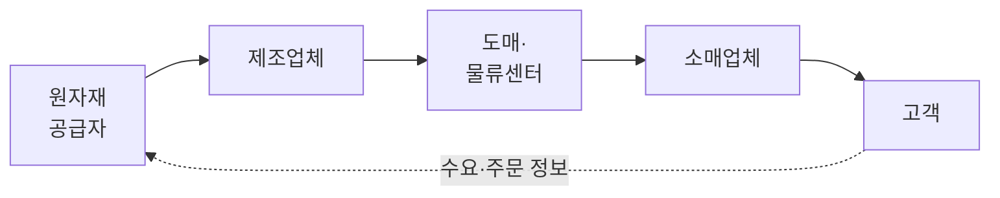
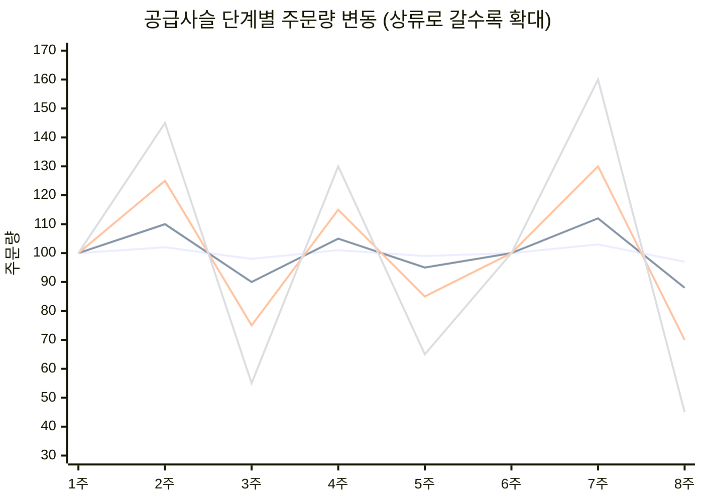
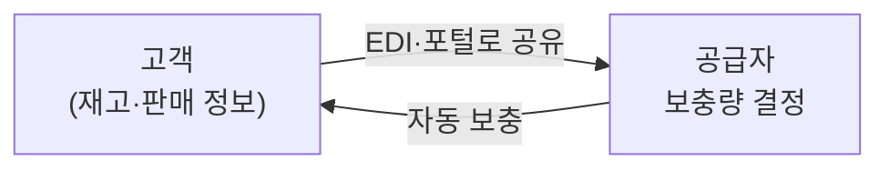

# 2.3 공급망 관리(SCM)

!!! info "출제기준"
    **2. 생산운영 및 물류관리** › **3. 공급망 관리(SCM)**

## 출제 경향

총 **25문항** 출제 (1교시 단답형 13 · 2~4교시 논술형 12) · 최근 10개 회차(109~139회) 10문항 · 최근 출제 제139회

| 주제 | 출제 수 | 출제 회차 |
|---|:-:|---|
| 2.3.1 SCM의 개념과 성과측정 | 3 | 63회, 82회, 103회 |
| 2.3.2 채찍효과 | 5 | 91회, 112회, 127회, 136회, 139회 |
| 2.3.3 Push-Pull 공급체인 | 2 | 91회, 124회 |
| 2.3.4 신속대응(QR)과 애자일 | 4 | 67회, 94회, 106회, 130회 |
| 2.3.5 공급자 주도 재고(VMI·CRP·COCK) | 5 | 65회, 106회, 112회, 130회 |
| 2.3.6 물류 아웃소싱과 유통(3PL·크로스도킹·SPA·OMS) | 4 | 88회, 100회, 115회, 130회 |
| 2.3.7 수요 불확실성과 제품가용성 | 2 | 106회 |

## 목차

1. [SCM의 개념과 성과측정](#t23-1)
2. [채찍효과](#t23-2)
3. [Push-Pull 공급체인](#t23-3)
4. [신속대응(QR)과 애자일](#t23-4)
5. [공급자 주도 재고(VMI·CRP·COCK)](#t23-5)
6. [물류 아웃소싱과 유통(3PL·크로스도킹·SPA·OMS)](#t23-6)
7. [수요 불확실성과 제품가용성](#t23-7)

## 2.3.1 SCM의 개념과 성과측정 {#t23-1}

### SCM의 개념 (82·127회)

**공급사슬(Supply Chain)**은 원자재 공급자에서 제조업체·유통업체를 거쳐 최종 고객에 이르는 기업들의 연결망이다. **공급사슬관리(SCM)**는 이 사슬 전체의 **물자·정보·자금 흐름**을 통합적으로 계획·관리해, 고객 가치를 높이면서 전체 비용을 최소화하는 경영 기법이다.

물자는 하류(고객)로, 정보(수요·주문)는 상류(공급자)로, 자금은 고객에서 공급자 방향으로 흐른다.

SCM이라는 용어는 1982년 컨설팅사 Booz Allen의 K. Oliver가 처음 쓴 것으로 알려져 있으며, 1990년대 정보기술(EDI·ERP)과 함께 확산되었다. 개별 기업 간 경쟁이 **공급사슬 간 경쟁**으로 바뀌었다는 인식이 출발점이다.

### SCOR 모델과 성과 속성

공급사슬협의회(SCC, 현 ASCM)의 **SCOR(Supply Chain Operations Reference) 모델**은 공급사슬 프로세스를 표준화한 참조 모형이다.

| 프로세스 | 내용 |
|---|---|
| Plan(계획) | 수요·공급 균형, 공급사슬 계획 |
| Source(조달) | 구매, 입고, 공급자 관리 |
| Make(생산) | 제조, 시험, 포장 |
| Deliver(배송) | 주문 관리, 창고, 운송 |
| Return(반품) | 반품·회수, 역물류 |
| Enable(지원) | 규칙·성과·데이터·리스크 관리 |

성과 속성은 **신뢰성**(완전주문 충족률) · **대응성**(주문 충족 사이클타임) · **민첩성**(공급사슬 유연성) · **비용**(총 SCM 비용) · **자산 효율**(현금전환주기, 재고일수)로 나눈다. (최신판 SCOR DS는 프로세스 구성이 일부 바뀌었으므로 교재 확인 필요)

### SCM의 특징과 과잉재고 감소 방안 (63회)

| SCM의 특징 | 내용 |
|---|---|
| 전체 최적화 | 개별 기업의 부분 최적이 아니라 공급사슬 전체의 최적 추구 |
| 정보 공유 | 수요·재고·생산계획 정보를 실시간으로 공유 |
| 협업과 파트너십 | 공급자·유통업체와의 장기 협력 관계 |
| 고객 지향 | 최종 고객의 수요가 전체 흐름을 이끎(Pull) |
| 흐름 통합 | 물자·정보·자금 흐름을 하나의 프로세스로 관리 |

**과잉재고 감소 방안**: ① POS·재고 정보 공유로 채찍효과 감소 ② VMI·CRP로 공급자 주도 보충 ③ 협업 예측(CPFR) ④ 리드타임 단축과 소로트 다빈도 보충 ⑤ 차별화 지연(Postponement) ⑥ 재고 거점 통합(리스크 풀링) ⑦ 품목(SKU) 합리화

### SCM 추진 기법 (127회)

| 기법 | 의미 |
|---|---|
| QR(신속대응) | 의류 업계에서 시작, POS 정보 공유로 소량 다빈도 신속 보충 |
| ECR(효율적 소비자 대응) | 식품·잡화 업계의 QR, 제조·유통 협력으로 비효율 제거 |
| VMI / CRP | 공급자가 고객 재고를 관리하고 실판매 기반으로 연속 보충 |
| CPFR | 협업적 계획·예측·보충 — 거래 당사자가 예측과 계획을 함께 수립 |
| 크로스도킹 | 물류센터에서 보관 없이 바로 분류·출고 |
| 차별화 지연 | 제품 차별화 시점을 최대한 늦춤 |
| 3PL | 물류 기능을 외부 전문업체에 위탁 |
| EDI·RFID·APS | 정보 교환, 실시간 추적, 공급사슬 계획 최적화 |

### 공급사슬 재고 성과측정 (103회)

| 지표 | 산출 방법 |
|---|---|
| 평균 총재고액 | 일정 기간 보유한 모든 재고(원자재·재공품·완제품)의 평균 금액. 기초·기말 평균 또는 기간별 평균 |
| 재고회전율 | \( \dfrac{\text{연간 매출원가}}{\text{평균 총재고액}} \) — 재고가 1년에 몇 번 판매로 바뀌는지 |
| 재고공급 주 수 | \( \dfrac{\text{평균 총재고액}}{\text{주당 매출원가}} \) — 현재 재고로 몇 주를 공급할 수 있는지 |
| 재고공급 일수 | \( \dfrac{\text{평균 총재고액}}{\text{일당 매출원가}} \) — 현재 재고로 며칠을 공급할 수 있는지 |

**풀이 (평균 총재고액 2억 원, 연간 매출원가 10억 원)**

1. 평균 총재고액 = **2억 원**
2. 재고회전율 = 10억 ÷ 2억 = **5회/년**
3. 재고공급 주 수 = 2억 ÷ (10억 ÷ 50주) = 2억 ÷ 0.2억 = **10주**
4. 재고공급 일수 = 2억 ÷ (10억 ÷ 250일) = 2억 ÷ 0.04억 = **50일**
5. 재고회전율 10회/년이면 평균 총재고액 = 10억 ÷ 10 = **1억 원** (재고 1억 원 감소)

### 최근 동향: 공급망 리스크와 지속가능성

| 이슈 | 내용 | 대응 |
|---|---|---|
| 공급망 리스크 | 팬데믹, 지정학 갈등, 자연재해, 반도체 등 핵심 부품 부족 | 공급처 다변화, 니어쇼어링·리쇼어링, 전략 재고, 리스크 지도 |
| 회복탄력성(Resilience) | 효율(Lean) 중심에서 충격 흡수·복구 능력 중시 | Just-in-Case 병행, 공급망 디지털 트윈, 조기경보 |
| ESG·공급망 실사 | 협력사 인권·환경 실사 의무화 추세, Scope 3 탄소 배출 관리 | 협력사 ESG 평가, 탄소 데이터 수집, 친환경 물류 |
| 디지털 SCM | 실시간 가시성, AI 예측, 블록체인 이력 추적 | 컨트롤 타워, 클라우드 SCM 플랫폼 |

연관 주제: ESG·통상규제 [7.5.1](../07-support-technology/05-trends.md#t75-1), 리스크 관리 [1.5.5](../01-production-strategy/05-business-environment.md#t15-5), 공급자 관계관리 [1.3.4](../01-production-strategy/03-purchasing-outsourcing.md#t13-4)

!!! tip "답안 작성 포인트"
    - SCM 개념 문제는 **공급사슬 그림(물자·정보·자금 흐름)**을 반드시 넣는다.
    - 재고 지표 계산은 공식과 단위(회/년, 주, 일)를 정확히 쓰고, 회전율이 오르면 재고와 운전자금이 줄어든다는 의미를 덧붙인다.
    - 결론 예: "SCM은 부분 최적에서 전체 최적으로의 전환이며, 효율과 함께 **공급망 회복탄력성과 ESG 실사 대응**까지 고려한 디지털 SCM으로 발전해야 한다."

??? example "관련 기출 3문항 (63회, 82회, 103회)"

    - **제63회(2001) 4교시 4번** · 25점  
      SCM의 특징 및 과잉재고를 줄일 수 있는 방안을 설명하시오.
    - **제82회(2007) 1교시 4번** · 10점  
      Supply Chain Management
    - **제103회(2014) 3교시 2번** · 25점  
      공급사슬의 성과측정은 공급사슬의 효율성을 파악하는 것이다. 재고측정의 기본 형태 4가지에 대해 주어진 회사의 재고관련 자료를 활용하여 다음 각 물음에 답하시오.

        ??? quote "문제 전문"

            공급사슬의 성과측정은 공급사슬의 효율성을 파악하는 것이다. 재고측정의 기본 형태 4가지에 대해 주어진 회사의 재고관련 자료를 활용하여 다음 각 물음에 답하시오.  
            ※ 재고관련 자료 : 평균 총 재고액 2억원, 연간 매출원가 10억원  
            1) 평균총재고액(average aggregate inventory value)의 개념과 산출방법을 설명하시오.  
            2) 재고회전율(inventory turnover)을 설명하고, 자료를 활용하여 계산하시오.  
            3) 재고공급 주 수(weeks of supply)를 설명하고, 연간 50주 영업을 가정하여 자료를 활용하여 계산하시오.  
            4) 재고공급일수(inventory day's supply)를 설명하고, 연간 운영일수가 250일 경우 자료를 활용하여 계산하시오.  
            5) 만약 SCM 활동으로 재고회전율이 10회/년으로 향상되었다면 이때의 평균총재고액을 구하시오.  

## 2.3.2 채찍효과 {#t23-2}

### 채찍효과(Bullwhip Effect)의 정의 (91·112·136·139회)

최종 소비자의 수요 변동은 작은데, 공급사슬의 **상류(소매 → 도매 → 제조 → 원자재 공급자)로 갈수록 주문량의 변동이 점점 커지는 현상**이다. 채찍 손잡이를 조금 흔들어도 끝부분은 크게 요동치는 것에 비유한다. P&G의 기저귀(팸퍼스) 사례로 널리 알려졌다. J. Forrester(1961)가 산업 동역학 연구에서 처음 밝혀 **포레스터 효과**라고도 하며, MIT의 맥주 게임(Beer Game)으로 체험할 수 있다.

가장 평탄한 선이 소비자 수요이고, 소매업체 → 도매업체 → 제조업체 순으로 진폭이 커진다. 재고 수준도 같은 원리로 상류일수록 **과잉과 품절이 번갈아 크게 나타난다**.

### 발생 원인 (Lee, Padmanabhan & Whang, 1997)

| 원인 | 내용 |
|---|---|
| ① 수요예측의 갱신 | 각 단계가 실제 소비자 수요가 아닌 **하류의 주문량**으로 예측하고 안전재고를 더해 주문 → 변동이 단계마다 증폭 |
| ② 주문 일괄처리 | 주문비·운송비를 줄이려고 모아서 대량 주문 → 주문이 몰리고 끊기는 패턴 |
| ③ 가격 변동 | 판촉·할인 때 미리 사 두기(선행 구매) → 실제 수요와 다른 주문 |
| ④ 할당 게임(품귀 게이밍) | 공급 부족 시 배정량을 늘리려고 부풀려 주문하고 나중에 취소 |
| (추가) 긴 리드타임 | 리드타임이 길수록 안전재고와 주문 변동이 커짐 |

### 해결 방안

| 원인 | 해결 방안 |
|---|---|
| 수요예측 갱신 | POS 데이터 등 **실수요 정보 공유**, 단일 예측(CPFR), VMI |
| 주문 일괄처리 | EDI로 주문비 절감, 소로트 다빈도 주문, 혼재 운송·3PL |
| 가격 변동 | 상시 저가(EDLP) 정책, 판촉 축소 |
| 할당 게임 | 과거 판매 실적 기준 배분, 공급 능력 정보 공유 |
| 리드타임 | 리드타임 단축, 크로스도킹 |

**정량적 이해**: 소매점이 최근 \( p \)기간 이동평균으로 예측하고 리드타임이 \( L \)일 때, 주문 변동은 수요 변동보다 최소 다음 배수만큼 커진다(Chen 등, 2000).

\[
\frac{Var(q)}{Var(D)} \ge 1 + \frac{2L}{p} + \frac{2L^2}{p^2}
\]

→ 리드타임 \( L \)을 줄이고 예측에 쓰는 자료 기간 \( p \)를 늘릴수록(평활) 채찍효과가 줄고, 실수요 정보를 공유하면 단계별 증폭이 크게 줄어든다.

**채찍효과의 영향**: 상류의 과잉 생산능력·재고, 품절과 납기 지연, 운송비·잔업비 증가, 생산계획의 불안정, 공급사슬 전체의 수익성 저하

### 스마트팩토리로 채찍효과를 줄이는 방안 (136회)

1. **실시간 데이터 연계**: IoT·클라우드 플랫폼으로 고객 판매·재고 정보부터 생산·협력사 정보까지 공급사슬 전체가 같은 데이터를 실시간 공유
2. **AI 기반 수요예측과 디지털 트윈**: 실수요 데이터로 정확도를 높인 예측, 공급사슬 시뮬레이션으로 주문·재고 정책 최적화
3. **유연 생산과 자동 보충**: MES-ERP-SCM 통합으로 소로트 다빈도 생산·짧은 리드타임 실현, 재고 수준에 따른 자동 발주

!!! tip "답안 작성 포인트"
    - 139·91회처럼 도식화를 요구하면 **단계별 주문량 그래프**(상류일수록 진폭 확대)와 공급사슬 그림을 함께 그린다.
    - 원인 4가지는 **Lee 교수의 분류**를 그대로 쓰고, 원인과 대책을 1:1로 대응시킨다.
    - 136회처럼 최신 기술과 연결하면 IoT·AI·디지털 트윈·통합 플랫폼을 키워드로 쓴다.
    - 결론 예: "채찍효과의 본질은 정보 왜곡과 지연이므로, 실수요 정보 공유·리드타임 단축·인센티브 정렬을 축으로 **공급사슬 전체를 하나의 계획 단위로 통합**해야 한다."

??? example "관련 기출 5문항 (91회, 112회, 127회, 136회, 139회)"

    - **제91회(2010) 1교시 7번** · 10점  
      SCM의 채찍효과(Bullwhip Effect)에 대하여 공급체인 그림을 사용하여 그 내용을 설명하시오.
    - **제112회(2017) 1교시 4번** · 10점  
      채찍효과(Bullwhip Effect)
    - **제127회(2022) 3교시 4번** · 25점  
      공급사슬관리(SCM)의 개념, 채찍효과(Bullwhip Effect)의 발생원인과 해결방안, SCM 추진기법의 종류와 의미를 설명하시오.
    - **제136회(2025) 2교시 5번** · 25점  
      공급사슬 관리의 채찍효과에 대하여 다음 질문에 답하시오.

        ??? quote "문제 전문"

            공급사슬 관리의 채찍효과에 대하여 다음 질문에 답하시오.  
            (1) 채찍효과가 무엇인지 설명하시오.  
            (2) 채찍효과의 발생요인을 4가지만 설명하시오.  
            (3) 스마트팩토리로 채찍효과 감소에 기여하는 방안 3가지를 설명하시오.  
    - **제139회(2026) 1교시 8번** · 10점  
      SCM에서 채찍효과(Bullwhip Effect)에 대하여 공급사슬의 주문패턴과 재고수준을 도식화하여 설명하시오.

## 2.3.3 Push-Pull 공급체인 {#t23-3}

### Push·Pull 공급체인 (91·124회)

| 구분 | Push(밀어내기) | Pull(끌어당기기) |
|---|---|---|
| 기준 | **수요예측** | **실제 고객 주문** |
| 생산·보충 시점 | 주문 전에 미리 생산·배송 | 주문을 받은 뒤 생산·보충 |
| 재고 | 많음, 진부화 위험 | 적음 |
| 대응성 | 수요 변화에 늦게 대응, 채찍효과 큼 | 수요 변화에 빠르게 대응 |
| 원가 | 규모의 경제로 생산·운송 원가 낮음 | 규모의 경제를 살리기 어려움 |
| 적합 조건 | 수요 불확실성 낮음, 규모의 경제 중요 | 수요 불확실성 높음, 리드타임이 짧을 수 있음 |

### Push-Pull 경계와 전략

현실의 공급사슬은 대부분 앞부분은 Push, 뒷부분은 Pull로 운영하는 **Push-Pull 혼합형**이다. 두 방식이 나뉘는 지점을 **Push-Pull 경계**라 하며, 고객주문 분리점(CODP)과 같은 개념이다.

예: 델(Dell) 컴퓨터 — 부품은 예측으로 확보(Push), 최종 조립은 주문 후(Pull)

**공급사슬 전략 선택 (Simchi-Levi)**

| 수요 불확실성 \ 규모의 경제 | 중요도 낮음 | 중요도 높음 |
|---|---|---|
| **높음** | Pull 전략 (예: 주문형 PC) | Push-Pull 전략 (예: 가구 — 생산은 주문 후, 배송은 묶어서) |
| **낮음** | Push 또는 Pull (예: 도서·음반) | Push 전략 (예: 식료품·생활용품) |

!!! tip "답안 작성 포인트"
    - **비교표 → Push-Pull 경계 그림 → 전략 선택 매트릭스 → 사례** 순으로 쓴다.
    - 경계를 하류로 옮길수록 재고·원가 효율이, 상류로 옮길수록 대응성·고객화가 커진다는 상충관계를 결론으로 쓴다.
    - 경계 이동 수단: 차별화 지연·모듈 설계([7.2.5](../07-support-technology/02-product-development.md#t72-5)), 생산방식 MTS·ATO·MTO 선택([1.2.2](../01-production-strategy/02-production-system-layout.md#t12-2))
    - 결론 예: "Push는 효율, Pull은 대응성을 주므로 제품의 수요 불확실성과 규모의 경제에 따라 **Push-Pull 경계를 전략적으로 설계**하고, 공통 모듈까지 Push·최종 조립은 Pull로 운영하는 것이 바람직하다."

??? example "관련 기출 2문항 (91회, 124회)"

    - **제91회(2010) 3교시 4번** · 25점  
      SCM에서 밀기-끌기(push-pull ) 공급체인에 대하여 설명하시오.
    - **제124회(2021) 1교시 1번** · 10점  
      Push-Pull 기반의 공급사슬 전략

## 2.3.4 신속대응(QR)과 애자일 {#t23-4}

### 신속대응(QR, Quick Response) (94회)

**정의**: 1980년대 미국 섬유·의류 업계에서 수입품과의 경쟁에 대응하려고 시작한 SCM 기법이다. 소매점의 **판매시점(POS) 정보를 제조·원단 업체와 공유**해 소량 다빈도로 신속하게 보충함으로써, 리드타임과 재고를 줄이고 판매 기회 손실을 막는다.

**구성 요소**: 바코드·POS, EDI(전자문서교환), 자동 보충 발주, 짧은 생산 리드타임(유연 생산), 파트너십

**효과**: 재고·품절 감소, 리드타임 단축, 판매 기회 손실과 가격 인하(마크다운) 감소, 수요 변화에 대한 대응력 향상

### 한국 기업의 QR 도입과 문제점 (67회)

| 문제점 | 내용 | 개선 방향 |
|---|---|---|
| 표준화 미비 | 상품코드·EDI 문서 표준이 기업마다 다름 | 국가·업계 표준 코드와 EDI 표준 채택 |
| 정보화 수준 격차 | 중소 협력사의 정보시스템·투자 여력 부족 | 공동 플랫폼, 정부·대기업 지원 |
| 거래 관행 | 반품·위탁 판매 관행, 정보 공개 기피, 상호 불신 | 장기 파트너십, 성과 공유 계약 |
| 복잡한 유통 구조 | 다단계 유통으로 정보 전달 지연 | 유통 단계 축소, 직거래·SPA형 구조 |
| 생산 유연성 부족 | 대량 로트 중심 생산으로 소량 다빈도 대응 곤란 | 준비교체 단축, 셀 생산 |

### 수요 불확실성을 줄이는 방안 (106회)

| 방안 | 내용 |
|---|---|
| 수요예측 개선 | POS 실수요 데이터 활용, 협업 예측(CPFR), 예측 수준의 총량화(합칠수록 예측 정확도 상승) |
| 신속대응(QR) | 리드타임을 줄여 판매 시즌 중에도 실수요를 보고 재주문 → 예측 기간 단축 |
| 차별화 지연(Postponement) | 공통 공정은 미리, 제품을 구분 짓는 공정은 주문 후로 늦춤 — 공통 반제품 단계에서 수요를 합쳐 관리(예: 베네통 후염색) |
| 맞춤보충(Tailored Sourcing) | 공급원을 나눠 쓰는 전략 — **기본(예측 가능) 수요는 저비용·장리드타임 공급원**, **변동 수요는 고비용·신속 공급원**이 담당 |

### 애자일(Agile)과 QR 비교 (130회)

**애자일 생산(Agile Manufacturing)**: 1991년 미국 Iacocca 연구소 보고서에서 제시된 개념으로, **예측할 수 없는 시장 변화에 빠르고 유연하게 대응**하는 기업 전체의 역량이다. 고객 가치 중심, 가상기업 등 협력, 변화에 대응하는 조직, 정보·지식 활용을 핵심으로 한다.

| 구분 | QR(신속대응) | 애자일(Agile) |
|---|---|---|
| 범위 | 유통-제조 간 보충 프로세스 기법 | 기업 전략·조직 철학(전사적 역량) |
| 초점 | 기존 수요에 대한 신속한 보충 | 새롭고 불확실한 요구에 대한 유연한 대응 |
| 수단 | POS·EDI·자동 보충 | 유연 생산, 모듈화, 가상기업·협력 네트워크, 권한 위양 |
| 기원 | 1980년대 미국 의류 업계 | 1991년 Iacocca 연구소 |

**공통점**: 속도와 고객 대응 중시, 리드타임 단축, 정보 공유, 파트너와의 협력

### 제품 특성과 공급사슬 전략 (Fisher, 1997)

| 구분 | 기능적 제품(수요 예측 가능, 긴 수명주기, 낮은 마진) | 혁신적 제품(수요 불확실, 짧은 수명주기, 높은 마진) |
|---|---|---|
| 적합한 공급사슬 | **효율적(Efficient)** 공급사슬 — 원가·재고 최소화(린) | **대응적(Responsive)** 공급사슬 — 속도·유연성(QR·애자일) |
| 예 | 생필품, 표준 부품 | 패션 의류, 첨단 전자제품 |

린은 안정 수요에, 애자일은 변동 수요에 맞는다. 두 방식을 디커플링 포인트(Push-Pull 경계) 앞뒤로 결합한 것이 **Leagile** 전략이다 → [7.4.2](../07-support-technology/04-production-innovation.md#t74-2)

!!! tip "답안 작성 포인트"
    - QR은 **도입 배경(미국 의류 업계) → 구성 요소 → 효과**로 쓴다.
    - 106회 네 가지 방안은 각각 **개념 + 불확실성을 줄이는 원리 + 사례**의 세 줄로 정리한다.
    - 비교 문제는 비교표 뒤에 공통점을 따로 정리하고, 린과 애자일을 결합한 'Leagile'을 덧붙이면 좋다.
    - 결론 예: "QR은 보충 프로세스의 속도, 애자일은 기업 전체의 적응력이므로, Fisher 모형에 따라 제품별로 효율·대응 전략을 구분하고 디지털 플랫폼으로 두 역량을 결합해야 한다."

??? example "관련 기출 4문항 (67회, 94회, 106회, 130회)"

    - **제67회(2002) 4교시 2번** · 25점  
      우리나라 기업의 QR(Quick Response) 시스템의 도입과 문제점에 대하여 기술하시오.
    - **제94회(2011) 1교시 3번** · 10점  
      Quick Response
    - **제106회(2015) 2교시 3번** · 25점  
      수요의 불확실성을 줄이는 다음 방안에 대하여 각각 설명하시오.

        ??? quote "문제 전문"

            수요의 불확실성을 줄이는 다음 방안에 대하여 각각 설명하시오.  
            (1) 수요예측의 개선  
            (2) 신속대응(Quick Response)  
            (3) 차별화 지연(Postponement)  
            (4) 맞춤보충(Tailored Sourcing)  
    - **제130회(2023) 4교시 3번** · 25점  
      애자일(AGILE)과 신속 대응(QR)에 관하여 설명하고, 차이점과 공통점을 설명하시오.

## 2.3.5 공급자 주도 재고(VMI·CRP·COCK) {#t23-5}

### VMI(Vendor Managed Inventory, 공급자 재고관리) (65·106·112회)

**정의**: 공급자가 고객(유통업체·제조업체)의 재고 수준과 판매 정보를 공유받아 **보충 시점과 수량을 직접 결정·관리**하는 방식이다. 고객이 발주하던 일을 공급자가 맡는다.

**목적**: 공급사슬 재고 감소, 품절 방지, 채찍효과 완화, 발주 업무 간소화

**기대효과**

| 고객 측 | 공급자 측 |
|---|---|
| 재고·발주 업무 감소 | 실수요 가시성 확보 → 생산계획 안정 |
| 품절 감소, 서비스 수준 향상 | 운송·생산의 효율적 계획 |
| 재고 유지비 절감 | 고객과의 장기 관계(충성도) 강화 |

**성공 조건**: 정보 공유 시스템(EDI·포털), 상호 신뢰, 재고 수준·서비스 목표에 대한 합의, 성과 측정 체계

### CRP(Continuous Replenishment Program, 연속 보충) (106회)

고객의 **실제 출고·판매 데이터**를 바탕으로 공급자가 예측 대신 **소량씩 지속적으로 보충**하는 프로그램이다. P&G와 월마트의 협력이 대표 사례다. CRP는 보충 *방식*이고 VMI는 보충 *책임 주체*에 대한 개념이어서, 실무에서는 VMI 체계 안에서 CRP 방식으로 보충하는 경우가 많다.

### VMI와 코크(COCK) 시스템 비교 (130회)

**코크 시스템**은 국내 제조업에서 쓰는 방식으로, 공급자 소유의 자재를 **고객 공장 안이나 인근 창고에 보관해 두고, 고객이 꺼내 쓰는 시점에 구매(소유권 이전)와 대금 정산**을 하는 위탁재고(consignment) 방식이다.

| 구분 | VMI | 코크 시스템 |
|---|---|---|
| 핵심 | 공급자가 고객 재고의 **보충 결정**을 담당 | 공급자 소유 재고를 고객 현장에 두고 **사용 시점에 정산** |
| 재고 소유권 | 보통 납품 시 고객에게 이전(계약에 따라 다름) | 고객이 사용할 때까지 공급자 소유 |
| 재고 부담 | 고객(보유 재고는 줄어듦) | 공급자 |
| 활용 포인트 | 수요가 안정적이고 정보 공유가 가능한 반복 품목 | 결품 영향이 큰 생산 자재, 수요 변동이 있는 부품 |
| 기대효과 | 재고·발주 업무 감소, 품절 감소, 채찍효과 완화 | 고객의 재고 부담·운전자금 감소, 즉시 사용 가능으로 결품 방지 |

!!! warning "확인 필요"
    코크(COCK) 시스템의 영문 약어 풀이는 자료마다 다릅니다. 수험 교재나 출제 해설로 정의를 확인한 뒤 답안에 쓰세요.

### 협업적 보충 기법의 발전 단계

| 기법 | 정보 공유 수준 | 의사결정 주체 | 특징 |
|---|---|---|---|
| 기존 발주 | 주문 정보만 | 고객 | 채찍효과 발생 |
| CRP | 출고·판매 실적 | 공급자(보충) | 실수요 기반 연속 보충 |
| VMI | 재고·판매 정보 | 공급자(재고 책임) | 발주 업무를 공급자가 수행 |
| CMI(공동 재고관리) | 재고·판매·판촉 정보 | 공급자와 고객 공동 | VMI의 일방성 보완 |
| CPFR | 예측·계획까지 공유 | 공동(계획·예측·보충) | 단일 협업 예측, 예외 관리 |

**도입 시 유의점**: 공급자에게 재고 책임이 넘어가 협력사 부담이 커질 수 있으므로 서비스 목표·재고 상하한·비용 분담을 계약으로 명확히 하고, 상생 관점에서 운영한다.

!!! tip "답안 작성 포인트"
    - VMI는 **정의 → 운영 흐름 그림 → 목적 → 고객/공급자 측 효과 → 성공 조건**으로 쓴다(10점은 앞의 넷).
    - 비교 문제는 **보충 결정 주체**와 **재고 소유권(정산 시점)**이라는 두 축으로 차이를 설명하면 명확하다.
    - 결론 예: "VMI·코크는 재고 부담과 결정권을 공급자로 옮기는 방식이므로, 정보시스템 연계와 공정한 계약으로 **공급자 부담 전가가 아닌 공급사슬 전체 재고 감축**이 되도록 운영해야 한다."

??? example "관련 기출 5문항 (65회, 106회, 112회, 130회)"

    - **제65회(2001) 3교시 3번** · 25점  
      VMI(Vendor Managed Inventory) 활동의 목적 및 기대효과를 설명하시오.
    - **제106회(2015) 1교시 10번** · 10점  
      CRP(Continuous Replenishment Program)
    - **제106회(2015) 1교시 11번** · 10점  
      VMI(Vendor Managed Inventory)
    - **제112회(2017) 1교시 1번** · 10점  
      VMI(Vendor Managed Inventory)
    - **제130회(2023) 4교시 2번** · 25점  
      VMI(Vendor Managed Inventory)와 코크시스템(COCK System)과의 차이, 활용포인트, 기대효과를 각각 설명하시오.

## 2.3.6 물류 아웃소싱과 유통(3PL·크로스도킹·SPA·OMS) {#t23-6}

### 3PL(Third-Party Logistics) (88회)

**정의**: 화주 기업이 수송·보관·하역·재고관리 등 물류 기능의 일부나 전부를 **외부 전문 물류업체에 장기 계약으로 위탁**하는 것이다.

| 구분 | 내용 |
|---|---|
| 1PL | 화주 기업이 직접 수행하는 자가 물류 |
| 2PL | 물류 자회사가 수행 |
| **3PL** | 외부 전문 물류업체가 계약에 따라 수행 |
| 4PL | 3PL에 컨설팅·IT를 결합해 공급사슬 전체를 통합 관리 |

| 장점 | 단점 |
|---|---|
| 핵심역량 집중, 물류 투자·고정비 절감 | 물류 통제력 약화, 고객 접점 정보 단절 |
| 전문성·규모의 경제로 물류비 절감 | 업체 의존과 전환 비용 |
| 물동량 변동에 탄력적 대응 | 정보 보안·서비스 품질 위험 |

### SPA(Speciality retailer of Private label Apparel) (100회)

**정의**: 의류 기업이 **상품 기획 → 생산 → 유통 → 판매**를 직접 수행하는 수직통합형 사업 모델이다. 1986년 미국 GAP이 처음 쓴 용어이며, 자라(ZARA)·유니클로·H&M이 대표적이다.

| 구분 | 내용 |
|---|---|
| 특징 | 다품종 소량, 짧은 기획·생산 주기(자라는 수 주 단위), 매장 판매 정보를 곧바로 기획·생산에 반영 |
| 장점 | 유통 마진 제거로 가격 경쟁력, 재고·진부화 위험 감소, 트렌드에 빠른 대응 |
| 성공 요인 | 판매 데이터 분석, 신속한 생산·물류 체계(근거리 생산, 크로스도킹), 대규모 매장망 |
| SCM 관점 | 전방통합 + QR의 결합 — 실수요 기반의 Pull형 공급사슬 |

### 월마트의 크로스도킹 (115회)

**정의**: 물류센터에 들어온 상품을 **보관하지 않고 바로 분류해 매장행 차량에 옮겨 싣는** 방식이다(보통 24시간 안에 출고).

- **월마트 사례**: 공급자 트럭으로 들어온 상품을 물류센터에서 곧바로 매장별 트럭에 옮겨 실었다. 위성통신·EDI로 매장 판매 정보와 입고 정보를 연결해 보관 단계를 없앴다.
- **효과**: 보관비·재고 감소, 리드타임 단축, 매장 단위 만차 운송으로 운송비 절감
- **조건**: 정확한 사전 출하 정보(ASN·EDI), 입고·출고 일정의 동기화, 바코드·RFID, 공급자와의 긴밀한 협력

### OMS(Order Management System)의 장점 (130회)

**OMS**는 여러 판매 채널의 주문을 접수부터 재고 할당·처리·출하·반품까지 **한 시스템에서 통합 관리**하는 시스템이다.

1. 모든 채널 주문의 **통합 가시성**
2. 실시간 재고 확인과 최적 할당(어느 창고에서 보낼지)
3. 주문 처리 자동화로 **리드타임 단축과 오류 감소**
4. 고객의 주문 상태 조회 등 **고객 서비스 향상**
5. 주문 데이터 분석으로 수요예측·재고 계획 개선

!!! tip "답안 작성 포인트"
    - 모두 개념형 문제다. **정의(도입 배경·사례 기업) → 특징·구조 → 장단점(효과) → 성공 조건**을 쓴다.
    - SPA와 크로스도킹은 대표 기업 사례(GAP·자라, 월마트)를 반드시 넣는다.
    - 3PL은 **선정 기준**(물류 전문성·IT 역량·재무 안정성·서비스 수준 계약(SLA)·비용)과 성과 관리(KPI)를 덧붙이면 차별화된다.
    - 연관 주제: 보관·오더피킹 [4.2.2](../04-facility-management/02-material-handling.md#t42-2), 수배송 [4.2.3](../04-facility-management/02-material-handling.md#t42-3), 아웃소싱 전략 [1.3.2](../01-production-strategy/03-purchasing-outsourcing.md#t13-2)
    - 결론 예(SPA 25점): "SPA는 수직통합과 QR을 결합한 Pull형 공급사슬로, 제조업도 판매 데이터 기반의 신속 기획·근거리 생산 체계를 벤치마킹할 수 있다."

??? example "관련 기출 4문항 (88회, 100회, 115회, 130회)"

    - **제88회(2009) 1교시 2번** · 10점  
      3PL(Third-Party Logistics)에 대하여 장점과 단점을 포함하여 설명하시오.
    - **제100회(2013) 3교시 3번** · 25점  
      SPA(Speciality retailer of Private label Apparel)에 대하여 설명하시오.
    - **제115회(2018) 1교시 11번** · 10점  
      월마트(Wal-mart)의 크로스 도킹(cross docking)
    - **제130회(2023) 1교시 5번** · 10점  
      SCM 형태 중 OMS(Order Management System) 시스템의 장점을 설명하시오.

## 2.3.7 수요 불확실성과 제품가용성 {#t23-7}

### 제품가용성(Product Availability) (106회)

**정의**: 고객 주문을 **보유 재고로 즉시 충족할 수 있는 정도**다. 공급사슬의 대응성을 나타내는 핵심 지표다.

**측정 방법**

| 지표 | 정의 |
|---|---|
| 제품 충족률(Fill Rate) | 전체 수요 중 재고로 바로 충족된 수요의 비율 |
| 주문 충족률(Order Fill Rate) | 전체 주문 중 모든 품목을 재고로 충족한 주문의 비율 |
| 주기 서비스 수준(CSL) | 한 보충 주기 동안 품절이 일어나지 않을 확률 |

**관리 이슈**

- 가용성을 높이면 고객 만족은 오르지만 **재고 비용도 늘어나는 상충관계**가 있다.
- 최적 수준은 품절 비용과 재고 과잉 비용의 균형으로 정한다. 단일 기간 모형에서 최적 주기 서비스 수준은

\[
CSL^{*} = \frac{C_u}{C_u + C_o}
\]

(\( C_u \): 품절 1단위당 손실, \( C_o \): 재고 1단위 과잉당 손실)

- 가용성을 높이는 수단: 안전재고, 리드타임 단축, 수요 불확실성 감소(정보 공유·예측 개선), 재고 거점 통합(리스크 풀링), 차별화 지연
- **리스크 풀링 효과**: 수요가 서로 독립이고 표준편차가 같은 \( n \)개 지역 창고를 하나로 통합하면 통합 수요의 표준편차는 \( \sqrt{n}\,\sigma \)가 되어, 같은 서비스 수준에 필요한 안전재고가 \( n \)배가 아닌 \( \sqrt{n} \)배로 줄어든다(제곱근 법칙).

### 공급사슬 협력 결여의 발생 요인과 관리 수단 (106회)

| 발생 요인 | 내용 | 관리 수단 |
|---|---|---|
| 목표·인센티브 장애 | 각 단계가 자기 이익만 최적화, 판매량 기준 보상 | 공급사슬 전체 이익 기준의 목표·인센티브 정렬 |
| 정보처리 장애 | 하류 주문으로 예측, 정보 비공유 | POS·재고 정보 공유, 협업 예측(CPFR), 단일 예측 |
| 운영 장애 | 대량 로트 주문, 긴 보충 리드타임, 할당 게임 | 리드타임 단축, 로트 축소, 과거 판매 기준 배분 |
| 가격 장애 | 로트 수량 할인, 판촉에 따른 가격 변동 | 상시 저가(EDLP), 기간 누적 물량 기준 할인 |
| 행동 장애 | 신뢰 부족, 국지적 시각, 상대 탓하기 | 장기 파트너십, 신뢰 구축, 성과 공유 |

협력이 결여되면 채찍효과가 생겨 생산비·재고비·보충 리드타임·운송비가 늘고, 제품 가용성과 수익성이 떨어진다.

!!! tip "답안 작성 포인트"
    - 제품가용성은 **정의 → 측정 지표 3가지 → 상충관계와 최적 수준**으로 쓴다.
    - 협력 결여 문제는 **요인과 관리 수단을 1:1로 대응시킨 표**를 쓰고, 채찍효과와 연결해 결론을 맺는다.
    - 결론 예: "협력 결여는 정보·인센티브·운영·가격·행동 장애가 겹친 결과이므로, 정보 공유 인프라와 **공급사슬 전체 이익 기준의 계약(수익 공유·환매 계약 등)**을 함께 설계해야 한다."

??? example "관련 기출 2문항 (106회)"

    - **제106회(2015) 1교시 12번** · 10점  
      제품가용성(Product Availability)의 정의, 관리 이슈, 측정방법
    - **제106회(2015) 4교시 2번** · 25점  
      공급사슬에서 협력이 결여되면 생산비용, 재고비용, 보충리드타임, 수송비용, 선적과 하역비용 등이 증가하고 제품 가용성 수준 및 수익성이 감소한다. 공급사슬에서 협력결여 발생요인과 협력을 이루어내기 위한 관리수단에 대하여 설명하시오.

## 답안 작성 예시

!!! example "25점 예시: 제136회 2교시 5번 — 채찍효과의 정의, 발생요인 4가지, 스마트팩토리로 감소시키는 방안 3가지"
    **1. 개요**

    - 채찍효과는 소비자 수요의 작은 변동이 공급사슬 상류로 갈수록 주문 변동으로 증폭되는 현상이다(Forrester 1961, P&G 팸퍼스 사례).

    **2. 본론**

    - (1) 정의와 도식: [그림] 공급사슬(소매→도매→제조→공급자) + [그림] 단계별 주문량 그래프(상류일수록 진폭 확대), 재고의 과잉·품절 반복
    - (2) 발생요인 4가지(Lee 등, 1997): [표] 수요예측 갱신·주문 일괄처리·가격 변동·할당 게임 + 원인별 해결 방안 1:1 대응
    - (3) 정량 근거: 리드타임 \( L \)과 예측 기간 \( p \)에 따른 증폭 하한식 → 리드타임 단축의 효과
    - (4) 스마트팩토리 방안 3가지: 실시간 데이터 연계(IoT·클라우드) / AI 예측·디지털 트윈 / MES-ERP-SCM 통합 유연 생산·자동 보충 — 각각 "개념 + 채찍효과를 줄이는 원리" 2줄

    **3. 결론(기술사 의견)**

    - 근본 원인은 정보 왜곡·지연이므로 기술 도입과 함께 CPFR·VMI 등 협업 체계와 인센티브 정렬이 병행되어야 한다.
    - 차별화: 공급망 리스크(부품 대란) 시 할당 게임이 실제로 발생한 최근 사례를 들고, 공급망 컨트롤 타워 구축을 제안

!!! example "25점 예시: 제130회 4교시 2번 — VMI와 코크시스템의 차이, 활용포인트, 기대효과"
    **1. 개요**

    - VMI는 공급자가 고객 재고의 보충 결정을 맡는 방식, 코크 시스템은 공급자 소유 재고를 고객 현장에 두고 사용 시점에 정산하는 위탁재고 방식이다.

    **2. 본론**

    - (1) VMI 운영 구조: [그림] 고객 재고·판매 정보 공유 → 공급자 보충 결정 흐름도
    - (2) 코크 시스템 구조: 공급자 소유 재고 → 고객 사용 → 소유권 이전·정산 흐름
    - (3) 차이점: [표] 핵심·재고 소유권·재고 부담·활용 포인트·기대효과 비교(보충 결정 주체 vs 정산 시점의 두 축)
    - (4) 협업 보충 기법 발전 단계 표(CRP→VMI→CMI→CPFR)로 위치 설명

    **3. 결론(기술사 의견)**

    - 품목 특성(수요 안정성, 결품 영향, 금액)에 따라 VMI·코크를 구분 적용
    - 차별화: 협력사 부담 전가 우려와 상생 계약·정보시스템 연계 방안을 제시하면 고득점
