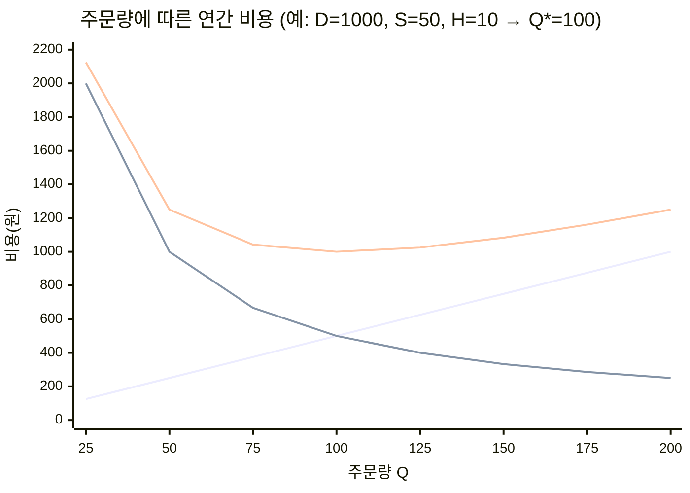
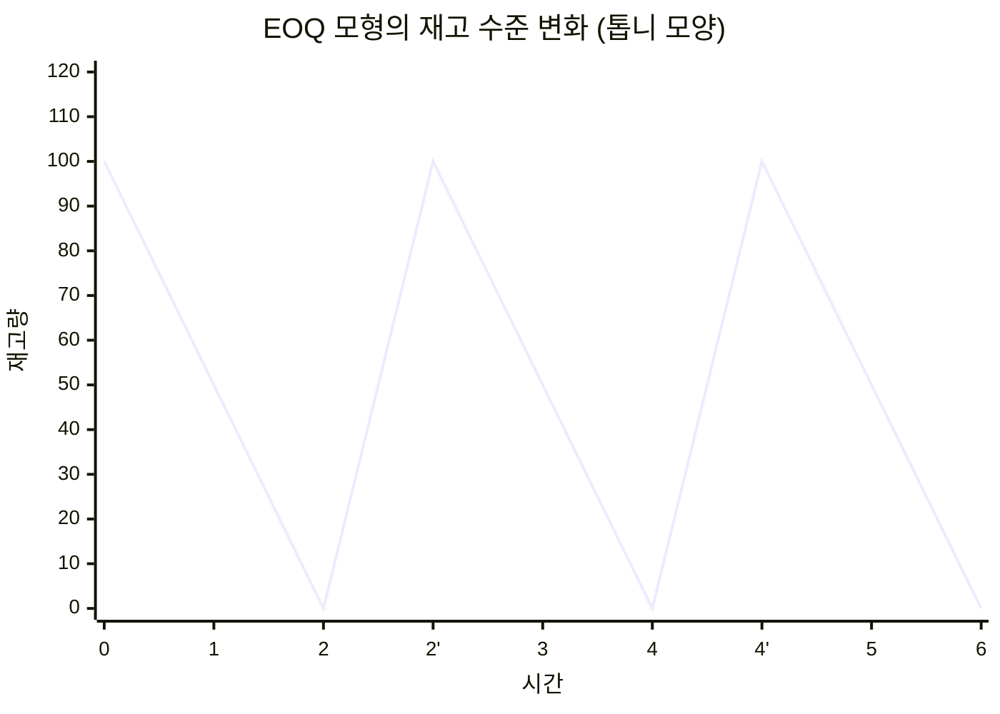
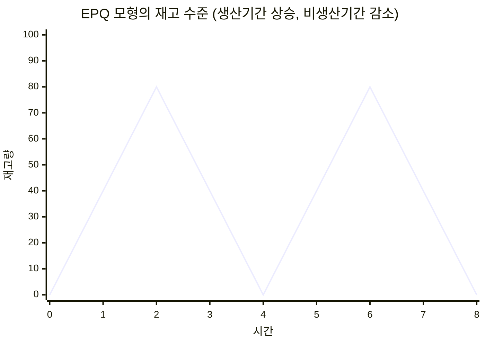
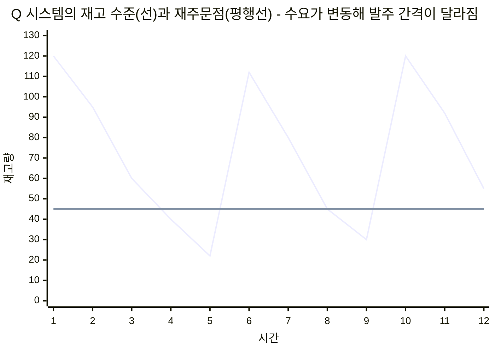
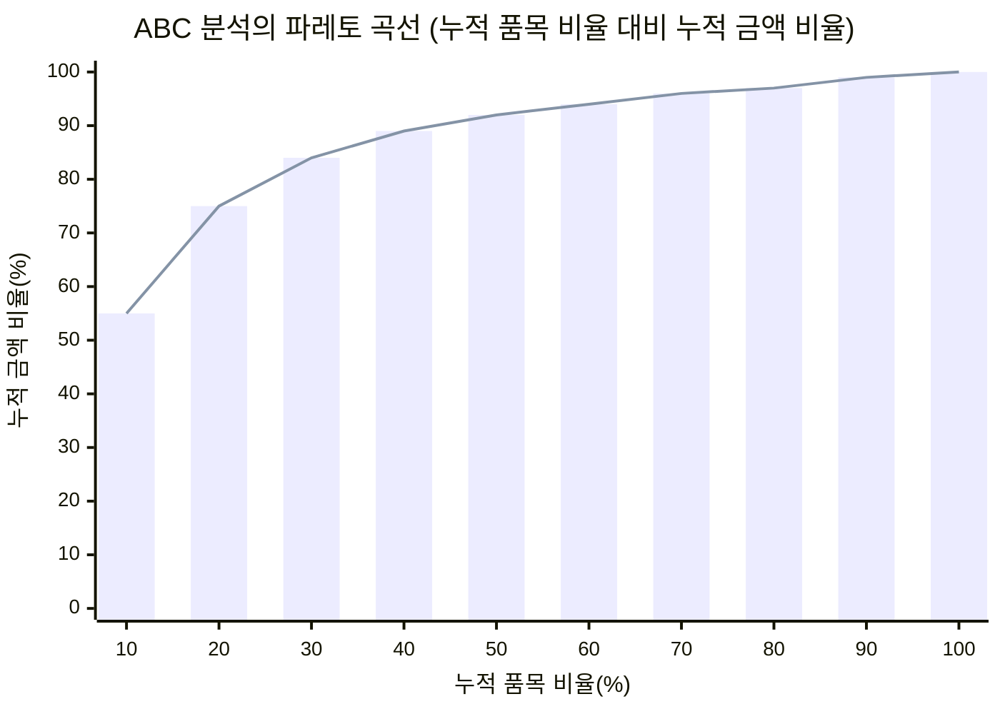
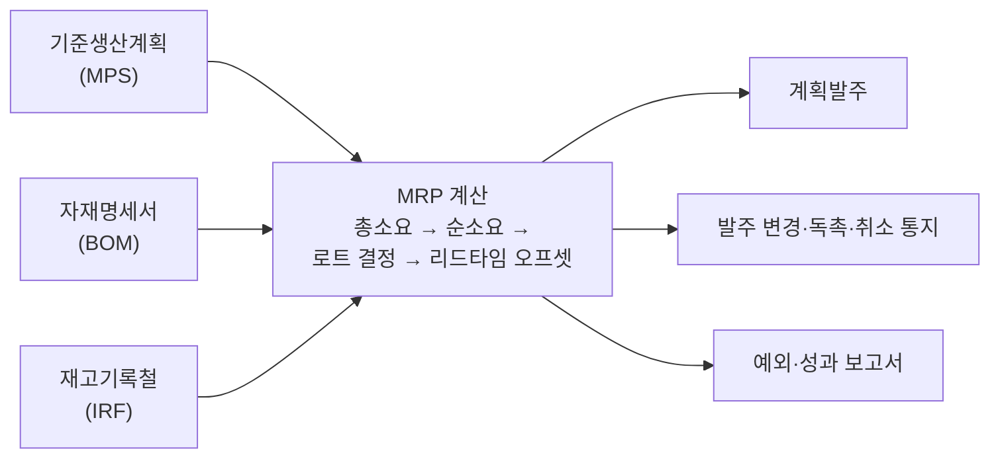

# 2.4 물류관리(자재 및 재고관리)

!!! info "출제기준"
    **2. 생산운영 및 물류관리** › **4. 물류관리(자재 및 재고관리)**

## 출제 경향

총 **39문항** 출제 (1교시 단답형 21 · 2~4교시 논술형 18) · 최근 10개 회차(109~139회) 21문항 · 최근 출제 제139회

| 주제 | 출제 수 | 출제 회차 |
|---|:-:|---|
| 2.4.1 재고의 유형과 기능 | 4 | 106회, 112회, 121회, 136회 |
| 2.4.2 경제적 주문량(EOQ·EPQ) | 8 | 67회, 82회, 88회, 94회, 97회, 115회, 124회, 139회 |
| 2.4.3 재고관리 시스템(정량·정기·Two-Bin) | 10 | 70회, 73회, 76회, 79회, 88회, 103회, 109회, 127회, 130회, 133회 |
| 2.4.4 ABC 분석과 자재분류 | 3 | 67회, 73회, 112회 |
| 2.4.5 자재소요계획(MRP) | 7 | 85회, 103회, 115회, 124회, 130회, 133회, 136회 |
| 2.4.6 창고·물류관리(WMS·RFID) | 7 | 70회, 82회, 121회, 124회, 130회, 133회, 139회 |

## 목차

1. [재고의 유형과 기능](#t24-1)
2. [경제적 주문량(EOQ·EPQ)](#t24-2)
3. [재고관리 시스템(정량·정기·Two-Bin)](#t24-3)
4. [ABC 분석과 자재분류](#t24-4)
5. [자재소요계획(MRP)](#t24-5)
6. [창고·물류관리(WMS·RFID)](#t24-6)

## 2.4.1 재고의 유형과 기능 {#t24-1}

### 재고의 개념

**재고(Inventory)**는 미래의 생산·판매에 쓰려고 보유하는 원자재·재공품·완제품·소모품 등 유휴 자원이다. 수요와 공급의 시간·수량 차이를 흡수하는 **완충 장치**이지만 자금을 묶고 문제(불량·고장·불균형)를 감추므로, 린 생산에서는 "재고는 낭비, 문제를 덮는 물"로 본다. 재고관리는 **고객 서비스 수준과 재고 비용 사이의 균형**을 찾는 활동이다.

| 재고 관련 비용 | 내용 | 로트가 커지면 |
|---|---|---|
| 주문(준비)비용 | 발주 사무, 운송, 검수 / 생산 준비교체 | 연간 비용 감소 |
| 재고유지비용 | 자본 비용(이자), 보관·보험·세금, 진부화·감손 | 증가 |
| 재고부족비용 | 판매 기회 손실, 납기 지연 위약금, 신용 저하, 긴급 조달비 | 감소 |
| 구매(생산)비용 | 단가 × 수량, 수량 할인 | 할인 시 감소 |

### 재고의 분류

**형태별(생산 운영상) 재고 (136회)**

| 종류 | 내용 |
|---|---|
| 원자재 | 생산에 투입되기 전의 원료·구입 부품 |
| 재공품(WIP) | 공정에 투입되어 가공 중이거나 공정 사이에 있는 미완성품 |
| 완제품 | 생산이 끝나 출하를 기다리는 제품 |
| MRO(소모성 자재) | 유지·보수·운영에 쓰는 공구·부품·소모품 |

**기능별 재고 (106·112·121회)**

| 재고 | 보유 목적 | 관리 요점·감축 방안 |
|---|---|---|
| **주기재고**(로트사이즈 재고) | 주문·생산을 로트 단위로 해서 생기는 재고(평균 \( Q/2 \)) | 로트 크기 축소 — 준비교체 시간 단축(SMED), 주문비 절감(EDI) |
| **안전재고** | 수요·리드타임의 불확실성에 대비 | 예측 정확도 향상, 리드타임 단축·안정화, 공급자 신뢰성 향상, 정보 공유 |
| **예상재고**(계절재고) | 계절적 수요나 판촉·파업 등 예상되는 수요 증가에 대비해 미리 생산 | 수요 평준화(가격·판촉 조정), 생산능력의 유연화(잔업·임시직) |
| **수송재고**(파이프라인 재고) | 운송 중이거나 공정 간 이동 중인 재고(평균 \( d \times L \)) | 리드타임 단축, 근거리 공급자, 운송 수단 개선 |
| **공정분리재고**(디커플링 재고) | 공정 사이에 두어 앞뒤 공정을 독립적으로 운영 | 공정 동기화, 라인밸런싱, 병목 앞에만 버퍼 유지(TOC) |

**관련 식**

\[
SS = z \cdot \sigma_{LT}, \qquad ROP = \bar d \times L + SS, \qquad \text{평균 주기재고} = \frac{Q}{2}, \qquad \text{수송재고} = \bar d \times L
\]

(\( z \): 서비스 수준에 따른 안전계수, \( \sigma_{LT} \): 리드타임 중 수요의 표준편차)

| 서비스 수준(품절 없을 확률) | 90% | 95% | 99% |
|---|:-:|:-:|:-:|
| 안전계수 \( z \) | 1.28 | 1.65 | 2.33 |

서비스 수준을 높일수록 안전재고는 급격히 늘어나므로, 품목 중요도(ABC)에 따라 서비스 수준을 차등 설정한다.

!!! tip "답안 작성 포인트"
    - 문제가 지정한 분류(형태별 4가지 / 기능별 3·4·5가지)를 정확히 맞추고, 유형마다 **목적 + 관리 요점(감축 방안)**을 같은 행에 쓴다.
    - 재고는 "필요악"이므로 목적은 인정하되 근본 원인(로트·불확실성·리드타임)을 줄이는 방향으로 결론을 맺는다.
    - 연관 주제: JIT와 재고 감축 [7.4.1](../07-support-technology/04-production-innovation.md#t74-1), SMED [3.6.2](../03-process-control/06-process-improvement.md#t36-2), 계절재고와 총괄계획 [3.1.1](../03-process-control/01-production-planning.md#t31-1)
    - 결론 예: "재고는 로트·불확실성·리드타임의 결과이므로 유형별 근본 원인을 줄이고, ERP·MES로 재고를 실시간 가시화해 **서비스 수준을 유지하면서 재고를 줄이는** 방향으로 관리해야 한다."

??? example "관련 기출 4문항 (106회, 112회, 121회, 136회)"

    - **제106회(2015) 4교시 1번** · 25점  
      재고 보유 목적에 따라 재고는 크게 주기재고, 안전재고, 계절재고로 분류된다. 보유 목적 및 관리상의 요점을 중심으로 각 재고에 대하여 설명하시오.
    - **제112회(2017) 2교시 2번** · 25점  
      수요만족이나 생산지원을 위한 4가지 재고유형과 유형별 감축방안에 대하여 설명하시오.
    - **제121회(2020) 3교시 2번** · 25점  
      기능별 재고분류법에 대하여 설명하시오.

        ??? quote "문제 전문"

            기능별 재고분류법에 대하여 설명하시오.  
            1) 안전재고(Safety Stock)  
            2) 로트사이즈 재고(Lot size/cycle Stock)  
            3) 운송재고(Transportation Stock)  
            4) 예상재고(Anticipation Stock)  
            5) 공정분리재고(Decoupling Stock)  
    - **제136회(2025) 1교시 13번** · 10점  
      생산 운영상의 재고 종류 4가지를 설명하시오.

## 2.4.2 경제적 주문량(EOQ·EPQ) {#t24-2}

**EOQ(Economic Order Quantity)**는 연간 주문비용과 재고유지비용의 합을 최소로 하는 1회 주문량이다. 1913년 F. W. Harris가 처음 제시했고 R. H. Wilson이 실무에 보급해 **Wilson 공식**이라고도 한다. EPQ(경제적 생산량) 모형은 1918년 E. W. Taft가 생산 상황으로 확장한 것으로 알려져 있다.

### EOQ 모형의 가정 (97·115회)

1. 연간 수요량이 알려져 있고 일정하다.
2. 리드타임이 일정하다.
3. 주문량은 한 번에 모두 입고된다.
4. 단위당 구매가격은 일정하다(수량 할인 없음).
5. 비용은 주문비용과 재고유지비용뿐이며, 재고 부족은 허용하지 않는다.
6. 단일 품목이다.

### 총비용 식과 EOQ (88·97회)

\[
TC(Q) = \underbrace{\frac{D}{Q} S}_{\text{연간 주문비용}} + \underbrace{\frac{Q}{2} H}_{\text{연간 재고유지비용}}
\]

\[
Q^{*} = \sqrt{\frac{2DS}{H}}, \qquad N = \frac{D}{Q^{*}}, \qquad T = \frac{\text{연간 작업일수}}{N}, \qquad TC^{*} = \sqrt{2DSH}, \qquad ROP = d \times L
\]

(\( D \): 연간 수요, \( S \): 1회 주문비용, \( H \): 단위당 연간 재고유지비, \( d \): 일일 수요, \( L \): 리드타임)

EOQ에서는 **주문비용 = 재고유지비용**이 된다.

**유도**: \( \dfrac{dTC}{dQ} = -\dfrac{DS}{Q^2} + \dfrac{H}{2} = 0 \)에서 \( Q^{*} = \sqrt{2DS/H} \)

**민감도(강건성)**: \( \dfrac{TC(Q)}{TC^{*}} = \dfrac{1}{2}\left(\dfrac{Q}{Q^{*}} + \dfrac{Q^{*}}{Q}\right) \) — 주문량이 EOQ보다 20% 커도 총비용은 약 1.7%만 늘어난다. 총비용 곡선이 바닥 근처에서 평평하므로 포장 단위 등에 맞춰 주문량을 반올림해도 무방하다.

**EOQ 모형의 한계와 시사점**: 가정(수요·비용 일정)이 현실과 다르고, 주문비 \( S \)를 고정값으로 본다. JIT는 반대로 \( S \)(준비교체 비용)를 줄여 EOQ 자체를 작게 만드는 접근이다(\( S \to 0 \)이면 \( Q^{*} \to 0 \)).

### EOQ 모형도 (97·139회)

우상향 직선은 재고유지비용, 우하향 곡선은 주문비용, U자 곡선은 총비용이다. 두 비용 선이 만나는 \( Q = 100 \)에서 총비용이 최소다.

재고가 \( Q \)에서 일정 속도로 줄다가 0이 되는 순간 \( Q \)만큼 입고된다. 평균 재고는 \( Q/2 \)이고, 재고가 \( ROP \)에 이르면 발주한다.

### 재고관리 모형의 분류 (97회)

| 구분 | 모형 | 내용 |
|---|---|---|
| 확정적 모형 | 기본 EOQ | 수요·리드타임 확정, 일시 입고 |
| | EPQ(경제적 생산량) | 생산하면서 동시에 소비(점진 입고) |
| | 수량할인 모형 | 주문량에 따라 단가가 달라짐 |
| | 재고부족 허용 모형 | 부재고(Backorder)를 허용 |
| 확률적 모형 | 정량발주(Q) 시스템 | 재주문점에 안전재고 포함 |
| | 정기발주(P) 시스템 | 일정 주기마다 목표재고까지 보충 |
| | 단일기간(신문판매원) 모형 | 한 번만 주문하는 계절·부패 상품 |

### EPQ 모형 (124회)

**가정**: EOQ 가정에 더해, 생산율 \( p \)가 사용률 \( d \)보다 크고(\( p > d \)) 생산과 소비가 **동시에** 일어나 재고가 점진적으로 쌓인다.

\[
I_{max} = Q\left(1 - \frac{d}{p}\right), \qquad TC(Q) = \frac{D}{Q}S + \frac{Q}{2}\left(1 - \frac{d}{p}\right)H, \qquad Q^{*} = \sqrt{\frac{2DS}{H\left(1 - \dfrac{d}{p}\right)}}
\]

(\( S \): 1회 생산준비비용, 생산기간 \( = Q/p \))

| 구분 | EOQ | EPQ |
|---|---|---|
| 입고 방식 | 일시 입고(구매) | 점진 입고(자체 생산) |
| 비용 항목 | 주문비 + 유지비 | 준비비 + 유지비 |
| 최대 재고 | \( Q \) | \( Q(1 - d/p) \) |
| 최적량 | \( \sqrt{2DS/H} \) | \( \sqrt{2DS/H} \times \sqrt{p/(p-d)} \) → EOQ보다 큼 |

**수량할인 모형**: 가격 구간별로 EOQ를 구해 실행 가능 여부(구간 안인지)를 확인하고, 실행 불가하면 구간 하한 수량으로 조정한 뒤 **구매비를 포함한 총비용**이 최소인 수량을 고른다.

### 풀이: 82회

연간 수요 \( D = 15 \times 52 = 780 \)개, \( H = 50 \times 0.2 = 10 \)원/개·년, \( Q = 400 \)

- 연간 주문비용 \( = \dfrac{780}{400} \times 40 = 78 \)원
- 연간 재고유지비용 \( = \dfrac{400}{2} \times 10 = 2{,}000 \)원
- **연간 총재고비용 = 2,078원** (구매비 \( 780 \times 50 = 39{,}000 \)원을 포함하면 41,078원)

참고로 EOQ는 \( \sqrt{2 \times 780 \times 40 / 10} \approx 79 \)개로, 현재 로트 400개는 지나치게 크다.

### 풀이: 94회 (\( D = 32{,}000,\ H = 60,\ S = 2{,}400 \), 연간 240일)

| 항목 | 계산 | 답 |
|---|---|---|
| 경제적 주문량 | \( \sqrt{2 \times 32{,}000 \times 2{,}400 / 60} \) | **1,600개** |
| 연간 주문횟수 | \( 32{,}000 / 1{,}600 \) | **20회** |
| 주문주기 | \( 240 / 20 \) | **12일** |
| 연간 총재고비용 | \( 20 \times 2{,}400 + 800 \times 60 \) | **96,000원** |
| 재주문점(리드타임 3일) | \( (32{,}000 / 240) \times 3 \) | **400개** |

### 풀이: 115회 (\( D = 100{,}000,\ H = 100,\ S = 500 \), 연간 300일)

| 항목 | 계산 | 답 |
|---|---|---|
| 경제적 주문량 | \( \sqrt{2 \times 100{,}000 \times 500 / 100} \) | **1,000단위** |
| 연간 주문횟수 | \( 100{,}000 / 1{,}000 \) | **100회** |
| 주문 간 간격 | \( 300 / 100 \) | **3일** |
| 연간 총 최소재고비용 | \( 100 \times 500 + 500 \times 100 \) | **100,000원** |

!!! tip "답안 작성 포인트"
    - EOQ 문제는 **가정 → 총비용 식 → 미분해 구한 Q\* → 모형도(비용 곡선 + 톱니 그래프)**를 갖추면 대부분 대응된다.
    - 계산 문제는 항목별 계산식과 단위를 표로 정리하고, "EOQ에서는 주문비용과 유지비용이 같다"로 검산한다.
    - EPQ는 EOQ와 달리 \( (1 - d/p) \) 항이 붙는 이유(생산 중에도 소비)를 설명한다.
    - 결론 예: "EOQ는 비용 균형의 원리를 보여 주지만 가정이 엄격하므로, 실무에서는 준비교체 단축으로 \( S \)를 낮춰 **소로트화**하고 수요 변동은 안전재고·MRP로 보완한다."

??? example "관련 기출 8문항 (67회, 82회, 88회, 94회, 97회, 115회, 124회, 139회)"

    - **제67회(2002) 1교시 11번** · 10점  
      EOQ(경제적 발주모형)를 예제와 함께 설명하시오.
    - **제82회(2007) 1교시 7번** · 10점  
      다음의 조건에서 연간 총 재고비용은 얼마인가?

        ??? quote "문제 전문"

            다음의 조건에서 연간 총 재고비용은 얼마인가?  
            \- 판매량 : 15개/1주일  
            \- 구매단가 : 50원/개  
            \- 주문비용 : 40원  
            \- 재고유지비용 : 구매가의 20%  
            \- 연간 판매일 : 52주/년  
            \- 구매 로트크기 : 400개/로트  
    - **제88회(2009) 1교시 7번** · 10점  
      EOQ(Economic Order Quantity) 모형에서 연간수요량(D), 1회 주문비용(S), 연간 단위당 재고비용(H)이 주어졌을 때, 연간 총비용을 수식과 그래프로 나타내고, 최적발주량을 구하시오.
    - **제94회(2011) 3교시 5번** · 25점  
      A회사에서는 연간 약 32,000개의 실리콘 칩(silicon chip)을 사용한다. 실리콘 연간 재고유지비가 개당 60원이고, 1회 주문비용이 2,400원이다. 이 회사는 연간 240일 작업을 한다고 가정하고, 다음 각 항목을 구하시오.

        ??? quote "문제 전문"

            A회사에서는 연간 약 32,000개의 실리콘 칩(silicon chip)을 사용한다. 실리콘 연간 재고유지비가 개당 60원이고, 1회 주문비용이 2,400원이다. 이 회사는 연간 240일 작업을 한다고 가정하고, 다음 각 항목을 구하시오.  
            \- 경제적 주문량  
            \- 연간 주문회수  
            \- 주문주기  
            \- 최적 주문정책에 따른 연간 총재고 비용  
            \- 상품인도기간이 3일일 때의 재주문점  
    - **제97회(2012) 4교시 1번** · 25점  
      생산시스템의 운영에 있어서 재고관리시스템모형에 대하여 다음 사항을 설명하시오.

        ??? quote "문제 전문"

            생산시스템의 운영에 있어서 재고관리시스템모형에 대하여 다음 사항을 설명하시오.  
            1) 재고관리시스템모형을 확정적 모델과 확률적 모형으로 항목별로 구분하고, 각 항목별 내용을 설명하시오.  
            2) 경제적 주문량(EOQ) 모형에 있어서 EOQ의 가정을 설명하시오.  
            3) EOQ의 모형도(주문량, 주문비용, 재고유지비용, 총비용을 나타낸 그래프)를 그리시오.  
            4) 총비용을 파악하는 산식, EOQ를 구하는 식, EOQ의 재주문점을 구하는 식을 쓰시오.  
    - **제115회(2018) 4교시 2번** · 25점  
      경제적 주문량(EOQ) 모형은 재고의 주문비와 재고 유지비의 합을 최소화하는 최적의 주문량을 계산하는 모형이다. 다음 물음에 답하시오.

        ??? quote "문제 전문"

            경제적 주문량(EOQ) 모형은 재고의 주문비와 재고 유지비의 합을 최소화하는 최적의 주문량을 계산하는 모형이다. 다음 물음에 답하시오.  
            1) EOQ 모형의 전제조건에 대해서 설명하시오.  
            2) 어떤 제품의 연간수요량은 100,000단위, 연간 재고유지비용은 단위당 100원이며 매회 주문비용은 500원의 비용이 든다. 다음 각 항목을 구하시오.  
            (단, 연간작업일수는 300일)  
            (1) 경제적 주문량  
            (2) 연간 주문회수  
            (3) 주문간 간격  
            (4) 연간 총최소재고비용  
    - **제124회(2021) 3교시 3번** · 25점  
      EPQ(Economic Production Quantity) 재고모형에 대하여 다음 질문에 답하시오.

        ??? quote "문제 전문"

            EPQ(Economic Production Quantity) 재고모형에 대하여 다음 질문에 답하시오.  
            1) 기본가정을 나열하고 생산기간과 재고량 관계의 모형도를 그리시오.  
            2) 총비용과 EPQ를 구하는 수식을 작성하시오  
            (단, D: 연간생산량, Q: 단위당 생산량, S: 단위당 생산준비비용, H: 단위당 재고유지비용, p: 1일 생산율, d: 1일 사용률)  
    - **제139회(2026) 1교시 9번** · 10점  
      경제적 발주량(Economic Order Quantity; EOQ)의 개념을 도식화하여 설명하시오.

## 2.4.3 재고관리 시스템(정량·정기·Two-Bin) {#t24-3}

### 독립수요와 종속수요 (70회)

| 구분 | 독립수요 | 종속수요 |
|---|---|---|
| 대상 | 완제품, 서비스 부품 | 원자재, 부품, 반제품 |
| 수요 결정 | 시장에서 결정 → **예측** 필요 | 상위 품목의 생산계획에서 **계산** |
| 수요 형태 | 비교적 연속적 | 덩어리(lumpy) 형태 |
| 재고모형 | EOQ, 정량발주(Q)·정기발주(P) 시스템, 안전재고 | **MRP**(자재소요계획) |

### 최적 재고정책의 변수 (73회)

- **결정 변수**: 주문량(\( Q \)), 재주문점(\( ROP \)), 주문주기(\( T \)), 목표(최대)재고, 안전재고
- **입력 변수(모수)**: 수요의 평균과 변동, 리드타임과 그 변동, 주문(준비)비용, 재고유지비용, 재고부족비용, 서비스 수준

### 독립수요 품목의 재고 발생 원인과 관리 시스템 (88회)

**발생 원인**: 수요·공급의 불확실성, 로트 단위 구매·생산(규모의 경제), 계절적 수요, 운송 리드타임, 공정 간 독립 운영, 가격 상승 대비(투기)

| 시스템 | 특징 | 적용 대상 |
|---|---|---|
| 정량발주(Q) | 재고가 재주문점에 이르면 일정량 발주 | 수요가 안정된 일반 품목 |
| 정기발주(P) | 정해진 주기마다 목표재고까지 보충 | 고가·중요 품목, 여러 품목을 한꺼번에 발주하는 경우 |
| Min-Max (s, S) | 정기 점검 시 Min 이하이면 Max까지 보충 | 정기발주와 정량발주의 절충 |
| Two-Bin | 두 상자로 시각적 발주 관리 | 저가·소모성 C급 품목 |
| 단일기간 모형 | 한 번만 주문 | 계절 상품, 신선식품, 신문 |

### 정량발주(Q) 시스템과 정기발주(P) 시스템 (103·109·127회)

| 구분 | 정량발주(Q 시스템) | 정기발주(P 시스템) |
|---|---|---|
| 발주 시점 | 재고가 재주문점에 도달할 때(부정기) | 일정한 주기마다(정기) |
| 발주량 | 일정(보통 EOQ) | 변동(목표재고 − 현재 재고) |
| 재고 조사 | 계속 실사(상시 감시) | 주기적 실사 |
| 안전재고 | 리드타임 동안의 변동만 대비 → 적음 | 주기 + 리드타임 동안의 변동 대비 → 많음 |
| 관리 부담 | 상시 감시 필요(전산화 시 용이) | 정해진 날에 조사 → 관리 용이 |
| 적합 품목 | 저가·수요 안정 품목(B·C급) | 고가·중요 품목(A급), 같은 공급자의 여러 품목 동시 발주 |

\[
\text{Q 시스템: } ROP = \bar d L + z\,\sigma_d \sqrt{L} \qquad\quad \text{P 시스템: } \text{목표재고} = \bar d (T + L) + z\,\sigma_d \sqrt{T + L}
\]

Q 시스템은 재고가 재주문점(ROP)에 닿는 순간 일정량 \( Q \)를 발주하므로 **발주 간격이 변한다**. P 시스템은 같은 그래프에서 발주 시점이 **일정 간격 \( T \)**로 고정되고 발주량(목표재고 − 현재고)이 변한다. 리드타임 동안 재고가 안전재고 근처까지 내려갔다가 입고로 회복되는 모양을 그린다.

### Two-Bin 시스템 (76·79·130회)

**개념**: 재고를 두 개의 상자(Bin)에 나눠 둔다. 첫 번째 상자를 다 쓰면 발주하고, 입고될 때까지 두 번째 상자(= 재주문점 수량)를 쓴다. 장부 없이 **눈으로 발주 시점을 알 수 있는 정량발주의 간이 방식**이다.

**적용이 쉬운 자재 (79회)**: 저가·다량 소비 품목(볼트·너트·소모품), 수요가 안정적인 품목, 리드타임이 짧고 안정된 품목, 보관이 쉬운 표준품

**협력업체 선정 기준 (79회)**: 납기 신뢰성, 짧은 조달 리드타임, 소량 다빈도 납품 능력, 품질 안정(무검사 납품 가능), 가격 안정, 장기 거래와 정보 공유(간판 대응) 의지

**Min-Max 기법**: 재고가 Min(재주문점 = 리드타임 중 수요 + 안전재고) 이하로 떨어지면 Max까지 채운다(발주량 = Max − 현재고, Max ≈ Min + EOQ).

**적용의 핵심 포인트 (130회)**: ① Two-Bin의 두 번째 상자 수량과 Min 값을 **리드타임 수요 + 안전재고**로 정확히 설정 ② 발주 신호(빈 상자·카드)가 즉시 전달되는 체계 ③ 재고 기록의 정확성과 정기 점검 ④ 수요 변화에 맞춰 기준값을 주기적으로 재조정 ⑤ 저가·소모성 품목에 한정 적용

### 재고의 움직임을 평가하는 지표 (133회)

| 지표 | 식 | 의미 |
|---|---|---|
| 재고회전율 | 연간 매출원가(출고액) ÷ 평균 재고액 | 높을수록 재고가 빨리 소진됨 |
| 재고회전일수(보유일수) | 평균 재고 ÷ 일평균 출고량 (= 365 ÷ 회전율) | 현재 재고로 버틸 수 있는 일수 |
| 장기 체류(불용) 재고율 | 일정 기간 이상 움직임이 없는 재고 ÷ 전체 재고 | 진부화·불용 재고 위험 |

(서비스 측면 지표로 결품률·재고 정확도를 함께 관리한다.)

!!! tip "답안 작성 포인트"
    - Q·P 시스템 비교는 10점으로 세 번 출제됐다. **비교표 + 재고 수준 그래프(톱니)**를 기본으로 하고, 공식 두 개를 덧붙인다.
    - 70회형은 Orlicky의 독립/종속 수요 구분 → 각각의 모형(EOQ 계열 / MRP)으로 연결한다.
    - 결론 예: "품목의 금액(ABC)·수요 패턴에 따라 Q·P·Two-Bin·MRP를 **혼합 적용**하고, 바코드·RFID와 WMS로 재고 기록 정확도를 확보하는 것이 재고 시스템 성공의 전제다."

??? example "관련 기출 10문항 (70회, 73회, 76회, 79회, 88회, 103회, 109회, 127회, 130회, 133회)"

    - **제70회(2003) 3교시 5번** · 25점  
      재고관리 시스템은 수요패턴에 따라 구분, 적용하는 것이 합리적이다. 재고에 대한 수요는 독립수요와 종속수요로 구분할 수 있는데, 이러한 구분에 따라 재고모델을 연계시켜 설명하시오.
    - **제73회(2004) 1교시 4번** · 10점  
      최적 재고정책을 결정하기 위한 변수(Parameter)
    - **제76회(2005) 1교시 11번** · 10점  
      Two Bin System의 개념 및 적용.
    - **제79회(2006) 2교시 4번** · 25점  
      자재 및 구매관리에서 TWO-BIN 시스템의 적용이 용이한 자재 및 협력업체 선정기준에 대해 기술하시오.
    - **제88회(2009) 3교시 2번** · 25점  
      독립제품의 경우에 재고 발생원인 및 재고 유형에 대해 설명하시오. 그리고 독립제품의 재고관리시스템들에 대한 각각의 특징 및 적용 대상 등에 대해 설명하시오.
    - **제103회(2014) 1교시 12번** · 10점  
      재고관리 방식에서 Q시스템(정량발주방식)과 P시스템(정기발주방식)을 비교하여 설명하시오.
    - **제109회(2016) 4교시 6번** · 25점  
      합리적 구매방식중 정량발주형과 정기발주형에 대하여 각각 설명하시오.
    - **제127회(2022) 1교시 4번** · 10점  
      재고관리활동에서 정량발주시스템과 정기발주시스템의 차이점
    - **제130회(2023) 1교시 8번** · 10점  
      ‘TWO BIN’&‘MINI-MAX’재고관리기법 적용의 핵심 포인트에 대하여 설명하시오.
    - **제133회(2024) 1교시 3번** · 10점  
      재고의 움직임을 측정·평가할 수 있는 재고관리 3가지 지표

## 2.4.4 ABC 분석과 자재분류 {#t24-4}

### ABC 분석의 개념 (67·112회)

**ABC 분석**은 파레토 원리에 따라 품목을 **연간 사용금액**의 크기로 A·B·C 등급으로 나누고, 등급별로 관리의 정도를 달리하는 **중점관리 기법**이다.

### 분석 절차

1. 품목별 연간 사용금액 계산(연간 사용량 × 단가)
2. 사용금액이 큰 순서로 정렬
3. 누적 품목 비율과 누적 금액 비율 계산
4. 파레토 곡선을 그리고 등급 구분
5. 등급별 관리 방안 결정

| 등급 | 품목 수 비율 | 금액 비율 |
|:-:|:-:|:-:|
| A | 약 10~20% | 약 70~80% |
| B | 약 20~30% | 약 15~20% |
| C | 약 50~60% | 약 5~10% |

곡선이 가파른 앞부분(품목 약 20%, 금액 약 75%)이 A, 완만해지는 중간이 B, 거의 평평한 나머지가 C 등급이다(수치는 예시).

### 등급별 관리 방안

| 구분 | A 품목 | B 품목 | C 품목 |
|---|---|---|---|
| 관리 수준 | 엄격·정밀 | 중간 | 간단 |
| 발주 방식 | 정기발주, 소량 다빈도 | 정량발주 | Two-Bin, 대량 일괄 발주 |
| 재고 수준 | 최소화 | 적정 | 여유 있게 |
| 재고 조사 | 수시·정밀 | 정기 | 연 1~2회 |
| 수요예측 | 정밀 예측 | 일반 예측 | 과거 실적 기준 |
| 안전재고 | 적게 | 중간 | 많이 |
| 구매 | 경영층·전문 담당, 가격 협상 | 일반 절차 | 간소화·위임 |

### 자재 분류의 원칙 (73회)

1. **점진성**: 대분류 → 중분류 → 소분류로 단계적으로 세분화
2. **포괄성**: 모든 자재가 빠짐없이 어느 분류에든 포함
3. **상호 배타성**: 한 자재는 하나의 분류에만 속함(중복 없음)
4. **용이성**: 기억하고 사용하기 쉬움(코드 체계의 단순성)
5. **신축성**: 신규 자재를 추가할 수 있도록 여유를 둠

### ABC 분석의 보완 기법

| 기법 | 분류 기준 | 활용 |
|---|---|---|
| VED | 중요도(Vital·Essential·Desirable) | 결품 시 생산 중단 위험이 큰 저가 부품 관리 |
| FSN | 이동 속도(Fast·Slow·Non-moving) | 장기 체류·불용 재고 정리 |
| XYZ | 수요 변동성(안정·변동·불규칙) | 예측 방법·안전재고 차등 |
| 다기준 ABC | 금액 + 중요도 + 리드타임 등 | ABC×XYZ 매트릭스로 재고 정책 차별화 |

ABC 분석은 금액만 보므로, 저가지만 결품 시 라인이 멈추는 부품은 VED·다기준 분석으로 보완한다.

!!! tip "답안 작성 포인트"
    - **파레토 곡선 그림 + 등급 구분표 + 등급별 관리 방안표**가 ABC 분석 답안의 기본이다.
    - 금액 외에 중요도(결품 영향)를 함께 고려하는 다기준 ABC나, 사용 빈도 기준 분석을 덧붙이면 좋다.
    - 결론 예: "ABC 분석은 한정된 관리 자원을 A 품목에 집중하는 중점관리 기법이며, VED·XYZ와 결합한 다기준 분류를 ERP에서 주기적으로 재분류해 운영해야 한다."

??? example "관련 기출 3문항 (67회, 73회, 112회)"

    - **제67회(2002) 1교시 10번** · 10점  
      ABC 자재분류법
    - **제73회(2004) 1교시 6번** · 10점  
      자재분류의 원칙
    - **제112회(2017) 2교시 5번** · 25점  
      ABC 재고관리에 대하여 ABC 분석절차와 분류별 자재관리 방안에 대하여 설명하시오.

## 2.4.5 자재소요계획(MRP) {#t24-5}

### MRP의 입력과 출력 (85·103·124·130·136회)

**MRP(Material Requirements Planning)**는 기준생산계획을 바탕으로 **종속수요 품목(부품·자재)**의 소요량과 발주 시점을 계산하는 시스템이다. 1960년대 IBM의 J. Orlicky 등이 컴퓨터를 이용해 개발했고, Orlicky의 저서(1975)와 APICS의 'MRP 운동'으로 확산되었다. "필요한 자재를, 필요한 때에, 필요한 양만큼" 확보해 재고를 줄이면서 결품을 막는 것이 목적이다.

| 3대 입력 | 내용 |
|---|---|
| 기준생산계획(MPS) | 어떤 완제품을 언제 얼마나 만들지 |
| 자재명세서(BOM) | 제품을 이루는 부품의 구성·수량·계층 구조(제품 구조 나무) |
| 재고기록철(IRF) | 품목별 현재고, 예정 입고, 리드타임, 로트 크기, 안전재고 |

**BOM**: 완제품을 만드는 데 필요한 모든 부품·원자재의 목록과 수량, 상하위 관계를 계층(레벨)으로 나타낸 것이다. 설계 BOM과 제조 BOM으로 나누기도 하며, 같은 부품이 여러 레벨에 있으면 가장 낮은 레벨에서 한 번에 계산한다(로우레벨 코드).

### 소요량 산출 과정 (85회)

1. **총소요량**: 상위 품목의 계획발주량 × BOM 수량
2. **순소요량** = 총소요량 − 현재고 − 예정입고량 (+ 안전재고)
3. **로트 크기 결정**: L4L(Lot-for-Lot), 고정 로트, EOQ, 기간 발주량 등
4. **리드타임 오프셋**: 계획입고 시점에서 리드타임만큼 앞당겨 **계획발주** 시점 결정
5. 하위 레벨로 내려가며 반복

| 로트 결정 기법 | 내용 |
|---|---|
| L4L(Lot-for-Lot) | 순소요량만큼 그대로 발주 → 재고 최소, 발주 횟수 많음 |
| 고정 주문량(FOQ)·EOQ | 정해진 수량 단위로 발주 |
| 기간 발주량(POQ) | EOQ를 평균 수요로 나눈 기간만큼의 소요량을 묶어 발주 |
| 동적 기법 | Wagner–Whitin(최적), Silver–Meal, 최소 단위비용, 부분기간 균형(PPB) 휴리스틱 |

### MRP의 장점과 한계

| 장점 | 한계 |
|---|---|
| 종속수요 재고 감소, 결품 방지 | BOM·재고 데이터가 부정확하면 결과 신뢰 불가 |
| 발주·생산 시점의 정확한 계획 | 무한 능력 가정 → CRP로 능력 점검 필요 |
| 계획 변경 시 재계산으로 신속 대응 | 고정 리드타임 가정, 잦은 재계획 시 계획 불안정(Nervousness) |
| 우선순위 계획(독촉·연기) 제공 | 도입·운영 비용, 교육 부담 |

**최근 동향**: 유한 능력·제약을 동시에 고려하는 **APS**, 수요 변동을 디커플링 버퍼로 흡수하는 **DDMRP(수요 주도형 MRP)**, 클라우드 ERP와 MES 실시간 재고 연동으로 보완한다 → [7.1.6](../07-support-technology/01-it-smart-factory.md#t71-6), 기준생산계획 [3.1.2](../03-process-control/01-production-planning.md#t31-2), BOM 관리 [7.2.8](../07-support-technology/02-product-development.md#t72-8)

### MRP, MRP II, ERP (130·133회)

| 구분 | MRP | MRP II | ERP |
|---|---|---|---|
| 의미 | 자재소요계획 | 제조자원계획 | 전사적 자원관리 |
| 범위 | 자재 소요량·발주 시점 | MRP + 능력계획(CRP) + 생산통제 + 재무 연계(폐쇄 루프) | 생산·물류·영업·회계·인사 등 전사 업무 통합 |
| 관리 대상 | 자재 | 자재·설비·인력·자금 | 기업의 모든 자원 |

### MRP 도입 시 고려사항과 성공 요인 (85·133회)

1. **데이터 정확성**: BOM·재고 기록의 정확도(목표 95% 이상)
2. **MPS의 안정성**: 동결 구간 설정으로 잦은 계획 변경 방지
3. **리드타임의 신뢰성**: 표준 리드타임 정비와 준수
4. **정보시스템**: 전산화, 다른 시스템(구매·생산)과의 통합
5. 교육과 경영층 의지, 업무 절차 정비
6. 적절한 로트 크기 정책

**공급망 관리의 최적화 방법 (133회)**: 공급망 네트워크 설계 최적화, 판매·운영계획(S&OP)으로 수요·공급 계획 통합, 협업과 정보 공유(CPFR·VMI), 다단계 재고 최적화, 리드타임 단축, APS 등 계획 시스템 활용

### 풀이: 115회

**총소요량** (A → X 3, Y 2 / B → X 5, Z 3, MPS 주차에 부품 필요로 가정)

| 품목 \ 주 | 1 | 2 | 3 | 4 | 5 | 6 | 7 | 8 |
|---|:-:|:-:|:-:|:-:|:-:|:-:|:-:|:-:|
| X | | | 250 | 550 | | 400 | | 250 |
| Y | | | | 200 | | 100 | | |
| Z | | | 150 | 150 | | 150 | | 150 |

**품목 X** (로트 500, 리드타임 1주, 현재고 150)

| 주 | 1 | 2 | 3 | 4 | 5 | 6 | 7 | 8 |
|---|:-:|:-:|:-:|:-:|:-:|:-:|:-:|:-:|
| 총소요량 | | | 250 | 550 | | 400 | | 250 |
| 기말 재고(150부터) | 150 | 150 | 400 | 350 | 350 | 450 | 450 | 200 |
| 순소요량 | | | 100 | 150 | | 50 | | |
| 계획입고 | | | 500 | 500 | | 500 | | |
| **계획발주** | | **500** | **500** | | **500** | | | |

**품목 Y** (로트 150, 리드타임 3주, 현재고 100)

| 주 | 1 | 2 | 3 | 4 | 5 | 6 | 7 | 8 |
|---|:-:|:-:|:-:|:-:|:-:|:-:|:-:|:-:|
| 총소요량 | | | | 200 | | 100 | | |
| 기말 재고(100부터) | 100 | 100 | 100 | 50 | 50 | 100 | 100 | 100 |
| 순소요량 | | | | 100 | | 50 | | |
| 계획입고 | | | | 150 | | 150 | | |
| **계획발주** | **150** | | **150** | | | | | |

**품목 Z** (로트 300, 리드타임 2주, 현재고 150)

| 주 | 1 | 2 | 3 | 4 | 5 | 6 | 7 | 8 |
|---|:-:|:-:|:-:|:-:|:-:|:-:|:-:|:-:|
| 총소요량 | | | 150 | 150 | | 150 | | 150 |
| 기말 재고(150부터) | 150 | 150 | 0 | 150 | 150 | 0 | 0 | 150 |
| 순소요량 | | | | 150 | | | | 150 |
| 계획입고 | | | | 300 | | | | 300 |
| **계획발주** | | **300** | | | | **300** | | |

### 풀이: 124회 (Lot-for-Lot)

BOM: 산악자전거 → 몸체(1), 핸들(1) / 몸체 → 앞바퀴(1), 뒷바퀴(1), 페달(2)

| 품목 (현재고, LT) | 항목 | 1주 | 2주 | 3주 | 4주 | 5주 |
|---|---|:-:|:-:|:-:|:-:|:-:|
| 산악자전거 (50, 1주) | 총소요량 | | | | 200 | 150 |
| | 순소요량 | | | | 150 | 150 |
| | **계획발주** | | | **150** | **150** | |
| 몸체 (100, 1주) | 총소요량 | | | 150 | 150 | |
| | 순소요량 | | | 50 | 150 | |
| | **계획발주** | | **50** | **150** | | |
| 핸들 (50, 2주) | 총소요량 | | | 150 | 150 | |
| | 순소요량 | | | 100 | 150 | |
| | **계획발주** | **100** | **150** | | | |
| 앞바퀴 (40, 1주) | 총소요량 | | 50 | 150 | | |
| | 순소요량 | | 10 | 150 | | |
| | **계획발주** | **10** | **150** | | | |
| 뒷바퀴 (20, 1주) | 총소요량 | | 50 | 150 | | |
| | 순소요량 | | 30 | 150 | | |
| | **계획발주** | **30** | **150** | | | |
| 페달 (80, 1주) | 총소요량 | | 100 | 300 | | |
| | 순소요량 | | 20 | 300 | | |
| | **계획발주** | **20** | **300** | | | |

(하위 품목의 총소요량 = 상위 품목의 계획발주량 × BOM 수량)

!!! tip "답안 작성 포인트"
    - MRP 이론 문제는 **입력 3가지 → 처리 논리 → 출력**의 흐름도로 시작한다.
    - 계산 문제는 품목마다 **총소요 → 재고 → 순소요 → 계획입고 → 계획발주** 행을 갖춘 표를 쓰고, 로트 규칙과 리드타임 오프셋을 명시한다.
    - 상위 품목의 **계획발주**가 하위 품목의 **총소요**가 된다는 연결을 놓치지 않는다.
    - 결론 예: "MRP의 성패는 BOM·재고 데이터 정확도와 MPS 안정성에 달려 있으며, 능력 제약은 CRP·APS로, 수요 변동은 DDMRP·MES 실시간 연동으로 보완해야 한다."

??? example "관련 기출 7문항 (85회, 103회, 115회, 124회, 130회, 133회, 136회)"

    - **제85회(2008) 3교시 4번** · 25점  
      1) MRP(Material Requirements Planning) 시스템에서 자재소요계획 작성을 위한 3가지 필수입력자료를 기술하시오.

        ??? quote "문제 전문"

            1) MRP(Material Requirements Planning) 시스템에서 자재소요계획 작성을 위한 3가지 필수입력자료를 기술하시오.  
            2) 이들 자료를 활용하여 자재소요량을 산출하는 과정을 도식 또는 그림 등으로 자세히 설명하시오.  
            3) MRP 시스템의 성공요인을 설명하시오.  
    - **제103회(2014) 1교시 9번** · 10점  
      MRP의 3대 필수요소를 쓰고, 자재명세서(Bill of material)에 대하여 설명하시오.
    - **제115회(2018) 4교시 1번** · 25점  
      다음은 A 제품과 B 제품의 주생산계획(MPS: Master Production Schedule), 자재명세서(BOM: Bill of Materials)이고, 부품 품목별 재고기록(IRF: Inventory Record Files)이다. 다음 물음에 답하시오.

        ??? quote "문제 전문"

            다음은 A 제품과 B 제품의 주생산계획(MPS: Master Production Schedule), 자재명세서(BOM: Bill of Materials)이고, 부품 품목별 재고기록(IRF: Inventory Record Files)이다. 다음 물음에 답하시오.  
            ○ 주생산계획(MPS)  
            [표] 제품\\주 | 1 | 2 | 3 | 4 | 5 | 6 | 7 | 8  
            A | | | | 100 | | 50 | |  
            B | | | 50 | 50 | | 50 | | 50  
            ○ 자재명세서(BOM)  
            [그림] A 제품 → X(3), Y(2) / B 제품 → X(5), Z(3)  
            ○ 재고기록(IRF)  
            [표] 품명 | 로트크기 | 조달기간 | 재고현황  
            X | 500개 | 1주 | 150개  
            Y | 150개 | 3주 | 100개  
            Z | 300개 | 2주 | 150개  
            1) 주생산계획을 달성하기 위한 품목 X, Y, Z의 주별 총소요량을 구하시오.  
            2) 주생산계획을 달성하기 위한 품목 X의 주별 계획발주량을 결정하시오.  
            3) 주생산계획을 달성하기 위한 품목 Y의 주별 계획발주량을 결정하시오.  
            4) 주생산계획을 달성하기 위한 품목 Z의 주별 계획발주량을 결정하시오.  
    - **제124회(2021) 3교시 4번** · 25점  
      MRP(Material Requirements Planning)에 대하여 다음 질문에 답하시오.

        ??? quote "문제 전문"

            MRP(Material Requirements Planning)에 대하여 다음 질문에 답하시오.  
            1) MRP의 입력자료에 대하여 설명하시오.  
            2) 아래와 같이 초기재고와 LT(Lead Time)을 가질 때, 산악자전거를 4, 5주에 각각 200대와 150대씩 생산하고자 한다. Lot-for-Lot 주문정책에 따라 구성부품별 MRP를 작성하시오.  
            [그림] 산악자전거 → 몸체(1), 핸들(1) / 몸체 → 앞바퀴(1), 뒷바퀴(1), 페달(2)  
            [표] 품목 | 산악자전거 | 몸체 | 핸들 | 앞바퀴 | 뒷바퀴 | 페달  
            현재고 | 50 | 100 | 50 | 40 | 20 | 80  
            LT(주) | 1 | 1 | 2 | 1 | 1 | 1  
    - **제130회(2023) 1교시 2번** · 10점  
      MRP 시스템의 입력요소와 출력요소를 쓰고, MRPⅡ, ERP 시스템의 차이점을 설명하시오.
    - **제133회(2024) 2교시 1번** · 25점  
      다음의 생산 및 운영관리 기법에 대하여 설명하시오.

        ??? quote "문제 전문"

            다음의 생산 및 운영관리 기법에 대하여 설명하시오.  
            1) MRP 및 MRPⅡ  
            2) MRP 도입 시 4가지 고려 사항  
            3) 공급망관리의 최적화 방법  
    - **제136회(2025) 1교시 12번** · 10점  
      자재소요계획(MRP, Material Requirement Planning)의 3대 필수 요소를 설명하시오.

## 2.4.6 창고·물류관리(WMS·RFID) {#t24-6}

### 물류의 기능 (124회)

**4대 기능**: ① 수송(운송) ② 보관 ③ 하역 ④ 포장
(여기에 유통가공과 정보 기능을 더해 6대 기능으로 보기도 한다.)

| 기능 | 효용 | 내용 |
|---|---|---|
| 수송 | 장소적 효용 | 생산지와 소비지의 거리 극복(공장 간·배송) |
| 보관 | 시간적 효용 | 생산 시점과 소비 시점의 차이 조정 |
| 하역 | 수송·보관 연결 | 적재·하차·운반·분류·피킹 |
| 포장 | 보호·취급 편의 | 상품 보호, 유닛로드화로 하역 효율 향상 |
| (유통가공) | 부가가치 | 소분, 라벨링, 조립 |
| (정보) | 흐름 통합 | 물류 정보의 수집·전달(WMS·TMS) |

### 창고 관리 운영의 4가지 기본 업무 (133회)

| 업무 | 내용 |
|---|---|
| 입고 | 입하·검수·입고 등록, 보관 위치 지정 |
| 보관 | 로케이션 관리, 품질 유지, 재고 실사 |
| 피킹 | 출고 지시에 따라 물품을 꺼내 주문별로 모음 |
| 출고 | 검품·포장·출하, 출고 등록 |

### 선입선출법(FIFO) (70회)

**먼저 입고된 물품을 먼저 출고**하는 원칙이다. 변질·진부화·유효기간 경과를 막고 품질을 일정하게 유지한다.

- **실행 방법**: 플로우 랙(뒤에서 넣고 앞에서 꺼냄), 입고일 라벨·색상 표시, 로케이션·로트 관리(WMS), 선출 위치 지정
- 회계에서는 **먼저 매입한 재고의 원가부터 출고 원가로 계산하는 재고자산 평가 방법**을 뜻하기도 한다(후입선출법·이동평균법과 비교).

### RFID (82·121회)

**정의**: 전파를 이용해 태그에 저장된 정보를 **비접촉으로 읽고 쓰는** 자동 인식 기술이다. 구성: 태그(칩 + 안테나), 리더기, 안테나, 미들웨어

| 구분 | 바코드 | RFID |
|---|---|---|
| 인식 방식 | 광학, 가시선 필요 | 전파, 비접촉·비가시 |
| 동시 인식 | 1개씩 | 여러 개 동시 |
| 인식 거리 | 짧음 | 수 m 이상 가능 |
| 정보 | 읽기 전용, 적은 용량 | 읽기·쓰기, 큰 용량 |
| 비용 | 낮음 | 높음 |

**물류에서의 기대효과**: 입출고 검수 자동화, 실시간 재고 가시성과 재고 정확도 향상, 이력 추적(Traceability), 분실·도난 방지, 인력·오류 감소, 공급사슬 정보 공유
**한계**: 태그 비용, 금속·액체 환경에서 인식률 저하, 표준·보안 문제

### WMS 핵심 모듈 (130회)

**WMS(Warehouse Management System)**는 입고부터 출고까지 창고 업무와 재고를 실시간으로 관리하는 정보시스템이다.

| 모듈 | 정보화 관점의 기능 | 개선 방향 |
|---|---|---|
| 수불관리 | 바코드·RFID로 입출고 트랜잭션을 실시간 기록, 검수 자동화 | RFID·IoT 기반 무인 검수 |
| 재고관리 | 로케이션별 실시간 수량·상태, 순환 실사, 로트·유효기간 관리 | AI 기반 적치 위치 최적화(슬로팅)와 수요예측 연계 |
| 설비보전관리 | 자동창고(AS/RS)·컨베이어·지게차의 가동·보전 이력 | 센서 기반 예지보전 |
| 운송관리 | TMS 연계, 배차·적재 계획, 배송 추적 | 경로 최적화, 실시간 위치 추적 |

**공통 개선 방향**: ERP·MES·TMS와의 통합, 자동화 설비(AMR·AS/RS) 연계, 클라우드화, KPI 대시보드, 디지털 트윈 기반 운영 시뮬레이션

### 원자재·재공품·제품 창고의 단계별·통합 관리 (139회)

| 단계 | 관리 방안 |
|---|---|
| 원자재 창고 | MRP·EOQ로 적정 재고, 입고 검사·무검사 납품 체계, VMI·위탁재고로 재고 부담 이전, ABC 차별 관리 |
| 재공품 창고 | 소로트·흐름생산으로 WIP 최소화, 병목 앞 버퍼만 유지(TOC), MES로 위치·수량 추적 |
| 제품 창고 | 수요 연동 생산(S&OP), FIFO 출하, 장기 체류 재고 관리, 재고회전율 관리 |

**통합 관리 전략**

1. **단일 재고 가시성**: ERP·WMS·MES를 연결해 전 단계 재고를 하나의 화면에서 관리
2. **현금 흐름 관점의 KPI**: 현금전환주기 \( CCC = \text{재고보유일수} + \text{매출채권일수} - \text{매입채무일수} \)를 줄이는 방향으로 재고 목표 설정
3. **S&OP**로 판매·생산·구매 계획을 하나로 맞춤
4. 품목 특성(ABC·수요 패턴)별 재고 정책 차별화
5. 공급자·고객과의 정보 공유로 공급망 전체의 재고 감축

!!! tip "답안 작성 포인트"
    - 10점 단답형(FIFO·RFID·물류 기능·창고 업무)은 **정의 + 구성·방법 + 효과**를 3~4줄로 쓴다. RFID는 바코드와의 비교표가 효과적이다.
    - 139회처럼 재무와 연결된 문제는 **현금전환주기(CCC)**나 재고회전율로 재고와 현금 흐름의 관계를 정량적으로 보여 준다.
    - 연관 주제: 보관·오더피킹 [4.2.2](../04-facility-management/02-material-handling.md#t42-2), 포장·유닛로드 [4.2.3](../04-facility-management/02-material-handling.md#t42-3), AGV [4.2.4](../04-facility-management/02-material-handling.md#t42-4)
    - 결론 예: "창고는 단순 보관소가 아니라 현금 흐름을 결정하는 거점이므로, WMS·RFID·자동화 설비로 재고를 실시간 가시화하고 **CCC·재고회전율 KPI**로 전 단계를 통합 관리해야 한다."

??? example "관련 기출 7문항 (70회, 82회, 121회, 124회, 130회, 133회, 139회)"

    - **제70회(2003) 1교시 11번** · 10점  
      선입선출법(FIFO)
    - **제82회(2007) 1교시 13번** · 10점  
      물류환경에서 RFID(Radio Frequency Identification) 도입의 기대효과
    - **제121회(2020) 1교시 13번** · 10점  
      RFID(Radio Frequency Identification)
    - **제124회(2021) 1교시 13번** · 10점  
      물류의 4대 기능
    - **제130회(2023) 2교시 4번** · 25점  
      WMS(Warehouse Management System, 창고관리체계) 핵심 모듈(수불관리, 재고관리, 설비보전관리, 운송관리)에 대하여 정보화 관점에서 설명하고, 개선방향을 설명하시오.
    - **제133회(2024) 1교시 9번** · 10점  
      창고 관리운영의 4가지 기본 업무
    - **제139회(2026) 4교시 4번** · 25점  
      원자재, 재공품, 그리고 제품 창고는 제조 공정의 각 단계에서 현금 흐름과 직결되는 핵심 관리 요소이다. 효율적인 운영을 위한 단계별 관리 방안을 설명하고, 통합 관리 전략을 설명하시오.

## 답안 작성 예시

!!! example "25점 예시: 제139회 4교시 4번 — 원자재·재공품·제품 창고의 단계별 관리 방안과 통합 관리 전략"
    **1. 개요**

    - 재고는 현금이 형태를 바꾼 자산이며, 원자재→재공품→제품 창고는 현금전환주기(CCC)의 재고보유일수를 결정한다.
    - [그림] 원자재 → 재공품 → 제품 → 고객의 물자 흐름과 현금 흐름(구매 대금 지급 → 매출 회수) 대비도

    **2. 본론**

    - (1) 단계별 관리 방안: [표] 원자재(MRP·EOQ·VMI·ABC) / 재공품(소로트·TOC 버퍼·MES 추적) / 제품(S&OP·FIFO·장기 체류 관리)
    - (2) 정량 지표: 재고회전율, 재고보유일수, \( CCC = \) 재고일수 + 매출채권일수 − 매입채무일수
    - (3) 통합 관리 전략 5가지: 단일 재고 가시성(ERP·WMS·MES) / CCC KPI / S&OP / 품목별 정책 차별화(ABC·XYZ) / 공급망 정보 공유
    - (4) 정보화·자동화: WMS 핵심 모듈, RFID, AS/RS·AMR

    **3. 결론(기술사 의견)**

    - 재고 감축은 창고별 개별 최적이 아니라 흐름 전체(리드타임 단축)의 문제임을 강조
    - 차별화: "재고일수 10일 감축 → 운전자금 ○○억 원 확보"처럼 CCC로 효과를 수치화하는 예를 제시

!!! example "25점 예시: 제109회 4교시 6번 — 정량발주형과 정기발주형"
    **1. 개요**

    - 독립수요 품목의 재고 보충 방식으로, 언제(발주 시점)와 얼마나(발주량) 중 무엇을 고정하느냐에 따라 Q·P 시스템으로 나뉜다.

    **2. 본론**

    - (1) 정량발주(Q): 개념, \( Q^{*} = \sqrt{2DS/H} \), \( ROP = \bar d L + z\sigma_d\sqrt{L} \), [그림] 재고 수준 톱니 그래프(ROP선)
    - (2) 정기발주(P): 개념, 목표재고 \( = \bar d(T+L) + z\sigma_d\sqrt{T+L} \), 발주량 = 목표재고 − 현재고, [그림] 일정 간격 발주 그래프
    - (3) [표] 발주 시점·발주량·재고 조사·안전재고·관리 부담·적합 품목 비교
    - (4) 절충형: Min-Max (s, S), Two-Bin, ABC 등급별 적용(A→P, B→Q, C→Two-Bin)

    **3. 결론(기술사 의견)**

    - 품목 특성별 혼합 적용과 재고 기록 정확도(바코드·RFID·WMS)가 전제
    - 차별화: P 시스템의 안전재고가 \( (T+L) \) 기간을 대비해 더 크다는 점을 식으로 비교하고, ERP 자동 발주로 Q 시스템의 상시 감시 부담이 사라졌다는 현대적 해석 제시
