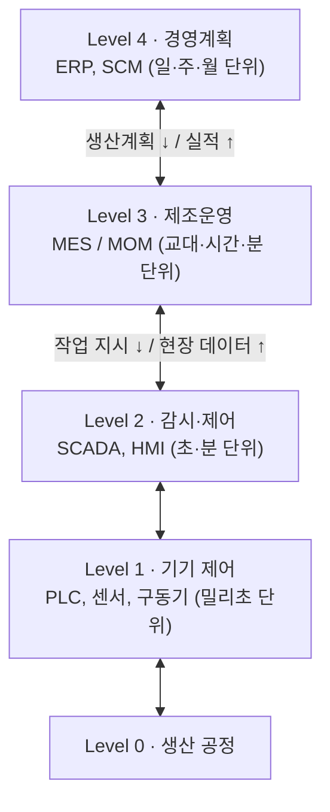

# 2.5 제조실행시스템(MES)

!!! info "출제기준"
    **2. 생산운영 및 물류관리** › **5. 제조실행시스템(MES)**

## 출제 경향

총 **4문항** 출제 (1교시 단답형 3 · 2~4교시 논술형 1) · 최근 10개 회차(109~139회) 3문항 · 최근 출제 제136회

| 주제 | 출제 수 | 출제 회차 |
|---|:-:|---|
| 2.5.1 MES의 개념과 기능 | 2 | 88회, 136회 |
| 2.5.2 MOM과 현장 데이터 수집 | 2 | 124회, 127회 |

## 목차

1. [MES의 개념과 기능](#t25-1)
2. [MOM과 현장 데이터 수집](#t25-2)

## 2.5.1 MES의 개념과 기능 {#t25-1}

### MES의 정의 (88·136회)

**MES(Manufacturing Execution System, 제조실행시스템)**는 생산계획(ERP)과 현장 설비·작업자 사이에서, **작업 지시부터 완제품이 나올 때까지 생산 활동을 실시간으로 관리·통제·최적화**하는 현장 중심의 정보시스템이다. MESA(MES 협회)는 이를 "주문 접수에서 완제품까지 생산 활동을 최적화하는 정보를 제공하는 시스템"으로 정의한다.

### 시스템 계층에서의 위치 (ISA-95)

MES는 **ERP의 계획을 현장 실행으로 연결**하고, **현장 실적을 ERP로 올려 보내는** 다리 역할을 한다.

### MES의 주요 기능 (MESA-11)

| 기능 | 내용 |
|---|---|
| 자원 할당·상태 관리 | 설비·인력·자재·공구의 상태와 가용성 관리 |
| 세부 일정계획 | 작업 순서·설비 배정 등 현장 단위의 일정 수립 |
| 작업 지시(디스패칭) | 일정에 따라 작업을 지시하고 변경 사항 반영 |
| 문서 관리 | 작업표준서·도면·레시피 등 현장 문서 배포·관리 |
| 데이터 수집 | 설비·작업자·검사 데이터의 실시간 수집 |
| 인력 관리 | 작업자 투입·근태·숙련도 관리 |
| 품질 관리 | 공정 검사, SPC, 불량 분석 |
| 공정 관리 | 공정 조건 감시, 이상 발생 시 조치 |
| 보전 관리 | 설비 보전 계획과 이력 관리 |
| 제품 추적·계보 | 로트·시리얼별 자재·공정·품질 이력 추적(Traceability) |
| 성과 분석 | 생산량·OEE·수율·리드타임 등 실적 분석 |

### ERP와 MES 비교

| 구분 | ERP | MES |
|---|---|---|
| 목적 | 전사 자원의 계획·관리 | 현장 생산의 실행·통제 |
| 관리 단위 | 일·주·월, 금액·수량 중심 | 실시간(분·초), 설비·공정·로트 중심 |
| 주요 사용자 | 경영·관리 부서 | 생산·품질·설비 현장 |
| 데이터 | 계획·거래 데이터 | 실적·공정·설비 데이터 |

### 도입 효과

생산 현황의 실시간 가시화, 리드타임과 재공재고 감소, 품질 향상과 불량 원인 추적, 서류 작업 감소, 설비 가동률(OEE) 향상, 계획 대비 실적의 정확한 피드백, 스마트공장의 기반 시스템

!!! tip "답안 작성 포인트"
    - 10점 단답형은 **정의 → ISA-95 계층 그림(ERP–MES–제어) → 주요 기능 5~6개 → 도입 효과**로 쓴다.
    - "계획(ERP)과 실행(현장)의 단절을 메우는 시스템"이라는 핵심 메시지를 첫 문장에 둔다.

??? example "관련 기출 2문항 (88회, 136회)"

    - **제88회(2009) 1교시 1번** · 10점  
      MES(Manufacturing Execution System)에 대해서 설명하시오.
    - **제136회(2025) 1교시 1번** · 10점  
      제조실행시스템(MES, Manufacturing Execution System)에 대하여 설명하시오.

## 2.5.2 MOM과 현장 데이터 수집 {#t25-2}

### MES와 MOM (127회)

**MOM(Manufacturing Operations Management, 제조운영관리)**은 ISA-95 표준(Part 3)에서 정의한 개념으로, Level 3의 제조 운영 활동 전체를 포괄한다. MES가 주로 **생산 실행**에 초점을 둔다면, MOM은 **생산·품질·보전·재고(물류) 운영**을 모두 아우르는 상위 개념이다.

| 구분 | MES | MOM |
|---|---|---|
| 범위 | 생산 실행 중심(작업 지시·실적·추적) | 생산 + 품질 + 보전 + 재고 운영의 통합 |
| 관점 | 개별 공장·라인의 시스템 | 여러 공장의 운영을 표준화·통합하는 관리 체계 |
| 근거 | MESA 기능 모델 | ISA-95 Part 3 활동 모델 |
| 관계 | MOM의 핵심 구성 요소 | MES를 포함하는 확장 개념 |

**MOM의 4대 운영 영역**: ① 생산 운영 ② 품질 운영 ③ 보전 운영 ④ 재고(물류) 운영 — 각 영역마다 정의·자원·상세 일정·디스패칭·실행·데이터 수집·추적·분석 활동을 수행한다.

### 스마트 데이터 수집 방법 (124회)

| 방법 | 개념 | 특징 |
|---|---|---|
| **Real-Time Management** (실시간 관리) | 현장 데이터를 발생과 **동시에** 수집·분석해 즉시 의사결정과 조치에 활용 | 지연 없는 현황 가시성, 이상의 즉시 감지·대응, 데이터 기반 의사결정, 일정 재수립의 신속성 |
| **On-Line System** (온라인 시스템) | 설비·센서·단말기가 네트워크로 서버와 **상시 연결**되어 데이터가 자동으로 전송·처리되는 체계(일괄 입력 방식과 대비) | 자동 수집으로 입력 누락·오류 감소, 시스템 간 연동(ERP·MES·SCADA), 원격 모니터링 |
| **Paperless** (종이 없는 현장) | 작업 지시서·체크시트·작업 일보·검사 기록을 **전자화**(태블릿·키오스크·전자 작업표준서) | 데이터 정확성과 검색성, 실시간 공유, 문서 관리 비용 감소, 이력 추적(Traceability) 용이 |

**현장 데이터 수집 수단**: PLC·OPC-UA를 통한 설비 데이터 연동, IoT 센서, 바코드·RFID, 생산시점관리(POP) 단말기, 머신 비전

!!! tip "답안 작성 포인트"
    - MES와 MOM은 **포함 관계(MOM ⊃ MES)**와 ISA-95 근거를 분명히 쓰고, 비교표로 정리한다.
    - 124회처럼 세 가지 개념을 물으면 각각 **개념 + 특징 3개 + 기대효과**를 같은 형식으로 반복해 쓴다.

??? example "관련 기출 2문항 (124회, 127회)"

    - **제124회(2021) 4교시 6번** · 25점  
      다음의 스마트 데이터 수집 방법 3가지의 개념과 특징을 설명하시오.

        ??? quote "문제 전문"

            다음의 스마트 데이터 수집 방법 3가지의 개념과 특징을 설명하시오.  
            1) Real-Time Management  
            2) On-Line System  
            3) Paperless  
    - **제127회(2022) 1교시 9번** · 10점  
      MES(Manufacturing Execution System)와 MOM(Manufacturing Operation Management)
