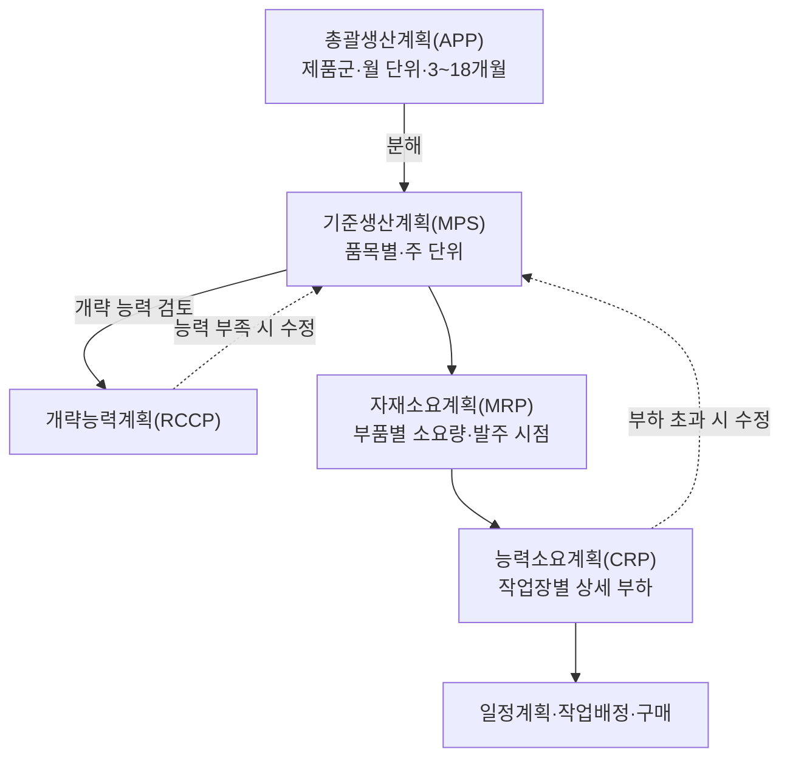
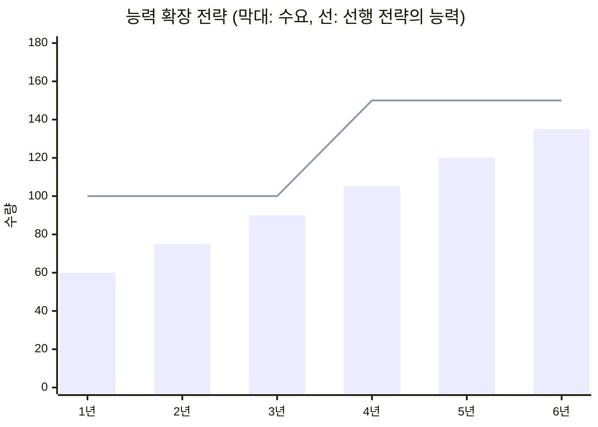
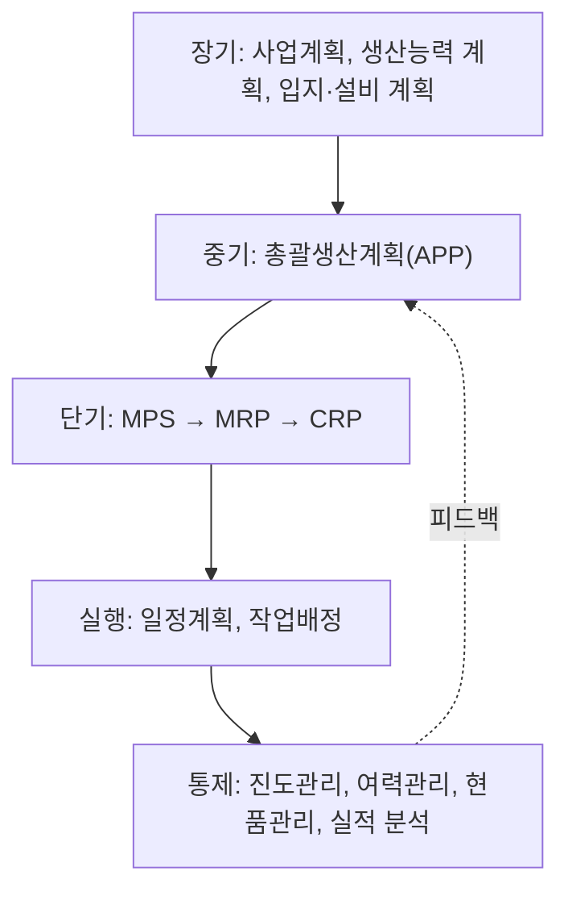

# 3.1 생산계획수립

!!! info "출제기준"
    **3. 공정관리** › **1. 생산계획수립**

## 출제 경향

총 **32문항** 출제 (1교시 단답형 12 · 2~4교시 논술형 20) · 최근 10개 회차(109~139회) 12문항 · 최근 출제 제136회

| 주제 | 출제 수 | 출제 회차 |
|---|:-:|---|
| 3.1.1 총괄생산계획(APP) | 13 | 70회, 73회, 85회, 88회, 94회, 103회, 112회, 121회, 124회, 133회 |
| 3.1.2 기준생산계획(MPS) | 5 | 71회, 82회, 88회, 112회 |
| 3.1.3 생산능력 계획(CRP 포함) | 10 | 67회, 73회, 79회, 88회, 94회, 100회, 112회, 133회, 136회 |
| 3.1.4 생산계획·통제 체계 | 4 | 71회, 82회, 106회, 130회 |

## 목차

1. [총괄생산계획(APP)](#t31-1)
2. [기준생산계획(MPS)](#t31-2)
3. [생산능력 계획(CRP 포함)](#t31-3)
4. [생산계획·통제 체계](#t31-4)

## 3.1.1 총괄생산계획(APP) {#t31-1}

### 총괄생산계획의 개념 (112·121회)

**총괄생산계획(APP, Aggregate Production Planning)**은 보통 **3~18개월**의 중기 기간에 걸쳐, 변동하는 수요를 현재의 설비·자원으로 가장 경제적으로 충족하도록 **기간별 생산율·고용수준·재고수준·하청량**을 정하는 계획이다. 개별 품목이 아니라 **제품군을 공통 단위(대·톤·공수 등)로 묶어(총괄하여)** 계획한다.

- **배경**: 1950년대 Holt·Modigliani·Muth·Simon(HMMS)의 **선형결정규칙(LDR)** 연구로 정량 모형이 본격화되었고, 이후 수송모형·경영계수법 등으로 발전했다.
- **위치**: 장기 사업계획·능력계획과 단기 MPS를 잇는 **중기 계획**이며, 오늘날에는 **S&OP(판매·운영계획)** 회의에서 판매·생산·재무 계획을 맞추는 핵심 단계로 운영된다.

### 생산계획의 목표 (133회)

① 수요 충족(고객 서비스 수준 유지) ② 총비용 최소화 ③ 설비·인력의 효율적 활용 ④ 고용의 안정 ⑤ 재고 최소화 — 이 목표들은 서로 상충하므로 균형을 찾아야 한다.

### 총괄(Aggregation)과 분해(Disaggregation) (124회)

- **총괄**: 여러 품목을 제품군으로 묶고, 수요·능력을 공통 단위로 환산해 계획을 단순화한다. 중기 수요 변동에 대한 큰 틀의 대응을 결정한다.
- **분해**: 확정된 총괄계획을 품목별·주별 **기준생산계획(MPS)**으로 나눈다. 분해된 MPS의 합은 총괄계획과 일치해야 한다.

### 수립 시 고려 요소 (88회)

1. **수요예측**: 기간별 총괄 수요
2. **생산능력**: 설비·인력의 정규·초과 능력, 하청 가능량
3. **재고 정책**: 초기 재고, 안전재고, 부재고 허용 여부
4. **비용 구조**: 아래 비용 요소
(이 밖에 노사 관계·고용 정책 등 경영 방침)

### 대안 평가 시 비용 요소 (70·73·94·133회)

| 비용 | 내용 |
|---|---|
| 정규 생산비 | 정규 시간의 노무비·재료비 등 |
| 초과근무(잔업)비 | 정규 임금보다 높은 잔업 수당 |
| 유휴(조업단축)비 | 능력보다 적게 생산할 때 발생하는 유휴 인력·설비 비용 |
| 고용·해고비 | 채용·교육비, 해고 수당과 사기 저하 |
| 재고유지비 | 미리 생산해 쌓아 둔 재고의 보관·자본 비용 |
| 재고부족·부재고비 | 판매 기회 손실, 납기 지연 위약금, 신용 하락 |
| 하청(외주)비 | 외부에 맡길 때의 추가 비용과 품질 위험 |

### 능력·수요 조절 수단 (85·106회)

| 구분 | 수단 |
|---|---|
| 공급(능력) 측면 — 단기 생산능력 조절 | 고용·해고, 초과근무·조업단축, 임시직·시간제 활용, 하청(외주), 재고 축적·소진, 교대제 변경 |
| 수요 측면 | 가격 조정(비수기 할인), 광고·판촉, 예약·주문잔고(부재고) 활용, 보완 제품(비수기 수요 창출) |

### 수립 전략: 순수 전략과 혼합 전략 (73·88·103·112·121·133회)

| 전략 | 방법 | 관련 비용 | 장점 | 고려사항(단점) |
|---|---|---|---|---|
| **고용수준 변경**(수요추구 전략, Chase) | 수요에 맞춰 인력을 채용·해고해 생산량 조정 | 채용·교육비, 해고비 | 재고가 거의 없음 | 고용 불안·사기 저하, 숙련 인력 확보 어려움, 노사 문제 |
| **생산율 변경**(작업시간 조정) | 인력은 고정하고 잔업·조업단축·하청으로 조정 | 잔업 수당, 유휴비, 하청비 | 고용 안정, 수요 대응 | 잔업 한계와 피로, 하청 품질·의존 위험 |
| **재고수준 변경**(생산평준화 전략, Level) | 평균 수요로 **일정하게 생산**하고 재고·부재고로 수요 변동 흡수 | 재고유지비, 재고부족·부재고비 | 고용·설비 가동 안정, 관리 용이 | 재고 비용, 진부화 위험, 서비스 수준 저하 가능 |
| **혼합 전략** | 위 수단을 조합 | 위 비용의 합 | 총비용을 가장 낮출 수 있음 | 대안이 많아 최적안 탐색 필요 |

**간단한 비교 예시** (4개 분기 수요 100·140·180·140, 재고유지비 10원/단위·분기, 증산비 20원/단위, 감산비 30원/단위, 1분기 직전 생산율 100)

| 전략 | 분기별 생산 | 발생 비용 | 총비용 |
|---|---|---|:-:|
| 평준화 | 140·140·140·140 | 기말재고 40·40·0·0 → 80 × 10 | 800원 |
| 수요추구 | 100·140·180·140 | 증산 40+40, 감산 40 → 80 × 20 + 40 × 30 | 2,800원 |

이 조건에서는 평준화 전략이 유리하다. 재고유지비가 크거나 진부화가 빠른 제품이면 결과가 바뀐다.

**해법**: 도표법(시행착오), 선형계획법·수송모형, 선형결정규칙(LDR), 경영계수법, 탐색결정규칙, 시뮬레이션

| 구분 | 기법 | 특징 |
|---|---|---|
| 시행착오 | 도표법(Graphic) | 누적 수요·누적 생산 그래프로 대안 비교, 간단하나 최적 보장 없음 |
| 수리적 최적화 | 선형계획법(LP), 수송모형(Bowman) | 비용을 선형으로 가정하고 총비용 최소 대안 도출([6.4.1](../06-cost-engineering-economy/04-operations-research.md#t64-1)) |
| | 선형결정규칙(LDR, HMMS) | 2차 비용함수를 미분해 생산율·고용수준 결정 규칙 도출 |
| 휴리스틱 | 경영계수법(Bowman), 탐색결정규칙(SDR) | 과거 관리자 결정의 회귀 분석 / 컴퓨터 탐색으로 비용 최소 대안 탐색 |
| 기타 | 시뮬레이션 | 불확실한 수요·비선형 비용 반영 |

### 최근 경향: S&OP와 디지털 계획

- **S&OP**: 월 1회 수요 검토 → 공급 검토 → 사전 조정 → 경영진 승인의 회의 체계로 APP를 운영한다. 재무 계획까지 통합하면 IBP(통합사업계획)라 한다.
- **APS·AI 수요예측**: 능력 제약을 반영한 계획을 빠르게 다시 세운다([7.1.6 APS](../07-support-technology/01-it-smart-factory.md#t71-6)).
- **공급망 리스크**: 원자재 수급 불안 시 하청·안전재고 등 혼합 전략의 **유연성 비용**을 함께 평가한다.

### 수립 과정 4단계 (133회)

1. **수요예측**: 계획 기간의 기간별 총괄 수요 결정
2. **능력·제약 검토**: 정규·초과 능력, 재고·고용 정책, 하청 가능성 확인
3. **대안 수립과 비용 산정**: 평준화·수요추구·혼합 대안별 총비용 계산
4. **최적안 선정과 분해**: 최소 비용·정책에 맞는 대안 승인 후 MPS로 분해

!!! tip "답안 작성 포인트"
    - APP는 13문항으로 3.1에서 가장 많이 나왔다. **정의(3~18개월, 총괄 단위) → 고려 요소 → 비용 요소 → 전략 비교표 → 수립 절차**를 한 세트로 외운다.
    - 전략 문제는 **방법·관련 비용·장단점** 열을 갖춘 비교표를 쓰고, 누적 수요와 누적 생산 그래프(평준화는 직선, 수요추구는 수요곡선과 일치)를 그리면 좋다.
    - 비용 요소 단답형(10점)은 7가지를 표로 쓰고 전략과의 연결을 한 줄 덧붙인다.
    - 결론 예: "순수 전략은 비용 구조에 따라 우열이 바뀌므로 혼합 전략으로 총비용을 최소화해야 하며, S&OP·APS로 매월 계획을 다시 맞추는 체계가 필요하다."

??? example "관련 기출 13문항 (70회, 73회, 85회, 88회, 94회, 103회, 112회, 121회, 124회, 133회)"

    - **제70회(2003) 3교시 2번** · 25점  
      총괄 샌상계획에서 여러 대안을 평가할 때 고려해야 하는 비용 요소들에 대하여 설명하시오.
    - **제73회(2004) 1교시 2번** · 10점  
      총괄생산게획에서 여러 대안을 평가할 때 고려해야 할 비용요소
    - **제73회(2004) 2교시 4번** · 25점  
      변동하는 수요를 만족시키기 위하여 사용되는 총괄 생산계획의 전략으로서 추적 전략(chase strategy)과 균등생산 전략(level strategy)이 있다. 그 내용과 특징을 약술하시오.
    - **제85회(2008) 1교시 10번** · 10점  
      현재의 생산설비 및 자원을 가장 효율적으로 운영하여 보통 3～18개월 내의 수요를 만족시킬 수 있도록 공장의 총생산활동을 계획하는데, 이 총괄생산계획에서 흔히 사용하는 대표적인 단기적 생산능력 조절 수단에는 어떤 것들이 있는지 설명하시오.
    - **제88회(2009) 3교시 1번** · 25점  
      총괄생산계획을 수립할 때 고려되는 주요 요소 4가지와 총괄생산계획의 수립전략 3가지를 설명하시오.
    - **제94회(2011) 1교시 1번** · 10점  
      총괄생산계획의 대안평가에서 고려해야 할 비용요소
    - **제103회(2014) 4교시 3번** · 25점  
      총괄생산계획을 수립함에 있어 수요에 적응하는 순수전략대안 3가지(고용수준, 생산율, 재고수준)에 대하여 각 전략별 방법과 비용요소 및 고려사항을 설명하시오.
    - **제112회(2017) 1교시 11번** · 10점  
      총괄생산계획(Aggregate Operation Plan)
    - **제112회(2017) 2교시 3번** · 25점  
      총괄생산계획의 3가지 수립전략에 대하여, 관련 비용과 고려사항을 포함하여 설명하시오.
    - **제121회(2020) 2교시 3번** · 25점  
      생산계획과 관련하여 다음 물음에 답하시오.

        ??? quote "문제 전문"

            생산계획과 관련하여 다음 물음에 답하시오.  
            1) 총괄생산계획과 기준생산계획(Master Production Schedule)에 대하여 설명하시오.  
            2) 총괄생산계획의 평준화, 수요대응 및 혼합생산전략에 대하여 설명하시오.  
    - **제124회(2021) 1교시 2번** · 10점  
      총괄생산계획의 총괄(Aggregation)과 분해(Disaggregation)
    - **제133회(2024) 1교시 5번** · 10점  
      총괄생산계획 수립 시 고려하는 비용
    - **제133회(2024) 2교시 3번** · 25점  
      총괄생산계획에 대하여 다음을 설명하시오.

        ??? quote "문제 전문"

            총괄생산계획에 대하여 다음을 설명하시오.  
            1) 생산계획의 목표  
            2) 총괄생산계획의 수요추구 전략과 생산평준화 전략  
            3) 총괄생산계획의 수립과정 4단계  

## 3.1.2 기준생산계획(MPS) {#t31-2}

### 기준생산계획(MPS)의 개념 (71·88회)

**MPS(Master Production Schedule, 대일정계획·주생산계획)**는 총괄생산계획을 분해해 **최종 품목(또는 주요 모듈)별로 주 단위의 생산 수량과 시기**를 정한 계획이다. MRP의 핵심 입력이며, 고객 납기 약속의 기준이 된다.

### APP–MPS–MRP–CRP의 연관관계 (82·88·112회)

| 계획 | 대상·단위 | 역할 |
|---|---|---|
| APP | 제품군, 월, 중기 | 생산율·고용·재고 수준 결정 |
| MPS | 최종 품목, 주, 단기 | 무엇을 언제 얼마나 만들지 결정 |
| MRP | 부품·자재, 주·일 | 종속 수요 품목의 소요량과 발주 시점 계산 |
| CRP | 작업장, 주·일 | MRP 계획발주에 필요한 공수를 계산해 능력과 비교 |

APP는 MPS의 **총량 제약**이 되고, MPS의 합은 APP와 일치해야 한다. MRP·CRP 결과 능력이 부족하면 다시 MPS를 조정하는 **폐쇄 루프**를 이룬다.

### MPS 수립 시 반영 항목과 결과 (82·112회)

| 반영 항목(입력) | 결과(출력) |
|---|---|
| 총괄생산계획(총량 제약) | 품목별·주별 생산 수량과 시기 |
| 수요예측과 확정 고객 주문 | 예상 기말재고 |
| 현재고·안전재고 | 납기 약속 가능량(ATP, Available-To-Promise) |
| 생산능력(개략능력계획) | MRP·CRP의 입력 |
| 로트 크기·리드타임 | 영업·구매·생산 부서 간 공통 계획 |
| 계획 동결 구간(Time Fence) | |

**계획 동결 구간**: 가까운 기간은 변경을 금지하는 **동결 구간**, 중간은 제한적으로 바꿀 수 있는 **확정 구간**, 먼 기간은 자유롭게 바꾸는 **자유 구간**으로 나눠 계획의 안정성을 확보한다.

### 공정 특성에 따른 MPS 대상 (112회)

| 생산 방식 | MPS 대상 | 설명 |
|---|---|---|
| 계획생산(MTS) | **완제품** | 품목 수가 적고 수요예측으로 완제품 생산 |
| 주문조립(ATO) | **모듈·주요 부품** | 완제품 조합이 너무 많으므로 모듈 단위로 MPS, 주문 후 최종조립일정(FAS) 수립 |
| 주문생산(MTO)·ETO | **최종 품목(주문) 또는 원자재·핵심 부품** | 주문 단위로 계획, 장납기 자재는 선행 확보 |

### MPS 레코드와 ATP 계산 예

\[
\text{예상 기말재고}_t = \text{기말재고}_{t-1} + \text{MPS}_t - \max(\text{예측}_t,\ \text{확정 주문}_t)
\]

**ATP** = 해당 주 MPS량(첫 주는 기초재고 포함) − 다음 MPS 직전 주까지의 확정 주문 합

예: 기초재고 50, 로트 크기 60, 예상 기말재고가 음수가 되는 주에 MPS 투입

| 주 | 1 | 2 | 3 | 4 |
|---|:-:|:-:|:-:|:-:|
| 수요예측 | 30 | 30 | 30 | 30 |
| 확정 주문 | 35 | 20 | 10 | 5 |
| 예상 기말재고 | 15 | 45 | 15 | 45 |
| MPS 생산량 | – | 60 | – | 60 |
| ATP | 15 | 30 | – | 55 |

(1주: 50 − 35 = 15 / 2주: 60 − (20 + 10) = 30 / 4주: 60 − 5 = 55) — 영업은 ATP 범위에서 신규 주문의 납기를 약속한다.

### MPS 운영의 실무 포인트

- **능력 검증**: MPS 확정 전에 RCCP로 병목 작업장의 부하를 확인한다([3.1.3](#t31-3)).
- **안정성 vs 대응성**: 동결 구간을 길게 하면 현장은 안정되지만 고객 대응이 늦어진다 — 리드타임과 변경 비용을 보고 정한다.
- **시스템**: ERP의 MPS·MRP 모듈과 APS로 수립하고, MES 실적으로 계획 대비 차이를 피드백한다([2.4.5 MRP](../02-operations-logistics/04-materials-inventory.md#t24-5)).

!!! tip "답안 작성 포인트"
    - 연관관계 문제는 **APP → MPS → MRP → CRP 흐름도(피드백 포함)**와 비교표가 핵심이다.
    - MPS 대상은 **제품 구조의 "가장 좁은 부분"**(MTS는 완제품, ATO는 모듈, MTO는 원자재 쪽)이라는 원리로 설명하면 설득력이 있다.
    - 결과(출력)를 물으면 예상 기말재고와 **ATP**를 작은 MPS 레코드 표로 보여 주면 차별화된다.
    - 결론 예: "MPS는 APP의 총량 제약과 현장 능력을 잇는 연결 고리이므로 동결 구간과 RCCP로 안정성을 확보하고, APS·MES로 계획–실적의 폐쇄 루프를 운영해야 한다."

??? example "관련 기출 5문항 (71회, 82회, 88회, 112회)"

    - **제71회(2003) 1교시 5번** · 10점  
      MPS
    - **제82회(2007) 2교시 2번** · 25점  
      총괄생산과 대일정계획(Master Production Schedule)의 연관관계 그리고 대일정계획 수립시 고려되어야 할 요소와 그 결과에 대해 설명하시오.
    - **제88회(2009) 1교시 3번** · 10점  
      MPS(Master Production Schedule)에 대하여 설명하시오.
    - **제88회(2009) 4교시 6번** · 25점  
      총괄생산계획(APP: Aggregate Production Planning), 대생산일정계획(MPS: Master Production Schedule), 자재소요계획(MRP: Material Requirements Planning), 생산능력소요계획(CRP: Capacity Requirement Planning)에 대한 설명과 이들의 연관관계를 기술하시오.
    - **제112회(2017) 3교시 1번** · 25점  
      대일정계획(MPS: Master Production Schedule)과 관련한 다음 물음에 답하시오.

        ??? quote "문제 전문"

            대일정계획(MPS: Master Production Schedule)과 관련한 다음 물음에 답하시오.  
            (1) 총괄생산계획과의 관계에 대하여 설명하시오.  
            (2) MPS 수립 시 반영 항목 및 결과, 공정특성에 따른 MPS 대상에 대하여 각각 설명하시오.  

## 3.1.3 생산능력 계획(CRP 포함) {#t31-3}

### 생산능력의 개념과 척도 (88·112회)

**생산능력(Capacity)**은 일정 기간에 생산시스템이 산출할 수 있는 최대 산출량이다.

| 척도 | 내용 | 적합한 경우 |
|---|---|---|
| 산출 척도 | 기간당 산출량(대/일, 톤/월) | 소품종 대량, 연속생산 |
| 투입 척도 | 기간당 가용 기계시간·인시(공수), 좌석·병상 수 | 다품종 소량, 서비스 |
| 이용률 | 실제 산출 ÷ 능력 | 능력 활용 정도 평가 |

### 생산능력의 종류 (133회)

| 종류 | 의미 |
|---|---|
| 최대(이론) 능력 | 이상적인 조건에서 낼 수 있는 최대 산출량 |
| 설계 능력 | 설비 설계 시 정한 산출량 |
| 유효 능력 | 제품 믹스·준비교체·정기 보전 등 피할 수 없는 손실을 뺀 능력 |
| 정상 능력 | 장기적으로 평균 수요를 감안해 유지하는 능력 |
| 실제 능력(실적) | 고장·불량·결근 등을 반영한 실제 산출량 |

(교재마다 분류 명칭이 조금씩 다르므로, 답안에서는 각 능력의 정의를 함께 쓴다.)

### 능력의 유효성 평가, 최적조업도, 규모의 경제 (112회)

\[
\text{이용률} = \frac{\text{실제 산출량}}{\text{설계 능력}}, \qquad \text{효율} = \frac{\text{실제 산출량}}{\text{유효 능력}}
\]

- **최적조업도**: 단위당 평균원가가 최소가 되는 산출 수준. 이보다 낮으면 고정비 부담이, 높으면 잔업·혼잡·고장 비용이 커진다.
- **규모의 경제**: 시설 규모가 커질수록 고정비 분산, 대량 구매, 전문화·학습으로 단위원가가 낮아지는 현상
- **규모의 불경제**: 일정 규모를 넘으면 관리 복잡성, 운반 거리, 의사소통 비용 증가로 단위원가가 다시 오르는 현상

### 생산능력 결정의 중요성과 영향 요인 (79·94회)

**중요성**: ① 대규모 장기 투자로 번복이 어렵다 ② 원가 경쟁력을 좌우한다 ③ 능력이 부족하면 판매 기회와 고객을 잃고, 남으면 유휴 비용이 생긴다 ④ 납기·서비스 수준을 결정한다

**영향 요인**: 장기 수요예측과 성장률, 기술 변화, 경쟁 상황, 자본 비용과 재무 여력, 규모의 경제, 설비 확보 리드타임, 유연성 필요성, 공급망·인력 확보 가능성

### 생산능력 확장 전략 (94·100·136회)

**능력 여유(Capacity Cushion)** = 1 − 평균 이용률, **능력비율** = 생산능력 ÷ 수요

| 전략 | 내용 | 능력비율 | 장단점 |
|---|---|:-:|---|
| **선행 전략**(Lead) | 수요 증가를 예상하고 **먼저** 능력을 확장 | > 1 (여유 큼) | 수요를 놓치지 않고 경쟁사 진입을 막음 / 유휴 능력 비용 |
| **추종 전략**(Match·Average) | 수요 변화에 맞춰 **조금씩** 확장 | ≈ 1 | 균형적 / 일시적 부족과 과잉이 번갈아 발생 |
| **후행 전략**(Lag) | 수요가 확인된 **뒤에** 확장 | < 1 (부족) | 설비 이용률 높고 투자 위험 낮음 / 판매 기회 손실, 고객 이탈 |

확장 규모 측면에서는 **대규모 일괄 확장**(규모의 경제, 여유 큼)과 **소규모 점진 확장**(위험 작음, 수요에 근접)을 비교해 선택한다.

### 생산능력 계획의 수립 과정 (73회)

1. 장기 수요예측
2. 현재 생산능력 평가
3. 필요 능력 산정(능력 여유 포함)
4. 대안 개발: 설비 확장·신설, 외주, 교대 증가, 공정 개선
5. 대안 평가: 경제성(NPV·손익분기), 의사결정나무, 정성적 요인
6. 최적 대안 선정과 실행 일정 수립

**필요 능력 산정식(투입 척도)**: 필요 설비 대수(또는 인원) \( = \dfrac{\text{연간 수요} \times \text{단위당 표준시간}}{\text{1대당 연간 가용시간} \times (1 - \text{능력 여유})} \) — 결과는 올림한다.

| 평가 도구 | 용도 | 관련 |
|---|---|---|
| 손익분기 분석 | 대안별 고정비·변동비 비교, 최소 필요 수요 | [6.1.2](../06-cost-engineering-economy/01-feasibility.md#t61-2) |
| 의사결정나무 | 수요 불확실성(고·저 수요 확률)하의 확장 규모 선택 | [6.4.4](../06-cost-engineering-economy/04-operations-research.md#t64-4) |
| 대기행렬 | 서비스·병목 설비의 능력 여유 수준 결정 | [6.4.3](../06-cost-engineering-economy/04-operations-research.md#t64-3) |
| NPV·IRR | 확장 투자의 경제성 | [6.1.1](../06-cost-engineering-economy/01-feasibility.md#t61-1) |

### 능력소요계획(CRP) (112회)

**CRP**는 MRP의 계획발주와 라우팅(공정 순서)·표준시간을 이용해 **작업장별·기간별 필요 공수(부하)**를 계산하고, 가용 능력과 비교해 **부하를 조정**하는 상세 능력계획이다.
부하가 능력을 넘으면 잔업·외주·작업 이동·일정 조정을, 반대면 작업 앞당기기·교육 등을 한다. MPS 단계의 대략적인 검토는 **RCCP(개략능력계획)**로 한다.

### 평준화 생산 계획 예 (67회)

조건: A 120대, B 80대, C 40대(월 240대), 능력 10대/일 → 필요 일수 240 ÷ 10 = **24일**

| 방식 | 계획 | 특징 |
|---|---|---|
| 배치 생산 | A를 12일 → B를 8일 → C를 4일 연속 생산 | 준비교체 최소, 그러나 각 품종의 재고가 크게 쌓이고 수요 대응이 늦음 |
| **JIT 평준화(혼류) 생산** | 비율 A:B:C = 3:2:1 → 6대 단위 순서 **A-B-A-C-A-B**를 반복, 3일마다 A 15·B 10·C 5대 | 매일 모든 품종을 조금씩 생산 → 재고 최소, 부하·부품 소요 평준화, 준비교체 단축이 전제 |

월 30일 가동이면 6일의 여유가 생기므로, 일 생산량을 8대로 낮춰 30일에 고르게 배분하거나 여유일을 보전·교육·수요 증가 대응에 쓴다.

!!! tip "답안 작성 포인트"
    - 능력 확장 전략은 **선행·추종·후행 3가지를 그래프(수요선 vs 능력 계단)**로 그리고, 장단점과 능력비율·능력 여유를 함께 설명한다.
    - 능력 척도·종류 단답형은 정의와 산식(이용률·효율)을 함께 쓴다.
    - 67회형은 **필요 일수 계산 → 배치 vs 평준화 비교 → 혼류 순서 제시**로 답한다.
    - 결론 예: "능력 결정은 번복이 어려운 장기 투자이므로 수요 불확실성·공급망 리스크를 반영한 능력 여유를 두되, 소규모 점진 확장·외주·유연 설비로 위험을 분산해야 한다."

??? example "관련 기출 10문항 (67회, 73회, 79회, 88회, 94회, 100회, 112회, 133회, 136회)"

    - **제67회(2002) 4교시 3번** · 25점  
      JIT(Just In Time)생산방식의 평준화와 Batch 생산의 특징을 고려하여 다음 조건의 월간 생산계획을 제시하시오. (단, 휴일은 없다고 가정하고, 각 기종의 공수는 동일함.)

        ??? quote "문제 전문"

            JIT(Just In Time)생산방식의 평준화와 Batch 생산의 특징을 고려하여 다음 조건의 월간 생산계획을 제시하시오. (단, 휴일은 없다고 가정하고, 각 기종의 공수는 동일함.)  
            (A품종 : 120대/월, B품종 : 80대/월, C품종: 40대/월, 능력 : 10대/일)  
    - **제73회(2004) 4교시 6번** · 25점  
      생산능력 계획의 중요성과 수립과정을 설명하시오.
    - **제79회(2006) 3교시 6번** · 25점  
      생산능력을 결정할 경우, 전략과 고려해야할 요인에 대해 설명하시오.
    - **제88회(2009) 1교시 5번** · 10점  
      생산능력을 측정할 때 사용되는 능력척도 3가지를 설명하시오.
    - **제94회(2011) 3교시 1번** · 25점  
      생산능력 결정이 중요한 이유와 생산능력 결정에 영향을 주는 요인을 4가지만 설명하고, 생산능력 확장에 대한 3가지 전략을 쓰시오.
    - **제100회(2013) 2교시 5번** · 25점  
      생산시스템을 신설하거나 확장할 때, 생산능력의 결정은 매우 중요한 일이다. 생산능력결정을 위한 전략에 대하여 설명하시오.
    - **제112회(2017) 1교시 12번** · 10점  
      CRP(Capacity Requirements Planning)
    - **제112회(2017) 3교시 4번** · 25점  
      생산능력과 관련한 다음 물음에 답하시오.

        ??? quote "문제 전문"

            생산능력과 관련한 다음 물음에 답하시오.  
            (1) 능력척도 및 유효성 평가, 최적조업도, 규모의 경제에 대하여 각각 설명하시오.  
            (2) 생산능력의 결정전략에 대하여 설명하시오.  
    - **제133회(2024) 1교시 4번** · 10점  
      설비 용량의 종류 5가지
    - **제136회(2025) 1교시 11번** · 10점  
      능력비율(Capacity Ratio)을 활용하여 생산능력을 확장하는 전략 3가지를 설명하시오.

## 3.1.4 생산계획·통제 체계 {#t31-4}

### 생산계획과 생산통제의 체계 (71·82회)

**생산계획**은 무엇을·언제·얼마나·어떻게 생산할지 미리 정하는 활동이고, **생산통제**는 계획대로 실행되도록 실적을 측정·비교하고 시정하는 활동이다. 두 기능은 계획 → 실행 → 통제 → 피드백의 순환을 이룬다.

| 구분 | 기능 요소 | 핵심 고려사항 |
|---|---|---|
| 계획 | 수요예측 | 예측 기법 선택, 정확도 관리 |
| | 총괄생산계획 | 능력·재고·고용 전략의 비용 균형 |
| | 기준생산계획(MPS) | APP와 일치, 계획 동결 구간 |
| | 자재·능력 계획(MRP·CRP) | 데이터 정확성, 능력 제약 |
| | 일정계획 | 우선순위 규칙, 병목 고려 |
| 통제 | 작업배정 | 작업 지시의 정확성·적시성 |
| | 진도·여력·현품 관리 | 지연의 조기 발견, 부하 조정, 재공 관리 |
| | 실적 분석 | 계획 대비 차이 원인의 피드백 |

**전통적 공정관리 기능 구분**(국내 교재): 계획 기능(절차계획·공수계획·일정계획) → 통제 기능(작업배정·진도관리·여력관리·현품관리) → 사후처리(실적 분석·개선). 상세는 [2.2.1 생산통제와 공정관리 기능](../02-operations-logistics/02-progress-control.md#t22-1)을 참고한다.

**품질·생산성 향상 기법 10가지와 용도 (82회)**

| 기법 | 용도 |
|---|---|
| QC 7가지 도구 | 현장 데이터 분석과 문제 원인 파악 |
| 관리도(SPC) | 공정의 안정 상태 감시 |
| 6시그마 | 데이터 기반으로 변동을 줄이는 개선 프로젝트 |
| FMEA | 잠재 고장 모드의 사전 예방 |
| QFD | 고객 요구를 설계 특성으로 전개 |
| 작업연구(IE) | 작업 방법 개선과 표준시간 설정 |
| VE | 기능 대비 원가 최적화 |
| TPM | 설비 효율 극대화와 고장 예방 |
| JIT·SMED | 낭비 제거, 준비교체 시간 단축 |
| 5S·TOC | 현장 정리·정돈 / 병목 중심 개선 |

### 예측 가능한 계절 변동에 대한 수요·공급 관리 (106회)

| 구분 | 관리 방안 |
|---|---|
| **공급 관리** | 성수기 전 **계절재고** 축적, 유연한 인력 운영(잔업·임시직·교대), 하청 활용, 비수기 보완 제품 생산(역계절 제품), 범용·유연 설비 |
| **수요 관리** | 비수기 할인·판촉으로 수요 이동, 성수기 가격 인상, 사전 주문·예약 인센티브, 주문잔고 활용 |

수요 관리와 공급 관리를 함께 계획해야 총비용(재고비·능력비·기회손실)이 최소가 된다.

### 생산·공장운영 사업계획의 요소 활동과 KPI (130회)

| 부문 | 요소 활동 | 핵심관리지표(KPI) |
|---|---|---|
| 계획 | 수요예측 | 예측 정확도(MAPE) |
| | 생산계획(MPS) | 생산계획 준수율 |
| | 자재계획(MRP·구매) | 자재 결품률(또는 재고회전율) |
| 통제 | 공정(진도) 관리 | 납기준수율(OTD) |
| | 품질 관리 | 공정 불량률(ppm) |
| | 설비 관리 | 설비종합효율(OEE) |

| KPI | 산식 |
|---|---|
| MAPE | \( \dfrac{1}{n}\sum \dfrac{\lvert A_t - F_t \rvert}{A_t} \times 100\% \) (\( A_t \): 실적, \( F_t \): 예측) |
| 생산계획 준수율 | 계획 수량(품목·기간)대로 생산한 수량 ÷ 계획 수량 |
| 자재 결품률 | 결품 발생 건수 ÷ 자재 요청 건수 |
| 납기준수율(OTD) | 납기 내 출하 건수 ÷ 전체 출하 건수 |
| 공정 불량률(ppm) | 불량 수 ÷ 생산 수 × 10⁶ |
| OEE | 시간가동률 × 성능가동률 × 양품률([3.5.3](05-maintenance.md#t35-3)) |

최근에는 MES·IoT로 KPI를 실시간 수집해 **대시보드**로 관리하고, 탄소 배출 원단위 같은 ESG 지표를 공장 KPI에 더하는 추세다.

!!! tip "답안 작성 포인트"
    - 체계 문제는 **장기 → 중기 → 단기 → 실행·통제의 계층 그림**을 먼저 그리고 요소별 표로 정리한다.
    - 130회처럼 KPI를 요구하면 지표명과 산식(예: 납기준수율 = 납기 내 출하 건수 ÷ 전체 출하 건수)을 함께 쓴다.
    - 결론 예: "계획과 통제는 PDCA 순환으로 연결되어야 하므로, MES 실적 데이터를 KPI 대시보드로 실시간 피드백해 계획 정확도를 지속적으로 높여야 한다."

??? example "관련 기출 4문항 (71회, 82회, 106회, 130회)"

    - **제71회(2003) 4교시 4번** · 25점  
      생산관리에서 일상적으로 수행하는 생산계획 기능을 요소별로 열거하고 핵심 고려사항을 설명하시오.
    - **제82회(2007) 2교시 3번** · 25점  
      생산계획 및 생산통제의 의의와 그 체계를 구분하여, 그 각기의 세부 핵심내용들을 설명하고, 품질 및 생산성 향상을 위한 기법 중 10가지만 선정하여, 각기 그 용도를 간략히 설명하시오.
    - **제106회(2015) 3교시 6번** · 25점  
      수요가 계절적 요인 등으로 급격히 변하지만 그 변동이 예측 가능한 경우 수요와 공급을 효율적으로 대응시키기 위한 수요 및 공급관리 방안에 대하여 각각 설명하시오.
    - **제130회(2023) 4교시 4번** · 25점  
      생산운영, 공장운영 사업계획 포인트는 계획부문과 통제부문으로 나누어져 있다. 각 부문별 요소활동을 3개만 제시하고, 각 요소활동의 핵심관리지표(KPI)를 1개씩만 제시하시오.

## 답안 작성 예시

!!! example "25점 예시: 제133회 2교시 3번 — 생산계획의 목표, 수요추구·생산평준화 전략, APP 수립과정 4단계"
    **1. 개요**

    - APP 정의: 3~18개월 중기, 제품군 총괄 단위로 생산율·고용·재고·하청량 결정
    - 위치: 장기 능력계획과 MPS 사이의 중기 계획, S&OP의 핵심 단계

    **2. 본론**

    - (1) 생산계획의 목표 5가지: 수요 충족, 총비용 최소, 자원 활용, 고용 안정, 재고 최소 — 상충 관계 한 줄
    - (2) 전략 비교: [표] 순수 전략 비교표(방법·관련 비용·장단점), [그림] 누적 수요 vs 누적 생산(평준화는 직선, 수요추구는 수요곡선과 일치)
    - (3) 간단한 수치 비교: 4분기 예시(평준화 800원 vs 수요추구 2,800원)로 비용 구조에 따라 우열이 바뀜을 제시
    - (4) 수립과정 4단계: 수요예측 → 능력·제약 검토 → 대안 수립·비용 산정 → 최적안 선정·MPS 분해 (흐름도)

    **3. 결론(기술사 의견)**

    - 실무는 혼합 전략 + 수요 관리(비수기 판촉)를 함께 쓴다
    - 차별화: S&OP 월간 회의, APS·AI 예측으로 재계획 주기 단축, 공급망 리스크를 반영한 유연성 비용 평가

!!! example "25점 예시: 제112회 3교시 1번 — MPS와 APP의 관계, 반영 항목·결과, 공정특성별 MPS 대상"
    **1. 개요**

    - MPS 정의: APP를 분해한 최종 품목(모듈)별·주 단위 생산 수량·시기, MRP의 핵심 입력

    **2. 본론**

    - (1) APP와의 관계: [그림] APP → MPS → RCCP/MRP → CRP 흐름도(피드백 점선), [표] 계획 단계별 대상·단위·역할 / 총량 일치 원칙
    - (2) 반영 항목과 결과: [표] 입력(APP·예측·주문·재고·능력·로트·동결 구간) vs 출력(품목별 수량·예상 기말재고·ATP)
    - (3) MPS 레코드 예시 표로 예상 기말재고·ATP 계산 시연
    - (4) 공정특성별 대상: [표] MTS 완제품 / ATO 모듈(FAS 연계) / MTO·ETO 원자재 — "제품 구조의 가장 좁은 부분" 원리

    **3. 결론(기술사 의견)**

    - 동결·확정·자유 구간 운영으로 계획 안정성과 대응성의 균형 확보
    - 차별화: ERP·APS·MES 연계로 계획–실적 폐쇄 루프, 계획 준수율 KPI 관리
