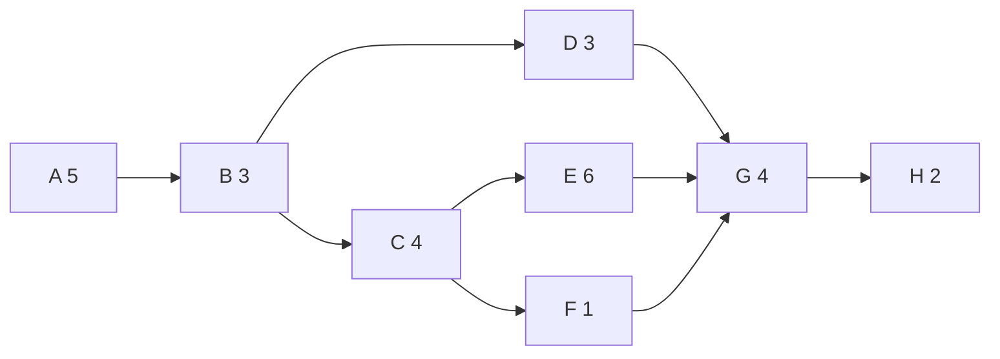
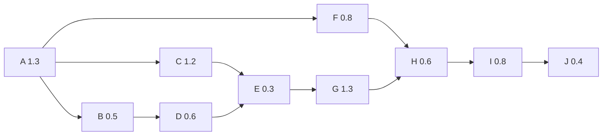
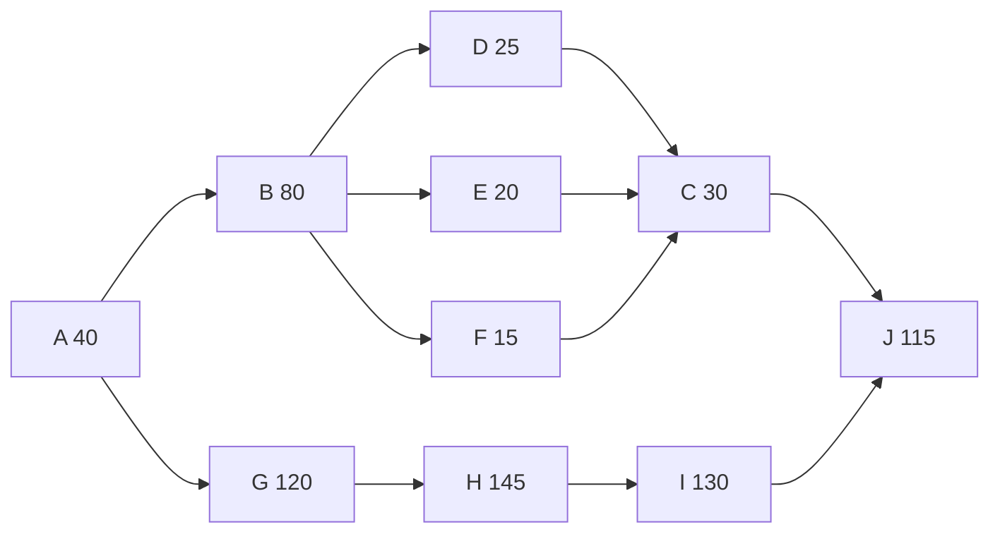

# 3.2 공정설계

!!! info "출제기준"
    **3. 공정관리** › **2. 공정설계**

## 출제 경향

총 **19문항** 출제 (1교시 단답형 5 · 2~4교시 논술형 14) · 최근 10개 회차(109~139회) 8문항 · 최근 출제 제136회

| 주제 | 출제 수 | 출제 회차 |
|---|:-:|---|
| 3.2.1 공정설계와 공정 결정 요인 | 7 | 63회, 71회, 73회, 79회, 124회, 133회, 136회 |
| 3.2.2 피치타임·사이클타임 | 4 | 68회, 76회, 124회, 136회 |
| 3.2.3 라인밸런싱과 라인 편성 | 8 | 63회, 67회, 76회, 82회, 91회, 112회, 115회, 136회 |

## 목차

1. [공정설계와 공정 결정 요인](#t32-1)
2. [피치타임·사이클타임](#t32-2)
3. [라인밸런싱과 라인 편성](#t32-3)

## 3.2.1 공정설계와 공정 결정 요인 {#t32-1}

### 공정설계의 의의 (124회)

**공정설계(Process Planning·Process Design)**는 설계된 제품을 경제적으로 만들기 위해 **어떤 방법·설비·순서로 가공할지**를 결정하는 활동이다. 제품설계와 생산 실행을 잇는 단계로, 원가·품질·리드타임·유연성의 대부분이 이 단계에서 결정된다.

| 구분 | 내용 |
|---|---|
| 거시적 공정설계 | 프로세스 유형(개별·배치·라인·연속) 선택, 자동화·수직적 통합 수준 결정 — 전략적 결정 |
| 미시적 공정설계 | 부품별 가공 방법·공정 순서·설비·표준시간 결정(공정표·라우팅) — 기술적 결정 |

**제품-공정 매트릭스**(Hayes & Wheelwright, 1979): 제품의 다양성·생산량과 공정 유형을 대각선으로 맞출 때 효율적이다.

| 제품 특성 | 공정 유형 | 배치 | 예 |
|---|---|---|---|
| 다품종 극소량, 주문 설계 | 프로젝트·개별생산(Job Shop) | 고정형·공정별 | 선박, 금형 |
| 다품종 소량 | 배치(Batch)생산 | 공정별·셀 | 기계 부품 |
| 소품종 대량 | 라인(조립)생산 | 제품별 | 자동차, 가전 |
| 단일품 초대량 | 연속생산 | 제품별(장치) | 정유, 제지 |

상세는 [1.1.4 생산시스템 포지셔닝](../01-production-strategy/01-competitive-strategy.md#t11-4)을 참고한다.

### 공정설계 단계의 결정 사항 (63회)

1. 제품 분석: 도면·BOM으로 가공 대상 부품 파악, 자가생산·외주 결정
2. 공정(가공 방법) 선택: 주조·단조·절삭·조립 등
3. **공정 순서(Routing)** 결정
4. 설비·치공구 선정과 자동화 수준
5. 작업 방법과 표준시간 설정
6. 로트 크기와 검사 공정(검사 위치·방법)
7. 설비배치와 운반 방법

### 공정순서 계획(Routing) (73회)

**개념**: 제품·부품을 만드는 데 필요한 작업의 순서, 작업장(설비), 작업 방법과 표준시간을 정한 계획이다(공정표·라우팅 시트로 문서화).

**수립 시 고려사항**: 제품 사양과 품질 요구, 가공 방법 간 선후 제약, 설비 능력과 정밀도, 원가(가공비·준비비), 운반 거리와 흐름, 병목 공정의 부하, 표준시간, 검사 시점, 대체 경로(설비 고장 시)

**라우팅 시트의 구성 항목**: 품번·품명, 공정 번호·공정명, 작업장(설비)·치공구, 작업 내용, 준비시간·정미시간(표준시간), 검사 항목, 이동 경로

**컴퓨터 지원 공정계획(CAPP)**

| 방식 | 내용 | 특징 |
|---|---|---|
| 변성형(Variant) | GT 코드로 유사 부품군의 **표준 공정표를 불러와 수정** | 구축 쉬움, 기존 지식 재사용 |
| 창성형(Generative) | 부품 형상·재질 정보와 의사결정 규칙(전문가 시스템)으로 **공정표를 새로 생성** | 신부품에도 적용, 구축 어려움 |

최근에는 CAD 모델 기반 자동 공정계획, 디지털 트윈으로 라인을 가상 검증한 뒤 양산하는 방식이 확산되고 있다([4.5.3 가상제조](../04-facility-management/05-factory-automation.md#t45-3)).

### 생산 프로세스의 결정 요인 (124·136회)

| 결정 요인 | 내용 |
|---|---|
| **자본 집약도** | 설비·자동화와 인력의 조합 수준. 대량·표준품일수록 자동화 유리 |
| **자원 유연성** | 설비·인력이 다양한 제품·수량 변화를 처리할 수 있는 정도(범용설비·다기능공) |
| **고객 참여** | 고객이 프로세스에 관여하는 정도(맞춤 설계·셀프서비스 등) |
| **수직적 통합** | 공급사슬 중 어디까지를 자체 프로세스로 수행할지 |
| (공통 전제) 제품·수요 특성 | 다양성과 생산량 → 제품-공정 매트릭스상 위치(개별·배치·라인·연속) |

**규모의 경제·불경제·범위의 경제 (136회)**

- **규모의 경제**: 생산량이 늘수록 고정비 분산·전문화·구매력으로 단위원가가 낮아짐
- **규모의 불경제**: 일정 규모를 넘으면 관리 복잡성·운반·조정 비용으로 단위원가가 다시 상승
- **범위의 경제**: 여러 제품을 **함께** 생산할 때 따로 생산하는 것보다 원가가 낮아지는 현상(공통 설비·기술·유통 공유, 유연 설비)

DTO·MTO·MTS·ATO 생산·재고전략은 [1.2.2 주문 형태별 생산방식](../01-production-strategy/02-production-system-layout.md#t12-2)을 참고한다.

### 신규 공장의 공정 선정 평가 요소 (71·79회)

| 구분 | 평가 요소 |
|---|---|
| 기술 | 기술적 실현 가능성, 품질·정밀도 확보 능력, 기술 성숙도 |
| 경제 | 설비 투자비, 운영비(노무·에너지·보전), 손익분기 생산량 |
| 능력 | 생산능력과 확장성, 리드타임 |
| 유연성 | 제품·수량 변화 대응력, 모델 변경 용이성 |
| 인력·환경 | 숙련 인력 확보, 안전·환경 규제, 작업 환경 |
| 전략 | 경쟁우선순위(원가·품질·유연성)와의 적합성, 자동화 수준 |

**손익분기에 의한 공정 선택**: 공정 A(고정비 \( F_A \), 변동비 \( v_A \))와 공정 B(\( F_B > F_A,\ v_B < v_A \))의 총비용이 같아지는 생산량

\[
Q^{*} = \frac{F_B - F_A}{v_A - v_B}
\]

생산량이 \( Q^{*} \)보다 적으면 공정 A(범용·노동집약), 많으면 공정 B(전용·자동화)가 유리하다.

### 셀형 생산방식과 FMS (133회)

| 구분 | 셀형 생산방식(CMS) | 유연생산시스템(FMS) |
|---|---|---|
| 개념 | GT로 부품군을 형성하고, 그 가공에 필요한 이종 설비를 셀로 묶어 셀 안에서 완성 | NC 설비·자동 운반·중앙 컴퓨터 제어를 통합해 중품종 중량을 자동으로 유연하게 생산 |
| 장점·기대효과 | 리드타임·재공 감소, 운반 감소, 품질 책임 명확, 다기능화 | 무인·소인 운전, 다품종 자동 전환, 설비 가동률 향상, 리드타임 단축 |
| 단점 | 다기능공 필요, 설비 중복 | 높은 초기 투자, 복잡한 시스템 운영 |

자세한 내용은 [1.2.6 셀 생산·GT·U라인](../01-production-strategy/02-production-system-layout.md#t12-6)과 [4.5 공장자동화 기술](../04-facility-management/05-factory-automation.md)을 참고한다.

!!! tip "답안 작성 포인트"
    - 공정설계 문제는 **의의 → 결정 사항(또는 결정 요인) → 평가 방법**으로 쓴다. 결정 요인은 Krajewski의 4요인(자본 집약도·자원 유연성·고객 참여·수직적 통합)으로 정리하면 깔끔하다.
    - 정량 평가가 필요하면 **공정 간 손익분기 그래프**를 그리고 교차 생산량 식을 덧붙인다.
    - 의의를 쓸 때 **제품-공정 매트릭스**로 "제품 특성에 맞는 공정 선택"을 보여 주면 차별화된다.
    - 결론 예: "공정설계는 원가·품질의 대부분을 결정하므로 동시공학(CE)으로 제품설계 단계부터 참여하고, CAPP·디지털 트윈으로 공정을 사전 검증해 양산 초기 로스를 줄여야 한다."

??? example "관련 기출 7문항 (63회, 71회, 73회, 79회, 124회, 133회, 136회)"

    - **제63회(2001) 3교시 4번** · 25점  
      공정설계(Process planning) 단계에서 결정해야 할 중요사항에 대하여 쓰시오.
    - **제71회(2003) 3교시 4번** · 25점  
      신규 공장을 설계하는 경우에 공정을 결정하기 위한 평가요소를 열거하고 설명하시오.
    - **제73회(2004) 3교시 1번** · 25점  
      공정순서 계획(Routing)의 개념과 수립시 고려해야 할 사항에 대하여 설명하시오.
    - **제79회(2006) 3교시 5번** · 25점  
      신규공장을 설계하는 경우, 생산공정을 선정할 때 고려해야할 요인에 대해 설명하시오.
    - **제124회(2021) 4교시 5번** · 25점  
      공정설계의 의의와 공정설계의 결정요인을 설명하시오.
    - **제133회(2024) 2교시 4번** · 25점  
      공정설계에 대하여 다음을 설명하시오.

        ??? quote "문제 전문"

            공정설계에 대하여 다음을 설명하시오.  
            1) 셀형 생산방식(Cellular Manufacturing System)의 개념과 장·단점  
            2) 유연생산시스템(Flexible Manufacturing System)의 개념과 기대효과  
    - **제136회(2025) 3교시 5번** · 25점  
      생산 프로세스 결정에 관련된 다음 질문에 답하시오.

        ??? quote "문제 전문"

            생산 프로세스 결정에 관련된 다음 질문에 답하시오.  
            (1) 생산 프로세스의 결정 요인 4가지를 설명하시오.  
            (2) 규모의 경제, 규모의 비경제 및 범위의 경제에 대하여 각각 설명하시오.  
            (3) 생산 및 재고전략인 DTO(Design to Order), MTO(Make to Order), MTS(Make to Stock), ATO(Assemble to Order)에 대하여 각각 설명하시오.  

## 3.2.2 피치타임·사이클타임 {#t32-2}

### 택트타임·피치타임·사이클타임 (68·76·124회)

| 용어 | 정의 | 식 |
|---|---|---|
| **택트타임**(Takt Time) | 고객 수요를 맞추기 위해 **1개를 만들어야 하는 시간 간격** — 수요가 정하는 목표 속도 | \( \dfrac{\text{가용 작업시간}}{\text{필요 생산량}} \) |
| **피치타임**(Pitch Time) | 흐름작업에서 제품 1개가 라인에서 나오는 **계획 시간 간격**. 라인 정지·불량 등 손실을 반영해 택트타임을 보정 | \( P = \dfrac{T(1 - \alpha)}{N} \) |
| **사이클타임**(Cycle Time) | 각 공정(작업장)이 실제로 1개를 처리하는 시간. 라인 전체로는 **가장 긴 공정의 시간**이 산출 간격이 됨 | \( \max(t_i) \) |

(\( T \): 1일 실가동시간, \( \alpha \): 라인 정지·불량 등 손실률, \( N \): 1일 계획 생산량)

- 사이클타임 ≤ 피치(택트)타임이어야 수요를 맞출 수 있다.
- 사이클타임이 피치타임보다 큰 공정이 **애로(병목) 공정**이다.

**피치타임 계산 예**: 1일 실가동 480분, 손실률 5%, 계획 생산량 228개 → \( P = 480 \times 0.95 \div 228 = 2.0 \)분/개

**활용**: ① 라인 편성의 기준(작업장 수·작업 배분) ② 목표 인원 산정(\( \sum t_i \div P \)) ③ 컨베이어 속도·간격 결정 ④ 피치 다이어그램으로 병목·유휴 공정 가시화 ⑤ 수요 변화 시 택트 재설정 → 인원 증감(소인화)

### 균형손실률 (124회)

\[
\text{편성효율 } E = \frac{\sum t_i}{n \times C} \times 100\%, \qquad \text{균형손실률 } L = 1 - E = \frac{n \times C - \sum t_i}{n \times C}
\]

(\( \sum t_i \): 공정별 작업시간의 합, \( n \): 공정(작업자) 수, \( C \): 피치타임 또는 최장 공정시간)

### 풀이: 136회 1교시

가용시간 = 5일 × 8시간 × 60분 = 2,400분/주

\[
C = \frac{2{,}400}{650} = 3.69\ldots \approx \mathbf{3.7\text{분}}
\]

!!! tip "답안 작성 포인트"
    - 10점 단답형은 **정의 → 공식(기호 설명) → 택트·사이클타임과의 차이 → 활용(라인 편성의 기준)** 순으로 쓴다.
    - 피치타임 공식은 교재에 따라 손실률(\( \alpha \)) 반영 여부가 다르므로, 기호의 의미를 반드시 밝힌다.
    - 균형손실률은 식과 함께 **피치 다이어그램(공정별 막대 + 피치타임 선)**을 그려 막대 위 빈 면적이 손실임을 보여 주면 좋다.

??? example "관련 기출 4문항 (68회, 76회, 124회, 136회)"

    - **제68회(2002) 1교시 9번** · 10점  
      Pitch Time
    - **제76회(2005) 1교시 9번** · 10점  
      피치타임 정의 및 공식.
    - **제124회(2021) 1교시 7번** · 10점  
      흐름생산의 피치타임(Pitch Time)과 균형손실률
    - **제136회(2025) 1교시 4번** · 10점  
      주당 수요 650개, 1주에 5일, 매일 8시간의 작업을 할 경우 어떤 제품을 조립하는 데 필요한 이론적인 최소 사이클 타임(분)을 구하시오.

        ??? quote "문제 전문"

            주당 수요 650개, 1주에 5일, 매일 8시간의 작업을 할 경우 어떤 제품을 조립하는 데 필요한 이론적인 최소 사이클 타임(분)을 구하시오.  
            (단, 소수점 둘째 자리에서 반올림하여 구하시오.)  

## 3.2.3 라인밸런싱과 라인 편성 {#t32-3}

### 라인밸런싱의 개념과 절차

**라인밸런싱(Line Balancing)**은 흐름 라인의 각 작업장 작업시간을 **피치타임에 가깝게 고르게** 배분해 유휴시간(균형손실)을 최소화하는 것이다.

1. 작업 요소와 작업시간, **선행관계 도표**(Precedence Diagram) 작성
2. 피치(사이클)타임 결정: \( C = \text{가용시간} \div \text{목표 생산량} \)
3. 이론적 최소 작업장 수: \( n_{min} = \lceil \sum t_i / C \rceil \)
4. 작업 할당: 선행관계와 \( C \)를 지키며 휴리스틱으로 배정(최장 작업시간 우선, 후속 작업 수 최다 우선, 위치 가중치(RPW) 우선)
5. 편성효율 \( E = \sum t_i / (n \times C) \)과 균형손실률 계산, 개선

**라인밸런싱 문제의 유형**

| 구분 | 유형 | 내용 |
|---|---|---|
| 목적 | Type I | 사이클타임 \( C \)가 주어질 때 작업장 수 \( n \) 최소화(신규 라인 설계) |
| | Type II | 작업장 수 \( n \)이 주어질 때 사이클타임 \( C \) 최소화(기존 라인 생산량 극대화) |
| 제품 | 단일모델 라인 | 한 제품만 생산 |
| | 혼합모델(혼류) 라인 | 여러 모델을 섞어 생산 — 가중 평균 작업시간으로 밸런싱하고 **투입 순서(Sequencing)**로 부하 평준화 |
| | 다모델 라인 | 모델별로 배치 단위 전환 생산 |
| 배치 | 직선 라인 / **U라인** | U라인은 입구·출구 공정을 한 작업자가 맡을 수 있어 배분 자유도가 높고 소인화에 유리([1.2.6](../01-production-strategy/02-production-system-layout.md#t12-6)) |

### 편성효율과 무인 자동화 공정 (91회)

\[
E = \frac{\sum t_i}{n \times C} \times 100\%
\]

무인 자동화 공정이 있으면 그 공정에는 작업자가 없으므로, **작업자가 수행하는 공정의 작업시간 합을 분자로, 작업자 수를 \( n \)으로** 놓고 계산한다. 자동 공정은 기계 사이클이 피치타임 이하인지(병목이 아닌지)만 따로 확인한다. 작업자가 자동기계를 함께 담당하면 기계 가공 중의 대기시간은 작업시간에서 빼고 보조 작업시간만 반영한다.

### 라인 재편성의 절차 (76·82회)

| 단계 | 핵심 실시 내용 |
|---|---|
| ① 현상 분석 | 공정별 작업시간 측정, 피치 다이어그램(막대그래프)으로 불균형 파악, 현 편성효율 계산 |
| ② 목표 설정 | 필요 생산량에서 목표 피치타임과 목표 인원 산출 |
| ③ 작업 분해 | 작업을 요소작업으로 나누고 선행관계 정리 |
| ④ 작업 재할당 | 피치타임에 맞게 요소작업을 재배분, 작업장 수 최소화 |
| ⑤ 애로 공정 개선 | ECRS로 작업 개선, 작업 분할, 설비 추가·개선, 치공구 개선 |
| ⑥ 표준화 | 표준작업 설정, 작업자 교육, 레이아웃 조정 |
| ⑦ 시행·유지 | 시험 운영, 효율 재측정, 정기 점검 |

### 애로 공정과 공정능력 평준화 대책 (112회)

**부하 > 능력인 애로 공정**: 작업 일부를 앞뒤 공정으로 이관, 작업 분할, 설비 병렬 추가, 설비·치공구 개선(가공시간 단축), 숙련자 배치, 잔업·외주
**부하 < 능력인 여유 공정**: 공정 통합으로 인원 축소, 여유 인력의 애로 공정 지원, 다기능화
→ 모든 공정의 능력을 부하 수준에 맞춰 **평준화**한다.

**최근 경향**: 협동로봇으로 애로 작업을 분담, MES 실적 기반 공정별 실시간 사이클타임 모니터링, 시뮬레이션·디지털 트윈으로 재편성안 사전 검증, 수요 변동에 따라 인원을 바꾸는 **유연 편성(소인화)**

### 풀이: 63회 (사이클타임 8분)

선행관계: A → B → (C, D), C → (E, F), (D, E, F) → G → H, 총 작업시간 28분

- 최소 작업장 수 = ⌈28 ÷ 8⌉ = ⌈3.5⌉ = **4**
- 할당: 작업장 1 {A, B} 8분 / 작업장 2 {C, D, F} 8분 / 작업장 3 {E} 6분 / 작업장 4 {G, H} 6분
- 편성효율 = 28 ÷ (4 × 8) = **87.5%** (균형손실률 12.5%)
- 개선 방안: 작업장 3·4에 각 2분의 유휴가 있다. 가장 긴 작업 E(6분)를 개선·분할하거나 G·H의 요소작업을 재구성하면 사이클타임을 줄여 생산량을 늘릴 수 있다. 작업장 4개를 유지하면서 사이클타임 7분은 선행관계 때문에 불가능하다(5개 필요).

### 풀이: 67회 (실동시간 460분, 8명)

작업시간 합 = 224초, 최장 공정 = 공정 6의 38초

1. **현재**: 일 생산량 = 27,600초 ÷ 38초 = **726개**, 편성효율 = 224 ÷ (8 × 38) = **73.7%**
2. **애로 공정 개선 후**: 2초 단위로 작업을 옮겨 각 공정을 평균(28초)에 가깝게 재분배하면 공정별 시간이 28·29·29·28·29·28·28·25초가 되고, 최장 시간은 **29초**가 된다(원래 경계가 홀수라 2초 단위 이동으로 모두 28초로 맞출 수는 없음).
   일 생산량 = 27,600 ÷ 29 = **951개**, 편성효율 = 224 ÷ (8 × 29) = **96.6%**

### 풀이: 112회 (실가동 480분, 목표 15개/일 이상)

필요 사이클타임 = 480 ÷ 15 = **32분 이하**

| 공정 | 1 | 2 | 3 | 4 | 5 | 6 | 7 |
|---|:-:|:-:|:-:|:-:|:-:|:-:|:-:|
| 작업시간(분) | 30 | 30 | 42 | 31 | 32 | 35 | 36 |
| 기계 대수 | 1 | 1 | **2** | 1 | 1 | **2** | **2** |
| 유효 시간(분) | 30 | 30 | 21 | 31 | 32 | 17.5 | 18 |

- 32분을 넘는 공정 3·6·7에 기계를 1대씩 추가해 공정을 분할(병렬화)한다.
- 최장 공정 = 공정 5의 32분 → 일 생산량 = 480 ÷ 32 = **15개/일**
- 라인밸런스 효율 = 236 ÷ (10대 × 32) = **73.8%** (공정 수 7을 기준으로 유효 시간을 쓰면 179.5 ÷ (7 × 32) = 80.1%)

### 풀이: 115회

- 가용시간 = 540 − 20(휴식) − 40(점심) = 480분, 피치타임 = 480 ÷ 320 = **1.5분**
- 총 작업시간 7.8분 → 최소 공정 수 = ⌈7.8 ÷ 1.5⌉ = ⌈5.2⌉ = **6**

| 공정 | 1 | 2 | 3 | 4 | 5 | 6 |
|---|:-:|:-:|:-:|:-:|:-:|:-:|
| 할당 작업 | A | B, D | C, E | G | F, H | I, J |
| 작업시간(분) | 1.3 | 1.1 | 1.5 | 1.3 | 1.4 | 1.2 |

- 라인편성효율 = 7.8 ÷ (6 × 1.5) = **86.7%**
- 참고: 최장 작업시간 우선 규칙만 기계적으로 적용하면 7공정이 나오므로, 할당 결과를 보고 작업을 바꿔 6공정으로 줄여야 한다.

### 풀이: 136회 2교시

- 사이클타임 = 8 × 3,600초 ÷ 192개 = **150초**
- 최소 작업장 수 = ⌈720 ÷ 150⌉ = ⌈4.8⌉ = **5**

참고 할당(5개 작업장): {A, B, D} 145초 / {G, E} 140초 / {H} 145초 / {I, F} 145초 / {C, J} 145초 → 편성효율 720 ÷ (5 × 150) = 96%

!!! tip "답안 작성 포인트"
    - 계산 문제는 **선행관계도 → 피치타임 → 최소 작업장 수 → 할당표 → 편성효율 → 개선 방안**의 순서를 지킨다. 할당표에 작업장별 시간과 유휴시간을 함께 쓴다.
    - 최소 작업장 수는 반드시 **올림**하고, 실제 할당이 이론값과 다르면 그 이유(선행관계·작업시간 분할 불가)를 적는다.
    - 병렬 설비를 추가한 경우 효율의 분모 기준(기계 대수 또는 공정 수)을 명시한다.
    - 결론 예: "라인밸런싱은 한 번의 계산이 아니라 수요·모델 변화에 맞춰 반복되는 활동이므로, 작업 개선(ECRS)으로 \( \sum t_i \) 자체를 줄이고 표준작업·다기능화로 유연 편성 체계를 갖춰야 한다."

??? example "관련 기출 8문항 (63회, 67회, 76회, 82회, 91회, 112회, 115회, 136회)"

    - **제63회(2001) 3교시 3번** · 25점  
      사이클 타임이 8분인 조립공정이다. 다음 자료에 의해 1) 작업순서도표를 그리고 2) 최소 가능작업장 수를 구하라. 3) 그리고 Line Balance 가 되도록 순서도표상에 점선으로 작업을 할당하고 4) Line Balance 효율을 구한후 5) 개선방안을 제시하시오. (각5점)

        ??? quote "문제 전문"

            사이클 타임이 8분인 조립공정이다. 다음 자료에 의해 1) 작업순서도표를 그리고 2) 최소 가능작업장 수를 구하라. 3) 그리고 Line Balance 가 되도록 순서도표상에 점선으로 작업을 할당하고 4) Line Balance 효율을 구한후 5) 개선방안을 제시하시오. (각5점)  
            [표] 과업 | 소요시간(분) | 수행순서  
            A | 5 | -  
            B | 3 | A  
            C | 4 | B  
            D | 3 | B  
            E | 6 | C  
            F | 1 | C  
            G | 4 | D, E, F  
            H | 2 | G  
    - **제67회(2002) 4교시 5번** · 25점  
      8명이 근무하는 직선라인 stop watch로 작업시간을 측정하여 아래와 같은 결과를 얻었다.

        ??? quote "문제 전문"

            8명이 근무하는 직선라인 stop watch로 작업시간을 측정하여 아래와 같은 결과를 얻었다.  
            [표] 공정 | 1 | 2 | 3 | 4 | 5 | 6 | 7 | 8  
            작업시간(초) | 26 | 23 | 23 | 24 | 29 | 38 | 34 | 27  
            인원(명) | 1 | 1 | 1 | 1 | 1 | 1 | 1 | 1  
            (조건) : . 실동시간을 460분으로 한다.  
            . 2초단위까지는 작업분배 가능한 것으로 본다  
            . 손으로 하는 조립작업이다.  
            ① 일생산량과 현효율은 ?  
            ② 애로공정을 개선후의 효율은 ?  
    - **제76회(2005) 3교시 5번** · 25점  
      라인생산에 있어서 생산라인을 효율화하기 위한 라인 재편성의 절차를 논하시고 라인편성효율의 산출방식을 기술하시오.
    - **제82회(2007) 3교시 3번** · 25점  
      라인생산의 운영 효율화를 위하여 라인을 재편성 하고자 할 때, 이의 일반적인 순서와 단계별 핵심 실시내용에 대해 기술하시오.
    - **제91회(2010) 1교시 1번** · 10점  
      라인발란싱(line balancing) 문제에서 편성효율을 구하고자 할 때 필요한 계산식을 쓰고, 공정 중 무인자동화 공정이 존재할 때의 계산방법에 대하여 설명하시오.
    - **제112회(2017) 2교시 6번** · 25점  
      가공 및 조립공정의 라인밸런싱과 관련하여 다음 물음에 답하시오.

        ??? quote "문제 전문"

            가공 및 조립공정의 라인밸런싱과 관련하여 다음 물음에 답하시오.  
            (1) 다음 그림과 같이 부하량이 주어지고 공정별 능력에 차이가 있는 경우에 애로공정과 공정능력평준화에 대한 대책에 대하여 설명하시오.  
            [그림] 공정 1, 2, 3, …, n-1, n별 능력 막대그래프와 부하 수준 점선(일부 공정은 부하보다 능력이 낮고 일부는 높음)  
            (2) 1대씩의 기계가 배치된 흐름공정의 작업시간이 다음 표와 같을 경우, 일일 생산량이 15개/일 이상일 때까지 기계를 추가로 배치하여 공정분할을 실시하고, 그 때의 일일 생산량 및 라인밸런스 효율을 구하시오. (실제 가동시간 = 8시간/일)  
            [표] 공정 | 1 | 2 | 3 | 4 | 5 | 6 | 7  
            시간(분) | 30 | 30 | 42 | 31 | 32 | 35 | 36  
    - **제115회(2018) 2교시 6번** · 25점  
      S제품을 조립 생산하는 K공장은 공정효율을 최적화하는 라인을 구축하여 수요에 대응하고자 한다. 이 제품은 다음 표와 같이 10개의 단위작업을 거쳐 1일 320개가 조립생산 된다. 일일근무시간이 9시간이며, 오전 오후 10분씩 휴식시간과 40분의 점심시간이 주어질 때, 다음 물음에 답하시오.

        ??? quote "문제 전문"

            S제품을 조립 생산하는 K공장은 공정효율을 최적화하는 라인을 구축하여 수요에 대응하고자 한다. 이 제품은 다음 표와 같이 10개의 단위작업을 거쳐 1일 320개가 조립생산 된다. 일일근무시간이 9시간이며, 오전 오후 10분씩 휴식시간과 40분의 점심시간이 주어질 때, 다음 물음에 답하시오.  
            [표] 작업명 | 선행작업명 | 작업소요시간(분)  
            A | - | 1.3  
            B | A | 0.5  
            C | A | 1.2  
            D | B | 0.6  
            E | C, D | 0.3  
            F | A | 0.8  
            G | E | 1.3  
            H | F, G | 0.6  
            I | H | 0.8  
            J | I | 0.4  
            1) AON(Activity on node diagram) 방식을 사용하여 선후관계도(precedence diagram)를 작성하시오.  
            2) 생산목표를 달성하기 위한 최소공정수를 구하시오.  
            3) 최적할당을 수행하시오.  
            4) 라인편성효율(Line of Balance efficiency)을 구하시오.  
    - **제136회(2025) 2교시 6번** · 25점  
      어떤 회사가 8시간 동안 192개 제품을 생산하기 위한 조립라인을 설계하고 있다. 다음 질문에 답하시오.

        ??? quote "문제 전문"

            어떤 회사가 8시간 동안 192개 제품을 생산하기 위한 조립라인을 설계하고 있다. 다음 질문에 답하시오.  
            [표] 작업요소 | 시간(초) | 직전작업  
            A | 40 | 없음  
            B | 80 | A  
            C | 30 | D,E,F  
            D | 25 | B  
            E | 20 | B  
            F | 15 | B  
            G | 120 | A  
            H | 145 | G  
            I | 130 | H  
            J | 115 | C,I  
            (계) | 720 |  
            (1) 선행도표를 그리시오.  
            (2) 이 라인의 사이클타임(Cycle Time)(초)을 구하시오.  
            (3) 최소한의 필요 작업장 수를 구하시오.  

## 답안 작성 예시

!!! example "25점 예시: 제136회 3교시 5번 — 생산 프로세스 결정 요인 4가지, 규모·범위의 경제, DTO·MTO·MTS·ATO"
    **1. 개요**

    - 프로세스 결정: 제품을 어떤 방법·설비·흐름으로 만들지 정하는 전략적 결정, 원가·유연성의 대부분을 결정
    - [그림] 제품-공정 매트릭스(대각선 적합)로 결정의 출발점 제시

    **2. 본론**

    - (1) 결정 요인 4가지: [표] 자본 집약도·자원 유연성·고객 참여·수직적 통합(Krajewski) — 요인별 "대량·표준품이면 ~" 식의 판단 방향 한 줄
    - (2) 규모의 경제·불경제·범위의 경제: [그림] 생산량–단위원가 U자 곡선(최적 규모 표시), 범위의 경제는 공통 설비·유연 설비 예
    - (3) DTO·MTO·MTS·ATO: [표] 고객 주문 분리점(CODP) 위치, 리드타임, 재고 형태, 예시 비교([1.2.2](../01-production-strategy/02-production-system-layout.md#t12-2))
    - (4) 정량 판단 보충: 공정 간 손익분기 생산량 \( Q^{*} \) 식

    **3. 결론(기술사 의견)**

    - 요인 간 상충(자동화 ↔ 유연성)을 경쟁우선순위로 조정
    - 차별화: 유연 자동화(FMS·협동로봇)와 모듈 설계로 규모와 범위의 경제를 동시에 추구, 디지털 트윈으로 공정 대안을 사전 검증

!!! example "25점 예시: 제115회 2교시 6번 — 선후관계도, 최소 공정 수, 최적 할당, 라인편성효율"
    **1. 개요**

    - 라인밸런싱 정의와 목적(유휴시간 최소, 피치타임 기준 작업 배분)

    **2. 본론**

    - (1) 가용시간 480분, 피치타임 \( 480 \div 320 = 1.5 \)분 — 휴식·점심 차감 과정을 명시
    - (2) [그림] AON 선후관계도
    - (3) 최소 공정 수 \( \lceil 7.8 \div 1.5 \rceil = 6 \) — 올림 근거
    - (4) [표] 공정별 할당 작업·작업시간·유휴시간(6공정), 휴리스틱(최장 작업시간 우선) 결과가 7공정이면 조정 과정 서술
    - (5) 편성효율 \( 7.8 \div (6 \times 1.5) = 86.7\% \), 균형손실률 13.3%

    **3. 결론(기술사 의견)**

    - 개선안: 최장 작업(A·G 1.3분) 분할·ECRS, 유휴 공정 통합, U라인 검토
    - 차별화: 수요 변동 시 택트 재설정 → 인원 증감(유연 편성), 표준작업 3요소로 유지
