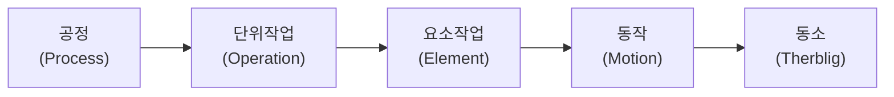

# 3.3 작업계획수립

!!! info "출제기준"
    **3. 공정관리** › **3. 작업계획수립**

## 출제 경향

총 **5문항** 출제 (1교시 단답형 2 · 2~4교시 논술형 3) · 최근 10개 회차(109~139회) 1문항 · 최근 출제 제136회

| 주제 | 출제 수 | 출제 회차 |
|---|:-:|---|
| 3.3.1 작업 분할과 작업계획 | 1 | 63회 |
| 3.3.2 인간-기계 작업분석(Man-Machine Chart) | 4 | 73회, 82회, 136회 |

## 목차

1. [작업 분할과 작업계획](#t33-1)
2. [인간-기계 작업분석(Man-Machine Chart)](#t33-2)

## 3.3.1 작업 분할과 작업계획 {#t33-1}

### 작업의 분할 단위 (63회)

생산공정의 작업은 분석 목적에 따라 큰 단위에서 작은 단위로 나눈다.

**작업 분할의 목적**: ① 표준시간 설정(측정 단위 확보) ② 작업 배분·라인밸런싱 ③ 낭비·개선점 발견(ECRS) ④ 작업 표준서·교육 자료 작성 ⑤ 사람과 기계 작업의 분리로 다기계 담당·자동화 검토. 테일러의 시간연구·길브레스의 동작연구가 이 분할 개념의 출발점이다.

| 단위 | 의미 | 예(볼트 체결 조립) | 주된 활용 |
|---|---|---|---|
| 공정 | 하나의 작업장에서 수행하는 작업의 묶음 | 조립 공정 | 공정분석, 설비배치 |
| 단위작업 | 하나의 목적을 가진 작업 | 커버 체결 | 작업 배분, 라인밸런싱 |
| 요소작업 | 시작·끝이 명확하고 측정 가능한 최소 작업 단위 | 볼트 집기, 체결, 부품 놓기 | 시간연구, 표준시간 설정 |
| 동작 | 신체 움직임의 단위 | 손 뻗기, 쥐기, 운반 | 동작연구, PTS |
| 동소(서블릭) | 동작을 이루는 기본 요소(17~18종) | 찾기, 잡기, 바로 놓기 | 미세 동작 개선 |

### 작업 구분 방법

| 구분 기준 | 내용 |
|---|---|
| 작업의 성질 | 가공·운반·검사·정체(공정분석 기호) |
| 작업 주체 | 사람 작업 / 기계 작업 / 사람·기계 연합 작업 |
| 반복성 | 규칙적 요소(매 사이클) / 불규칙적 요소(가끔 발생: 공구 교환, 청소) |
| 시간 변동 | 상수 요소(작업시간 일정) / 변수 요소(크기·무게에 따라 변동) |
| 준비 작업 | 내준비(설비 정지 중) / 외준비(설비 가동 중) |
| 부가가치 | 주작업(가치 창출) / 부수작업 / 낭비(제거 대상) |

**요소작업 분할 원칙**: 시작점과 끝점이 명확할 것, 측정 가능한 길이일 것, 사람 작업과 기계 작업을 분리할 것, 상수·변수 요소와 규칙·불규칙 요소를 분리할 것

### 작업계획의 내용

작업 분할 결과를 바탕으로 작업 방법(표준작업), 작업 순서, 작업자·설비 배정, 표준시간, 작업량(일정)을 정한다. 이는 라인밸런싱([3.2.3](02-process-design.md#t32-3))과 표준시간 설정([5.1](../05-work-measurement/01-method-time-study.md))의 기초가 된다.

| 분할 단위 | 대응 분석 기법 | 관련 |
|---|---|---|
| 공정 | 공정분석(제품·작업자 공정분석표), 흐름도 | [5.2.2](../05-work-measurement/02-process-analysis.md#t52-2) |
| 단위작업 | 연합작업분석, 라인밸런싱 | [3.3.2](#t33-2), [3.2.3](02-process-design.md#t32-3) |
| 요소작업 | 스톱워치 시간연구, 워크샘플링 | [5.1.1](../05-work-measurement/01-method-time-study.md#t51-1) |
| 동작·서블릭 | 동작연구, PTS법 | [5.1.6](../05-work-measurement/01-method-time-study.md#t51-6) |

최근에는 작업 영상을 AI로 요소작업 단위로 자동 분할·측정하거나, 사람과 협동로봇의 작업 분담을 요소작업 단위로 설계하는 방식이 쓰인다.

!!! tip "답안 작성 포인트"
    - **분할 단위의 계층 그림 → 단위별 정의·예·활용 표 → 구분 기준 표** 순으로 쓴다.
    - 분할 목적(표준시간 설정, 작업 배분, 개선점 발견)을 서두에 밝힌다.
    - 결론 예: "작업 분할은 표준시간·라인밸런싱·개선의 공통 기초이므로 분할 단위를 분석 목적에 맞게 정하고, 요소작업 데이터베이스로 축적해 표준 자료법·AI 분석에 활용해야 한다."

??? example "관련 기출 1문항 (63회)"

    - **제63회(2001) 4교시 2번** · 25점  
      제품의 생산공정에 대해 작업을 분할하고 그 구분방법에 대해 쓰시오.

## 3.3.2 인간-기계 작업분석(Man-Machine Chart) {#t33-2}

### 연합작업분석(Man-Machine Chart)의 개념 (82·136회)

**연합작업분석**은 작업자와 기계(또는 여러 작업자)의 작업을 **같은 시간 축에 나란히** 그려, 서로 기다리는 **유휴시간**을 찾고 작업을 재배분하는 분석 기법이다. 작업자–기계 분석표(Man-Machine Chart)와 작업자들 사이의 조작업 분석표(Gang Process Chart)가 있다.

### 작성 방법

1. 한 사이클의 작업을 요소작업으로 나누고 시간을 측정한다.
2. 각 요소를 **단독 작업**(혼자 함), **연합 작업**(작업자와 기계가 함께 — 장착·탈착), **유휴**로 구분한다.
3. 세로 시간 척도에 작업자와 기계(들)의 막대를 나란히 그린다.
4. 한 사이클이 끝날 때까지 작성하고 사이클타임을 구한다.
5. 작업자·기계별 **이용률 = 작업시간 ÷ 사이클타임**을 계산한다.

**작성 예**(장착 1분·탈착 1분, 자동 가공 6분, 작업자 단독 작업 2분, 작업자 1명–기계 1대)

| 시간(분) | 작업자 | 기계 |
|:-:|---|---|
| 0~1 | 장착(연합) | 장착(연합) |
| 1~3 | 부품 준비·검사(단독) | 자동 가공 |
| 3~7 | **유휴** | 자동 가공 |
| 7~8 | 탈착(연합) | 탈착(연합) |

→ 사이클타임 8분, 작업자 이용률 4 ÷ 8 = 50%, 기계 이용률 8 ÷ 8 = 100%(연합 작업 포함). 작업자 유휴 4분이 있으므로 **2대 담당**을 검토한다(아래 공식으로 \( n' = (2 + 6) \div (2 + 2) = 2 \)).

(표기: 단독 작업·연합 작업·유휴를 각각 다른 음영으로 구분해 그린다.)

### 활용 방법

- 작업자 1인이 담당할 **최적 기계 대수** 결정
- 작업자·기계의 유휴시간 제거와 작업 재배분
- 기계 가공 중에 할 수 있는 작업(부품 준비 등)을 찾아 **외작업화**
- 조작업(여러 작업자)의 인원 편성과 작업 균형
- 개선 전후의 사이클타임과 이용률 비교
- 사람–협동로봇 작업 분담 설계(로봇 작업을 "기계" 열로 놓고 분석)

| 비교 | 연합작업분석 | 작업자 공정분석 | 동작분석(양수작업분석) |
|---|---|---|---|
| 대상 | 작업자–기계, 작업자–작업자의 **상호 관계** | 작업자 한 명의 작업 흐름 | 한 작업자의 왼손·오른손 동작 |
| 목적 | 유휴 제거, 담당 대수·인원 결정 | 공정 순서·운반 개선 | 동작 낭비 제거 |

### 다기계 담당의 이론적 최적 대수

기호: \( l \) = 장착·탈착 시간(기계 정지 중 작업자와 연합 작업), \( m \) = 기계 자동 가공시간, \( w \) = 기계 가동 중 작업자의 단독 작업(보행·부품 준비 등), \( K_1 \) = 작업자 시간당 임금, \( K_2 \) = 기계 시간당 비용

\[
n' = \frac{l + m}{l + w}
\]

| 담당 대수 \( n \) | 사이클타임 | 유휴 발생 |
|---|---|---|
| \( n \le n' \) | \( l + m \) (기계가 제약) | 작업자 유휴 = \( (l + m) - n(l + w) \) |
| \( n \ge n' \) | \( n(l + w) \) (작업자가 제약) | 기계별 유휴 = \( n(l + w) - (l + m) \) |

\( n' \)이 정수가 아니면 바로 아래·위 정수에 대해 **단위당 비용**을 비교한다.

\[
\text{단위당 비용} = \frac{(K_1 + nK_2) \times \text{사이클타임}}{n}
\]

### 풀이: 73회

\( l = 5 \)분(탈착·장착·시동), \( m = 43 \)분, \( w = 1 + 9 = 10 \)분(보행 + 부품 준비), \( K_1 = 2{,}200 \)원/시간, \( K_2 = 3{,}000 \)원/시간

\[
n' = \frac{5 + 43}{5 + 10} = \frac{48}{15} = 3.2
\]

| 구분 | \( n = 3 \) | \( n = 4 \) |
|---|:-:|:-:|
| 사이클타임 | \( l + m = 48 \)분 | \( 4 \times 15 = 60 \)분 |
| 작업자 유휴시간 | \( 48 - 3 \times 15 = 3 \)분 | 0분 |
| 기계 유휴시간(대당) | 0분 | \( 60 - 48 = 12 \)분 |
| 시간당 비용 | \( 2{,}200 + 3 \times 3{,}000 = 11{,}200 \)원 | \( 2{,}200 + 4 \times 3{,}000 = 14{,}200 \)원 |
| 시간당 생산량 | \( 3 \times 60 / 48 = 3.75 \)개 | \( 4 \times 60 / 60 = 4 \)개 |
| **단위당 비용** | 11,200 ÷ 3.75 ≈ **2,987원** | 14,200 ÷ 4 = **3,550원** |

→ **최적 담당 대수는 3대**이다. 이때 사이클타임 48분, 작업자 유휴시간 3분(사이클당), 기계 유휴시간 0분이다.

### 대규모 다기계 담당의 개선 기법 (82회)

자동기계 600대를 1인당 5~20대씩 담당하는 경우, 기계 정지가 무작위로 겹쳐 작업자를 기다리는 **기계 간섭** 손실이 커진다.

| 단계 | 적용 기법 |
|---|---|
| 현상 파악 | **워크샘플링**으로 기계별 가동률과 정지 원인(대기·고장·자재 부족·작업자 부재) 조사 |
| 담당 대수 결정 | **연합작업분석**과 최적 담당 대수 공식, 정지가 무작위이면 **대기행렬 이론·기계 간섭 분석**으로 담당 대수별 손실 비교 |
| 정지 원인 제거 | TPM·예방보전으로 고장 감소, 자동 정지·이상 알림(안돈), 자재 자동 공급 |
| 작업 개선 | 장착·탈착 시간 단축(치공구 개선), 부품 준비의 외작업화, 표준작업 |
| 배치 개선 | 담당 기계를 U자·원형으로 배치해 보행 거리 단축, 순회 경로 표준화 |
| 인력 운영 | 다기능화, 담당 구역 재편성, 성과 지표(가동률·작업 능률) 관리 |

!!! tip "답안 작성 포인트"
    - 10점 단답형은 **정의 → 작성 방법(기호 3가지) → 활용**의 세 덩어리로 쓴다.
    - 계산 문제는 \( n' \) 공식 → 양쪽 정수 비교표 → **단위당 비용으로 최종 결정** 순서로 쓴다. 이론 대수 3.2를 그대로 답으로 쓰지 않는다.
    - 82회 같은 사례형은 **측정(워크샘플링) → 분석(연합작업·간섭) → 개선(TPM·배치·표준작업)**의 흐름으로 기법을 연결한다.
    - 10점이라도 작은 **작성 예 표(시간 축 + 작업자·기계 열)**를 넣으면 득점이 안정적이다.
    - 결론 예: "자동화가 진행될수록 사람의 역할은 다기계 담당·이상 처치로 바뀌므로, 연합작업분석으로 담당 대수를 정하고 IoT 가동 데이터로 기계 간섭 손실을 상시 관리해야 한다."

??? example "관련 기출 4문항 (73회, 82회, 136회)"

    - **제73회(2004) 4교시 3번** · 25점  
      다음의 자료로부터 물음에 답하시오.

        ??? quote "문제 전문"

            다음의 자료로부터 물음에 답하시오.  
            Unload, load, 기계시동버튼을 누름 : 5.0분, 다른 기계쪽으로 걸어감 : 1.0분  
            부품을 준비함 : 9.0분, 기계가공(자동) : 43.0분  
            작업자 임금 : 2,200원/시간, 기계비용 : 3,000원/시간  
            1) 작업자 1명의 경제적인 최적담당 대수 ?  
            2) 이때(최적담당 대수)의 Cycle time과 작업자 유휴시간, 기계 유휴시간을 각각 구하시오.  
    - **제82회(2007) 1교시 5번** · 10점  
      연합작업분석(Man-Machine Chart)의 작성 및 활용방법
    - **제82회(2007) 3교시 2번** · 25점  
      H공업(주)에서는 자동차부품 생산용 자동기계를 600대 보유하고 있다. 작업자들은 1인당 5 ~ 20대의 기계를 담당하고 있다. 이 회사의 가동률과 작업능률을 향상시키려면 어떤 기법을 적용하여 해결해야 하는지를 설명하시오.
    - **제136회(2025) 1교시 8번** · 10점  
      Man-Machine Chart에 대하여 설명하시오.

## 답안 작성 예시

!!! example "10점 예시: 제136회 1교시 8번 — Man-Machine Chart"
    - **개요**: 작업자와 기계의 작업을 같은 시간 축에 나란히 그려 상호 유휴를 찾는 연합작업분석 도표
    - **작성 방법**: 요소작업 분해·측정 → 단독·연합·유휴 구분 → 시간 척도에 작업자·기계 막대 작성 → 사이클타임과 이용률 산출
    - **핵심 내용**: [표] 작성 예(시간 축 + 작업자·기계 열), 최적 담당 대수 \( n' = (l + m) \div (l + w) \)
    - **활용/의견**: 다기계 담당 대수 결정, 외작업화, 조작업 편성 — 협동로봇 도입 시 사람–로봇 분담 설계에도 적용

!!! example "25점 예시: 제82회 3교시 2번 — 자동기계 600대, 1인 5~20대 담당 시 가동률·작업능률 향상 기법"
    **1. 개요**

    - 문제 진단: 담당 대수 편차가 크고 기계 정지가 무작위로 겹쳐 **기계 간섭 손실**과 작업자 유휴가 동시에 존재

    **2. 본론**

    - (1) 현상 파악: 워크샘플링으로 기계별 가동률·정지 원인 층별(대기·고장·결품·작업자 부재)
    - (2) 담당 대수 결정: [표] Man-Machine Chart, \( n' \) 공식과 단위당 비용 비교(73회 풀이 방식), 무작위 정지는 대기행렬·간섭 분석([6.4.3](../06-cost-engineering-economy/04-operations-research.md#t64-3))
    - (3) 정지 원인 제거: TPM·예방보전, 안돈·자동 정지, 자재 자동 공급
    - (4) 작업·배치 개선: 장착·탈착 단축, 외작업화, U자·원형 배치와 순회 경로 표준화
    - (5) 인력 운영: 다기능화, 담당 구역 재편성, 가동률·능률 KPI

    **3. 결론(기술사 의견)**

    - 측정 → 분석 → 개선 → 표준화의 단계적 추진
    - 차별화: IoT 가동 모니터링으로 정지 알림·담당 구역을 동적으로 재배정, 예지보전으로 정지 자체를 줄임
