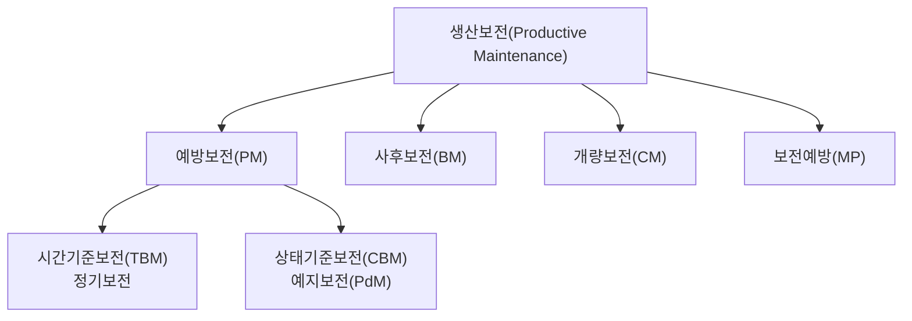
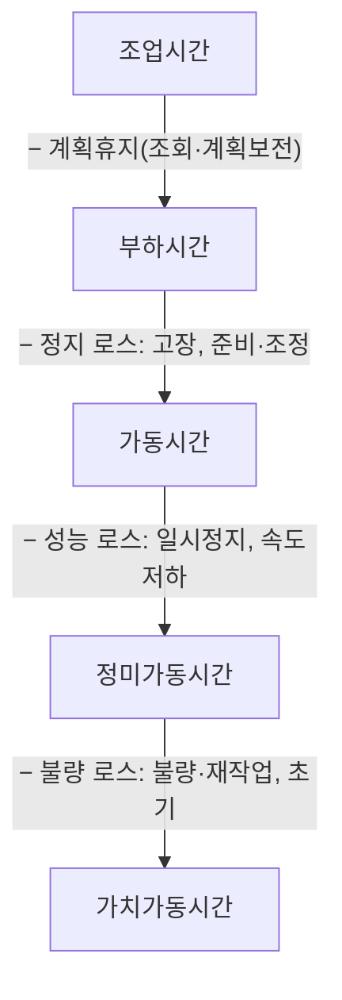
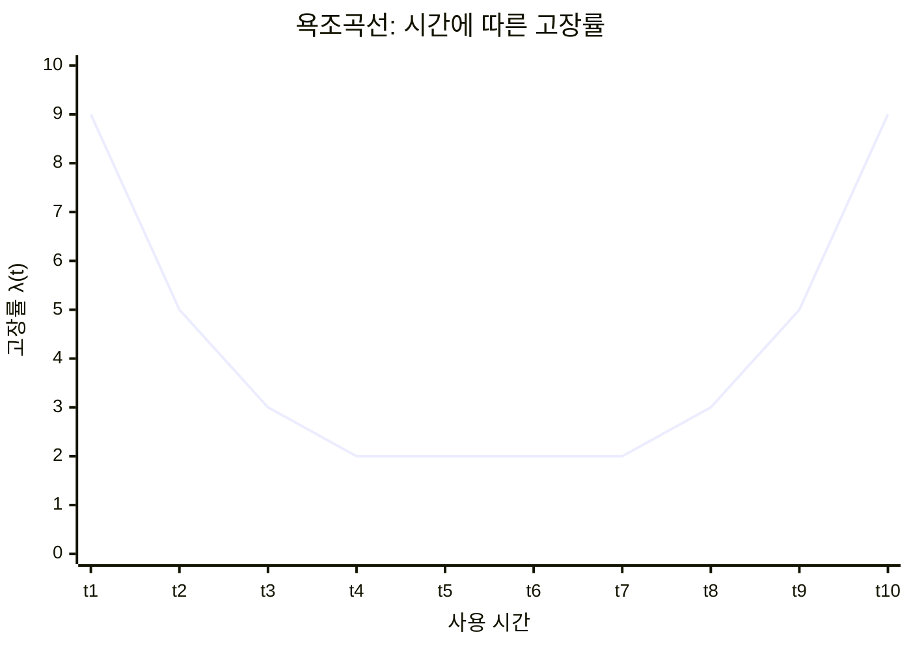
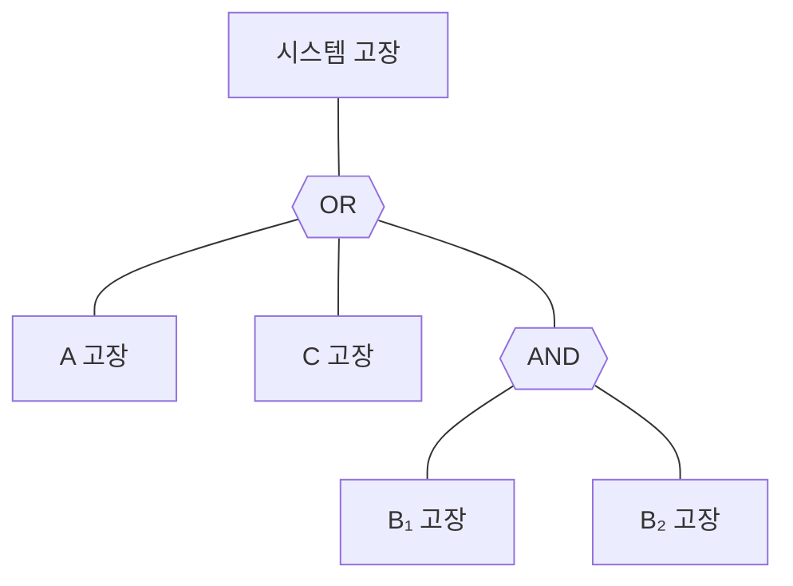
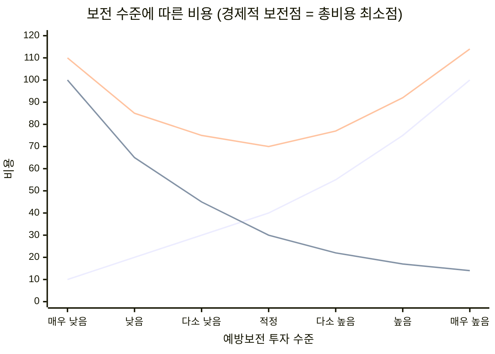

# 3.5 설비보전관리

!!! info "출제기준"
    **3. 공정관리** › **5. 설비보전관리**

## 출제 경향

총 **68문항** 출제 (1교시 단답형 26 · 2~4교시 논술형 42) · 최근 10개 회차(109~139회) 27문항 · 최근 출제 제139회

| 주제 | 출제 수 | 출제 회차 |
|---|:-:|---|
| 3.5.1 설비보전의 유형과 보전조직 | 5 | 63회, 73회, 79회, 94회, 133회 |
| 3.5.2 TPM과 자주보전 | 11 | 67회, 68회, 73회, 97회, 100회, 112회, 115회, 124회, 127회, 139회 |
| 3.5.3 설비 로스와 설비종합효율(OEE) | 13 | 63회, 67회, 76회, 91회, 97회, 103회, 106회, 109회, 127회, 130회, 133회, 136회, 139회 |
| 3.5.4 고장과 욕조곡선 | 10 | 67회, 70회, 79회, 82회, 88회, 94회, 97회, 121회, 136회 |
| 3.5.5 신뢰성·보전성·가용도(RAM) | 23 | 63회, 67회, 71회, 76회, 82회, 85회, 88회, 91회, 94회, 100회, 103회, 109회, 112회, 115회, 127회, 130회, 133회, 136회, 139회 |
| 3.5.6 보전비용과 보전 경제성 | 3 | 70회, 79회, 130회 |
| 3.5.7 PM 분석 | 3 | 85회, 103회, 136회 |

## 목차

1. [설비보전의 유형과 보전조직](#t35-1)
2. [TPM과 자주보전](#t35-2)
3. [설비 로스와 설비종합효율(OEE)](#t35-3)
4. [고장과 욕조곡선](#t35-4)
5. [신뢰성·보전성·가용도(RAM)](#t35-5)
6. [보전비용과 보전 경제성](#t35-6)
7. [PM 분석](#t35-7)

## 3.5.1 설비보전의 유형과 보전조직 {#t35-1}

### 설비보전의 개념 (133회)

**설비보전**은 설비가 본래의 기능을 유지하도록 점검·청소·급유·조정·수리·개량하는 모든 활동이다. 목적은 고장·불량 등 설비로 인한 손실을 줄이고 설비의 수명주기 비용(LCC)을 최소화하는 것이다.

### 설비보전의 발전 과정

| 시기(무렵) | 보전 방식 | 특징 |
|---|---|---|
| ~1950년 | 사후보전(BM) | 고장 나면 수리 |
| 1950년대 초 | 예방보전(PM) | 미국에서 정기 점검·교체 도입, 일본으로 확산 |
| 1954년 | 생산보전(PM) | 미국 GE사가 제창 — 경제성을 기준으로 보전 방식을 선택 |
| 1950년대 후반 | 개량보전(CM) | 고장 부위를 개선해 재발 방지 |
| 1960년 전후 | 보전예방(MP) | 설계 단계부터 보전성 반영 |
| 1971년 | TPM | 일본에서 전원 참가 생산보전으로 정립 |
| 1980년대~ | 예지보전(CBM·PdM) | 상태 감시 기술 발전 |
| 2010년대~ | 스마트 보전(PHM) | IoT·AI로 고장 예측과 잔여수명(RUL) 추정 |

(연도는 교재마다 조금씩 다르다 — 교재 확인 필요)

### 생산보전(PM)에서의 보전 유형 (73·94회)

| 유형 | 내용 | 적용 |
|---|---|---|
| **예방보전**(Preventive) | 고장이 나기 전에 점검·교체해 고장을 막음 | 고장 영향이 큰 설비 |
| └ 시간기준보전(TBM) | 정해진 주기(시간·횟수)마다 보전 | 열화 주기가 일정한 부품 |
| └ 상태기준보전(CBM)·**예지보전** | 진동·온도·오일·전류 등 **상태를 감시해 이상 징후가 보일 때** 보전 | 고장 패턴이 불규칙한 중요 설비 |
| **사후보전**(Breakdown) | 고장이 난 뒤에 수리 | 고장 영향이 작고 예방비가 더 큰 설비 |
| **개량보전**(Corrective) | 고장이 반복되는 부위의 설계·재질을 개선해 수명·보전성 향상 | 반복 고장, 설계 약점 |
| **보전예방**(MP) | 신설비 설계 단계부터 보전 정보를 반영해 고장이 적고 보전하기 쉬운 설비를 만듦 | 신규 설비 도입 |

**고장 시점 기준 (133회)**: 고장 전에 하는 **사전보전**(예방보전·예지보전) / 고장 후에 하는 **사후보전**(긴급보전·일상 사후보전)

**예지보전 (63회)**: 센서·진단 장비로 설비 상태를 계속 감시하고, 데이터 추세로 고장 시점을 예측해 **필요한 시점에만** 보전한다. 과잉 보전과 돌발 고장을 함께 줄이며, IoT·AI 기반 예측 보전으로 발전하고 있다.

| 진단 기법 | 감지 대상 | 적용 예 |
|---|---|---|
| 진동 분석 | 불평형·정렬 불량·베어링 결함 | 모터, 펌프, 팬 |
| 오일 분석 | 마모 입자·오염·열화 | 기어박스, 유압 장치 |
| 열화상(적외선) | 과열·접촉 불량 | 배전반, 전동기 |
| 전류·전력 분석 | 부하 이상, 권선 결함 | 전동기 |
| 초음파·음향 | 누설, 윤활 부족 | 공압 배관, 베어링 |

**보전 방식의 선정**: 설비 중요도(고장 시 생산·품질·안전 영향)와 고장 패턴으로 정한다 — 중요도 높고 열화 추세가 보이면 CBM, 수명이 일정하면 TBM, 중요도 낮고 예방비가 더 크면 BM, 반복 고장이면 CM. 이를 체계화한 것이 **RCM(신뢰성 중심 보전)**으로, 기능·고장 모드·영향(FMEA) 분석으로 설비별 최적 보전 방식을 정한다.

### 보전의 직접기능과 간접기능 (79회)

| 구분 | 기능 |
|---|---|
| 직접기능(보전 작업) | 일상보전(청소·급유·조정), 점검·검사(정기·정밀 진단), 수리(예방 수리·사후 수리), 개량 작업 |
| 간접기능(보전 관리) | 보전 계획·일정, 보전 기록·이력 관리, 보전 자재(예비품) 관리, 보전 예산·비용 관리, 보전 기술·교육 |

### 설비보전 조직의 형태 (73회)

| 형태 | 내용 | 장점 | 단점 |
|---|---|---|---|
| 집중보전 | 보전 요원을 한 부서에 모아 전 공장을 담당 | 인력 활용 효율, 기술 축적, 긴급 대응 인원 확보 | 현장과 거리, 이동 시간, 현장 사정 이해 부족 |
| 지역보전 | 보전 요원을 공장 지역별로 배치(소속은 보전부서) | 현장 대응이 빠름, 설비 이해도 높음 | 인력 중복, 지역 간 부하 불균형 |
| 부문보전 | 보전 요원이 각 제조 부문에 소속 | 생산과 일체감, 신속 대응 | 보전 기술의 분산, 생산 우선으로 보전 소홀 |
| 절충형 | 위 형태를 결합(예: 일상보전은 부문, 대수리는 집중) | 각 형태의 장점 결합 | 책임 범위 조정 필요 |

!!! tip "답안 작성 포인트"
    - 보전 유형은 **체계도(생산보전 → 예방·사후·개량·보전예방)**를 반드시 그리고 표로 보충한다.
    - 조직 형태는 4가지를 비교표로 쓰고, 최근 경향(일상보전은 운전 부서의 자주보전, 전문 보전은 집중 조직)을 결론에 둔다.
    - 133회처럼 고장률 곡선을 함께 물으면 [3.5.4 욕조곡선](#t35-4)의 그림과 구간별 보전 방식(초기: 디버깅, 우발: BM·CBM, 마모: TBM)을 연결한다.
    - 결론 예: "설비 중요도와 고장 패턴에 따라 BM·TBM·CBM을 조합하는 RCM 관점이 필요하며, IoT·AI 기반 예지보전(PHM)으로 과잉 보전과 돌발 고장을 함께 줄여야 한다."

??? example "관련 기출 5문항 (63회, 73회, 79회, 94회, 133회)"

    - **제63회(2001) 1교시 7번** · 10점  
      예지(예측) 보전
    - **제73회(2004) 3교시 3번** · 25점  
      설비보전 조직의 형태와 형태별 특성을 설명하시오.
    - **제79회(2006) 2교시 5번** · 25점  
      설비보전에서 직접기능을 분류하여 설명하시오.
    - **제94회(2011) 3교시 6번** · 25점  
      생산보전(Productive Maintenance)에서의 설비보전 유형에 대하여 설명하시오.
    - **제133회(2024) 3교시 4번** · 25점  
      설비보전에 대하여 다음을 설명하시오.

        ??? quote "문제 전문"

            설비보전에 대하여 다음을 설명하시오.  
            1) 설비보전 개념  
            2) 고장 시점 기준으로 사전보전과 사후보전  
            3) 고장률 곡선  

## 3.5.2 TPM과 자주보전 {#t35-2}

### TPM의 개념 (124·127회)

**TPM(Total Productive Maintenance, 전원 참가 생산보전)**은 일본설비관리협회(JIPM)가 1971년 정립한 것으로, 다음을 특징으로 한다.

1. **설비종합효율 극대화**를 목표로 함
2. 설비의 **일생 전체**를 대상으로 하는 생산보전 시스템 확립
3. 설비 계획·사용·보전 등 **전 부문**이 참여
4. 최고경영자부터 현장 작업자까지 **전원 참가**
5. **소집단 자주활동**으로 추진

목표는 **고장 제로·불량 제로·재해 제로**의 "로스 제로"다. (Total Preventive Maintenance라고 표기한 기출도 같은 개념으로 답한다.)

- **제창**: 미국식 생산보전(PM)을 일본식으로 발전시킨 것으로, 나카지마 세이이치(中嶋清一)가 체계화·보급했다. 초기에는 생산부문 중심이었으나 1989년 무렵 개발·영업·관리 등 **전사 부문**으로 범위를 넓힌 "전사 TPM"으로 재정의되었다.
- **기본 사상**: "내 설비는 내가 지킨다"(운전자 자주보전) + 보전 전문 부서의 계획보전 → 설비의 체질 개선 → 사람의 체질 개선 → 기업의 체질 개선

| 비교 | TQM(TQC) | TPM |
|---|---|---|
| 대상 | 품질(결과) | 설비(원인 — 조건) |
| 목표 | 품질 향상, 고객 만족 | 로스 제로, 설비종합효율 극대화 |
| 수단 | 관리 체계·통계적 방법(QC 도구) | 현장·현물 중심, 설비 조건 관리 |
| 공통점 | 전원 참가, 소집단 활동, 경영층 주도, 예방 중시 | |

### TPM의 8대 기둥

| 기둥 | 내용 |
|---|---|
| 개별개선 | 로스 테마별 팀 개선(6대 로스 감소) |
| 자주보전 | 운전 부서가 스스로 설비를 지키는 활동 |
| 계획보전 | 보전 부서의 예방·예지 보전 체계 |
| 교육훈련 | 운전·보전 기능 향상 |
| 초기관리 | 신제품·신설비의 조기 안정화(보전예방 설계) |
| 품질보전 | 불량이 나지 않는 설비 조건 설정·유지 |
| 관리·간접부문 효율화 | 사무·지원 부문의 로스 제거 |
| 안전·환경 | 재해 제로, 환경 개선 |

### TPM 전개 단계 (68·127회)

| 단계 | 스텝 |
|---|---|
| **도입 준비** | ① 최고경영자의 TPM 도입 결의 선언 ② 도입 교육과 캠페인 ③ 추진 조직 구성 ④ 기본 방침과 목표 설정 ⑤ 추진 마스터플랜 작성 |
| **도입 개시** | ⑥ TPM 킥오프 |
| **도입 실시** | ⑦ 생산 효율화 체제 구축(개별개선·자주보전·계획보전·교육훈련) ⑧ 초기관리 체제 ⑨ 품질보전 체제 ⑩ 관리·간접부문 효율화 ⑪ 안전·환경 관리 체제 |
| **정착** | ⑫ TPM 완전 실시와 수준 향상 |

**3단계로 묻는 경우 (127회)**: ① **준비 단계**(스텝 1~5: 결의 선언 → 교육·캠페인 → 추진 조직 → 방침·목표 → 마스터플랜) ② **도입 실시 단계**(스텝 6~11: 킥오프 → 생산 효율화 → 초기관리 → 품질보전 → 관리·간접 효율화 → 안전·환경) ③ **정착 단계**(스텝 12: 완전 실시, PM상 도전 등 수준 향상)로 묶는다.

**성과 분석 (68회)**: PQCDSM 지표로 도입 전후를 비교한다 — P(설비종합효율, 노동생산성), Q(공정 불량률, 고객 클레임), C(제조원가, 보전비), D(재고 일수, 납기준수율), S(재해 건수), M(개선 제안 건수, 사기 조사)

### TPM의 로스 중심 분류와 개선 (67·100회)

설비의 **6대 로스**를 기준으로 개선한다(상세 대책은 [3.5.3](#t35-3) 참고). 고장 로스 → 고장 제로 5대 대책, 준비·조정 로스 → SMED, 일시정지·속도저하 로스 → 원인 분석과 설비 개선, 불량·초기 로스 → 품질보전과 조건 관리

### 자주보전 7스텝 (97·112·115·127·139회)

| 스텝 | 명칭 | 목적·활동 내용 |
|:-:|---|---|
| 1 | **초기 청소**(청소 점검) | 설비를 구석구석 청소하며 불합리(풀림·누유·마모)를 발견 — "청소는 점검이다" |
| 2 | **발생원·곤란 개소 대책** | 오염의 발생원을 없애고, 청소·급유·점검이 어려운 곳을 개선해 시간 단축 |
| 3 | **자주보전 가기준 작성** | 청소·급유·점검을 짧은 시간에 확실히 할 수 있도록 임시 기준 작성 |
| 4 | **총점검** | 설비 기능·구조를 배우고 계통별로 점검해 숨은 결함을 찾아 복원 |
| 5 | **자주점검** | 가기준을 보완해 자주점검 체크시트를 확정하고 스스로 점검 |
| 6 | **정리·정돈(표준화)** | 관리 대상을 넓혀 작업·물류·품질 등 현장 관리 항목을 표준화 |
| 7 | **자주관리 철저** | 목표 관리와 개선을 스스로 계속하는 자주관리 체제 정착 |

**설비에 강한 오퍼레이터의 4가지 능력 (115회)과 육성 단계 연계 (97회)**

| 오퍼레이터 능력 | 내용 | 연계 스텝 |
|---|---|---|
| ① 이상 발견 능력 | 설비의 이상·결함을 이상으로 볼 수 있는 눈 | 스텝 1~3 |
| ② 처치·회복 능력 | 발견한 이상을 바로 처치하고 보고하는 능력(설비 구조·기능 이해) | 스텝 4 |
| ③ 조건 설정 능력 | 정상·이상의 판단 기준을 정량적으로 정하는 능력(설비와 품질의 관계 이해) | 스텝 5 |
| ④ 유지관리 능력 | 정한 기준과 규칙을 확실히 지키는 능력 | 스텝 6~7 |

**총점검(스텝 4)의 전개 방법 (97회)**: ① 점검 계통(체결·윤활·공유압·전기·구동) 선정 → ② 계통별 총점검 교재·체크시트 작성 → ③ 리더 교육 → ④ 리더의 전달 교육(오퍼레이터) → ⑤ 총점검 실시와 불합리 발견·복원 → ⑥ 점검 기준(가기준) 개정, 눈으로 보는 관리 → ⑦ 진단(스텝 합격 심사)

**자주보전 추진 도구**: 활동판(목표·실적·계획), 원 포인트 레슨(OPL, 한 장짜리 교육 자료), 불합리 꼬리표(Tag, 운전자 처리용·보전 의뢰용 구분), 스텝별 진단(자주진단 → 과장 진단 → 공장장 진단)

**자주보전과 계획보전의 역할 분담**

| 구분 | 자주보전(운전 부서) | 계획보전(보전 부서) |
|---|---|---|
| 목적 | 강제열화 방지 | 자연열화 측정·복원, 수명 연장 |
| 활동 | 청소·급유·조임, 일상점검, 간단한 부품 교체 | 정기·예지보전, 고장 분석, 개량보전, 예비품 관리 |
| 관계 | 이상 발견·보고 → | ← 기술 지원·교육, 정밀 수리 |

### TBM과 CBM의 효율적 적용 순서 (124회)

1. **설비 중요도 등급화**(A·B·C): 고장 영향이 큰 설비부터 대상 선정
2. **기본조건 정비와 열화 복원**: 자주보전으로 강제열화를 없애 고장 패턴을 안정화
3. **TBM 체계 수립**: 고장 이력·MTBF 분석으로 부품별 교체·점검 주기 설정
4. **주기 최적화**: 과잉·과소 보전을 줄이도록 TBM 주기를 데이터로 조정
5. **CBM 전환**: 고장 패턴이 불규칙하고 고장 비용이 큰 설비에 상태 감시(진동·온도·오일 분석) 적용
6. **예지보전 고도화**: IoT·AI로 고장 시점 예측, 보전 계획 자동화

!!! tip "답안 작성 포인트"
    - TPM은 11문항으로 반복 출제되는 핵심 주제다. **정의 5요소 → 8대 기둥 → 12스텝(4단계 구분) → 자주보전 7스텝** 세트를 외운다.
    - 자주보전 7스텝은 **명칭 + 목적 + 활동** 표를 쓰고, 오퍼레이터 4능력과 연결하면 97·115회형에 바로 대응된다.
    - 스텝 1~3은 "기본조건 정비", 4~5는 "설비 기능 이해와 점검", 6~7은 "자주관리"로 묶어 설명하면 구조가 분명해진다.
    - 결론 예: "TPM은 설비의 체질 개선을 통해 사람과 기업의 체질을 바꾸는 활동이므로, 자주보전과 계획보전의 역할을 분명히 하고 IoT 설비 데이터와 연계한 스마트 TPM으로 고도화해야 한다."

??? example "관련 기출 11문항 (67회, 68회, 73회, 97회, 100회, 112회, 115회, 124회, 127회, 139회)"

    - **제67회(2002) 3교시 6번** · 25점  
      TPM(종합설비보전)을 Loss중심으로 분류하고 개선방안을 설명하시오.
    - **제68회(2002) 2교시 4번** · 25점  
      종합생산보전(Total Productive Maintenance : TPM)의 전개방법과 성과분석법을 설명하시오.
    - **제73회(2004) 1교시 10번** · 10점  
      TPM에서의 설비보전 유형(생산보전을 중심으로)
    - **제97회(2012) 2교시 3번** · 25점  
      설비에 의한 가공공장에서 자주보전 7스텝 추진활동에 있어서 다음 사항에 대하여 설명하시오.

        ??? quote "문제 전문"

            설비에 의한 가공공장에서 자주보전 7스텝 추진활동에 있어서 다음 사항에 대하여 설명하시오.  
            1) 자주보전 7스텝 활동을 오퍼레이터의 육성 4단계와 연계하여 설명하시오.  
            2) 자주보전 4스텝 활동인 총 점검 단계의 전개방법을 설명하시오.  
    - **제100회(2013) 4교시 5번** · 25점  
      TPM(종합적 생산보전)의 개념과 6대 로스별 개선대책을 설명하시오.
    - **제112회(2017) 2교시 1번** · 25점  
      가공산업에서 TPM의 자주보전 7단계를 단계별 목적과 활동내용을 포함하여 설명하시오.
    - **제115회(2018) 3교시 3번** · 25점  
      자주보전활동을 잘하기 위해서는 오퍼레이터가 설비에 강해야 한다. 설비에 강한 오퍼레이터에 요구되는 능력 4가지와 이를 효과적으로 실현하기 위한 자주보전활동 7스텝에 대하여 설명하시오.
    - **제124회(2021) 1교시 10번** · 10점  
      TPM(Total Preventive Maintenance)
    - **제124회(2021) 2교시 6번** · 25점  
      TPM(Total Preventive Maintenance)전략에서 TBM(Time-Based Maintenance)과 CBM(Condition-Based Maintenance)의 적용 효율을 높이는 순서상의 방법을 설명하시오.
    - **제127회(2022) 4교시 5번** · 25점  
      TPM(Total Productive Maintenance) 활동과 자주보전 활동에 대하여 다음 물음에 답하시오.

        ??? quote "문제 전문"

            TPM(Total Productive Maintenance) 활동과 자주보전 활동에 대하여 다음 물음에 답하시오.  
            1) TPM 개념을 설명하시오.  
            2) TPM추진을 3단계로 구분하고, 단계 내에서 수행하는 활동의 순서를 설명하시오.  
            3) 자주보전 7단계를 순서대로 나열하고, 각각 설명하시오.  
    - **제139회(2026) 2교시 6번** · 25점  
      자주보전 전개의 7단계를 활동 중심으로 설명하시오.

## 3.5.3 설비 로스와 설비종합효율(OEE) {#t35-3}

### 설비의 6대 로스와 7대 로스 (76·106·133·136회)

| 구분 | 로스 | 내용 | 대책 |
|---|---|---|---|
| **정지 로스** → 시간가동률 | ① 고장 로스 | 돌발·만성 고장으로 인한 정지 | 고장 제로 5대 대책, 예방보전 |
| | ② 준비·조정 로스 | 품종 교체·조정에 따른 정지 | 준비교체 시간 단축(SMED), 조정 없애기 |
| **성능 로스** → 성능가동률 | ③ 일시정지·공회전 로스 | 센서 오작동·막힘 등 짧은 정지 | 현상 관찰, 미세결함 제거, PM 분석 |
| | ④ 속도저하 로스 | 설계 속도보다 느린 운전 | 설계·실제 속도 차이의 원인 규명과 설비 개선 |
| **불량 로스** → 양품률 | ⑤ 불량·재작업 로스 | 불량품과 수정 작업 | 품질보전, 조건 관리, 실수방지 |
| | ⑥ 초기(수율) 로스 | 가동 시작 후 안정될 때까지의 손실 | 가동 조건 표준화, 초기 안정화 |

**7대 로스**는 6대 로스에 **공구(날물) 교환 로스**를 더한 것이다(교재에 따라 계획정지 로스를 더해 8대 로스로 보기도 한다).

**생산 효율화를 저해하는 16대 로스**(JIPM 체계 — 설비·사람·원단위로 확장)

| 구분 | 로스 |
|---|---|
| 설비 효율 저해 8대 로스 | 고장, 준비·조정, 공구(날물) 교환, 초기(가동 시작), 일시정지·공회전, 속도저하, 불량·재작업, **셧다운(SD, 계획정지)** |
| 사람 효율 저해 5대 로스 | 관리(자재·지시 대기), 동작, 편성(라인 불균형), 자동화 치환(자동화 가능한데 사람이 함), 측정·조정 |
| 원단위 효율 저해 3대 로스 | 에너지, 금형·치공구, 수율(재료) |

16대 로스는 OEE(설비)뿐 아니라 **노동생산성·원단위(에너지·재료)**까지 관리 대상을 넓힌 것으로, 최근 탄소중립 관점에서 에너지 로스 관리가 중요해지고 있다.

### 시간 구조와 설비종합효율 (63·67·91·109·136·139회)

| 지표 | 산출식 |
|---|---|
| **시간가동률** | \( \dfrac{\text{가동시간}}{\text{부하시간}} = \dfrac{\text{부하시간} - \text{정지시간}}{\text{부하시간}} \) |
| 속도가동률 | \( \dfrac{\text{이론 사이클타임}}{\text{실제 사이클타임}} \) |
| 정미가동률 | \( \dfrac{\text{생산량} \times \text{실제 사이클타임}}{\text{가동시간}} \) |
| **성능가동률** | \( \text{속도가동률} \times \text{정미가동률} = \dfrac{\text{이론 사이클타임} \times \text{생산량}}{\text{가동시간}} \) |
| **양품률** | \( \dfrac{\text{양품 수}}{\text{총생산량}} \) |
| **설비종합효율(OEE)** | 시간가동률 × 성능가동률 × 양품률 \( = \dfrac{\text{가치가동시간}}{\text{부하시간}} \) |

**목표 수준**(나카지마 세이이치): 시간가동률 90% 이상, 성능가동률 95% 이상, 양품률 99% 이상 → OEE **85% 이상**

**설비효율화 지표 (91회)**: OEE와 그 구성 지표, MTBF·MTTR, 고장도수율·고장강도율, 보전비율, 설비 생산성

| 관련 지표 | 산식·의미 |
|---|---|
| TEEP(총유효설비생산성) | 설비 이용률(부하시간 ÷ 달력시간) × OEE — 계획휴지까지 포함한 설비 활용도 |
| 장치산업의 종합효율 | 장치산업에서는 계획정지(SD)를 포함해 달력시간 기준으로 산출하기도 한다(명칭·산식은 교재 확인 필요) |
| 설비 가동률 | 가동시간 ÷ 부하시간(= 시간가동률) — OEE와 혼동하지 않는다 |

**OEE 운영의 실무 포인트**: ① 이론 사이클타임을 설비 사양 또는 최고 실적으로 정의해 기준을 고정 ② 로스 시간을 6대 로스별로 집계(작업일보 → MES 자동 수집) ③ 가장 낮은 지표부터 개별개선 테마 선정 ④ 설비 간 비교보다 같은 설비의 추세로 평가

### 돌발 로스와 만성 로스 (130회)

| 구분 | 돌발 로스 | 만성 로스 |
|---|---|---|
| 형태 | 갑자기 크게 발생 | 작은 폭으로 늘 반복 |
| 원인 | 단일·명확(부품 파손 등) | 복합·불명확, 미세결함이 얽힘 |
| 인식 | 쉽게 눈에 띔 | 당연하게 여겨 방치 |
| 대책 | **복원 대책**(원래 상태로 되돌림) | **혁신 대책** — 기본조건 재정비, 미세결함 철저 제거, PM 분석, 최적 조건 재설정 |

### 장치산업의 정상·비정상 생산 로스 (103회)

| 구분 | 정상 생산 로스 | 비정상 생산 로스 |
|---|---|---|
| 의미 | 정상 운전 중에도 피할 수 없는 성능 저하 | 설비·공정 이상으로 정격보다 낮게 운전해서 생기는 손실 |
| 원인 | 가동 시작·정지, 품종(등급) 전환 시의 감속 운전 | 설비 부조, 원료 품질 이상, 공정 트러블로 인한 감산 운전 |
| 대책 | 시작·정지·전환 절차 최적화, 전환 횟수·시간 단축 | 설비 신뢰성 향상, 원료 관리, 이상 조기 감지 |

### 풀이: 97회

가동시간 = 부하시간 − 고장정지 − 준비교체 = 5,700 − 100 − 390 = **5,210분**

| 항목 | 계산 | 결과 |
|---|---|:-:|
| MTBF | 가동시간 ÷ 고장 건수 = 5,210 ÷ 3 | **1,736.7분** |
| MTTR | 고장정지시간 ÷ 고장 건수 = 100 ÷ 3 | **33.3분** |
| 시간가동률 | 5,210 ÷ 5,700 | **91.4%** |
| 속도가동률 | 1.0 ÷ 1.2 | **83.3%** |
| 정미가동률 | 4,250 × 1.2 ÷ 5,210 | **97.9%** |
| 성능가동률 | 0.833 × 0.979 (= 4,250 × 1.0 ÷ 5,210) | **81.6%** |
| 양품률 | (4,250 − 250) ÷ 4,250 | **94.1%** |
| **설비종합효율** | 0.914 × 0.816 × 0.941 | **70.2%** |

(MTBF를 부하시간에서 고장정지만 뺀 5,600분으로 보면 1,866.7분이 된다 — 문제 조건에 맞춰 기준을 밝힌다.)

**효율이 낮은 항목과 개선 방안**: 속도가동률(83.3%)이 가장 낮다 → 설계 속도로 운전하지 못하는 원인(설비 열화·품질 우려·조건 미설정)을 분석해 속도를 회복한다. 다음으로 양품률(94.1%) → 불량 유형별 원인 분석과 품질보전, 시간가동률(91.4%) → 준비교체 390분을 SMED로 단축한다.

### 풀이: 127회

부하시간 = 500 − 50 = 450분, 가동시간 = 450 − 50 = 400분

| 항목 | 계산 | 결과 |
|---|---|:-:|
| 시간가동률 | 400 ÷ 450 | **88.9%** |
| 성능가동률 | 0.5 × 400 ÷ 400 (속도 62.5% × 정미 80%) | **50.0%** |
| 양품률 | 390 ÷ 400 | **97.5%** |
| **설비종합효율** | 0.889 × 0.5 × 0.975 | **43.3%** |

**문제점과 조치**: 성능가동률 50%가 결정적 원인이다. 실제 사이클(0.8분)이 이론 사이클(0.5분)보다 60% 길고(속도저하 로스), 가동시간 중 20%가 일시정지 등으로 생산에 쓰이지 않았다. → 속도저하 원인 분석(금형·이송 장치 상태, 조건 설정), 일시정지 현상 관찰과 미세결함 제거, 고장·준비 50분은 예방보전과 SMED로 단축한다.

!!! tip "답안 작성 포인트"
    - OEE는 13문항으로 3.5에서 두 번째로 많다. **시간 구조 그림(조업 → 부하 → 가동 → 정미가동 → 가치가동)에 6대 로스를 표시**하고 지표 산식을 붙이는 것이 핵심이다.
    - 계산 문제는 **가동시간 계산 → 지표별 계산표 → OEE → 가장 낮은 지표의 원인과 대책** 순서로 쓴다.
    - 6대 로스 문제에 **16대 로스**나 TEEP를 한 줄 덧붙이면 차별화된다.
    - 결론 예: "OEE는 로스를 드러내는 도구이므로 MES·IoT로 로스 시간을 자동 수집하고, 만성 로스는 PM 분석, 준비 로스는 SMED로 테마화해 85% 이상을 목표로 개선해야 한다."

??? example "관련 기출 13문항 (63회, 67회, 76회, 91회, 97회, 103회, 106회, 109회, 127회, 130회, 133회, 136회, 139회)"

    - **제63회(2001) 4교시 3번** · 25점  
      설비종합 효율 산출지표와 로스(loss)개선 방안을 연계하여 설명하시오.
    - **제67회(2002) 1교시 1번** · 10점  
      종합설비 효율이란 ?
    - **제76회(2005) 2교시 1번** · 25점  
      설비의 7대로스와 설비 종합효율 공식과의 관계를 설명하시오.
    - **제91회(2010) 1교시 8번** · 10점  
      설비효율화 지표에 대하여 설명하시오.
    - **제97회(2012) 3교시 2번** · 25점  
      다음은 어느 가공설비에 대해 설비종합효율을 측정하고, 개선방안을 수립하기 위해 작업일보를 정리한 것이다.

        ??? quote "문제 전문"

            다음은 어느 가공설비에 대해 설비종합효율을 측정하고, 개선방안을 수립하기 위해 작업일보를 정리한 것이다.  
            [표] 내용 | 집계결과  
            부하시간 | 5700분  
            고장정지시간 | 100분  
            고장발생건수 | 3회  
            준비교체시간 | 390분  
            총생산량 | 4250개  
            부적합품 수(불량품 수) | 250개  
            이론속도/개 | 1.0분/개  
            실제속도/개 | 1.2분/개  
            1) 위 표를 바탕으로 MTBF와 MTTR을 구하시오.  
            2) 시간가동율, 속도가동율, 정미가동율, 성능가동율, 양품율 및 설비종합효율의 의미를 설명하시오.  
            3) 위 표를 바탕으로 2)의 각 항목에 대한 효율(%)을 구하시오.  
            4) 계산 결과 효율이 낮은 항목을 제시하고, 그 원인과 개선 방안을 설명하시오.  
    - **제103회(2014) 1교시 8번** · 10점  
      석유화학공업과 같은 장치산업에서 성능가동율의 저해요인인 정상생산로스와 비정상생산로스를 비교하여 설명하시오.
    - **제106회(2015) 3교시 2번** · 25점  
      설비 효율화를 저해하는 6대 로스(loss)와 각 로스별 대책에 대하여 설명하시오.
    - **제109회(2016) 3교시 5번** · 25점  
      설비종합효율은 시간가동률, 성능가동률, 양품율의 곱으로 산출한다. 이 3가지 지표를 활용하여 산출하는 과정을 설비 6대 로스(loss)와 연계하여 설명하시오.
    - **제127회(2022) 3교시 3번** · 25점  
      프레스 가공업체의 프레스 설비에 대하여 1주간의 설비가동현황은 다음과 같다.

        ??? quote "문제 전문"

            프레스 가공업체의 프레스 설비에 대하여 1주간의 설비가동현황은 다음과 같다.  
            \- 근무시간: 500분  
            \- 계획 휴지시간: 50분  
            \- 고장, 준비에 의한 고장시간: 50분  
            \- 이론 cycle 시간: 0.5분/개  
            \- 실제 cycle 시간: 0.8분/개  
            \- 총생산량: 400개  
            \- 불량품: 10개  
            1) 시간가동률과 성능가동률을 구하시오.  
            2) 설비종합효율을 구하시오.  
            3) 설비가동 결과에 따른 문제점과 조치방안을 설명하시오.  
    - **제130회(2023) 2교시 1번** · 25점  
      설비로스 중 돌발로스와 만성로스의 차이점을 비교하고, 각각의 로스를 개선하는 방법에 대하여 설명하시오.
    - **제133회(2024) 2교시 6번** · 25점  
      설비의 6대 손실(Loss)을 설명하고, 설비종합효율 산출을 6대 손실과 연계하여 설명하시오.
    - **제136회(2025) 2교시 3번** · 25점  
      설비 6대 로스(Loss)와 설비종합효율에 대하여 다음 질문에 답하시오.

        ??? quote "문제 전문"

            설비 6대 로스(Loss)와 설비종합효율에 대하여 다음 질문에 답하시오.  
            (1) 설비 6대 로스를 설명하시오.  
            (2) A설비의 1일 작업시간 8시간을 조업시간, 부하시간, 가동시간, 정미가동시간, 가치가동시간으로 도식화(圖式化)하여 각각의 시간에 해당하는 설비 6대 로스를 표시하고, 이를 근거로 한 시간가동률, 성능가동률과 양품률 산식을 설명하시오.  
    - **제139회(2026) 1교시 2번** · 10점  
      설비종합효율과 관련하여 시간가동률, 성능가동률, 양품률에 대하여 각각 산출식을 포함하여 설명하시오.

## 3.5.4 고장과 욕조곡선 {#t35-4}

### 욕조곡선(고장률 곡선) (67·70·88·97·121·133·139회)

| 구분 | 초기고장기 | 우발고장기 | 마모고장기 |
|---|---|---|---|
| 고장률 형태 | **감소형**(DFR) | **일정형**(CFR) | **증가형**(IFR) |
| 와이블 형상모수 | \( m < 1 \) | \( m = 1 \)(지수분포) | \( m > 1 \) |
| 발생 원인 | 설계·제조 결함, 조립 불량, 부적합 부품, 사용 미숙 | 우발적 과부하·충격, 사용 조건의 무작위 변동, 오조작 | 마모·피로·부식·노화 등 열화 누적 |
| 대책 | 디버깅·번인(Burn-in), 시운전, 초기유동관리, 수입검사 | 여유(안전계수) 설계, 사용 조건 준수, 사후보전 체계·예비품 | **예방보전**(정기 교체), 수명 관리, 개량보전 |

**욕조곡선의 정의**: 제품·설비의 사용 시간에 따른 고장률 \( \lambda(t) \)의 변화를 나타낸 곡선으로, 모양이 욕조와 닮아 붙은 이름이다. 와이블분포의 형상모수로 각 구간을 표현한다.

\[
R(t) = \exp\left[-\left(\frac{t}{\eta}\right)^{m}\right], \qquad \lambda(t) = \frac{m}{\eta}\left(\frac{t}{\eta}\right)^{m-1}
\]

(\( m \): 형상모수, \( \eta \): 척도모수(특성수명) — \( m = 1 \)이면 \( \lambda = 1/\eta \)인 지수분포)

**고장 패턴의 다양성(RCM 관점)**: Nowlan & Heap(1978)의 항공기 부품 연구에서는 고장 패턴을 6가지로 나누었고, 욕조형·마모형처럼 **사용 시간에 따라 고장률이 증가하는 패턴은 일부**에 불과했다. 따라서 모든 설비에 정기 교체(TBM)를 적용하기보다 **상태 감시(CBM)**가 유효한 경우가 많다는 것이 차별화 포인트다(패턴별 비율은 교재 확인 필요).

### 보전예방(MP)과 욕조곡선 (97회)

**보전예방(Maintenance Prevention)**은 기존 설비의 고장·보전 정보(MP 정보)를 신설비의 설계·제작에 반영해 **고장이 적고 보전하기 쉬운 설비**를 만드는 활동이다.
욕조곡선에서 보면 ① 초기고장기를 짧게 하고(초기유동관리) ② 우발고장기의 고장률 수준을 낮추며 ③ 마모고장기의 시작을 늦추는 효과가 있다 — 곡선 전체를 아래로, 바닥 구간을 길게 만든다.

### 고장 제로를 위한 5대 대책 (79·94회)

1. **기본조건 정비**: 청소·급유·조임을 확실히 해 강제열화 방지
2. **사용조건 준수**: 설계 조건(전압·부하·속도·온도)대로 사용
3. **열화 복원**: 숨은 열화를 찾아 정상 상태로 되돌림
4. **설계상 약점 개선**: 반복 고장 부위의 개량보전
5. **기능(스킬) 향상**: 운전·보전 요원의 기량 향상으로 오조작·수리 실수 방지

### 고장의 분류

**파국고장과 열화고장 (82회)**

| 구분 | 파국고장(Catastrophic) | 열화고장(Degradation) |
|---|---|---|
| 형태 | 기능이 갑자기 완전히 정지 | 성능이 서서히 떨어져 허용 한계를 넘음 |
| 예측 | 어려움(돌발적) | 상태 감시로 예측 가능 |
| 대책 | 신뢰성 설계, 용장성, 사후보전 체계 | 상태기준보전(CBM), 정기 교체 |

**자연열화와 강제열화 (97회)**

| 구분 | 자연열화 | 강제열화 |
|---|---|---|
| 의미 | 올바르게 사용해도 시간이 지나면서 진행되는 물리적 열화(마모·피로) | 기본조건 미비·오조작·과부하로 **인위적으로 앞당겨진** 열화 |
| 대책 | 예방보전(정기 점검·교체), 수명 연장 개량 | **자주보전**으로 기본조건 정비, 사용조건 준수, 교육 |

### 윤활관리 (136회)

**개념**: 윤활제로 마찰·마모를 줄이고 냉각·방청·밀봉 기능을 확보해 설비 열화를 막는 관리다. 고장 원인 중 윤활 불량의 비중이 커서 설비관리의 기본이다.

**윤활의 5적(適)**: 적유(알맞은 유종), 적소(알맞은 개소), 적량(알맞은 양), 적기(알맞은 시기), 적법(알맞은 방법)

**활성화 방안**: ① 윤활 기준서(개소·유종·주기·양) 정비 ② 유종 통일·축소 ③ 눈으로 보는 관리(색상 라벨, 유면 표시) ④ 자동 급유 장치 ⑤ 윤활유 오염 관리(보관·필터링) ⑥ 오일 분석을 통한 상태기준보전 ⑦ 자주보전과 연계한 교육, 급유 이력 관리

!!! tip "답안 작성 포인트"
    - 욕조곡선은 그림이 필수다. 세 구간에 **고장률 형태(DFR·CFR·IFR), 와이블 형상모수, 원인, 대책**을 표로 대응시킨다.
    - 10점 단답형(고장 5대 대책, 파국·열화, 자연·강제열화)은 비교표 하나와 대책 한 줄로 끝낸다.
    - 결론 예: "욕조곡선 구간별로 보전 전략을 달리해야 하며, 초기고장은 MP 설계·초기유동관리로, 우발고장은 CBM으로, 마모고장은 TBM·개량보전으로 대응하고 고장 데이터를 와이블 분석해 보전 주기를 최적화해야 한다."

??? example "관련 기출 10문항 (67회, 70회, 79회, 82회, 88회, 94회, 97회, 121회, 136회)"

    - **제67회(2002) 1교시 3번** · 10점  
      욕조곡선(Bathtub Curve)이란 ?
    - **제70회(2003) 1교시 1번** · 10점  
      고장곡선(Bathtub Curve)
    - **제79회(2006) 1교시 1번** · 10점  
      설비의 고장대책 다섯 가지 중점항목
    - **제82회(2007) 1교시 9번** · 10점  
      파국고장(Catastrophic failure)과 열화고장(Degradation failure)
    - **제88회(2009) 2교시 3번** · 25점  
      제품수명 단계별 고장율은 욕조모양의 곡선(bathtub curve)으로 나타낸다. 이 때 고장의 종류, 주요발생 원인, 고장을 줄일 수 있는 방법을 설명하시오.
    - **제94회(2011) 1교시 5번** · 10점  
      설비고장의 5가지 중점관리 활동
    - **제97회(2012) 1교시 10번** · 10점  
      설비관리에 있어 강제열화와 자연열화의 차이점에 관하여 설명하시오.
    - **제97회(2012) 4교시 3번** · 25점  
      다음은 생산되는 제품의 수명에 대한 욕조곡선에 관한 사항이다. 물음에 답하시오.

        ??? quote "문제 전문"

            다음은 생산되는 제품의 수명에 대한 욕조곡선에 관한 사항이다. 물음에 답하시오.  
            1) 욕조곡선을 그리고 초기고장기, 우발고장기, 마모고장기를 그림에 구분하여 표기하시오.  
            2) 각각의 고장기간에 대해 발생원인과 개선대책을 설명하시오.  
            3) 보전예방(MP: Maintenance Prevention)을 설명하고, 욕조곡선과 어떤 관계가 있는지 설명하시오.  
    - **제121회(2020) 4교시 1번** · 25점  
      설비관리에서 욕조곡선을 도식화하고 제품수명 단계별로 구분하여 고장률 형태, 발생원인 및 대책에 대하여 설명하시오.
    - **제136회(2025) 4교시 3번** · 25점  
      설비의 윤활관리 개념과 윤활관리 활성화 방안에 대하여 설명하시오.

## 3.5.5 신뢰성·보전성·가용도(RAM) {#t35-5}

### 신뢰성·보전성·가용성(RAM) (112·127·130회)

| 개념 | 정의 | 대표 지표 |
|---|---|---|
| **신뢰성(Reliability)** | 정해진 조건에서 정해진 기간 동안 **고장 없이** 기능을 수행할 확률 | 신뢰도 \( R(t) \), 고장률 \( \lambda \), MTBF·MTTF |
| **보전성(Maintainability)** | 고장 난 설비를 정해진 시간 안에 **보전(수리)을 완료**할 확률 | 보전도 \( M(t) \), 수리율 \( \mu \), MTTR |
| **가용성(Availability)** | 필요한 시점에 설비가 **가동 가능한 상태**에 있을 확률 | 가용도 \( A \) |

신뢰성 공학은 1950년대 미국 군용 전자장비의 잦은 고장 문제에서 출발했으며(1957년 AGREE 보고서), 이후 고장 나지 않는 성질(신뢰성)에 수리 용이성(보전성)과 그 결과인 가동 가능성(가용성)을 합쳐 **광의의 신뢰성(RAM)**으로 확장되었다. 관계는 "신뢰성 + 보전성 → 가용성"이다.

### 주요 척도와 관계 (76·82·136·139회)

\[
R(t) = 1 - F(t), \qquad \lambda(t) = \frac{f(t)}{R(t)}
\]

고장이 지수분포(우발고장기)를 따르면

\[
R(t) = e^{-\lambda t}, \qquad MTBF = \frac{1}{\lambda}, \qquad M(t) = 1 - e^{-\mu t}, \qquad MTTR = \frac{1}{\mu}
\]

\[
MTBF = \frac{\text{총 가동시간}}{\text{고장 횟수}}, \qquad MTTR = \frac{\text{총 수리시간}}{\text{고장 횟수}}, \qquad A = \frac{MTBF}{MTBF + MTTR} = \frac{\mu}{\lambda + \mu}
\]

- **MTBF**: 수리 가능한 설비의 평균 고장 간격 / **MTTF**: 수리하지 않는 부품의 평균 고장 시간(평균 수명) (71회)

\[
\text{고장도수율} = \frac{\text{고장 횟수}}{\text{부하시간}} \times 100, \qquad \text{고장강도율} = \frac{\text{고장 정지시간}}{\text{부하시간}} \times 100
\]

**고장강도율 개선 (127회)**: 정지 시간을 줄여야 하므로 MTTR 단축 — 고장 진단 능력 향상, 예비품 확보, 모듈 교체식 설계, 보전 절차 표준화, 고장 이력 데이터베이스

### 가용도의 종류 (82·91회)

| 가용도 | 식 | 특징 |
|---|---|---|
| **고유 가용도** \( A_i \) | \( \dfrac{MTBF}{MTBF + MTTR} \) | 순수 수리시간만 고려 — 설계로 결정되는 이상적 가용도 |
| **성취 가용도** \( A_a \) | \( \dfrac{MTBM}{MTBM + \bar{M}} \) | 예방보전을 포함한 모든 보전 시간 고려(\( \bar M \): 평균 보전시간) |
| **운용 가용도** \( A_o \) | \( \dfrac{MTBM}{MTBM + MDT} \) | 행정·보급 대기시간까지 포함 — 실제 운용 환경의 가용도 |

**가용도 향상 방법 (88회)**: MTBF 늘리기(예방보전, 개량보전, 신뢰성 설계, 기본조건 정비) + MTTR 줄이기(보전성 설계, 예비품, 고장 진단 기술, 보전 요원 숙련, 표준 수리 절차)

### 소표본의 신뢰성 척도: 평균순위법 (85회)

\( n \)개 표본을 시험해 고장 시간을 작은 순서로 \( t_1, t_2, \ldots \)라 할 때

\[
F(t_i) = \frac{i}{n+1}, \qquad R(t_i) = \frac{n + 1 - i}{n + 1}, \qquad \lambda(t_i) = \frac{1}{(n + 1 - i)(t_{i+1} - t_i)}
\]

(더 정밀하게는 메디안 순위 \( F(t_i) = (i - 0.3)/(n + 0.4) \)를 쓴다.)

### 시스템 신뢰도

\[
\text{직렬: } R_s = \prod R_i, \qquad \text{병렬: } R_s = 1 - \prod (1 - R_i)
\]

고장률이 \( \lambda \)로 같은 지수분포 부품 2개의 평균수명 비교

| 구성 | 평균수명(MTTF) | 비고 |
|---|---|---|
| 단일 부품 | \( 1/\lambda \) | 기준 |
| 직렬 2개 | \( 1/(2\lambda) \) | 직렬은 고장률이 더해짐(\( \lambda_s = \sum \lambda_i \)) |
| 병렬(능동) 2개 | \( 3/(2\lambda) \) | \( R_s = 2e^{-\lambda t} - e^{-2\lambda t} \) |
| 대기 용장 2개(완전 전환) | \( 2/\lambda \) | 예비 부품은 대기 중 고장 없다고 가정 |
| k-out-of-n | \( R_s = \sum_{i=k}^{n} \binom{n}{i} R^i (1-R)^{n-i} \) | n개 중 k개 이상 작동하면 정상 |

### 신뢰성 설계기법 (94·100·109·127·133회)

| 기법 | 내용 | 예 |
|---|---|---|
| **신뢰도 배분** | 시스템 목표 신뢰도를 하위 부품에 중요도·복잡도에 따라 나눠 줌 | 항공기 시스템 설계 |
| **용장성(Redundancy) 설계** | 같은 기능의 요소를 여분으로 두어 일부가 고장 나도 기능 유지(병렬·대기 용장) | 이중화 펌프, 예비 전원 |
| **Fool Proof** | 사람이 실수해도 고장·불량·사고가 나지 않게 함 | 한 방향으로만 끼워지는 커넥터 |
| **Fail Safe** | 고장이 나도 **안전한 쪽**으로 작동하도록 설계 | 정전 시 닫히는 밸브, 전철 데드맨 장치 |
| **Safe Life** | 수명 기간에 고장이 나지 않도록 충분한 강도·여유를 두고 수명 전에 교체 | 항공기 부품 수명 관리 |
| **디레이팅(Derating)** | 부품을 정격보다 낮은 부하로 사용해 고장률을 낮춤 | 정격 전압의 70%로 사용 |
| 부품 표준화·검증 부품 사용 | 신뢰성이 입증된 표준 부품 사용 | – |
| 보전성 설계 | 점검·교체가 쉬운 구조(모듈화, 접근성) | – |

**용장성 (67회)**: 병렬 용장(모두 동시 가동), 대기 용장(주 요소 고장 시 예비 요소로 전환), k-out-of-n 용장

### 신뢰성관리와 고유·사용신뢰성 (103회)

**신뢰성관리**: 제품·설비의 신뢰성 목표를 정하고 설계·제조·사용 전 단계에서 이를 달성·유지하는 관리 활동

| 구분 | 고유신뢰성 | 사용신뢰성 |
|---|---|---|
| 개념 | 설계·제조 과정에서 **만들어 넣는** 신뢰성 | 사용·보전 과정에서 **유지되는** 신뢰성 |
| 증대 방안 | 신뢰성 설계(용장·디레이팅), 부품 선정, 제조 품질관리, 신뢰성 시험, FMEA | 사용 조건 준수, 예방보전, 사용자 교육, 포장·수송·보관 관리, 고장 데이터 피드백 |

**신뢰도를 높이는 4가지 대책 (88회)**: ① 신뢰성 설계 ② 예방보전·상태감시 ③ 고장 분석과 재발 방지(FMEA·FTA·PM 분석) ④ 운전·보전 요원 교육과 예비품 관리

**고장 분석 도구**: FMEA(상향식, 고장 모드 → 영향), FTA(하향식, 정상사상 → 원인 논리 게이트)는 [5.4.8 FMEA·FTA·실수방지](../05-work-measurement/04-quality-management.md#t54-8)를, 설비 안전설계(Fool Proof·Interlock)는 [4.3.3](../04-facility-management/03-environment-safety.md#t43-3)을 참고한다.

**최근 경향**: IoT 센서 데이터로 고장 시점과 잔여수명(RUL)을 예측하는 **PHM(Prognostics and Health Management)**, 설비 디지털 트윈으로 신뢰도를 실시간 추정하는 방식이 확산되고 있다([7.1.4 인공지능](../07-support-technology/01-it-smart-factory.md#t71-4)).

### 풀이: 63회

부하시간 = 동작시간 + 정지시간 = 228 + 12 = **240시간**

| 항목 | 계산 | 결과 |
|---|---|:-:|
| 월간 부하시간 | 228 + 12 | **240.00시간** |
| MTBF | 228 ÷ 4 | **57.00시간** |
| MTTR | 12 ÷ 4 | **3.00시간** |
| 고장도수율 | 4 ÷ 240 × 100 | **1.67%** |
| 고장강도율 | 12 ÷ 240 × 100 | **5.00%** |

### 풀이: 115회 (A — B∥B — C, \( t = 100 \)시간)

1) **우발고장기**
① 와이블분포의 형상모수 \( m = 1 \)이면 지수분포가 된다.
② 고장밀도함수 \( f(t) = \lambda e^{-\lambda t} \)
③ 고장률 \( \lambda(t) = \lambda \)로 **시간에 관계없이 일정**하다(무기억성).

2) **100시간 불신뢰도**

\[
R_A = R_C = e^{-0.005 \times 100} = 0.6065, \qquad R_B = e^{-0.01 \times 100} = 0.3679
\]

\[
R_{B\parallel B} = 1 - (1 - 0.3679)^2 = 0.6004, \qquad R_s = 0.6065^2 \times 0.6004 = 0.2209
\]

\[
F_s(100) = 1 - 0.2209 = \mathbf{0.7791}
\]

3) **평균수명**: \( R_s(t) = e^{-0.01t}\,(2e^{-0.01t} - e^{-0.02t}) = 2e^{-0.02t} - e^{-0.03t} \)

\[
MTTF = \int_0^\infty R_s(t)\,dt = \frac{2}{0.02} - \frac{1}{0.03} = 100 - 33.3 = \mathbf{66.7\text{시간}}
\]

4) **FT도**: 정상사상 "시스템 고장"은 A 고장 **OR** C 고장 **OR** (B₁ 고장 **AND** B₂ 고장)

!!! tip "답안 작성 포인트"
    - 3.5에서 가장 많이 나온 주제다(23문항). **RAM 정의표 → 지표 공식(R·λ·MTBF·MTTR·A) → 신뢰성 설계기법 표**의 세 덩어리를 완벽히 외운다.
    - 계산 문제는 공식을 먼저 쓰고 소수점 조건(63회는 둘째 자리)을 지킨다. 시스템 신뢰도는 직렬·병렬 블록을 단계별로 묶어 계산한다.
    - 신뢰성 설계기법은 문제가 요구한 개수(5개·6개)에 맞춰 **기법명 + 내용 + 예시**로 쓴다.
    - RAM 문제는 [그림] "가동–고장–수리" 시간 축(MTBF 구간과 MTTR 구간)을 그려 \( A = MTBF / (MTBF + MTTR) \)를 시각적으로 보여 주면 좋다.
    - 결론 예: "가용도는 MTBF 증대(신뢰성)와 MTTR 단축(보전성)의 두 축으로 높여야 하며, 설계 단계의 MP·신뢰성 설계와 운용 단계의 CBM·PHM을 연계한 수명주기 관점의 RAM 관리가 필요하다."

??? example "관련 기출 23문항 (63회, 67회, 71회, 76회, 82회, 85회, 88회, 91회, 94회, 100회, 103회, 109회, 112회, 115회, 127회, 130회, 133회, 136회, 139회)"

    - **제63회(2001) 2교시 4번** · 25점  
      K공업사에서 주력설비로 사용하고 있는 프레스의 월간 동작시간은 228시간, 정지시간은 12시간, 정지회수는 4회이었다.

        ??? quote "문제 전문"

            K공업사에서 주력설비로 사용하고 있는 프레스의 월간 동작시간은 228시간, 정지시간은 12시간, 정지회수는 4회이었다.  
            1) 월간부하시간 2) MTBF 3) MTTR 4) 고장도수율 5) 고장강도율을 구하시오. (각5점) (계산결과는 소수점이하 두자리까지만 적으시오.)  
    - **제67회(2002) 1교시 12번** · 10점  
      용장성(고장예방기법)
    - **제71회(2003) 1교시 2번** · 10점  
      MTBF
    - **제71회(2003) 1교시 3번** · 10점  
      MTTF
    - **제76회(2005) 3교시 2번** · 25점  
      가용도(Availability), MTBF, MTTR, λ, μ, 고장도수율, 고장강도율 척도를 신뢰도와 보전도 관계로 설명하시오.
    - **제82회(2007) 1교시 8번** · 10점  
      고유가용도, 성취가용도, 운용가용도의 정의 및 특징
    - **제85회(2008) 1교시 3번** · 10점  
      소표본인 경우 평균순위법에 의한 설비의 신뢰성 척도에 대해서 설명하시오.

        ??? quote "문제 전문"

            소표본인 경우 평균순위법에 의한 설비의 신뢰성 척도에 대해서 설명하시오.  
            1) F(tᵢ)  
            2) λ(tᵢ)  
    - **제88회(2009) 1교시 10번** · 10점  
      생산설비의 가용성(Availability)에 대하여 1) 가용도 산출식을 제시하고, 2) 가용도 향상 방법을 설명하시오.
    - **제88회(2009) 3교시 3번** · 25점  
      고장손실을 줄이고 생산시스템의 신뢰도를 높이기 위한 4가지 대책을 설명하시오.
    - **제91회(2010) 1교시 12번** · 10점  
      설비나 시스템의 보전관리에 있어서 시스템의 유용성(availability)이라는 개념을 설명하시오.
    - **제94회(2011) 4교시 6번** · 25점  
      다음 신뢰성 특유의 설계기법에 대하여 설명하시오.

        ??? quote "문제 전문"

            다음 신뢰성 특유의 설계기법에 대하여 설명하시오.  
            \- 신뢰도 배분  
            \- Fool Proof  
            \- Fail Safe 설계  
            \- Safe Life 설계  
            \- 용장성 설계  
    - **제100회(2013) 1교시 9번** · 10점  
      신뢰도(Reliability) 설계기법
    - **제103회(2014) 3교시 3번** · 25점  
      신뢰성관리에 대한 다음 각 물음에 답하시오.

        ??? quote "문제 전문"

            신뢰성관리에 대한 다음 각 물음에 답하시오.  
            1) 신뢰성관리의 정의를 설명하시오.  
            2) 고유신뢰성(inherent reliability)의 개념과 증대방안을 설명하시오.  
            3) 사용신뢰성(use reliability)의 개념과 증대방안을 설명하시오.  
    - **제109회(2016) 4교시 4번** · 25점  
      신뢰성 개선은 설계 시 행하는 것이 가장 효과적이라고 할 수 있다. 설계단계에서 적용할 수 있는 신뢰성 설계방법 6가지만 제시하고 각각 설명하시오.
    - **제112회(2017) 4교시 4번** · 25점  
      넓은 의미의 신뢰성(RAM)에서 Reliability, Availability, Maintainability에 대하여 설명하시오.
    - **제115회(2018) 4교시 6번** · 25점  
      다음 그림과 같이 결합된 시스템을 100시간 사용하였다. 다음 물음에 답하시오.

        ??? quote "문제 전문"

            다음 그림과 같이 결합된 시스템을 100시간 사용하였다. 다음 물음에 답하시오.  
            (단, 각 부품의 고장률은 λA=λC=0.005/시간, λB=0.01/시간이며, 각 부품의 고장은 지수분포에 따른다.)  
            [그림] A — (B ∥ B 병렬) — C 직렬 연결  
            1) 고장욕조곡선에서 우발고장기에 대해 답하시오.  
            ① 와이블분포가 지수분포를 따르게 되는 경우의 조건  
            ② 우발고장기의 고장밀도함수  
            ③ 우발고장기의 고장률함수의 특징  
            2) 위 시스템의 100시간에서의 불신뢰도를 구하시오.  
            3) 위 시스템의 평균수명을 구하시오.  
            4) 위 시스템에 대하여 FT도를 작성하시오.  
    - **제127회(2022) 1교시 7번** · 10점  
      고장강도율의 개념과 개선방법
    - **제127회(2022) 1교시 10번** · 10점  
      Reliability와 Maintainability
    - **제127회(2022) 1교시 11번** · 10점  
      신뢰성 특유의 설계기법 5가지
    - **제130회(2023) 3교시 1번** · 25점  
      설비관리의 기술적 측면에서 활용되고 있는 신뢰성, 보전성, 유용성에 대한 각각의 개념을 설명하고, 신뢰성, 보전성, 유용성을 나타내는 지표를 설명하시오.
    - **제133회(2024) 4교시 3번** · 25점  
      신뢰성 특유의 설계기법 5가지를 예를 들어 설명하시오.
    - **제136회(2025) 1교시 5번** · 10점  
      설비관리의 지표 중 MTBF와 MTTR을 각각 설명하시오.
    - **제139회(2026) 3교시 2번** · 25점  
      설비고장에 관하여 다음의 물음에 답하시오.

        ??? quote "문제 전문"

            설비고장에 관하여 다음의 물음에 답하시오.  
            1) 고장률곡선을 작성하고 설명하시오.  
            2) MTBF와 MTTR에 대하여 계산공식을 포함하여 각각 설명하시오.  

## 3.5.6 보전비용과 보전 경제성 {#t35-6}

### 보전비의 분류 (70·79회)

| 구분 | 주요 항목 |
|---|---|
| **예방보전비** | 정기 점검·검사비, 정기 교체 부품비, 급유·청소비, 상태 진단(진동·오일 분석) 장비·인건비, 보전 계획·기록 관리비 |
| **사후보전비** | 긴급 수리 인건비(잔업 포함), 수리 부품비, 외주 수리비, 고장 조사비 |
| 개량보전비 | 설계 개선·부품 재질 변경 비용 |
| 보전예방비 | 신설비 설계 시 보전성·신뢰성 검토 비용 |
| (열화·기회 손실비) | 고장 정지에 따른 생산 손실, 불량 손실, 납기 지연 손실 |

사후보전은 직접 수리비뿐 아니라 **고장으로 인한 생산 기회 손실**이 크다는 점이 핵심이다.

### 경제적 보전점 (130회)

- 우상향 선: **보전비**(예방보전 투자) — 보전 수준을 높일수록 증가
- 우하향 선: **열화 손실비**(고장·정지·불량 손실) — 보전 수준을 높일수록 감소
- U자 선: **총비용** = 보전비 + 열화 손실비 → **최소가 되는 점이 경제적 보전점**

보전 수준이 그보다 낮으면 고장 손실이, 높으면 과잉 보전 비용이 커진다. 설비 중요도별로 경제적 보전점이 다르므로, 중요 설비는 예방보전을, 영향이 작은 설비는 사후보전을 선택한다.

\[
\text{총비용}(x) = \text{보전비}(x) + \text{열화 손실비}(x) \;\rightarrow\; \frac{d\,\text{총비용}}{dx} = 0 \text{ 인 } x^{*} \text{ (두 곡선의 기울기 합이 0인 점)}
\]

### 설비 수명주기비용(LCC)과 보전 경제성 지표

**LCC** = 취득비(설계·구입·설치) + 운용·유지비(운전·에너지·보전·열화 손실) + 폐기비. 일반적으로 LCC의 상당 부분이 **설계 단계에서 결정**되므로 보전예방(MP) 설계가 경제적으로 가장 효과가 크다. 설비 갱신 판단은 [4.1.1 설비 갱신과 교체분석](../04-facility-management/01-equipment-planning.md#t41-1)을 참고한다.

| 지표 | 산식 | 의미 |
|---|---|---|
| 보전비율 | 보전비 ÷ 생산액(또는 설비 자산액) | 보전비 수준의 적정성 |
| 예방보전 비율 | 예방보전 공수 ÷ 전체 보전 공수 | 계획 보전 체계의 성숙도 |
| 고장 손실비 | 고장 정지시간 × 시간당 한계이익 + 수리비 | 사후보전의 숨은 비용 |
| 단위당 보전비 | 보전비 ÷ 생산량 | 원가 관점 비교 |

!!! tip "답안 작성 포인트"
    - 보전비 문제는 **예방보전비·사후보전비·손실비를 구분한 표**를 쓰고, 기회 손실을 반드시 포함한다.
    - 경제적 보전점은 **세 곡선(보전비·손실비·총비용) 그래프**를 그리고 최소점을 표시한다.
    - 결론 예: "보전비는 비용이 아니라 고장 손실을 줄이는 투자이므로, 설비 중요도별 경제적 보전점을 찾고 LCC 관점에서 MP 설계·CBM에 우선 투자해야 한다."

??? example "관련 기출 3문항 (70회, 79회, 130회)"

    - **제70회(2003) 2교시 1번** · 25점  
      설비의 보전비용을 설비보전의 유형에 따라 분류할 수 있는데, 어떤 비용들이 있는지 2가지 이상 들어 설명하시오.
    - **제79회(2006) 1교시 4번** · 10점  
      예방보전비용과 사후보전비용의 주요항목
    - **제130회(2023) 3교시 4번** · 25점  
      설비 예방보전 서비스의 경제성을 결정하는 보전투자와 보전서비스 수준의 비용함수 그래프를 그리고 경제적 보전점에 대하여 설명하시오.

## 3.5.7 PM 분석 {#t35-7}

### PM 분석의 정의 (85·103·136회)

**PM 분석**은 만성 로스(만성 불량·만성 고장)를 없애기 위해 **현상(Phenomena)을 물리적(Physical)으로 해석**하고, 그 현상이 일어나는 **메커니즘(Mechanism)**과 **성립 조건**을 밝혀, 설비·사람·재료·방법(4M)과의 관련성을 빠짐없이 조사하는 분석 기법이다. (P는 Phenomena·Physical, M은 Mechanism·4M을 뜻한다.)

### 추진 방법 (8단계)

| 단계 | 내용 |
|:-:|---|
| ① | **현상의 명확화**: 현상을 층별해 정확히 정의(언제·어디서·어떻게) |
| ② | **현상의 물리적 해석**: 현상을 물리적 원리(힘·마찰·온도 등)로 설명 |
| ③ | **성립 조건 도출**: 현상이 일어나기 위한 조건을 빠짐없이 나열 |
| ④ | **4M과의 관련성 검토**: 각 성립 조건과 설비·치공구·재료·방법의 관계 정리 |
| ⑤ | **조사 방법 검토**: 무엇을 어떻게 측정·확인할지 결정 |
| ⑥ | **불합리 조사**: 기준과 비교해 미세결함까지 모두 찾아냄 |
| ⑦ | **복원·개선 실시**: 찾아낸 불합리를 모두 복원·개선 |
| ⑧ | **결과 확인과 표준화**: 효과 확인, 관리 기준 설정 |

### PM 분석과 특성요인도 분석의 차이 (136회)

| 구분 | 특성요인도 분석 | PM 분석 |
|---|---|---|
| 접근 | 경험·브레인스토밍으로 원인을 나열 | 물리적 원리로 성립 조건을 **논리적으로** 도출 |
| 원인 선정 | 중요하다고 판단되는 요인을 골라 대책 | 기여도가 작아 보이는 **미세결함까지 모두** 대책 |
| 객관성 | 주관이 개입하기 쉬움, 누락 가능 | 체계적이어서 누락이 적음 |
| 적합한 로스 | 원인이 단순한 돌발 로스 | 원인이 복합적인 **만성 로스** |

PM 분석은 TPM의 개별개선·품질보전 기둥에서 만성 로스를 0으로 만들기 위한 핵심 도구로 JIPM 계열에서 체계화되었다. 원인을 "왜?"로 반복 추적하는 **5Why**와 달리, 물리적 성립 조건을 **모두** 나열해 미세결함까지 대책하는 점이 다르다.

### 적용 예: 부품 공급 장치의 만성 미세정지

| 단계 | 내용 |
|---|---|
| 현상 | 피더 출구에서 부품이 걸려 하루 수십 회 정지(1~2분) |
| 물리적 해석 | 부품이 가이드 사이에서 **기울어져 끼임** — 이송력 < 마찰 저항 |
| 성립 조건 | ① 가이드 간격 과대 ② 부품 치수 산포 ③ 진동 세기 부적정 ④ 가이드면 마모·오염 |
| 4M 관련성 | 설비(가이드·진동기), 재료(부품 치수), 방법(조정 기준) |
| 불합리 조사·복원 | 간격 실측, 마모면 교체, 진동 조정값 표준화, 입고 부품 치수 확인 |
| 표준화 | 간격 점검을 자주보전 체크시트에 반영 |

!!! tip "답안 작성 포인트"
    - **정의(P·M의 의미) → 8단계 추진 표 → 특성요인도와의 비교 → 적용 사례(예: 만성 미세 정지)** 순서로 쓴다.
    - "만성 로스는 원인이 복합적이어서 기존 방식으로는 줄지 않으므로 PM 분석이 필요하다"는 도입 이유를 서두에 둔다.
    - 결론 예: "만성 로스는 미세결함의 누적이므로 PM 분석으로 성립 조건을 빠짐없이 복원하고, 결과를 자주보전·품질보전 기준에 반영하며 IoT 데이터로 조건 변화를 상시 감시해야 한다."

??? example "관련 기출 3문항 (85회, 103회, 136회)"

    - **제85회(2008) 4교시 4번** · 25점  
      설비정지시간감소나 불량감소를 위하여 원인분석도구로 사용되는 PM(Phenomena Mechanism)분석의 과정을 체계적으로 설명하시오.
    - **제103회(2014) 4교시 6번** · 25점  
      PM(Phenomena Physical)분석의 개념과 실시방법에 대하여 설명하시오.
    - **제136회(2025) 3교시 3번** · 25점  
      PM(Phenomena Mechanism)분석과 관련된 다음 질문에 답하시오.

        ??? quote "문제 전문"

            PM(Phenomena Mechanism)분석과 관련된 다음 질문에 답하시오.  
            (1) PM분석의 정의를 설명하시오.  
            (2) PM분석과 특성요인도를 활용한 분석과의 차이점을 설명하시오.  
            (3) PM분석의 추진방법을 설명하시오.  

## 답안 작성 예시

!!! example "25점 예시: 제136회 2교시 3번 — 설비 6대 로스와 시간 구조 도식화, 시간가동률·성능가동률·양품률 산식"
    **1. 개요**

    - OEE 정의: 설비가 가치를 만든 시간의 비율(가치가동시간 ÷ 부하시간), TPM의 핵심 지표(나카지마 목표 85% 이상)

    **2. 본론**

    - (1) 6대 로스: [표] 정지·성능·불량 로스 구분, 로스별 내용·대책
    - (2) 시간 구조 도식: [그림] 8시간 조업 → 부하 → 가동 → 정미가동 → 가치가동, 각 단계 사이에 해당 로스 표시
    - (3) 산식: [표] 시간가동률·속도가동률·정미가동률·성능가동률·양품률·OEE
    - (4) 간단한 수치 예(127회 풀이 방식)로 산식 적용과 가장 낮은 지표 판별

    **3. 결론(기술사 의견)**

    - 로스별 개선 연결: 고장 → 5대 대책, 준비 → SMED, 미세정지 → PM 분석, 불량 → 품질보전
    - 차별화: 16대 로스·TEEP 언급, MES·IoT 로스 자동 수집과 실시간 OEE 대시보드

!!! example "25점 예시: 제130회 3교시 1번 — 신뢰성·보전성·유용성의 개념과 지표"
    **1. 개요**

    - 광의의 신뢰성(RAM) 정의와 배경(1950년대 군용 전자장비, AGREE 보고서), "신뢰성 + 보전성 → 가용성" 관계

    **2. 본론**

    - (1) 개념: [표] R·M·A 정의와 대표 지표
    - (2) 신뢰성 지표: \( R(t) \), \( \lambda(t) \), MTBF·MTTF, [그림] 욕조곡선과 와이블 형상모수
    - (3) 보전성 지표: \( M(t) \), \( \mu \), MTTR, 고장강도율
    - (4) 가용성 지표: [그림] 가동–고장–수리 시간 축, \( A = MTBF / (MTBF + MTTR) \), [표] 고유·성취·운용 가용도
    - (5) 향상 방안: MTBF 증대(신뢰성 설계·예방보전) / MTTR 단축(보전성 설계·예비품·진단)

    **3. 결론(기술사 의견)**

    - 설계 단계(MP·신뢰성 설계)와 운용 단계(CBM)를 잇는 수명주기 RAM 관리
    - 차별화: PHM·디지털 트윈으로 잔여수명 예측, RCM으로 설비별 보전 방식 최적화
