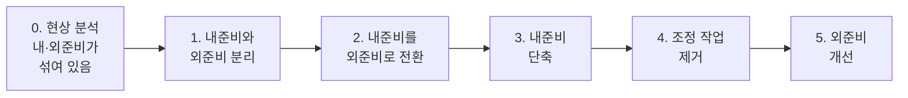

# 3.6 공정개선

!!! info "출제기준"
    **3. 공정관리** › **6. 공정개선**

## 출제 경향

총 **16문항** 출제 (1교시 단답형 5 · 2~4교시 논술형 11) · 최근 10개 회차(109~139회) 6문항 · 최근 출제 제139회

| 주제 | 출제 수 | 출제 회차 |
|---|:-:|---|
| 3.6.1 7대 낭비와 로스 | 4 | 70회, 79회, 82회, 130회 |
| 3.6.2 준비교체 시간 단축(SMED) | 7 | 67회, 82회, 91회, 97회, 109회, 130회, 139회 |
| 3.6.3 병목·라인 개선과 공정수 감축 | 5 | 68회, 79회, 136회 |

## 목차

1. [7대 낭비와 로스](#t36-1)
2. [준비교체 시간 단축(SMED)](#t36-2)
3. [병목·라인 개선과 공정수 감축](#t36-3)

## 3.6.1 7대 낭비와 로스 {#t36-1}

### TPS의 7대 낭비 (70·82·130회)

도요타 생산방식(TPS)의 오노 다이이치는 부가가치를 만들지 않고 원가만 높이는 활동을 **낭비**로 보고 일곱 가지로 정리했다.

| 낭비 | 내용 | 예 | 대책 |
|---|---|---|---|
| ① **과잉생산**의 낭비 | 필요 이상으로, 필요보다 빨리 만드는 것 | 로트 생산, 예측 생산 과다 | JIT·후공정 인수(간판), 평준화 |
| ② **대기**의 낭비 | 사람·설비가 일 없이 기다리는 것 | 자재 결품, 설비 감시, 라인 불균형 | 라인밸런싱, 다기능화, 자働化 |
| ③ **운반**의 낭비 | 불필요한 이동·옮겨 쌓기 | 공정 간 먼 거리, 임시 보관 | 흐름 배치(셀·라인), 운반 거리 단축 |
| ④ **가공 자체**의 낭비 | 필요 이상의 가공·공정 | 과잉 정밀도, 불필요한 검사·버 제거 | VE, 공정 재검토, 설계 개선 |
| ⑤ **재고**의 낭비 | 필요 이상의 원자재·재공·제품 | 공정 간 재공 적체 | 소로트화, 1개 흐름, 재고 상한 |
| ⑥ **동작**의 낭비 | 부가가치 없는 몸의 움직임 | 찾기, 허리 굽히기, 바꿔 쥐기 | 동작경제 원칙, 5S, 작업대 개선 |
| ⑦ **불량을 만드는** 낭비 | 불량·수정·재작업 | 재작업, 폐기, 선별 | 공정 내 품질 확보, 실수방지, 자働化 |

(최근에는 **인재(창의성)를 활용하지 못하는 낭비**를 더해 8대 낭비로 보기도 한다.)

### 가장 나쁜 낭비: 과잉생산 (70·82회)

1. **다른 낭비를 만들어 낸다**: 과잉생산은 재고·운반·보관·관리의 낭비를 연쇄적으로 일으킨다.
2. **문제를 감춘다**: 재고가 쌓이면 설비 고장·불량·라인 불균형 같은 문제가 드러나지 않아 개선 기회를 잃는다.
3. **자원을 미리 소비한다**: 필요 없는 자재·인력·설비 능력과 자금이 묶인다.
4. **바쁘게 일하는 것처럼 보여** 낭비로 인식하기 어렵다.

→ 대책: 필요한 것을 필요한 때 필요한 만큼만 만드는 **JIT**, 후공정이 가져가는 만큼만 만드는 **간판**, 생산 **평준화**

### 공장의 대기 로스 (79회)

| 발생 원인 | 대책 |
|---|---|
| 자재·부품 결품, 공급 지연 | JIT 공급, 물류 순회 공급, 재고 상한·하한 관리 |
| 설비 고장·준비교체 | 예방보전·TPM, 준비교체 단축 |
| 공정 간 작업량 불균형 | 라인밸런싱, 작업 재배분 |
| 작업 지시·정보 지연 | 생산계획판·MES로 지시 정보 신속 전달 |
| 품질 문제(검사 대기, 재작업) | 공정 내 품질 확보, 자주검사 |
| 기계 가공 중 작업자 감시 대기 | 자働化(이상 시 자동 정지), 다공정·다기계 담당 |

!!! tip "답안 작성 포인트"
    - 7대 낭비는 **낭비명 + 내용 + 예 + 대책** 표로 쓴다.
    - "가장 나쁜 낭비"를 물으면 반드시 **과잉생산**을 들고, 다른 낭비를 유발·은폐한다는 이유를 2~3개 쓴다.

??? example "관련 기출 4문항 (70회, 79회, 82회, 130회)"

    - **제70회(2003) 3교시 3번** · 25점  
      생산현장에서 볼수 있는 낭비(7가지)를 나열하고, 그 중에서 가장 나쁜 낭비는 무엇이며, 그 이유를 설명하시오.
    - **제79회(2006) 1교시 2번** · 10점  
      공장의 대기로스(Loss) 발생원인과 대책
    - **제82회(2007) 1교시 1번** · 10점  
      TPS(Toyota Production System)의 7대 낭비 중 과잉생산의 낭비
    - **제130회(2023) 1교시 1번** · 10점  
      TPS 7대 낭비에 대하여 설명하시오.

## 3.6.2 준비교체 시간 단축(SMED) {#t36-2}

### 준비교체 시간의 정의 (82·109·130회)

**준비교체 시간**은 앞 품목의 **마지막 양품**을 만든 때부터 다음 품목의 **첫 양품**을 만들 때까지 걸린 시간이다. 금형·지그 교체뿐 아니라 시운전과 조정 시간까지 포함한다.

- **내준비(Internal Setup)**: 설비를 **멈춰야만** 할 수 있는 작업(금형 탈착 등)
- **외준비(External Setup)**: 설비가 **가동 중에도** 할 수 있는 작업(다음 금형·공구 준비, 운반)

### 준비교체의 낭비 요소 (82회)

준비물을 찾고 옮기는 시간, 외준비로 할 수 있는 일을 설비를 세워 놓고 하는 것, 볼트를 여러 번 돌려 풀고 조이는 시간, **조정·시험 가공의 반복**(보통 준비교체 시간의 큰 비중을 차지), 작업 표준이 없어 사람마다 다른 방법, 혼자서 하는 직렬 작업

### 단축의 필요성과 효과 (109·130회)

| 필요성 | 효과 |
|---|---|
| 다품종 소량·짧은 납기 요구 | 로트 크기 축소 → 재고·재공 감소 |
| 잦은 품종 교체로 가동률 저하 | 설비 가동률(시간가동률) 향상 |
| 대로트 생산으로 리드타임 증가 | 리드타임 단축, 수요 변화에 신속 대응 |
| JIT·평준화 생산의 전제 조건 | 혼류 생산 가능, 초품 불량 감소 |

### 준비교체 개선 단계: SMED (91·97·109·130회)

**SMED(Single Minute Exchange of Die)**는 시게오 신고(新郷重夫)가 체계화한 기법으로, 준비교체를 **10분 미만(한 자릿수 분)**으로 줄이는 것을 목표로 한다.

| 단계 | 개선 방법 |
|---|---|
| 0. 현상 분석 | 준비교체 작업을 비디오·작업 분석으로 요소별 시간 측정 |
| 1. 내·외준비 분리 | 체크리스트·준비대·사전 운반으로 외준비를 설비 정지 전에 끝냄 |
| 2. 내준비의 외준비화 | 금형 예열, 중간 지그(사전 셋업), 기능 표준화(금형 높이·클램프 위치 통일) |
| 3. 내준비 단축 | 원터치 클램프·U자 홈·퀵 커플러, 볼트 1회전 체결, 병렬 작업(2인), 표준 작업 순서 |
| 4. 조정 제거 | 기준면·위치 결정 핀·게이지 블록으로 **한 번에 맞춤**, 눈금 표시, 시험 가공 없애기 |
| 5. 외준비 개선 | 공구·금형 보관 위치 3정, 운반 대차, 준비 순서 표준화 |
| (궁극) | 준비교체 자체를 없앰 — 공용 부품·공용 금형, 원터치 교체(OTED) |

### GT와 연계한 준비시간 단축 (67회)

**그룹 테크놀로지(GT)**로 형상·가공이 비슷한 부품을 부품군으로 묶으면, ① 같은 부품군을 **연속 가공**해 준비교체 횟수를 줄이고 ② 부품군 공용 **그룹 지그**·공구를 써서 교체 범위를 줄이며 ③ 부품군 전용 **셀**을 구성해 셀 안에서는 미세 조정만으로 품목을 바꿀 수 있다. 여기에 SMED를 더하면 다품종 소량에서도 소로트 생산이 가능해진다.

### 로트 크기를 키우는 로스와 대책 (139회)

1. **특정 로스의 명칭**: **준비·조정 로스**(준비교체 로스)
2. **고객 대응 문제**: 준비교체가 길면 교체 횟수를 줄이려고 로트를 크게 하므로 → 재고 증가, 리드타임 증가, 다품종·긴급 주문에 대응하지 못함, 납기 지연, 수요 변화 시 재고 진부화
3. **핵심 전략**: **SMED로 준비교체 시간 단축** → 소로트·혼류 생산 → 생산 평준화와 짧은 리드타임 실현(JIT). 조정 작업 제거와 표준화로 교체 품질도 안정시킨다.

!!! tip "답안 작성 포인트"
    - 준비교체는 3.6에서 가장 많이 나온 주제다(7문항). **정의(마지막 양품 → 첫 양품) → 내·외준비 → 낭비 요소 → SMED 단계 그림·표 → 효과**를 한 세트로 외운다.
    - 개선 단계는 신고의 **"분리 → 전환 → 단축 → 조정 제거"** 흐름을 그림으로 그리고, 단계마다 구체적 기법을 쓴다.

??? example "관련 기출 7문항 (67회, 82회, 91회, 97회, 109회, 130회, 139회)"

    - **제67회(2002) 2교시 2번** · 25점  
      작업의 준비시간 단축의 필요성과 개선기법을 G.T와 연계하여 설명하시오.
    - **제82회(2007) 3교시 1번** · 25점  
      준비교체 시간의 정의와 준비교체의 낭비요소 및 준비교체시간 단축을 위한 대책에 관해 기술하시오.
    - **제91회(2010) 1교시 3번** · 10점  
      생산현장에서 준비교체작업은 아주 많이 발생되며 이 준비교체시간의 단축을 위한 준비작업의 단순화는 매우 중요하다. 준비교체의 개선단계를 단계별로 설명하시오.
    - **제97회(2012) 1교시 1번** · 10점  
      생산시스템의 준비교체 개선활동을 실시하는 순서에 대하여 설명하시오.
    - **제109회(2016) 2교시 5번** · 25점  
      준비교체시간의 개념, 단축의 필요성과 개선절차에 대하여 각각 설명하시오.
    - **제130회(2023) 2교시 2번** · 25점  
      다품종 소량 생산시대를 위해서는 준비교체시간 단축이 아주 중요하다. 아래 사항에 대하여 설명하시오.

        ??? quote "문제 전문"

            다품종 소량 생산시대를 위해서는 준비교체시간 단축이 아주 중요하다. 아래 사항에 대하여 설명하시오.  
            1) 준비교체시간의 개념(정의)  
            2) 준비교체시간 단축의 필요성 및 효과  
            3) 준비교체작업의 개선을 위한 순서(절차)  
            4) 준비교체작업의 개선방법  
    - **제139회(2026) 2교시 5번** · 25점  
      설비효율의 6대 로스 중 특정 로스가 발생하면 생산 로트 사이즈가 커지고, 고객 대응에 문제가 생긴다. 다음의 물음에 답하시오.

        ??? quote "문제 전문"

            설비효율의 6대 로스 중 특정 로스가 발생하면 생산 로트 사이즈가 커지고, 고객 대응에 문제가 생긴다. 다음의 물음에 답하시오.  
            1) 이 때의 특정 로스의 명칭을 쓰시오.  
            2) 고객 대응에 생기는 문제를 설명하시오.  
            3) 위의 문제 해결을 위한 핵심 전략을 설명하시오.  

## 3.6.3 병목·라인 개선과 공정수 감축 {#t36-3}

### 다품종 소량 조립 작업장의 생산성 개선 (68회)

**현상의 문제점**: 부품이 바닥에 흩어져 찾기·운반 낭비, 작업 표준 부재, 반장의 구두 지시에 의존(계획·지시 체계 부재), 다품종 소량으로 잦은 품목 교체

| 영역 | 개선 방법 |
|---|---|
| 현장 정비 | 5S·3정 — 부품 선반·용기, 위치·품번 표시, 바닥 정리 |
| 작업장 배치 | 작업대를 셀·U자형으로 재배치, 부품을 손이 닿는 범위에 배치(동작경제) |
| 자재 공급 | 품목별 키트(세트) 공급, 물류 담당의 정시 공급 |
| 작업 지시 | 생산계획판·작업지시서(간판), 우선순위 가시화 |
| 표준화 | 품목별 표준작업서, 압착 조건표, 한도 견본 |
| 준비교체 | 공용 지그, 압착 금형 퀵 체인지 |
| 품질·인력 | 실수방지(Fool Proof), 다기능화, 눈으로 보는 관리 |

### 택트타임 1/2 단축을 위한 협업팀(CFT) (79회)

| 구성 부서 | 업무 분장 |
|---|---|
| 생산(현장) | 현 라인 작업 분석, 작업 개선 실행, 작업자 교육 |
| 생산기술 | 공정 재설계, 설비 자동화·고속화, 치공구 개발 |
| IE·공정관리 | 작업 측정, 라인밸런싱, 목표 인원·피치타임 산정 |
| 설계(개발) | 조립성 개선 설계(DFA), 부품 수 감축·모듈화 |
| 품질 | 공정 변경의 품질 검증, 공정 내 품질 확보 방안 |
| 구매·협력사 | 모듈 부품 공급, 협력사 공정 개선 |
| 설비보전 | 신·개조 설비의 가동률 확보, 예방보전 |
| 물류 | 라인 측 자재 공급 방식 개선(키트·순회 공급) |
| 원가·인사 | 투자 효과 분석 / 인력 재배치·교육 |

### 공정 수 감축을 위한 선행 개선 활동 (79회)

1. **공정 분석과 ECRS**: 불필요한 공정 제거, 공정 결합
2. **설계 개선(DFA)**: 부품 수 감축, 모듈화, 체결 방식 단순화
3. **복합 가공·자동화**: 여러 공정을 한 설비에서 처리
4. **검사 공정 통합**: 자주검사·공정 내 검사로 별도 검사 공정 제거
5. **운반·정체 공정 제거**: 흐름 배치(셀·라인)로 운반·보관 공정 없앰
6. **라인밸런싱과 다기능화**: 작업 재배분으로 공정 통합
7. **준비교체 단축**: 공정 전환을 줄여 공정 통합 가능

### 조립라인 생산성 향상 컨설팅 절차 (136회)

작업자 7명·7공정 라인의 문제(인원 과다, 라인밸런스 효율 저조, 생산성 저조)를 다음 절차로 해결한다.

| 단계 | 방법 |
|---|---|
| ① 현상 분석 | 공정별 작업시간 측정, **피치 다이어그램**으로 불균형 파악, 편성효율 \( E = \sum t_i / (n \times C) \) 계산, 낭비·동작 분석 |
| ② 목표 설정 | 필요 생산량으로 택트타임 산정, **목표 인원 = ⌈\( \sum t_i \) ÷ 택트타임⌉** |
| ③ 작업 개선 | ECRS, 동작경제 원칙, 치공구·실수방지 개선으로 \( \sum t_i \) 자체를 줄임 |
| ④ 라인 재편성 | 작업 요소를 택트타임에 맞게 재배분, U라인·셀화로 **소인화**(7명 → 목표 인원) |
| ⑤ 표준화 | 표준작업 3요소(택트타임·작업 순서·표준 재공) 설정, 교육 |
| ⑥ 효과 확인 | 1인당 시간당 생산량, 편성효율, 단위당 노무비 비교 |
| ⑦ 유지·확산 | 정기 점검, 다른 라인으로 확산 |

라인밸런싱 계산 방법은 [3.2.3 라인밸런싱과 라인 편성](02-process-design.md#t32-3)을 참고한다.

### 병목 공정 찾기와 OPT (136회)

**풀이**: 작업장 가용시간 = 5일 × 8시간 × 60분 = **2,400분/주**

| 작업장 | 부하 계산(수요 × 공정시간) | 주간 부하(분) | 이용률 |
|:-:|---|:-:|:-:|
| A | 60 × 30 | 1,800 | 75.0% |
| B | 80 × 5 + 100 × 15 | 1,900 | 79.2% |
| **C** | 60 × 10 + 80 × 20 + 80 × 5 | **2,600** | **108.3%** |
| D | 60 × 10 + 80 × 10 + 80 × 5 + 100 × 5 | 2,300 | 95.8% |
| E | 80 × 5 + 100 × 5 | 900 | 37.5% |

→ 부하가 가용시간을 넘는 **작업장 C가 병목**이다(주 200분 부족). 다음으로 D(95.8%)가 잠재 병목이다.

**OPT 전개 과정 3단계**

1. **병목 자원 식별**: 제품 네트워크와 부하를 분석해 능력 제약 자원을 찾음
2. **병목 공정 일정계획**: 병목의 가동을 최대화하도록 병목부터 상세 일정을 세움(드럼) — 병목 앞에 버퍼 설치
3. **비병목 공정 동기화**: 병목 일정에 맞춰 앞 공정은 후방(역산) 일정, 뒤 공정은 전방 일정으로 계획하고 자재 투입을 병목 속도에 묶음(로프)

OPT·TOC의 원칙과 DBR은 [7.4 생산혁신기술](../07-support-technology/04-production-innovation.md)에서 자세히 다룬다.

!!! tip "답안 작성 포인트"
    - 사례형 문제는 **현상 진단 → 개선 영역별 방법 표 → 기대효과**로 쓰고, 5S·표준작업·라인밸런싱·SMED 같은 기법 이름을 명시한다.
    - 병목 계산은 **작업장별 부하 = Σ(수요 × 공정시간)**을 표로 계산해 가용시간과 비교하고, 이용률이 100%를 넘는 곳을 병목으로 판정한다.

??? example "관련 기출 5문항 (68회, 79회, 136회)"

    - **제68회(2002) 3교시 6번** · 25점  
      전자제품에 사용되는 리드선에 단자를 조립하는 작업장에 여러부품이 바닥에 흩어져 있고 작업자가 반장의 지시에 따라 작업을 하고 있다. 생산형태는 다품종 소량 주문 생산이다. 이 경우에 생산성을 개선할 수 있는 방법을 설명해보시오.
    - **제79회(2006) 2교시 6번** · 25점  
      A가전사는 냉장고 조립라인의 Tack Time을 1/2로 줄이려 한다. 개선활동을 하기 위해 협업팀(CFT)을 편성하는데 어떤 관련부서로 구성하며, 이 팀원들의 업무를 분장하시오.
    - **제79회(2006) 4교시 6번** · 25점  
      제조생산성 향상을 위해서는 공정수의 감축이 주요과제이다. 공정수 감축을 위해 선행해야할 개선활동 5가지 이상을 기술하시오.
    - **제136회(2025) 4교시 4번** · 25점  
      종업원 200명 정도의 자동차부품을 제조하는 A회사가 컨설팅을 요청하였다. 컨설팅 대상라인은 작업자 7명이 7개 공정을 담당하는 조립라인이고, 라인작업을 하고 있다. 이 라인의 문제점은 ①작업자 수 많음 ②라인밸런스효율 저조 ③생산성 나쁨이다. 이 경우에 어떤 절차와 방법으로 문제점을 해결하여 생산성 향상과 원가절감을 할 것인지 설명하시오.
    - **제136회(2025) 4교시 6번** · 25점  
      병목 공정에 대한 다음 질문에 답하시오.

        ??? quote "문제 전문"

            병목 공정에 대한 다음 질문에 답하시오.  
            (1) A전자는 뱃치 프로세스 작업장 5곳에서 4가지 제품을 생산하고 있다. 작업장은 주 5일 하루 8시간 가동한다. 제품별 작업장 A, B, C, D, E의 작업시간에 따른 병목 공정을 구하시오.  
            [표] 제품 | 수요량(개/주) | 작업순서별 공정시간  
            1 | 60 | A 30분 -&gt; D 10분 -&gt; C 10분  
            2 | 80 | D 10분 -&gt; C 20분  
            3 | 80 | B 5분 -&gt; E 5분 -&gt; C 5분 -&gt; D 5분  
            4 | 100 | B 15분 -&gt; E 5분 -&gt; D 5분  
            (2) OPT(Optimized Production Technology) 전개과정 3단계를 설명하시오.  
