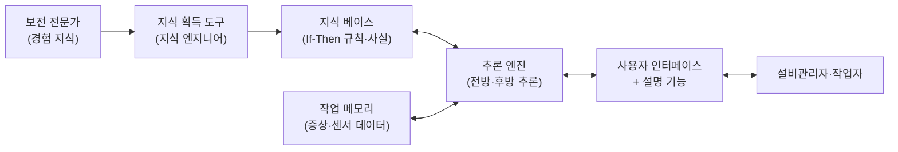

# 4.1 설비계획 및 관리

!!! info "출제기준"
    **4. 설비관리** › **1. 설비계획 및 관리**

## 출제 경향

총 **6문항** 출제 (1교시 단답형 1 · 2~4교시 논술형 5) · 최근 10개 회차(109~139회) 1문항 · 최근 출제 제115회

| 주제 | 출제 수 | 출제 회차 |
|---|:-:|---|
| 4.1.1 설비 갱신과 교체분석(MAPI) | 2 | 63회, 115회 |
| 4.1.2 설비 소요량 계획 | 1 | 106회 |
| 4.1.3 치공구 관리 | 1 | 85회 |
| 4.1.4 설비관리 시스템과 리스크 관리 | 2 | 91회, 94회 |

## 목차

1. [설비 갱신과 교체분석(MAPI)](#t41-1)
2. [설비 소요량 계획](#t41-2)
3. [치공구 관리](#t41-3)
4. [설비관리 시스템과 리스크 관리](#t41-4)

## 4.1.1 설비 갱신과 교체분석(MAPI) {#t41-1}

### 설비 갱신(교체)의 필요성

설비는 시간이 지나면서 **열화**(물리적 마모로 성능 저하·보전비 증가)와 **진부화**(더 우수한 신설비 등장으로 경제적 가치 하락)를 겪는다. 교체분석은 현 설비를 계속 쓸지, 신설비로 바꿀지를 경제성으로 판단하는 것이다.

| 설비 수명의 종류 | 의미 |
|---|---|
| 물리적 수명 | 마모·파손으로 더 이상 사용할 수 없을 때까지의 기간 |
| 기능적 수명 | 제품·공정 변화나 신기술로 기능이 맞지 않게 될 때까지의 기간(진부화) |
| **경제적 수명** | 연평균비용(자본회수비 + 운영·보전비)이 **최소**가 되는 사용 기간 — 교체 시기 판단의 기준 |

| 설비 갱신의 유형 | 내용 |
|---|---|
| 교체(Replacement) | 같은 기능의 신설비로 바꿈(동종 교체·개량 교체) |
| 개조·현대화(Modernization) | 핵심 부위만 개량해 성능·수명 연장(레트로핏) |
| 증설·확장 | 능력 부족에 대응해 설비 추가 |
| 폐기 | 대체 없이 기능을 없애거나 외주로 전환 |

!!! note "교체분석의 기본 원칙"
    - 현 설비의 **취득원가·장부가는 매몰원가**이므로 고려하지 않고, 현재의 **처분가치(시장가치)**를 현 설비의 투자액으로 본다([6.1.4](../06-cost-engineering-economy/01-feasibility.md#t61-4)).
    - 두 대안의 **차이가 나는 현금흐름**만 비교하고, 화폐의 시간가치(이자)를 반영한다([6.1.1](../06-cost-engineering-economy/01-feasibility.md#t61-1)).
    - 수명이 다른 대안은 **연간 등가(EAC)**로 맞추어 비교한다.

| 교체분석 기법 | 내용 |
|---|---|
| 원가비교법 | 현 설비와 신설비의 연간 총비용을 비교 |
| 연평균비용법(EAC) | 자본회수비 + 운영비를 연간 등가로 환산해 비교, 경제적 수명 결정 |
| 현가법·수익률법 | 교체로 인한 현금흐름의 순현재가치·수익률 계산 |
| **MAPI 방식** | 미국 기계·관련제품협회(MAPI)의 Terborgh가 개발한 교체 분석 방식 — 구 MAPI(1949), 신 MAPI(1958) |

### 구 MAPI 방식 (115회)

**개념**: 현 설비를 1년 더 사용할 때의 **차년도 불리액**(Next-year adverse minimum)과, 신설비의 **연간 불리액**(Adverse minimum: 자본비용)을 비교해, 현 설비의 불리액이 더 크면 교체하는 방식이다. 신설비의 연간 불리액은 내용연수와 잔존가치율(\( \alpha \))로 정해진 **MAPI 계수**를 투자액에 곱해 구한다.

**절차**

1. 신설비의 투자액, 내용연수(\( n \)), 잔존가치율(\( \alpha = \) 잔존가치 ÷ 투자액) 결정
2. MAPI 차트(표)에서 **MAPI 계수** 확인 → 신설비 연간 불리액 = 투자액 × MAPI 계수
3. 현 설비의 차년도 불리액 계산 = **운전 열위**(신설비 대비 추가 운영·보전비) + **1년간 처분가치 감소액** + **현 처분가치에 대한 이자**
4. 비교: 현 설비 차년도 불리액 > 신설비 연간 불리액이면 **교체**

### 풀이: 115회 (정밀화법)

- 신설비 잔존가치율 \( \alpha = 800 \div 2{,}000 = 40\% \) → 구 MAPI 계수 **15%**
- 신설비 연간 불리액 = 2,000만 원 × 15% = **300만 원**
- 현 설비 차년도 불리액

| 항목 | 계산 | 금액 |
|---|---|:-:|
| 운전 열위(유지보전비 추가분) | 신형 교체 시 절감액 | 300만 원 |
| 1년간 처분가치 감소 | 300 − 150 | 150만 원 |
| 현 처분가치의 이자 | 300 × 10% | 30만 원 |
| **합계** | | **480만 원** |

→ 현 설비의 차년도 불리액(480만 원) > 신설비 연간 불리액(300만 원)이므로 **교체가 유리**하다.

### 신 MAPI 방식의 긴급률 (63회)

신 MAPI 방식은 교체 투자의 **세후 수익률**인 **긴급률(Urgency Rating)**을 구해 기업의 최저 요구수익률과 비교한다.

\[
\text{긴급률}\,(\%) = \frac{\text{차년도 운영이익 증가} + \text{차년도 자본소비 회피} - \text{차년도 신설비 자본소비} - \text{소득세 증가}}{\text{순투자액}} \times 100
\]

| 계산 요소 | 내용 |
|---|---|
| ① 순투자액 | 신설비 설치 비용 − 현 설비 처분가치 − 교체로 회피되는 현 설비의 대수리비 |
| ② 차년도 운영이익 증가 | 교체로 인한 다음 해의 수익 증가 + 운영비(노무·보전·불량·에너지) 절감 |
| ③ 차년도 자본소비 회피 | 현 설비를 1년 더 쓸 때 생기는 처분가치 감소와 대수리비를 피하는 금액 |
| ④ 차년도 신설비 자본소비 | 신설비 1년 사용에 따른 가치 감소 — MAPI 차트(내용연수·잔존가치·감가상각 방법)로 산정 |
| ⑤ 소득세 증가 | 이익 증가에 따른 세금 증가분 |

긴급률이 높을수록 교체가 시급하며, 여러 투자안의 우선순위를 정하는 데도 쓴다.

| 비교 | 구 MAPI(1949) | 신 MAPI(1958) |
|---|---|---|
| 판단 기준 | 현 설비 차년도 불리액 vs 신설비 연간 불리액(금액 비교) | 긴급률(세후 수익률) vs 최저 요구수익률 |
| 세금 고려 | 하지 않음 | 소득세 반영 |
| 용도 | 단일 교체안의 교체 여부 | 여러 투자안의 우선순위 결정 |
| 공통 특징 | 차년도(1년) 기준 비교, MAPI 차트 사용 | |

**한계와 보완**: MAPI는 차년도만 보는 단기 판단이므로, 실무에서는 NPV·EAC 분석과 함께 쓰고 생산성·품질·안전·에너지 효율 같은 비재무 효과와 설비 상태 데이터(예지보전·OEE)를 함께 고려한다.

!!! tip "답안 작성 포인트"
    - 구 MAPI는 **"현 설비의 차년도 불리액 vs 신설비의 연간 불리액"** 비교라는 핵심 원리를 먼저 쓰고, 불리액 구성 항목을 표로 계산한다.
    - 신 MAPI는 **긴급률 공식과 5가지 계산 요소**를 표로 정리하고, 판단 기준(최저 요구수익률)을 쓴다.
    - MAPI 계수 선택 시 잔존가치율 \( \alpha \)를 먼저 계산하는 과정을 보여 준다.
    - 개요에 **열화·진부화와 경제적 수명**, 본론 서두에 **매몰원가 무시 원칙**을 쓰면 원리 이해를 보여 줄 수 있다.
    - 결론 예: "MAPI는 차년도 기준의 간편법이므로 NPV·LCC 분석과 병행하고, OEE·고장 이력 데이터에 근거한 교체 시점 관리로 설비 투자의 적시성을 확보해야 한다."

??? example "관련 기출 2문항 (63회, 115회)"

    - **제63회(2001) 2교시 3번** · 25점  
      신 MAPI방식에 의한 설비갱신시 긴급률(Urgency rating)을 구하는데 필요한 계산 요소를 설명하시오.
    - **제115회(2018) 2교시 1번** · 25점  
      교체분석 기법 중 구MAPI 방식에 대하여 다음 물음에 답하시오.

        ??? quote "문제 전문"

            교체분석 기법 중 구MAPI 방식에 대하여 다음 물음에 답하시오.  
            1) 구MAPI 방식의 개념에 대하여 설명하시오.  
            2) 구MAPI 방식의 절차에 대하여 설명하시오.  
            3) 5년간 사용한 승용차를 신형으로 교체하려고 한다. 다음과 같은 자료가 있을 때 정밀화법에 의거, 교체여부를 판단하시오.  
            ○ 신형승용차의 구매가격은 2,000만원이며, 5년 후의 잔가는 800만원으로 예상  
            ○ 현재 사용 중인 승용차의 처분가격은 300만원이고, 1년 후의 처분가격은 150만원으로 예상  
            ○ 신형차로 교체하는 경우 유지보전비의 연간 절감액은 300만원으로 추정  
            ○ 연이자율 10%  
            ○ n=5이며, α=30%일 때 구MAPI 계수는 18%, α=40%일 때 구MAPI 계수는 15%  

## 4.1.2 설비 소요량 계획 {#t41-2}

**설비 소요량 계획**은 목표 생산량을 달성하는 데 필요한 공정별 설비 대수를 표준시간·가용시간·효율·불량률로 산정하는 것이다. 장기 생산능력 계획([3.1.3](../03-process-control/01-production-planning.md#t31-3))을 공정·설비 단위로 구체화하는 단계이며, 과소하면 납기 지연, 과다하면 유휴 투자가 된다.

### 필요 설비 대수의 계산

\[
\text{필요 설비 대수} = \frac{\text{필요 생산량} \times \text{단위당 표준작업시간}}{\text{설비당 가용시간} \times \text{효율} \times \text{신뢰도(가동률)}}
\]

결과는 반드시 **올림**한다. 불량이 있으면 필요 생산량에 불량을 감안한 투입량을 쓴다.

| 분모 요소 | 반영 내용 |
|---|---|
| 가용시간 | 근무일 × 교대 × 근무시간 − 계획 정지(휴식·계획보전) |
| 효율 | 작업자·설비의 성능 효율(속도 저하·순간 정지) |
| 신뢰도(가동률) | 고장·준비교체 등에 의한 정지 손실 — OEE의 시간가동률 개념([3.5.3](../03-process-control/05-maintenance.md#t35-3)) |

**불량을 감안한 투입량**: 공정별 양품률을 \( (1 - p_i) \)라 하면

\[
\text{투입량} = \frac{\text{목표 양품 수}}{\prod (1 - p_i)}
\]

### 풀이: 106회

**(1) 기계 대수** — 주당 가용시간 = 5일 × 8시간 × 60분 = 2,400분

| 공정 | 계산 | 결과 | 기계 대수 |
|---|---|:-:|:-:|
| 공정 1 | \( \dfrac{2{,}000 \times 4}{2{,}400 \times 0.93 \times 0.95} \) | 3.77 | **4대** |
| 공정 2 | \( \dfrac{2{,}000 \times 5}{2{,}400 \times 0.95 \times 0.90} \) | 4.87 | **5대** |

**(2) 원자재 투입량**

\[
\frac{1{,}000}{(1 - 0.05)(1 - 0.03)} = \frac{1{,}000}{0.9215} = 1{,}085.2 \rightarrow \mathbf{1{,}086\text{개}}
\]

**(3) 공정 간 검사의 경제성** (공정 1 산출 1개 기준)

- 검사를 하지 않으면 공정 1의 불량품(5%)도 공정 2에서 가공되고 완성품 검사까지 받는다 → 낭비 비용 = 0.05 × (2,000 + 100) = **105원**
- 공정 간 검사 비용 = **80원**

→ 검사로 피할 수 있는 비용(105원)이 검사 비용(80원)보다 크므로 **공정 간 검사를 하는 것이 유리**하다. (완성품 검사비를 빼고 공정 2 가공비만 비교해도 100원 > 80원으로 결론은 같다.)

### 설비 선정 시 고려 사항

생산능력(필요 대수), 가공 정밀도·품질, 경제성(투자비·운영비·수명주기비용 LCC), 신뢰성·보전성, 유연성·확장성, 안전·환경, 공급자의 기술 지원과 부품 조달, 기존 설비와의 호환성

**검사 위치 결정의 일반 원칙**: 가공비가 큰 공정 **직전**, 되돌릴 수 없는 공정(조립·도장·열처리) 직전, 불량률이 높은 공정 직후, 고객 인도 전에 검사를 둔다. 최근에는 공정 내 자동 검사(인라인 비전)와 SPC로 검사 자체를 줄이는 방향이다.

!!! tip "답안 작성 포인트"
    - 설비 대수 계산은 **공식 → 대입 → 소수 결과 → 올림**의 과정을 모두 보여 준다.
    - 검사 경제성 문제는 "검사 비용 vs 검사로 회피하는 비용(불량 × 후공정 비용)"의 비교 원리를 서두에 쓴다.
    - 결론 예: "계산된 대수는 최소 소요량이므로 수요 변동·병목 공정을 감안한 여유 능력과 OEE 향상 목표를 함께 검토해 투자 규모를 확정한다."

??? example "관련 기출 1문항 (106회)"

    - **제106회(2015) 3교시 3번** · 25점  
      공정 설비계획과 관련한 다음 각 물음에 답하시오.

        ??? quote "문제 전문"

            공정 설비계획과 관련한 다음 각 물음에 답하시오.  
            (1) 1일 8시간, 1주 5일간 작업하여 주당 2000개의 제품을 생산하려 한다. 표를 참고하여 생산목표를 달성하기 위해 필요한 공정 1과 공정 2의 기계대수를 각각 구하시오.  
            [표] 구분 | 표준작업시간 | 효율 | 신뢰도  
            공정 1 | 4분 | 93% | 95%  
            공정 2 | 5분 | 95% | 90%  
            (2) 제품 A는 공정 1과 공정 2를 거쳐 생산되며, 공정 1의 불량률은 5%, 공정 2의 불량률은 3%이다. 1000개의 양품 생산을 목표로 할 때 공정 1에 대한 원자재 투입량을 구하시오.  
            (3) 제품 A에 대한 공정 1의 공정비용은 개당 1000원, 공정 2의 공정비용은 개당 2000원이다. 공정 2를 거친 완성품은 전수검사를 하며, 완성품 검사비용은 개당 100원이다. 공정 1과 공정 2 사이의 공정간 검사비용이 개당 80원인 경우, 공정간 검사를 실시하는 것이 경제적 측면에서 유리한지 판단하시오.  

## 4.1.3 치공구 관리 {#t41-3}

### 치공구 관리의 목적 (85회)

**치공구**는 가공·조립·검사에 쓰는 지그(Jig)·고정구(Fixture)·절삭공구·금형·게이지를 말한다. 치공구 관리는 이들을 계획·설계·조달·보관·사용·보수·폐기까지 체계적으로 관리하는 활동이다.

**목적**

1. **품질 안정**: 정밀도가 유지된 치공구로 가공 품질의 균일화
2. **생산성 향상**: 가공·조립 시간과 준비교체 시간 단축
3. **원가 절감**: 공구 수명 관리, 재연삭·재생, 적정 재고로 공구비 절감
4. **표준화**: 치공구 규격·사용 방법 표준화로 숙련 의존도 감소
5. **가용성 확보**: 필요할 때 바로 쓸 수 있도록 보관·대출 체계 확립(분실·결품 방지)
6. **안전 확보**: 파손·마모된 치공구 사용에 의한 사고 예방

**관리 내용**: 치공구 계획·설계 → 구입·제작 → 검수·등록(코드화) → 보관(3정)·대출 → 사용 중 정도 점검 → 수명 관리·재연삭 → 폐기, 전 과정의 이력 관리

| 구분 | 지그(Jig) | 고정구(Fixture) |
|---|---|---|
| 기능 | 공작물 고정 + **공구 안내**(드릴 부시 등) | 공작물의 **위치 결정·고정**만 담당 |
| 주 용도 | 드릴링·리밍 | 밀링·선삭·용접·조립·검사 |

**공구 수명 관리**: Taylor의 공구 수명식 \( V T^n = C \)(V: 절삭 속도, T: 공구 수명, n·C: 상수)으로 절삭 조건과 교환 주기를 정한다. 교환 방식은 고장(파손) 후 교환, 정기 교환, 사용 횟수·가공 수량 기준 교환이 있다.

**최근 경향**: RFID·바코드로 공구 개체 식별, 공구 프리세터 데이터의 CNC 자동 전송, 공구 자판기(무인 불출)와 사용량 분석, 공구 마모의 센서 기반 예측 교환. 준비교체 시간 단축([3.6.2 SMED](../03-process-control/06-process-improvement.md#t36-2))과도 직결된다.

!!! tip "답안 작성 포인트"
    - 10점 단답형은 **치공구의 정의 → 목적 5~6가지 → 관리 사이클**로 쓴다. 목적은 품질·생산성·원가·안전 관점으로 나누면 빠짐이 없다.
    - 마지막 줄에 RFID 기반 공구 이력 관리나 SMED와의 연계를 쓰면 차별화된다.

??? example "관련 기출 1문항 (85회)"

    - **제85회(2008) 1교시 12번** · 10점  
      치공구관리의 목적을 기술하시오.

## 4.1.4 설비관리 시스템과 리스크 관리 {#t41-4}

### 설비관리와 전문가 시스템 (91회)

**전문가 시스템(Expert System)**은 특정 분야 전문가의 지식을 **지식 베이스**에 저장하고, **추론 엔진**으로 문제를 진단·해결하는 인공지능 시스템이다. 구성: 지식 베이스(규칙·사실), 추론 엔진, 사용자 인터페이스, 설명 기능, 지식 획득 도구

| 비교 | 일반 프로그램 | 전문가 시스템 |
|---|---|---|
| 처리 대상 | 데이터·알고리즘(수치 계산) | 지식·규칙(기호 추론) |
| 구조 | 지식과 처리 절차가 섞여 있음 | 지식 베이스와 추론 엔진이 **분리** → 지식만 추가·수정 가능 |
| 불완전 정보 | 처리 곤란 | 확신도(Certainty Factor) 등으로 추론 |
| 설명 | 결과만 제시 | 추론 근거(Why·How)를 설명 |

**(1) 설비관리자와 전문가 시스템의 적용**: 숙련 보전 전문가의 경험적 지식(고장 증상 → 원인 → 조치)을 시스템화해, 경험이 적은 관리자·작업자도 **고장 진단·보전 의사결정**을 빠르고 일관되게 할 수 있게 한다. 숙련자 퇴직에 따른 노하우 단절을 막는 효과도 있다.

**(2) 개발과 응용 실태**: 1980~90년대에는 규칙(If-Then) 기반 진단 시스템이 발전소·철도·화학 공정 등 고가 설비의 고장 진단에 주로 쓰였다. 지식 획득의 어려움과 유지보수 부담이 한계였으며, 최근에는 센서 데이터와 머신러닝을 결합한 **예지보전·AI 진단 시스템**으로 발전하고 있다.

**(3) 설비관리용 전문가 시스템의 예**

| 유형 | 내용 |
|---|---|
| 고장 진단 시스템 | 증상을 입력하면 원인과 조치를 추론(예: GE의 디젤 기관차 고장 진단 시스템 DELTA/CATS-1) |
| 상태 감시·진단 시스템 | 진동·온도 등 센서 데이터로 이상을 판정(예: 발전 설비 진단 시스템) |
| 보전 계획 지원 시스템 | 설비 중요도·고장 이력으로 보전 방식과 주기 결정 |
| 공정 이상 진단 시스템 | 공정 변수 이상의 원인 추론(예: 화학 공정 진단 시스템) |

**발전 방향**: 규칙 기반 전문가 시스템 → 사례 기반 추론(CBR) → 센서·IoT 데이터와 머신러닝을 결합한 **예지보전(PdM)·AI 진단** → 생성형 AI가 보전 매뉴얼·고장 이력을 검색해 조치를 안내하는 **보전 지원 에이전트**. CMMS·EAM과 연계해 진단 결과가 작업 지시로 바로 이어지게 한다([3.5.1](../03-process-control/05-maintenance.md#t35-1), [7.1.4](../07-support-technology/01-it-smart-factory.md#t71-4)).

### 설비·공법 설계 단계의 리스크 관리 (94회)

설비·공법을 설계하는 단계에서 고장·안전·품질 리스크를 미리 찾아 줄이는 활동이다.

- **정의**: 설비·공법 설계에서 목표(성능·안전·품질·일정·비용)에 영향을 줄 수 있는 불확실성을 식별·분석·평가하고 대응하는 체계적 관리
- **절차**: 상황 설정 → 리스크 식별(설계 FMEA, HAZOP, 설계 검토) → 분석(발생 가능성 × 영향) → 평가(우선순위) → 대응 → 모니터링
- **전통적 처리 기술 4T**: 회피(Terminate), 감소(Treat), 전가(Transfer), 보유(Tolerate)

리스크 관리 절차와 4T의 자세한 내용은 [1.5.5 리스크 관리](../01-production-strategy/05-business-environment.md#t15-5)를 참고한다. 설비 설계에서는 특히 **보전예방(MP) 설계, FMEA, 안전 설계(Fail Safe·Fool Proof)**가 주요 감소 수단이다.

| 4T | 의미 | 설비·공법 설계 적용 예 |
|---|---|---|
| 회피(Terminate) | 리스크 원인이 되는 활동·설계를 없앰 | 검증되지 않은 신공법 채택 보류, 위험물 공정 제거 |
| 감소(Treat) | 발생 가능성·영향을 낮춤 | 설계 FMEA 반영, 이중화, Fail Safe, MP 설계, 시운전 검증 |
| 전가(Transfer) | 제3자에게 넘김 | 보험, 설비 공급자 성능 보증·턴키 계약 |
| 보유(Tolerate) | 영향이 작아 수용하고 감시 | 잔류 리스크의 비상 대응 계획·예비품 확보 |

**리스크 평가 매트릭스**: 발생 가능성(1~5) × 영향도(1~5)로 등급을 매기고, 고위험(빨강)은 설계 변경, 중위험은 감소 대책, 저위험은 보유·감시로 대응한다. FMEA에서는 RPN(심각도 × 발생도 × 검출도)을 쓴다([5.4.8](../05-work-measurement/04-quality-management.md#t54-8)).

!!! tip "답안 작성 포인트"
    - 전문가 시스템은 **구성 요소 그림(지식 베이스·추론 엔진·인터페이스)**을 먼저 그리고, 설비관리에 적용하는 이유(숙련 지식의 공유·보존)를 강조한다.
    - 리스크 관리 문제는 1.5.5의 일반 틀에 **설비 설계 특유의 기법(설계 FMEA·HAZOP·MP 설계)**을 더해 차별화한다.
    - 결론 예(91회): "규칙 기반 전문가 시스템은 IoT·AI 기반 예지보전으로 진화하고 있으며, 숙련자 노하우를 지식 베이스로 축적하는 체계가 스마트 보전의 출발점이다."
    - 결론 예(94회): "설계 단계 리스크는 변경 비용이 가장 낮을 때 제거할 수 있으므로, 설계 검토(DR)마다 FMEA·HAZOP을 의무화하고 리스크 등록부로 시운전까지 추적해야 한다."

??? example "관련 기출 2문항 (91회, 94회)"

    - **제91회(2010) 2교시 3번** · 25점  
      설비관리와 전문가 시스템에 관한 다음 각 물음에 답하시오.

        ??? quote "문제 전문"

            설비관리와 전문가 시스템에 관한 다음 각 물음에 답하시오.  
            (1) 설비관리자와 전문가 시스템의 적용에 대하여 쓰시오.  
            (2) 설비용 전문가시스템의 개발과 응용범위실태를 설명하시오.  
            (3) 설비관리를 위하여 특별히 개발된 전문가시스템 4가지를 제시하시오.  
            (단, 의료 및 군사용은 제외한다.)  
    - **제94회(2011) 4교시 4번** · 25점  
      설비 및 공법 설계 단계에서의 Risk Management에 대한 정의, 절차, 전통적인 처리기술(4T)에 대하여 설명하시오.

## 답안 작성 예시

!!! example "25점 예시: 제115회 2교시 1번 — 구MAPI 방식의 개념·절차와 승용차 교체 판단"

    **1. 개요**

    - 설비는 열화·진부화로 경제적 수명이 다하므로 교체 시점의 경제성 판단이 필요하다.
    - MAPI 방식은 미국 기계·관련제품협회(MAPI)의 Terborgh가 제시한 교체분석 기법(구 MAPI 1949)이다.

    **2. 본론**

    - (1) 개념: "현 설비 차년도 불리액 vs 신설비 연간 불리액" 비교, 불리액 정의와 MAPI 계수(\( n \)·\( \alpha \)로 결정)
    - (2) 절차: 4단계 번호 목록 — 신설비 조건 결정 → MAPI 계수 → 현 설비 불리액 → 비교·판단
    - (3) 계산: \( \alpha = 800 \div 2{,}000 = 40\% \) → 계수 15% → 신설비 300만 원
        - [표] 현 설비 차년도 불리액 = 운전 열위 300 + 처분가치 감소 150 + 이자 30 = 480만 원
        - 판정: 480 > 300 → 교체 유리
    - (4) [표] 구 MAPI vs 신 MAPI 비교(판단 기준·세금·용도)

    **3. 결론(기술사 의견)**

    - 현 설비 장부가는 매몰원가로 제외했음을 명시(원리 이해 차별화).
    - MAPI는 1년 기준 간편법이므로 NPV·EAC·LCC 분석과 병행하고, 안전·품질·에너지 효율 같은 비재무 효과와 OEE·고장 이력 데이터를 함께 반영해 교체 시점을 결정해야 한다.

!!! example "25점 예시: 제94회 4교시 4번 — 설비·공법 설계 단계의 Risk Management(정의·절차·4T)"

    **1. 개요**

    - 설비 수명주기 비용과 안전성의 대부분은 설계 단계에서 결정되므로, 이 단계의 리스크 관리가 가장 효과적이다(ISO 31000의 리스크 관리 틀 적용).

    **2. 본론**

    - (1) 정의: 성능·안전·품질·일정·비용 목표에 영향을 주는 불확실성의 식별·분석·평가·대응
    - (2) 절차: [그림] 상황 설정 → 식별 → 분석 → 평가 → 대응 → 모니터링(의사소통·협의가 전 단계에 걸침)
        - 식별 기법: 설계 FMEA, HAZOP, 설계 검토(DR), 체크리스트
        - [표] 발생 가능성 × 영향도 리스크 매트릭스
    - (3) [표] 4T(회피·감소·전가·보유)별 의미와 설비·공법 적용 예
    - (4) 설비 특유 감소 수단: MP 설계, Fail Safe·Fool Proof, 이중화, 시운전 검증

    **3. 결론(기술사 의견)**

    - 리스크 등록부로 설계 → 제작 → 시운전 → 양산까지 추적하고, 보전 이력을 MP 정보로 다음 설계에 환류하는 체계를 제언한다.
    - 공급망 리스크(핵심 부품 단일 공급원)와 사이버 보안까지 범위를 넓히는 것이 최근 경향이다.
