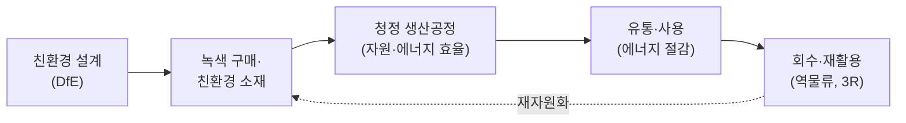

# 4.3 환경관리 및 안전관리

!!! info "출제기준"
    **4. 설비관리** › **3. 환경관리 및 안전관리**

## 출제 경향

총 **9문항** 출제 (1교시 단답형 8 · 2~4교시 논술형 1) · 최근 10개 회차(109~139회) 3문항 · 최근 출제 제130회

| 주제 | 출제 수 | 출제 회차 |
|---|:-:|---|
| 4.3.1 환경친화 생산과 친환경 설계 | 5 | 63회, 70회, 94회, 100회, 103회 |
| 4.3.2 환경·안전보건경영시스템(ISO 14001·45001) | 2 | 121회, 130회 |
| 4.3.3 설비 안전설계(Fool Proof·Interlock·위험점) | 2 | 106회, 115회 |

## 목차

1. [환경친화 생산과 친환경 설계](#t43-1)
2. [환경·안전보건경영시스템(ISO 14001·45001)](#t43-2)
3. [설비 안전설계(Fool Proof·Interlock·위험점)](#t43-3)

## 4.3.1 환경친화 생산과 친환경 설계 {#t43-1}

### 환경친화 생산의 개념과 체계 (70·94회)

**환경친화 생산(ECM, Environmentally Conscious Manufacturing)**은 제품의 **전 생애(원료 → 생산 → 유통·사용 → 폐기·회수)**에서 자원·에너지 사용과 오염 배출을 최소화하면서 경제성을 함께 확보하는 생산 방식이다. 오염이 생긴 뒤 처리하는 **사후처리(End-of-pipe)** 방식에서, 발생 자체를 막는 **청정생산(Cleaner Production)** 방식으로의 전환이 핵심이다.

| 체계 요소 | 내용 |
|---|---|
| 설계 | 친환경 설계(DfE), 유해물질 배제, 분해·재활용 쉬운 구조 |
| 조달 | 녹색 구매, 공급망 유해물질 관리 |
| 생산 | 청정생산, 공정 내 재활용, 에너지 효율화, 폐기물·배출 저감 |
| 유통·사용 | 포장 축소, 저에너지 제품, 장수명 |
| 회수·재활용 | 3R(감량 Reduce·재사용 Reuse·재활용 Recycle), 생산자 책임 재활용(EPR) |
| 관리 체계 | ISO 14001, 전과정평가(LCA), 환경회계, 탄소발자국 |

### 전과정평가(LCA, Life Cycle Assessment) (63회)

**정의**: 제품의 **원료 채취부터 생산·유통·사용·폐기까지(요람에서 무덤까지)** 전 과정에서 투입되는 자원·에너지와 배출물을 정량화하고 그 환경 영향을 평가하는 기법이다(ISO 14040·14044).

**4단계**: ① 목적 및 범위 정의 → ② 전과정 목록 분석(LCI: 투입·배출 데이터 수집) → ③ 전과정 영향 평가(LCIA: 지구온난화·산성화 등 영향 범주별 평가) → ④ 결과 해석(개선 기회 도출)

**활용**: 친환경 제품 개발·개선, 환경성적표지·탄소발자국 인증, 공급망 환경 관리, 정책 수립

### RoHS (100회)

**정의**: EU의 **전기·전자제품 유해물질 사용 제한 지침**(Restriction of Hazardous Substances). 2003년 제정, 2006년 7월 시행되었다.

| 구분 | 제한 물질 |
|---|---|
| 최초 6종 | 납(Pb), 수은(Hg), 카드뮴(Cd), 6가 크롬(Cr⁶⁺), 폴리브롬화비페닐(PBB), 폴리브롬화디페닐에테르(PBDE) |
| 추가 4종(2019년 적용) | 프탈레이트류 DEHP, BBP, DBP, DIBP |

- 허용 기준: 균질 물질 기준 0.1%(카드뮴은 0.01%) 이하
- 기업 대응: 공급망 함유 물질 조사·관리, 대체 물질 적용(무연 솔더 등), 성분 분석과 적합성 문서, 관련 규제(WEEE·REACH)와 통합 관리

### 친환경 설계(DfE, Design for Environment) (103회)

**개념**: 제품 설계 단계에서 전 생애의 환경 영향을 미리 고려해 줄이는 설계다. 환경 영향의 대부분이 설계 단계에서 결정되기 때문이다.

**특징·설계 지침**

1. 친환경·재활용 가능 소재 선택, 유해물질 배제
2. 부품 수·소재 종류 축소, **분해 용이 설계(DfD)**
3. 사용 단계의 에너지 효율 향상
4. 장수명·수리 용이 설계
5. 재활용 표시, 포장재 축소
6. LCA로 설계안의 환경성 비교

!!! tip "답안 작성 포인트"
    - 환경친화 생산은 **전 생애 흐름 그림 + 단계별 요소 표**로 체계를 보여 주고, 사후처리 → 청정생산으로의 패러다임 전환을 강조한다.
    - 단답형(LCA·RoHS·DfE)은 **정의(근거 표준·연도) → 구성·단계 → 활용·대응**으로 쓴다.

??? example "관련 기출 5문항 (63회, 70회, 94회, 100회, 103회)"

    - **제63회(2001) 1교시 1번** · 10점  
      LCA
    - **제70회(2003) 1교시 3번** · 10점  
      환경친화적 생산
    - **제94회(2011) 3교시 3번** · 25점  
      환경친화생산(Environmentally conscious manufacturing)의 개념과 체계에 대하여 설명하시오.
    - **제100회(2013) 1교시 1번** · 10점  
      RoHS(Restriction of the use of Hazardous Substances in EEE)
    - **제103회(2014) 1교시 7번** · 10점  
      친환경설계(Design for environment: DFE)의 개념과 특징에 대하여 설명하시오.

## 4.3.2 환경·안전보건경영시스템(ISO 14001·45001) {#t43-2}

### ISO 14001:2015 환경경영시스템 (121회)

**개념**: 조직이 환경 성과를 체계적으로 관리·개선하기 위한 국제 표준 경영시스템이다. **PDCA 사이클**과 2015년 개정 때 도입된 **공통 상위 구조(HLS)** 10개 조항으로 구성된다.

| 조항 | 내용 | PDCA |
|:-:|---|:-:|
| 1~3 | 적용 범위, 인용 표준, 용어와 정의 | – |
| 4 | **조직의 상황**: 내·외부 이슈, 이해관계자 요구, 적용 범위 | P |
| 5 | **리더십**: 최고경영자 책임, 환경방침, 역할·책임 | P |
| 6 | **기획**: 리스크와 기회, 환경측면, 준수 의무, 환경목표 | P |
| 7 | **지원**: 자원, 역량, 인식, 의사소통, 문서화된 정보 | D |
| 8 | **운용**: 운용 계획·관리(전과정 관점), 비상사태 대비·대응 | D |
| 9 | **성과 평가**: 모니터링·측정, 준수 평가, 내부 심사, 경영 검토 | C |
| 10 | **개선**: 부적합·시정조치, 지속적 개선 | A |

**2015년 개정의 주요 내용**: HLS 도입(다른 경영시스템과 통합 용이), 조직 상황·이해관계자 고려, 리더십 강화, 리스크 기반 사고, **전과정 관점**, 준수 의무 강화, 환경 성과 중시

### ISO 45001 안전보건경영시스템 (130회)

**개념**: 산업재해와 직업병을 예방하고 안전하고 건강한 작업장을 만들기 위한 국제 표준(2018년 제정)으로, 기존 OHSAS 18001을 대체했다. ISO 14001과 같은 HLS 10개 조항 구조다.

**핵심 요구사항**

1. **최고경영자의 리더십**과 안전보건 방침
2. **근로자의 참여와 협의**(비관리직 근로자 참여 강조)
3. **유해·위험요인 파악과 위험성 평가**, 리스크와 기회 관리
4. 법규 및 기타 요구사항 준수
5. 위험 제거·감소의 **관리 단계**(제거 → 대체 → 공학적 대책 → 관리적 대책 → 개인보호구)
6. 변경 관리, 조달·**협력업체(도급) 관리**
7. 비상 대비·대응, 사고 조사와 시정조치, 성과 평가와 지속적 개선

**도입 효과**: 재해 감소, 법규 준수(중대재해처벌법 대응 체계), 안전 문화 정착, 대외 신뢰도 향상, ISO 9001·14001과 통합 운영

!!! tip "답안 작성 포인트"
    - ISO 경영시스템은 **HLS 10개 조항 표에 PDCA를 대응**시키는 것이 핵심이다. 14001과 45001은 같은 틀로 쓰고 고유 요소(환경측면·전과정 관점 / 근로자 참여·위험성 평가)를 강조한다.

??? example "관련 기출 2문항 (121회, 130회)"

    - **제121회(2020) 1교시 4번** · 10점  
      ISO 14001:2015 구성과 내용
    - **제130회(2023) 1교시 11번** · 10점  
      ISO 45001 시스템에 대하여 설명하시오.

## 4.3.3 설비 안전설계(Fool Proof·Interlock·위험점) {#t43-3}

### 기계설비의 위험점 6가지 (115회)

| 위험점 | 형성 위치 | 예 |
|---|---|---|
| **협착점** | 왕복 운동하는 부분과 고정 부분 사이 | 프레스 금형, 전단기, 성형기 |
| **끼임점** | 회전 운동하는 부분과 고정 부분 사이 | 연삭숫돌과 작업대, 회전 풀리와 베드 |
| **절단점** | 회전하는 운동 부분 자체(날)의 돌출부 | 띠톱 날, 밀링 커터, 둥근톱 |
| **물림점** | 서로 반대로 회전하는 두 회전체가 맞물리는 곳 | 롤러기, 기어 맞물림 |
| **접선 물림점** | 회전하는 부분의 접선 방향으로 물려 들어가는 곳 | 벨트와 풀리, 체인과 스프로킷, 랙과 피니언 |
| **회전 말림점** | 회전하는 축·돌기에 옷·머리카락이 말려 들어가는 곳 | 회전축, 드릴, 커플링 |

**대책**: 위험점을 덮는 방호 덮개·울, 인터록 장치, 비상 정지 장치, 작업자 교육과 복장 관리

### Fool Proof, Fail Safe, 안전 인터록 (106회)

| 구분 | Fool Proof | Fail Safe | 안전 인터록(Interlock) |
|---|---|---|---|
| 개념 | **사람이 실수해도** 사고·불량이 나지 않게 하는 설계 | **기계가 고장 나도** 안전한 쪽으로 작동하게 하는 설계 | 방호 조건이 충족되지 않으면 **기계가 작동하지 않도록** 연동시키는 장치 |
| 대상 | 인적 오류 | 설비 고장 | 안전 조건(문·덮개·위치) |
| 예 | 한 방향으로만 끼워지는 커넥터, 양수 조작식 버튼 | 정전 시 닫히는 밸브, 전동차 데드맨 장치, 과부하 시 차단기 | 로봇 울타리 문이 열리면 정지, 프레스 광전자식 방호장치, 덮개 열림 시 정지 |

**Fail Safe의 유형**: Fail-Passive(고장 시 정지), Fail-Active(고장 시 경보를 내며 짧은 시간 운전 지속), Fail-Operational(고장이 나도 다음 정비 때까지 기능 유지)

실수방지의 품질 측면 활용은 [5.4 품질관리](../05-work-measurement/04-quality-management.md)를, 신뢰성 설계로서의 내용은 [3.5.5](../03-process-control/05-maintenance.md#t35-5)를 참고한다.

!!! tip "답안 작성 포인트"
    - 위험점 6가지는 **이름 + 형성 위치 + 예**를 표로 쓰고, 가능하면 간단한 그림(두 롤러, 벨트-풀리 등)을 곁들인다.
    - 세 가지 안전 설계는 **대상(사람의 실수 / 설비 고장 / 방호 조건)**의 차이로 비교한다.

??? example "관련 기출 2문항 (106회, 115회)"

    - **제106회(2015) 1교시 2번** · 10점  
      Fool Proof, Fail Safe 및 안전 Interlock
    - **제115회(2018) 1교시 9번** · 10점  
      기계설비의 대표적 잠재적 위험점 6가지
