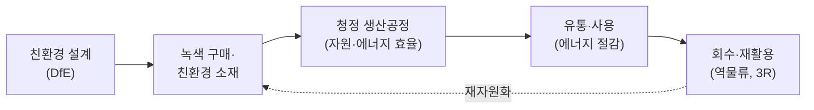

# 4.3 환경관리 및 안전관리

!!! info "출제기준"
    **4. 설비관리** › **3. 환경관리 및 안전관리**

## 출제 경향

총 **9문항** 출제 (1교시 단답형 8 · 2~4교시 논술형 1) · 최근 10개 회차(109~139회) 3문항 · 최근 출제 제130회

| 주제 | 출제 수 | 출제 회차 |
|---|:-:|---|
| 4.3.1 환경친화 생산과 친환경 설계 | 5 | 63회, 70회, 94회, 100회, 103회 |
| 4.3.2 환경·안전보건경영시스템(ISO 14001·45001) | 2 | 121회, 130회 |
| 4.3.3 설비 안전설계(Fool Proof·Interlock·위험점) | 2 | 106회, 115회 |

## 목차

1. [환경친화 생산과 친환경 설계](#t43-1)
2. [환경·안전보건경영시스템(ISO 14001·45001)](#t43-2)
3. [설비 안전설계(Fool Proof·Interlock·위험점)](#t43-3)

## 4.3.1 환경친화 생산과 친환경 설계 {#t43-1}

### 환경친화 생산의 개념과 체계 (70·94회)

**환경친화 생산(ECM, Environmentally Conscious Manufacturing)**은 제품의 **전 생애(원료 → 생산 → 유통·사용 → 폐기·회수)**에서 자원·에너지 사용과 오염 배출을 최소화하면서 경제성을 함께 확보하는 생산 방식이다. 오염이 생긴 뒤 처리하는 **사후처리(End-of-pipe)** 방식에서, 발생 자체를 막는 **청정생산(Cleaner Production)** 방식으로의 전환이 핵심이다.

| 체계 요소 | 내용 |
|---|---|
| 설계 | 친환경 설계(DfE), 유해물질 배제, 분해·재활용 쉬운 구조 |
| 조달 | 녹색 구매, 공급망 유해물질 관리 |
| 생산 | 청정생산, 공정 내 재활용, 에너지 효율화, 폐기물·배출 저감 |
| 유통·사용 | 포장 축소, 저에너지 제품, 장수명 |
| 회수·재활용 | 3R(감량 Reduce·재사용 Reuse·재활용 Recycle), 생산자 책임 재활용(EPR) |
| 관리 체계 | ISO 14001, 전과정평가(LCA), 환경회계, 탄소발자국 |

| 비교 | 사후처리(End-of-pipe) | 청정생산(Cleaner Production) |
|---|---|---|
| 관점 | 발생한 오염물을 처리 | 오염 발생원 자체를 예방 |
| 대상 | 폐수·배기·폐기물 처리 시설 | 원료·공정·제품·설계 전체 |
| 비용 | 처리 비용이 계속 발생(비용 요인) | 자원·에너지 절감으로 원가 절감(이익 요인) |
| 기법 | 방지 시설, 소각·매립 | 원료 대체, 공정 개선, 공정 내 재활용, DfE |

**배경과 최근 경향**: 1992년 리우 환경회의의 "지속가능한 발전" 이후 UNEP가 청정생산을 확산했다. 최근에는 **순환경제**(제품·소재를 계속 순환), EU **탄소국경조정제도(CBAM)**, 에코디자인 규정(ESPR)과 **디지털 제품 여권(DPP)**, 공급망 실사 등 통상 규제로 확대되어 ESG 경영의 핵심이 되었다([7.5.1](../07-support-technology/05-trends.md#t75-1)).

### 전과정평가(LCA, Life Cycle Assessment) (63회)

**정의**: 제품의 **원료 채취부터 생산·유통·사용·폐기까지(요람에서 무덤까지)** 전 과정에서 투입되는 자원·에너지와 배출물을 정량화하고 그 환경 영향을 평가하는 기법이다(ISO 14040·14044).

**4단계**: ① 목적 및 범위 정의 → ② 전과정 목록 분석(LCI: 투입·배출 데이터 수집) → ③ 전과정 영향 평가(LCIA: 지구온난화·산성화 등 영향 범주별 평가) → ④ 결과 해석(개선 기회 도출)

**활용**: 친환경 제품 개발·개선, 환경성적표지·탄소발자국 인증, 공급망 환경 관리, 정책 수립

| 평가 범위 | 의미 |
|---|---|
| 요람에서 무덤까지(Cradle-to-Grave) | 원료 채취 ~ 폐기 전 과정 |
| 요람에서 문까지(Cradle-to-Gate) | 원료 채취 ~ 공장 출하(B2B 소재·부품의 탄소발자국에 주로 사용) |
| 요람에서 요람까지(Cradle-to-Cradle) | 폐기 대신 재자원화해 다시 원료로 순환 |

**한계**: 데이터 수집 부담, 범위·가정에 따라 결과가 달라짐, 영향 범주 간 가중치의 주관성 → 결과 해석 단계에서 민감도 분석과 제3자 검토로 보완한다.

### RoHS (100회)

**정의**: EU의 **전기·전자제품 유해물질 사용 제한 지침**(Restriction of Hazardous Substances). 2003년 제정, 2006년 7월 시행되었다.

| 구분 | 제한 물질 |
|---|---|
| 최초 6종 | 납(Pb), 수은(Hg), 카드뮴(Cd), 6가 크롬(Cr⁶⁺), 폴리브롬화비페닐(PBB), 폴리브롬화디페닐에테르(PBDE) |
| 추가 4종(2019년 적용) | 프탈레이트류 DEHP, BBP, DBP, DIBP |

- 허용 기준: 균질 물질 기준 0.1%(카드뮴은 0.01%) 이하
- 기업 대응: 공급망 함유 물질 조사·관리, 대체 물질 적용(무연 솔더 등), 성분 분석과 적합성 문서, 관련 규제(WEEE·REACH)와 통합 관리
- 변천: RoHS 1(2002/95/EC) → RoHS 2(2011/65/EU, CE 마킹 연계·적용 범위 확대) → 추가 4종 지정(EU 2015/863)
- 국내: 「전기·전자제품 및 자동차의 자원순환에 관한 법률」(2008 시행)로 유해물질 함유 기준을 관리한다.

| 관련 규제 | 내용 |
|---|---|
| WEEE | 폐전기·전자제품의 회수·재활용 의무(생산자 책임) |
| REACH | 화학물질의 등록·평가·허가·제한(EU, 2007 시행) |
| ELV | 폐자동차의 유해물질 제한과 재활용 |

### 친환경 설계(DfE, Design for Environment) (103회)

**개념**: 제품 설계 단계에서 전 생애의 환경 영향을 미리 고려해 줄이는 설계다. 환경 영향의 대부분이 설계 단계에서 결정되기 때문이다.

**특징·설계 지침**

1. 친환경·재활용 가능 소재 선택, 유해물질 배제
2. 부품 수·소재 종류 축소, **분해 용이 설계(DfD)**
3. 사용 단계의 에너지 효율 향상
4. 장수명·수리 용이 설계
5. 재활용 표시, 포장재 축소
6. LCA로 설계안의 환경성 비교

DfE는 DFM·DFA 같은 **DFX(Design for X)**의 하나로, 근거 표준으로 ISO 14006(환경경영시스템 내 에코디자인 지침)과 IEC 62430(전기·전자제품 환경 의식 설계)이 있다. 제조용이성 설계와의 관계는 [7.2.4](../07-support-technology/02-product-development.md#t72-4)를 참고한다.

!!! tip "답안 작성 포인트"
    - 환경친화 생산은 **전 생애 흐름 그림 + 단계별 요소 표**로 체계를 보여 주고, 사후처리 → 청정생산으로의 패러다임 전환을 강조한다.
    - 단답형(LCA·RoHS·DfE)은 **정의(근거 표준·연도) → 구성·단계 → 활용·대응**으로 쓴다.
    - 결론 예(94회): "환경 규제가 CBAM·DPP 같은 통상 장벽으로 바뀌고 있으므로, LCA 기반 탄소 데이터와 공급망 함유물질 정보를 디지털로 관리하는 것이 수출 제조기업의 경쟁력이다."

??? example "관련 기출 5문항 (63회, 70회, 94회, 100회, 103회)"

    - **제63회(2001) 1교시 1번** · 10점  
      LCA
    - **제70회(2003) 1교시 3번** · 10점  
      환경친화적 생산
    - **제94회(2011) 3교시 3번** · 25점  
      환경친화생산(Environmentally conscious manufacturing)의 개념과 체계에 대하여 설명하시오.
    - **제100회(2013) 1교시 1번** · 10점  
      RoHS(Restriction of the use of Hazardous Substances in EEE)
    - **제103회(2014) 1교시 7번** · 10점  
      친환경설계(Design for environment: DFE)의 개념과 특징에 대하여 설명하시오.

## 4.3.2 환경·안전보건경영시스템(ISO 14001·45001) {#t43-2}

### ISO 14001:2015 환경경영시스템 (121회)

**개념**: 조직이 환경 성과를 체계적으로 관리·개선하기 위한 국제 표준 경영시스템이다. **PDCA 사이클**과 2015년 개정 때 도입된 **공통 상위 구조(HLS)** 10개 조항으로 구성된다.

| 조항 | 내용 | PDCA |
|:-:|---|:-:|
| 1~3 | 적용 범위, 인용 표준, 용어와 정의 | – |
| 4 | **조직의 상황**: 내·외부 이슈, 이해관계자 요구, 적용 범위 | P |
| 5 | **리더십**: 최고경영자 책임, 환경방침, 역할·책임 | P |
| 6 | **기획**: 리스크와 기회, 환경측면, 준수 의무, 환경목표 | P |
| 7 | **지원**: 자원, 역량, 인식, 의사소통, 문서화된 정보 | D |
| 8 | **운용**: 운용 계획·관리(전과정 관점), 비상사태 대비·대응 | D |
| 9 | **성과 평가**: 모니터링·측정, 준수 평가, 내부 심사, 경영 검토 | C |
| 10 | **개선**: 부적합·시정조치, 지속적 개선 | A |

**2015년 개정의 주요 내용**: HLS 도입(다른 경영시스템과 통합 용이), 조직 상황·이해관계자 고려, 리더십 강화, 리스크 기반 사고, **전과정 관점**, 준수 의무 강화, 환경 성과 중시

- **연혁**: 1996년 제정 → 2004년 1차 개정 → 2015년 2차 개정(현행). 2024년 기후변화 고려 사항이 4.1·4.2항에 추가되었다(Amd 1:2024).
- **핵심 용어**: **환경측면**(환경과 상호작용하는 활동·제품·서비스의 요소, 예: 폐수 배출) → **환경영향**(그 결과 생기는 환경 변화, 예: 수질 오염). 중대한 환경측면을 파악해 목표·운용 관리의 대상으로 삼는다.
- **인증 효과**: 환경 법규 준수, 자원·에너지 절감, 녹색 구매 요건 충족(대기업 협력사 평가), ESG 공시 기반

| 비교 | ISO 9001 | ISO 14001 | ISO 45001 |
|---|---|---|---|
| 대상 | 품질(고객 만족) | 환경 성과 | 안전보건(근로자 보호) |
| 이해관계자 | 고객 | 지역사회·규제기관 등 | 근로자·도급인 |
| 고유 요소 | 고객 요구·제품 적합성 | 환경측면·준수 의무·전과정 관점 | 근로자 참여·협의, 위험성 평가 |
| 공통 | HLS 10개 조항, PDCA, 리스크 기반 사고 → **통합경영시스템(IMS)** 구축 가능 | | |

### ISO 45001 안전보건경영시스템 (130회)

**개념**: 산업재해와 직업병을 예방하고 안전하고 건강한 작업장을 만들기 위한 국제 표준(2018년 제정)으로, 기존 OHSAS 18001을 대체했다. ISO 14001과 같은 HLS 10개 조항 구조다.

**핵심 요구사항**

1. **최고경영자의 리더십**과 안전보건 방침
2. **근로자의 참여와 협의**(비관리직 근로자 참여 강조)
3. **유해·위험요인 파악과 위험성 평가**, 리스크와 기회 관리
4. 법규 및 기타 요구사항 준수
5. 위험 제거·감소의 **관리 단계**(제거 → 대체 → 공학적 대책 → 관리적 대책 → 개인보호구)
6. 변경 관리, 조달·**협력업체(도급) 관리**
7. 비상 대비·대응, 사고 조사와 시정조치, 성과 평가와 지속적 개선

**도입 효과**: 재해 감소, 법규 준수(중대재해처벌법 대응 체계), 안전 문화 정착, 대외 신뢰도 향상, ISO 9001·14001과 통합 운영

| 비교 | OHSAS 18001 | ISO 45001 |
|---|---|---|
| 성격 | 영국 BSI 중심 민간 규격 | ISO 국제 표준 |
| 구조 | ISO 14001:2004 기반 | HLS 10개 조항 |
| 강조점 | 위험 관리 절차 | 조직 상황, **최고경영자 책임**, **근로자 참여**, 리스크와 기회 |
| 범위 | 사업장 내부 중심 | 도급·조달·외주 등 가치사슬 포함 |

국내에는 안전보건공단의 **KOSHA-MS**가 있으며, 중대재해처벌법(2022년 시행)이 요구하는 안전보건관리체계 구축(위험성 평가, 종사자 의견 청취, 도급 관리 등)과 ISO 45001의 요구사항이 많이 겹친다. 재해 지표는 [5.3.2](../05-work-measurement/03-productivity-safety.md#t53-2)를 참고한다.

!!! tip "답안 작성 포인트"
    - ISO 경영시스템은 **HLS 10개 조항 표에 PDCA를 대응**시키는 것이 핵심이다. 14001과 45001은 같은 틀로 쓰고 고유 요소(환경측면·전과정 관점 / 근로자 참여·위험성 평가)를 강조한다.
    - 10점 답안 마지막 줄에 **IMS(9001·14001·45001 통합)** 또는 **중대재해처벌법 대응**을 쓰면 실무 감각을 보여 준다.

??? example "관련 기출 2문항 (121회, 130회)"

    - **제121회(2020) 1교시 4번** · 10점  
      ISO 14001:2015 구성과 내용
    - **제130회(2023) 1교시 11번** · 10점  
      ISO 45001 시스템에 대하여 설명하시오.

## 4.3.3 설비 안전설계(Fool Proof·Interlock·위험점) {#t43-3}

**설비 안전설계**는 기계의 위험원을 설계 단계에서 제거하거나 격리해, 사람의 실수나 설비 고장이 있어도 재해로 이어지지 않게 하는 것이다(본질안전화). 위험성 감소는 **본질적 안전 설계 → 방호장치(공학적 대책) → 사용상 정보(경고·교육)** 순으로 적용한다(ISO 12100의 3단계 방법).

### 기계설비의 위험점 6가지 (115회)

| 위험점 | 형성 위치 | 예 |
|---|---|---|
| **협착점** | 왕복 운동하는 부분과 고정 부분 사이 | 프레스 금형, 전단기, 성형기 |
| **끼임점** | 회전 운동하는 부분과 고정 부분 사이 | 연삭숫돌과 작업대, 회전 풀리와 베드 |
| **절단점** | 회전하는 운동 부분 자체(날)의 돌출부 | 띠톱 날, 밀링 커터, 둥근톱 |
| **물림점** | 서로 반대로 회전하는 두 회전체가 맞물리는 곳 | 롤러기, 기어 맞물림 |
| **접선 물림점** | 회전하는 부분의 접선 방향으로 물려 들어가는 곳 | 벨트와 풀리, 체인과 스프로킷, 랙과 피니언 |
| **회전 말림점** | 회전하는 축·돌기에 옷·머리카락이 말려 들어가는 곳 | 회전축, 드릴, 커플링 |

**대책**: 위험점을 덮는 방호 덮개·울, 인터록 장치, 비상 정지 장치, 작업자 교육과 복장 관리

| 방호장치 유형 | 원리 | 예 |
|---|---|---|
| 격리형 | 위험점과 작업자 사이에 장벽 설치 | 완전 차단형 덮개, 안전 울타리 |
| 위치 제한형 | 조작 위치를 위험 구역에서 일정 거리 이상 떨어지게 함 | 양수 조작식 방호장치 |
| 접근 거부형 | 위험 구역에 들어간 신체 부위를 밀어냄 | 프레스 손쳐내기식 |
| 접근 반응형 | 신체 접근을 감지하면 기계 정지 | 광전자식 방호장치(라이트 커튼) |
| 포집형 | 튀어나오는 위험물을 잡아 둠 | 연삭숫돌 덮개, 반발 예방장치 |

(분류 명칭은 교재에 따라 다소 다르다 — 교재 확인 필요)

### Fool Proof, Fail Safe, 안전 인터록 (106회)

| 구분 | Fool Proof | Fail Safe | 안전 인터록(Interlock) |
|---|---|---|---|
| 개념 | **사람이 실수해도** 사고·불량이 나지 않게 하는 설계 | **기계가 고장 나도** 안전한 쪽으로 작동하게 하는 설계 | 방호 조건이 충족되지 않으면 **기계가 작동하지 않도록** 연동시키는 장치 |
| 대상 | 인적 오류 | 설비 고장 | 안전 조건(문·덮개·위치) |
| 예 | 한 방향으로만 끼워지는 커넥터, 양수 조작식 버튼 | 정전 시 닫히는 밸브, 전동차 데드맨 장치, 과부하 시 차단기 | 로봇 울타리 문이 열리면 정지, 프레스 광전자식 방호장치, 덮개 열림 시 정지 |

**Fail Safe의 유형**: Fail-Passive(고장 시 정지), Fail-Active(고장 시 경보를 내며 짧은 시간 운전 지속), Fail-Operational(고장이 나도 다음 정비 때까지 기능 유지)

실수방지의 품질 측면 활용은 [5.4.8 FMEA·FTA·실수방지](../05-work-measurement/04-quality-management.md#t54-8)를, 신뢰성 설계로서의 내용은 [3.5.5](../03-process-control/05-maintenance.md#t35-5)를 참고한다.

**Fool Proof의 기능 구분**: 작업이 잘못되면 **정지**(규제)시키는 방식과 **경보**로 알리는 방식이 있고, 오류를 미리 막는 예방형이 발견형보다 우선이다. 최근에는 협동로봇의 속도·힘 제한, 안전 PLC, AI 비전 기반 작업자 접근 감지처럼 **스마트 안전장치**로 발전하고 있다.

!!! tip "답안 작성 포인트"
    - 위험점 6가지는 **이름 + 형성 위치 + 예**를 표로 쓰고, 가능하면 간단한 그림(두 롤러, 벨트-풀리 등)을 곁들인다.
    - 세 가지 안전 설계는 **대상(사람의 실수 / 설비 고장 / 방호 조건)**의 차이로 비교한다.
    - 개요에 **본질안전화와 위험성 감소 3단계**를 한 줄 쓰면 10점 답안의 완성도가 높아진다.

??? example "관련 기출 2문항 (106회, 115회)"

    - **제106회(2015) 1교시 2번** · 10점  
      Fool Proof, Fail Safe 및 안전 Interlock
    - **제115회(2018) 1교시 9번** · 10점  
      기계설비의 대표적 잠재적 위험점 6가지

## 답안 작성 예시

!!! example "25점 예시: 제94회 3교시 3번 — 환경친화생산(ECM)의 개념과 체계"

    **1. 개요**

    - ECM은 제품 전 생애에서 자원·에너지 사용과 오염 배출을 최소화하면서 경제성을 확보하는 생산 방식이다.
    - 배경: 리우 회의(1992) 이후 지속가능발전, 사후처리 → 청정생산으로의 패러다임 전환

    **2. 본론**

    - (1) 개념: [표] 사후처리 vs 청정생산 비교(관점·대상·비용·기법)
    - (2) 체계: [그림] 설계(DfE) → 녹색 구매 → 청정 공정 → 유통·사용 → 회수·재활용의 순환 흐름
        - [표] 단계별 체계 요소(설계·조달·생산·유통·회수·관리 체계)
    - (3) 관리 도구: LCA(4단계), ISO 14001(HLS·PDCA), 환경회계·탄소발자국
    - (4) 관련 규제: RoHS·WEEE·REACH, EPR

    **3. 결론(기술사 의견)**

    - 환경 규제가 CBAM·ESPR(DPP)·공급망 실사 같은 통상 장벽으로 진화하므로 ECM은 비용이 아니라 수출 경쟁력의 문제임을 강조한다.
    - FEMS·LCA 데이터 기반의 탄소 관리와 순환경제형 설계를 단계적 추진 과제로 제언한다([4.4.3](04-facilities-utilities.md#t44-3) 연계).

!!! example "10점 예시: 제130회 1교시 11번 — ISO 45001 시스템"

    - **개요**: 산업재해·직업병 예방을 위한 안전보건경영시스템 국제 표준(2018년 제정), OHSAS 18001 대체
    - **구조**: HLS 10개 조항 + PDCA(4~6 Plan, 7~8 Do, 9 Check, 10 Act)
    - **핵심 요구사항**: 최고경영자 리더십, 근로자 참여·협의, 위험성 평가, 관리 단계(제거 → 대체 → 공학적 → 관리적 → 보호구), 도급 관리
    - **특징**: [표] OHSAS 18001 vs ISO 45001 비교 중 2~3행
    - **의견**: 중대재해처벌법의 안전보건관리체계와 요구사항이 겹치므로 ISO 9001·14001과 IMS로 통합 운영하면 효과적이다.
