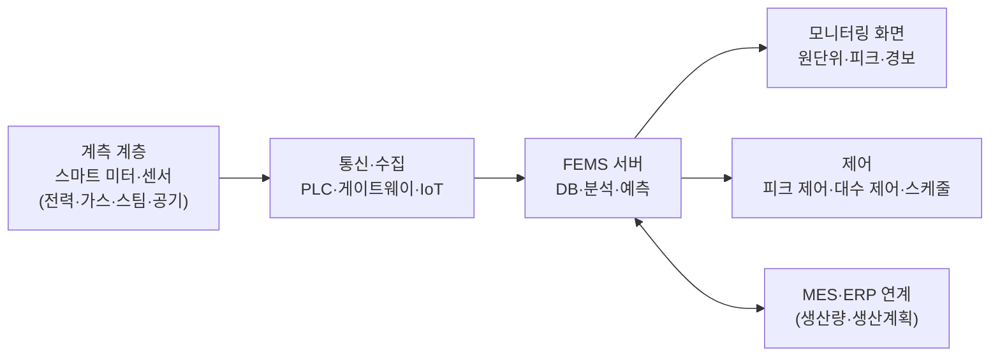

# 4.4 시설 및 유틸리티관리

!!! info "출제기준"
    **4. 설비관리** › **4. 시설 및 유틸리티관리**

## 출제 경향

현행 기출 데이터(제63회~제139회)에는 이 세부항목으로 분류된 문항이 없습니다. 새 출제기준(2027~)에 추가된 영역이므로 기본 개념 위주로 대비합니다.

| 주제 | 출제 수 | 출제 회차 |
|---|:-:|---|
| 4.4.1 공장 시설계획 | 0 | - |
| 4.4.2 유틸리티(전력·용수·공기·스팀) 관리 | 0 | - |
| 4.4.3 에너지 관리와 효율화 | 0 | - |

## 목차

1. [공장 시설계획](#t44-1)
2. [유틸리티(전력·용수·공기·스팀) 관리](#t44-2)
3. [에너지 관리와 효율화](#t44-3)

## 4.4.1 공장 시설계획 {#t44-1}

### 공장 시설계획의 개념

**공장 시설계획**은 생산 활동에 필요한 **부지·건물·부대시설**을 생산 흐름과 미래 확장에 맞게 계획하는 것이다. 입지 선정과 설비배치([1.2 생산구조와 방식](../01-production-strategy/02-production-system-layout.md)) 사이에서, 공장이라는 "그릇"을 설계하는 단계다.

| 계획 단계 | 결정 내용 | 관련 절 |
|---|---|---|
| 입지 선정 | 어느 지역·부지에 지을 것인가 | [1.2.3](../01-production-strategy/02-production-system-layout.md#t12-3) |
| **시설계획** | 부지 안에 어떤 건물·시설을 어떤 규모·구조로 둘 것인가 | 이 절 |
| 설비배치 | 건물 안에 설비·작업장을 어떻게 놓을 것인가 | [1.2.4](../01-production-strategy/02-production-system-layout.md#t12-4), [1.2.5 SLP](../01-production-strategy/02-production-system-layout.md#t12-5) |

시설은 한 번 지으면 수십 년 쓰고 바꾸기 어려우므로, **현재의 효율**과 **미래의 유연성·확장성** 사이의 균형이 핵심이다. 시설계획의 목표는 ① 원활한 물류 흐름 ② 공간의 효율적 이용 ③ 작업자의 안전·쾌적성 ④ 확장·변경의 유연성 ⑤ 투자·운영비 최소화 ⑥ 법규·환경 적합성이다.

### 시설계획의 절차

### 부지 종합계획(Master Plan)의 구성

| 구역 | 내용 |
|---|---|
| 생산동 | 공정 흐름에 맞는 배치, 향후 증설 공간 확보 |
| 창고·물류 | 원자재 입고장과 제품 출하장 분리, 차량 동선 |
| 유틸리티동 | 수배전·보일러·압축기·폐수 처리 시설 |
| 사무·복지 | 사무동, 식당, 휴게·의무 시설 |
| 도로·주차 | 화물차와 보행자 동선 분리, 비상 차량 통로 |
| 확장 부지 | 단계적 증설을 위한 예비 부지 |
| 환경·조경 | 법정 녹지, 완충 공간 |

### 건물 계획의 고려 사항

- **건물 형태**: 단층(흐름·하중에 유리, 부지 많이 필요) vs 다층(부지 절약, 수직 물류 필요)
- **구조**: 기둥 간격(스팬)과 층고 — 설비 크기, 크레인, 배관·덕트 공간 반영
- **바닥**: 설비 하중, 진동 격리, 평탄도(AGV 운행), 내화학성
- **환경**: 채광·조명, 환기·공조, 소음 차단, 클린룸 등급
- **안전·방재**: 소방 구획, 피난 동선, 방폭 구역, 위험물 저장 시설
- **확장성·유연성**: 모듈식 구조, 설비 재배치가 쉬운 넓은 스팬
- **법규**: 건축법, 산업집적법, 산업안전보건법, 소방법, 환경 관련 법규

| 비교 | 단층 공장 | 다층 공장 |
|---|---|---|
| 물류 | 수평 흐름, 운반 쉬움 | 엘리베이터·리프트 등 수직 운반 필요 |
| 바닥 하중·진동 | 중량 설비·프레스 설치 유리 | 상층 하중 제한, 진동 전파 |
| 공간·부지 | 넓은 부지 필요, 넓은 스팬 확보 쉬움 | 부지 절약(도시형·고지가 지역) |
| 채광·환기 | 천창(톱날 지붕)으로 자연 채광 | 외벽 의존, 중앙부 채광 불리 |
| 확장성 | 수평 증축 쉬움 | 증축 어려움 |
| 건설비 | 단위 면적당 저렴 | 구조비 높음, 기초 면적당 효율 높음 |
| 적합 | 중량물, 대형 설비, 연속 흐름 공정 | 경량 소형 제품(전자·의류·식품), 중력 이용 공정 |

### 확장성과 유연성 확보 방안

| 방안 | 내용 |
|---|---|
| 확장 방향 사전 설정 | 생산동의 한쪽 벽을 확장 벽으로 정하고 유틸리티 간선을 그 방향으로 배치 |
| 모듈식 구조 | 기둥 간격·층고를 표준 모듈로 해 단위 증설 |
| 넓은 스팬·고층고 | 기둥 없는 공간으로 설비 재배치 자유도 확보 |
| 유틸리티 그리드 | 천장·바닥 트렌치에 전력·공기·용수 간선을 격자로 설치(플러그 앤 플레이) |
| 단계적 건설 | 수요에 맞춰 1단계·2단계로 나누어 투자 위험 분산 |
| 이동식 설비 | 바닥 고정을 줄이고 캐스터·모듈 설비 사용 |

### 특수 시설

- **클린룸**: 공기 중 부유 입자 수로 청정도를 등급화(ISO 14644-1의 ISO Class 1~9)하며, 반도체·디스플레이·제약 공정에 쓴다. 온습도·차압·기류 관리와 에어샤워·갱의실 동선이 필요하다.
- **위험물·방폭 시설**: 위험물 저장소 이격 거리, 방폭 구역(가스·분진) 지정과 방폭 전기설비
- **친환경 건축**: 녹색건축 인증, 지붕 태양광, 우수 재이용, 고단열 외피

### 시설 유지관리(Facility Management)

건물·설비·유틸리티를 수명주기 동안 효율적으로 운영·보전하는 활동이다. 예방보전 계획, 법정 검사, 에너지 관리, 공간 관리를 포함하며, **CMMS**(전산화 보전관리 시스템)·BEMS 같은 정보시스템으로 관리한다.

| 관리 영역 | 내용 | 지표 예 |
|---|---|---|
| 공간 관리 | 면적 배분·이용률, 레이아웃 변경 관리 | 면적당 생산액, 공간 이용률 |
| 유지보전 | 건물·설비 예방보전, 법정 검사(승강기·소방·전기·보일러) | 계획보전 준수율, 고장 정지 시간 |
| 운영 서비스 | 청소·경비·식당·조경 등 | 서비스 만족도, 비용 |
| 수명주기 관리 | 장기 수선 계획, 리모델링, 자산 대장 | LCC, 시설 상태 지수 |

최근에는 **BIM**(건물 정보 모델)으로 설계·시공·유지관리 정보를 통합하고, 공장 디지털 트윈과 연계해 공간·유틸리티 변경을 사전에 시뮬레이션한다([4.5.3](05-factory-automation.md#t45-3)).

!!! question "예상 문제"
    - 신규 공장의 부지 종합계획(Master Plan) 수립 시 고려사항을 설명하시오.
    - 단층 공장과 다층 공장의 장단점을 비교하시오.
    - 공장 건물 계획에서 확장성과 유연성을 확보하는 방안을 설명하시오.

!!! tip "답안 작성 포인트"
    - 기출이 없는 새 영역이므로 **절차 흐름도 → 구성 요소 표 → 고려 사항**의 표준 틀로 준비한다.
    - 입지(1.2.3)·설비배치(1.2.4)와 연결해 "입지 → 시설 → 배치"의 계획 순서 안에서 설명하면 깊이가 생긴다.
    - 결론 예: "공장 시설은 수십 년 쓰는 고정 자산이므로 현재 효율보다 확장성·유연성을 우선하고, 모듈식 구조와 유틸리티 그리드, BIM·디지털 트윈으로 변경 비용을 최소화해야 한다."

## 4.4.2 유틸리티(전력·용수·공기·스팀) 관리 {#t44-2}

### 유틸리티의 종류와 관리 포인트

**유틸리티**는 생산 설비를 가동하는 데 필요한 전력·용수·압축공기·스팀·공조·가스 등의 공급 설비와 그 서비스다. 유틸리티가 멈추면 공장 전체가 멈추므로 **안정 공급**이 최우선이며, 에너지 비용의 대부분이 여기서 발생한다.

| 유틸리티 | 주요 설비 | 관리 포인트 |
|---|---|---|
| **전력** | 수변전 설비, 배전반, 비상발전기, UPS | 정전 대비 이중화·비상 전원, 역률 개선, 최대 수요 전력(피크) 관리, 전기안전 법정 검사 |
| **용수** | 취수·정수, 순수(DI) 설비, 냉각탑 | 수질(전도도·경도) 관리, 냉각수 수처리(스케일·부식 방지), 재이용 |
| **압축공기** | 공기 압축기, 드라이어, 배관 | **누설 관리**, 압력 적정화, 수분·유분 제거(노점 관리), 대수 제어 |
| **스팀** | 보일러, 스팀 트랩, 응축수 회수 | 보일러 효율, 스팀 트랩 점검, 응축수·폐열 회수, 보일러 법정 검사 |
| **공조·냉동** | 냉동기, 공조기(HVAC), 클린룸 | 온습도·청정도 유지, 외기 냉방, 운전 스케줄 최적화 |
| **가스** | LNG, 질소·산소 등 산업가스 | 누출 감지, 고압가스 안전 관리, 공급 압력 안정 |
| **환경 설비** | 폐수 처리, 대기 방지 시설 | 배출 기준 준수, 운영 비용 관리 |

### 유틸리티 관리의 공통 원칙

1. **안정 공급**: 핵심 설비의 이중화(N+1), 예비품, 비상 대응 절차
2. **품질 확보**: 압력·온도·순도·노점 등 공급 품질 기준 설정과 감시
3. **비용·에너지 효율**: 부하에 맞춘 대수 제어·인버터 운전, 누설·손실 관리
4. **안전·법규**: 전기·보일러·고압가스 등 법정 검사와 자격자 관리
5. **실시간 모니터링**: SCADA·FEMS로 사용량·이상 감시, 생산계획과 연계한 공급 계획

### 전력 관리

| 항목 | 내용 |
|---|---|
| 역률 개선 | 유도 전동기 부하로 낮아진 역률을 진상 콘덴서로 개선 → 선로 손실·전압 강하·기본요금 부담 감소 |
| 최대 수요 전력 관리 | 수요 제어기(Demand Controller)로 피크 예측·부하 차단, 생산 일정의 부하 평준화 |
| 전력 품질 | 순간 전압 강하(Sag)·고조파가 정밀 설비 정지의 원인 → UPS·순간정전 보상장치, 고조파 필터 |
| 고효율화 | 고효율 변압기·모터(IE3 이상), 인버터 |

### 압축공기 시스템의 손실과 절감

압축공기는 공장에서 가장 비싼 유틸리티 중 하나다. 압축기 입력 전력의 대부분이 열로 버려지고, 배관 누설로도 생산량의 상당 부분(흔히 20~30% 수준으로 알려짐)이 손실된다.

| 손실 요인 | 절감 방안 |
|---|---|
| 배관·이음부·호스 **누설** | 초음파 누설 탐지기로 정기 점검·수리, 비가동 시 차단 밸브 |
| 과도한 공급 압력 | 사용처 최고 필요 압력에 맞춰 설정 압력 하향(압력을 낮출수록 동력 감소) |
| 부적정 사용(청소·냉각용 블로우) | 블로어·송풍기로 대체, 절감 노즐 |
| 부분 부하 운전 | 인버터 압축기, 여러 대의 **대수 제어** |
| 압력 강하 | 배관 구경 확대·루프 배관, 필터 교체 |
| 압축열 방출 | 폐열 회수(온수·난방) |
| 흡입 공기 온도 높음 | 차고 건조한 외기 흡입 |

### 스팀·용수 관리

- **스팀**: 고장(누기) 스팀 트랩 점검·교체, 배관 보온, 응축수 회수(급수 온도 상승 → 연료 절감), 보일러 공기비 관리, 블로다운 열 회수
- **냉각수·용수**: 냉각탑 수처리(스케일·부식·레지오넬라균 관리), 농축 배수 관리, 공정 용수 재이용, 순수(DI) 수질 감시

### 유틸리티 중단에 대비한 비상 대응 체계

| 단계 | 내용 |
|---|---|
| 예방 | 핵심 설비 이중화(N+1), 이중 수전(2회선), 예비품, 예방보전·열화 진단 |
| 대비 | 영향 분석(정지 시 손실·복구 시간), 비상발전기·UPS 용량 확보, 부하 우선순위(안전 > 품질 > 생산) |
| 대응 | 비상 대응 매뉴얼, 안전 정지 절차(위험 공정), 연락 체계, 정기 모의 훈련 |
| 복구 | 순차 재가동 절차, 원인 분석과 재발 방지, 사업연속성계획(BCP)에 반영 |

!!! question "예상 문제"
    - 공장 유틸리티의 종류를 들고, 각각의 안정적 공급을 위한 관리 방안을 설명하시오.
    - 압축공기 시스템의 에너지 손실 요인과 절감 방안을 설명하시오.
    - 정전 등 유틸리티 공급 중단에 대비한 공장의 비상 대응 체계를 설명하시오.

!!! tip "답안 작성 포인트"
    - **유틸리티별 설비·관리 포인트 표**를 쓰고, 공통 원칙(안정·품질·효율·안전·모니터링)으로 결론을 맺는다.
    - 압축공기 누설, 스팀 트랩, 역률·피크 관리처럼 **구체적 손실 항목**을 들면 실무 감각을 보여 줄 수 있다.
    - 결론 예: "유틸리티는 공장의 생명선이므로 이중화·BCP로 안정 공급을 확보하고, FEMS로 사용량을 생산계획과 연계해 공급 품질과 에너지 비용을 동시에 관리해야 한다."

## 4.4.3 에너지 관리와 효율화 {#t44-3}

### 에너지 관리의 지표

\[
\text{에너지 원단위} = \frac{\text{에너지 사용량(toe, kWh 등)}}{\text{생산량(또는 매출액)}}
\]

생산량 변화의 영향을 빼고 에너지 효율을 비교할 수 있는 대표 지표다. 이 밖에 설비별 에너지 효율, 최대 수요 전력, 온실가스 배출량(tCO₂eq)을 관리한다.

- **toe**(Ton of Oil Equivalent): 서로 다른 에너지(전력·LNG·스팀)를 석유 1톤의 열량(10⁷ kcal)으로 환산한 통합 단위
- **원단위의 한계**: 제품 믹스·가동률 변화의 영향을 받으므로, 제품군별 원단위나 생산량 보정 기준선(회귀 모델)으로 비교한다.

### 에너지 관리 제도(국내)

| 제도 | 내용 |
|---|---|
| 에너지 진단 | 「에너지이용 합리화법」에 따라 에너지다소비사업자(연간 2,000toe 이상)는 정기적으로 에너지 진단을 받아야 한다 |
| 온실가스·에너지 목표관리제 | 일정 규모 이상 업체에 감축 목표를 부여하고 이행 관리 |
| 배출권거래제(K-ETS) | 배출 허용량을 할당하고 잉여·부족분을 거래 |

(대상 기준·주기는 개정이 잦으므로 시험 전 최신 법령 확인 필요)

### 펌프·팬의 인버터 절감 원리(상사 법칙)

\[
\frac{Q_2}{Q_1} = \frac{N_2}{N_1}, \qquad \frac{H_2}{H_1} = \left(\frac{N_2}{N_1}\right)^2, \qquad \frac{P_2}{P_1} = \left(\frac{N_2}{N_1}\right)^3
\]

유량(Q)은 회전수(N)에 비례하고 동력(P)은 회전수의 세제곱에 비례한다. 예를 들어 회전수를 80%로 낮추면 동력은 이론상 \( 0.8^3 \approx 0.51 \), 약 49% 절감된다. 밸브(댐퍼)로 유량을 조이는 방식보다 인버터 회전수 제어가 유리한 이유다.

### ISO 50001 에너지경영시스템

조직이 에너지 성과를 체계적으로 개선하기 위한 국제 표준으로, PDCA 구조를 따른다.

| 단계 | 내용 |
|---|---|
| Plan | 에너지 검토(주요 에너지 사용처 파악), **에너지 기준선**(Baseline)과 **에너지 성과 지표(EnPI)** 설정, 목표·실행 계획 |
| Do | 실행 계획 수행, 고효율 설비 구매·설계 반영, 교육 |
| Check | 모니터링·측정, 기준선 대비 성과 평가, 내부 심사 |
| Act | 경영 검토, 지속적 개선 |

- 2011년 제정, 2018년 개정으로 HLS 구조를 채택해 ISO 9001·14001과 통합 운영이 쉽다.
- **도입 효과**: 에너지 비용 절감, 에너지 성과의 데이터 기반 관리, 온실가스 감축 실적 확보, 고객사(글로벌 공급망)의 탄소 감축 요구 대응

### 에너지 절감 방안

| 영역 | 방안 |
|---|---|
| 설비 | 고효율 모터·인버터(펌프·팬·압축기 회전수 제어), LED 조명, 고효율 보일러·냉동기 |
| 운영 | 비가동 시간 설비 정지, 대수 제어, 압축공기 누설·스팀 트랩 관리, 설정값(압력·온도) 적정화 |
| 열 회수 | 폐열 회수(배기·응축수·압축기 열), 열교환기, 히트펌프 |
| 수요 관리 | 최대 수요 전력(피크) 억제, 부하 이전, 에너지저장장치(ESS) |
| 정보화 | **FEMS**(공장 에너지관리시스템)로 실시간 계측·분석, 이상 사용 감지 |
| 재생에너지 | 태양광 자가발전, 전력구매계약(PPA), 재생에너지 인증서 — RE100 대응 |

### FEMS(Factory Energy Management System)

**정의**: 공장의 에너지 사용을 설비·공정 단위로 실시간 계측·분석해, 낭비를 찾고 최적 운전을 지원하는 정보시스템이다. 건물용 BEMS, 가정용 HEMS와 함께 EMS의 한 유형이다.

| 기능 | 내용 |
|---|---|
| 모니터링 | 설비·라인별 실시간 사용량, 원단위, 피크 표시 |
| 분석 | 기준선 대비 편차, 비생산 시간 대기 전력, 이상 사용 감지 |
| 예측·최적화 | 생산계획 기반 수요 예측, 피크 회피 스케줄, 설비 최적 운전(AI) |
| 제어 | 수요 제어, 압축기·냉동기 대수 제어, 조명·공조 스케줄 |
| 보고 | 에너지·온실가스 보고서, ISO 50001 성과 지표(EnPI) 관리 |

**기대효과**: 에너지 사용의 가시화로 절감 기회 발굴, 피크 요금 감소, 설비 이상 조기 발견(에너지 패턴 변화), 탄소 배출 데이터 확보(CBAM·공급망 탄소 요구 대응)

### 탄소 관리와의 연계

에너지 사용은 온실가스 배출(Scope 1: 직접 연소, Scope 2: 구매 전력)과 직결된다. 원료·물류 등 가치사슬의 간접 배출은 Scope 3로 관리한다. 에너지 효율화와 재생에너지 전환은 탄소중립·ESG 대응의 핵심 수단이다. RE100과 ESG는 [7.5.1 ESG·지속가능경영·통상규제](../07-support-technology/05-trends.md#t75-1)에서 다룬다.

!!! question "예상 문제"
    - 에너지 원단위의 개념과 공장의 에너지 원단위 개선 방안을 설명하시오.
    - ISO 50001 에너지경영시스템의 주요 내용과 도입 효과를 설명하시오.
    - FEMS(공장 에너지관리시스템)의 구성과 기대효과를 설명하시오.

!!! tip "답안 작성 포인트"
    - **지표(원단위) → 관리 체계(ISO 50001·FEMS) → 절감 방안(설비·운영·회수·수요·재생)** 순으로 쓴다.
    - 최근 경향인 탄소중립·RE100과 연결해 결론을 맺으면 시의성을 보여 줄 수 있다.
    - 인버터 상사 법칙(동력 ∝ 회전수³) 같은 정량 근거를 한 줄 넣으면 차별화된다.
    - 결론 예: "에너지 관리는 비용 절감을 넘어 탄소 규제·고객 요구에 대한 대응 수단이므로, ISO 50001 체계 위에 FEMS 데이터로 원단위를 관리하고 재생에너지 전환 로드맵을 수립해야 한다."

## 답안 작성 예시

!!! example "25점 예시: 예상 문제 — 에너지 원단위의 개념과 공장의 에너지 원단위 개선 방안"

    **1. 개요**

    - 에너지 원단위 = 에너지 사용량(toe·kWh) ÷ 생산량(또는 매출액), 생산량 변동을 제거한 에너지 효율 지표
    - 배경: 에너지 가격 상승, 탄소중립·CBAM·RE100 등 공급망 탄소 요구 → 원단위가 원가·수출 경쟁력 지표로 부상

    **2. 본론**

    - (1) 개념: 공식, toe 환산, 원단위의 한계(제품 믹스·가동률 영향) → 제품군별 원단위·보정 기준선
    - (2) 관리 체계: [표] ISO 50001 PDCA(에너지 기준선·EnPI), 국내 제도(에너지 진단·목표관리제·K-ETS)
    - (3) 개선 방안: [표] 에너지 절감 방안(설비·운영·열 회수·수요 관리·정보화·재생에너지)
        - 정량 근거: 인버터 상사 법칙 — 회전수 80%면 동력 약 51%
        - 유틸리티 손실 항목: [표] 압축공기 손실 요인과 절감 방안, 스팀 트랩·응축수 회수
    - (4) 정보화: [그림] FEMS 구성도(계측 → 수집 → 분석 → 제어, MES 연계)

    **3. 결론(기술사 의견)**

    - "측정 없이는 개선 없다": FEMS로 설비 단위 계측부터 하고, 운영 개선(무투자) → 설비 고효율화 → 열 회수 → 재생에너지 순으로 단계 추진을 제언한다.
    - 원단위 개선은 OEE 향상(불량·정지 감소)과도 직결되므로 TPM 활동과 통합 관리하는 것이 차별화 포인트다.

!!! example "10점 예시: 예상 문제 — 단층 공장과 다층 공장의 장단점 비교"

    - **개요**: 건물 형태는 물류 흐름·설비 하중·부지 비용·확장성을 결정하는 시설계획의 기본 결정이다.
    - **비교**: [표] 단층 vs 다층(물류·하중·부지·채광·확장성·건설비·적합 제품) 중 5~6행
    - **선정 기준**: 제품 중량·크기, 공정 흐름(연속/중력 이용), 지가, 증설 계획
    - **의견**: 중량물·대형 설비는 단층, 도시형·경량 제품은 다층이 유리하며, 최근에는 수직 물류 자동화(리프트·AMR)로 다층 공장의 단점이 줄고 있다.
