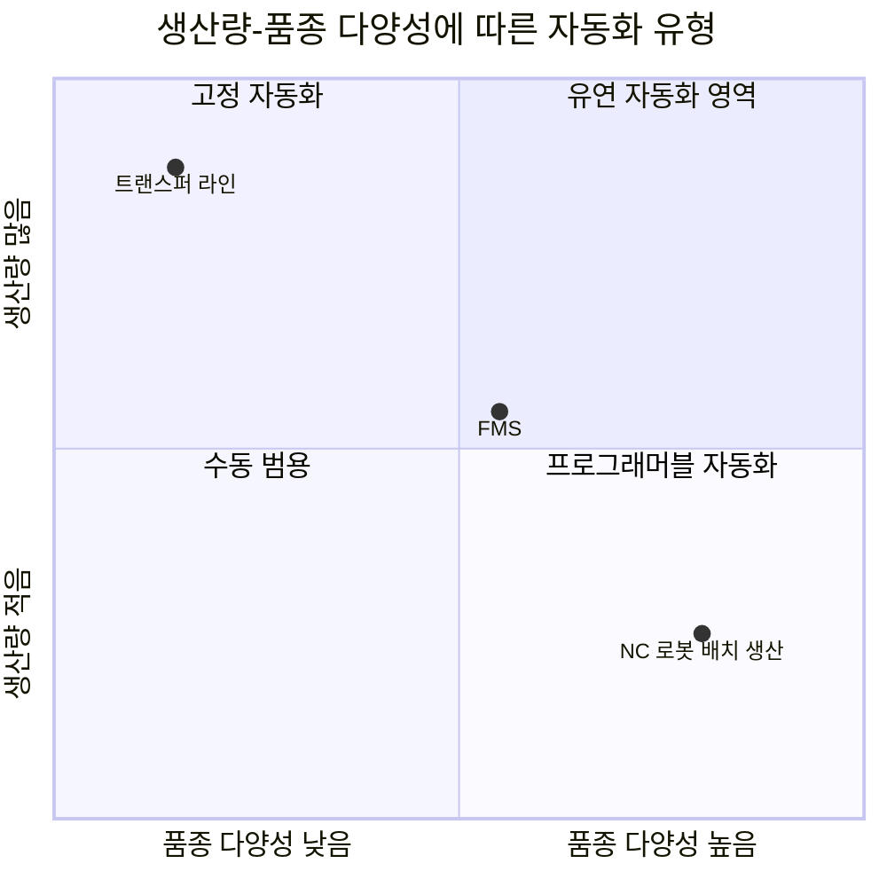
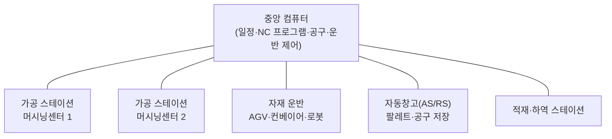
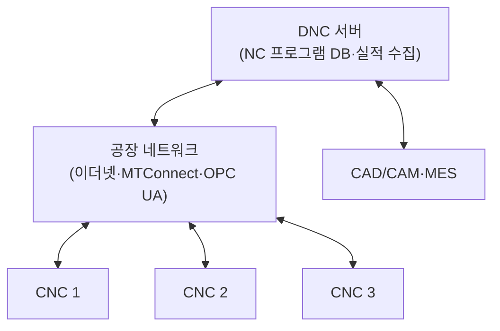
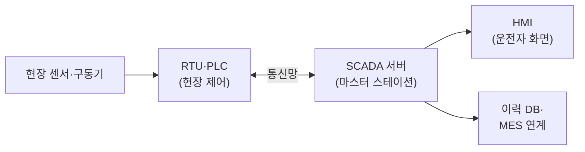

# 4.5 공장자동화 기술

!!! info "출제기준"
    **4. 설비관리** › **5. 공장자동화 기술**

## 출제 경향

총 **8문항** 출제 (1교시 단답형 6 · 2~4교시 논술형 2) · 최근 10개 회차(109~139회) 3문항 · 최근 출제 제136회

| 주제 | 출제 수 | 출제 회차 |
|---|:-:|---|
| 4.5.1 공장자동화의 개념과 유형 | 2 | 63회, 109회 |
| 4.5.2 유연생산시스템(FMS)·DNC | 4 | 67회, 76회, 106회, 121회 |
| 4.5.3 가상제조·SCADA | 2 | 65회, 136회 |

## 목차

1. [공장자동화의 개념과 유형](#t45-1)
2. [유연생산시스템(FMS)·DNC](#t45-2)
3. [가상제조·SCADA](#t45-3)

## 4.5.1 공장자동화의 개념과 유형 {#t45-1}

**공장자동화(FA, Factory Automation)**는 센서·제어기·구동기와 정보 기술로 생산 공정의 가공·조립·운반·검사·관리를 사람의 개입을 최소화해 자동으로 수행하는 것이다. "Automation"이라는 용어는 1940년대 후반 미국 포드사의 D. S. Harder가 공정 간 자동 운반 장치를 가리켜 처음 사용한 것으로 알려져 있다. 공장자동화는 단위 기계(NC) → 셀(FMC) → 시스템(FMS) → 공장 통합(CIM) → 스마트공장으로 발전해 왔다([7.1.2 스마트공장](../07-support-technology/01-it-smart-factory.md#t71-2)).

### 자동화의 개념: 기계화와 자동화 (109회)

| 구분 | 기계화(Mechanization) | 자동화(Automation) |
|---|---|---|
| 의미 | 사람의 **힘(동력)**을 기계로 대체 | 사람의 **감지·판단·제어**까지 기계가 수행 |
| 사람의 역할 | 기계를 조작하고 판단 | 감시·예외 처리 |
| 제어 | 개루프(사람이 판단) | 폐루프(센서 → 제어기 → 구동기의 피드백) |
| 예 | 전동 공구, 지게차 | NC 공작기계, 산업용 로봇, 자동 라인 |

**자동화의 3요소**: 센서(감지) → 제어기(판단, PLC·컴퓨터) → 구동기(실행, 모터·실린더) + 피드백

### 자동화의 유형 (109회)

| 유형 | 특징 | 적합한 생산 | 예 |
|---|---|---|---|
| **고정 자동화**(Fixed) | 작업 순서가 설비 구조로 고정, 전용설비 | 소품종 대량 | 트랜스퍼 라인, 자동 조립기 |
| **프로그래머블 자동화**(Programmable) | 프로그램을 바꿔 다른 제품 생산, 품종 전환 시 준비 시간 발생 | 중품종 배치 생산 | NC 공작기계, 산업용 로봇 |
| **유연 자동화**(Flexible) | 품종 전환 손실 없이 여러 제품을 혼합 생산 | 다품종 중량 | FMS |

| Groover의 자동화 계층(수준) | 내용 |
|---|---|
| ① 장치 수준 | 센서·구동기 등 개별 제어 요소 |
| ② 기계 수준 | 단일 기계의 자동 운전(CNC, 로봇) |
| ③ 셀·시스템 수준 | 여러 기계와 운반 장치의 통합(FMC·FMS, 라인) |
| ④ 공장 수준 | 생산계획·통제, 품질·자재 관리(MES) |
| ⑤ 기업 수준 | 수주·설계·재무·공급망까지 통합(ERP) |

### 자동화의 기본 원리: USA 원리 (109회)

M. Groover가 제시한 자동화 추진의 원리다.

1. **Understand(이해)**: 현재 공정의 입력·출력·기능을 충분히 분석
2. **Simplify(단순화)**: 불필요한 작업을 없애고 공정을 단순화(ECRS)
3. **Automate(자동화)**: 단순화된 공정을 자동화

→ 낭비가 있는 공정을 그대로 자동화하면 낭비까지 자동화된다. **"개선 후 자동화"**가 원칙이다.

### 자동화 도입 시 고려 요소 (109회)

경제성(투자비·회수기간·운영비), 생산량과 제품수명주기, 제품·공정의 표준화와 안정성, 요구 유연성, 품질 향상 효과, 기술 성숙도와 신뢰성, 보전 능력, 인력 영향(재교육·재배치), 안전, 기존 시스템과의 통합

| 관점 | 검토 항목 |
|---|---|
| 경제성 | 투자비, 회수기간·NPV([6.1.1](../06-cost-engineering-economy/01-feasibility.md#t61-1)), 노무비 절감, 운영·보전비 |
| 제품·시장 | 생산량, 제품수명주기, 품종 변화 빈도 |
| 공정·기술 | 공정 안정성·표준화 정도, 기술 성숙도, 기존 시스템(MES·ERP) 연계 |
| 조직·인력 | 보전·프로그래밍 역량, 고용 영향, 노사 협의 |
| 안전·환경 | 위험 작업 해소, 로봇 안전 기준, 에너지 사용 |

**자동화를 추진하는 이유**: 노동 생산성 향상, 인건비 상승·인력난(고령화) 대응, 위험 작업 해소, 품질 균일화, 리드타임 단축, 수작업으로 불가능한 정밀 작업 수행

### 바람직한 전개 단계: 자동화 이행 전략 (109회)

많은 자본이 드는 자동화는 수요 증가에 맞춰 단계적으로 추진한다(Groover의 자동화 이행 전략).

- 초기에는 투자 위험을 줄이고, 수요가 확인되면 자동화 범위를 넓힌다.
- 각 단계에서 공정 개선과 표준화를 먼저 하고 자동화로 넘어간다.

### 자동화의 이점·불리점과 고용 유지 방안 (63회)

| 이점 | 불리점 |
|---|---|
| 생산성 향상, 원가 절감 | 큰 초기 투자와 투자 위험 |
| 품질 균일화·향상 | 고정 자동화는 제품 변경에 비유연 |
| 위험·유해(3D) 작업에서 작업자 보호 | 고장 시 라인 전체 정지 |
| 리드타임 단축, 24시간 가동 | 고숙련 보전·프로그래밍 인력 필요 |
| 생산 데이터의 자동 수집 | 단순 작업 인력의 고용 감소 |

**기존 기능인력의 고용 유지 방안**

1. **재교육과 전환 배치**: 설비 운전·보전, 프로그래밍, 품질 관리 등 고부가가치 직무로 이동
2. **다기능화**: 여러 공정·설비를 다루는 인력으로 육성
3. **협동 로봇 도입**: 사람과 로봇이 함께 일하는 방식으로 작업 부담만 줄임
4. **단계적 도입과 노사 협의**: 자연 감소 인원 범위에서 자동화, 고용 안정 협약
5. **생산 확대·신사업 배치**: 원가 경쟁력으로 늘어난 물량과 신규 사업에 인력 재배치

**최근 관점**: 인력난·고령화로 자동화는 "고용 감소"보다 **인력 부족 대응** 수단이 되었다. 사람과 기계의 역할 분담을 재설계하는 **인간 중심 자동화**(Industry 5.0), 협동로봇과 작업자 증강(AR 작업 지원·웨어러블 로봇), 직무 전환을 위한 리스킬링이 핵심 과제다([7.5.2](../07-support-technology/05-trends.md#t75-2)).

!!! tip "답안 작성 포인트"
    - 109회형은 소문항(개념·유형·원리·고려 요소·전개 단계)을 **번호 그대로 소제목**으로 쓴다. 유형은 생산량-다양성 그래프 위에 세 영역을 표시하면 좋다.
    - **USA 원리("개선 후 자동화")**와 **단계적 이행 전략**은 자동화 문제의 결론으로 쓰기 좋다.
    - 결론 예(63회): "자동화는 인력난 시대의 생존 수단이므로 고용 대립이 아닌 직무 전환의 문제로 보고, 리스킬링·다기능화와 협동로봇 기반의 인간 중심 자동화를 노사 협의로 단계 추진해야 한다."

??? example "관련 기출 2문항 (63회, 109회)"

    - **제63회(2001) 2교시 6번** · 25점  
      공장 자동화의 진전은 많은 편의성 증대와 더불어 고용 감소의 문제점을 야기하고 있다. 자동화의 이점과 불리점을 제시하고, 기존 기능인력의 고용을 유지할 수 있는 방안을 논술하시오.
    - **제109회(2016) 3교시 3번** · 25점  
      공장 자동화에 대한 아래 사항을 설명하시오.

        ??? quote "문제 전문"

            공장 자동화에 대한 아래 사항을 설명하시오.  
            (1) 자동화의 개념(기계화, 자동화 구분 설명)  
            (2) 자동화의 유형  
            (3) 자동화(automation)의 기본원리  
            (4) 자동화 도입 시 고려해야 될 요소  
            (5) 많은 자본비용이 수반되는데 따른 바람직한 전개 단계  

## 4.5.2 유연생산시스템(FMS)·DNC {#t45-2}

### 유연생산시스템(FMS) (67·76·121회)

**정의**: 여러 대의 **NC 공작기계(머시닝센터)**, **자동 자재 운반·저장 장치**, 이를 통합 관리하는 **중앙 컴퓨터**로 구성되어, 다양한 부품을 품종 전환 손실 없이 자동으로 가공하는 생산시스템이다. 다품종 중량 생산에 적합하다.

**구성 요소**: ① 가공 스테이션(NC·머시닝센터, 검사기) ② 자재 운반·저장 장치(AGV, 컨베이어, 로봇, 자동창고) ③ 공구 관리 시스템(자동 공구 교환·공구 수명 관리) ④ 중앙 컴퓨터 제어 시스템 ⑤ 작업자(적재·하역, 감시)

**유형**: 단일 기계 유연생산셀(FMC) → 여러 기계의 FMS → 유연 트랜스퍼 라인

**배치 형태(운반 시스템 기준)**: 직선형(In-line), 루프형(Loop), 사다리형(Ladder), 개방형(Open field), 로봇 중심 셀(Robot-centered cell)

| 비교 | 전용 트랜스퍼 라인 | FMS | 개별(Job shop) 생산 |
|---|---|---|---|
| 생산량 | 대량 | 중량 | 소량 |
| 품종 | 1~소수 | 중간(부품군) | 매우 다양 |
| 유연성 | 낮음 | 중간~높음 | 매우 높음 |
| 설비 | 전용기 | NC·머시닝센터 + 자동 운반 | 범용기 |
| 단위당 원가 | 낮음 | 중간 | 높음 |

**유연성의 종류**: 기계 유연성(여러 작업 수행), 공정 유연성, 제품(전환) 유연성, 경로 유연성(고장 시 다른 기계로), 수량 유연성, 확장 유연성

| 기대효과 | 문제점 |
|---|---|
| 다품종을 자동으로 생산(전환 손실 최소) | 매우 큰 초기 투자 |
| 설비 가동률 향상, 무인·야간 운전 | 시스템 설계·운영의 복잡성 |
| 리드타임·재공재고 감소 | 고급 기술 인력 필요 |
| 품질 균일화, 인건비 절감 | 적용 부품 범위의 제약 |

FMS와 셀 생산·GT의 관계는 [1.2.6](../01-production-strategy/02-production-system-layout.md#t12-6)을 참고한다.

### DNC(Distributed/Direct Numerical Control) (106회)

**정의**: 여러 대의 NC·CNC 공작기계를 **중앙 컴퓨터와 네트워크로 연결**해, NC 프로그램을 내려보내고 각 기계의 가동 상태를 수집·관리하는 시스템이다.

- **발전**: 초기의 Direct NC(중앙 컴퓨터가 종이테이프 대신 프로그램을 직접 공급) → Distributed NC(각 기계는 CNC로 자체 제어하고, 중앙 컴퓨터는 프로그램 관리와 데이터 수집 담당)
- **기능**: NC 프로그램의 저장·전송·버전 관리, 가동·정지·생산 실적 데이터 수집, 작업 지시 연계
- **효과**: 프로그램 관리의 일원화, 준비 시간 단축, 가동률 모니터링, FMS·CIM·MES의 기반

| 비교 | NC | CNC | DNC |
|---|---|---|---|
| 제어 | 하드와이어 회로, 종이테이프 입력 | 기계마다 내장 컴퓨터(프로그램 저장·편집) | 여러 기계를 중앙 컴퓨터와 네트워크로 연결 |
| 범위 | 단일 기계 | 단일 기계 | 다수 기계(공장 수준) |
| 프로그램 관리 | 테이프 보관 | 기계별 | 중앙 일원화 |

최근에는 DNC가 MES의 설비 연동 기능(기계 가동 모니터링, 프로그램 버전 관리)에 흡수되는 추세이며, 공작기계 표준 통신 프로토콜로 MTConnect·OPC UA가 쓰인다.

!!! tip "답안 작성 포인트"
    - FMS는 **정의 → 구성도 → 구성 요소 → 유연성 종류 → 효과·문제점** 순으로 쓴다. 구성도를 반드시 그린다.
    - DNC는 **Direct → Distributed로의 발전**과 FMS·MES와의 관계를 함께 쓴다.
    - 10점 FMS 답안은 트랜스퍼 라인·Job shop과의 비교 표 한 개로 위치를 보여 주면 차별화된다.

??? example "관련 기출 4문항 (67회, 76회, 106회, 121회)"

    - **제67회(2002) 1교시 2번** · 10점  
      유연생산시스템(FMS)이란
    - **제76회(2005) 1교시 12번** · 10점  
      유연생산시스템(FMS).
    - **제106회(2015) 1교시 9번** · 10점  
      DNC(Distributed Numerical Control)
    - **제121회(2020) 1교시 8번** · 10점  
      FMS(Flexible Manufacturing System)

## 4.5.3 가상제조·SCADA {#t45-3}

### 가상제조시스템(VMS, Virtual Manufacturing System) (65회)

**정의**: 제품 설계부터 생산 공정·공장 운영까지를 **컴퓨터 모델과 시뮬레이션으로 가상 공간에서 미리 구현·검증**하는 시스템이다.

| 구성 | 내용 |
|---|---|
| 가상 설계 | CAD·CAE로 제품 형상과 성능을 해석 |
| 가상 공정 | 가공·조립 공정을 시뮬레이션해 간섭·가공성 검증 |
| 가상 공장 | 레이아웃·물류·생산 흐름을 시뮬레이션해 병목·능력 검증 |

**효과**: 시제품 제작과 시행착오 감소, 개발 기간·비용 단축, 생산 전 문제점 발견, 신속한 공정·공장 설계 변경
**발전**: 실제 공장과 실시간 데이터로 연결된 **디지털 트윈(Digital Twin)**으로 발전하고 있다.

| 가상제조의 관점별 분류 | 내용 |
|---|---|
| 설계 중심 | 제품 설계의 제조 가능성·조립성을 가상으로 검증(DFM·DFA) |
| 생산(공정) 중심 | 공정 계획·일정·자원 배분 대안을 시뮬레이션 |
| 제어 중심 | 실제 제어 프로그램(PLC)을 가상 설비에 연결해 사전 검증(가상 시운전) |

(분류 명칭은 문헌에 따라 다름 — 교재 확인 필요)

| 비교 | 가상제조(시뮬레이션) | 디지털 트윈 |
|---|---|---|
| 데이터 | 설계·가정 데이터(오프라인) | 실제 설비의 실시간 데이터(온라인) |
| 시점 | 주로 생산 전(계획·설계) | 운영 중 전 수명주기 |
| 연결 | 단방향(모델 → 의사결정) | 양방향(현실 ↔ 가상, 최적 조건 피드백) |

가상현실·증강현실 기술은 [7.1.5](../07-support-technology/01-it-smart-factory.md#t71-5)를 참고한다.

### SCADA (136회)

**정의**: **SCADA(Supervisory Control And Data Acquisition, 원격 감시제어 및 데이터 수집)**는 넓게 분산된 설비·공정의 상태를 실시간으로 **감시하고, 원격 제어하며, 데이터를 수집**하는 시스템이다. ISA-95 계층에서 Level 2(감시·제어)에 해당한다.

| 구성 | 역할 |
|---|---|
| 현장 장치 | 센서(측정)·구동기(밸브·모터) |
| RTU·PLC | 현장 데이터 수집과 국부 제어 |
| 통신망 | 현장과 중앙을 연결(유·무선) |
| SCADA 서버 | 데이터 수집·처리, 제어 명령 |
| HMI | 상태 표시, 경보, 운전자 조작 화면 |

- **기능**: 실시간 감시, 원격 제어, 경보·이벤트 관리, 이력 저장·추세 분석, 보고서
- **적용**: 전력·수도·가스 같은 기반 시설, 화학·정유 공정, 공장 유틸리티
- **유의점**: 외부 네트워크와 연결되면서 **사이버 보안**이 중요한 과제가 되었다.

| ISA-95 계층 | 기능 | 시스템 |
|:-:|---|---|
| Level 4 | 경영·계획(수주·자재·재무) | ERP |
| Level 3 | 생산 운영 관리(작업 지시·실적·품질) | MES·MOM([2.5.1](../02-operations-logistics/05-mes.md#t25-1)) |
| Level 2 | 감시·제어 | **SCADA**·DCS·HMI |
| Level 1 | 현장 제어 | PLC·RTU |
| Level 0 | 물리 공정 | 센서·구동기 |

| 비교 | SCADA | DCS(분산제어시스템) |
|---|---|---|
| 중심 | 데이터 수집·**감시** 중심 | 공정 **제어** 중심 |
| 적용 범위 | 넓게 분산된 지역(송배전·상하수도·파이프라인) | 한 공장 안의 연속 공정(화학·정유·발전) |
| 통신 | 원거리·저속 통신망도 수용 | 고속·고신뢰 공장 내부망 |
| 제어 주기 | 상대적으로 느린 감시 제어 | 빠른 연속 폐루프 제어 |

**보안 대책**: 제어망과 업무망 분리(망 분리·DMZ), 접근 통제, 패치·자산 관리, 이상 트래픽 감시. 산업제어시스템 보안 표준으로 IEC 62443이 있다. 최근 SCADA는 클라우드·IIoT 플랫폼과 결합해 원격 모니터링·예지보전으로 기능이 확장되고 있다.

!!! tip "답안 작성 포인트"
    - SCADA는 **약어 풀이 → 구성도 → 기능 → 적용 분야**를 쓰고, MES(Level 3)·PLC(Level 1)와의 계층 관계를 한 줄로 밝힌다.
    - VMS는 디지털 트윈과의 관계를 결론에 넣으면 최신성을 보여 줄 수 있다.
    - SCADA vs DCS 비교와 사이버 보안(IEC 62443·망 분리)을 한 줄씩 덧붙이면 10점 답안에서 차별화된다.

??? example "관련 기출 2문항 (65회, 136회)"

    - **제65회(2001) 1교시 8번** · 10점  
      가상제조시스템(VMS)
    - **제136회(2025) 1교시 3번** · 10점  
      SCADA(Supervisory Control And Data Acquisition)에 대하여 설명하시오.

## 답안 작성 예시

!!! example "25점 예시: 제109회 3교시 3번 — 공장 자동화의 개념·유형·기본원리·고려 요소·전개 단계"

    **1. 개요**

    - 공장자동화는 감지·판단·제어까지 기계가 수행해 사람의 개입을 최소화하는 생산 방식이다(용어는 1940년대 후반 포드사에서 유래).
    - 인력난·고령화, 품질 균일화, 스마트공장 전환이 추진 배경이다.

    **2. 본론** (소문항 번호를 소제목으로 그대로 사용)

    - (1) 개념: [표] 기계화 vs 자동화(의미·사람의 역할·개루프/폐루프), 자동화 3요소(센서·제어기·구동기 + 피드백)
    - (2) 유형: [표] 고정·프로그래머블·유연 자동화, [그림] 생산량-품종 다양성 도표 위 세 영역
    - (3) 기본원리: Groover의 USA 원리(Understand → Simplify → Automate) — "개선 후 자동화"
    - (4) 고려 요소: [표] 경제성·제품·공정·인력·안전 관점별 검토 항목
    - (5) 전개 단계: [그림] 수동 생산 → 단독 자동화 → 자동 통합 생산(Groover의 이행 전략), 단계마다 개선·표준화 선행

    **3. 결론(기술사 의견)**

    - 자본 집약적인 자동화는 수요 확인에 맞춰 단계 추진하고, 자동화 계층(기계 → 셀 → 공장 → 기업)에 따라 MES·ERP와 통합해야 효과가 난다.
    - 협동로봇·AI 비전 등 인간 중심 자동화와 작업자 리스킬링을 함께 계획하는 것이 차별화 포인트다.

!!! example "10점 예시: 제136회 1교시 3번 — SCADA"

    - **개요**: Supervisory Control And Data Acquisition, 분산 설비의 원격 감시·제어·데이터 수집 시스템(ISA-95 Level 2)
    - **구성**: [그림] 현장 장치 → RTU·PLC → 통신망 → SCADA 서버 → HMI·이력 DB
    - **기능**: 실시간 감시, 원격 제어, 경보·이벤트, 이력·추세 분석
    - **비교**: [표] SCADA vs DCS 2~3행(감시 중심·광역 vs 제어 중심·공장 내)
    - **의견**: 공장 유틸리티·FEMS 감시에 활용되며, IT 연결 확대로 IEC 62443 기반 보안과 MES 연계가 핵심 과제다.
