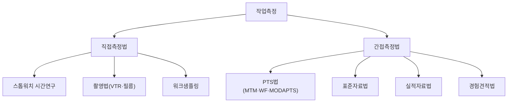

# 5.1 작업방법 및 시간 연구

!!! info "출제기준"
    **5. 작업관리와 성과측정** › **1. 작업방법 및 시간 연구**

## 출제 경향

총 **44문항** 출제 (1교시 단답형 19 · 2~4교시 논술형 25) · 최근 10개 회차(109~139회) 16문항 · 최근 출제 제139회

| 주제 | 출제 수 | 출제 회차 |
|---|:-:|---|
| 5.1.1 작업측정과 표준시간 | 6 | 63회, 76회, 85회, 109회, 133회, 136회 |
| 5.1.2 여유시간과 여유율 | 5 | 68회, 73회, 97회, 115회, 130회 |
| 5.1.3 레이팅(수행도 평가) | 5 | 70회, 71회, 91회, 121회, 127회 |
| 5.1.4 워크샘플링 | 7 | 63회, 73회, 82회, 100회, 109회, 139회 |
| 5.1.5 PTS법(MTM·WF·RWF·MODAPTS) | 8 | 68회, 71회, 73회, 88회, 91회, 103회, 127회 |
| 5.1.6 동작연구와 서블릭 | 7 | 67회, 71회, 76회, 91회, 109회, 136회 |
| 5.1.7 학습곡선 | 5 | 70회, 85회, 88회, 109회, 112회 |
| 5.1.8 과학적 관리법 | 1 | 121회 |

## 목차

1. [작업측정과 표준시간](#t51-1)
2. [여유시간과 여유율](#t51-2)
3. [레이팅(수행도 평가)](#t51-3)
4. [워크샘플링](#t51-4)
5. [PTS법(MTM·WF·RWF·MODAPTS)](#t51-5)
6. [동작연구와 서블릭](#t51-6)
7. [학습곡선](#t51-7)
8. [과학적 관리법](#t51-8)

## 5.1.1 작업측정과 표준시간 {#t51-1}

### 표준시간의 정의 (63·127·136회)

**표준시간(Standard Time)**은 **정해진 작업 조건과 방법**에 따라, 그 작업에 **알맞은 숙련도를 가진 작업자**가 **정상적인 속도**로 작업할 때 1단위의 작업을 끝내는 데 필요한 시간이다.

\[
\text{표준시간} = \text{정미시간} + \text{여유시간}, \qquad \text{정미시간} = \text{관측 평균시간} \times \text{레이팅 계수}
\]

**표준시간 측정의 작업 조건 7가지 (127회)**: ① 작업 방법 ② 설비·치공구 ③ 재료(자재) ④ 작업 환경(조명·온도·소음) ⑤ 작업자의 숙련도·적성 ⑥ 작업 속도(정상 페이스) ⑦ 품질 기준

**구비 조건 (127회)**: ① **정확성**: 객관적이고 과학적으로 측정 ② **공정성**: 작업자와 관리자 모두 납득 ③ **달성 가능성**: 정상적인 작업자가 무리 없이 달성(일관성·재현성 포함)

**활용 용도 (136회)**: 생산계획·일정계획, 필요 인원·설비 산정, 라인밸런싱, 원가 계산·견적, 작업 능률 평가와 성과급, 작업 개선 효과 측정

### 작업측정 기법의 분류 (109·133회)

**공정의 작업 소요시간 결정 방법 5가지와 장단점 (133회)**

| 방법 | 내용 | 장점 | 단점 |
|---|---|---|---|
| 경험견적법 | 숙련자의 경험으로 추정 | 빠르고 비용 없음 | 주관적, 정확도 낮음 |
| 실적자료법 | 과거 작업 실적의 평균 | 자료가 있으면 간편 | 비효율이 그대로 반영됨 |
| 스톱워치법 | 직접 관측 후 레이팅·여유 반영 | 정확, 반복 작업에 적합 | 레이팅의 주관성, 관측 부담 |
| 워크샘플링 | 무작위 순간 관측으로 비율 추정 | 비반복·다수 작업자에 적합, 관측 부담 적음 | 짧은 반복 작업 상세 분석에 부적합 |
| PTS법 | 기본 동작별 미리 정한 시간을 합산 | 레이팅 불필요, 작업 전 설정 가능 | 분석에 숙련·시간 필요, 기계 시간 제외 |
| (표준자료법) | 요소별 표준 자료를 조합 | 유사 작업에 신속 적용 | 자료 구축 비용 |

**스톱워치법 절차**: 작업 표준화 → 요소작업 분할 → 관측 횟수 결정 → 관측 → 이상치 제거·평균 → 레이팅 → 여유 부가 → 표준시간

### 필요 관측 횟수 (73회)

신뢰도 95%, 상대 정도 ±5%일 때

\[
N' = \left( \frac{40\sqrt{N\sum X^2 - (\sum X)^2}}{\sum X} \right)^2
\]

**풀이**: \( N = 10,\ \sum X = 66,\ \sum X^2 = 446 \)

\[
N\sum X^2 - (\sum X)^2 = 4{,}460 - 4{,}356 = 104, \qquad N' = \left( \frac{40 \times \sqrt{104}}{66} \right)^2 = (6.18)^2 = 38.2 \rightarrow \mathbf{39\text{회}}
\]

→ 필요 관측 횟수(39회)가 실제 관측(10회)보다 많으므로 **29회를 더 관측**하고, 전체 자료로 다시 \( N' \)을 계산해 충분한지 확인한다.

### 내경법과 외경법 (121회)

| 구분 | 외경법 | 내경법 |
|---|---|---|
| 여유율 | \( A = \dfrac{\text{여유시간}}{\text{정미시간}} \) | \( A = \dfrac{\text{여유시간}}{\text{실동시간}(=\text{정미}+\text{여유})} \) |
| 표준시간 | \( ST = NT \times (1 + A) \) | \( ST = \dfrac{NT}{1 - A} \) |

**풀이**: 평균 = 26.09 ÷ 10 = 2.609분, 정미시간 = 2.609 × 0.85 = 2.218분

- 외경법: \( 2.218 \times 1.25 = \mathbf{2.77\text{분}} \)
- 내경법: \( 2.218 \div (1 - 0.25) = \mathbf{2.96\text{분}} \)

### 시간 관련 용어 (76·97회)

| 용어 | 정의 |
|---|---|
| 투입시간 | 작업에 투입된 총 근무시간(조업시간) |
| 가동시간 | 투입시간 중 실제로 설비·작업자가 가동한 시간 |
| 정미가동시간 | 가동시간 중 일정 속도로 실제 생산에 쓰인 시간 |
| 표준생산량 공수 | 생산량 × 단위당 표준시간 — 표준으로 환산한 작업량 |
| 사이클타임 | 한 단위(또는 한 공정)를 처리하는 데 걸리는 실제 시간 |
| 피치타임 | 흐름작업에서 제품 1개가 나오는 계획 시간 간격 |
| 리드타임 | 착수(또는 수주)부터 완성(또는 인도)까지의 기간 |
| **정미시간** | 정상 속도로 작업할 때 순수하게 필요한 시간(관측시간 × 레이팅) |
| 여유시간 | 작업 중 불규칙하게 생기는 피할 수 없는 지연을 보상하는 시간 |
| 표준시간 | 정미시간 + 여유시간 |

### PAC 시스템 (85회)

**PAC(Performance Analysis & Control)**는 표준시간을 기준으로 작업 능률을 측정·분석·통제하는 **능률관리 시스템**이다.

- **특징**: 전체 능률을 **작업자 책임인 작업 능률**과 **관리자 책임인 가동률(관리 효율)**로 나눠 측정 → 능률 저하의 책임 소재를 명확히 함
- **종합 능률** = 작업 능률(표준시간 합계 ÷ 실제 작업시간) × 가동률(실제 작업시간 ÷ 근무시간)
- **효율적 능률관리의 요건**: 정확한 표준시간, 실적 데이터의 정확한 수집, 책임 구분과 피드백, 공정한 평가와 보상, 관리자 교육

!!! tip "답안 작성 포인트"
    - 표준시간은 **정의 → 구성 그림(정미 + 여유) → 설정 방법 분류도 → 활용**의 틀로 쓴다.
    - 계산 문제는 공식(내경·외경)을 먼저 쓰고 결과를 비교한다. 관측 횟수 문제는 **추가 관측 횟수와 조치**까지 답한다.

??? example "관련 기출 6문항 (63회, 76회, 85회, 109회, 133회, 136회)"

    - **제63회(2001) 1교시 6번** · 10점  
      표준시간
    - **제76회(2005) 1교시 5번** · 10점  
      정미시간(Net Time)의 개념.
    - **제85회(2008) 3교시 2번** · 25점  
      제조현장에서의 표준시간의 설정방법과 PAC(Performance Analysis & Control)system의 특징 및 효율적인 능률관리의 요건을 설명하시오.
    - **제109회(2016) 2교시 2번** · 25점  
      시간연구(time study)의 목적과 분석기법의 종류를 도시하고 그 중에서 스톱워치법과 PTS법에 대하여 설명하시오.
    - **제133회(2024) 2교시 2번** · 25점  
      공정의 작업 소요시간을 결정하는 5가지 방법과 각각의 장·단점을 설명하시오.
    - **제136회(2025) 3교시 1번** · 25점  
      표준작업시간(ST, Standard Time)의 정의와 활용 용도에 대하여 설명하시오.

## 5.1.2 여유시간과 여유율 {#t51-2}

### 여유시간의 종류 (68·73·115·130회)

**여유시간**은 정미시간 외에 작업 중 불규칙적으로 발생하는 피할 수 없는 지연과 피로를 보상하는 시간이다.

| 구분 | 종류 | 내용 |
|---|---|---|
| **일반여유** | 작업여유 | 공구 교환·청소·급유 등 작업 중 불규칙하게 생기는 작업 |
| | 직장여유 | 작업 지시·자재 대기 등 직장 관리상 피할 수 없는 지연 |
| | 용달여유(인적여유) | 물 마시기·화장실 등 생리적 욕구 |
| | 피로여유 | 작업에 따른 피로 회복 |
| **특수여유** | 기계간섭여유 | 다기계 담당 시 여러 기계가 동시에 정지해 생기는 대기 |
| | 조(組)여유 | 여러 명이 조를 이뤄 작업할 때 작업 불균형에 따른 대기 |
| | 소로트여유 | 로트가 작아 작업에 익숙해지기 전에 끝나서 생기는 손실 |
| | 장사이클여유 | 사이클이 길어 작업 리듬을 타기 어려워 생기는 손실 |
| | **관리여유(관리계수)** | 관리가 충분하지 못해 생기는 손실을 일시적으로 보정하는 여유 — 관리 개선에 따라 줄여 나가야 함 |

### 여유율 (130회)

\[
\text{외경법: } A = \frac{\text{여유시간}}{\text{정미시간}}, \qquad \text{내경법: } A = \frac{\text{여유시간}}{\text{정미시간} + \text{여유시간}}
\]

여유율은 워크샘플링이나 연속 관측으로 조사하고, 일반적으로 사내 규정으로 정한다. 같은 여유시간이라도 내경법의 여유율이 외경법보다 작게 나온다.

!!! tip "답안 작성 포인트"
    - 여유는 **일반여유 / 특수여유**의 분류표가 핵심이다. 특수여유의 관리여유(관리계수)는 "관리 개선으로 줄여야 할 여유"라는 성격을 강조한다.
    - 여유율은 **내경법·외경법 식**을 함께 쓰고 차이를 설명한다.

??? example "관련 기출 5문항 (68회, 73회, 97회, 115회, 130회)"

    - **제68회(2002) 2교시 3번** · 25점  
      표준시간의 설정에 필요한 여유시간의 종류를 열거하고 설명하시오.
    - **제73회(2004) 1교시 9번** · 10점  
      특수여유(관리계수)
    - **제97회(2012) 1교시 9번** · 10점  
      생산관리 및 생산분석을 실시함에 있어서 다음의 시간에 관한 용어를 설명하시오.

        ??? quote "문제 전문"

            생산관리 및 생산분석을 실시함에 있어서 다음의 시간에 관한 용어를 설명하시오.  
            1) 투입시간 2) 가동시간 3) 정미가동시간 4) 표준생산량 공수 5) 사이클 타임  
            6) 피치타임 7) 리드타임 8) 정미시간 9) 여유시간 10) 표준시간  
    - **제115회(2018) 2교시 5번** · 25점  
      표준시간 설정 시 고려되는 다음 여유시간에 대하여 설명하시오.

        ??? quote "문제 전문"

            표준시간 설정 시 고려되는 다음 여유시간에 대하여 설명하시오.  
            1) 일반여유  
            2) 특수여유  
    - **제130회(2023) 2교시 5번** · 25점  
      표준시간 계산 시에 사용되는 여유율을 설명하고, 여유시간을 일반여유와 특수여유로 구분하여 각각 설명하시오.

## 5.1.3 레이팅(수행도 평가) {#t51-3}

### 레이팅의 필요성 (70회)

**레이팅(Rating, 수행도 평가)**은 관측 대상 작업자의 작업 속도를 **정상 속도와 비교해 평가**하는 것이다. 관측된 작업자가 정상보다 빠르거나 느리면 관측 시간을 그대로 쓸 수 없으므로, 레이팅 계수로 **정상 속도 기준의 정미시간**으로 보정한다.

\[
\text{정미시간} = \text{관측 평균시간} \times \frac{\text{레이팅 계수}(\%)}{100}
\]

### 레이팅 기법 (70·71·91회)

| 기법 | 내용 |
|---|---|
| **속도 평가법** | 작업 속도만을 정상 속도(100%)와 비교해 평가 — 가장 널리 사용 |
| **웨스팅하우스법(평준화법)** | 숙련·노력·작업조건·일관성의 4가지를 평가해 합산 |
| **객관적 평가법** | 속도만 평가한 뒤 작업 난이도(신체 사용·페달·양손·눈과 손의 협응·취급 주의·중량)를 2차로 보정(Mundel) |
| **합성 평가법** | PTS로 구한 시간과 실측 시간의 비로 레이팅 계수를 산출(Morrow) |
| 노력 평가법·페이스 평가법 | 작업자의 노력 정도·작업 페이스를 평가 |

**레이팅 훈련이 안 된 경우 (91회)**: 관측자의 주관이 개입되지 않는 **합성 평가법**을 쓴다.

\[
\text{레이팅 계수} = \frac{\text{PTS로 구한 시간}}{\text{실측 평균 시간}}
\]

몇 개 요소작업을 PTS로 분석해 계수를 구하고, 나머지 요소에도 같은 계수를 적용한다.

### 웨스팅하우스법의 평가 항목 (127회)

① **숙련(Skill)** ② **노력(Effort)** ③ **작업 조건(Conditions)** ④ **일관성(Consistency)** — 각 항목을 등급별 평가값으로 정하고

\[
\text{레이팅 계수} = 1 + (\text{숙련} + \text{노력} + \text{조건} + \text{일관성의 평가값 합})
\]

!!! tip "답안 작성 포인트"
    - **필요성(정상 속도로 보정) → 공식 → 기법 비교표**가 기본 틀이다. 91회처럼 훈련 부족 상황을 물으면 **합성 평가법과 그 식**을 쓴다.

??? example "관련 기출 5문항 (70회, 71회, 91회, 121회, 127회)"

    - **제70회(2003) 3교시 6번** · 25점  
      정미시간을 계산할 때 직접시간 관측법에서는 레이팅(Rating)이 필요하다. 그 이유를 설명하고, 레이팅 종류를 나열하시오.
    - **제71회(2003) 1교시 8번** · 10점  
      레이팅(Raing)
    - **제91회(2010) 3교시 2번** · 25점  
      직접시간연구법으로 작업측정 시 Rating은 매우 중요한 기법이다. Rating 기법 5가지에 대하여 설명하고, Rating 훈련이 되어 있지 않았을 경우 어떤 기법을 활용하여 Rating값을 구하는지를 설명하시오.
    - **제121회(2020) 4교시 4번** · 25점  
      다음 자료는 작업자의 작업을 10회 측정한 실측값이다. 내경법과 외경법으로 표준시간을 구하시오.

        ??? quote "문제 전문"

            다음 자료는 작업자의 작업을 10회 측정한 실측값이다. 내경법과 외경법으로 표준시간을 구하시오.  
            (단, 레이팅계수는 0.85, 여유율은 25.0%이다.)  
            10회 측정값(분): 2.54, 2.57, 2.60, 2.59, 2.62, 2.63, 2.65, 2.66, 2.63, 2.60  
    - **제127회(2022) 1교시 13번** · 10점  
      Westinghouse 레이팅 계수를 구하기 위한 작업수행도 평가항목 4가지

## 5.1.4 워크샘플링 {#t51-4}

### 워크샘플링의 정의와 특징 (82·109·139회)

**워크샘플링(Work Sampling)**은 관측 대상(작업자·설비)을 **무작위 시점에 순간적으로 관측**해 작업·비작업 상태의 비율을 통계적으로 추정하는 작업측정 기법이다(L. H. C. Tippett, 1934).

**주요 특징 (139회)**

1. **순간 관측**: 연속 관측 대신 무작위 순간에 상태만 기록
2. **통계적 추정**: 관측 비율로 전체 시간 비율을 추정(이항분포), 관측 수로 정도 조절
3. **관측 부담이 적음**: 한 명이 여러 작업자·설비를 동시에 관측, 작업자의 의식 영향이 적음

| 장점 | 단점 |
|---|---|
| 관측자 1명이 여러 대상 관측, 비용 적음 | 짧은 반복 작업의 상세 분석에 부적합 |
| 비반복·장시간 작업에도 적용 | 작업 방법 개선 정보는 얻기 어려움 |
| 작업자의 부담·저항이 적음 | 무작위성이 깨지면 편향 발생 |
| 관측 중단·재개가 자유로움 | 개별 작업자의 차이를 알기 어려움 |

### 절차와 관측 횟수 (73·109회)

① 목적 설정 → ② 관측 대상·항목(작업·비작업 분류) 정의 → ③ 예비 관측으로 비율 \( p \) 추정 → ④ 필요 관측 수 결정 → ⑤ 무작위 관측 시각 결정 → ⑥ 관측·기록 → ⑦ 결과 분석·관리도로 안정성 확인 → ⑧ 개선

\[
\text{절대 정도 } e: \ N = \frac{Z^2\, p(1-p)}{e^2}, \qquad \text{상대 정도 } s: \ N = \frac{Z^2 (1-p)}{s^2\, p} \qquad (95\% \text{에서 } Z \approx 2)
\]

**가동률 향상 방안 (73회)**: 비가동 요인(대기·고장·자재 부족·준비)을 항목별로 집계해 파레토 분석 → 큰 항목부터 대책(자재 공급 개선, 예방보전, 준비교체 단축, 작업 지시 개선)

### 워크샘플링에 의한 표준시간 (63·100회)

\[
\text{단위당 정미시간} = \frac{\text{총 작업시간} \times \text{작업 비율} \times \text{평균 수행도}}{\text{생산량}}, \qquad \text{표준시간} = \text{정미시간} \times (1 + \text{여유율})
\]

**풀이: 63회**

\[
\text{정미시간} = \frac{460 \times 0.85 \times 1.10}{300} = 1.434\text{분}, \qquad \text{표준시간} = 1.434 \times 1.10 = \mathbf{1.58\text{분/개}}
\]

(여유율을 내경법으로 적용하면 \( 1.434 \div 0.9 = 1.59 \)분)

!!! tip "답안 작성 포인트"
    - 정의(창시자) → 특징 → 장단점 → 절차 → 관측 수 공식의 순서로 쓴다. 139회처럼 "특징 3가지"를 물으면 순간 관측·통계적 추정·관측 부담 경감을 쓴다.
    - 표준시간 계산은 공식에 각 항목의 출처(타임카드·워크샘플링·사내규정)를 대응시켜 설명한다.

??? example "관련 기출 7문항 (63회, 73회, 82회, 100회, 109회, 139회)"

    - **제63회(2001) 3교시 2번** · 25점  
      다음 자료에 의해 단위당 표준시간을 산출하시오. (소수점이하 두자리까지 계산)

        ??? quote "문제 전문"

            다음 자료에 의해 단위당 표준시간을 산출하시오. (소수점이하 두자리까지 계산)  
            [표] 내용 | 특정기간중의 Data | Data의 출처  
            1) 작업자가 소비한 총시간 | 460분 | Time Card  
            2) 생산량 | 300개 | 검사과  
            3) 작업시간율 (%) | 85% | Work Sampling  
            4) 유휴시간율 (%) | 15% | 〃  
            5) 평균수행도 (%) | 110% | 〃  
            6) 총여유율 (%) | 10% | 사내규정  
    - **제73회(2004) 3교시 2번** · 25점  
      H기업에서 가동상황을 면밀히 조사하기 위하여 Work Sampling을 하였다. Work Sampling의 절차와 가동율 향상 방안을 설명하시오.
    - **제73회(2004) 3교시 5번** · 25점  
      어떤 요소작업에 대하여 필요한 관측 회수를 결정하기 위해 10회 관측한 결과 아래와 같다. 신뢰도 95%, 정도 ±5%일때 관측회수는 얼마이며, 어떤 조치를 취해야 하는가를 설명하시오.

        ??? quote "문제 전문"

            어떤 요소작업에 대하여 필요한 관측 회수를 결정하기 위해 10회 관측한 결과 아래와 같다. 신뢰도 95%, 정도 ±5%일때 관측회수는 얼마이며, 어떤 조치를 취해야 하는가를 설명하시오.  
            N' = ( 40√(NΣX² − (ΣX)²) / ΣX )²  
            [표] N | 1 | 2 | 3 | 4 | 5 | 6 | 7 | 8 | 9 | 10  
            X | 5 | 6 | 8 | 6 | 8 | 6 | 6 | 7 | 8 | 6  
    - **제82회(2007) 3교시 5번** · 25점  
      워크샘플링(work sampling)법의 정의와 장·단점에 대해 기술하시오.
    - **제100회(2013) 1교시 5번** · 10점  
      워크샘플링법의 표준시간 설정
    - **제109회(2016) 3교시 2번** · 25점  
      가동분석 방법 중 워크샘플링(work sampling)에 대하여 설명하시오.
    - **제139회(2026) 1교시 1번** · 10점  
      작업측정 방법 중 하나인 워크샘플링법의 주요 특징 3가지를 설명하시오.

## 5.1.5 PTS법(MTM·WF·RWF·MODAPTS) {#t51-5}

### PTS법의 개념

**PTS(Predetermined Time Standards, 기정시간표준)법**은 작업을 **기본 동작으로 분해**하고, 각 동작에 **미리 정해진 표준 시간값**을 합산해 정미시간을 구하는 방법이다. 레이팅이 필요 없고, 작업을 시작하기 전(설계 단계)에도 시간을 정할 수 있다.

### MTM(Method Time Measurement) (73·88·91회)

1948년 미국 웨스팅하우스사의 Maynard 등이 개발했다. 시간 단위는 **1 TMU = 0.00001시간 = 0.036초**이다.

**기본 동작 (88회)**

| 구분 | 동작 |
|---|---|
| 손·팔 동작 | 손뻗기(R), 운반(M), 회전(T), 누르기(AP), 쥐기(G), 정치(위치 맞추기, P), 놓기(RL), 떼어 놓기(D) |
| 눈 동작 | 눈의 이동(ET), 눈의 초점 맞추기(EF) |
| 신체 동작 | 발·다리 동작, 보행, 굽히기·앉기·서기 등 |

**표준시간 설정 4단계**: ① 작업을 MTM 기본 동작으로 분해 ② 동작별 변수(거리·케이스·중량) 결정 ③ MTM 표에서 TMU 값을 찾아 합산 → 정미시간 ④ 여유를 더해 표준시간 산정

**동작 유형 Type Ⅰ·Ⅱ·Ⅲ (91회)**: 손뻗기·운반 동작의 시작과 끝 상태에 따른 구분

| 유형 | 내용 | 시간 |
|---|---|---|
| Type Ⅰ | 동작의 **시작과 끝 모두 정지** 상태(가속·감속 모두 있음) | 가장 김 |
| Type Ⅱ | 시작 **또는** 끝 한쪽이 움직이는 상태(가속·감속 중 하나만) | 중간 |
| Type Ⅲ | 시작과 끝 **모두 움직이는** 상태(가속·감속 없음) | 가장 짧음 |

**동작 연합 (73회)**: 둘 이상의 동작이 동시에 일어나면, 시간이 긴 **제한 동작(Limiting Motion)**의 시간만 계산한다.

| 연합 형태 | 예 | 계산 |
|---|---|---|
| 결합 동작(한 신체 부위가 두 동작 동시) | 손을 뻗으면서 손목 회전: R20B + T60 | 10.0 vs 4.1 → **10.0 TMU** |
| 결합 동작 | 물건을 옮기며 회전: M30B + T60 | 13.3 vs 4.1 → **13.3 TMU** |
| 동시 동작(서로 다른 신체 부위) | 오른손 R20B와 왼손 M20B를 동시에 | 10.0 vs 10.5 → **10.5 TMU** |

(쥐기 G2 = 5.6 TMU처럼 다른 동작과 겹칠 수 없는 동작은 따로 더한다. 동시 동작의 가능 여부는 동작 난이도에 따라 MTM 동시동작표로 판단한다.)

### WF(Work Factor)법 (71·127회)

시간 단위는 **1 WFU = 0.0001분**이다.

- **표준 요소 8가지**: 이동(손뻗기·운반), 쥐기, 미리 놓기, 조립, 사용, 분해, 내려놓기, 정신 과정
- **시간을 결정하는 변수 4가지**: ① 사용 신체 부위 ② 이동 거리 ③ 중량·저항 ④ 동작 곤란도(Work Factor)
- **표준시간 설정 절차**: 작업 분해 → 요소별 변수 결정 → WF 시간표에서 값 합산 → 정미시간 → 여유 부가

### RWF(Ready Work Factor)법 (68·103회)

WF법을 간략화해 현장에서 빠르게 적용할 수 있게 만든 방법이다.

**이동(R·M) 동작 규칙에 영향을 주는 3가지 요소**: ① 사용 **신체 부위**(손가락·팔·앞팔 회전·몸통·발 등) ② **이동 거리** ③ **동작 곤란도**(중량·저항 포함)

**동작 곤란도 척도 5가지 (103회)**

| 기호 | 곤란도 | 예 |
|:-:|---|---|
| W | 중량·저항(Weight) | 무거운 물건 운반, 뻑뻑한 레버 당기기 |
| D | 일정한 정지(Definite stop) | 정해진 위치에서 정확히 멈춤(스위치 위치) |
| S | 방향 조절(Steering) | 좁은 구멍으로 핀을 안내 |
| P | 주의(Precaution) | 깨지기 쉬운 물건·액체가 든 컵 운반 |
| U | 방향 변경(Change direction) | 장애물을 피해 돌아가는 동작 |

### MODAPTS (127회)

**MODAPTS(Modular Arrangement of PTS)**는 동작을 신체 부위의 이동 단위로 표시하는 간편 PTS로, 시간 단위는 **1 MOD = 0.129초**다. 신체 동작은 다음 3가지로 나눈다.

1. **이동 동작(Movement)**: 손가락(M1)·손(M2)·앞팔(M3)·팔 전체(M4)·어깨까지 뻗기(M5) 등
2. **종결 동작(Terminal)**: 잡기(Get: G0·G1·G3), 놓기(Put: P0·P2·P5)
3. **신체·보조 동작**: 보행(W5), 굽히기(B17), 앉고 서기(S30), 발 페달(F3), 읽기·판단 등

!!! tip "답안 작성 포인트"
    - PTS 문제는 **시간 단위(TMU·WFU·MOD)**를 반드시 쓰고, 기본 동작·변수를 표로 정리한다.
    - MTM 동작 연합은 "**긴 동작의 시간만 계산**"이라는 원칙과 주어진 TMU 값으로 예를 든다.

??? example "관련 기출 8문항 (68회, 71회, 73회, 88회, 91회, 103회, 127회)"

    - **제68회(2002) 1교시 6번** · 10점  
      RWF(Ready Work Factors)
    - **제71회(2003) 1교시 7번** · 10점  
      WF(Work Factor)
    - **제73회(2004) 2교시 2번** · 25점  
      MTM-1에서의 동작연합(Combination motion) 3가지를 예를 들어 상세히 설명하시오.(참고자료 ; R20B=10.0 TMU, M20B=10.5TMU, M30B=13.3TMU, G2=5.6TMU, T60=4.1TMU)
    - **제88회(2009) 2교시 6번** · 25점  
      1940년경 미국 웨스팅하우스에서 시작된 MTM(Method Time Measurement)법에서 기본동작을 11가지로 구분하여 설명하고, 표준시간 설정 4단계를 설명하시오.
    - **제91회(2010) 1교시 2번** · 10점  
      MTM법의 동작 Type Ⅰ, Ⅱ, Ⅲ 을 설명하시오.
    - **제103회(2014) 3교시 1번** · 25점  
      RWF(Ready Work Factor)법에 대한 다음 각 물음에 답하시오.

        ??? quote "문제 전문"

            RWF(Ready Work Factor)법에 대한 다음 각 물음에 답하시오.  
            1) 표준시간 설정기법 중 하나인 RWF법의 이동(R, M)의 규칙(rule)에 영향을 주는 요소를 크게 3가지로 구분하여 설명하시오.  
            2) 1)항 중 하나인 동작의 곤란도 척도 5가지에 대해 각각 용어의 뜻을 예를 들어 설명하시오.  
    - **제127회(2022) 1교시 12번** · 10점  
      Work Factor Method 표준요소와 표준시간 설정절차
    - **제127회(2022) 2교시 2번** · 25점  
      표준시간에 관련된 다음 물음에 답하시오.

        ??? quote "문제 전문"

            표준시간에 관련된 다음 물음에 답하시오.  
            1) 표준시간의 정의를 설명하시오.  
            2) 표준시간 측정 작업조건 7가지 항목을 쓰시오.  
            3) 표준시간의 구비조건 3가지를 설명하시오.  
            4) MODAPTS의 신체동작 3가지를 설명하시오.  

## 5.1.6 동작연구와 서블릭 {#t51-6}

### 동작연구의 목적과 방식 (136회)

**동작연구**는 작업을 동작 단위로 분석해 불필요한 동작을 없애고 **가장 좋은 작업 방법**을 찾는 연구다(길브레스 부부).

- **목적**: 최선의 작업 방법 개발, 불필요한 동작 제거, 피로 경감, 표준 작업 설정, 작업 공간·치공구 개선
- **2가지 방식**: ① **목시 동작연구**: 관측자가 눈으로 보며 서블릭·양손작업분석표로 분석 ② **미세 동작연구**: 고속 촬영(필름·VTR)으로 짧은 동작을 프레임 단위로 정밀 분석

### 서블릭(Therblig) 17가지 (71·91회)

| 분류 | 서블릭 | 개선 대책 |
|---|---|---|
| **제1종**(유용한 작용) | 손 뻗기, 쥐기, 운반, 조립, 사용, 분해, 내려놓기, 검사 (8) | 거리 단축, 동작 간소화, 공구 개선 |
| **제2종**(제1종을 지연시킴) | 찾기, 고르기, 바로 놓기, 미리 놓기, 생각하기 (5) | 정리·정돈, 위치 고정, 지그·가이드, 표시로 **제거** |
| **제3종**(작업이 진행되지 않음) | 잡고 있기, 피할 수 없는 지연, 피할 수 있는 지연, 휴식 (4) | 고정구 사용, 작업 균형, 피로 경감으로 **제거** |

(교재에 따라 '발견하기'를 더해 18가지로 보기도 한다.)

### 단위동작과 요소동작 (76회)

- **단위동작**: 하나의 목적을 가진 동작의 묶음(예: 부품을 집어 지그에 놓기)
- **요소동작**: 단위동작을 이루는 최소 동작 요소(예: 손 뻗기, 쥐기, 운반, 바로 놓기 — 서블릭 수준)
- 차이: 단위동작은 작업 분석·표준시간 설정의 단위, 요소동작은 미세 동작 개선의 단위

### 동작경제의 원칙 (67·109회)

R. M. Barnes가 정리한 원칙으로, 세 가지 범주로 나뉜다.

| 범주 | 원칙(예) |
|---|---|
| **신체 사용에 관한 원칙** | ① 양손은 동시에 시작하고 동시에 끝낸다 ② 휴식 시간 외에는 양손이 동시에 쉬지 않는다 ③ 양팔은 반대 방향·대칭으로 동시에 움직인다 ④ 가능한 한 낮은 등급의 신체 부위를 쓴다 ⑤ 관성을 이용하고 근력 사용을 줄인다 ⑥ 급격한 방향 전환 대신 연속된 곡선 동작을 한다 ⑦ 탄도 동작이 제한 동작보다 빠르고 정확하다 ⑧ 작업은 자연스러운 리듬을 갖도록 한다 |
| **작업장 배치에 관한 원칙** | 공구·재료는 정해진 위치에, 작업자 가까이 배치 / 중력 이용 공급 용기·낙하식 운반 / 작업 순서대로 배치 / 적절한 조명·작업대 높이·의자 |
| **공구·설비 설계에 관한 원칙** | 지그·고정구·발 조작 장치로 손을 자유롭게 / 두 가지 이상 공구 결합 / 공구는 미리 놓아 둠 / 손잡이는 잡기 쉽게 / 레버·핸들 위치는 자세를 바꾸지 않고 조작 |

### 불필요한 동작의 낭비액 (67회)

조건: 1개당 3보 × 2초 = 6초 낭비, 시간당 60개 생산

- 시간당 낭비 = 60 × 6초 = 360초 = 6분 → 작업시간의 **10%**
- 연간 작업시간 = 25일 × 8시간 × 12개월 = 2,400시간 → 낭비 시간 = **240시간**
- 시간당 임금 = 100만 원 ÷ (25일 × 8시간) = 5,000원
- **연간 낭비액 = 240 × 5,000 = 120만 원**(작업자 1인 기준, 연간 급여 1,200만 원의 10%)

!!! tip "답안 작성 포인트"
    - 서블릭은 **3종 분류표 + 종별 개선 방향(1종 단축, 2·3종 제거)**이 핵심이다.
    - 동작경제 원칙은 **세 범주**로 나눠 쓰고, 109회처럼 신체 사용 원칙만 물으면 8가지를 번호로 쓴다.

??? example "관련 기출 7문항 (67회, 71회, 76회, 91회, 109회, 136회)"

    - **제67회(2002) 2교시 5번** · 25점  
      60개를 조립하는데 소요되는 시간은 1시간이며 1개 조립하는데 불필요하게 공구를 집기위해 보행하는 거리는 3보이다. 이때 계속 생산한다고 볼 때 불요동작에 따라 연간 발생되는 낭비액은 얼마인가 ?

        ??? quote "문제 전문"

            60개를 조립하는데 소요되는 시간은 1시간이며 1개 조립하는데 불필요하게 공구를 집기위해 보행하는 거리는 3보이다. 이때 계속 생산한다고 볼 때 불요동작에 따라 연간 발생되는 낭비액은 얼마인가 ?  
            (조건) 월작업일 : 25일, 1일작업시간 : 8시간, 1보소요시간 : 2초  
            작업자 1인급료 : 100만원/월, 연간작업월 : 12월  
    - **제67회(2002) 3교시 2번** · 25점  
      동작경제 11개원칙을 설명하시오.
    - **제71회(2003) 1교시 6번** · 10점  
      써블릭(Therblig)
    - **제76회(2005) 1교시 7번** · 10점  
      요소동작과 단위동작의 정의 및 차이비교.
    - **제91회(2010) 1교시 4번** · 10점  
      서블릭기호 17가지를 제1종, 제2종, 제3종으로 분류하고, 각 서블릭별 개선대책을 설명하시오.

        ??? quote "문제 전문"

            서블릭기호 17가지를 제1종, 제2종, 제3종으로 분류하고, 각 서블릭별 개선대책을 설명하시오.  
            (단, 제1종은 유용한 작용을 한다고 생각되는 요소, 제2종은 제1종 요소동작을 지연시키는 요소, 제3종은 움직임이 없는 동작요소이다.)  
    - **제109회(2016) 1교시 2번** · 10점  
      동작경제의 원칙 중 인체사용에 관한 원칙 8가지를 설명하시오.
    - **제136회(2025) 4교시 2번** · 25점  
      동작연구(Motion Study)의 목적과 2가지 방식을 설명하시오.

## 5.1.7 학습곡선 {#t51-7}

### 학습곡선(Learning Curve)의 개념 (70·85·88·112회)

같은 작업을 반복하면 작업자의 숙련으로 단위당 작업시간이 줄어든다. **누적 생산량이 2배가 될 때마다 단위당 시간이 일정 비율(학습률)로 줄어든다**는 것이 학습곡선이다(1936년 T. P. Wright, 항공기 생산).

\[
Y_x = a\, x^{-b}, \qquad b = -\frac{\log r}{\log 2}
\]

(\( Y_x \): x번째 단위의 소요시간, \( a \): 첫 단위 소요시간, \( r \): 학습률, \( b \): 학습 지수)

**LCF(Learning Curve Factor)**: 학습률 \( r \)에 따라 x번째 단위의 시간이 첫 단위의 몇 배인지 나타내는 계수 \( x^{-b} \) — 표로 만들어 공수 예측에 쓴다.

### 풀이: 109회 (첫 단위 10시간, 학습률 80%)

\( b = -\log 0.8 / \log 2 = 0.322 \)

| 누적 생산 대수 | 1 | 2 | 4 | 8 | 16 | 32 |
|---|:-:|:-:|:-:|:-:|:-:|:-:|
| 해당 대수의 공수(시간) | 10.0 | 8.0 | 6.4 | 5.12 | 4.10 | 3.28 |

→ 누적 생산량이 2배가 될 때마다 공수가 **20%씩** 줄어든다. 초기에는 감소 폭이 크고, 생산이 누적될수록 완만해진다.

### 이용 부문과 활용 시 고려사항 (85·88회)

| 이용 부문 | 내용 |
|---|---|
| 원가 예측·가격 결정 | 누적 생산에 따른 단위원가 감소를 반영한 견적·입찰 |
| 인력·일정 계획 | 필요 공수와 인원, 납기 계획 |
| 생산능력 계획 | 학습 효과를 감안한 능력 산정 |
| 구매 협상 | 공급자의 학습 효과를 반영한 단가 인하 요구 |
| 성과 평가 | 신규 작업자·신제품의 목표 공수 설정 |

**고려사항**: 수작업 비율이 높을수록 학습 효과가 크다(자동화 공정은 작다), 생산 중단 시 망각 효과, 설계 변경·작업자 교체 시 학습 단절, 학습률은 과거 유사 제품 실적으로 추정해야 함

!!! tip "답안 작성 포인트"
    - **공식 → 학습률의 의미(2배마다 r배) → 수치 예시 표 → 그래프(우하향 곡선) → 활용과 한계**로 쓴다.

??? example "관련 기출 5문항 (70회, 85회, 88회, 109회, 112회)"

    - **제70회(2003) 1교시 10번** · 10점  
      학습곡선
    - **제85회(2008) 2교시 5번** · 25점  
      LCF(Learning Curve Factor) 이론과 이용부문, 그리고 활용 시 고려사항을 설명하시오.
    - **제88회(2009) 2교시 5번** · 25점  
      LCF(Learning Curve Factor)의 개념을 설명하고, 산출 공식과 적용부문 3가지를 설명하시오.
    - **제109회(2016) 2교시 3번** · 25점  
      학습곡선의 공식과 그 의미를 설명하고, 1호기 공수가 10시간일 때 학습율이 80%인 경우에 나타나는 공수변화에 대하여 설명하시오.
    - **제112회(2017) 1교시 2번** · 10점  
      학습곡선(Learning Curve)

## 5.1.8 과학적 관리법 {#t51-8}

### 테일러의 과학적 관리법 (121회)

F. W. Taylor(1911, 『과학적 관리의 원칙』)는 주먹구구식 관리 대신 **과학적 방법으로 하루의 공정한 작업량(과업)**을 정해 관리하는 **과업관리**를 제창했다.

**4대 원칙**

1. 작업의 각 요소를 **과학적으로 연구**해 주먹구구식 방법을 대체
2. 작업자를 **과학적으로 선발·훈련**
3. 과학적 원리에 따라 작업이 이루어지도록 **관리자와 작업자가 협력**
4. 관리자와 작업자 간 **책임과 업무의 적절한 분담**(계획은 관리자, 실행은 작업자)

**주요 수단**: 시간연구·동작연구, 차별적 성과급제(과업 달성 시 높은 임률), 기능식 직장제도, 작업지도표, 표준화(공구·작업 조건)

**의의와 한계**: 작업 측정·표준시간·IE의 출발점이 되었지만, 인간을 기계처럼 취급하고 노동 강화를 불렀다는 비판을 받았다. 포드 시스템과의 비교는 [1.2.1](../01-production-strategy/02-production-system-layout.md#t12-1)을 참고한다.

!!! tip "답안 작성 포인트"
    - **배경 → 4대 원칙 → 주요 수단 → 의의와 한계** 순서로 쓰고, 시간·동작 연구가 이 장(작업측정)의 기원임을 연결한다.

??? example "관련 기출 1문항 (121회)"

    - **제121회(2020) 1교시 5번** · 10점  
      Taylor의 과학적 관리법(Scientific Management)
