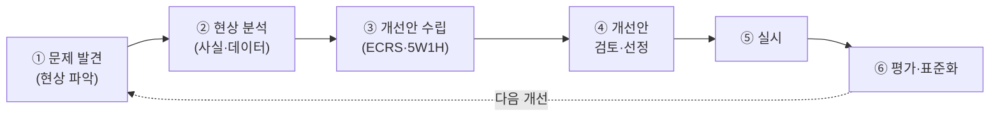
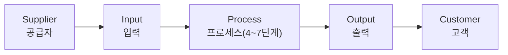

# 5.2 프로세스 분석과 개선

!!! info "출제기준"
    **5. 작업관리와 성과측정** › **2. 프로세스 분석과 개선**

## 출제 경향

총 **26문항** 출제 (1교시 단답형 13 · 2~4교시 논술형 13) · 최근 10개 회차(109~139회) 7문항 · 최근 출제 제133회

| 주제 | 출제 수 | 출제 회차 |
|---|:-:|---|
| 5.2.1 개선의 원칙(ECRS·5W1H) | 5 | 67회, 73회, 76회, 94회, 130회 |
| 5.2.2 공정분석 기법과 도표 | 10 | 68회, 76회, 85회, 88회, 91회, 100회, 106회, 109회, 121회 |
| 5.2.3 아이디어 발상과 문제해결 기법 | 6 | 68회, 71회, 85회, 94회, 133회 |
| 5.2.4 Less Engineering과 제안제도 | 3 | 97회, 109회, 127회 |
| 5.2.5 IE 기법의 현장 적용 | 2 | 67회, 73회 |

## 목차

1. [개선의 원칙(ECRS·5W1H)](#t52-1)
2. [공정분석 기법과 도표](#t52-2)
3. [아이디어 발상과 문제해결 기법](#t52-3)
4. [Less Engineering과 제안제도](#t52-4)
5. [IE 기법의 현장 적용](#t52-5)

## 5.2.1 개선의 원칙(ECRS·5W1H) {#t52-1}

### 개선의 4원칙: ECRS (67·76·130회)

| 원칙 | 질문 | 내용 | 예 |
|---|---|---|---|
| **E**liminate(제거) | 이 작업은 꼭 필요한가? | 불필요한 작업·동작·검사를 없앰 | 이중 검사 폐지, 운반 제거 |
| **C**ombine(결합) | 함께 할 수 없는가? | 두 작업·공정을 합침 | 가공과 검사를 한 공정에서 |
| **R**earrange(교환·재배치) | 순서·장소·사람을 바꿀 수 없는가? | 작업 순서·위치·담당을 바꿈 | 공정 순서 변경으로 역류 제거 |
| **S**implify(단순화) | 더 쉽게 할 수 없는가? | 방법·도구를 단순하게 | 지그 사용, 원터치 체결 |

적용 순서는 **E → C → R → S**이며, 앞의 원칙일수록 개선 효과가 크다. 'ECRSA'로 쓸 때는 마지막에 **자동화(Automate)**를 더하는 경우가 많다 — 먼저 제거·결합·재배치·단순화한 뒤에 자동화한다.

### 5W1H와 ECRS의 연계 (73회)

| 5W1H 질문 | 확인 내용 | 연결되는 개선 원칙 |
|---|---|---|
| Why(왜) / What(무엇을) | 작업의 목적과 필요성 | **제거**(Eliminate) |
| Where(어디서) / When(언제) / Who(누가) | 장소·순서·시기·담당자 | **결합**(Combine)·**재배치**(Rearrange) |
| How(어떻게) | 작업 방법 | **단순화**(Simplify) |

**적용 예 – 설거지 작업**

- 제거: 애벌 헹굼을 없애고 식기세척기 사용 / 1회용 받침으로 일부 설거지 제거
- 결합: 헹구면서 건조대에 바로 놓아 헹굼과 정리를 동시에
- 재배치: 기름기 적은 그릇부터 닦고 기름 많은 그릇은 마지막에 / 개수대 옆에 건조대 배치
- 단순화: 미리 물에 불려 문지르는 작업을 줄임, 세제 거품기 사용

### 개선의 기본 원칙과 6단계 (94회)

**기본 원칙(개선 정신)**: ① 현상을 부정하고 더 나은 방법이 있다고 생각한다 ② 사실과 데이터에 근거한다(3현주의: 현장·현물·현실) ③ 원인을 끝까지 추구한다(5 Why) ④ 완벽하지 않아도 즉시 실행한다 ⑤ 여럿의 지혜를 모은다 ⑥ 개선 결과는 표준화해 유지한다

**개선의 6단계**

!!! tip "답안 작성 포인트"
    - ECRS는 **원칙 + 질문 + 예시 표**와 적용 순서(E → S)를 쓴다.
    - 5W1H와 연계를 물으면 **질문 → 원칙 대응표**를 쓰고, 문제에서 준 일상 사례(설거지·세탁)로 각 원칙을 한 줄씩 적용한다.

??? example "관련 기출 5문항 (67회, 73회, 76회, 94회, 130회)"

    - **제67회(2002) 3교시 3번** · 25점  
      개선의 E.C.R.S.A 기법을 설명하고 사례를 기술하시오.
    - **제73회(2004) 2교시 6번** · 25점  
      5W1H와 개선의 4원칙(ECRS)을 연제하여 설명하시오.

        ??? quote "문제 전문"

            5W1H와 개선의 4원칙(ECRS)을 연제하여 설명하시오.  
            (예 : 설거지작업, 세탁작업등)  
    - **제76회(2005) 1교시 13번** · 10점  
      개선의 4대 원칙인 ECRS.
    - **제94회(2011) 4교시 3번** · 25점  
      문제해결을 위한 개선의 기본원칙과 개선의 6단계에 대하여 설명하시오.
    - **제130회(2023) 1교시 12번** · 10점  
      일반적으로 ECRS를 개선의 4원칙이라고 한다. ECRS에 대하여 설명하시오.

## 5.2.2 공정분석 기법과 도표 {#t52-2}

### 프로세스와 시스템 (76회)

- **프로세스**: 입력을 출력으로 변환하는 **상호 관련된 활동의 집합**(ISO 9000)
- **시스템**: 공통의 목적을 위해 서로 작용하는 **구성 요소의 집합** — 여러 프로세스가 모여 시스템을 이룬다

### SIPOC(COPIS) 모형 (91회)

프로세스를 **공급자(Supplier) → 입력(Input) → 프로세스(Process) → 출력(Output) → 고객(Customer)**의 다섯 요소로 한눈에 정리하는 도구다. 6시그마의 정의(Define) 단계에서 주로 쓴다. **COPIS**는 같은 내용을 고객부터 거꾸로 정의하는 방식으로, 고객 요구에서 출발한다는 점을 강조한다.

**장점**: ① 프로세스의 범위와 경계가 명확해진다 ② 관계자 모두가 전체 그림을 공유한다 ③ 고객 요구(CTQ)와 핵심 입력 변수를 찾는 출발점이 된다

### 공정분석 기호 (109·121회)

| 기본 기호 | 의미 |
|:-:|---|
| ○ | **가공(작업)**: 원재료·부품의 형태·성질을 변화시키는 과정 |
| ⇨ (또는 작은 ○) | **운반**: 위치를 바꾸는 과정 |
| □ (수량), ◇ (품질) | **검사**: 수량 또는 품질을 기준과 비교 |
| ▽ (저장), D (지체) | **정체**: 계획적으로 쌓아 둠(저장) 또는 계획에 없던 대기(지체) |

**복합 기호 (121회)**: 두 가지 공정이 동시에 일어날 때는 **주된 공정의 기호를 바깥에, 부수 공정의 기호를 안쪽**에 그린다.

| 복합 기호 | 의미 |
|---|---|
| ◇ 안에 □ | 품질검사를 주로 하면서 수량검사도 함 |
| □ 안에 ◇ | 수량검사를 주로 하면서 품질검사도 함 |
| ○ 안에 □ | 가공을 주로 하면서 수량검사도 함 |
| ○ 안에 ⇨ | 가공을 주로 하면서 운반도 함 |

### 공정분석 도표의 종류 (88·106회)

| 도표 | 특징 | 용도 |
|---|---|---|
| **작업공정도**(Operation Process Chart) | 가공(○)과 검사(□)만으로 재료 투입부터 완성까지 순서 표시 | 전체 공정 순서·조립 관계 파악 |
| **흐름공정도**(Flow Process Chart) | 가공·운반·검사·정체·저장 기호로 모든 과정을 상세히 표시(제품형·작업자형) | 운반·정체 낭비 발견 |
| **유선도**(Flow Diagram) | 배치도 위에 물자·작업자의 이동 경로를 선으로 표시 | 운반 경로·역류·교차 개선, 배치 개선 |
| **From-To Chart** | 공정 간 이동 횟수·물량을 행렬로 표시 | 다품종 배치 결정 |
| 조립공정도 | 부품이 조립되는 순서를 나무 구조로 표시 | 조립 순서·부품 흐름 |
| 다중활동분석표(연합작업분석) | 사람·기계의 활동을 시간 축에 병렬 표시 | 유휴시간 제거, 담당 대수 결정 |
| 양손작업분석표 | 왼손·오른손 동작을 나란히 표시 | 동작 개선 |

### 가치흐름도(VSM, Value Stream Mapping) (121회)

**정의**: 제품 하나가 원자재에서 고객에게 갈 때까지의 **물자 흐름과 정보 흐름**을 한 장에 그려, 부가가치·비부가가치 활동과 리드타임을 시각화하는 린 생산 도구다(Rother & Shook, 『Learning to See』).

**절차**: ① 대상 제품군 선정 → ② **현재 상태도** 작성(공정 박스·재고 삼각형·정보 흐름·리드타임 사다리) → ③ 낭비·병목 분석 → ④ **미래 상태도** 설계(흐름 생산·풀 시스템·평준화) → ⑤ 실행 계획

**핵심 지표**: 총 리드타임 대비 **부가가치 시간 비율**(보통 매우 작음) — 정체 시간이 대부분임을 보여 준다.

### 기타 분석 도구

- **경로분석 (68회)**: 다품종 생산에서 제품별 가공 경로(공정 순서)를 표로 비교해 공통·유사 경로를 찾고, GT 셀·라인화·설비배치 개선의 근거로 쓰는 분석이다. (통계에서 변수 간 인과 경로를 분석하는 '경로분석'과는 다른 개념이다.)
- **4W 차트 (85회)**: 업무나 작업을 What(무엇을)·Who(누가)·When(언제)·Where(어디서)로 정리해 담당과 일정을 한눈에 보이게 하는 계획·분석 표다. 업무 분장, 작업 일정 관리, 개선 과제의 추진 관리에 쓴다.
- **제조 8대 프로세스 (100회)**: 제조기업의 핵심 프로세스를 가치사슬 흐름으로 보면 ① 수주(영업) ② 개발·설계 ③ 생산계획 ④ 구매·조달 ⑤ 제조 ⑥ 품질 ⑦ 출하·물류 ⑧ 사후 서비스로 정리할 수 있다.

!!! warning "확인 필요"
    경로분석·4W 차트·제조 8대 프로세스는 교재마다 정의가 다를 수 있으므로 수험 교재의 설명을 확인하세요.

!!! tip "답안 작성 포인트"
    - 공정분석은 **기호표 → 도표 종류 비교표 → 개선 착안점(운반·정체 제거)** 순으로 쓴다. 기호는 반드시 그림으로 그린다.
    - VSM은 현재·미래 상태도의 **간단한 그림**(공정 박스, 재고 삼각형, 리드타임 사다리)을 곁들인다.

??? example "관련 기출 10문항 (68회, 76회, 85회, 88회, 91회, 100회, 106회, 109회, 121회)"

    - **제68회(2002) 1교시 7번** · 10점  
      경로분석
    - **제76회(2005) 1교시 1번** · 10점  
      프로세스와 시스템의 정의.
    - **제85회(2008) 1교시 6번** · 10점  
      4W Chart의 특징과 용도에 대해서 설명하시오.
    - **제88회(2009) 4교시 5번** · 25점  
      공장 및 사업장내에서 공정과 자재흐름을 분석하기 위한 5가지 도구에 대한 특징과 용도를 기술하시오.
    - **제91회(2010) 1교시 5번** · 10점  
      SIPOC (COPIS) 모형을 설명하고, 이 모형의 장점 3가지를 쓰시오.
    - **제100회(2013) 1교시 4번** · 10점  
      제조(생산) 8대 프로세스
    - **제106회(2015) 3교시 1번** · 25점  
      공정분석 및 개선에 사용되는 도표에 대하여 설명하시오.
    - **제109회(2016) 1교시 5번** · 10점  
      생산공정 분석 시 사용하는 공정기호(4가지)의 표시와 각각의 의미를 설명하시오.
    - **제121회(2020) 1교시 9번** · 10점  
      가치흐름도(Value Stream Mapping)
    - **제121회(2020) 3교시 4번** · 25점  
      공정분석표(Operation Process Chart)에서 사용하는 기본적인 공정기호 4가지와 기본 공정기호를 복합적으로 사용하는 복합기호 4가지를 설명하시오.

## 5.2.3 아이디어 발상과 문제해결 기법 {#t52-3}

### 문제해결 절차 (68·94회)

대표적인 문제해결 절차(QC 스토리)는 다음과 같다. 68회처럼 경험 사례를 요구하면 이 단계에 맞춰 자신의 사례를 쓴다.

| 단계 | 내용 | 도구 |
|---|---|---|
| ① 주제 선정 | 문제를 구체적으로 정의 | 파레토도, 체크시트 |
| ② 현상 파악 | 사실·데이터로 현재 수준 측정 | 그래프, 층별 |
| ③ 원인 분석 | 근본 원인 규명 | 특성요인도, 5 Why |
| ④ 목표 설정 | 정량 목표와 기한 | – |
| ⑤ 대책 수립 | 원인별 대책 | 브레인스토밍, ECRS |
| ⑥ 실시 | 계획에 따라 실행 | 간트 차트 |
| ⑦ 효과 확인 | 목표 대비 결과 확인 | 비교 그래프 |
| ⑧ 표준화·사후관리 | 재발 방지, 수평 전개 | 표준서, 관리도 |

### 아이디어 발상 기법

**브레인스토밍(Osborn)의 4가지 규칙 (68·85회)**

1. **비판 금지**: 다른 사람의 아이디어를 평가·비판하지 않는다
2. **자유분방**: 엉뚱한 아이디어도 환영한다
3. **질보다 양**: 가능한 한 많이 낸다
4. **결합·개선(편승)**: 남의 아이디어를 발전시키거나 결합한다

**브레인스토밍과 고든법 비교 (85회)**

| 구분 | 브레인스토밍 | 고든(Gordon)법 |
|---|---|---|
| 주제 제시 | 구체적인 문제를 모두에게 공개 | **리더만 문제를 알고**, 참가자에게는 추상적 키워드(기능)만 제시 |
| 목적 | 많은 아이디어를 빠르게 | 고정관념에서 벗어난 독창적 발상 |
| 특징 | 진행이 쉽고 참여가 활발 | 리더의 숙련 필요, 시간이 걸림 |
| 예 | "불량을 줄이는 방법은?" | "자르다"라는 기능만 제시 → 새 절단 방식 발상 |

**희망열거법 (71회)**: 대상에 대해 "이렇게 되었으면 좋겠다"는 **희망 사항을 열거**하고, 이를 실현하는 방안을 찾는 발상법이다. 결점열거법(단점을 나열해 개선)·특성열거법(특성별로 나눠 개선)과 함께 대표적인 열거법이다. 신제품 아이디어나 고객 관점의 개선에 효과적이다.

**KJ법 (94회)**: 가와키타 지로(川喜田二郎)가 개발한 방법으로, 사실·의견을 **카드에 한 장씩 적고**, 내용이 비슷한 카드끼리 모아 **그룹화하고 표제를 붙여** 구조를 도해한 뒤 문장으로 정리한다. 정리되지 않은 정성 정보에서 문제의 구조를 찾는 데 쓰며, 신 QC 7가지 도구의 **친화도법**이 여기서 나왔다.

### 시스템 접근 방법 (133회)

문제를 개별 요소가 아니라 **목적을 가진 전체 시스템** 관점에서 보고, 구성 요소와 상호관계를 분석해 전체 최적의 해결책을 찾는 방법이다.

- **특징**: 전체성(부분 최적보다 전체 최적), 목적 지향성, 구성 요소 간 상호관계 중시, 환경과의 관계 고려, 피드백에 의한 수정
- **절차**: 문제 정의 → 목표 설정 → 시스템 분석(구성 요소·관계) → 대안 도출 → 대안 평가·선택 → 실행 → 피드백
- **효과**: 근본적·종합적 해결, 부서 간 이해 충돌 조정, 부작용 예방, 복잡한 문제의 구조화

!!! tip "답안 작성 포인트"
    - 발상 기법은 **창시자 + 규칙(절차) + 특징 + 적용 예**를 쓴다. 비교 문제는 표로 쓴다.
    - 68회처럼 경험 사례를 묻는 문제는 **8단계 표에 자신의 사례를 숫자와 함께** 채워 넣는 연습을 미리 해 둔다.

??? example "관련 기출 6문항 (68회, 71회, 85회, 94회, 133회)"

    - **제68회(2002) 4교시 4번** · 25점  
      귀하가 최근에 경험한 업무상의 문제를 예를 들어 문제해결 절차에 따라 해결 방안을 제시해보시오.
    - **제68회(2002) 4교시 5번** · 25점  
      집단 아이디어 창출방법인 브레인스토밍(Brain Storming)의 4가지 규칙을 설명하시오.
    - **제71회(2003) 1교시 9번** · 10점  
      희망열거법
    - **제85회(2008) 1교시 5번** · 10점  
      브레인스토밍(Brain Storming)과 고든(Gordon)법을 비교 설명하시오.
    - **제94회(2011) 1교시 13번** · 10점  
      문제해결을 위한 KJ(가와기다 지로 교수의 카드발상)법
    - **제133회(2024) 3교시 6번** · 25점  
      문제 해결을 위한 시스템 접근 방법(Systems Approach)의 특징과 효과를 설명하시오.

## 5.2.4 Less Engineering과 제안제도 {#t52-4}

### 레스(Less) 엔지니어링 (97·127회)

**3무(無) 메모법**은 현장의 **무리(ムリ)·낭비(ムダ)·불균일(ムラ)**을 발견할 때마다 메모해 개선 과제로 삼는 활동이다. 그 일환인 **레스 엔지니어링(○○ Less Engineering)**은 "○○이 없는 상태"를 목표로 설정하고, 그 대상을 근본적으로 없애는 방향으로 개선하는 방법이다. 줄이는 것(Reduce)이 아니라 **없애는 것(Less)**을 목표로 하므로 발상의 전환을 이끈다.

**4M과 연계한 개선 방법 (127회)**

| 4M | Less 목표 | 개선 방법 |
|---|---|---|
| **Man**(사람) | Walk-less, Search-less, Skill-less | 배치 개선으로 보행 제거, 3정으로 찾기 제거, 실수방지로 숙련 불필요 |
| **Machine**(설비) | Setup-less, Adjust-less, Tool-less | SMED, 위치결정 기준으로 조정 제거, 공구 없이 교체(원터치) |
| **Material**(자재) | Inventory-less, Defect-less, Packaging-less | 1개 흐름·간판, 공정 내 품질 확보, 반복 사용 용기(포장 없는 공급) |
| **Method**(방법) | Paper-less, Inspection-less, Waiting-less | 전자 작업지시, 공정 보증으로 검사 생략, 라인밸런싱 |

### 제안제도의 성공 요소 (109회)

**제안제도**는 구성원이 업무 개선 아이디어를 제안하고, 회사가 심사·채택·실시·보상하는 제도다.

1. **경영층의 관심과 지원**: 최고경영자의 참여, 우수 제안 공유
2. **쉬운 제안 절차**: 양식 간소화, 전자 제안 시스템, 즉시 실천 제안 인정
3. **신속한 심사와 피드백**: 채택 여부와 이유를 빠르게 회신
4. **공정한 평가와 보상**: 명확한 심사 기준, 금전·비금전 보상, 성과 공유
5. **실시 중심 운영**: 제안 건수보다 실시율과 효과를 중시
6. **교육과 소집단 연계**: 개선 기법 교육, 분임조 활동과 연계
7. **목표 관리와 확산**: 부서별 목표, 우수 사례 수평 전개

!!! tip "답안 작성 포인트"
    - 레스 엔지니어링은 **3무 메모법과의 관계 → 개념("없앤다") → 4M별 Less 목표·방법 표**로 쓴다.
    - 제안제도는 성공 요소를 **경영층·절차·피드백·보상·실시·교육**의 관점으로 빠짐없이 쓴다.

??? example "관련 기출 3문항 (97회, 109회, 127회)"

    - **제97회(2012) 1교시 2번** · 10점  
      3무(無)메모법의 일환으로 실시되는 OO Less Engineering에 대하여 설명하시오.
    - **제109회(2016) 3교시 6번** · 25점  
      기업경쟁력의 원천인 제안제도의 성공요소를 설명하시오.
    - **제127회(2022) 2교시 1번** · 25점  
      레스 엔지니어링(Less Engineering) 의미를 설명하고 4M과 연계하여 개선방법을 설명하시오.

## 5.2.5 IE 기법의 현장 적용 {#t52-5}

### 생산 방식별 IE 기법 적용 (67회)

| 구분 | 소품종 대량 생산 | 다품종 소량·단납기 생산 |
|---|---|---|
| **자재** | MRP·간판으로 안정 공급, 대량 구매·VMI, 라인 측 정량 공급 | 부품 공용화·표준화, 키트(세트) 공급, 단납기 협력사·소로트 다빈도 조달 |
| **설비** | 전용·자동화 설비, 라인밸런싱, TPM으로 가동률 극대화 | 범용·소형 설비, 셀·GT 배치, SMED로 준비교체 단축 |
| **인력** | 표준작업과 작업 측정, 분업·전문화, 라인 편성 효율 관리 | 다기능화, U라인·셀로 인원 탄력 운영, 스킬 맵 관리 |
| **중점 IE 기법** | 시간연구·라인밸런싱·동작경제·워크샘플링 | 공정분석·GT·SMED·워크샘플링·일정계획 |

### 원가 절감과 납기 단축 방안 (73회)

| 목표 | 대상 | 개선 방안 |
|---|---|---|
| **원가 절감** | 재료비 | VE·설계 개선, 수율 향상, 구매 단가 협상·공용화 |
| | 노무비 | 작업 개선(ECRS·동작경제), 라인밸런싱, 자동화, 다기능화 |
| | 경비 | 에너지 절감, 예방보전으로 수리비 감소, 공간·재고 축소 |
| | 품질비용 | 불량·재작업 감소(공정 내 품질 확보) |
| **납기 단축** | 리드타임 | 정체 제거, 소로트화, SMED, 병목 해소 |
| | 계획·통제 | 정확한 일정계획, 진도관리, 우선순위 관리 |
| | 개발·조달 | 동시공학, 장납기 자재 선행 발주, 협력사 정보 공유 |

원가와 납기는 **낭비 제거**라는 같은 뿌리를 가지므로, 정체·재고를 줄이면 두 목표를 동시에 달성할 수 있다. 리드타임 단축의 상세는 [2.2.2](../02-operations-logistics/02-progress-control.md#t22-2)를 참고한다.

!!! tip "답안 작성 포인트"
    - 67회처럼 비교 축(생산 방식)과 운영 요소(자재·설비·인력)를 주면 **2차원 표**로 답한다.
    - 원가·납기 문제는 **원가 요소별·납기 요인별 표**를 쓰고, 낭비 제거로 둘을 함께 달성한다는 결론을 맺는다.

??? example "관련 기출 2문항 (67회, 73회)"

    - **제67회(2002) 4교시 4번** · 25점  
      소품종 대량 생산방식과 다품종 소량생산의 단납기 생산방식에서 IE전문가로서 자재, 설비, 인력의 운영면에서 효과적으로 기법을 적용하는 방법을 기술하시오.
    - **제73회(2004) 4교시 4번** · 25점  
      원가절감과 납기 단축을 위한 개선방안을 설명하시오.
