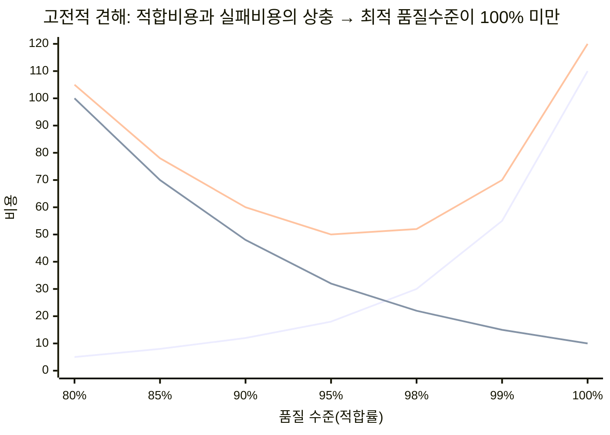
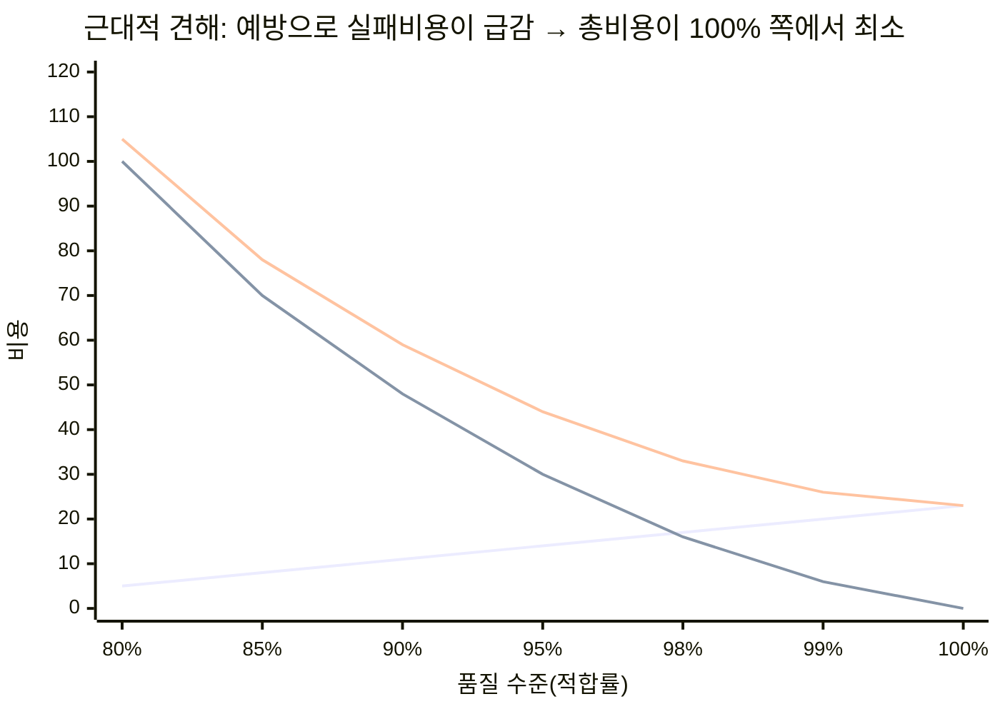
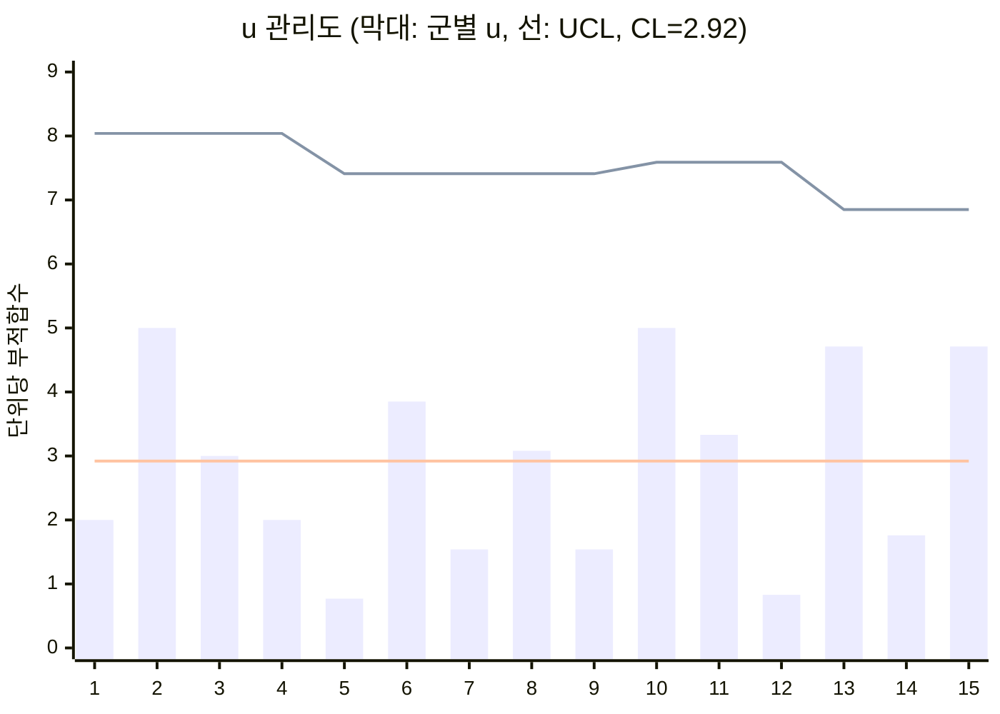
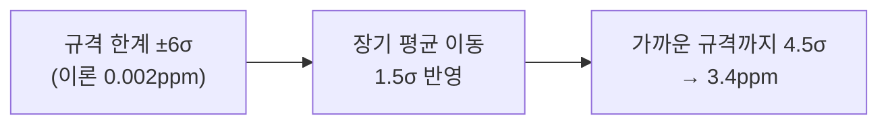
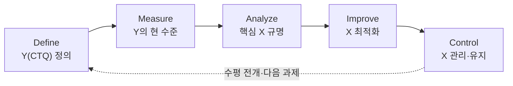
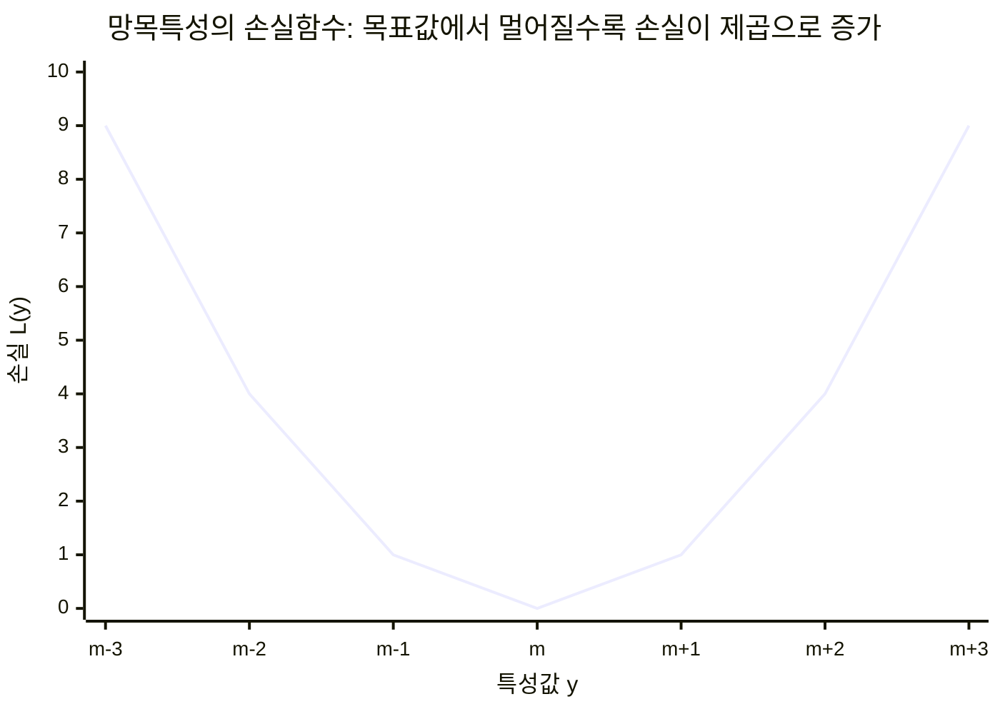
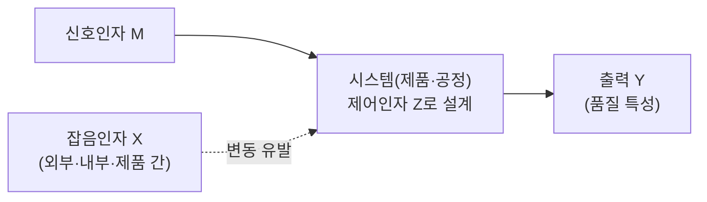
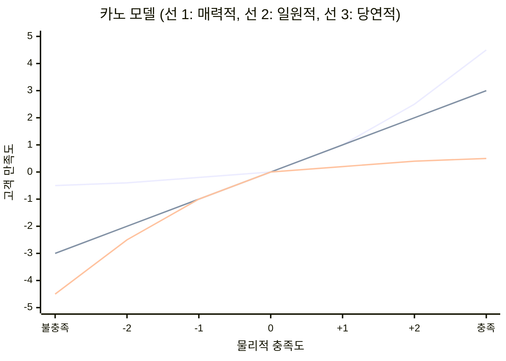

# 5.4 품질관리

!!! info "출제기준"
    **5. 작업관리와 성과측정** › **4. 품질관리**

## 출제 경향

총 **71문항** 출제 (1교시 단답형 37 · 2~4교시 논술형 34) · 최근 10개 회차(109~139회) 24문항 · 최근 출제 제139회

| 주제 | 출제 수 | 출제 회차 |
|---|:-:|---|
| 5.4.1 품질경영·TQM·ISO 9000 | 8 | 63회, 68회, 91회, 103회, 109회, 124회, 133회 |
| 5.4.2 품질비용(COQ) | 8 | 65회, 67회, 76회, 85회, 94회, 112회, 127회, 139회 |
| 5.4.3 통계적 공정관리(관리도·공정능력) | 13 | 67회, 68회, 73회, 97회, 103회, 109회, 112회, 127회, 130회, 133회 |
| 5.4.4 측정시스템분석(MSA·Gage R&R) | 5 | 65회, 67회, 76회, 115회, 130회 |
| 5.4.5 6시그마(DMAIC·DMADV·DFSS) | 13 | 65회, 67회, 70회, 76회, 79회, 85회, 91회, 109회, 121회, 130회, 139회 |
| 5.4.6 다구찌 품질공학과 강건설계 | 8 | 65회, 91회, 100회, 106회, 112회, 115회, 133회, 136회 |
| 5.4.7 카노 모델 | 3 | 65회, 100회, 124회 |
| 5.4.8 FMEA·FTA·실수방지 | 8 | 67회, 71회, 82회, 94회, 133회 |
| 5.4.9 제조물책임(PL) | 5 | 63회, 67회, 70회, 73회, 82회 |

## 목차

1. [품질경영·TQM·ISO 9000](#t54-1)
2. [품질비용(COQ)](#t54-2)
3. [통계적 공정관리(관리도·공정능력)](#t54-3)
4. [측정시스템분석(MSA·Gage R&R)](#t54-4)
5. [6시그마(DMAIC·DMADV·DFSS)](#t54-5)
6. [다구찌 품질공학과 강건설계](#t54-6)
7. [카노 모델](#t54-7)
8. [FMEA·FTA·실수방지](#t54-8)
9. [제조물책임(PL)](#t54-9)

## 5.4.1 품질경영·TQM·ISO 9000 {#t54-1}

### TQM(Total Quality Management) (124회)

**TQM**은 최고경영자의 리더십 아래 **전 부문·전원이 참여**해 고객 만족을 목표로 제품·서비스·업무 프로세스의 품질을 **지속적으로 개선**하는 전사적 경영 방식이다.

| 구분 | QC(품질관리) | TQC(전사적 품질관리) | **TQM**(종합적 품질경영) |
|---|---|---|---|
| 초점 | 제품의 검사·규격 적합 | 제조 중심 전 부문의 품질 활동 | 경영 전반의 품질과 고객 만족 |
| 주체 | 품질부서 | 품질·생산 부서 중심 | 최고경영자부터 전 구성원 |
| 목표 | 불량 감소 | 품질 보증 | 고객 만족·경쟁력·장기적 성공 |

**핵심 원칙**: 고객 중심, 최고경영자의 리더십, 전원 참여, 프로세스 중심, 지속적 개선(PDCA), 사실에 근거한 관리, 공급자와의 협력

**품질관리의 발전 단계**: 검사 중심(작업자·직장 검사) → 통계적 품질관리(Shewhart 관리도, 1920년대) → 품질보증(QA) → TQC(Feigenbaum, 1950년대) → TQM(1980년대~) → 6시그마·품질 4.0(데이터·AI 기반)

**품질 대가의 핵심 주장**

| 학자 | 핵심 주장 |
|---|---|
| Deming | PDCA 사이클, 경영 14원칙, 품질 문제의 대부분(교재에 따라 85~94%)은 시스템(경영) 책임 |
| Juran | 품질 = 용도 적합성, **품질 3부작**(품질 계획·관리·개선), 파레토 원칙(중요한 소수) |
| Feigenbaum | TQC 제창, 품질비용(PAF) 분류 |
| Crosby | 무결점(ZD), 품질 = 요구사항 적합, 부적합 비용 |
| Ishikawa | 전사적 품질관리(CWQC), 특성요인도, QC 서클 |

**TQM 추진 체계**: 경영층의 품질 방침·목표 → 고객 요구 파악(VOC·QFD) → 프로세스 관리·개선(6시그마·분임조) → 교육·참여 → 성과 측정(품질비용·고객만족도) → 피드백

### Garvin의 제품 품질 8가지 차원 (91회)

| 차원 | 의미 |
|---|---|
| 성능(Performance) | 제품의 기본 기능 수준 |
| 특징(Features) | 기본 기능을 보완하는 부가 기능 |
| 신뢰성(Reliability) | 일정 기간 고장 없이 작동할 가능성 |
| 적합성(Conformance) | 설계 규격에 맞는 정도 |
| 내구성(Durability) | 제품의 수명 |
| 서비스성(Serviceability) | 수리의 신속성·용이성·친절함 |
| 심미성(Aesthetics) | 외관·느낌·소리 등 감각적 특성 |
| 인지된 품질(Perceived Quality) | 브랜드·평판 등으로 고객이 느끼는 품질 |

### Crosby의 품질경영 4대 절대 원칙 (103회)

1. **품질의 정의**는 "요구사항에 대한 적합"이다.
2. **품질 시스템**은 평가가 아니라 **예방**이다.
3. **성과 기준**은 **무결점(ZD)**이다 — "이 정도면 된다"를 허용하지 않는다.
4. **품질의 척도**는 **부적합 비용(PONC)**이다 — 품질 문제를 돈으로 측정한다.

**예방의 원칙과 한국 기업의 품질 의식 (103회)**

| 문제점 | 개선 방안 |
|---|---|
| 검사로 불량을 걸러내는 **사후 대응** 중심 | 설계·공정 단계의 예방(FMEA, 실수방지, 공정능력 확보) |
| "이 정도 불량은 어쩔 수 없다"는 허용 문화 | 무결점 목표, 품질비용으로 손실 가시화 |
| 품질은 품질부서의 일이라는 인식 | 전원 참여·자주검사, 품질 책임의 공정 내재화 |
| 원가·납기 우선으로 품질 투자 소홀 | 예방 투자의 효과(1:10:100 원칙) 공유, 경영층 의지 |
| 협력사 품질의 방치 | 공급자 품질 보증·육성 |

### ZD(Zero Defect) 프로그램의 단점 (109회)

1960년대 미국 마틴사에서 시작된 ZD 운동은 작업자의 동기 부여로 무결점을 달성하려 했지만 다음 한계가 있다.

1. 구호·캠페인 같은 **정신 운동에 치우침**
2. 불량의 대부분은 관리·시스템의 문제인데 **작업자에게 책임을 전가**
3. 통계적 방법과 **근본 원인 분석이 부족**
4. 공정 능력이 부족하면 의욕만으로는 달성할 수 없음
5. 초기 열기가 식으면 **지속성이 떨어짐**

### ISO 9000 품질경영 원칙 (103·133회)

| ISO 9000:2000/2008 **8원칙** | ISO 9001:2015 **7원칙** |
|---|---|
| ① 고객 중시 | ① 고객 중시 |
| ② 리더십 | ② 리더십 |
| ③ 전원 참여 | ③ 인원의 적극 참여 |
| ④ 프로세스 접근방법 | ④ 프로세스 접근법 |
| ⑤ 경영에 대한 시스템 접근방법 | (④에 통합) |
| ⑥ 지속적 개선 | ⑤ 개선 |
| ⑦ 의사결정에 대한 사실적 접근방법 | ⑥ 증거 기반 의사결정 |
| ⑧ 상호 유익한 공급자 관계 | ⑦ 관계 관리 |

**ISO 9001:2015의 주요 변화**: 공통 상위 구조(HLS, 10개 조항)로 ISO 14001·45001과 통합 운영 용이, **조직 상황과 이해관계자** 파악, **리스크 기반 사고**, 리더십 책임 강화, 문서·기록을 "문서화된 정보"로 통합

**ISO 9001:2015 조항 구성과 PDCA**

| PDCA | 조항 |
|---|---|
| Plan | 4. 조직 상황 / 5. 리더십 / 6. 기획(리스크·기회, 품질목표) / 7. 지원(자원·역량·문서화된 정보) |
| Do | 8. 운용(제품·서비스 요구사항, 설계·개발, 외부 공급자 관리, 생산) |
| Check | 9. 성과 평가(모니터링·내부심사·경영검토) |
| Act | 10. 개선(부적합·시정조치, 지속적 개선) |

(1~3조항은 적용 범위·인용 표준·용어)

**ISO 9001 실행 시 함께 참고하는 지원 표준 (103회)**: KS Q ISO 9000(기본 사항과 용어), ISO 9004(조직의 지속적 성공을 위한 경영), ISO 19011(경영시스템 심사 지침), ISO 10005(품질계획서 지침), ISO 10014(재무적·경제적 이익 실현 지침), ISO 10015(교육훈련 지침) 등 — 문제의 의도에 맞는 5가지를 골라 쓴다.

**프로세스 접근방법 (68회)**: 원하는 결과를 얻기 위해 활동과 자원을 **입력 → 출력의 상호 관련 프로세스**로 관리하는 방식이다. 프로세스 간 상호작용을 하나의 시스템으로 보고 PDCA와 리스크 기반 사고로 관리한다.

**Hidden Factory (63회)**: 공식적인 생산 흐름 뒤에서 **재작업·수정·선별·재검사** 같은 눈에 보이지 않는 작업이 공장 능력의 상당 부분을 소모하는 현상(숨겨진 공장)이다. 최종 수율에는 드러나지 않으므로 **누적수율(RTY)**로 측정해 드러낸다.

!!! tip "답안 작성 포인트"
    - 품질경영 이론은 **학자명 + 원칙 목록 + 의미** 표로 정리한다(Garvin 8차원, Crosby 4원칙, ISO 7·8원칙).
    - ISO 원칙은 2008년판 8원칙과 2015년판 7원칙의 **대응 관계**를 알아 두면 어느 판으로 묻든 대응할 수 있다.
    - TQM·ZD 같은 25점 문제는 **품질관리 발전 단계 → 품질 대가 표**로 배경을 깔면 개요가 풍부해진다.
    - 결론 예: "품질경영은 검사에서 예방, 예방에서 데이터 기반 예측으로 진화하고 있으므로, ISO 9001 체계 위에 AI 비전검사·공정 데이터 분석(품질 4.0)과 공급망 품질 리스크 관리를 더해야 한다."

??? example "관련 기출 8문항 (63회, 68회, 91회, 103회, 109회, 124회, 133회)"

    - **제63회(2001) 1교시 10번** · 10점  
      Hidden Factory
    - **제68회(2002) 1교시 11번** · 10점  
      프로세스 접근방법
    - **제91회(2010) 1교시 13번** · 10점  
      Garvin 교수가 제시한 제품 품질특성의 8가지를 나열하고 설명하시오.
    - **제103회(2014) 2교시 5번** · 25점  
      품질경영에 대한 다음 각 물음에 답하시오.

        ??? quote "문제 전문"

            품질경영에 대한 다음 각 물음에 답하시오.  
            1) P. B. Crosby의 품질경영 4대 절대조건(Absolutes of QM)을 설명하시오.  
            2) 1)항의 관점 중 2번째 원칙을 실현하는 수단으로 제시된 ‘예방의 원칙’에 대하여 한국기업의 품질의식에 대한 문제점과 개선방안을 연결하여 설명하시오.  
    - **제103회(2014) 4교시 1번** · 25점  
      ISO 9000 품질경영시스템에서 다음 사항에 대하여 설명하시오.

        ??? quote "문제 전문"

            ISO 9000 품질경영시스템에서 다음 사항에 대하여 설명하시오.  
            1) 품질경영의 8원칙  
            2) KS Q ISO 9001:2009 품질경영시스템을 실행할 때 고려해야 할 활동들을 규정한 표준 5가지  
    - **제109회(2016) 2교시 4번** · 25점  
      ZD(zero defect) 프로그램의 단점에 대하여 설명하시오.
    - **제124회(2021) 1교시 9번** · 10점  
      TQM(Total Quality Management)
    - **제133회(2024) 1교시 7번** · 10점  
      ISO 9001:2015의 품질경영 7대 원칙

## 5.4.2 품질비용(COQ) {#t54-2}

### 품질비용의 정의와 산출 의의 (76·139회)

**품질비용(COQ, Cost of Quality)**은 제품·서비스의 품질을 확보하고 유지하는 데 드는 비용과, 품질이 나빠서 생기는 손실을 합한 비용이다(Feigenbaum의 PAF 분류).

**산출의 의의**: 품질 문제를 **금액으로 가시화**해 경영층의 관심을 끌고, 개선 우선순위를 정하며, 품질 활동의 성과를 측정한다.

### 품질비용의 분류 (67·112·127·139회)

| 분류 | 의미 | 항목 예 |
|---|---|---|
| **예방비용**(P) | 불량이 생기지 않도록 미리 쓰는 비용 | 품질 계획, 품질 교육, 설계 검토, 공정 관리·개선, 공급자 품질 지도 |
| **평가비용**(A) | 품질 수준을 측정·평가하는 비용 | 수입·공정·최종 검사, 시험 장비 유지·교정, 품질 감사 |
| **내부 실패비용**(IF) | 출하 **전에** 발견된 불량으로 생기는 비용 | 폐기, 재작업·수리, 재검사, 등급 저하, 불량에 따른 설비 정지 |
| **외부 실패비용**(EF) | 출하 **후** 고객에게서 발견된 불량으로 생기는 비용 | 클레임 처리, 반품·교환, 보증 수리, 리콜, 제조물책임 배상, 신용 하락 |

- **COPQ(Cost of Poor Quality) (65회)**: 품질이 나빠서 생기는 비용 — 실패비용(내부 + 외부)에 판매 기회 손실·고객 이탈 같은 **숨은 비용**까지 포함한다.
- **F-Cost(실패비용) (94회)**: 내부 실패비용 + 외부 실패비용. 외부 실패비용은 금액보다 **신용 손실**이 더 크다(67회).
- **1:10:100 원칙**: 불량을 설계 단계에서 막으면 1, 공정에서 잡으면 10, 고객에게서 발견되면 100의 비용이 든다.

**품질비용 빙산 모델**: 회계에 드러나는 비용(폐기·재작업·보증 수리·클레임)은 수면 위의 일부이고, 수면 아래에 **숨은 비용**(추가 공수·재검사, 과잉 재고, 납기 지연, 판매 기회 손실, 고객 이탈·신용 하락)이 훨씬 크게 존재한다 — Hidden Factory와 같은 맥락이다.

### 품질비용의 산출 기준 (127회)

| 구분 | 내용 |
|---|---|
| 집계 범위 | 설계·구매·제조·검사·영업·A/S 등 **전 부문**의 PAF 항목, 항목별 계정 코드 정의 |
| 수집 방법 | 회계 자료 + 공수·폐기·클레임 실적, 숨은 비용은 추정 기준을 정해 산정 |
| 측정 지표 | 매출액 대비 품질비용률(%), 제조원가 대비, 생산 단위당 품질비용, **PAF 구성비** |
| 평가 | 추세 분석(월·분기), 실패비용의 파레토 분석, 예방비 투자 대비 실패비용 감소 효과 |

(일반적으로 품질 수준이 낮은 기업은 실패비용 비중이 크고, 성숙할수록 예방비 비중이 커진다.)

### 고전적 견해와 근대적 견해 (85·139회)

(각 그래프에서 우상향 선은 예방·평가비용, 우하향 선은 실패비용, 나머지는 총품질비용)

| 구분 | 고전적(전통적) 견해 | 근대적(현대적) 견해 |
|---|---|---|
| 관점 | 품질을 높이려면 예방·평가비가 급증 | 예방 투자가 실패비용을 훨씬 크게 줄임 |
| 최적점 | 총비용 최소인 **100% 미만**의 품질 수준 | **무결점(100%)**에 가까울수록 총비용 최소 |
| 시사점 | 일정 수준의 불량은 경제적 | 불량 제로를 향한 **지속적 개선**이 경제적 |

**공장혁신 활동이 필요한 이유 (85회)**: 근대적 견해에 따르면 예방 중심의 혁신 활동(TQM·6시그마·TPM·실수방지)으로 실패비용을 줄이면 총품질비용이 계속 낮아진다. 따라서 품질 향상은 비용 증가가 아니라 **원가 절감 수단**이며, 혁신 활동을 멈추지 않아야 한다.

### 단계별 품질비용 개선 방안 (127회)

1. **실패비용 파악**: 품질비용 체계를 세워 숨은 실패비용까지 집계
2. **실패 원인 제거**: 파레토 분석으로 큰 실패비용부터 근본 원인 대책
3. **예방비 투자 확대**: 설계 검토, FMEA, 공정능력 확보, 교육
4. **평가비 최적화**: 공정 능력이 확보되면 검사를 줄이고 공정 내 보증으로 전환
5. **예방 중심 체제 정착**: 품질비용을 정기 보고해 경영 지표로 관리

!!! tip "답안 작성 포인트"
    - 품질비용은 **PAF 4분류 표(의미 + 항목 3개 이상)**가 기본이다.
    - 고전적·근대적 견해는 **두 그래프를 나란히** 그리고 최적점의 위치 차이를 강조한다.
    - 항목 예는 문제가 요구한 개수(2개·3개)보다 1개 더 쓰고, **빙산 모델(숨은 비용)**을 언급하면 차별화된다.
    - 결론 예: "품질비용은 품질을 경영의 언어(금액)로 바꾸는 도구이므로, 예방비 투자로 실패비용을 줄이는 구조 전환을 경영 지표로 관리하고 ERP·MES 연계로 숨은 비용까지 자동 집계해야 한다."

??? example "관련 기출 8문항 (65회, 67회, 76회, 85회, 94회, 112회, 127회, 139회)"

    - **제65회(2001) 1교시 6번** · 10점  
      COPQ(Cost of Poor Quality)
    - **제67회(2002) 1교시 8번** · 10점  
      Q-Cost의 외적 실패코스트를 설명하시오
    - **제76회(2005) 1교시 2번** · 10점  
      품질코스트(Q-cost) 산출의 의의와 분류.
    - **제85회(2008) 3교시 6번** · 25점  
      품질코스트는 고전적 견해와 근대적 견해가 있다.

        ??? quote "문제 전문"

            품질코스트는 고전적 견해와 근대적 견해가 있다.  
            1) 두 견해의 차이를 설명하고,  
            2) 공장혁신활동을 해야 하는 이유를 근대적 견해와 연계하여 설명하시오.  
    - **제94회(2011) 1교시 12번** · 10점  
      F-Cost(Failure cost)
    - **제112회(2017) 4교시 1번** · 25점  
      품질비용(Cost of Quality)을 4가지로 분류하여 설명하고, 각각의 예를 2가지만 제시하시오.
    - **제127회(2022) 3교시 2번** · 25점  
      품질코스트 분류, 산출기준 및 단계별 품질코스트 개선방안을 설명하시오.
    - **제139회(2026) 3교시 1번** · 25점  
      품질비용에 대하여 다음의 물음에 답하시오.

        ??? quote "문제 전문"

            품질비용에 대하여 다음의 물음에 답하시오.  
            1) 품질비용의 정의를 설명하시오.  
            2) 품질비용을 분류하고, 구체적인 항목을 3가지씩 쓰시오.  
            3) 품질비용 곡선을 전통적인 관점과 새로운 관점으로 구분하여 작성하시오.  

## 5.4.3 통계적 공정관리(관리도·공정능력) {#t54-3}

### QC 7가지 도구와 신 QC 7가지 도구 (127·130회)

| QC 7가지 도구(수치 데이터) | 용도 |
|---|---|
| 파레토도 | 중점 문제(큰 항목) 선정 |
| 특성요인도 | 결과(특성)와 원인(4M·5M1E)의 관계 정리 — 이시카와 다이어그램 |
| 체크시트 | 데이터를 쉽게 수집·집계 |
| 히스토그램 | 분포 형태·산포 파악, 규격과 비교 |
| 산점도 | 두 변수 간 상관관계 |
| 관리도 | 공정의 안정 상태 감시 |
| 층별(또는 그래프) | 데이터를 요인별로 나눠 차이 파악 |

| 신 QC 7가지 도구(언어 데이터) | 용도 |
|---|---|
| 친화도법(KJ법) | 혼란한 언어 정보를 유사성으로 묶어 구조화 |
| 연관도법 | 복잡한 원인·결과의 인과관계 정리 |
| 계통도법 | 목적 → 수단을 단계적으로 전개 |
| 매트릭스도법 | 두 요소 간 관계를 행렬로 정리 |
| 매트릭스 데이터 해석법 | 매트릭스의 수치 데이터를 다변량 분석 |
| PDPC법 | 예상되는 문제와 대응책을 미리 계획 |
| 애로우 다이어그램 | 일정 계획(PERT/CPM 네트워크) |

### 관리도의 개념

**관리도(Control Chart)**는 W. A. Shewhart(1924, 벨 연구소)가 고안한 것으로, 중심선과 \( \pm 3\sigma \) 관리한계를 그어 공정 변동이 **우연원인**(피할 수 없는 산포)에 의한 것인지 **이상원인**(찾아서 제거할 수 있는 원인)에 의한 것인지 판별하는 그래프다.

| 구분 | 우연원인(Chance Cause) | 이상원인(Assignable Cause) |
|---|---|---|
| 성격 | 다수의 작은 원인, 항상 존재 | 특정한 원인, 간헐적으로 발생 |
| 예 | 재료의 미세한 편차, 환경의 작은 변화 | 공구 마모·파손, 작업자 교체, 재료 로트 변경 |
| 조치 | 시스템(경영) 개선으로만 감소 | 현장에서 원인을 찾아 제거 |

**관리도의 용도 (67회)**: ① 공정 해석(안정 상태 판단) ② 공정 관리(이상 조기 발견) ③ 공정능력 평가의 전제(안정 상태 확인) ④ 개선 효과 확인

**이상 판정 규칙(대표 예, KS Q ISO 7870-2 등)**: ① 1점이 관리한계 밖 ② 9점이 중심선 한쪽에 연속 ③ 6점이 연속 상승 또는 하강 ④ 14점이 교대로 오르내림 ⑤ 3점 중 2점이 2σ 밖(같은 쪽) ⑥ 5점 중 4점이 1σ 밖(같은 쪽) — 규칙을 늘리면 검출력은 높아지지만 **제1종 오류**(잘못된 경보)도 늘어난다.

### 관리도의 종류와 적용 이론 (67·73·133회)

| 구분 | 관리도 | 관리 대상 | 분포 |
|---|---|---|---|
| **계량형** | \( \bar X \)-R 관리도 | 평균과 범위 | 정규분포 |
| | \( \bar X \)-s 관리도 | 평균과 표준편차(시료가 클 때) | 정규분포 |
| | X-Rs(I-MR) 관리도 | 개별값과 이동범위(시료 1개) | 정규분포 |
| **계수형** | **p 관리도** | 불량률(시료 크기가 달라도 됨) | 이항분포 |
| | np 관리도 | 불량 개수(시료 크기 일정) | 이항분포 |
| | **c 관리도** | 결점 수(일정 크기 시료) | 포아송분포 |
| | u 관리도 | 단위당 결점 수(시료 크기가 다름) | 포아송분포 |

**p 관리도와 c 관리도의 차이 (73회)**: p는 **불량품의 비율**(제품을 양·불로 판정, 이항분포), c는 **결점의 개수**(한 제품·일정 단위에 있는 결점 수, 포아송분포)를 관리한다.

**관리도 사용 전 결정 사항 (133회)**: ① 관리할 품질 특성 ② 관리도의 종류 ③ 군(群) 구분 방법과 시료 크기 ④ 샘플링 빈도(주기) ⑤ 관리한계의 산출 방법(보통 ±3σ) ⑥ 이상 판정 규칙과 조치 책임

**해석용 관리도와 관리용(공정용) 관리도 (97·133회)**

| 구분 | 해석용 관리도 | 관리용(공정용) 관리도 |
|---|---|---|
| 표준값 | **주어져 있지 않음** — 데이터로 \( \bar{\bar X}, \bar R \) 추정 | **주어져 있음**(\( \mu, \sigma \) 또는 앞서 확정한 한계) |
| 용도 | 과거 데이터로 공정 상태를 해석하고 관리한계를 설정 | 설정된 한계로 현재 공정을 감시·관리 |
| 계수 | \( A_2, D_3, D_4 \) | \( A, D_1, D_2 \) |

### 공정능력지수 (67·112·127회)

\[
C_p = \frac{USL - LSL}{6\sigma}, \qquad C_{pk} = \min\!\left(\frac{USL - \mu}{3\sigma},\ \frac{\mu - LSL}{3\sigma}\right) = (1 - k)\,C_p, \qquad k = \frac{\lvert M - \mu \rvert}{T/2}
\]

(\( \sigma = \bar R / d_2 \), \( M \): 규격 중심, \( T \): 규격 폭)

| 등급 | 공정능력지수 | 판정 | 조치 |
|:-:|:-:|---|---|
| 0 | 1.67 이상 | 매우 충분 | 관리 간소화, 원가 절감 검토 |
| 1 | 1.33 ~ 1.67 | 충분 | 현 상태 유지 |
| 2 | 1.00 ~ 1.33 | 보통(그런대로 만족) | 공정 관리 철저, 개선 검토 |
| 3 | 0.67 ~ 1.00 | 부족 | 전수 검사, 공정 개선 필요 |
| 4 | 0.67 미만 | 매우 부족 | 전수 선별, 원인 규명과 긴급 대책, 규격 재검토 |

**단기·장기 공정능력**: \( C_p, C_{pk} \)는 군내 변동(\( \bar R / d_2 \))으로 구한 **단기(잠재) 능력**, \( P_p, P_{pk} \)는 전체 데이터의 표준편차로 구한 **장기(실제) 성능**이다. 둘의 차이가 크면 군간 변동(로트·교대·설비 차이)이 크다는 뜻이다.

**공정능력 분석 자료의 활용 (67회)**: 공정 개선 우선순위 결정, 설계 공차의 타당성 검토, 공정·설비 선정, 검사 방식(전수·샘플링·무검사) 결정, 협력사 품질 평가, 신제품 양산 승인

### 풀이: 97회 (규격 750 ± 40, k = 16, n = 5)

1) 표준값이 주어지지 않은 관리도(해석용) — 데이터로 중심선과 한계를 추정하는 경우다.

2) \( \bar{\bar X} = 12{,}137.8 / 16 = 758.61 \), \( \bar R = 628 / 16 = 39.25 \)

| 관리도 | 중심선 | 관리상한 | 관리하한 |
|---|:-:|:-:|:-:|
| \( \bar X \) | 758.61 | \( 758.61 + 0.577 \times 39.25 = \mathbf{781.26} \) | \( 758.61 - 22.65 = \mathbf{735.97} \) |
| R | 39.25 | \( 2.114 \times 39.25 = \mathbf{82.97} \) | 고려하지 않음(\( D_3 = 0 \)) |

3) \( \sigma = 39.25 / 2.326 = 16.87 \)

\[
C_p = \frac{80}{6 \times 16.87} = \mathbf{0.79}, \qquad k = \frac{\lvert 750 - 758.61 \rvert}{40} = 0.215, \qquad C_{pk} = (1 - 0.215) \times 0.79 = \mathbf{0.62}
\]

→ \( C_p \)는 3등급(부족), 치우침까지 고려한 \( C_{pk} \)는 4등급(매우 부족)이다. **개선 방안**: 평균이 상한 쪽으로 8.6mm 치우쳐 있으므로 공정 중심을 750으로 조정하고, 산포(σ)를 줄이기 위해 4M 원인 분석(설비 정도·치공구·재료 편차·작업 표준)을 실시한다. 개선 전까지는 전수 검사로 부적합품 유출을 막는다.

### 풀이: 127회 (규격 8.40 ~ 8.60, n = 4, k = 20)

\( \bar{\bar X} = 171 / 20 = 8.55 \), \( \bar R = 1.6 / 20 = 0.08 \), \( \sigma = 0.08 / 2.059 = 0.0389 \)

\[
C_p = \frac{0.20}{6 \times 0.0389} = 0.86, \qquad k = \frac{\lvert 8.50 - 8.55 \rvert}{0.10} = 0.5, \qquad C_{pk} = (1 - 0.5) \times 0.86 = \mathbf{0.43}
\]

1) 평균이 규격 중심에서 치우쳐 있으므로 \( C_{pk} = 0.43 \)
2) 0.67 미만이므로 **4등급(매우 부족)**
3) 조치: 즉시 **전수 선별**로 부적합품 유출 차단 → 공정 평균을 8.50으로 조정(치우침 제거만으로 \( C_{pk} \)가 0.86까지 상승) → 산포 감소를 위한 원인 분석과 개선 → 개선 후 공정능력 재평가

### 풀이: 103회 (부적합수, 시료 크기가 다름)

1) 일정 단위당 부적합 수는 **포아송분포**를 따른다. 시료 크기(길이)가 군마다 다르므로 **u 관리도**를 쓴다.

2) \( \bar u = \sum c / \sum n = 56 / 19.2 = 2.917 \)

\[
UCL_i = \bar u + 3\sqrt{\bar u / n_i}, \qquad LCL_i = \bar u - 3\sqrt{\bar u / n_i}\ (\text{음수이면 고려하지 않음})
\]

| 시료 크기 \( n \) | 1.0 | 1.2 | 1.3 | 1.7 |
|---|:-:|:-:|:-:|:-:|
| UCL | 8.04 | 7.59 | 7.41 | 6.85 |
| LCL | – | – | – | – |

3) 각 군의 \( u = c / n \): 2.00, 5.00, 3.00, 2.00, 0.77, 3.85, 1.54, 3.08, 1.54, 5.00, 3.33, 0.83, 4.71, 1.76, 4.71

**해석**: 모든 점이 관리한계 안에 있고 특별한 습관성(연속 상승·한쪽 치우침)도 없으므로 **관리 상태**로 판단한다. 다만 13·15군에서 값이 높으므로 해당 시기의 조건을 확인한다.

### 기타 통계적 품질관리 용어

- **F 검정 (67회)**: 두 모집단의 **분산이 같은지** 검정하는 방법. \( F = s_1^2 / s_2^2 \)를 F분포의 임계값과 비교한다. 분산분석(ANOVA)의 기초가 된다.
- **AQL과 AOQL (109회)**: **AQL(합격품질수준)**은 샘플링 검사에서 합격으로 볼 수 있는 공정 평균 불량률의 상한(생산자 관점, 생산자 위험 α와 관련)이다. **AOQL(평균출검품질한계)**은 불합격 로트를 전수 선별하는 선별형 검사에서, 검사 후 출하되는 평균 품질(AOQ)의 최댓값으로, 소비자가 받는 최악의 평균 불량률이다.
- **특성요인도 (68회)**: 결과(특성)를 오른쪽에, 원인을 큰 가지(4M·5M1E)·작은 가지로 생선뼈 모양으로 정리한 그림(이시카와 가오루)이다.

!!! tip "답안 작성 포인트"
    - 관리도는 **종류·대상·분포 표**가 기본이고, 계산 문제는 **중심선·한계 → 그림 → 해석(이상 판정 규칙)**까지 쓴다.
    - 공정능력은 **Cp와 Cpk를 함께 계산**하고(치우침 여부 확인), 등급 판정과 조치를 연결한다.
    - 관리도 개요에는 **Shewhart·우연원인/이상원인·±3σ**를 반드시 쓴다. 관리한계(공정의 목소리)와 규격한계(고객의 목소리)를 혼동하지 않는다.
    - 결론 예: "관리도는 이상원인을 조기에 찾아 공정을 안정시키는 도구이므로, MES·센서 데이터와 연계한 실시간 SPC와 자동 이상 경보로 운영하고 공정능력 향상은 산포 감소(6시그마) 과제로 연결해야 한다."

??? example "관련 기출 13문항 (67회, 68회, 73회, 97회, 103회, 109회, 112회, 127회, 130회, 133회)"

    - **제67회(2002) 1교시 7번** · 10점  
      공정능력 분석자료를 활용하는 종류를 기술하시오.
    - **제67회(2002) 1교시 9번** · 10점  
      F검증(Ftest)이란
    - **제67회(2002) 2교시 6번** · 25점  
      관리도(control chart)의 종류와 사용용도를 설명하시오.
    - **제68회(2002) 1교시 10번** · 10점  
      특성요인도(Cause Effect Diagram)
    - **제73회(2004) 1교시 13번** · 10점  
      P관리도와 C관리도의 차이
    - **제97회(2012) 4교시 5번** · 25점  
      어떤 제품을 생산하는 공정이 있다. 이 제품에 대한 치수의 규격은 750±40mm라고 한다. 이 공정은 많은 부적합품이 발생되고 있어 관리도를 통해 공정을 해석하고, 안정된 상태로 관리하고자 다음과 같이 측정결과를 얻었다. 각 물음에 답하시오.

        ??? quote "문제 전문"

            어떤 제품을 생산하는 공정이 있다. 이 제품에 대한 치수의 규격은 750±40mm라고 한다. 이 공정은 많은 부적합품이 발생되고 있어 관리도를 통해 공정을 해석하고, 안정된 상태로 관리하고자 다음과 같이 측정결과를 얻었다. 각 물음에 답하시오.  
            측정결과 k=16, n=5, ΣX̄=12137.8 ΣR=628  
            n=5 일 때 A=1.342, A₂=0.577, D₂=4.918, D₄=2.114, d₂=2.326  
            1) 표준값이 주어져 있는 관리도와 표준값이 주어져 있지 않는 관리도와의 차이를 설명하고, 이 경우는 현재 어느 관리도에 해당되는지 제시하시오.  
            2) X̄-R관리도의 관리상한선, 중심선, 관리하한선을 구하시오.  
            3) 공정능력지수(Cp(PCI))를 구하여 판정하고, 개선방안을 제시하시오.  
    - **제103회(2014) 3교시 5번** · 25점  
      다음은 어느 공정의 부적합수 데이터를 나타낸 것이다. (단위 n: 1000m)

        ??? quote "문제 전문"

            다음은 어느 공정의 부적합수 데이터를 나타낸 것이다. (단위 n: 1000m)  
            [표] 군(k) | 1 | 2 | 3 | 4 | 5 | 6 | 7 | 8 | 9 | 10 | 11 | 12 | 13 | 14 | 15  
            시료크기(n) | 1.0 | 1.0 | 1.0 | 1.0 | 1.3 | 1.3 | 1.3 | 1.3 | 1.3 | 1.2 | 1.2 | 1.2 | 1.7 | 1.7 | 1.7  
            부적합수 | 2 | 5 | 3 | 2 | 1 | 5 | 2 | 4 | 2 | 6 | 4 | 1 | 8 | 3 | 8  
            1) 위와 같은 데이터는 통계적으로 어떠한 분포를 따르는지 설명하시오.  
            2) 위 데이터를 활용하여 관리한계선을 산출하시오.  
            3) 위 데이터를 활용하여 관리도를 그리고, 해석하시오.  
    - **제109회(2016) 1교시 10번** · 10점  
      AQL과 AOQL에 대하여 각각 설명하시오.
    - **제112회(2017) 1교시 7번** · 10점  
      공정능력지수
    - **제127회(2022) 1교시 2번** · 10점  
      품질관리 7가지 도구(tool)의 명칭과 각각의 사용 목적 및 용도
    - **제127회(2022) 4교시 3번** · 25점  
      가공품 규격이 8.40 ~ 8.60(mm)인 부품의 두께를 품질특성으로 하는 자동차부품회사에서 n=4, k=20의 데이터를 얻어 관리도를 작성하였다.

        ??? quote "문제 전문"

            가공품 규격이 8.40 ~ 8.60(mm)인 부품의 두께를 품질특성으로 하는 자동차부품회사에서 n=4, k=20의 데이터를 얻어 관리도를 작성하였다.  
            이때, ΣX̄=171, ΣR=1.6인 자료를 얻었다. 다음 물음에 답하시오.  
            (단, n=4일 때, d2=2.059이다.)  
            1) 공정능력지수를 구하시오.  
            (단, 분포가 좌우대칭이 아니면 치우침을 고려함)  
            2) 공정능력등급을 판정하시오.  
            3) “2)”항 판정에 따른 필요한 조처를 설명하시오.  
    - **제130회(2023) 1교시 3번** · 10점  
      신 QC 7가지 도구를 설명하시오.
    - **제133회(2024) 3교시 1번** · 25점  
      관리도에 대하여 다음을 설명하시오.

        ??? quote "문제 전문"

            관리도에 대하여 다음을 설명하시오.  
            1) 계량형 관리도와 계수형 관리도의 종류와 적용 이론  
            2) 관리도 사용 전 6가지 결정 사항  
            3) 공정용 관리도와 해석용 관리도의 용도  

## 5.4.4 측정시스템분석(MSA·Gage R&R) {#t54-4}

**개요**: 측정시스템분석(MSA, Measurement System Analysis)은 계측기·측정자·측정 방법·환경으로 이루어진 **측정 시스템의 변동이 데이터 판단에 미치는 영향**을 통계적으로 평가하는 방법이다. 자동차 산업의 AIAG MSA 매뉴얼(IATF 16949 요구사항)로 체계화되었으며, "측정할 수 없으면 관리할 수 없다"는 SPC·6시그마의 전제 조건이다.

### 측정 오차의 두 구성 요소 (76회)

| 구성 요소 | 의미 | 관련 MSA 항목 |
|---|---|---|
| **정확도**(Accuracy) | 측정 평균이 참값에 얼마나 가까운가 | 편의, 선형성, 안정성 |
| **정밀도**(Precision) | 반복 측정값이 얼마나 모여 있는가(산포) | 반복성, 재현성 |

\[
\sigma^2_{\text{관측}} = \sigma^2_{\text{공정}} + \sigma^2_{\text{측정}}
\]

측정 오차가 크면 관측된 산포가 커져 **공정능력지수가 실제보다 낮게 평가**된다. 따라서 공정능력(SPC)을 평가하기 전에 측정시스템(MSA)이 적합한지 먼저 확인해야 한다(76회).

### 측정시스템의 변동 5가지 (115·130회)

| 유형 | 의미 |
|---|---|
| **편의**(Bias) | 측정 평균과 기준값(참값)의 차이 |
| **안정성**(Stability) | 시간이 지나도 같은 기준을 측정했을 때 편의가 일정한 정도 |
| **선형성**(Linearity) | 측정 범위 전체에서 편의가 일정한 정도 |
| **반복성**(Repeatability) | **같은 측정자**가 **같은 계측기**로 같은 부품을 반복 측정할 때의 변동 — 계측기 변동(EV) |
| **재현성**(Reproducibility) | **다른 측정자**가 같은 계측기로 같은 부품을 측정할 때 평균의 차이 — 측정자 변동(AV) |

130회처럼 그림을 요구하면, 기준값과 측정 분포의 위치 차이(편의), 시간에 따른 분포 이동(안정성), 측정 범위별 편의 변화(선형성), 한 측정자의 분포 폭(반복성), 측정자별 분포 중심의 차이(재현성)를 각각 그린다.

### Gage R&R 연구 (65·67회)

**절차(사례)**: 측정자 3명이 부품 10개를 무작위 순서로 각 2~3회 측정 → 반복성(EV)·재현성(AV)·부품 변동(PV) 계산 → 전체 변동 대비 R&R 비율 판정

\[
\%R\&R = \frac{\sqrt{EV^2 + AV^2}}{TV} \times 100
\]

| %R&R | 판정 |
|:-:|---|
| 10% 미만 | 측정시스템 적합 |
| 10 ~ 30% | 조건부 수용(중요도·비용 고려) |
| 30% 초과 | 부적합 — 개선 필요 |

추가로 구별 범주 수 \( ndc = 1.41 \times PV / GRR \)가 5 이상이어야 한다(부품 간 차이를 5개 이상의 구간으로 구별할 수 있다는 뜻). 반복성이 크면 계측기 정비·고정 방법 개선, 재현성이 크면 측정자 교육·측정 방법 표준화로 개선한다.

| 결과 | 원인 추정 | 대책 |
|---|---|---|
| 반복성(EV) > 재현성(AV) | 계측기 정밀도 부족, 고정 불안정, 부품 내 변동 | 계측기 교체·정비, 지그 고정, 측정 위치 지정 |
| 재현성(AV) > 반복성(EV) | 측정자 간 방법·숙련 차이, 눈금 읽기 차이 | 측정 표준서, 측정자 교육, 디지털 판독·자동 측정 |

**계수형 MSA**: 합·부 판정(외관 검사 등)은 측정자 간·측정자 내 판정 일치율과 Kappa 계수로 평가한다. 최근 AI 비전 검사 도입 시에도 판정 일치율 검증이 필요하다.

**MSA 실시 시점**: 신규 계측기·공정 도입, 계측기 수리·교정 후, 공정능력 평가 전, 측정 관련 클레임 발생 시, 정기(예: 연 1회)

!!! tip "답안 작성 포인트"
    - **정확도(위치) vs 정밀도(산포)** 구분 → 5가지 변동 표 → Gage R&R 판정 기준의 순서로 쓴다.
    - 반복성과 재현성은 "**같은 사람 반복** vs **다른 사람 사이**"로 간결하게 구분한다.
    - 사례형(67회)은 **측정자 3명 × 부품 10개 × 2~3회** 설계 → %R&R 판정 → 원인별 대책 표의 흐름으로 쓴다.
    - 결론 예: "MSA는 모든 품질 데이터의 신뢰성을 보증하는 출발점이므로, 공정능력·6시그마 분석 전에 반드시 실시하고 자동 측정·데이터 직접 수집으로 측정 변동 자체를 줄여야 한다."

??? example "관련 기출 5문항 (65회, 67회, 76회, 115회, 130회)"

    - **제65회(2001) 4교시 3번** · 25점  
      Gage R & R Study에서 반복성과 재현성이 무엇을 의미하는지 설명하시오.
    - **제67회(2002) 3교시 4번** · 25점  
      재현성과 반복성(R&R)을 사례를 중심으로 기술하시오.
    - **제76회(2005) 2교시 3번** · 25점  
      SPC의 공정능력지수와 MSA의 주요기법을 오차의 두 구성요소의 개념(정확도와 정밀도)을 이용하여 설명하시오.
    - **제115회(2018) 1교시 13번** · 10점  
      측정시스템에서의 측정오차 유형 5가지
    - **제130회(2023) 3교시 6번** · 25점  
      측정시스템의 변동과 오차의 종류 5가지를 설명하고, 이를 그림으로 나타내시오.

## 5.4.5 6시그마(DMAIC·DMADV·DFSS) {#t54-5}

### 6시그마의 개념과 3.4ppm (67회)

**6시그마**는 1987년 모토로라에서 시작되어 GE에서 확산된 경영 혁신 기법으로, 데이터와 통계에 근거해 **프로세스 변동을 줄여 결함을 100만 개당 3.4개 이하**로 만드는 것을 목표로 한다.

**3.4ppm인 이유**: 규격 한계가 평균에서 ±6σ 떨어져 있으면 이론상 불량률은 약 0.002ppm이다. 그러나 장기적으로 공정 평균은 **±1.5σ 정도 이동**한다고 보므로, 가까운 쪽 규격 한계까지의 거리는 4.5σ가 되고 그 바깥의 확률이 약 **3.4ppm**이다.

**시그마 수준과 결함률(1.5σ 이동 반영)**

| 시그마 수준 | DPMO(100만 기회당 결함) | 수율 |
|:-:|:-:|:-:|
| 3σ | 66,807 | 93.3% |
| 4σ | 6,210 | 99.38% |
| 5σ | 233 | 99.977% |
| 6σ | 3.4 | 99.99966% |

### 추진 조직과 성공 여건 (65회)

- **벨트 체계**: 챔피언(경영진·과제 후원) → 마스터 블랙벨트(전문 지도) → 블랙벨트(전임 과제 리더) → 그린벨트(현업 겸임) → 화이트·옐로벨트
- **성공 여건**: 최고경영자의 의지, 전략과 연계된 과제 선정, 전문 인력 육성과 전임 배치, 데이터 인프라, 재무 성과 검증과 보상, 전사적 교육

### DMAIC 단계와 주요 도구 (70·85·91·130·139회)

| 단계 | 추진 내용 | 주요 도구 |
|---|---|---|
| **D**efine(정의) | 고객 요구(CTQ) 파악, 과제·목표·범위 정의 | VOC, CTQ 트리, SIPOC, 과제 정의서 |
| **M**easure(측정) | 현 수준 측정, 측정시스템 검증 | 데이터 수집 계획, Gage R&R, 공정능력, 시그마 수준 |
| **A**nalyze(분석) | 잠재 원인 도출과 핵심 원인(X) 검증 | 특성요인도, 파레토, 가설검정, 회귀분석 |
| **I**mprove(개선) | 개선안 도출·최적화·검증 | 실험계획법(DOE), 브레인스토밍, 파일럿 |
| **C**ontrol(관리) | 개선 결과 유지, 표준화 | 관리도, 관리 계획서, 실수방지, 표준화 |

**QFD와의 연계 (85회)**: QFD로 고객 요구를 기술 특성(CTQ)으로 전환해 Define 단계의 과제와 목표를 정한다(QFD·HOQ는 [7.2.2](../07-support-technology/02-product-development.md#t72-2) 참고).

(핵심 논리: **Y = f(X)** — 결과 Y를 개선하려면 원인 X를 찾아 관리한다.)

### Harry & Schroeder의 6시그마 혁신 전략 (91회)

| 범주 | 단계 | 목표 |
|---|---|---|
| **확인**(Identification) | ① 인식(Recognize) ② 정의(Define) | 사업상의 문제와 개선 대상 프로세스 확인 |
| **특성화**(Characterization) | ③ 측정(Measure) ④ 분석(Analyze) | 현재 성과 측정, 핵심 변수 규명 |
| **최적화**(Optimization) | ⑤ 개선(Improve) ⑥ 관리(Control) | 핵심 변수 최적화와 유지 |
| **제도화**(Institutionalization) | ⑦ 표준화(Standardize) ⑧ 통합(Integrate) | 성과를 표준화하고 경영 시스템에 통합 |

### 6시그마와 품질분임조 개선 단계 연계 (76회)

Bottom-up 과제는 현장 분임조의 QC 스토리 단계를 DMAIC에 대응시켜 추진한다.

| DMAIC | 품질분임조(QC 스토리) |
|---|---|
| Define | 주제 선정, 활동 계획 수립 |
| Measure | 현상 파악, 목표 설정 |
| Analyze | 원인 분석 |
| Improve | 대책 수립·실시 |
| Control | 효과 확인, 표준화, 사후관리·반성 |

### 측정 지표와 성과 평가

- **누적수율(RTY, Rolled Throughput Yield) (79회)**: 각 공정에서 **재작업 없이 한 번에 통과한 비율(FTY)**의 곱 \( RTY = \prod FTY_i \). 최종 수율이 감추는 재작업(Hidden Factory)을 드러낸다. 예: 3공정 FTY가 각 95%이면 RTY = 0.95³ ≈ 85.7%
- **FEA(Financial Effect Analyst) (109회)**: 6시그마 과제의 **재무 성과를 객관적으로 검증**하는 재무 전문가다. 과제 선정 시 기대 효과를 검토하고, 완료 후 실제 효과(Hard Saving: 손익에 직접 반영 / Soft Saving: 간접 효과)를 산정·인증한다.

### 6시그마 과제로 부적합한 경우 (79회)

'예산편성 소요일수 단축' 과제가 6시그마 과제로 부적합한 이유:

1. **데이터가 너무 적다**: 예산편성은 분기(또는 연) 단위로만 발생해 통계 분석에 필요한 데이터 수를 확보할 수 없다.
2. **변동(산포)을 다루기 어렵다**: 6시그마는 반복 프로세스의 변동을 줄이는 방법인데, 소요일수는 측정 기회가 드물어 결함·산포를 정의하기 어렵다.
3. **CTQ의 근거가 약하다**: 고객(내부 고객) 요구와 사업 성과와의 연결이 분명하지 않다.
4. **재무 효과가 작다**: 과제 투입 자원에 비해 효과를 정량화하기 어렵다.

→ 이런 과제는 6시그마보다 **즉시 실행(Quick Win)·업무 프로세스 개선(BPR·ECRS)**으로 처리하는 것이 적합하다.

### DMAIC, DFSS, DMADV (121·130·139회)

| 구분 | DMAIC | DFSS |
|---|---|---|
| 대상 | **기존** 프로세스·제품의 개선 | **새로운** 제품·프로세스의 설계 |
| 목적 | 변동·결함 감소 | 설계 단계부터 6시그마 품질 확보 |
| 단계 | Define-Measure-Analyze-Improve-Control | DMADV 또는 IDOV |

**DFSS의 대표 전개 방법**

- **DMADV**: Define(목표 정의) → Measure(고객 요구·CTQ 측정) → Analyze(설계 대안 분석) → **Design**(상세 설계·최적화) → **Verify**(검증과 양산 이관)
- **IDOV**: Identify(고객 요구 확인) → Design(개념 설계) → Optimize(강건 설계·공차 최적화) → Validate(검증)

DFSS의 단계별 도구(QFD·TRIZ·Pugh·DOE·강건설계·공차 설계)와 설계 검토는 [7.2.6](../07-support-technology/02-product-development.md#t72-6)을 참고한다.

**최근 동향**: 린의 흐름·낭비 제거와 결합한 **린 6시그마**([7.4.2](../07-support-technology/04-production-innovation.md#t74-2)), 빅데이터·머신러닝으로 Analyze 단계의 핵심 X를 찾는 데이터 분석형 6시그마, 소규모 과제를 빠르게 처리하는 Quick Win·애자일 방식이 확산되고 있다.

!!! tip "답안 작성 포인트"
    - 6시그마는 12문항으로 5.4에서 가장 많이 나온 주제 중 하나다. **3.4ppm의 근거 그림, DMAIC 단계별 내용·도구 표, DMAIC vs DFSS 비교**를 반드시 준비한다.
    - 79회 같은 사례형은 6시그마가 **데이터 기반의 반복 프로세스 변동 감소** 기법이라는 전제에서 부적합 사유를 찾는다.
    - 개요에서 **시그마 수준-DPMO 표**와 Y = f(X) 논리를 제시하면 차별화된다.
    - 결론 예: "6시그마는 기존 프로세스 개선(DMAIC)과 신제품 설계 품질 확보(DFSS)를 함께 운영해야 하며, 린과 결합하고 공정 빅데이터·AI 분석을 접목해 과제 속도와 효과를 높여야 한다."

??? example "관련 기출 13문항 (65회, 67회, 70회, 76회, 79회, 85회, 91회, 109회, 121회, 130회, 139회)"

    - **제65회(2001) 3교시 2번** · 25점  
      6σ 개선활동의 성공 여건을 열거하시오.
    - **제67회(2002) 2교시 1번** · 25점  
      6시그마에서 결함의 발생확률을 3.4ppm으로 규정 하는 사유를 그림과 함께 설명하시오. (이론상 0.002ppm)
    - **제70회(2003) 3교시 1번** · 25점  
      6시그마 활동과 활동에 따른 사용기법을 단계별로 구분하여 설명하시오.
    - **제76회(2005) 4교시 4번** · 25점  
      6시그마 개선단계와 품질분임조 개선단계를 연계해서 설명하시오.(단 Bottom-up 과제일 경우)
    - **제79회(2006) 1교시 13번** · 10점  
      누적수율(Rolled Throughput Yield)의 정의
    - **제79회(2006) 4교시 4번** · 25점  
      S전자의 설비보전부서에서 근무하는 김과장은 예산편성업무를 담당하고 있는데, 경영 혁신활동으로 ‘예산편성 소요일수’라는 CTQ를 찾아냈다. 마침 3/4분기 Rolling Plan을 하는 시점이었던지라 ‘예산편성 소요일수’를 측정할 수 있었고, ‘예산편성 소요일수 단축’이라는 과제를 등록하였다. 이 과제를 진행할 때 6시그마 개선활동 관점에서 비적합한 사유를 기술하시오.
    - **제85회(2008) 1교시 9번** · 10점  
      통계적 품질관리 도구 중에서 QFD(품질기능전개)와 6시그마기법의 DMAIC 프로세스 개념을 단계별로 간단히 기술하시오.
    - **제91회(2010) 1교시 6번** · 10점  
      Harry와 Schroeder가 주장하는 6시그마 혁신 전략의 4개 범주와 8단계를 구분하고, 각 범주별 목표를 설명하시오.
    - **제91회(2010) 3교시 3번** · 25점  
      6시그마의 핵심방법론인 DMAIC를 설명하고, 각 단계별로 사용되는 주요 개선도구들을 설명하시오.
    - **제109회(2016) 1교시 13번** · 10점  
      6시그마 프로젝트 성과 평가 시 FEA(financial effect analyst)에 대하여 설명하시오.
    - **제121회(2020) 1교시 1번** · 10점  
      6시그마 전개 방법 중 DMADV 절차
    - **제130회(2023) 3교시 5번** · 25점  
      다음 물음에 답하시오.

        ??? quote "문제 전문"

            다음 물음에 답하시오.  
            1) DMAIC와 DFSS의 차이점에 대하여 설명하시오.  
            2) DMAIC의 전개방법을 설명하시오.  
            3) DFSS에서 사용되는 대표적인 2가지의 전개방법을 설명하시오.  
    - **제139회(2026) 2교시 2번** · 25점  
      6시그마 추진기법에 대하여 다음의 물음에 답하시오.

        ??? quote "문제 전문"

            6시그마 추진기법에 대하여 다음의 물음에 답하시오.  
            1) DMAIC를 정의하고, 단계별로 추진 내용을 설명하시오.  
            2) DFSS를 정의하고, 단계별로 추진 내용을 설명하시오.  

## 5.4.6 다구찌 품질공학과 강건설계 {#t54-6}

### 다구찌 품질공학의 품질 정의와 기본 철학 (91·112·136회)

다구찌 겐이치는 품질을 "**제품이 출하된 후 사회에 끼치는 손실**"로 정의했다. 품질 특성값이 목표값에서 벗어나는 만큼 손실이 생기므로, 규격 안에 있어도 목표값에 가깝게 만드는 것이 중요하다.

**기본 철학 (91회)**

1. 품질은 **사회적 손실**로 측정한다.
2. 특성값이 **목표값에서 벗어나면** 규격 안이라도 손실이 생긴다.
3. 품질은 검사가 아니라 **설계 단계(오프라인 품질관리)**에서 만들어진다.
4. 제품은 잡음에 둔감하도록(**강건하게**) 설계해야 한다.
5. **직교배열 실험**으로 적은 실험 횟수로 최적 조건을 찾는다.
6. 값비싼 부품·공정보다 **설계 파라미터 조정**으로 산포를 줄이는 것이 경제적이다.

### 품질 손실함수 (112·133·136회)

\[
\text{망목특성: } L(y) = k\,(y - m)^2, \qquad \text{망소특성: } L(y) = k\,y^2, \qquad \text{망대특성: } L(y) = \frac{k}{y^2}
\]

(\( m \): 목표값, \( k = A_0 / \Delta_0^2 \): 손실계수, \( A_0 \): 기능 한계 \( \Delta_0 \)에서의 손실)

**평균 손실(망목특성)**: 로트 전체의 기대 손실은 산포와 치우침의 합으로 나타난다.

\[
\bar L = k\left[\sigma^2 + (\mu - m)^2\right]
\]

→ 손실을 줄이려면 ① 산포 \( \sigma \)를 줄이고 ② 평균을 목표값에 맞춘다. 규격 적합 여부(Goal-post 관점)만 보는 전통적 사고와 달리, 규격 안에서도 목표값 이탈만큼 손실이 생긴다는 점이 핵심이다.

| 품질 특성 | 의미 | 예 |
|---|---|---|
| **망목특성** | 목표값에 가까울수록 좋음 | 치수, 전압, 무게 |
| **망소특성** | 작을수록 좋음(이상값 0) | 마모량, 소음, 불순물 |
| **망대특성** | 클수록 좋음 | 강도, 수명, 접착력 |

### 품질 설계의 3단계 (106·112회)

| 단계 | 내용 |
|---|---|
| ① **시스템 설계**(개념 설계) | 기능을 실현할 기술·구조 선택 |
| ② **파라미터 설계**(인자 설계) | 제어인자의 최적 수준을 정해 **잡음에 둔감하게(강건)** 만듦 — 핵심 단계 |
| ③ **허용차 설계**(공차 설계) | 파라미터 설계로도 부족할 때, 손실과 비용을 비교해 영향이 큰 부품의 공차를 좁힘 |

**공차 설계 (100회)**: 품질 손실과 부품 등급 향상 비용의 균형을 따져, 품질에 대한 기여가 큰 인자만 선택적으로 공차를 좁히는 방법이다.

### 강건 설계의 인자 (115·136회)

| 인자 | 개념 | 적용 예(자동차 브레이크) |
|---|---|---|
| **신호인자**(M) | 사용자가 출력을 조절하려고 바꾸는 인자 | 브레이크 페달을 밟는 힘 |
| **잡음인자**(X) | 설계자가 통제할 수 없는 변동 원인 | 노면 상태·온도(외부), 패드 마모(내부), 부품 편차 |
| **제어인자**(Z) | 설계자가 수준을 정할 수 있는 인자 | 패드 재질, 디스크 직경, 실린더 크기 |

**잡음 요인의 종류**: ① **외부 잡음**: 온도·습도·사용 조건 등 환경 ② **내부 잡음**: 열화·마모 등 시간에 따른 변화 ③ **제품 간 잡음**: 제조 편차

**강건(Robustness) (65회)**: 잡음이 있어도 기능의 변동이 작은 성질. **SN비(신호 대 잡음비)**로 평가한다.

**강건 설계 절차 (136회)**: ① 목적 기능과 품질 특성 선정 → ② 신호·제어·잡음 인자와 수준 결정 → ③ 직교배열로 실험 계획 → ④ 실험 실시 → ⑤ SN비·감도 분석 → ⑥ 최적 조건 선정 → ⑦ 확인 실험

**SN비(데시벨)** — 클수록 강건하다.

| 특성 | SN비 |
|---|---|
| 망소특성 | \( SN = -10\log\left(\frac{1}{n}\sum y_i^2\right) \) |
| 망대특성 | \( SN = -10\log\left(\frac{1}{n}\sum \frac{1}{y_i^2}\right) \) |
| 망목특성 | \( SN = 10\log\left(\frac{\bar y^2}{s^2}\right) \) |

**2단계 최적화**: ① SN비를 최대로 하는 제어인자 수준으로 산포를 줄이고 ② 평균에만 영향을 주는 조정인자로 평균을 목표값에 맞춘다. 실험은 \( L_8(2^7) \), \( L_{18}(2^1 \times 3^7) \) 같은 **직교배열표**로 내측(제어인자)·외측(잡음인자) 배치해 적은 횟수로 수행한다.

!!! tip "답안 작성 포인트"
    - 다구찌는 **품질 정의(사회적 손실) → 손실함수 그래프·식 → 3단계 설계 → 인자 구분**의 흐름으로 쓴다.
    - 손실함수는 **망목·망소·망대 세 가지 식과 예**를 표로 정리하고, "규격 안이라도 손실이 생긴다"는 점을 그래프로 보여 준다.
    - 평균 손실 식 \( k[\sigma^2 + (\mu - m)^2] \)과 SN비·2단계 최적화를 쓰면 25점 답안이 차별화된다.
    - 결론 예: "품질은 검사가 아니라 설계에서 만들어지므로, 개발 단계에서 강건설계와 시뮬레이션(가상 실험)으로 잡음에 둔감한 제품을 만들어 품질 손실과 원가를 함께 줄여야 한다."

??? example "관련 기출 8문항 (65회, 91회, 100회, 106회, 112회, 115회, 133회, 136회)"

    - **제65회(2001) 1교시 4번** · 10점  
      Robustness
    - **제91회(2010) 4교시 4번** · 25점  
      Taguchi 방법에 대한 기본철학(philosophy)은 무엇인지 6가지로 구분하여 설명하시오.
    - **제100회(2013) 1교시 10번** · 10점  
      강건설계(Robust Design) 방법 중 공차설계
    - **제106회(2015) 1교시 13번** · 10점  
      공학적 설계에서의 개념설계, 인자설계, 허용차설계
    - **제112회(2017) 3교시 2번** · 25점  
      다구찌(Taguchi) 품질공학에서의 품질정의, 품질손실함수, 품질설계 단계에 대하여 각각 설명하시오.
    - **제115회(2018) 2교시 2번** · 25점  
      강건설계 시 품질 특성에 영향을 주는 다음 인자에 대한 개념과 적용 예를 설명하시오.

        ??? quote "문제 전문"

            강건설계 시 품질 특성에 영향을 주는 다음 인자에 대한 개념과 적용 예를 설명하시오.  
            1) 신호인자(signal factor: M)  
            2) 잡음인자(noise factor: X)  
            3) 제어인자(control factor: Z)  
    - **제133회(2024) 1교시 8번** · 10점  
      품질손실함수(Quality Loss Function)
    - **제136회(2025) 4교시 5번** · 25점  
      다구찌 품질공학에 대하여 다음 질문에 답하시오.

        ??? quote "문제 전문"

            다구찌 품질공학에 대하여 다음 질문에 답하시오.  
            (1) 다구찌 겐이치의 품질공학의 개념과 손실함수에 대하여 각각 설명하시오.  
            (2) 손실함수의 품질특성 3가지에 대하여 설명하시오.  
            (3) 잡음요인(Noise Factor) 종류와 강건설계(Robust Design) 절차에 대하여 설명하시오.  

## 5.4.7 카노 모델 {#t54-7}

### 카노 모델의 품질 특성 (65·124회)

N. Kano(1984)는 물리적 충족 정도와 고객 만족의 관계에 따라 품질 요소를 다섯 가지로 나눴다.

| 품질 요소 | 충족되면 | 충족되지 않으면 | 예(스마트폰) |
|---|---|---|---|
| **매력적 품질** | 큰 만족 | 불만 없음 | 예상하지 못한 혁신 기능 |
| **일원적 품질** | 만족 | 불만 | 배터리 사용 시간 |
| **당연적 품질** | 당연하게 여김(만족 증가 없음) | 큰 불만 | 통화 기능, 안전성 |
| **무관심 품질** | 영향 없음 | 영향 없음 | 사용하지 않는 기능 |
| **역 품질** | 오히려 불만 | 만족 | 과도한 기능으로 인한 복잡성 |

**동태성**: 시간이 지나면 매력적 품질 → 일원적 품질 → 당연적 품질로 바뀐다(예: 카메라 기능).

**카노 평가표** (행: 충족 시 응답, 열: 불충족 시 응답)

| 충족(행) / 불충족(열) | 좋다 | 당연하다 | 아무렇지 않다 | 하는 수 없다 | 싫다 |
|---|:-:|:-:|:-:|:-:|:-:|
| 좋다 | Q | A | A | A | O |
| 당연하다 | R | I | I | I | M |
| 아무렇지 않다 | R | I | I | I | M |
| 하는 수 없다 | R | I | I | I | M |
| 싫다 | R | R | R | R | Q |

(A: 매력적, O: 일원적, M: 당연적, I: 무관심, R: 역, Q: 회의적(모순 응답))

### 실제 산업 현장의 적용 방법 (100회)

1. **품질 요소 도출**: VOC·인터뷰로 평가할 기능·속성 선정
2. **카노 설문**: 각 요소에 대해 "충족되면 어떻습니까?"(긍정 질문)와 "충족되지 않으면 어떻습니까?"(부정 질문)를 쌍으로 질문
3. **평가표로 분류**: 응답 조합을 카노 평가표로 매력·일원·당연·무관심·역 품질로 분류
4. **고객만족계수 산출**

\[
\text{Better} = \frac{A + O}{A + O + M + I}, \qquad \text{Worse} = -\frac{O + M}{A + O + M + I}
\]

(A: 매력적, O: 일원적, M: 당연적, I: 무관심 응답 수)

5. **우선순위 결정**: 당연적 품질은 반드시 충족 → 일원적 품질은 경쟁사보다 높게 → 매력적 품질로 차별화
6. QFD의 고객 요구 중요도에 반영해 설계 목표로 전개

!!! tip "답안 작성 포인트"
    - 카노 모델은 **2차원 그래프(가로: 충족도, 세로: 만족도)에 세 곡선**(매력=위로 휘는 곡선, 일원=직선, 당연=아래 곡선)을 그리고, 5가지 요소 표를 붙인다.
    - 적용 방법은 **설문 → 분류 → 만족계수 → 우선순위** 절차로 쓴다. 평가표(5 × 5)를 그리면 100회형 25점 문제에서 차별화된다.
    - 결론 예: "품질 요소는 시간이 지나며 당연적 품질로 변하므로, 카노 분석을 정기적으로 반복하고 결과를 QFD([7.2.2](../07-support-technology/02-product-development.md#t72-2))에 반영해 매력적 품질을 지속적으로 발굴해야 한다."

??? example "관련 기출 3문항 (65회, 100회, 124회)"

    - **제65회(2001) 4교시 5번** · 25점  
      Kano의 품질 속성별 구분 방법을 나열하고 설명하시오.
    - **제100회(2013) 2교시 3번** · 25점  
      카노모델(Kano Model)의 실제 산업현장에서 적용방법을 설명하시오.
    - **제124회(2021) 1교시 6번** · 10점  
      카노(Kano) 모델의 5가지 품질특성

## 5.4.8 FMEA·FTA·실수방지 {#t54-8}

### FMEA(고장형태 및 영향 분석) (67·71·94·133회)

**정의**: 제품·공정에서 발생할 수 있는 **잠재적 고장 형태**를 미리 찾고, 그 **영향과 원인**을 분석해 위험도가 높은 것부터 예방 대책을 세우는 **상향식(Bottom-up)** 신뢰성 분석 기법이다.

| 유형 | 대상 |
|---|---|
| 설계 FMEA(DFMEA) | 제품 설계의 고장 형태 |
| **공정 FMEA(PFMEA)** (133회) | 제조·조립 공정에서 생길 수 있는 결함 형태와 원인 |
| 시스템 FMEA | 시스템·서브시스템 간 기능 고장 |

**절차**: ① 대상·범위 정의 → ② 기능(공정 단계) 정리 → ③ 고장 형태 도출 → ④ 고장 영향과 **심각도(S)** → ⑤ 고장 원인과 **발생도(O)** → ⑥ 현재 관리 방법과 **검출도(D)** → ⑦ 위험 우선순위 \( RPN = S \times O \times D \)(각 1~10) → ⑧ 대책 수립·실시 → ⑨ RPN 재평가

(최신 AIAG-VDA FMEA(2019)는 RPN 대신 **조치 우선순위(AP)**로 대책 우선순위를 정한다.)

| 평가 항목 | 1점 | 10점 | 낮추는 방법 |
|---|---|---|---|
| 심각도(S) | 영향 거의 없음 | 안전·법규 위반(경고 없이) | 설계 변경으로만 감소 |
| 발생도(O) | 거의 발생하지 않음 | 거의 확실히 발생 | 원인 제거, 실수방지, 공정능력 향상 |
| 검출도(D) | 거의 확실히 검출 | 검출 불가 | 자동 검사, 실수방지(검출형) |

(RPN이 낮아도 **S가 9~10이면 우선 조치**한다. 대책은 S → O → D 순서로 효과가 크다.)

**기계가공 공정 PFMEA 예 (71회)**

| 공정 | 고장 형태 | 영향 | S | 원인 | O | 현재 관리 | D | RPN | 대책 |
|---|---|---|:-:|---|:-:|---|:-:|:-:|---|
| 선반 외경 가공 | 외경 치수 초과 | 조립 불가 | 7 | 공구 마모 | 5 | 1일 1회 측정 | 6 | 210 | 공구 수명 관리, 자동 측정 |

**특징·효과 (94회)**: 사전 예방(설계·공정 단계), 체계적·팀 단위 분석, 위험 우선순위로 자원 집중 → 품질 문제·클레임 감소, 개발 기간 단축, 지식의 축적

### FMECA (82회)

FMEA에 **치명도(Criticality) 분석**을 더해 고장의 치명도를 정량적으로 평가하는 방법이다(MIL-STD-1629A). 시스템 수준에서의 두 가지 접근 방법:

1. **하드웨어 접근**: 부품(하드웨어) 단위로 고장 형태를 찾아 위로 영향을 분석 — 설계 도면·부품 목록이 확정된 후 적용
2. **기능적 접근**: 시스템의 기능 단위로 기능 고장을 분석해 아래로 전개 — 설계 초기, 하드웨어가 정해지기 전에 적용

### FTA(결함수 분석) (67회)

**정의**: 원하지 않는 **정상 사상(Top Event, 시스템 고장)**에서 출발해 그 원인을 AND·OR 논리 게이트로 **하향식(Top-down)** 전개하는 분석 기법이다. 기본 사상의 발생 확률로 정상 사상의 확률을 계산하고, **최소 컷셋**으로 취약점을 찾는다.

| 구분 | FMEA | FTA |
|---|---|---|
| 방향 | 상향식(원인 → 결과) | 하향식(결과 → 원인) |
| 출발점 | 부품·공정의 고장 형태 | 시스템의 특정 고장(정상 사상) |
| 표현 | 표(워크시트) | 논리 나무(게이트) |
| 분석 | 정성적(RPN) | 정량적(확률) 가능 |
| 강점 | 단일 고장의 빠짐없는 검토 | 복합 원인·조합 고장의 분석 |

**FTA의 게이트와 확률 계산**(기본 사상이 서로 독립일 때)

\[
\text{AND 게이트: } P = \prod_{i} P_i, \qquad \text{OR 게이트: } P = 1 - \prod_{i}(1 - P_i)
\]

**FTA 절차**: 정상 사상 정의 → 시스템 구조·고장 원인 파악 → FT도 작성(게이트 전개) → 최소 컷셋 도출 → 정상 사상 확률 계산 → 중요도 분석과 대책

(FT도 작성 예는 [3.5.5의 115회 풀이](../03-process-control/05-maintenance.md#t35-5) 참고)

### 실수방지(Fool Proof·Poka-Yoke) (67·82회)

**개요**: 작업자가 실수해도 **불량·사고로 이어지지 않도록** 설비·치공구에 장치를 두는 방법이다(시게오 신고의 Poka-Yoke).

| 구분 | 방법 |
|---|---|
| **기능에 따라** | ① **규제(정지)형**: 이상이 생기면 설비가 멈추거나 작업이 진행되지 않음 ② **경고형**: 램프·부저로 알림 |
| **검출 방식에 따라** | ① **접촉식**: 형상·치수로 이상 검출(가이드 핀, 리밋 스위치) ② **정수(定數)식**: 정해진 개수·횟수로 확인(부품 수 카운터) ③ **동작 단계식**: 정해진 순서대로 해야 진행 |

**구조**: 검출 장치(센서·핀) → 판정 → 조치(정지·경보) — 이상 발생 즉시 원인 공정에서 멈추게 한다.

**설계 원칙(효과가 큰 순서)**: ① **제거**(실수할 수 있는 작업 자체를 없앰) ② **대체**(자동화·확실한 방법으로 바꿈) ③ **용이화**(색상·형상 구분으로 쉽게) ④ **검출**(실수를 즉시 발견) ⑤ **완화**(실수의 영향을 줄임)

**적용 예**: 비대칭 형상 지그(역삽입 방지), 부품 개수 카운터·토크 확인 후 다음 공정 진행, 바코드·RFID 부품 대조, 비전 센서 누락 검출

**Fool Proof와 Fail Safe (82회)**: Fool Proof는 **사람의 실수**를, Fail Safe는 **설비의 고장**을 대상으로 안전·품질을 지키는 설계다(비교는 [4.3.3](../04-facility-management/03-environment-safety.md#t43-3) 참고).

!!! tip "답안 작성 포인트"
    - FMEA는 **절차 + RPN 식 + 워크시트 예시(한 행)**를 반드시 쓰고, FTA와의 비교표로 차이를 정리한다.
    - 실수방지는 **기능(규제·경고)과 검출 방식(접촉·정수·동작 단계)**의 두 분류로 쓴다.
    - FMEA는 S·O·D 평가 기준표와 "S가 높으면 RPN과 무관하게 우선 조치"를 쓰면 차별화된다.
    - 결론 예: "FMEA·FTA는 문제가 생기기 전에 위험을 찾는 예방 도구이므로, 개발 단계부터 살아 있는 문서로 관리하고 현장 불량·클레임 데이터를 피드백해 발생도·검출도를 갱신해야 한다."

??? example "관련 기출 8문항 (67회, 71회, 82회, 94회, 133회)"

    - **제67회(2002) 1교시 4번** · 10점  
      결점나무 분석(Fault Tree Analysis) 이란
    - **제67회(2002) 1교시 5번** · 10점  
      고장형태 및 영향분석(FMEA)을 설명하시오.
    - **제67회(2002) 3교시 1번** · 25점  
      Fool Proof(실수방지) 시스템의 개요와 방법과 구조를 설명하시오.
    - **제71회(2003) 4교시 3번** · 25점  
      기계가공 공정에서 FMEA(Failure Mode and Effect Analysis)의 예를 들어 설명하시오.
    - **제82회(2007) 1교시 3번** · 10점  
      시스템수준에서의 FMECA(failure mode, effect and criticality analysis)의 두 가지 접근방법
    - **제82회(2007) 1교시 11번** · 10점  
      Fool Proof와 Fail Safe의 정의
    - **제94회(2011) 2교시 4번** · 25점  
      FMEA(Failure Mode and Effects Analysis)의 정의, 특징, 효과에 대하여 설명하시오.
    - **제133회(2024) 1교시 11번** · 10점  
      Process FMEA(Failure Mode and Effect Analysis)

## 5.4.9 제조물책임(PL) {#t54-9}

### 제조물책임(PL, Product Liability) (63·67·70·73회)

**정의**: 제조물의 **결함**으로 소비자 등의 생명·신체·재산에 손해가 생겼을 때, 제조업자가 **과실이 없어도** 손해를 배상해야 하는 책임(무과실 책임)이다. 한국은 **제조물책임법**을 2002년 7월부터 시행하고 있다.

**결함의 3가지 유형**

| 유형 | 내용 | 예 |
|---|---|---|
| **제조상 결함** | 설계대로 만들지 못해 생긴 결함 | 이물질 혼입, 조립 불량 |
| **설계상 결함** | 설계 자체가 안전하지 못함 | 안전장치가 없는 구조 |
| **표시상 결함** | 설명서·경고 표시가 부적절 | 위험 경고 누락, 잘못된 사용법 안내 |

**면책 사유**: 제조업자가 제조물을 공급하지 않은 경우, 공급 당시 과학·기술 수준으로 결함을 발견할 수 없었던 경우(개발 위험의 항변), 법령 기준을 지켜서 생긴 결함 등

| 구분 | 과실 책임(민법 불법행위) | 제조물책임(PL법) |
|---|---|---|
| 책임 근거 | 제조자의 **과실** | 제조물의 **결함**(무과실 책임) |
| 입증 부담 | 피해자가 과실·인과관계 입증 | 결함 중심 — 일정 요건에서 결함·인과관계 추정 |
| 결과 | 소비자 구제 어려움 | 소비자 보호 강화, 기업의 예방 책임 증대 |

**법의 주요 내용**: 2017년 개정(2018년 시행)으로 제조업자가 결함을 알면서 필요한 조치를 하지 않아 중대한 손해가 생긴 경우 손해의 **3배 이내 징벌적 손해배상**과 **결함·인과관계 추정** 규정이 도입되었다. 손해배상 청구권은 손해와 배상책임자를 안 날부터 3년, 제조물을 공급한 날부터 10년 이내에 행사해야 한다(교재 확인 필요).

### PL 대책과 제품안전경영시스템(PSMS) (82회)

**PSMS의 정의**: 제품의 기획·설계부터 제조·판매·사용·폐기까지 **제품 안전을 체계적으로 관리**하는 경영시스템이다.

**도입 필요성**: 제조물책임법 시행으로 배상 위험 증가, 리콜·소송에 따른 막대한 손실과 신뢰 하락, 글로벌 안전 규제(CE 등) 대응, 소비자 안전 의식 향상

**PSMS의 두 가지 내용**

| 구분 | PLP(제조물책임 예방) | PLD(제조물책임 방어) |
|---|---|---|
| 목적 | 결함이 있는 제품을 **만들지 않음** | 사고가 났을 때 **손실을 최소화** |
| 내용 | 안전 설계(위험성 평가·FMEA), 제조 품질 보증, 적절한 경고 표시·설명서, 협력사 품질 관리, 시판 후 감시 | PL 보험 가입, 계약상 책임 분담, 설계·제조·검사 기록 문서화, 사고 대응 조직·리콜 체계, 소송 대응 |
| 중요성 | **근본적·우선적** — 사고 자체를 막음 | 보완적 — 발생한 손실을 줄임 |

→ PLP가 우선이며, PLD는 PLP로도 막지 못한 위험에 대비하는 2차 방어선이다. 두 가지를 함께 갖춰야 한다.

!!! tip "답안 작성 포인트"
    - PL 단답형은 **정의(무과실 책임) → 결함 3유형 → 면책 사유 → 대책(PLP·PLD)**으로 쓴다.
    - PSMS 문제는 **PLP와 PLD의 비교표**와 "예방이 우선"이라는 결론이 핵심이다.
    - 과실 책임과의 비교표, 징벌적 손해배상·결함 추정 도입을 쓰면 최신성이 드러난다.
    - 결론 예: "PL 리스크는 설계 단계의 위험성 평가(DFMEA)와 이력 추적(Traceability) 체계로 줄여야 하며, 리콜 대응 체계와 PL 보험은 2차 방어선으로 함께 갖춰야 한다."

??? example "관련 기출 5문항 (63회, 67회, 70회, 73회, 82회)"

    - **제63회(2001) 1교시 8번** · 10점  
      PL
    - **제67회(2002) 1교시 13번** · 10점  
      제품책임(Product liability)
    - **제70회(2003) 1교시 6번** · 10점  
      제품책임(PL)
    - **제73회(2004) 1교시 11번** · 10점  
      제조물 책임(Product liability)
    - **제82회(2007) 4교시 2번** · 25점  
      기업의 제조물책임(PL : product liability) 대책을 위한 제품안전경영시스템(PSMS : product safety management system)의 정의 및 도입 필요성을 설명하시오.

        ??? quote "문제 전문"

            기업의 제조물책임(PL : product liability) 대책을 위한 제품안전경영시스템(PSMS : product safety management system)의 정의 및 도입 필요성을 설명하시오.  
            또한 PSMS의 내용을 두 가지로 구분하여 기술하고 그 중요성을 비교하시오.  

## 답안 작성 예시

!!! example "25점 예시: 제139회 3교시 1번 — 품질비용의 정의, 분류와 항목, 전통적·새로운 관점의 품질비용 곡선"
    **1. 개요**

    - 품질비용(COQ): 품질을 확보·유지하는 비용 + 품질 불량으로 생기는 손실의 합(Feigenbaum의 PAF 분류)
    - 산출 의의: 품질 문제를 금액으로 가시화 → 경영층 관심, 개선 우선순위, 성과 측정

    **2. 본론**

    - (1) 분류와 항목: [표] 예방·평가·내부 실패·외부 실패비용 — 의미 + 항목 3개 이상씩
    - (2) 관련 개념: COPQ, 1:10:100 원칙, [그림] 빙산 모델(숨은 비용)
    - (3) 전통적 관점: [그림] 적합비용 우상향·실패비용 우하향 → 총비용 최소점이 100% 미만
    - (4) 새로운 관점: [그림] 예방 투자로 실패비용 급감 → 무결점 쪽에서 총비용 최소, [표] 두 견해 비교
    - (5) 개선 단계: 실패비용 파악 → 원인 제거 → 예방비 확대 → 평가비 최적화 → 예방 중심 체제

    **3. 결론(기술사 의견)**

    - 품질 향상은 비용이 아니라 원가 절감 수단 — PAF 구성비를 예방 중심으로 전환하는 것을 경영 목표로
    - 차별화: ERP·MES 연계 품질비용 자동 집계, 공급망 품질 리스크(협력사 불량·리콜) 비용까지 포함한 관리 제시

!!! example "25점 예시: 제139회 2교시 2번 — DMAIC와 DFSS의 정의와 단계별 추진 내용"
    **1. 개요**

    - 6시그마: 모토로라(1987)에서 시작, GE가 확산 — 데이터·통계로 변동을 줄여 3.4 DPMO 달성, [표] 시그마 수준-DPMO
    - 핵심 논리 Y = f(X), 두 방법론: 기존 프로세스 개선(DMAIC) / 신규 설계(DFSS)

    **2. 본론**

    - (1) DMAIC 정의와 흐름: [그림] D-M-A-I-C 순환도
    - (2) DMAIC 단계별 추진 내용: [표] 단계·추진 내용·주요 도구(VOC·SIPOC / Gage R&R·공정능력 / 가설검정·회귀 / DOE / 관리도·실수방지)
    - (3) DFSS 정의: 설계 단계부터 6시그마 품질 확보, [표] DMAIC vs DFSS 비교
    - (4) DFSS 단계별 내용: DMADV(Define-Measure-Analyze-Design-Verify)와 IDOV — 단계별 도구(QFD·TRIZ·강건설계·공차 설계)
    - (5) 추진 조직: 챔피언·MBB·BB·GB 벨트 체계, FEA의 재무 성과 검증

    **3. 결론(기술사 의견)**

    - 품질 비용의 대부분이 설계에서 결정되므로 DMAIC만으로는 한계 → DFSS 병행 필요
    - 차별화: 린 6시그마 결합, 공정 빅데이터·AI로 핵심 X 탐색, 디지털 트윈 기반 가상 검증(Verify) 제시
