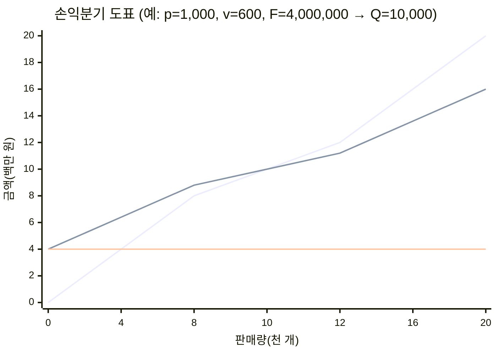

# 6.1 사업성분석

!!! info "출제기준"
    **6. 원가관리 및 경제성공학** › **1. 사업성분석**

## 출제 경향

총 **32문항** 출제 (1교시 단답형 8 · 2~4교시 논술형 24) · 최근 10개 회차(109~139회) 16문항 · 최근 출제 제139회

| 주제 | 출제 수 | 출제 회차 |
|---|:-:|---|
| 6.1.1 투자 경제성 평가(NPV·IRR·회수기간) | 10 | 71회, 76회, 85회, 88회, 97회, 112회, 121회, 124회, 136회, 139회 |
| 6.1.2 손익분기점(BEP) 분석 | 11 | 63회, 76회, 79회, 85회, 91회, 94회, 100회, 109회, 127회, 133회, 139회 |
| 6.1.3 감가상각 | 7 | 73회, 88회, 103회, 109회, 121회, 127회, 133회 |
| 6.1.4 경제성 분석의 비용 개념(매몰·기회비용) | 3 | 65회, 130회, 136회 |
| 6.1.5 사업 타당성 분석 | 1 | 127회 |

## 목차

1. [투자 경제성 평가(NPV·IRR·회수기간)](#t61-1)
2. [손익분기점(BEP) 분석](#t61-2)
3. [감가상각](#t61-3)
4. [경제성 분석의 비용 개념(매몰·기회비용)](#t61-4)
5. [사업 타당성 분석](#t61-5)

## 6.1.1 투자 경제성 평가(NPV·IRR·회수기간) {#t61-1}

### 설비투자 경제성 평가 방법 (76·97·112·121·136회)

| 구분 | 방법 | 산식 | 판단 기준 | 장단점 |
|---|---|---|---|---|
| **비할인법** | **자본회수기간법** | 투자액 ÷ 연간 현금유입(일정하지 않으면 누적으로 계산) | 목표 회수기간 이내, 짧을수록 유리 | 간편, 위험 판단에 유용 / 화폐의 시간가치·회수 후 현금흐름 무시 |
| | **회계적 이익률법(ARR, 투자이익률법)** | 평균 연이익 ÷ 투자액(또는 평균 투자액) | 목표 이익률 이상 | 회계 자료로 쉽게 계산 / 시간가치 무시 |
| **할인법(DCF)** | **순현재가치법(NPV)** | \( \sum \dfrac{CF_t}{(1+k)^t} - I_0 \) | NPV > 0 채택, 클수록 유리 | 시간가치·전 기간 반영, 가치 가산성 / 할인율 결정 필요 |
| | **내부수익률법(IRR)** | NPV = 0이 되는 할인율 | IRR > MARR 채택 | 수익률로 직관적 / 복수 IRR, 상호배타안 비교 시 오류 가능 |
| | **수익성지수(PI)** | 현금유입의 현재가치 ÷ 투자액 | PI > 1 채택 | 자본 제약 시 순위 결정 |
| | 연가법(EAC) | NPV × 자본회수계수 \( (A/P, k, n) \) | 연간 등가 비교 | 내용연수가 다른 대안 비교에 유용 |

**MARR(최저 필수 수익률) (124회)**: 투자안이 채택되기 위해 최소한 벌어야 하는 수익률이다. 자본비용(가중평균 자본비용)에 위험 프리미엄과 기회비용을 더해 기업이 정책적으로 정한다. **이자율**은 자금을 빌리거나 빌려줄 때의 대가로 시장에서 정해지는 반면, MARR은 기업의 투자 판단 기준이므로 보통 이자율보다 높게 정한다.

**자본회수기간법 (85회)**: 투자액을 투자에서 생기는 현금흐름으로 회수하는 데 걸리는 기간으로 평가한다. 위험(불확실성)이 크거나 자금 회수가 중요한 경우 보조 지표로 쓴다.

**LCC(수명주기 비용) (71회)**: 설비·제품의 취득부터 폐기까지 드는 모든 비용의 합계다.

| 단계 | 예상 비용 |
|---|---|
| 초기 조달비 | 연구·설계비, 구입가, 운송·설치·시운전비, 초기 교육비 |
| 제조·운반비 | 운전 인건비, 에너지·소모품비, 운반·물류비 |
| 보전비 | 예방·사후 보전비, 예비품, 정기 정비·개조비 |
| 생산 손실비 | 고장·정지로 인한 생산 기회 손실, 불량 손실 |
| (폐기비) | 철거·처분비 − 잔존가치 |

### 풀이: 88회 (내용연수 3년)

현금흐름: −10,000, 4,000, 4,000, 5,000(3년 말 잔존가치 1,000 포함으로 해석)

\[
-10{,}000 + \frac{4{,}000}{1+r} + \frac{4{,}000}{(1+r)^2} + \frac{5{,}000}{(1+r)^3} = 0 \;\Rightarrow\; r \approx 13.8\% \rightarrow \mathbf{14\%}
\]

MARR 15%에서 \( NPV = -210 \)만 원 → IRR(14%) < MARR(15%)이므로 **경제성 없음**.
(잔존가치 1,000만 원을 5,000만 원과 별도로 더하면 IRR ≈ 17.5%로 경제성이 있다 — 현금흐름의 해석을 답안에 밝힌다.)

### 풀이: 103회 (할인율 10%)

| 방법 | A 설비 | B 설비 | 판단 |
|---|---|---|---|
| 자본회수기간 | 11,000 ÷ 5,000 = 2.2년 | 5,000 ÷ 3,500 = 1.43년 | **B** |
| 투자이익률 | 3,000 ÷ 11,000 = 27.3% | 1,500 ÷ 5,000 = 30.0% | **B** |
| NPV | 5,000 × 3.7908 − 11,000 = **7,954** | 3,500 × 3.1699 − 5,000 = **6,095** | **A** |

→ 전통적 방법으로는 B가, 시간가치를 반영한 NPV로는 A가 유리하다. 내용연수가 다르므로 연가로 바꿔도 A(약 2,098만 원/년) > B(약 1,923만 원/년)이다. 기업가치 극대화 관점에서는 **NPV 기준으로 A**를 선택한다.

### 풀이: 112회 (투자비 2,000원, 요구수익률 10%, 목표 회수기간 2년)

| 투자안 | NPV | 회수기간 | 평가 |
|---|---|---|---|
| A | 455 + 415 + 1,500 − 2,000 = **370** | 2 + 1,000 ÷ 2,000 = 2.5년 | 회수기간 미달 |
| B | 455 + 1,494 − 2,000 = **−51** | 1 + 1,500 ÷ 1,800 = 1.83년 | NPV 음수 |
| C | 1,638 + 415 − 2,000 = **53** | 1 + 200 ÷ 500 = 1.4년 | 두 기준 모두 충족 |

→ NPV만 보면 A가 가장 크지만 목표 회수기간(2년)을 넘는다. **두 기준을 모두 만족하는 C**를 선택한다.

### 풀이: 121회 (할인율 20%, 잔존가치 없음)

| 방법 | A 기계 | B 기계 | 판단 |
|---|---|---|---|
| 자본회수기간 | 2,400 ÷ 950 = 2.53년 | 2,200 ÷ 1,050 = 2.10년 | **B** |
| 투자이익률 | 550 ÷ 2,400 = 22.9% | 600 ÷ 2,200 = 27.3% | **B** |
| NPV | 950 × 2.9906 − 2,400 = **441** | 1,050 × 2.5887 − 2,200 = **518** | **B** |

→ 세 방법 모두 **B 기계**가 유리하다.

### 풀이: 127회 (할인율 20%, 잔존가치 각 200만 원)

| 방법 | A 기계 | B 기계 | 판단 |
|---|---|---|---|
| 자본회수기간 | 2,470 ÷ 950 = 2.6년 | 2,310 ÷ 1,050 = 2.2년 | **B** |
| 투자이익률 | 600 ÷ 2,470 = 24.3% | 650 ÷ 2,310 = 28.1% | **B** |
| NPV | 950 × 2.9906 + 200 × 0.4019 − 2,470 = **451** | 1,050 × 2.5887 + 200 × 0.4823 − 2,310 = **505** | **B** |

→ 종합 판정: 세 방법 모두에서 **B 기계**가 우수하므로 B를 선택한다.

### 풀이: 139회 (자금의 시간가치)

10% 이자율로 10년간 매년 초 적립한 뒤 10년 말부터 15년간 매년 200만 원씩 받으려면

- 10년 말에 필요한 금액 = 200 × (P/A, 10%, 15) = 200 × 7.6061 = **1,521만 원**
- 매년 초 적립액 \( A \): \( A \times (F/A, 10\%, 10) \times 1.1 = 1{,}521 \) → \( A = 1{,}521 \div (15.9374 \times 1.1) \approx \mathbf{86.8\text{만 원}} \)

(적립을 매년 말에 한다고 보면 \( 1{,}521 \div 15.9374 \approx 95.4 \)만 원 — 문제의 시점 조건을 확인한다.)

!!! tip "답안 작성 포인트"
    - 평가 방법은 **비할인법 / 할인법**으로 나눈 표(산식·판단 기준·장단점)를 기본으로 한다.
    - 계산 문제는 **방법별 결과를 한 표에 모으고**, 방법마다 결론이 다르면 NPV를 우선하는 이유(시간가치·가치 극대화)를 쓴다.
    - 현가계수 \( (P/A, k, n) = \dfrac{1 - (1+k)^{-n}}{k} \)는 문제에서 주어지지 않으면 직접 계산한다.

??? example "관련 기출 10문항 (71회, 76회, 85회, 88회, 97회, 112회, 121회, 124회, 136회, 139회)"

    - **제71회(2003) 3교시 3번** · 25점  
      제품의 LCC(Life Cycle Cost)에 대하여 다음 단계별로 예상 비용을 열거해보시오.

        ??? quote "문제 전문"

            제품의 LCC(Life Cycle Cost)에 대하여 다음 단계별로 예상 비용을 열거해보시오.  
            (1) 초기조달비 (2) 제조운반비 (3) 보전비 (4) 생산손실비  
    - **제76회(2005) 4교시 1번** · 25점  
      설비투자의 경제성 평가개요 및 종류를 설명하시오.
    - **제85회(2008) 1교시 13번** · 10점  
      자본회수 기간법에 대하여 설명하시오.
    - **제88회(2009) 2교시 4번** · 25점  
      내용연수가 3년인 생산설비 A의 초기 투자금액과 연도 말 현금흐름은 다음과 같다.

        ??? quote "문제 전문"

            내용연수가 3년인 생산설비 A의 초기 투자금액과 연도 말 현금흐름은 다음과 같다.  
            (단, 3년도 말 잔존가치는 1000 만원으로 가정)  
            [표] 년도 말 | 0 | 1 | 2 | 3  
            현금흐름(단위 :만원) | -10,000 | 4,000 | 4,000 | 5,000  
            1) 생산설비 A의 수익률(%)을 산출하시오.(단, 소수점 첫째자리에서 반올림 처리)  
            2) 최저필수수익률(MARR : Minimum Attractive Rate of Return)이 15% 일 때, 생산설비 A의 경제성 유무를 판단하시오.  
    - **제97회(2012) 4교시 4번** · 25점  
      투자안의 경제성을 분석하는 모델을 전통적인 비할인모델과 현금흐름 할인법으로 구분하여 다음 각 물음에 답하시오.

        ??? quote "문제 전문"

            투자안의 경제성을 분석하는 모델을 전통적인 비할인모델과 현금흐름 할인법으로 구분하여 다음 각 물음에 답하시오.  
            1) 각각의 기법의 종류를 나열하시오.  
            2) 산식을 포함하여 경제성 분석방법을 설명하시오.  
    - **제112회(2017) 3교시 3번** · 25점  
      시설투자의 평가방법과 관련한 다음 물음에 답하시오.

        ??? quote "문제 전문"

            시설투자의 평가방법과 관련한 다음 물음에 답하시오.  
            (1) 순현재가치법, 내부수익률법, 회계수익률법, 자본회수기간법에 대하여 각각 설명하시오.  
            (2) 3가지 투자안의 현금흐름이 다음 표와 같을 때, 투자안을 순현재가치법과 자본회수기간법으로 비교하고 하나의 대안을 선택하시오. (단, 목표투자회수기간은 2년 이내, 요구수익률 = 10%, 투자비용 = 2,000원)  
            [표] 투자안 | 1년 | 2년 | 3년  
            A | 500원 | 500원 | 2,000원  
            B | 500원 | 1,800원 | 0  
            C | 1,800원 | 500원 | 0  
            비고: (1.1)^-1=0.91, (1.1)^-2=0.83, (1.1)^-3=0.75  
    - **제121회(2020) 1교시 10번** · 10점  
      설비 투자의 경제성 평가 방법 5가지
    - **제124회(2021) 3교시 5번** · 25점  
      MARR(Minimum Attractive Rate of Return)의 정의를 설명하고, 이자율(Interest Rate)과의 차이점을 설명하시오.
    - **제136회(2025) 3교시 4번** · 25점  
      설비투자의 경제성 평가 방법 중 5가지를 설명하시오.
    - **제139회(2026) 3교시 6번** · 25점  
      K-자동차 부품 공장의 L-부장은 직접 창업을 하는 것이 꿈이다. L-부장은 앞으로 매년 1월 초에 적금을 10년 동안 적립하기로 하였다. L-부장은 10년 후에 창업할 예정이고, 적립된 예치금을 매년 200만원씩 사업 안정 자금으로 15년 동안 수령할 예정이다. 다음 물음에 답하시오.

        ??? quote "문제 전문"

            K-자동차 부품 공장의 L-부장은 직접 창업을 하는 것이 꿈이다. L-부장은 앞으로 매년 1월 초에 적금을 10년 동안 적립하기로 하였다. L-부장은 10년 후에 창업할 예정이고, 적립된 예치금을 매년 200만원씩 사업 안정 자금으로 15년 동안 수령할 예정이다. 다음 물음에 답하시오.  
            (단, 년 이자율 10% 기준)  
            1) 10년 동안 모아져서, 계속 예치하여야 할 금액을 구하시오.  
            2) 10년 동안 매년 적립하여야 하는 금액을 구하시오.  
            [표] 이자율 10%의 이산복리표  
            년 | 일시불 미래가치 (F/P) | 연금 미래가치 (F/A) | 감채기금 (A/F) | 연금 현재가치 (P/A) | 자본회수 (A/P)  
            기호 | Find F Given P | Find F Given A | Find A Given F | Find P Given A | Find A Given P  
            8 | 2.1436 | 11.4359 | 0.0874 | 5.3349 | 0.1874  
            9 | 2.3579 | 13.5795 | 0.0736 | 5.759 | 0.1736  
            10 | 2.5937 | 15.9374 | 0.0627 | 6.1446 | 0.1627  
            11 | 2.8531 | 18.5312 | 0.054 | 6.4951 | 0.154  
            12 | 3.1384 | 21.3843 | 0.0468 | 6.8137 | 0.1468  
            13 | 3.4523 | 24.5227 | 0.0408 | 7.1034 | 0.1408  
            14 | 3.7975 | 27.975 | 0.0357 | 7.3667 | 0.1357  
            15 | 4.1772 | 31.7725 | 0.0315 | 7.6061 | 0.1315  

## 6.1.2 손익분기점(BEP) 분석 {#t61-2}

### 손익분기점(BEP)의 개념 (76·109·133·139회)

**손익분기점**은 총수익과 총비용이 같아 **이익이 0이 되는 판매량(매출액)**이다.

| 용어 | 정의 |
|---|---|
| 고정비(F) | 생산량과 관계없이 일정한 비용(감가상각비, 임차료, 관리직 인건비) |
| 변동비(V) | 생산량에 비례하는 비용(재료비, 외주 가공비) |
| **한계이익(공헌이익)** | 매출액 − 변동비 — 고정비를 회수하고 이익을 만드는 몫 |
| 한계이익률 | 한계이익 ÷ 매출액 \( = 1 - \dfrac{v}{p} \) |

\[
\text{수량 BEP: } Q_{BEP} = \frac{F}{p - v}, \qquad \text{매출액 BEP: } S_{BEP} = \frac{F}{1 - \dfrac{V}{S}}, \qquad \text{목표이익 판매량} = \frac{F + \text{목표이익}}{p - v}
\]

\[
\text{안전한계} = S - S_{BEP}, \qquad \text{안전한계율} = \frac{S - S_{BEP}}{S}, \qquad \text{손익분기점률} = \frac{S_{BEP}}{S}
\]

(가파른 선: 매출액, 완만한 선: 총비용, 수평선: 고정비 — 두 선이 만나는 10,000개가 BEP)

**의의**: 신규 투자의 채산성 판단, 목표이익 달성 판매량 결정, 가격·원가 정책 수립, 경영 안전도 진단

**민감도 분석 (76회)**: 판매가격·변동비·고정비·판매량 같은 **변수가 변할 때 BEP와 이익이 얼마나 변하는지** 분석해, 이익에 가장 큰 영향을 주는 변수를 찾고 위험에 대비한다.

### BEP를 활용한 원가 전략 — BEP 낮추기 (79·94·133회)

| 관점 | 방안 | 예 |
|---|---|---|
| **고정비 절감** | 고정비를 줄이거나 변동비화 | 유휴 설비 처분, 외주 활용, 간접 인원 효율화, 임차 대신 공유 |
| **변동비 절감** | 단위당 변동비 감소 → 한계이익률 상승 | VE·설계 개선, 수율 향상, 구매 단가 인하, 에너지 절감 |
| **판매가격·제품 구성 개선** | 단위당 한계이익 확대 | 고부가 제품 비중 확대, 가격 정책, 한계이익률이 낮은 제품 정리 |

### 한계이익률법 (85회)

| 방법 | 용도 | 계산 |
|---|---|---|
| **평균법** | 회사 전체의 BEP를 구할 때 — 제품 구성이 일정하다고 가정 | 전체 한계이익률 = (20 − 11.9) ÷ 20 = **40.5%** → BEP = 10 ÷ 0.405 = **24.7억 원** |
| **기준법** | 대표 품목의 한계이익률로 BEP를 구할 때 — 제품 구성 변화의 목표 설정 | C의 한계이익률 = 4.5 ÷ 10 = **45%** → BEP = 10 ÷ 0.45 = **22.2억 원** |

제품별 한계이익률: A 30%, B 40%, C 45%, D 35%

**진단과 경영 방향**: 현재 매출 20억 원은 평균법 BEP(24.7억 원)에 4.7억 원 모자라 적자(한계이익 8.1억 − 고정비 10억 = −1.9억 원)다. 대표 품목 C 수준의 한계이익률로 제품 구성을 바꾸면 BEP가 22.2억 원으로 낮아진다. → ① 한계이익률이 높은 **C·B 제품의 비중 확대** ② A·D 제품의 원가 개선 또는 축소 ③ 고정비 절감 ④ 매출 증대

### 풀이: 63회 (p = 7만 원, v = 2만 원, F = 8억 원)

1. 수량 BEP = 8억 ÷ (7 − 2)만 = **16,000단위**
2. 매출액 BEP = 16,000 × 7만 = **11.2억 원**(비용 = 수익 = 11.2억 원)
3. 4만 단위의 이익 = 40,000 × 5만 − 8억 = **12억 원**

### 풀이: 91회 (p = 9원, v = 5 + 1 = 6원, F = 22,000 + 14,000 = 36,000원)

| 항목 | 계산 | 결과 |
|---|---|---|
| (1) 영업이익 | 180,000 − 120,000 − 36,000 | **24,000원** |
| (2) BEP | 수량 36,000 ÷ 3 / 매출액 12,000 × 9 | **12,000개 / 108,000원** |
| (3) 목표이익 30,000원 판매량 | (36,000 + 30,000) ÷ 3 | **22,000개** |
| (4) 목표이익 20,000원 매출액 | (36,000 + 20,000) ÷ (3 ÷ 9) | **168,000원** |
| (5) 이익이 매출액의 20%인 판매량 | 3Q − 36,000 = 0.2 × 9Q → 1.2Q = 36,000 | **30,000개** |

### 풀이: 100회 (p = 15원, v = 5 + 1 = 6원, F = 120,000 + 20,000 = 140,000원)

이 문제는 매출액 300,000원(20,000개) × 단위당 변동비 6원 = 120,000원으로, 제시된 총변동원가(100,000원)와 맞지 않는다. **단위당 자료 기준**으로 풀면:

| 항목 | 계산 | 결과 |
|---|---|---|
| (1) 영업이익 | 300,000 − 120,000 − 140,000 | **40,000원** |
| (2) BEP | 140,000 ÷ 9 = 15,556개, × 15 | **15,556개 / 233,333원** |
| (3) 안전한계·안전한계율 | 300,000 − 233,333 / ÷ 300,000 | **66,667원 / 22.2%** |
| (4) 목표이익 50,000원 판매량 | (140,000 + 50,000) ÷ 9 | **21,111개** |
| (5) 매출 30,000원 증가 시 이익 증가 | 30,000 × 한계이익률 0.6 | **18,000원** |

(총변동원가 100,000원을 그대로 쓰면 영업이익 60,000원, 한계이익률 66.7%로 바뀐다 — 답안에 사용한 기준을 밝힌다.)

### 풀이: 127회 (다품종 BEP, 고정비 60만 원)

| 제품 | 공헌이익률 | 매출 구성비 | 가중 |
|---|:-:|:-:|:-:|
| A | 100 ÷ 400 = **25%** | 20% | 5.0% |
| B | 225 ÷ 1,000 = **22.5%** | 40% | 9.0% |
| C | 800 ÷ 2,000 = **40%** | 40% | 16.0% |
| 합계 | | | **30.0%** |

- BEP 총매출액 = 600,000 ÷ 0.30 = **2,000,000원**
- 제품별 매출액: A **400,000원**, B **800,000원**, C **800,000원**
- 제품별 판매량: A 400,000 ÷ 400 = **1,000개**, B 800,000 ÷ 1,000 = **800개**, C 800,000 ÷ 2,000 = **400개**

### 풀이: 139회 (p = 1,000원, v = 600원, F = 4,000,000원)

- 수량 기준 BEP = 4,000,000 ÷ (1,000 − 600) = **10,000개**
- 매출액 기준 BEP = 4,000,000 ÷ (1 − 600 ÷ 1,000) = 4,000,000 ÷ 0.4 = **10,000,000원**
- **적자를 면하는 기준**: 월 10,000개(매출 1,000만 원)를 넘게 팔아야 한다.

!!! tip "답안 작성 포인트"
    - BEP는 **용어 정의 → 공식(수량·매출액) → 손익분기 도표 → 의의**를 기본으로 하고, 계산 문제는 표로 정리한다.
    - BEP를 낮추는 전략은 **고정비·변동비·가격(제품 구성)**의 세 관점으로 쓴다.
    - 문제의 자료가 서로 맞지 않으면(100회) 어떤 기준으로 풀었는지 밝힌다.

??? example "관련 기출 11문항 (63회, 76회, 79회, 85회, 91회, 94회, 100회, 109회, 127회, 133회, 139회)"

    - **제63회(2001) 2교시 5번** · 25점  
      다음과 같은 자료에 의해 1) 생산량 손익분기점 2) 비용․수익 손익분기점

        ??? quote "문제 전문"

            다음과 같은 자료에 의해 1) 생산량 손익분기점 2) 비용․수익 손익분기점  
            3) 4만단위에서의 이익을 결정하시오.  
            가격=7만원/단위, 변동비 = 2만원/단위, 고정비 = 8억원  
    - **제76회(2005) 4교시 6번** · 25점  
      사업의 손익분기점 분석에 대하여 다음사항을 기술하시오.

        ??? quote "문제 전문"

            사업의 손익분기점 분석에 대하여 다음사항을 기술하시오.  
            1) 고정비, 변동비, 한계이익  
            2) 손익분기점의 산출방식과 의의  
            3) 민감도분석을 위한 변수와 의의  
    - **제79회(2006) 3교시 3번** · 25점  
      BEP(손익분기점)을 활용한 원가전략에 대해 기술하시오.
    - **제85회(2008) 3교시 3번** · 25점  
      최고주식회사의 각 제품 매출액과 변동비는 아래 표와 같으며, 고정비는 10억원이고 이 회사의 대표품목은 C이다. 현재 회사는 적자 상태여서 경영효율화를 위한 진단의 일환으로 손익분기점 분석 중 한계이익률법을 활용하여 현재의 문제점이 무엇인지 진단하고 대책을 수립하고자 한다. 한계이익률법은 특히 그 용도에 따라 평균법, 기준법, 절충법, 개별법의 4가지로 개발되어 적용되고 있다. 그 중 평균한계이익률(평균법)과 기준한계이익률(기준법)의 용도를 설명하고, 각각의 방법으로 손익분기점을 계산하고 결과를 고려하여 향후 경영 방향을 간략히 설명하시오.

        ??? quote "문제 전문"

            최고주식회사의 각 제품 매출액과 변동비는 아래 표와 같으며, 고정비는 10억원이고 이 회사의 대표품목은 C이다. 현재 회사는 적자 상태여서 경영효율화를 위한 진단의 일환으로 손익분기점 분석 중 한계이익률법을 활용하여 현재의 문제점이 무엇인지 진단하고 대책을 수립하고자 한다. 한계이익률법은 특히 그 용도에 따라 평균법, 기준법, 절충법, 개별법의 4가지로 개발되어 적용되고 있다. 그 중 평균한계이익률(평균법)과 기준한계이익률(기준법)의 용도를 설명하고, 각각의 방법으로 손익분기점을 계산하고 결과를 고려하여 향후 경영 방향을 간략히 설명하시오.  
            [표] 제품구분 | 매출액 | 변동비  
            A | 3억원 | 2.1억원  
            B | 5억원 | 3억원  
            C | 10억원 | 5.5억원  
            D | 2억원 | 1.3억원  
            합계 | 20억원 | 11.9억원  
    - **제91회(2010) 3교시 1번** · 25점  
      아이스크림을 생산, 판매하는 서해(주)의 8월 중 영업과 관련된 [데이터]를 참고하여 다음 각 물음에 답하시오.

        ??? quote "문제 전문"

            아이스크림을 생산, 판매하는 서해(주)의 8월 중 영업과 관련된 [데이터]를 참고하여 다음 각 물음에 답하시오.  
            [데이터]  
            ㆍ매출액 : 180,000원 ㆍ고정제조원가 : 22,000원  
            ㆍ고정판매관리비 : 14,000원 ㆍ총변동원가 : 120,000원  
            ㆍ단위당 판매가격 : 9원 ㆍ단위당 변동제조원가 : 5원  
            ㆍ단위당 변동판매비 : 1원  
            (1) 영업이익을 구하시오.  
            (2) 손익분기점의 수량과 매출액을 구하시오.  
            (3) 목표영업이익 30,000원인 경우의 판매량을 구하시오.  
            (4) 목표영업이익 20,000원인 경우의 매출액을 구하시오.  
            (5) 목표영업이익이 매출액의 20%인 경우의 판매량을 구하시오.  
    - **제94회(2011) 2교시 5번** · 25점  
      손익분기점을 활용한 원가전략 중에서 손익분기점을 낮추는 방안을 3가지 관점에서 예를 들어 설명하시오.
    - **제100회(2013) 4교시 6번** · 25점  
      어떤 회사의 5월중 영업과 관련된 자료가 표와 같을 때 다음 각 물음에 답하시오. (단, 풀이과정을 포함하여 설명하시오.)

        ??? quote "문제 전문"

            어떤 회사의 5월중 영업과 관련된 자료가 표와 같을 때 다음 각 물음에 답하시오. (단, 풀이과정을 포함하여 설명하시오.)  
            · 매출액 : 300,000원 · 고정제조원가 : 120,000원  
            · 고정판매관리비 : 20,000원 · 총변동원가 : 100,000원  
            · 단위당 판매가격 : 15원 · 단위당 변동제조원가 : 5원  
            · 단위당 변동판매비 : 1원  
            (1) 영업이익을 구하시오.  
            (2) 손익분기점의 판매수량과 매출액을 구하시오.  
            (3) 안전한계와 안전한계율을 구하시오.  
            (4) 목표영업이익이 50,000원인 경우의 판매량을 구하시오.  
            (5) 매출액이 30,000원 증가할 경우 순이익증가액을 구하시오.  
    - **제109회(2016) 1교시 11번** · 10점  
      신규투자 시 손익분기점을 수량(Q)중심으로 도출하고, 그 의미에 대하여 설명하시오.
    - **제127회(2022) 2교시 3번** · 25점  
      가공 부품업체는 A, B, C의 세 가지 제품을 제조 판매하고 있고, 이 회사의 총고정비용은 60만원이다. 총매출액에서 차지하는 각 제품의 매출액 구성 비율이 변하지 않는다고 가정할 때 제품별 비용은 다음 표와 같다. 다음 물음에 답하시오.

        ??? quote "문제 전문"

            가공 부품업체는 A, B, C의 세 가지 제품을 제조 판매하고 있고, 이 회사의 총고정비용은 60만원이다. 총매출액에서 차지하는 각 제품의 매출액 구성 비율이 변하지 않는다고 가정할 때 제품별 비용은 다음 표와 같다. 다음 물음에 답하시오.  
            [표] 제품 | 판매단가(원) | 단위당 변동비(원) | 매출액 구성비율(%)  
            A | 400 | 300 | 20  
            B | 1000 | 775 | 40  
            C | 2000 | 1200 | 40  
            1) 각 제품의 공헌이익률을 구하시오.  
            2) 손익분기점에서의 총매출액을 구하시오.  
            3) 각 제품의 매출액을 구하시오.  
            4) 각 제품의 판매량을 구하시오.  
    - **제133회(2024) 3교시 5번** · 25점  
      손익분기점 분석을 통한 원가절감 전략에 대하여 다음을 설명하시오.

        ??? quote "문제 전문"

            손익분기점 분석을 통한 원가절감 전략에 대하여 다음을 설명하시오.  
            1) 손익분기점 분석의 의의와 손익분기점 산정식  
            2) 변동비와 고정비 절감 방안  
    - **제139회(2026) 3교시 5번** · 25점  
      손익분기점과 관련하여 다음의 물음에 답하시오.

        ??? quote "문제 전문"

            손익분기점과 관련하여 다음의 물음에 답하시오.  
            1) 수량 기준 BEP 계산방법을 사례를 포함하여 설명하시오.  
            2) 매출액 기준 BEP 계산방법을 사례를 포함하여 설명하시오.  
            3) 아래의 조건을 기준으로 위 두 가지 계산방법을 이용하여 BEP를 구하고, 적자를 면하는 기준을 쓰시오.  
            \- 제품 1개 단가: 1,000원  
            \- 제품 1개당 재료비(변동비): 600원  
            \- 월 임대료, 인건비, 고정비: 4,000,000원  

## 6.1.3 감가상각 {#t61-3}

### 감가상각의 의의 (133회)

**감가상각**은 설비·건물 같은 유형자산의 취득원가를 그 자산을 사용하는 기간(내용연수)에 걸쳐 **비용으로 배분**하는 회계 절차다.

- 수익과 비용의 올바른 대응(정확한 원가·손익 계산)
- 자산의 가치 감소(물리적 마모·기능적 진부화)를 장부에 반영
- 감가상각비는 현금 지출이 없는 비용이므로 **투자 자금의 내부 유보(회수)** 효과

### 감가상각 계산에 필요한 4가지 정보 (73회)

① **취득원가** ② **내용연수** ③ **잔존가치** ④ **상각 방법**

### 감가상각 방법 (88·109·133회)

| 방법 | 산식 | 특징 |
|---|---|---|
| **정액법** | \( D = \dfrac{P - S}{n} \) | 매년 같은 금액 — 간단, 시간에 따라 고르게 가치가 줄어드는 자산 |
| **정률법** | \( D_t = BV_{t-1} \times r, \quad r = 1 - \sqrt[n]{S / P} \) | 장부가에 일정 비율 — 초기에 많이, 후기에 적게 상각(가속상각), 진부화가 빠른 설비 |
| 연수합계법 | \( D_t = (P - S) \times \dfrac{n - t + 1}{n(n+1)/2} \) | 가속상각의 한 형태 |
| 생산량비례법 | \( D_t = (P - S) \times \dfrac{\text{당기 생산량}}{\text{총 추정 생산량}} \) | 사용량에 따라 가치가 줄어드는 자산 |

(\( P \): 취득원가, \( S \): 잔존가치, \( n \): 내용연수, \( BV \): 기초 장부가액)

**예**: 취득원가 1,000만 원, 잔존가치 100만 원, 내용연수 5년

- 정액법: 매년 (1,000 − 100) ÷ 5 = **180만 원**
- 정률법: \( r = 1 - (100/1{,}000)^{1/5} = 36.9\% \) → 1년차 369만 원, 2년차 233만 원 …

!!! tip "답안 작성 포인트"
    - **의의 → 4가지 정보 → 방법별 산식·특징 표 → 간단한 수치 예**로 쓴다. 정액법과 정률법을 비교하는 그래프(직선 vs 체감 곡선)를 그리면 좋다.

??? example "관련 기출 7문항 (73회, 88회, 103회, 109회, 121회, 127회, 133회)"

    - **제73회(2004) 1교시 1번** · 10점  
      감가상각계산을 위한 4가지 정보
    - **제88회(2009) 1교시 11번** · 10점  
      일반적으로 사용하는 2종류의 감가상각방법을 설명하시오.
    - **제103회(2014) 3교시 4번** · 25점  
      홍길동은 A설비와 B설비의 경제성 평가를 활용하여 경제적이라고 판단되는 설비를 선정하려 한다. 다음은 투자안의 자료이다.

        ??? quote "문제 전문"

            홍길동은 A설비와 B설비의 경제성 평가를 활용하여 경제적이라고 판단되는 설비를 선정하려 한다. 다음은 투자안의 자료이다.  
            [표] 투자안 \\ 구분 | 투자금 | 경제적 내용년수 | 연간 수입예상액 | 연간 감가상각비 | 평균 연이익  
            A설비 | 11,000만원 | 5년 | 5,000만원 | 2,000만원 | 3,000만원  
            B설비 | 5,000만원 | 4년 | 3,500만원 | 1,000만원 | 1,500만원  
            1) 자본회수기간법(payoff or payback period)을 설명하고, 어느 설비가 효과적인지 평가하시오.  
            2) (평균)투자이익율법(average rate of return)을 설명하고, 어느 설비가 효과적인지 평가하시오.  
            3) 1), 2) 항의 전통적 경제성 측정 방법과 대별되는 방법은 순현재가치법(NPV: Net Present Value)이다. 순현재가치법(NPV)의 개념을 설명하고 k(자본비용, 할인율)=10%로 할 때, 어느 설비가 효과적인지 평가하시오.  
    - **제109회(2016) 2교시 6번** · 25점  
      원가계산의 설비 감가상각 방법 중 정액법과 정율법의 의미에 대하여 설명하시오.
    - **제121회(2020) 2교시 4번** · 25점  
      부품 회사에서 신제품 생산에 필요한 포장기계를 구입함에 있어서 A기계와 B기계 중에서 경제적인 것으로 선정하려 한다. 다음 물음에 답하시오.

        ??? quote "문제 전문"

            부품 회사에서 신제품 생산에 필요한 포장기계를 구입함에 있어서 A기계와 B기계 중에서 경제적인 것으로 선정하려 한다. 다음 물음에 답하시오.  
            [표] 투자안\\구분 | 투자금액 | 경제적 내용연수 | 연간 수입예상액 | 연간 감가상각비 | 평균 연이익  
            A기계 | 2,400만원 | 5년 | 950만원 | 400만원 | 550만원  
            B기계 | 2,200만원 | 4년 | 1,050만원 | 500만원 | 600만원  
            1) 자본회수기간법으로 계산하고 평가하시오.  
            2) 투자이익률법으로 계산하고 평가하시오.  
            3) 자본비용(할인률) 20%일 때 순현재가치법으로 계산하고 평가하시오.  
    - **제127회(2022) 3교시 5번** · 25점  
      자동차부품회사에서 신제품 생산에 필요한 포장기계를 구입함에 있어서 A기계와 B기계 중에서 경제적인 것으로 선정하려 한다. 잔존가액은 각각 200만원으로 하고 연간수입액은 A기계는 950만원, B기계는 1050만원으로 한다. 다음 물음에 답하시오.

        ??? quote "문제 전문"

            자동차부품회사에서 신제품 생산에 필요한 포장기계를 구입함에 있어서 A기계와 B기계 중에서 경제적인 것으로 선정하려 한다. 잔존가액은 각각 200만원으로 하고 연간수입액은 A기계는 950만원, B기계는 1050만원으로 한다. 다음 물음에 답하시오.  
            [표] 투자안\\구분 | 투자금액 | 경제적 내용년수 | 연간수입 예상액 | 연간 감가상각비 | 평균 연이익  
            A 기계 | 2470만원 | 5년 | 950만원 | 400만원 | 600만원  
            B 기계 | 2310만원 | 4년 | 1050만원 | 500만원 | 650만원  
            1) 자본회수기간법으로 경제성 있는 투자안을 구하시오.  
            2) 투자이익률법으로 경제성 있는 투자안을 구하시오.  
            3) 자본비용(할인율)을 20%일 때 순현재가치법으로 경제성 있는 투자안을 구하시오.  
            4) “1), 2), 3)”항의 결과에 따른 A, B기계의 종합 투자안을 판정하시오.  
    - **제133회(2024) 1교시 10번** · 10점  
      유형자산에 대한 감가상각의 의의와 감가상각을 하는 3가지 방법

## 6.1.4 경제성 분석의 비용 개념(매몰·기회비용) {#t61-4}

### 경제성 분석의 비용 개념 (65·130·136회)

| 개념 | 정의 | 경제성 분석에서의 처리 | 예 |
|---|---|---|---|
| **초기비용**(First Cost) | 투자 시점에 드는 비용 — 구입가, 운송·설치·시운전비 | 투자액(0시점 현금유출)에 포함 | 신설비 구입·설치비 |
| **매몰비용**(Sunk Cost) | **이미 지출되어 회수할 수 없는** 비용 | **의사결정에서 제외**한다 — 어떤 대안을 택해도 변하지 않으므로 | 현 설비의 과거 구입가, 이미 쓴 연구비 |
| **기회비용**(Opportunity Cost) | 어떤 대안을 선택함으로써 **포기한 다른 대안의 최대 이익** | 의사결정에 **포함**한다 | 현 설비를 계속 쓸 때 포기하는 처분가치, 자금의 다른 투자 수익 |

- **매몰비용의 오류**: "이미 많이 투자했으니 계속해야 한다"는 판단은 매몰비용에 얽매인 비합리적 결정이다. 앞으로 생길 비용과 수익만 비교해야 한다.
- **설비 교체 분석에서의 기회비용 (136회)**: 현 설비를 계속 사용하는 대안의 투자액은 장부가가 아니라 **현재 처분하면 받을 수 있는 금액(시장가치)**이다 — 이것을 포기하기 때문이다.

!!! tip "답안 작성 포인트"
    - 세 개념을 **정의 → 의사결정에서의 처리(포함·제외) → 예**로 정리한 비교표 하나로 답할 수 있다.

??? example "관련 기출 3문항 (65회, 130회, 136회)"

    - **제65회(2001) 3교시 6번** · 25점  
      경제성 분석의 기초자료로서 초기비용(first cost)과, 매몰비용(sunk cost)에 대해 설명하시오.
    - **제130회(2023) 1교시 13번** · 10점  
      매몰원가(Sunk Cost)에 대하여 설명하시오.
    - **제136회(2025) 1교시 9번** · 10점  
      설비 경제성 분석 시 발생하는 기회비용(機會費用)을 설명하시오.

## 6.1.5 사업 타당성 분석 {#t61-5}

### 사업 타당성 분석 (127회)

신규 사업이 성공할 수 있는지를 투자 전에 여러 측면에서 검토하는 분석이다.

| 구분 | 분석 내용 | 분석 항목 |
|---|---|---|
| **시장성** | 제품을 팔 수 있는 시장이 있는가 | 시장 규모와 성장률, 수요예측, 경쟁 구조(5 Forces), 목표 고객, 가격·유통·마케팅 전략, 판매 계획 |
| **기술성** | 제품을 만들 수 있는가 | 기술 수준·성숙도, 생산 공정과 설비, 원자재 조달, 입지·시설, 품질 확보, 인허가·환경 규제 |
| **경제성** | 돈을 벌 수 있는가 | 투자비·운영비 추정, 매출·이익 추정, NPV·IRR·회수기간, 손익분기점, 민감도·위험 분석 |
| **사업 수행 능력** | 우리가 해낼 수 있는가 | 경영진의 역량과 경험, 자금 조달 능력, 조직·인력, 핵심 역량과의 적합성, 위험 관리 능력 |

**분석 절차**: 사업 구상 → 예비 타당성 검토(간략 분석) → 본 타당성 분석(4개 측면) → 종합 평가와 사업 여부 결정 → 사업계획 수립

!!! tip "답안 작성 포인트"
    - **4개 측면 × 분석 항목 표**가 답안의 핵심이며, 경제성 분석의 지표(NPV·IRR·BEP)는 [6.1.1](#t61-1)·[6.1.2](#t61-2)와 연결한다.
    - 결론에서 "네 측면이 **모두** 충족되어야 사업을 추진한다"는 종합 판단 원칙을 쓴다.

??? example "관련 기출 1문항 (127회)"

    - **제127회(2022) 4교시 6번** · 25점  
      신규 사업을 시작함에 있어서 사업 타당성 분석을 시장성, 기술성, 경제성, 사업 수행능력으로 구분하여 설명하고, 타당성 분석 항목을 포함하여 쓰시오.
