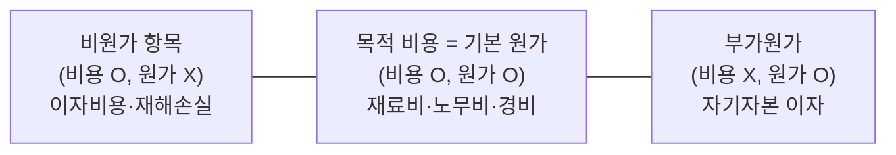
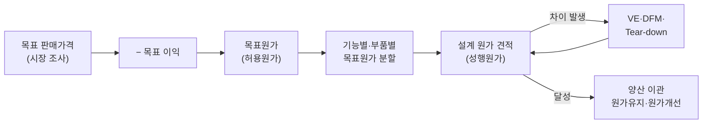
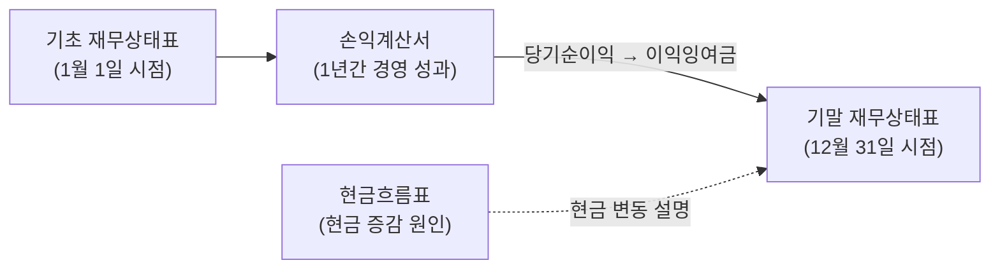

# 6.2 원가관리

!!! info "출제기준"
    **6. 원가관리 및 경제성공학** › **2. 원가관리**

## 출제 경향

총 **26문항** 출제 (1교시 단답형 11 · 2~4교시 논술형 15) · 최근 10개 회차(109~139회) 8문항 · 최근 출제 제139회

| 주제 | 출제 수 | 출제 회차 |
|---|:-:|---|
| 6.2.1 원가의 개념과 구성 | 5 | 82회, 88회, 97회, 124회 |
| 6.2.2 원가계산(표준·종합·ABC·간접비 배부) | 7 | 65회, 68회, 73회, 91회, 133회 |
| 6.2.3 원가절감 | 5 | 65회, 82회, 91회, 103회, 112회 |
| 6.2.4 목표원가 | 3 | 65회, 71회, 88회 |
| 6.2.5 관리회계(공헌이익·쓰루풋 회계) | 4 | 63회, 85회, 115회, 139회 |
| 6.2.6 재무제표 | 2 | 82회, 139회 |

## 목차

1. [원가의 개념과 구성](#t62-1)
2. [원가계산(표준·종합·ABC·간접비 배부)](#t62-2)
3. [원가절감](#t62-3)
4. [목표원가](#t62-4)
5. [관리회계(공헌이익·쓰루풋 회계)](#t62-5)
6. [재무제표](#t62-6)

## 6.2.1 원가의 개념과 구성 {#t62-1}

### 원가의 정의와 비용과의 차이 (82·97·124회)

- **원가(Cost)**: 제품 생산 등 **특정 경영 목적을 위해 소비된 경제적 가치**를 화폐로 측정한 것
- **비용(Expense)**: 일정 **회계 기간**의 수익을 얻기 위해 소비된 가치(손익계산서 항목)

| 구분 | 의미 | 예 |
|---|---|---|
| **비원가 항목** | 손익계산서상 비용이지만 원가는 아님(제조 목적과 무관) | 이자비용 등 영업외비용, 화재·재해 손실 등 특별손실, 법인세 |
| **부가원가** | 비용은 아니지만 원가로는 인정(실제 지출은 없으나 경제적으로 소비) | 자기자본 이자, 자가 소유 건물의 임차료 상당액, 개인 기업주의 급료 |

**원가와 비용의 비교 (124회)**

| 구분 | 원가(Cost) | 비용(Expense) |
|---|---|---|
| 기준 | **급부(제품·서비스)** 단위 — 무엇을 만드는 데 들었나 | **기간** 단위 — 이번 기간 수익을 위해 얼마 썼나 |
| 회계 영역 | 원가회계·관리회계(내부 관리용) | 재무회계(외부 보고용) |
| 범위 | 정상적·경영 목적 관련 소비만 포함(비정상 손실 제외), 부가원가 포함 | 영업외비용·특별손실까지 포함, 부가원가 제외 |
| 자산화 | 판매 전에는 **재고자산**(재공품·제품)으로 남음 | 발생 기간에 바로 손익에 반영 |
| 관계 | 제품이 팔리면 원가가 **매출원가(비용)**로 바뀜 | 기간 비용 = 매출원가 + 판매비와 관리비 + 영업외비용 |

**원가의 본질(요건)**: ① **경제 가치의 소비**(공기·햇빛처럼 대가 없는 것은 제외) ② **급부와의 관련성**(제품·서비스 생산을 위해 소비) ③ **정상적 소비**(화재·파업 손실 같은 비정상 소비 제외) ④ 경영 목적(제조·판매) 관련

### 원가의 분류 (82회)

| 분류 기준 | 종류 |
|---|---|
| 발생 형태 | **재료비·노무비·경비**(원가의 3요소) |
| 추적 가능성 | 직접비(특정 제품에 직접 부과) / 간접비(여러 제품에 배부) |
| 조업도 | 변동비 / 고정비 / 준변동비 |
| 기능 | 제조원가 / 판매비 / 일반관리비 |
| 시점 | 실제원가 / 예정원가 / 표준원가 |
| 통제 가능성 | 통제 가능 원가 / 통제 불능 원가 |
| 의사결정 관련성 | 관련원가·차액원가 / 매몰원가 / 기회원가 |

**직접비의 3종류 (88회)**: ① **직접재료비**(제품을 구성하는 주요 재료) ② **직접노무비**(제품 생산에 직접 종사한 작업자 임금) ③ **직접경비**(특정 제품에 직접 쓰인 외주 가공비·특허권 사용료·설계비 등)

### 원가 구성도 (82·124회)

| 단계 | 구성 |
|---|---|
| 직접원가 | 직접재료비 + 직접노무비 + 직접경비 |
| 제조원가 | 직접원가 + 제조간접비 |
| 총원가 | 제조원가 + 판매비와 일반관리비 |
| 판매가격 | 총원가 + 이익 |

(원가 요소 → 직접원가 → 제조원가 → 총원가 → 판매가격의 다섯 층으로 그리면 "원가구성 5단계"가 된다.)

(답안에는 왼쪽부터 직접원가 → 제조원가 → 총원가 → 판매가격의 막대를 그리되, 각 막대가 왼쪽 막대 전체에 새 항목(제조간접비 → 판매비·일반관리비 → 이익)을 위로 쌓아 높아지는 **계단식 원가구성도**로 그린다.)

**원가 정보의 활용과 최근 동향**: 가격 결정, 원가 통제·절감, 예산 편성, 투자·제품 믹스 의사결정의 기초다. 최근에는 MES·ERP 실적 데이터로 제품·로트별 **실시간 원가**를 계산하고([2.5.1 MES](../02-operations-logistics/05-mes.md#t25-1)), 탄소 배출량을 원가처럼 제품별로 배부하는 **탄소 원가(탄소발자국) 관리**가 확산되고 있다.

!!! tip "답안 작성 포인트"
    - 원가 문제는 **정의 → 분류표 → 원가 구성도(계단식 그림)**의 순서로 쓴다. 구성도는 반드시 그린다.
    - 비용과 원가의 차이는 **비교표(기준·회계 영역·범위·자산화) + 비원가 항목·부가원가의 예**로 구체화한다.
    - 결론 예: "원가는 제품 단위의 관리 정보, 비용은 기간 손익 정보이므로 목적에 맞게 구분해 써야 하며, 정확한 원가 정보가 가격·투자·개선 의사결정의 출발점이다."

??? example "관련 기출 5문항 (82회, 88회, 97회, 124회)"

    - **제82회(2007) 4교시 3번** · 25점  
      원가의 본질적 정의와 원가의 종류를 체계적으로 구분·분류하고, 제조기업에서 판매가격까지의 원가구성 5단계를 “원가구성도”로 도시화(作圖)하여 설명하시오.
    - **제88회(2009) 1교시 13번** · 10점  
      제조원가에서 차지하는 직접비의 3 종류와 그 내용을 설명하시오.
    - **제97회(2012) 1교시 13번** · 10점  
      손익계산서 상의 비용이라도 원가에서는 비용으로 보지 않고, 손익계산서 상의 비용은 아니지만 원가에서는 비용으로 인정하는 것에 해당되는 용어를 쓰고, 각각에 대해 예를 들어 설명하시오.
    - **제124회(2021) 1교시 3번** · 10점  
      제조원가의 구성
    - **제124회(2021) 3교시 6번** · 25점  
      비용과 원가의 개념을 쓰고, 차이점을 설명하시오.

## 6.2.2 원가계산(표준·종합·ABC·간접비 배부) {#t62-2}

### 표준원가와 원가 차이 분석 (65·68·71·91회)

**목표·표준·실제원가 (71회)**

| 구분 | 의미 | 용도 |
|---|---|---|
| **목표원가** | 시장 가격에서 목표 이익을 뺀, 개발 단계에서 달성해야 할 원가 | 원가기획(설계 단계의 원가 결정) |
| **표준원가** | 정상적인 조건에서 효율적으로 생산할 때 발생해야 할 원가(과학적으로 설정) | 원가 통제·예산·성과 평가 |
| **실제원가** | 실제로 발생한 원가 | 결과 측정, 차이 분석 |

**표준원가의 설정 (91회)**: 표준 재료비 = **표준 원단위**(제품 1단위당 표준 소요량) × 표준 단가, 표준 노무비 = **표준시간** × 표준 임률. 원단위와 표준시간이 표준원가의 기초가 된다.

**표준원가 시스템의 장점 (65회)**: ① 원가 차이 분석으로 **원가 통제**와 책임 소재 명확화 ② 예산 편성의 기초 ③ 가격 결정·견적의 근거 ④ 원가 의식 향상 ⑤ 원가 계산·기장의 간소화 ⑥ 성과 평가 기준

**원가 차이 분석 요소 (68회)** (AP·AQ: 실제 가격·수량, SP·SQ: 표준 가격·수량)

| 원가 요소 | 차이 | 산식 | 주된 책임 |
|---|---|---|---|
| 재료비 | 가격 차이 | \( (AP - SP) \times AQ \) | 구매 부서 |
| | 수량(사용) 차이 | \( (AQ - SQ) \times SP \) | 생산 부서 |
| 노무비 | 임률 차이 | \( (AR - SR) \times AH \) | 인사·노무 |
| | 능률(시간) 차이 | \( (AH - SH) \times SR \) | 생산 부서 |
| 제조간접비 | 예산(소비) 차이·능률 차이·조업도 차이 | 실제 vs 예산·표준 | 관리·생산 |

### 원가 행태의 추정: 준평균법 (65회)

**준평균법**은 자료를 두 그룹으로 나눠 각 그룹의 평균점을 구하고, 두 점을 잇는 직선으로 변동비율(기울기)과 고정비(절편)를 추정하는 방법이다. 원가 행태는 생산량에 따라 결정되므로 **생산량 순으로 정렬**해 나눈다.

| 그룹 | 생산량 | 원가 | 평균 생산량 | 평균 원가 |
|---|---|---|:-:|:-:|
| 저(低) 그룹 | 100, 120 | 14,000, 16,000 | 110 | 15,000 |
| 고(高) 그룹 | 170, 250 | 18,000, 32,000 | 210 | 25,000 |

\[
\text{단위당 변동원가} = \frac{25{,}000 - 15{,}000}{210 - 110} = \mathbf{100\text{원/EA}}, \qquad \text{고정원가} = 15{,}000 - 100 \times 110 = \mathbf{4{,}000\text{원}}
\]

(참고: 고저점법으로는 변동원가 120원, 고정원가 2,000원. 월 순서로 나누면 고정원가가 음수가 나와 부적절하다.)

### ABC(활동기준 원가계산) (73회)

**개념**: 간접비를 **활동(Activity)**별로 모은 뒤, 각 활동의 원가를 유발하는 **원가동인(Cost Driver)**에 따라 제품에 배부하는 원가계산 방법이다(Cooper & Kaplan). 간접비 비중이 크고 제품이 다양할수록 기존 조업도 기준 배부보다 정확하다.

**절차**: ① 활동 분석(구매·준비·검사·운반 등) → ② 활동별 원가 집계 → ③ 원가동인 선정(발주 횟수·준비 횟수·검사 시간) → ④ 활동별 배부율 계산 → ⑤ 제품별 원가 산정

**효과**: 정확한 제품 원가(다품종 소량 제품의 원가 과소평가 방지), 비부가가치 활동 발견과 활동기준 경영(ABM)으로 원가 개선 / 단점: 시스템 구축·운영 비용

### 종합원가계산 (133회)

**개념**: 같은 종류의 제품을 **연속적으로 대량 생산**할 때, 일정 기간의 총원가를 그 기간의 생산량(완성품 환산량)으로 나눠 단위원가를 구하는 방법이다(주문별로 계산하는 개별원가계산과 대비).

| 종류 | 적용 |
|---|---|
| 단일 종합원가계산 | 한 공정에서 한 제품을 생산(제빙·벽돌) |
| 공정별 종합원가계산 | 여러 공정을 거치는 제품(화학·제지) |
| 조별 종합원가계산 | 여러 종류의 제품을 조(組)별로 연속 생산(식품·통조림) |
| 등급별 종합원가계산 | 같은 재료·공정에서 품질 등급이 다른 제품(제분·양조) |
| 연산품 원가계산 | 같은 재료에서 여러 제품이 동시에 나옴(정유) — 결합원가 배분 |

기말 재공품 평가 방법으로 **평균법**과 **선입선출법**이 있다.

### 간접비 배부 (133회)

**배부 원칙**: ① **인과관계 기준**(원가를 유발한 정도) ② **수혜 기준**(혜택을 받은 정도) ③ **부담 능력 기준**(수익성) ④ 공정성·공평성 기준

**제조간접비 배부 기준**: 직접노동시간, 기계작업시간, 직접노무비, 직접재료비, 직접원가, 생산량, 점유 면적 — 공장 전체 단일 배부율, 부문별 배부율, 활동기준(ABC) 배부로 정확도를 높인다.

\[
\text{제조간접비 배부율} = \frac{\text{제조간접비(예정) 총액}}{\text{배부 기준 총량(예: 총 기계시간)}}, \qquad \text{제품별 배부액} = \text{배부율} \times \text{해당 제품의 배부 기준량}
\]

| 배부 기준 | 적합한 경우 |
|---|---|
| 직접노동시간·직접노무비 | 수작업 중심, 노무비 비중이 큰 공정 |
| 기계작업시간 | 자동화·장치 공정(감가상각비·동력비가 주된 간접비) |
| 직접재료비 | 재료 취급·보관비가 주된 간접비 |
| 생산량 | 단일 제품 또는 제품 간 차이가 작을 때 |

**보조부문비의 배부 (133회 보충)**: 동력·수선·품질 같은 보조부문의 원가를 제조부문에 넘기는 방법

| 방법 | 내용 | 특징 |
|---|---|---|
| 직접배부법 | 보조부문 간 용역 수수를 무시하고 제조부문에만 배부 | 간단, 정확도 낮음 |
| 단계배부법 | 우선순위에 따라 보조부문 간 용역을 한 방향으로만 반영 | 중간 수준 |
| 상호배부법 | 보조부문 간 용역 수수를 모두 반영(연립방정식) | 가장 정확, 계산 복잡 |

### 표준원가의 종류와 원가 차이 계산 예

| 종류 | 의미 | 특징 |
|---|---|---|
| 이상적 표준 | 최상의 조건(낭비·고장 0)에서의 원가 | 동기 저하 우려, 개선 목표용 |
| 정상적 표준 | 과거 수년의 평균적 실적에 장래 추세 반영 | 안정 시기의 원가 관리 |
| **현실적 표준** | 정상적인 감손·여유를 인정한 달성 가능한 수준 | 원가 통제·동기 부여에 가장 널리 사용 |

**재료비 차이 계산 예**: 표준 2kg/개 × 500원/kg, 실제 생산 1,000개, 실제 사용 2,100kg, 실제 단가 480원/kg

| 항목 | 계산 | 결과 |
|---|---|---|
| 표준 수량 SQ | 1,000개 × 2kg | 2,000kg |
| 가격 차이 | (480 − 500) × 2,100 | **−42,000원(유리)** — 구매 부서 성과 |
| 수량 차이 | (2,100 − 2,000) × 500 | **+50,000원(불리)** — 생산 부서 원인 분석 |
| 총차이 | 480 × 2,100 − 500 × 2,000 | **+8,000원(불리)** = −42,000 + 50,000 |

(저가 재료를 사서 가격 차이는 유리했지만 불량·로스로 수량 차이가 불리해진 전형적 사례 — 부서 간 상충을 함께 분석해야 한다.)

### 개별원가계산과 종합원가계산의 비교

| 구분 | 개별원가계산 | 종합원가계산 |
|---|---|---|
| 생산 형태 | 주문 생산, 다품종 소량(조선·기계·건설) | 연속 대량 생산(화학·제지·식품) |
| 원가 집계 단위 | 작업(제조지시서)별 | 공정(기간)별 |
| 핵심 과제 | 제조간접비 배부 | 완성품 환산량 계산 |
| 원가 정확도 | 제품별로 정확 | 평균 원가 |

**완성품 환산량**: 기말 재공품을 완성도(%)로 환산한 수량. 평균법은 기초 재공품까지 당기 작업으로 보고, 선입선출법은 기초 재공품을 먼저 완성한 것으로 보고 당기 투입분만 계산한다.

\[
\text{단위당 원가} = \frac{\text{원가(평균법: 기초 재공품 원가 + 당기 투입 원가, 선입선출법: 당기 투입 원가)}}{\text{완성품 환산량}}
\]

**ABC 보충**: 전통적 배부(조업도 기준)는 대량 생산 제품에 간접비를 과다, 소량·복잡 제품에 과소 배부하는 **원가 왜곡**을 낳는다. ABC는 이를 바로잡으며, 활동 조사 부담을 줄인 **시간동인 ABC(TDABC, Kaplan & Anderson)**가 실무 대안으로 쓰인다. 스마트공장 환경에서는 설비 가동·작업 실적 데이터를 원가동인으로 자동 수집할 수 있어 ABC 적용이 쉬워졌다.

!!! tip "답안 작성 포인트"
    - 원가 차이 분석은 **재료비·노무비·간접비별 차이 산식과 책임 부서** 표가 핵심이며, 간단한 수치 예(유리·불리 차이)를 붙이면 차별화된다.
    - ABC는 **전통적 배부와의 차이(조업도 기준 vs 활동·원가동인 기준)**와 원가 왜곡 해소를 강조한다.
    - 간접비 배부(133회)는 **배부 원칙 → 배부율 산식 → 배부 기준별 적합 상황 표 → 보조부문비 배부 3방법 → ABC**로 전개한다.
    - 결론 예: "간접비 비중이 커진 자동화 공장에서는 노동시간 기준 배부가 원가를 왜곡하므로 기계시간·활동 기준 배부로 전환하고, MES 데이터를 활용해 배부의 정확성과 적시성을 높여야 한다."

??? example "관련 기출 7문항 (65회, 68회, 73회, 91회, 133회)"

    - **제65회(2001) 2교시 2번** · 25점  
      표준원가 시스템의 장점을 열거하시오.
    - **제65회(2001) 4교시 6번** · 25점  
      S사의 지난 4개월간 월별 생산량과 생산원가는 다음과 같다. 준평균법을 이용하여 단위당 변동원가와 고정원가를 산출하시오.

        ??? quote "문제 전문"

            S사의 지난 4개월간 월별 생산량과 생산원가는 다음과 같다. 준평균법을 이용하여 단위당 변동원가와 고정원가를 산출하시오.  
            [표] 월 | 생산량(EA) | 생산원가 (원)  
            1 | 100 | 14,000  
            2 | 170 | 18,000  
            3 | 120 | 16,000  
            4 | 250 | 32,000  
    - **제68회(2002) 3교시 4번** · 25점  
      표준원가와 실제원가간에 원가 차이를 분석하기 위한 이 요소를 열거하고 설명하시오.
    - **제73회(2004) 1교시 8번** · 10점  
      ABC(Activity Based Costing)
    - **제91회(2010) 1교시 10번** · 10점  
      원단위와 표준시간의 의미를 설명하고, 이를 이용한 표준원가관리활동에 대하여 설명하시오.
    - **제133회(2024) 1교시 12번** · 10점  
      종합원가계산 방법과 종류
    - **제133회(2024) 2교시 5번** · 25점  
      간접비의 배부원칙과 제조간접비 배부 기준을 설명하시오.

## 6.2.3 원가절감 {#t62-3}

### 원가관리의 중요성과 원가 절감의 효과 (82회)

원가 절감은 그대로 이익 증가로 이어지지만, 매출 증대는 늘어난 매출에 비례해 원가도 함께 늘어난다.

**비교 예** (매출 100, 원가 95, 이익 5 — 이익률 5%, 원가는 매출에 비례한다고 가정)

| 구분 | 매출 | 원가 | 이익 | 이익 증가율 |
|---|:-:|:-:|:-:|:-:|
| 현재 | 100 | 95 | 5.0 | – |
| 매출 10% 증가 | 110 | 104.5 | 5.5 | +10% |
| 원가 1% 절감 | 100 | 94.05 | 5.95 | **+19%** |

→ 이익률이 5%인 기업에서 **원가 1% 절감은 매출 약 19% 증가와 같은 효과**를 낸다. 경기 침체기에는 매출 확대보다 원가 절감이 더 확실하고 효과적인 대응이다.

### 한계이익과 변동비·고정비 절감 (103회)

- **한계이익이 중요한 이유**: 한계이익(매출 − 변동비)은 **고정비를 회수하고 이익을 만드는 원천**이다. 한계이익이 고정비를 넘어야 흑자가 되며, 제품 선택·가격 결정·특별 주문 수락의 기준이 된다.
- **변동비율** = 변동비 ÷ 매출액 → 낮을수록 한계이익률이 높다.

| 구분 | 절감 방안 |
|---|---|
| **변동비 절감** | VE·설계 개선으로 재료비 감소, 수율 향상·불량 감소, 구매 단가 인하(집중 구매·대체 재료), 외주 가공비 절감, 에너지·소모품 절감 |
| **고정비 절감** | 유휴 설비·자산 처분·임대, 간접 인력 효율화, 외주화로 고정비의 변동비화, 투자 억제로 감가상각비 축소, 재고·차입금 감축으로 금융비용 절감, 관리비 절감 |

**S철강의 고정비 인하 제안 (65회)**: 가동률이 낮은 설비 매각·임대, 공정 통합으로 간접 인력 재배치, 비핵심 업무(물류·정비·청소) 외주화, 차입금 상환과 재고 감축으로 이자 부담 축소, 사무 간접비(임차료·통신비) 절감, 에너지 계약 재조정

### 원가 요소별 원가 절감 대책 (91·112회)

| 원가 요소 | 절감 대책 |
|---|---|
| **재료비** | VE·설계 개선, 부품 표준화·공용화, 수율 향상(불량·로스 감소), 구매 단가 협상·집중 구매, 재고 감축, 대체 재료 |
| **노무비** | 작업 개선(ECRS·동작경제), 표준시간 관리, 라인밸런싱, 자동화, 다기능화, 간접 인력 효율화 |
| **경비** | 에너지 절감, 예방보전으로 수리비 감소, 외주비·물류비 절감, 소모품 관리, 공간 효율화 |

### 원가관리의 개념과 원가 절감 기법 체계 (82·112회 보충)

**원가관리**는 원가를 계획(원가기획·예산)하고, 실적과 비교해 통제(표준원가·차이 분석)하며, 지속적으로 낮추는(원가 개선) 관리 활동 전체를 말한다. **원가 절감**은 그중 원가 수준 자체를 낮추는 활동이다.

| 구분 | 원가 통제(Cost Control) | 원가 절감(Cost Reduction) |
|---|---|---|
| 목표 | 정해진 표준·예산을 **지키는 것** | 표준·예산 자체를 **낮추는 것** |
| 수단 | 표준원가·예산·차이 분석 | VE·IE·설계 변경·공정 혁신 |
| 시점 | 생산 단계(사후·동시 관리) | 기획·설계 단계부터(사전 관리) |

**원가관리의 중요성**: ① 이익 확보의 가장 확실한 수단(시장 가격은 기업이 정하기 어려움) ② 가격 경쟁력 확보 ③ 불황기 생존력(BEP 인하) ④ 투자 재원 확보 ⑤ 원가 의식을 통한 낭비 제거 문화

**생애주기 관점의 원가 절감 기법**

| 단계 | 원가 결정 비중 | 주요 기법 |
|---|---|---|
| 기획·설계 | 원가의 대부분이 결정됨(흔히 70~80%로 설명) | 원가기획(목표원가), VE, DFM/DFA, 모듈화·표준화([7.2.4](../07-support-technology/02-product-development.md#t72-4)) |
| 구매 | 재료비 | 집중 구매, 공급자 협업(VA), 대체 재료, 글로벌 소싱 |
| 생산 | 노무비·경비·로스 | IE(작업 개선·표준시간, [5.1.1](../05-work-measurement/01-method-time-study.md#t51-1)), 라인밸런싱, TPM·OEE, 6시그마·불량 감소, JIT·재고 감축 |
| 물류·사후 | 물류비·품질비용 | 물류 최적화, 품질비용(COQ) 관리([5.4.2](../05-work-measurement/04-quality-management.md#t54-2)) |

**최근 동향**: 스마트공장의 실시간 데이터(설비 가동·에너지·불량)로 로스를 원가로 환산해 개선 우선순위를 정하고, AI 기반 수요예측·예지보전으로 재고비·보전비를 줄인다([7.1.2 스마트공장](../07-support-technology/01-it-smart-factory.md#t71-2)). 에너지·탄소 비용 절감은 ESG 대응과 원가 절감을 동시에 달성한다.

!!! tip "답안 작성 포인트"
    - 82회형은 **간단한 수치 예**로 원가 1% 절감과 매출 증가의 효과를 비교하는 것이 설득력 있다.
    - 원가 절감 대책은 **재료비·노무비·경비(또는 변동비·고정비)** 기준으로 빠짐없이 표로 정리한다.
    - 차별화: 생애주기 단계별 기법 표로 "**설계 단계의 원가 절감이 가장 효과가 크다**"는 점을 보여 준다.
    - 결론 예: "원가 절감은 일회성 비용 삭감이 아니라 설계–구매–생산 전 단계의 낭비를 체계적으로 제거하는 활동이어야 하며, 품질·안전을 희생하는 절감은 피해야 한다. 스마트공장 데이터로 원가를 실시간 가시화해 지속 개선 체계를 만들어야 한다."

??? example "관련 기출 5문항 (65회, 82회, 91회, 103회, 112회)"

    - **제65회(2001) 2교시 4번** · 25점  
      2차 가공업체인 S철강은 경기침체로 매출액이 감소하여 손익이 악화되고 있다. 따라서 임원회의에서 손익분기점을 낮출 수 있는 경영혁신에 대하여 컨설팅을 받기로 결정하였다. 귀하가 컨설턴트라면 고정비 인하측면에서 어떠한 제안을 하겠는가 ?
    - **제82회(2007) 4교시 4번** · 25점  
      원가관리의 중요성을 설명하고 매출 10% 증가와 원가 1% 절감시 효과를 비교하여 효과적인 대응방안을 설명하시오.
    - **제91회(2010) 2교시 1번** · 25점  
      제조원가의 구성은 재료비, 노무비, 경비로 분류한다. 이러한 원가요소에 따른 원가절감대책을 기술하시오.
    - **제103회(2014) 2교시 4번** · 25점  
      원가절감을 위한 경영활동에 대한 다음 각 물음에 답하시오.

        ??? quote "문제 전문"

            원가절감을 위한 경영활동에 대한 다음 각 물음에 답하시오.  
            1) 기업경영에 있어 한계이익을 최대로 확보하는 것이 왜 중요한지 설명하시오.  
            2) 변동비율의 개념을 설명하고 변동비를 낮추는 원가절감 방안을 설명하시오.  
            3) 고정비의 개념을 설명하고 고정비를 낮추는 원가절감 방안을 설명하시오.  
    - **제112회(2017) 2교시 4번** · 25점  
      원가관리 및 원가절감에 관한 총원가의 구성요소와 재료비 및 노무비의 절감방안에 대하여 각각 설명하시오.

## 6.2.4 목표원가 {#t62-4}

### 목표원가(Target Cost) (65·88회)

**개념**: 시장에서 받아들여지는 **목표 판매가격에서 목표 이익을 뺀**, 제품 개발 단계에서 달성해야 할 원가다. "원가 + 이익 = 가격"이 아니라 "**가격 − 이익 = 원가**"의 발상이다.

\[
\text{목표원가(허용원가)} = \text{목표 판매가격} - \text{목표 이익}
\]

**결정 방법**

| 방법 | 내용 |
|---|---|
| 공제법(시장 기준) | 목표 판매가에서 목표 이익을 빼서 결정 — 원칙적 방법 |
| 가산법(적산법) | 현재 원가에 개선 목표를 반영해 쌓아 올려 결정 |
| 통합법(절충법) | 공제법의 허용원가와 가산법의 성행원가 사이에서 달성 가능한 수준으로 결정 |

### 목표원가의 3단계 달성 과정 (88회)

제품 수명주기에 따른 원가관리의 3단계로 목표원가를 달성·유지한다.

| 단계 | 시기 | 내용 |
|---|---|---|
| ① **원가기획**(Target Costing) | 기획·개발 | 목표원가 설정 → 기능·부품별로 **분할(배분)** → VE·설계 개선을 반복해 설계 원가를 목표원가에 맞춤 |
| ② **원가유지**(Cost Maintenance) | 양산 초기 | 표준원가로 실제원가를 관리해 목표 수준 유지 |
| ③ **원가개선**(Kaizen Costing) | 양산 중 | 지속적 개선으로 원가를 목표 이하로 계속 낮춤 |

제품 원가의 대부분은 개발·설계 단계에서 결정되므로 ① 원가기획이 가장 중요하다.

목표원가·표준원가·실제원가의 비교(71회)는 [6.2.2](#t62-2)의 표를 참고한다.

**배경**: 원가기획(Target Costing)은 1960년대 일본 도요타 등 자동차 산업에서 발전한 원가관리 방식으로, 시장 가격이 경쟁으로 정해지는 환경에서 "원가 가산 가격 결정"의 한계를 극복하기 위해 등장했다.

**목표원가의 분할(배분)과 달성 활동**

| 분할 방식 | 내용 |
|---|---|
| 기능별 분할 | 고객이 중시하는 기능의 중요도 비율로 목표원가 배분(VE의 기능 평가와 연결, [6.3.2](03-value-engineering.md#t63-2)) |
| 구성품(부품)별 분할 | 모듈·부품별로 배분해 설계 담당자·협력사의 책임 목표로 부여 |
| 원가 요소별 분할 | 재료비·가공비·간접비별로 배분 |

**목표원가 달성 수단**: VE, DFM/DFA, 동시공학(CE, [7.2.3](../07-support-technology/02-product-development.md#t72-3)), 경쟁사 제품 분해 분석(Tear-down), 부품 공용화·모듈화, 협력사 조기 참여

!!! tip "답안 작성 포인트"
    - **공식(가격 − 이익) → 결정 방법 3가지 → 원가기획·유지·개선의 3단계** 순서로 쓴다.
    - 목표원가 달성 수단으로 VE·DFM·동시공학을 연결하고, **목표원가 분할 흐름도**를 그리면 차별화된다.
    - 결론 예: "제품 원가의 대부분은 설계 단계에서 결정되므로 목표원가는 개발 초기부터 기능·부품별로 분할해 관리해야 하며, 양산 후에는 원가개선(Kaizen Costing)으로 이어져야 한다."

??? example "관련 기출 3문항 (65회, 71회, 88회)"

    - **제65회(2001) 1교시 5번** · 10점  
      Target Cost
    - **제71회(2003) 4교시 5번** · 25점  
      일반적으로 총원가를 총량적으로 관리하는 개념이 3가지가 있다. 그것은 ⅰ)목표원가, ii)표준원가, iii)실제원가이다. 이에 대해 간략히 설명하시오.
    - **제88회(2009) 3교시 4번** · 25점  
      목표원가 개선에서 1) 목표원가(target cost)의 결정방법, 2) 목표원가의 3단계 달성과정을 각각 설명하시오.

## 6.2.5 관리회계(공헌이익·쓰루풋 회계) {#t62-5}

### 공헌이익 (139회)

\[
\text{공헌이익} = \text{매출액} - \text{변동비}, \qquad \text{단위당 공헌이익} = p - v, \qquad \text{공헌이익률} = 1 - \frac{v}{p}
\]

**관리 회계적 의미**

1. 고정비를 회수하고 이익에 **기여하는 몫**을 보여 준다(손익분기점 분석의 기초).
2. **단기 의사결정**의 기준: 제품 유지·폐지, 특별 주문 수락(공헌이익 > 0이면 수락 검토), 자가생산·외주, 제품 믹스 결정
3. 제약 자원이 있으면 **제약 자원 단위당 공헌이익**이 큰 제품을 우선 생산한다.
4. 사업부·제품별 성과 평가(공헌이익 손익계산서)

### 쓰루풋 회계(Throughput Accounting) (115회)

제약이론(TOC)에 근거한 관리 회계 방식으로, 세 가지 지표로 경영을 판단한다.

| 지표 | 정의 |
|---|---|
| **쓰루풋(T)** | 매출액 − **완전 변동비**(주로 재료비) — 시스템이 판매를 통해 돈을 버는 속도 |
| **재고·투자(I)** | 판매할 물건을 사기 위해 시스템에 묶인 돈(재고·설비) |
| **운영비(OE)** | 재고를 쓰루풋으로 바꾸는 데 드는 돈(노무비 포함) |

\[
\text{순이익} = T - OE, \qquad ROI = \frac{T - OE}{I}
\]

**특징**: 노무비를 고정적 운영비로 보고, 재고 증가를 이익이 아닌 투자로 본다(과잉생산 유인 차단). 제품 우선순위는 **병목 자원 1단위 시간당 쓰루풋**으로 정한다. → T를 늘리고 I와 OE를 줄이는 방향으로 개선한다. TOC의 5단계 집중 개선과 DBR은 [7.4.3](../07-support-technology/04-production-innovation.md#t74-3)을 본다.

**전부원가계산·변동원가계산·쓰루풋 회계 비교**

| 구분 | 전부원가계산 | 변동원가계산(직접원가계산) | 쓰루풋 회계 |
|---|---|---|---|
| 제품원가에 포함 | 직접재료비·직접노무비·**변동·고정 제조간접비** | 변동 제조원가만 | **완전 변동비(재료비)**만 |
| 고정 제조간접비 | 재고에 배분(자산화) | 기간 비용 | 운영비(OE) |
| 이익 개념 | 매출총이익 | 공헌이익 | 쓰루풋(T) |
| 생산량 증가 시 | 재고가 늘면 이익이 커 보임(과잉생산 유인) | 판매량에만 이익이 연동 | 판매량에만 이익이 연동 |
| 용도 | 외부 보고(재무회계) | 단기 의사결정·BEP | 병목 관리·제품 믹스 |

**공헌이익 활용 예(제약 자원)**: 병목 설비 시간이 부족하면 단위당 공헌이익이 아니라 **병목 1시간당 공헌이익**으로 순위를 정한다 — 예: 제품 X(공헌이익 3,000원, 병목 2분) = 1,500원/분, 제품 Y(공헌이익 4,000원, 병목 4분) = 1,000원/분 → **X 우선**.

### 기회원가와 COCK 시스템 (63·85회)

- **기회원가 (63회)**: 어떤 대안을 선택함으로써 포기한 다른 대안의 최대 이익이다. 회계 장부에는 나타나지 않지만 의사결정에는 반드시 포함한다([6.1.4](01-feasibility.md#t61-4) 참고).
- **COCK 시스템 (85회)**: 공급자 소유 자재를 고객 현장에 두고 사용 시점에 구매·정산하는 방식으로, 고객의 재고 부담과 운전자금을 줄인다([2.3.5](../02-operations-logistics/03-scm.md#t23-5) 참고 — 정의는 교재로 확인 필요).

!!! tip "답안 작성 포인트"
    - 공헌이익은 **산식 → 의사결정에서의 활용 예**를, 쓰루풋 회계는 **T·I·OE의 정의와 전통 원가회계와의 차이**를 쓴다.
    - 차별화: 전부원가·변동원가·쓰루풋 회계의 **3자 비교표**와 "전부원가계산은 재고를 쌓을수록 이익이 커 보인다"는 문제점을 한 줄 덧붙인다.

??? example "관련 기출 4문항 (63회, 85회, 115회, 139회)"

    - **제63회(2001) 1교시 4번** · 10점  
      기회원가
    - **제85회(2008) 1교시 7번** · 10점  
      COCK 시스템의 특징에 관해 설명하시오.
    - **제115회(2018) 1교시 6번** · 10점  
      Throughput 회계
    - **제139회(2026) 1교시 11번** · 10점  
      공헌이익 계산 방법과 관리 회계적 의미를 설명하시오.

## 6.2.6 재무제표 {#t62-6}

### 재무상태표와 손익계산서 (139회)

| 기준 | 재무상태표(B/S) | 손익계산서(P/L) |
|---|---|---|
| 회계 목적 | 기업의 **재무 상태**(자산·부채·자본) 표시 | 기업의 **경영 성과**(수익·비용·이익) 표시 |
| 시간 관점 | **일정 시점**(예: 12월 31일 현재)의 저량(Stock) | **일정 기간**(예: 1월 1일 ~ 12월 31일)의 유량(Flow) |
| 구성 항목 | 자산 = 부채 + 자본 — 유동·비유동 자산, 유동·비유동 부채, 자본금·이익잉여금 | 매출액 − 매출원가 = 매출총이익 − 판관비 = 영업이익 ± 영업외손익 = 법인세차감전 이익 − 법인세 = 당기순이익 |
| 공장관리 활용 | 재고자산·설비자산 규모, 자산회전율, 운전자금, 설비 투자 여력 | 제조원가·원가율, 영업이익률, 원가 절감 효과, 부문별 성과 |

두 표는 당기순이익이 재무상태표의 이익잉여금으로 들어가며 연결된다.

**공장관리 관점의 주요 재무 지표**

| 지표 | 산식 | 공장관리에서의 의미 |
|---|---|---|
| 매출원가율 | 매출원가 ÷ 매출액 | 제조 원가 경쟁력 — 원가 절감 성과 |
| 영업이익률 | 영업이익 ÷ 매출액 | 본업의 수익성 |
| 재고자산회전율 | 매출원가 ÷ 평균 재고자산 | 재고 감축·리드타임 단축 성과(높을수록 좋음) |
| 유형자산회전율 | 매출액 ÷ 평균 유형자산 | 설비 활용도(가동률·OEE와 연결) |
| 총자산이익률(ROA) | 당기순이익 ÷ 총자산 | 자산 전체의 효율 — 재고·유휴설비 축소로 개선 |

(재무제표 체계는 재무상태표·손익계산서·현금흐름표·자본변동표와 주석으로 구성된다.)

### 무형고정자산 (82회)

**개념**: 물리적 실체는 없지만 기업이 통제하며 **미래 경제적 효익**을 주는 식별 가능한 비화폐성 자산이다(현행 회계 기준의 '무형자산').

**항목**: 영업권, 산업재산권(특허권·실용신안권·디자인권·상표권), 개발비, 소프트웨어, 라이선스·프랜차이즈, 광업권 등

**특징**: ① 물리적 실체가 없음 ② 미래 효익의 불확실성이 큼 ③ 식별 가능하고 기업이 통제 ④ 내용연수에 걸쳐 상각(주로 정액법), 내용연수가 비한정이면 손상 검사

!!! tip "답안 작성 포인트"
    - B/S·P/L 비교는 문제에서 준 **4가지 기준을 표의 행**으로 그대로 쓰고, 두 표의 연결 관계(그림)를 한 줄 덧붙인다.
    - 차별화: 공장관리 활용법은 **재고회전율·유형자산회전율·매출원가율** 같은 지표로 구체화하고, 현장 KPI(OEE·리드타임·불량률)와 연결한다.
    - 결론 예: "공장장은 P/L로 원가·이익 성과를, B/S로 재고·설비 자산의 효율을 함께 관리해야 하며, 현장 개선 활동의 성과를 재무 지표로 환산해 경영진과 소통해야 한다."

??? example "관련 기출 2문항 (82회, 139회)"

    - **제82회(2007) 2교시 6번** · 25점  
      대차대조표에서 무형고정자산의 개념, 항목, 특징에 대해 설명하시오.
    - **제139회(2026) 4교시 5번** · 25점  
      재무상태표(B/S)와 손익계산서(P/L)의 차이를 아래 4가지 기준으로 비교하여 설명하시오.

        ??? quote "문제 전문"

            재무상태표(B/S)와 손익계산서(P/L)의 차이를 아래 4가지 기준으로 비교하여 설명하시오.  
            1) 회계 목적 차이  
            2) 시간 적용 관점  
            3) 콘텐츠 구성 항목  
            4) 공장관리 관점의 활용법  

## 답안 작성 예시

!!! example "25점 예시: 제139회 4교시 5번 — 재무상태표(B/S)와 손익계산서(P/L)를 4가지 기준(목적·시간·구성·공장관리 활용)으로 비교"

    **1. 개요**

    - 재무제표 = 기업의 재무 상태·경영 성과·현금흐름을 이해관계자에게 알리는 회계 보고서(B/S·P/L·현금흐름표·자본변동표·주석)
    - 공장관리자는 현장 개선 성과가 재무 수치로 어떻게 나타나는지 이해해야 한다.

    **2. 본론**

    - (1) [표] B/S vs P/L 비교 — 행: 회계 목적 / 시간 관점(시점·저량 vs 기간·유량) / 구성 항목(자산 = 부채 + 자본 vs 매출 → 당기순이익 계단) / 공장관리 활용([6.2.6](#t62-6) 첫 표)
    - (2) [그림] 기초 B/S → P/L → 기말 B/S 연결도(당기순이익 → 이익잉여금)
    - (3) 공장관리 활용 구체화: [표] 매출원가율·재고자산회전율·유형자산회전율·ROA의 산식과 의미
    - (4) 현장 KPI 연결: OEE 향상 → 유형자산회전율 상승, 리드타임 단축 → 재고 감소 → 운전자금 감소, 불량 감소 → 매출원가율 하락

    **3. 결론(기술사 의견)**

    - P/L(원가·이익)과 B/S(재고·설비 자산)를 **함께** 봐야 "이익은 나는데 현금이 부족한" 문제를 막을 수 있다.
    - 차별화 포인트: 현장 지표 → 재무 지표의 인과 연결, 스마트공장 데이터로 원가·재고를 실시간 가시화하는 방향을 제시한다.

!!! example "25점 예시: 제133회 2교시 5번 — 간접비의 배부원칙과 제조간접비 배부 기준"

    **1. 개요**

    - 간접비 = 여러 제품에 공통으로 발생해 특정 제품에 직접 추적할 수 없는 원가 → 합리적 기준으로 **배부**해야 제품 원가가 정확해진다.
    - 자동화로 간접비 비중이 커져 배부 방법이 원가 정확도를 좌우한다.

    **2. 본론**

    - (1) 배부 원칙 4가지: 인과관계·수혜·부담 능력·공정성 — 인과관계 기준이 가장 바람직함을 명시
    - (2) 배부율 산식과 계산 순서(예정 배부율 → 제품별 배부액 → 실제와의 배부 차이 조정)
    - (3) [표] 배부 기준(직접노동시간·기계시간·직접재료비·생산량)별 적합 상황
    - (4) 배부 단위: 공장 전체 단일 배부율 → 부문별 배부율 → [표] 보조부문비 배부 3방법(직접·단계·상호)
    - (5) ABC: 활동 → 원가동인 → 제품 배부 흐름, 전통 배부의 원가 왜곡(소량 제품 과소 배부) 해소

    **3. 결론(기술사 의견)**

    - 자동화 공장은 노동시간 기준에서 **기계시간·활동 기준**으로 배부 기준을 바꿔야 원가 왜곡을 막는다.
    - 차별화 포인트: 배부가 가격 결정·제품 믹스 판단에 미치는 영향, MES 실적 데이터 기반 TDABC 적용을 제안한다.
