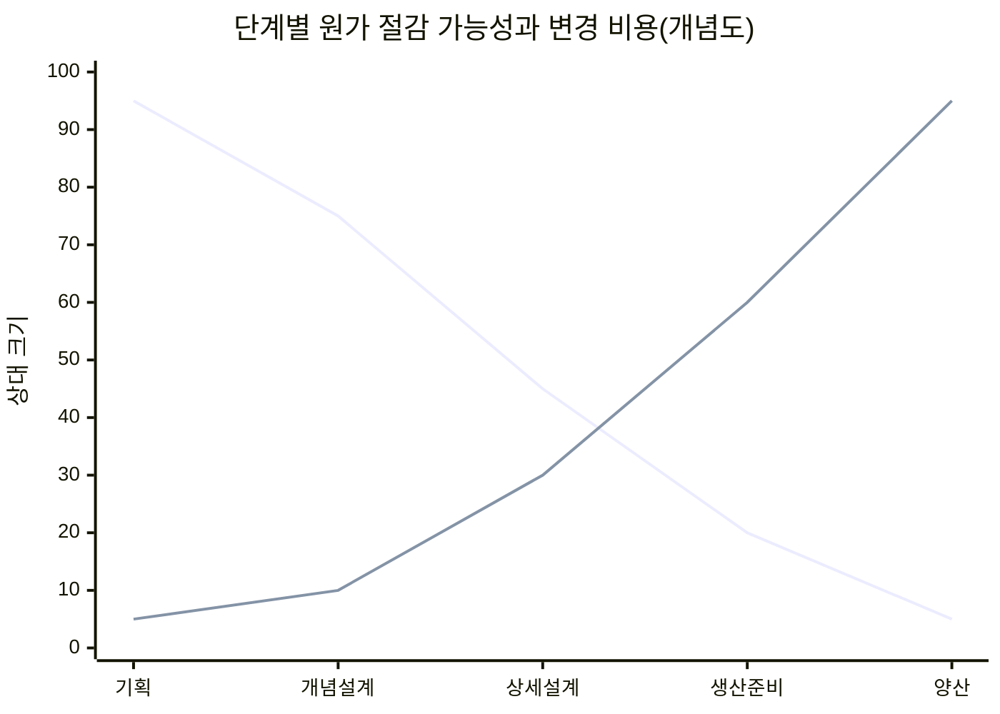
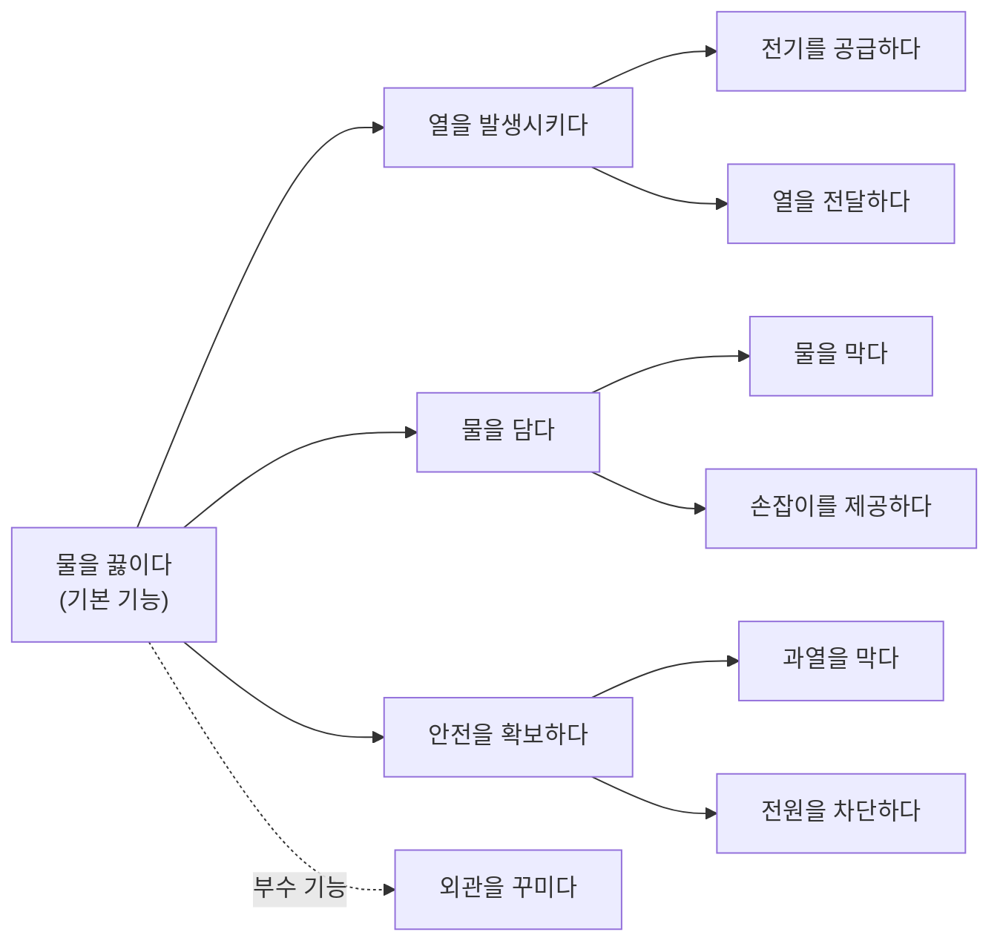
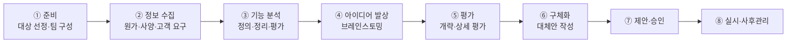

# 6.3 가치공학

!!! info "출제기준"
    **6. 원가관리 및 경제성공학** › **3. 가치공학**

## 출제 경향

총 **12문항** 출제 (1교시 단답형 5 · 2~4교시 논술형 7) · 최근 10개 회차(109~139회) 3문항 · 최근 출제 제136회

| 주제 | 출제 수 | 출제 회차 |
|---|:-:|---|
| 6.3.1 VE의 개념과 기본원칙 | 3 | 67회, 109회, 136회 |
| 6.3.2 기능분석과 가치 평가 | 5 | 63회, 68회, 88회, 97회, 130회 |
| 6.3.3 VE 추진절차 | 4 | 71회, 76회, 82회, 94회 |

## 목차

1. [VE의 개념과 기본원칙](#t63-1)
2. [기능분석과 가치 평가](#t63-2)
3. [VE 추진절차](#t63-3)

## 6.3.1 VE의 개념과 기본원칙 {#t63-1}

### VE의 개념 (109·136회)

**VE(Value Engineering, 가치공학)**는 제품·서비스·업무의 **기능을 분석**해, 필요한 기능을 **최소의 생애주기 비용(LCC)**으로 확실히 달성하는 방법을 찾는 **조직적 개선 활동**이다.

\[
V(\text{가치}) = \frac{F(\text{기능})}{C(\text{비용})}
\]

| 구분 | VA(Value Analysis) | VE(Value Engineering) |
|---|---|---|
| 기원 | 1947년 GE의 L. D. Miles — 구매 자재의 가치 분석 | 1954년 미 해군 함정국(Bureau of Ships)이 설계 단계에 도입하며 VE로 명명, 이후 국방부·공공 건설로 확산 |
| 적용 단계 | 구매·제조 단계(기존 제품) | 기획·개발·설계 단계(신제품) |
| 효과 | 원가 개선 | 원가 결정 단계에서 큰 효과 |

오늘날에는 VA와 VE를 구분하지 않고 함께 쓰는 경우가 많다. 원가의 대부분이 설계 단계에서 결정되므로 **설계 단계의 VE**가 가장 효과가 크다.

### 가치 향상의 유형

| 유형 | 기능 F | 비용 C | 의미 |
|:-:|:-:|:-:|---|
| ① | 유지 → | 감소 ↓ | 원가 절감형 |
| ② | 향상 ↑ | 감소 ↓ | 가장 이상적 |
| ③ | 향상 ↑ | 유지 → | 기능 향상형 |
| ④ | 크게 향상 ↑↑ | 증가 ↑ | 고부가가치형 |
| (⑤) | 다소 감소 ↓ | 크게 감소 ↓↓ | 과잉 기능 제거형 |

### VE에서 중시하는 네 가지 가치 (67회)

| 가치 | 의미 |
|---|---|
| **사용 가치**(Use Value) | 제품이 수행하는 기능·성능에서 나오는 가치 — VE가 가장 중시 |
| **귀중 가치**(Esteem Value) | 제품을 소유함으로써 느끼는 매력·자부심(디자인·브랜드) |
| **교환 가치**(Exchange Value) | 다른 것과 교환할 수 있는 시장 가치 |
| **원가 가치**(Cost Value) | 제품을 만드는 데 든 원가로 본 가치 |

### VE의 기본 원칙 (97회)

1. **사용자 우선의 원칙**: 사용자가 요구하는 기능을 기준으로 판단
2. **기능 중심의 원칙**: 물건이 아니라 **기능**에 착안
3. **창조에 의한 변경의 원칙**: 고정관념을 버리고 창조적 대안을 찾음
4. **팀 디자인의 원칙**: 여러 분야 전문가의 팀 활동
5. **가치 향상의 원칙**: 기능 대비 비용을 개선해 가치를 높임

**배경(개요용)**: 2차 세계대전 중 자재 부족으로 GE가 대체 재료를 쓸 수밖에 없었는데, 기능은 유지되면서 원가가 오히려 내려가는 사례가 많았다. Miles는 여기서 "고객이 사는 것은 물건이 아니라 **기능**"이라는 착안을 얻어 VA를 체계화했다.

### VE 적용 시점과 효과

(하강선: VE로 원가를 낮출 수 있는 여지, 상승선: 변경에 드는 비용 — 앞 단계일수록 VE의 효과가 크다. 수치는 개념 설명용)

**VE와 일반적 원가 절감의 차이**

| 구분 | 일반 원가 절감 | VE |
|---|---|---|
| 착안점 | 물건·원가 요소(재료비·노무비) | **기능** |
| 접근 | 개인·부서 단위, 경험 중심 | 다기능 **팀**, 체계적 절차(Job Plan) |
| 원가 관점 | 제조원가 | **LCC**(운용·보전·폐기 포함) |
| 품질 | 절감 과정에서 품질 저하 위험 | 필요 기능은 확보(사용자 요구 기준) |
| 적용 시점 | 주로 생산 단계 | 기획·설계 단계부터 |

**VE 대상 선정 기준**: 원가 비중이 큰 품목(파레토 분석), 생산량이 많은 품목, 설계가 오래된 품목, 클레임·품질 문제가 많은 품목, 경쟁사 대비 원가가 높은 품목

!!! tip "답안 작성 포인트"
    - VE는 **정의 → V = F/C → 가치 향상 유형 → 기본 원칙**의 순서로 쓴다. VA와 VE의 차이는 **적용 단계**로 구분한다.
    - 차별화: Miles의 착안 배경("기능을 산다")과 **단계별 원가 절감 가능성 곡선**, 일반 원가 절감과의 비교표를 덧붙인다.
    - VE는 목표원가 달성의 핵심 수단이다([6.2.4](02-cost-management.md#t62-4)).

??? example "관련 기출 3문항 (67회, 109회, 136회)"

    - **제67회(2002) 1교시 6번** · 10점  
      VE(가치공학)에서 중시하는 네가지 가치를 설명하시오.
    - **제109회(2016) 1교시 8번** · 10점  
      VA와 VE의 개념에 대하여 설명하시오.
    - **제136회(2025) 1교시 2번** · 10점  
      가치공학(VE, Value Engineering)에 대하여 설명하시오.

## 6.3.2 기능분석과 가치 평가 {#t63-2}

### 기능 분석의 절차 (63·68·97·130회)

**기능 분석**은 대상의 기능을 정의·분류·정리하고 각 기능의 가치를 평가해 개선 대상을 찾는 VE의 핵심 단계다.

1. **기능 정의**: 각 구성 요소의 기능을 **"명사 + 동사"**로 간결하게 표현(예: 전류를 차단하다, 물을 끓이다)
2. **기능 분류**: **기본 기능**(존재 이유) / **2차 기능**(기본 기능을 돕는 기능) — 필요 기능과 불필요(과잉) 기능 구분
3. **기능 정리**: 목적(Why)–수단(How) 관계로 기능 계통도(**FAST 다이어그램**) 작성
4. **기능 평가**: 기능별 **기능 평가값(F)**과 **현재 원가(C)**를 비교해 가치지수와 개선 여지 산출

### 기능 가치의 측정식 (88회)

\[
\text{가치지수 } V = \frac{F(\text{기능 평가값})}{C(\text{현재 원가})}, \qquad \text{원가 절감 기대액} = C - F
\]

**목적**: 기능별 가치를 **정량적으로 비교**해, 가치지수가 낮고(V < 1) 절감 기대액이 큰 기능을 **개선 우선 대상**으로 선정한다.

### 기능 평가 방법 (130회)

| 방법 | 내용 |
|---|---|
| 실적 가치 기준법 | 같은 기능을 수행하는 과거 실적 중 가장 낮은 원가를 기능 평가값으로 사용 |
| 이론 가치법 | 기능 실현에 필요한 이론적 최소 원가로 평가 |
| 표준 가치법 | 사내 표준원가·시장 가격을 기준으로 평가 |
| **강제 결정법**(FD법) | 기능을 둘씩 짝지어 중요도를 비교(쌍대 비교)해 점수화하고, 점수 비율 × 목표원가로 기능 평가값 배분 |
| DARE법 등 점수 평가법 | 평가자들이 기능 중요도에 가중 점수를 매겨 배분 |

### 기능 분석 적용 예 — 전기 주전자 (68회)

| 구성 요소 | 기능(명사 + 동사) | 구분 | 현재 원가 C | 기능 평가값 F | V = F/C | 개선안 |
|---|---|---|:-:|:-:|:-:|---|
| 히터 | 물을 가열하다 | 기본 | 6,000 | 5,500 | 0.92 | 고효율 히터 표준품 사용 |
| 본체 | 물을 담다 | 기본 | 5,000 | 3,500 | 0.70 | 사출 일체 성형, 재질 변경 |
| 자동 전원 차단 | 과열을 막다 | 2차 | 2,000 | 1,800 | 0.90 | 표준 서모스탯 공용화 |
| 장식 커버 | 외관을 꾸미다 | 2차 | 2,000 | 700 | 0.35 | 커버 제거, 본체 색상·질감으로 대체 |
| **합계** | | | **15,000** | **11,500** | | 절감 기대액 3,500 |

→ 가치지수가 가장 낮은 **장식 커버**와 **본체**를 우선 개선한다. (금액은 설명용 예시)

97회의 VE 정의·기본 원칙 5가지와 130회의 VA·VE 개념은 [6.3.1](#t63-1)을, VE 전개 프로세스는 [6.3.3](#t63-3)을 함께 본다.

### 기능 계통도(FAST 다이어그램) 예 — 전기 주전자

왼쪽으로 갈수록 **목적(Why)**, 오른쪽으로 갈수록 **수단(How)**이다. 가장 왼쪽의 기본 기능에서 "어떻게?"를 물으며 오른쪽으로 전개한다.

### 기능 분류의 다른 관점

| 관점 | 분류 |
|---|---|
| 중요도 | 기본 기능(존재 이유, 없으면 제품이 성립하지 않음) / 2차(보조) 기능 |
| 성격 | **사용 기능**(성능·작동) / **귀중 기능**(외관·매력) |
| 필요성 | 필요 기능 / 불필요 기능(과잉 품질·중복 기능 → 제거 대상) |

### 강제 결정법(FD법) 계산 예

기능 A~D를 둘씩 비교해 4점을 나눠 갖게 한다(4:0, 3:1, 2:2). 목표원가 12,000원을 점수 비율로 배분한다.

| 기능 | vs A | vs B | vs C | vs D | 점수 합 | 중요도 비율 | 기능 평가값 F |
|:-:|:-:|:-:|:-:|:-:|:-:|:-:|:-:|
| A | – | 3 | 3 | 4 | 10 | 10/24 | 5,000 |
| B | 1 | – | 2 | 3 | 6 | 6/24 | 3,000 |
| C | 1 | 2 | – | 3 | 6 | 6/24 | 3,000 |
| D | 0 | 1 | 1 | – | 2 | 2/24 | 1,000 |
| 합계 | | | | | **24** | 1.00 | **12,000** |

→ 각 기능의 현재 원가 C와 비교해 \( V = F/C \)가 낮고 \( C - F \)가 큰 기능부터 개선한다. (0·1로 비교하면 최하위 기능이 0점이 되는 문제가 있어 4점 배분 방식을 흔히 쓴다.)

!!! tip "답안 작성 포인트"
    - 기능 분석은 **기능 정의(명사 + 동사) → 분류 → FAST → 평가(V = F/C)**의 4단계를 쓰고, 68회처럼 사례를 요구하면 **기능 분석표**를 직접 작성한다.
    - 기능 평가 방법은 **강제 결정법(FD)**을 중심으로 설명하고, 점수표와 배분 결과를 간단히 보여 주면 차별화된다.
    - 결론 예(68·130회): "기능 분석은 물건이 아닌 기능에 착안해 과잉·불필요 기능을 찾아내는 VE의 핵심 단계이며, 정량적 기능 평가로 개선 우선순위를 객관화해야 한다. 고객 요구 반영을 위해 QFD([7.2.2](../07-support-technology/02-product-development.md#t72-2))와 연계하면 효과가 크다."

??? example "관련 기출 5문항 (63회, 68회, 88회, 97회, 130회)"

    - **제63회(2001) 1교시 11번** · 10점  
      기능분석
    - **제68회(2002) 4교시 1번** · 25점  
      어떤 제품을 예를 들어 가치공학의 기능분석 방법을 적용하여 제품가치에 대한 개선안을 작성해보시오.
    - **제88회(2009) 1교시 12번** · 10점  
      가치공학(VA/VE)에서 기능가치의 측정식을 제시하고, 그 목적을 설명하시오.
    - **제97회(2012) 2교시 4번** · 25점  
      기능가치분석을 통한 개선 기법으로서 VE(Value Engineering)에 대한 다음 사항을 설명하시오.

        ??? quote "문제 전문"

            기능가치분석을 통한 개선 기법으로서 VE(Value Engineering)에 대한 다음 사항을 설명하시오.  
            1) VE의 정의  
            2) VE활동의 기본원칙 5가지  
            3) VE활동의 전개프로세스와 단계별 주요내용  
    - **제130회(2023) 4교시 1번** · 25점  
      VE와 VA의 개념을 각각 설명하고, VE의 추진단계 중 기능분석단계에서 진행하는 ‘기능 평가방법’에 대하여 설명하시오.

## 6.3.3 VE 추진절차 {#t63-3}

### VE 추진 절차(Job Plan) (71·76·82·94회)

| 단계 | 핵심 질문 | 활동 |
|---|---|---|
| 준비 | 무엇을 대상으로 할까? | 대상 선정(원가 비중·개선 여지), 목표·팀 구성 |
| 정보 수집 | 그것은 무엇이며 비용은 얼마인가? | 도면·사양·원가·고객 요구 자료 수집 |
| 기능 분석 | 그 기능은 무엇이며 가치는 얼마인가? | 기능 정의·정리(FAST)·평가(V = F/C) |
| 아이디어 발상 | 그 기능을 다른 방법으로 달성할 수는 없는가? | 브레인스토밍·고든법·체크리스트 |
| 평가 | 그 대안의 비용과 효과는? | 기술적·경제적 타당성 평가 |
| 구체화·제안 | 대안이 필요 기능을 확실히 만족하는가? | 상세 설계, 시험, 제안서 작성 |
| 실시·사후관리 | 효과가 났는가? | 실시, 효과 확인, 표준화 |

**VE의 기본 사고와 목적 (82회)**: 고정관념 타파, 사용자 지향, 기능 중심, 팀 활동 → 목적은 **필요한 기능을 최소 LCC로 달성**해 가치를 높이는 것

**VE의 특징 (94회)**: 기능 중심 접근, 체계적 절차(Job Plan), 팀(부서 횡단) 활동, 창조적 발상, 생애주기 비용 관점, 사용자 요구 중심

### 업무 프로세스에 적용한 VE (71회)

**예: 구매 요청 결재 프로세스**

| VE 단계 | 적용 내용 |
|---|---|
| 대상 선정 | 결재 기간이 평균 7일로 길고 담당 공수가 많은 구매 요청 결재 업무 |
| 정보 수집 | 결재 단계(5단계)별 소요 시간, 반려 사유, 처리 공수 |
| 기능 정의 | "요청을 접수하다", "예산을 확인하다", "필요성을 승인하다", "중복을 방지하다" |
| 기능 평가 | 소액 건까지 5단계 결재 → "승인하다" 기능의 비용이 가치 대비 과다(V < 1) |
| 대안 발상 | 금액별 위임 전결, 예산 자동 확인(ERP), 표준 품목 카탈로그 구매 |
| 평가·실시 | 소액 건 2단계 결재·자동 예산 확인 도입 → 결재 기간 7일 → 2일, 처리 공수 감소 |

### Job Plan의 표준 단계와 적용 분야

국제 VE 협회(SAVE International)의 Job Plan은 크게 **사전 준비 → VE 워크숍(정보 → 기능 분석 → 창조 → 평가 → 개발 → 제안) → 사후 실행**으로 구성된다. 교재마다 단계 수(6~8단계)와 명칭이 조금씩 다르므로, 답안에서는 위 흐름도처럼 **기능 분석 → 아이디어 → 평가 → 구체화**의 핵심 흐름이 드러나면 된다.

| 단계 | 주요 기법 |
|---|---|
| 대상 선정 | 파레토 분석, 원가 비중·개선 여지 분석 |
| 기능 분석 | 기능 정의(명사 + 동사), FAST, FD법 |
| 아이디어 발상 | 브레인스토밍, 체크리스트(오스본), 고든법, TRIZ([7.2.7](../07-support-technology/02-product-development.md#t72-7), [5.2.3](../05-work-measurement/02-process-analysis.md#t52-3)) |
| 평가 | 개략 평가(장단점 비교) → 상세 평가(가중치 평가표, LCC 비교) |
| 실시·사후관리 | 효과 측정(절감액·가치 향상), 표준화·수평 전개 |

| 적용 분야 | 내용 |
|---|---|
| 제품(제조업) | 신제품 원가기획, 기존 제품 원가 개선, 부품 표준화 |
| 건설 | 공공 건설공사의 **설계 VE**(일정 규모 이상 공사에 법적으로 의무화 — 기준 금액은 교재 확인 필요) |
| 업무·서비스 | 결재·구매·물류 프로세스, 간접 부문 효율화(71회) |
| 설비 | 설비 사양 최적화, LCC 기준 설비 선정 |

**성공 요건**: 최고경영자의 지원, 다기능 팀(설계·생산·구매·품질·영업) 구성, 전문 VE 리더(퍼실리테이터), 아이디어 비판 금지, 성과 보상과 사후 관리

**최근 동향**: PLM·CAD 데이터와 원가 테이블을 연동한 **디지털 VE**, AI로 유사 부품·대체 재료를 찾는 설계 지원, 친환경 재료·재활용성까지 기능 평가에 넣는 **Green VE**(LCC + 탄소 배출)가 확산되고 있다.

!!! tip "답안 작성 포인트"
    - VE 절차는 **단계 흐름도 + 단계별 핵심 질문**으로 쓰면 VE의 사고방식이 잘 드러난다.
    - 업무 프로세스 적용 문제는 제품 대신 **업무의 기능("명사 + 동사")**을 정의하는 것이 핵심이다.
    - 차별화: 단계별 **주요 기법 표**와 성공 요건, 적용 분야(제품·건설·업무)를 덧붙인다.
    - 결론 예: "VE는 일회성 원가 절감이 아니라 기능 중심의 조직적 개선 활동이므로, 설계 초기 단계에 다기능 팀으로 적용하고 PLM과 연계한 디지털 VE로 상시화해야 한다."

??? example "관련 기출 4문항 (71회, 76회, 82회, 94회)"

    - **제71회(2003) 2교시 3번** · 25점  
      VE의 추진절차를 업무프로세스의 개선에 적용하여 예를 들어 설명해보시오.
    - **제76회(2005) 3교시 3번** · 25점  
      VE의 개념, 목적 및 추진과정에 대하여 기술하시오.
    - **제82회(2007) 4교시 5번** · 25점  
      가치공학(VE)에 대하여 개념, 기본사고와 목적, 프로젝트 과제 추진단계 및 절차에 대하여 설명하시오.
    - **제94회(2011) 2교시 6번** · 25점  
      VE(Value Engineering)의 정의 및 특징, 추진과정에 대하여 설명하시오.

## 답안 작성 예시

!!! example "25점 예시: 제130회 4교시 1번 — VE와 VA의 개념, 기능분석단계의 '기능 평가방법'"

    **1. 개요**

    - VE = 필요한 기능을 최소 LCC로 달성하기 위한 기능 중심의 조직적 개선 활동, \( V = F/C \)
    - 1947년 GE의 Miles가 VA로 창안, 1954년 미 해군이 설계 단계에 도입하며 VE로 발전

    **2. 본론**

    - (1) [표] VA vs VE(기원·적용 단계·효과) + [그림] 단계별 원가 절감 가능성 곡선 → 설계 단계 VE가 효과가 큼
    - (2) 기능분석의 위치: Job Plan 흐름도에서 정보 수집 다음, 아이디어 발상 앞의 핵심 단계
    - (3) 기능 분석 절차: 정의(명사 + 동사) → 분류(기본·2차) → 정리([그림] FAST) → 평가
    - (4) [표] 기능 평가 방법 5가지(실적 가치·이론 가치·표준 가치·FD법·점수 평가법)
    - (5) FD법 계산 예: [표] 쌍대 비교 점수표 → 중요도 비율 × 목표원가 = 기능 평가값 F → \( V = F/C \), 절감 기대액 \( C - F \)

    **3. 결론(기술사 의견)**

    - 기능 평가는 개선 대상을 객관적으로 고르는 VE 성패의 핵심이며, 평가자 주관을 줄이기 위해 다기능 팀 합의와 QFD의 고객 요구 가중치를 함께 쓴다.
    - 차별화 포인트: FD 점수표 수치 예, 목표원가(원가기획)와의 연결, 디지털 VE·Green VE 동향 언급

!!! example "25점 예시: 제94회 2교시 6번 — VE의 정의 및 특징, 추진과정"

    **1. 개요**

    - VE의 정의와 \( V = F/C \), [표] 가치 향상 5유형(원가 절감형 ~ 고부가가치형)

    **2. 본론**

    - (1) 특징: 기능 중심, 사용자 지향, 팀 활동, 체계적 절차, 창조적 발상, LCC 관점 + [표] 일반 원가 절감과 VE의 비교
    - (2) 기본 원칙 5가지(사용자 우선·기능 중심·창조에 의한 변경·팀 디자인·가치 향상)
    - (3) 추진과정: [그림] Job Plan 8단계 흐름도 + [표] 단계별 핵심 질문·활동·주요 기법
    - (4) 간단한 적용 예: 전기 주전자 기능 분석표(V가 가장 낮은 장식 커버·본체를 우선 개선)

    **3. 결론(기술사 의견)**

    - 성공 요건(경영자 지원·다기능 팀·사후 관리)을 제시하고, 목표원가·DFM과 연계한 설계 단계 적용을 권고한다.
    - 차별화 포인트: "고객은 물건이 아니라 기능을 산다"는 VE 철학을 결론에 한 줄로 정리
