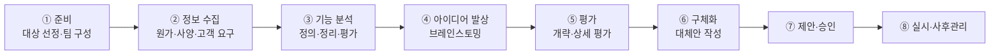

# 6.3 가치공학

!!! info "출제기준"
    **6. 원가관리 및 경제성공학** › **3. 가치공학**

## 출제 경향

총 **12문항** 출제 (1교시 단답형 5 · 2~4교시 논술형 7) · 최근 10개 회차(109~139회) 3문항 · 최근 출제 제136회

| 주제 | 출제 수 | 출제 회차 |
|---|:-:|---|
| 6.3.1 VE의 개념과 기본원칙 | 3 | 67회, 109회, 136회 |
| 6.3.2 기능분석과 가치 평가 | 5 | 63회, 68회, 88회, 97회, 130회 |
| 6.3.3 VE 추진절차 | 4 | 71회, 76회, 82회, 94회 |

## 목차

1. [VE의 개념과 기본원칙](#t63-1)
2. [기능분석과 가치 평가](#t63-2)
3. [VE 추진절차](#t63-3)

## 6.3.1 VE의 개념과 기본원칙 {#t63-1}

### VE의 개념 (109·136회)

**VE(Value Engineering, 가치공학)**는 제품·서비스·업무의 **기능을 분석**해, 필요한 기능을 **최소의 생애주기 비용(LCC)**으로 확실히 달성하는 방법을 찾는 **조직적 개선 활동**이다.

\[
V(\text{가치}) = \frac{F(\text{기능})}{C(\text{비용})}
\]

| 구분 | VA(Value Analysis) | VE(Value Engineering) |
|---|---|---|
| 기원 | 1947년 GE의 L. D. Miles — 구매 자재의 가치 분석 | 1954년 미 국방부가 설계 단계 적용을 VE로 명명 |
| 적용 단계 | 구매·제조 단계(기존 제품) | 기획·개발·설계 단계(신제품) |
| 효과 | 원가 개선 | 원가 결정 단계에서 큰 효과 |

오늘날에는 VA와 VE를 구분하지 않고 함께 쓰는 경우가 많다. 원가의 대부분이 설계 단계에서 결정되므로 **설계 단계의 VE**가 가장 효과가 크다.

### 가치 향상의 유형

| 유형 | 기능 F | 비용 C | 의미 |
|:-:|:-:|:-:|---|
| ① | 유지 → | 감소 ↓ | 원가 절감형 |
| ② | 향상 ↑ | 감소 ↓ | 가장 이상적 |
| ③ | 향상 ↑ | 유지 → | 기능 향상형 |
| ④ | 크게 향상 ↑↑ | 증가 ↑ | 고부가가치형 |
| (⑤) | 다소 감소 ↓ | 크게 감소 ↓↓ | 과잉 기능 제거형 |

### VE에서 중시하는 네 가지 가치 (67회)

| 가치 | 의미 |
|---|---|
| **사용 가치**(Use Value) | 제품이 수행하는 기능·성능에서 나오는 가치 — VE가 가장 중시 |
| **귀중 가치**(Esteem Value) | 제품을 소유함으로써 느끼는 매력·자부심(디자인·브랜드) |
| **교환 가치**(Exchange Value) | 다른 것과 교환할 수 있는 시장 가치 |
| **원가 가치**(Cost Value) | 제품을 만드는 데 든 원가로 본 가치 |

### VE의 기본 원칙 (97회)

1. **사용자 우선의 원칙**: 사용자가 요구하는 기능을 기준으로 판단
2. **기능 중심의 원칙**: 물건이 아니라 **기능**에 착안
3. **창조에 의한 변경의 원칙**: 고정관념을 버리고 창조적 대안을 찾음
4. **팀 디자인의 원칙**: 여러 분야 전문가의 팀 활동
5. **가치 향상의 원칙**: 기능 대비 비용을 개선해 가치를 높임

!!! tip "답안 작성 포인트"
    - VE는 **정의 → V = F/C → 가치 향상 유형 → 기본 원칙**의 순서로 쓴다. VA와 VE의 차이는 **적용 단계**로 구분한다.

??? example "관련 기출 3문항 (67회, 109회, 136회)"

    - **제67회(2002) 1교시 6번** · 10점  
      VE(가치공학)에서 중시하는 네가지 가치를 설명하시오.
    - **제109회(2016) 1교시 8번** · 10점  
      VA와 VE의 개념에 대하여 설명하시오.
    - **제136회(2025) 1교시 2번** · 10점  
      가치공학(VE, Value Engineering)에 대하여 설명하시오.

## 6.3.2 기능분석과 가치 평가 {#t63-2}

### 기능 분석의 절차 (63·68·97·130회)

**기능 분석**은 대상의 기능을 정의·분류·정리하고 각 기능의 가치를 평가해 개선 대상을 찾는 VE의 핵심 단계다.

1. **기능 정의**: 각 구성 요소의 기능을 **"명사 + 동사"**로 간결하게 표현(예: 전류를 차단하다, 물을 끓이다)
2. **기능 분류**: **기본 기능**(존재 이유) / **2차 기능**(기본 기능을 돕는 기능) — 필요 기능과 불필요(과잉) 기능 구분
3. **기능 정리**: 목적(Why)–수단(How) 관계로 기능 계통도(**FAST 다이어그램**) 작성
4. **기능 평가**: 기능별 **기능 평가값(F)**과 **현재 원가(C)**를 비교해 가치지수와 개선 여지 산출

### 기능 가치의 측정식 (88회)

\[
\text{가치지수 } V = \frac{F(\text{기능 평가값})}{C(\text{현재 원가})}, \qquad \text{원가 절감 기대액} = C - F
\]

**목적**: 기능별 가치를 **정량적으로 비교**해, 가치지수가 낮고(V < 1) 절감 기대액이 큰 기능을 **개선 우선 대상**으로 선정한다.

### 기능 평가 방법 (130회)

| 방법 | 내용 |
|---|---|
| 실적 가치 기준법 | 같은 기능을 수행하는 과거 실적 중 가장 낮은 원가를 기능 평가값으로 사용 |
| 이론 가치법 | 기능 실현에 필요한 이론적 최소 원가로 평가 |
| 표준 가치법 | 사내 표준원가·시장 가격을 기준으로 평가 |
| **강제 결정법**(FD법) | 기능을 둘씩 짝지어 중요도를 비교(쌍대 비교)해 점수화하고, 점수 비율 × 목표원가로 기능 평가값 배분 |
| DARE법 등 점수 평가법 | 평가자들이 기능 중요도에 가중 점수를 매겨 배분 |

### 기능 분석 적용 예 — 전기 주전자 (68회)

| 구성 요소 | 기능(명사 + 동사) | 구분 | 현재 원가 C | 기능 평가값 F | V = F/C | 개선안 |
|---|---|---|:-:|:-:|:-:|---|
| 히터 | 물을 가열하다 | 기본 | 6,000 | 5,500 | 0.92 | 고효율 히터 표준품 사용 |
| 본체 | 물을 담다 | 기본 | 5,000 | 3,500 | 0.70 | 사출 일체 성형, 재질 변경 |
| 자동 전원 차단 | 과열을 막다 | 2차 | 2,000 | 1,800 | 0.90 | 표준 서모스탯 공용화 |
| 장식 커버 | 외관을 꾸미다 | 2차 | 2,000 | 700 | 0.35 | 커버 제거, 본체 색상·질감으로 대체 |
| **합계** | | | **15,000** | **11,500** | | 절감 기대액 3,500 |

→ 가치지수가 가장 낮은 **장식 커버**와 **본체**를 우선 개선한다. (금액은 설명용 예시)

97회의 VE 정의·기본 원칙 5가지와 130회의 VA·VE 개념은 [6.3.1](#t63-1)을, VE 전개 프로세스는 [6.3.3](#t63-3)을 함께 본다.

!!! tip "답안 작성 포인트"
    - 기능 분석은 **기능 정의(명사 + 동사) → 분류 → FAST → 평가(V = F/C)**의 4단계를 쓰고, 68회처럼 사례를 요구하면 **기능 분석표**를 직접 작성한다.
    - 기능 평가 방법은 **강제 결정법(FD)**을 중심으로 설명하면 좋다.

??? example "관련 기출 5문항 (63회, 68회, 88회, 97회, 130회)"

    - **제63회(2001) 1교시 11번** · 10점  
      기능분석
    - **제68회(2002) 4교시 1번** · 25점  
      어떤 제품을 예를 들어 가치공학의 기능분석 방법을 적용하여 제품가치에 대한 개선안을 작성해보시오.
    - **제88회(2009) 1교시 12번** · 10점  
      가치공학(VA/VE)에서 기능가치의 측정식을 제시하고, 그 목적을 설명하시오.
    - **제97회(2012) 2교시 4번** · 25점  
      기능가치분석을 통한 개선 기법으로서 VE(Value Engineering)에 대한 다음 사항을 설명하시오.

        ??? quote "문제 전문"

            기능가치분석을 통한 개선 기법으로서 VE(Value Engineering)에 대한 다음 사항을 설명하시오.  
            1) VE의 정의  
            2) VE활동의 기본원칙 5가지  
            3) VE활동의 전개프로세스와 단계별 주요내용  
    - **제130회(2023) 4교시 1번** · 25점  
      VE와 VA의 개념을 각각 설명하고, VE의 추진단계 중 기능분석단계에서 진행하는 ‘기능 평가방법’에 대하여 설명하시오.

## 6.3.3 VE 추진절차 {#t63-3}

### VE 추진 절차(Job Plan) (71·76·82·94회)

| 단계 | 핵심 질문 | 활동 |
|---|---|---|
| 준비 | 무엇을 대상으로 할까? | 대상 선정(원가 비중·개선 여지), 목표·팀 구성 |
| 정보 수집 | 그것은 무엇이며 비용은 얼마인가? | 도면·사양·원가·고객 요구 자료 수집 |
| 기능 분석 | 그 기능은 무엇이며 가치는 얼마인가? | 기능 정의·정리(FAST)·평가(V = F/C) |
| 아이디어 발상 | 그 기능을 다른 방법으로 달성할 수는 없는가? | 브레인스토밍·고든법·체크리스트 |
| 평가 | 그 대안의 비용과 효과는? | 기술적·경제적 타당성 평가 |
| 구체화·제안 | 대안이 필요 기능을 확실히 만족하는가? | 상세 설계, 시험, 제안서 작성 |
| 실시·사후관리 | 효과가 났는가? | 실시, 효과 확인, 표준화 |

**VE의 기본 사고와 목적 (82회)**: 고정관념 타파, 사용자 지향, 기능 중심, 팀 활동 → 목적은 **필요한 기능을 최소 LCC로 달성**해 가치를 높이는 것

**VE의 특징 (94회)**: 기능 중심 접근, 체계적 절차(Job Plan), 팀(부서 횡단) 활동, 창조적 발상, 생애주기 비용 관점, 사용자 요구 중심

### 업무 프로세스에 적용한 VE (71회)

**예: 구매 요청 결재 프로세스**

| VE 단계 | 적용 내용 |
|---|---|
| 대상 선정 | 결재 기간이 평균 7일로 길고 담당 공수가 많은 구매 요청 결재 업무 |
| 정보 수집 | 결재 단계(5단계)별 소요 시간, 반려 사유, 처리 공수 |
| 기능 정의 | "요청을 접수하다", "예산을 확인하다", "필요성을 승인하다", "중복을 방지하다" |
| 기능 평가 | 소액 건까지 5단계 결재 → "승인하다" 기능의 비용이 가치 대비 과다(V < 1) |
| 대안 발상 | 금액별 위임 전결, 예산 자동 확인(ERP), 표준 품목 카탈로그 구매 |
| 평가·실시 | 소액 건 2단계 결재·자동 예산 확인 도입 → 결재 기간 7일 → 2일, 처리 공수 감소 |

!!! tip "답안 작성 포인트"
    - VE 절차는 **단계 흐름도 + 단계별 핵심 질문**으로 쓰면 VE의 사고방식이 잘 드러난다.
    - 업무 프로세스 적용 문제는 제품 대신 **업무의 기능("명사 + 동사")**을 정의하는 것이 핵심이다.

??? example "관련 기출 4문항 (71회, 76회, 82회, 94회)"

    - **제71회(2003) 2교시 3번** · 25점  
      VE의 추진절차를 업무프로세스의 개선에 적용하여 예를 들어 설명해보시오.
    - **제76회(2005) 3교시 3번** · 25점  
      VE의 개념, 목적 및 추진과정에 대하여 기술하시오.
    - **제82회(2007) 4교시 5번** · 25점  
      가치공학(VE)에 대하여 개념, 기본사고와 목적, 프로젝트 과제 추진단계 및 절차에 대하여 설명하시오.
    - **제94회(2011) 2교시 6번** · 25점  
      VE(Value Engineering)의 정의 및 특징, 추진과정에 대하여 설명하시오.
