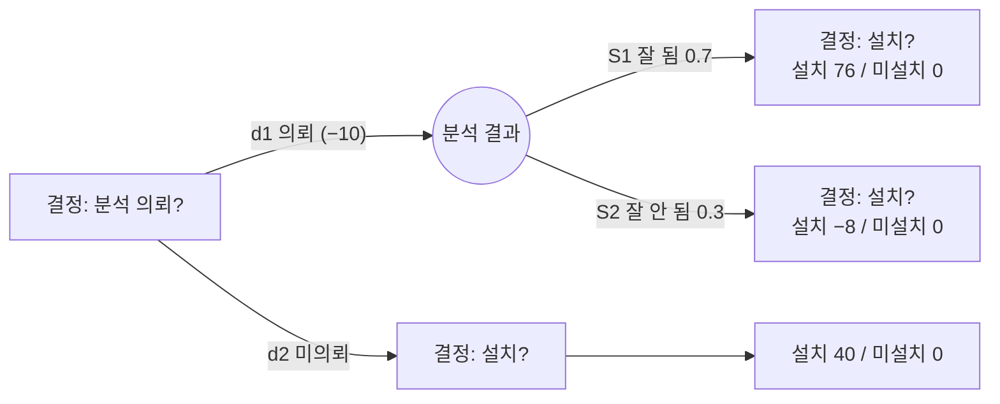

# 6.4 경영과학(OR)

!!! info "출제기준"
    **6. 원가관리 및 경제성공학** › **4. 경영과학(OR)**

## 출제 경향

총 **45문항** 출제 (1교시 단답형 15 · 2~4교시 논술형 30) · 최근 10개 회차(109~139회) 12문항 · 최근 출제 제139회

| 주제 | 출제 수 | 출제 회차 |
|---|:-:|---|
| 6.4.1 선형계획법(LP) | 11 | 68회, 73회, 76회, 82회, 88회, 91회, 97회, 103회, 121회 |
| 6.4.2 수송·할당 문제 | 2 | 65회, 91회 |
| 6.4.3 대기행렬 이론 | 4 | 91회, 97회, 103회, 124회 |
| 6.4.4 의사결정 이론(불확실성하 의사결정·AHP) | 8 | 97회, 100회, 103회, 106회, 115회, 121회, 127회 |
| 6.4.5 프로젝트 관리와 PERT/CPM | 17 | 71회, 76회, 82회, 91회, 94회, 97회, 100회, 103회, 106회, 115회, 124회, 130회, 139회 |
| 6.4.6 시뮬레이션과 DEA | 3 | 88회, 100회, 112회 |

## 목차

1. [선형계획법(LP)](#t64-1)
2. [수송·할당 문제](#t64-2)
3. [대기행렬 이론](#t64-3)
4. [의사결정 이론(불확실성하 의사결정·AHP)](#t64-4)
5. [프로젝트 관리와 PERT/CPM](#t64-5)
6. [시뮬레이션과 DEA](#t64-6)

## 6.4.1 선형계획법(LP) {#t64-1}

### 선형계획법(LP)의 정의와 일반식 (76·91회)

**선형계획법**은 한정된 자원의 제약(선형 부등식) 아래에서 목적(이익 최대·비용 최소)을 나타내는 **선형 함수를 최적화**하는 수리계획 기법이다.

\[
\text{목적함수: } \max(\min)\ Z = \sum_{j} c_j x_j, \qquad \text{제약조건: } \sum_{j} a_{ij} x_j \le (\ge, =)\ b_i, \qquad \text{비음조건: } x_j \ge 0
\]

| 구성 | 의미 |
|---|---|
| 의사결정변수 \( x_j \) | 결정해야 할 양(제품별 생산량 등) |
| 목적함수 | 최대화·최소화하려는 목표(이익·비용) |
| 제약조건 | 자원(시간·재료·능력)의 한계 |
| 비음조건 | 변수는 음수가 될 수 없음 |

### LP의 가정(필수 조건) (68·73·91회)

1. **비례성**: 목적함수·제약조건의 각 항이 변수에 비례(규모의 경제 없음)
2. **가법성**: 각 변수의 기여도를 단순 합산할 수 있음(상호작용 없음)
3. **분할성**: 변수가 연속값(소수)을 가질 수 있음
4. **확정성**: 모든 계수(\( c_j, a_{ij}, b_i \))가 확정적으로 알려져 있음

**LP·IP·GP의 비교 (73회)**

| 구분 | LP(선형계획) | IP(정수계획) | GP(목표계획) |
|---|---|---|---|
| 변수 | 연속 | 정수(또는 0·1) — 분할성 가정 완화 | 연속(또는 정수) |
| 목적 | 단일 목적 | 단일 목적 | **여러 목표**를 우선순위에 따라 달성 |
| 특징 | 심플렉스로 효율적 해법 | 해법이 복잡(분지한계법) | 목표와의 편차(미달·초과)를 최소화 |
| 적용 | 제품 배합, 생산계획 | 설비 배치, 할당, 투자 선택 | 이익·고용·품질 등 상충 목표 |

**적용 분야 (76·82·121회)**: ① 제품 배합(생산 믹스) 결정 ② 원료 배합(사료·석유 정제) ③ 생산·재고 계획(총괄생산계획) ④ 수송·물류 계획 ⑤ 인력 배치·일정 계획 ⑥ 투자 포트폴리오 선택

**해법의 종류 (76·103회)**

| 해법 | 장점 | 단점 |
|---|---|---|
| **도시법(그래프법)** | 해의 의미를 시각적으로 이해, 민감도 분석이 직관적 | 변수가 2개일 때만 사용 가능 |
| **심플렉스법** | 변수·제약이 많아도 체계적으로 해를 구함, 컴퓨터 처리 가능 | 계산 과정이 복잡, 직관적 이해 어려움 |
| (기타) 내부점법, 쌍대 심플렉스법, 컴퓨터 소프트웨어 | 대규모 문제 | – |

### 풀이: 88회

\[
\max Z = 12A + 15B \quad \text{s.t.} \quad 4A + 2B \le 120\ (\text{용접}),\ \ 3A + 5B \le 100\ (\text{연마}),\ \ A, B \ge 0
\]

| 꼭짓점 (A, B) | Z(만 원) |
|---|:-:|
| (0, 0) | 0 |
| (30, 0) | 360 |
| (0, 20) | 300 |
| **(28.57, 2.86)** — 두 제약식의 교점 | **385.7** |

→ 최적해 A = 200/7 ≈ 28.6단위, B = 20/7 ≈ 2.9단위, 최대 이익 ≈ 385.7만 원. (정수로 생산해야 하면 A = 28, B = 3에서 381만 원)

### 풀이: 97회

\[
\max Z = 1{,}000A + 1{,}500B \quad \text{s.t.} \quad 10A + 18B \le 3{,}200,\ \ 15A + 5B \le 2{,}500,\ \ A, B \ge 0
\]

(참고) 두 제약식의 교점 A ≈ 131.8, B ≈ 104.5에서 Z ≈ 288,636원이 최대다.

**현실 적용 시 예상 문제점**: ① 해가 소수로 나와 정수 생산량으로 조정 필요 ② 계수(소요시간·이익)가 실제로는 변동(확정성 가정 위배) ③ 시장 수요 한계, 원자재·인력 제약 등 모형에 빠진 조건 ④ 대량 생산 시 단위 이익이 변하는 비선형성 ⑤ 품종 전환(준비교체) 시간 미반영

### 풀이: 103회 (텐트 X1, 그늘막 X2)

\[
\max Z = 20{,}000X_1 + 10{,}000X_2 \quad \text{s.t.} \quad 6X_1 + 4X_2 \le 2{,}400,\ \ 4X_1 \le 1{,}500,\ \ 9X_1 + 3X_2 \le 2{,}700,\ \ X_1, X_2 \ge 0
\]

| 꼭짓점 (X1, X2) | Z(원) |
|---|:-:|
| (0, 600) | 6,000,000 |
| (300, 0) | 6,000,000 |
| **(200, 300)** — 인발·조립 제약의 교점 | **7,000,000** |

→ 텐트 **200개**, 그늘막 **300개**, 최대 이익 **700만 원**. 후가공 제약(4X1 ≤ 1,500)은 여유가 있다(800시간 사용).

### 풀이: 121회 (제품1 x₁, 제품2 x₂)

\[
\max Z = 30x_1 + 50x_2 \quad \text{s.t.} \quad x_1 \le 6,\ \ 2x_2 \le 14,\ \ 2x_1 + 2x_2 \le 18,\ \ x_1, x_2 \ge 0
\]

| 꼭짓점 | (0, 7) | **(2, 7)** | (6, 3) | (6, 0) |
|---|:-:|:-:|:-:|:-:|
| Z(만 원) | 350 | **410** | 330 | 180 |

→ 최적해 x₁ = 2, x₂ = 7, 주당 최대 이익 **410만 원**

**민감도 분석(잠재가격)**: 최적점에서 공장2·공장3의 제약이 묶여(binding) 있다. 쌍대 조건 \( 2y_3 = 30,\ 2y_2 + 2y_3 = 50 \)에서

- **공장2의 1시간 가치 = 10만 원**, **공장3의 1시간 가치 = 15만 원**
- 공장1은 여유(4시간)가 있으므로 1시간의 가치는 0이다.

그래프로 보면 공장3의 시간을 1시간 늘리면 제약선이 바깥으로 이동해 최적점이 (2.5, 7)로 옮겨 가고 이익이 15만 원 늘어난다.

!!! tip "답안 작성 포인트"
    - LP 계산은 **정식화(목적함수·제약조건·비음조건) → 그래프(실행가능영역) → 꼭짓점 비교표 → 최적해**의 순서를 지킨다. 그래프를 반드시 그린다.
    - 민감도 분석은 **묶인 제약의 잠재가격(쌍대가격)**으로 설명한다.

??? example "관련 기출 11문항 (68회, 73회, 76회, 82회, 88회, 91회, 97회, 103회, 121회)"

    - **제68회(2002) 1교시 5번** · 10점  
      LP의 필수조건
    - **제73회(2004) 4교시 5번** · 25점  
      LP(Liner Programing), IP(Integer programing), GP(Goal Programing)를 적용하여 모델화 할때의 여러 가정을 비교 설명하시오.
    - **제76회(2005) 2교시 4번** · 25점  
      선형계획법(LP)의 정의, 적용분야 및 해법의 종류에 관하여 설명하시오.
    - **제82회(2007) 1교시 10번** · 10점  
      선형계획법이 주로 응용되는 분야 4가지
    - **제88회(2009) 3교시 5번** · 25점  
      제품 A와 제품 B는 용접공정과 연마공정을 거쳐 생산된다. 제품 A를 1단위 생산하기 위해서는 용접공정에서 4시간과 연마공정에서 3시간, 제품 B를 1단위 생산하기 위해서는 용접공정에서 2시간과 연마공정에서 5시간의 작업을 필요로 한다. 설비의 작업 가능시간은 용접공정 120시간, 연마공정 100시간이다. 제품 A, B의 단위당 판매이익은 각각 12만원, 15만원이다.

        ??? quote "문제 전문"

            제품 A와 제품 B는 용접공정과 연마공정을 거쳐 생산된다. 제품 A를 1단위 생산하기 위해서는 용접공정에서 4시간과 연마공정에서 3시간, 제품 B를 1단위 생산하기 위해서는 용접공정에서 2시간과 연마공정에서 5시간의 작업을 필요로 한다. 설비의 작업 가능시간은 용접공정 120시간, 연마공정 100시간이다. 제품 A, B의 단위당 판매이익은 각각 12만원, 15만원이다.  
            1) 판매이익을 최대로 하기 위한 LP(Linear Programming)모형을 수립하시오.  
            2) 그래프에 의한 제품 A, B의 최적생산량을 산출하시오.  
    - **제88회(2009) 4교시 3번** · 25점  
      서로 다른 3대의 기계와 3종류의 작업이 있다. 각각의 기계는 3종류의 작업을 수행할 수 있으며, 각 작업에 대한 기계별 수행시간은 다음과 같다.

        ??? quote "문제 전문"

            서로 다른 3대의 기계와 3종류의 작업이 있다. 각각의 기계는 3종류의 작업을 수행할 수 있으며, 각 작업에 대한 기계별 수행시간은 다음과 같다.  
            [표] (단위 : 시간) 작업 \\ 기계 | A | B | C  
            1 | 2 | 4 | 7  
            2 | 4 | 2 | 1  
            3 | 2 | 6 | 5  
            1) 0, 1변수를 이용하여 총 작업소요시간을 최소화하기 위한 선형모형을 수립하시오.  
            2) 수립한 모형에 대한 실행 가능해(feasible solution)를 제시하고, 총 수행시간을 산출하시오.  
    - **제91회(2010) 4교시 5번** · 25점  
      선형계획법에 대한 다음 각 물음에 답하시오.

        ??? quote "문제 전문"

            선형계획법에 대한 다음 각 물음에 답하시오.  
            (1) 선형계획모형(목적함수, 제약조건, 비음조건)의 일반식을 나타내고, 각각의 의미를 설명하시오.  
            (2) 선형계획법의 제 가정을 설명하시오.  
    - **제97회(2012) 2교시 5번** · 25점  
      A와 B의 2가지 제품을 생산하고 있는 공장에서 현재의 생산능력 범위 내에서 최대의 이익을 창출할 수 있는 A와 B의 생산량을 선형계획법으로 결정하고자 한다. 이 두 가지 제품은 ‘가’와 ‘나’의 공정을 거치는데 순차적으로 거칠 필요는 없다. ‘가’ 와 ‘나’의 각 공정에서의 소요시간과 각 공정의 생산능력은 다음 표와 같고, 완제품의 판매이익은 A가 1000원, B는 1500원이다.

        ??? quote "문제 전문"

            A와 B의 2가지 제품을 생산하고 있는 공장에서 현재의 생산능력 범위 내에서 최대의 이익을 창출할 수 있는 A와 B의 생산량을 선형계획법으로 결정하고자 한다. 이 두 가지 제품은 ‘가’와 ‘나’의 공정을 거치는데 순차적으로 거칠 필요는 없다. ‘가’ 와 ‘나’의 각 공정에서의 소요시간과 각 공정의 생산능력은 다음 표와 같고, 완제품의 판매이익은 A가 1000원, B는 1500원이다.  
            1) 이 자료를 바탕으로 최적해를 구하기 위한 선형계획모형을 작성하시오.  
            2) 이 선형계획 모형으로 구한 해의 현실 적용시 예상되는 문제점을 쓰시오.  
            [표] 공정 | 제품별 단위당 소요시간 A | 제품별 단위당 소요시간 B | 생산능력(시간)  
            가 | 10 | 18 | 3200  
            나 | 15 | 5 | 2500  
    - **제103회(2014) 4교시 2번** · 25점  
      등산용 텐트와 그늘막을 생산·판매하고 있는 고구려주식회사는 현재의 생산능력범위내에서 이익을 최대로 올릴 수 있는 텐트와 그늘막의 생산량을 각각 결정하려고 한다. 이들 제품은 인발, 후가공, 조립의 3공정을 순차적으로 거쳐 제작되는데(단, 그늘막은 후가공을 하지 않는다.) 소요시간은 아래의 표와 같다. 그리고 각 공정별 월간 최대 작업능력은 인발 2,400시간, 후 가공 1,500시간, 조립 2,700시간으로 이를 초과하여 작업할 수는 없다.

        ??? quote "문제 전문"

            등산용 텐트와 그늘막을 생산·판매하고 있는 고구려주식회사는 현재의 생산능력범위내에서 이익을 최대로 올릴 수 있는 텐트와 그늘막의 생산량을 각각 결정하려고 한다. 이들 제품은 인발, 후가공, 조립의 3공정을 순차적으로 거쳐 제작되는데(단, 그늘막은 후가공을 하지 않는다.) 소요시간은 아래의 표와 같다. 그리고 각 공정별 월간 최대 작업능력은 인발 2,400시간, 후 가공 1,500시간, 조립 2,700시간으로 이를 초과하여 작업할 수는 없다.  
            그리고 제품의 단위당 판매이익은 텐트 20,000원, 그늘막 10,000원이다.  
            [표] 작업공정 | 생산소요시간 텐트(X1) | 생산소요시간 그늘막(X2) | 최대작업능력(시간)  
            인발 | 6 | 4 | 2,400  
            후 가공 | 4 | 0 | 1,500  
            조립 | 9 | 3 | 2,700  
            1) 도시법(graphic solution method)과 심플렉스 해법(simplex solution method)의 장단점을 비교하여 설명하시오.  
            2) 선형계획모델을 설계하고, 도시법을 사용하여 최적해를 구하시오.  
    - **제121회(2020) 1교시 11번** · 10점  
      선형계획법이 주로 응용되는 분야 5가지
    - **제121회(2020) 2교시 5번** · 25점  
      부품 회사는 2개 제품을 생산하기 위하여 공장1, 공장2, 공장3에서 주어진 시간만큼 가공시간이 필요하다. 제품1과 제품2의 개당 이익은 각각 30만원과 50만원이고, 주당 총이익을 최대화하려 한다. 3개 공장의 주당 이용가능시간은 각각 6, 14, 18(시간/주)이다. 제품당 필요한 가공시간은 아래와 같고 가공순서는 고려하지 않는다. 다음 물음에 답하시오.

        ??? quote "문제 전문"

            부품 회사는 2개 제품을 생산하기 위하여 공장1, 공장2, 공장3에서 주어진 시간만큼 가공시간이 필요하다. 제품1과 제품2의 개당 이익은 각각 30만원과 50만원이고, 주당 총이익을 최대화하려 한다. 3개 공장의 주당 이용가능시간은 각각 6, 14, 18(시간/주)이다. 제품당 필요한 가공시간은 아래와 같고 가공순서는 고려하지 않는다. 다음 물음에 답하시오.  
            [표] 구분 | 제품1 | 제품2  
            공장1 | 1 시간 | 0 시간  
            공장2 | 0 시간 | 2 시간  
            공장3 | 2 시간 | 2 시간  
            1) 선형계획문제로 정식화(대수식)하시오.  
            2) 1)항을 그래프로 도식화하고 최적해를 구하시오.  
            3) 공장2와 공장3의 이용가능시간을 증가시키려 할 때 그래프를 활용한 민감도분석을 이용하여 공장2와 공장3의 1시간의 가치를 계산하시오.  

## 6.4.2 수송·할당 문제 {#t64-2}

### 수송 문제와 중계수송 문제 (65·91회)

**수송계획법**은 여러 공급지에서 여러 수요지로 물자를 보낼 때 **총수송비를 최소화**하는 수송량을 정하는 LP의 특수한 형태다. 생산·물류 계획, 공장·창고 입지 선정에 쓰인다.

| 구분 | 수송 문제 | 중계수송 문제 |
|---|---|---|
| 경로 | 공급지 → 수요지로 **직접** 수송 | 공급지·수요지 사이에 **중계지(창고·물류센터)**를 거칠 수 있음 |
| 해법 | 수송표로 직접 해법 적용 | 중계지를 공급지이자 수요지로 보고 수송 문제로 변환해 풂 |

**최초 가능해를 구하는 방법**

| 방법 | 내용 |
|---|---|
| 서북코너법 | 표의 왼쪽 위(북서) 칸부터 차례로 최대한 배정 — 간단하지만 비용을 고려하지 않음 |
| **지름길법(최소비용법)** | 수송비가 가장 작은 칸부터 최대한 배정 |
| 벌과손실법(보겔법, VAM) | 행·열별로 최소 비용과 다음 최소 비용의 차이(벌과)가 가장 큰 행·열에 우선 배정 — 최적해에 가장 가까움 |

최초 가능해를 구한 뒤 **징검다리법·MODI법**으로 개선해 최적해를 찾는다.

### 풀이: 91회 (지름길법)

| 순서 | 칸(비용) | 배정량 |
|:-:|---|:-:|
| 1 | 공장3 → 수요처2 (4) | 30톤 |
| 2 | 공장2 → 수요처3 (6) | 20톤 |
| 3 | 공장1 → 수요처1 (7) | 40톤 |
| 4 | 공장2 → 수요처4 (7) | 30톤 |
| 5 | 공장3 → 수요처1 (11) | 10톤 |
| 6 | 공장3 → 수요처4 (13) | 10톤 |

총수송비 = 30 × 4 + 20 × 6 + 40 × 7 + 30 × 7 + 10 × 11 + 10 × 13 = **970천 원**

### 할당 문제 (88회)

0·1 변수 \( x_{ij} \)(작업 i를 기계 j에 배정하면 1)로 정식화한다.

\[
\min Z = \sum_i \sum_j t_{ij} x_{ij} \quad \text{s.t.} \quad \sum_j x_{ij} = 1\ (\text{각 작업은 한 기계}),\ \ \sum_i x_{ij} = 1\ (\text{각 기계는 한 작업}),\ \ x_{ij} \in \{0, 1\}
\]

**실행 가능해와 최적해**: 6가지 배정을 모두 비교하면 **작업1 → B(4), 작업2 → C(1), 작업3 → A(2)**로 총 수행시간 **7시간**이 최소다. (예: 1→A, 2→B, 3→C도 실행 가능해이며 총 9시간) — 일반적으로는 헝가리안법으로 푼다.

!!! tip "답안 작성 포인트"
    - 수송 문제는 **세 가지 최초 가능해 방법의 비교 → 지정된 방법으로 배정표 작성 → 총비용** 순서로 쓴다. 공급 합계와 수요 합계가 같은지(균형) 먼저 확인한다.

??? example "관련 기출 2문항 (65회, 91회)"

    - **제65회(2001) 4교시 1번** · 25점  
      일반적인 수송문제(Transportation Problem)와 중계수송문제(Transshipment Problem)에 대하여 논하시오.
    - **제91회(2010) 2교시 5번** · 25점  
      수송계획법의 의의와 용도를 기술하고 최초의 가능해를 구하는 방법으로 서북코너법, 지름길법, 벌과손실법에 대하여 설명하고, 지름길법을 활용하여 다음 표의 공장에서 수요처로의 수송에 따른 총 수송비용을 구하시오.

        ??? quote "문제 전문"

            수송계획법의 의의와 용도를 기술하고 최초의 가능해를 구하는 방법으로 서북코너법, 지름길법, 벌과손실법에 대하여 설명하고, 지름길법을 활용하여 다음 표의 공장에서 수요처로의 수송에 따른 총 수송비용을 구하시오.  
            [표] 공장에서 수요처로의 톤당 수송비용 (단위 : 천원)  
            구분 | 수요처 1 | 수요처 2 | 수요처 3 | 수요처 4 | 총 공급  
            공장 1 | 7 | 7 | 10 | 12 | 40톤  
            공장 2 | 14 | 9 | 6 | 7 | 50톤  
            공장 3 | 11 | 4 | 8 | 13 | 50톤  
            총수요 | 50톤 | 30톤 | 20톤 | 40톤 | 140톤  

## 6.4.3 대기행렬 이론 {#t64-3}

### 대기행렬의 의의와 구조 (91·97회)

**대기행렬 이론**은 고객이 서비스를 받으려고 기다리는 현상을 확률 모형으로 분석해, **대기 비용과 서비스 비용의 합이 최소**가 되는 서비스 수준(창구·설비 수)을 정하는 기법이다.

**모형화에 필요한 정보 (97회, 수리공장의 예)**

1. **도착 과정**: 고장 설비가 도착하는 율(λ)과 분포(포아송)
2. **서비스 과정**: 수리공의 수리율(μ)과 서비스 시간 분포(지수)
3. **서비스 창구 수**: 수리공(수리 라인)의 수
4. **대기 규칙과 용량**: 선착순 등 우선순위, 대기 공간의 한계, 고객 모집단의 크기

**구조별 분류 (91회)**: 단일 창구·단일 단계 / 복수 창구·단일 단계 / 단일 창구·복수 단계 / 복수 창구·복수 단계

**분석 절차**: 시스템 정의 → 도착·서비스 자료 수집과 분포 확인 → 모형 선택(M/M/1 등) → 성과 척도 계산 → 비용 분석·대안 비교 → 최적 서비스 수준 결정

### M/M/1 모형 (97·103회)

**가정**: ① 도착은 포아송분포(도착 간격은 지수분포) ② 서비스 시간은 지수분포 ③ 단일 창구, 선착순, 무한 모집단·무한 대기 공간, **λ < μ**(정상 상태)

\[
\rho = \frac{\lambda}{\mu}, \quad L_s = \frac{\lambda}{\mu - \lambda}, \quad L_q = \frac{\lambda^2}{\mu(\mu - \lambda)}, \quad W_s = \frac{1}{\mu - \lambda}, \quad W_q = \frac{\lambda}{\mu(\mu - \lambda)}
\]

### 풀이: 91회

μ = 12건/시간, λ = 60 ÷ 6 = 10건/시간

- 시스템 내 평균 소비시간 \( W_s = \dfrac{1}{12 - 10} = 0.5\text{시간} = \mathbf{30\text{분}} \)
- 평균 대기시간 \( W_q = \dfrac{10}{12 \times 2} = 0.417\text{시간} = \mathbf{25\text{분}} \)

### 풀이: 103회

- 도착률 λ = 40명 ÷ 10시간 = **4명/시간**
- 서비스율 μ = 60분 ÷ 10분 = **6명/시간**
- 시스템 내 평균 고객 수 \( L_s = \dfrac{4}{6 - 4} = \mathbf{2\text{명}} \)

### 계량 모델 비교 (124회)

| 모델 | 특징 | 응용 분야 |
|---|---|---|
| 선형계획 | 선형 제약에서 최적해(확정적) | 생산 믹스, 배합, 수송 |
| 대기행렬 | 확률적 도착·서비스의 대기 현상 분석 | 창구·설비 수, 정비 인력, 물류 도크 |
| 시뮬레이션 | 복잡·확률적 시스템을 모의 실험 | 공장 배치, 생산 라인, 재고 정책 검증 |

!!! tip "답안 작성 포인트"
    - M/M/1 문제는 **λ·μ를 같은 시간 단위로 맞추고**, 공식과 결과(단위 포함)를 쓴다. 적용 조건(포아송·지수·λ < μ)을 빠뜨리지 않는다.

??? example "관련 기출 4문항 (91회, 97회, 103회, 124회)"

    - **제91회(2010) 3교시 5번** · 25점  
      대기행렬시스템에 관한 다음 각 물음에 답하시오.

        ??? quote "문제 전문"

            대기행렬시스템에 관한 다음 각 물음에 답하시오.  
            (1) 대기행렬의 의의와 분석의 목적은 무엇인가?  
            (2) 대기행렬시스템을 구조별로 분류하시오.  
            (3) 대기행렬시스템의 분석절차를 기술하시오.  
            (4) 한사람이 시간당 12건의 업무처리를 하는 시스템에서 매 6분마다 업무의뢰가 이루어지는 상황이라면, 시스템 내에서 평균소비시간과 대기행렬 평균대기시간을 구하시오.  
    - **제97회(2012) 3교시 5번** · 25점  
      대기행렬이론(Queueing Theory)에 대한 다음 각 물음에 답하시오.

        ??? quote "문제 전문"

            대기행렬이론(Queueing Theory)에 대한 다음 각 물음에 답하시오.  
            1) 대기행렬모형을 수리적으로 모형화하는데 필요한 정보 4가지를 수리공장의 예를 들어 설명하시오.  
            2) 대기행렬의 평균길이 Lq는 λ²/(μ(μ-λ))로 계산되는데, 이 모형이 적용될 수 있는 조건을 쓰시오.  
    - **제103회(2014) 2교시 3번** · 25점  
      대기행렬시스템에 대한 다음 각 물음에 답하시오.

        ??? quote "문제 전문"

            대기행렬시스템에 대한 다음 각 물음에 답하시오.  
            1) M/M/1 모형을 설명하고 이 모형이 성립하기 위한 가정 3가지를 설명하시오.  
            2) 홍길동은 혼자 이발소를 운영 중이다. 근무시간 10시간 동안 (식사시간이나 휴식시간은 빈 시간을 활용하여 해결하므로 없다고 가정한다.) 일일 평균 고객 수는 40명이고 한 명 당 이발시간은 평균 10분이다. 이 이발소가 M/M/1 조건을 만족하고 있을 때, 도착율(λ), 서비스율(μ), 시스템 내의 평균 고객 수(LS : length in system)를 계산하시오.  
    - **제124회(2021) 2교시 4번** · 25점  
      생산경영 계량모델 중 선형계획모델, 대기행렬모델, 시뮬레이션모델의 특징과 응용분야를 설명하시오.

## 6.4.4 의사결정 이론(불확실성하 의사결정·AHP) {#t64-4}

### 의사결정의 상황 구분 (106·127회)

| 상황 | 의미 | 기법 |
|---|---|---|
| **확실성하** | 각 대안의 결과를 확실히 앎 | LP, 손익분기 분석 |
| **위험하** | 상황의 발생 확률을 앎 | **기대값(EMV) 기준**, 의사결정나무 |
| **불확실성하** | 상황의 발생 확률을 모름 | Laplace, Maximin(Wald), Maximax, Hurwicz, Minimax regret(Savage) |

**시스템과 의사결정 과정 (127회)**: 시스템은 공통 목적을 위해 상호작용하는 요소의 집합이며, 의사결정은 ① 문제 인식 → ② 목표 설정 → ③ 대안 탐색 → ④ 대안 평가 → ⑤ 선택 → ⑥ 실행·피드백의 과정을 거친다.

### 불확실성하 의사결정 기준

| 기준 | 방법 | 성향 |
|---|---|---|
| **Laplace**(동일 확률) | 모든 상황의 확률을 같다고 보고 평균이 최대인 대안 | 중립 |
| **Maximin**(Wald) | 각 대안의 **최소** 이익 중 최대인 대안 | 비관적 |
| **Maximax** | 각 대안의 **최대** 이익 중 최대인 대안 | 낙관적 |
| **Hurwicz** | \( \alpha \times \text{최대} + (1 - \alpha) \times \text{최소} \)가 최대인 대안(α: 낙관계수) | 절충 |
| **Minimax regret**(Savage) | 기회손실(후회) = 그 상황의 최대 이익 − 해당 이익, 최대 후회가 최소인 대안 | 기회손실 최소 |

### 풀이: 100회

| 계약 형태 | 불황 | 중간 | 호황 | Wald(최소값) | 최대 후회 |
|---|:-:|:-:|:-:|:-:|:-:|
| 장기 | 50 | 55 | 70 | **50** | 130 |
| 단기 | 40 | 60 | 120 | 40 | 80 |
| 1회 | 30 | 65 | 200 | 30 | **20** |

→ **Wald 기준: 장기계약**, **Savage 기준: 1회계약**

### 풀이: 103회 (Laplace)

평균: 소형 (100 + 300 + 500) ÷ 3 = 300, 중형 333.3, **대형 400** → **대형설비(d3)** 선택

### 풀이: 106회 (α = 0.4)

| 대안 | Laplace | Wald | Maximax | Savage(최대 후회) | Hurwicz |
|---|:-:|:-:|:-:|:-:|:-:|
| 소규모 | 60 | **50** | 75 | 55 | 60 |
| 중규모 | **80** | 40 | 120 | **10** | **72** |
| 대규모 | 75 | 30 | **130** | 20 | 70 |
| **선택** | 중규모 | 소규모 | 대규모 | 중규모 | 중규모 |

(Hurwicz: 중규모 = 0.4 × 120 + 0.6 × 40 = 72)

### 의사결정나무 (97·115회)

**97회 (10년간, 할인하지 않음)**

- 대규모: 0.6 × 9,000 × 10 + 0.4 × 1,000 × 10 − 20,000 = **38,000만 원**
- 소규모: 0.6 × 4,000 × 10 + 0.4 × 5,000 × 10 − 10,000 = **34,000만 원**
→ 기대수익이 큰 **대규모 시설**을 선택한다.

**115회 (단위: 억 원)**

| 물음 | 계산 | 결과 |
|---|---|---|
| 1) S1일 때 | EMV(d3) = 0.8 × 100 + 0.2 × (−20) = 76 > EMV(d4) = 0 | 설치 |
| 2) S2일 때 | EMV(d3) = 0.1 × 100 + 0.9 × (−20) = −8 < EMV(d4) = 0 | 미설치 |
| 3) 미의뢰 시 | EMV(d3) = 0.5 × 100 + 0.5 × (−20) = 40 > 0 | 설치 |
| 4) 의뢰 여부 | EMV(d1) = 0.7 × 76 + 0.3 × 0 − 10 = **43.2** > EMV(d2) = **40** | 의뢰 |

5) **종합 결정**: 사업성 분석을 의뢰하고, 분석이 잘 되면 거점창고를 설치하고 잘 되지 않으면 설치하지 않는다. 분석의 가치(53.2 − 40 = 13.2억 원)가 비용(10억 원)보다 크다.

### AHP와 ANP (97·115·121회)

**AHP(계층분석과정)**: T. Saaty가 개발한 다기준 의사결정 기법으로, 문제를 **목표 → 평가 기준 → 대안**의 계층으로 나누고 요소들을 **쌍대 비교**해 가중치를 구한다.

- **기본 공리 4가지**: ① 역수성(A가 B보다 a배 중요하면 B는 A의 1/a배) ② 동질성(비교 요소는 같은 척도로 비교 가능한 범위) ③ 독립성(계층 간 요소는 서로 독립) ④ 기대성(계층 구조에 의사결정에 필요한 요소가 모두 포함됨)
- **쌍대 비교 (121회)**: 같은 계층의 두 요소를 1~9점 척도(1: 같음, 3: 약간, 5: 중요, 7: 매우, 9: 극히 중요)로 비교한 행렬을 만들고 고유벡터로 가중치를 구한다. **일관성 비율(CR) 0.1 이하**이면 판단이 일관된 것으로 본다.

**ANP(네트워크 분석과정) (115회)**: AHP를 확장해 요소 간 **상호 의존성과 피드백**을 허용하는 네트워크 구조로 가중치를 구한다. 기준끼리 영향을 주고받는 현실 문제에 적합하지만 비교 횟수가 많다.

!!! tip "답안 작성 포인트"
    - 불확실성 기준은 **기준별 계산 열을 붙인 표 하나**로 모든 기준의 결과를 보여 준다. Savage는 후회 행렬을 먼저 만든다.
    - 의사결정나무는 **나무 그림(결정 □, 확률 ○) → 뒤에서부터 EMV 역산(rollback)** 순서로 쓴다.

??? example "관련 기출 8문항 (97회, 100회, 103회, 106회, 115회, 121회, 127회)"

    - **제97회(2012) 1교시 3번** · 10점  
      계층분석과정인 AHP(Analytic Hierarchy Process)의 정의와 기본적인 공리 4가지를 설명하시오.
    - **제97회(2012) 3교시 3번** · 25점  
      신제품을 생산할 공장의 신설을 검토하고 있다. 신제품은 앞으로 10년간 계속 판매될 것으로 예상되며 수요가 높을 확률은 60%, 낮을 확률은 40%로 예측되었다. 이러한 상황에서 공장규모를 대규모로 할 것인지, 소규모로 할 것인지의 전략을 결정하고자 한다. 시설투자를 대규모로 할 경우 2억원, 소규모로 할 경우에는 1억원이 필요하며, 시설물들에 대한 10년 후 잔존가치는 없다. 수익은 대규모시설에서 수요가 높으면 10년간 매년 9000만원, 대규모시설이나 수요가 낮으면 1000만원이다. 소규모시설 시 수요가 높으면 4000만원, 수요가 낮으면 5000만원이다. 어떤 전략이 유리한지 디시전트리(decision tree)를 사용하여 결정하고자 할 때 디시전트리(decision tree)를 작성하고, 기대수익을 계산한 후 유리한 전략을 선정하시오.
    - **제100회(2013) 2교시 1번** · 25점  
      불확실한 상황에서의 의사결정기준으로 Wald기준, Savage기준 등이 사용되고 있다. 다음 각 물음에 답하시오.

        ??? quote "문제 전문"

            불확실한 상황에서의 의사결정기준으로 Wald기준, Savage기준 등이 사용되고 있다. 다음 각 물음에 답하시오.  
            (1) 불확실한 상황에 대하여 설명하시오.  
            (2) Wald기준과 Savage기준에 대하여 설명하시오.  
            (3) A제품은 통상 장기계약(2∼3년 이상), 단기계약(1년), 1회계약의 세 가지 형태로 공급되고 있으며, 그 이익은 계약기간 동안의 시장경기에 따라 달라진다. 경기에 따른 계약형태별 이익의 경향이 다음 표와 같을 때 Wald기준, Savage기준에 의한 각각 최선의 계약형태를 결정하시오.  
            [표] 계약형태 \\ 경기 | 불황 | 중간 | 호황  
            장기계약 | 50 | 55 | 70  
            단기계약 | 40 | 60 | 120  
            1회계약 | 30 | 65 | 200  
    - **제103회(2014) 1교시 6번** · 10점  
      불확실성하의 의사결정법 중 Laplace기준에 대하여 다음의 자료를 이용하여 설명하시오.

        ??? quote "문제 전문"

            불확실성하의 의사결정법 중 Laplace기준에 대하여 다음의 자료를 이용하여 설명하시오.  
            [표] 대안 \\ 상황 | 수요가 높다 (S1) | 수요가 보통이다 (S2) | 수요가 낮다 (S3)  
            소형설비 (d1) | 100 | 300 | 500  
            중형설비 (d2) | 300 | 500 | 200  
            대형설비 (d3) | 1000 | 200 | 0  
    - **제106회(2015) 2교시 1번** · 25점  
      의사결정과 관련한 다음 각 물음에 답하시오.

        ??? quote "문제 전문"

            의사결정과 관련한 다음 각 물음에 답하시오.  
            (1) 확실성하의 의사결정, 불확실성하의 의사결정, 위험하의 의사결정에 대하여 각각 설명하시오.  
            (2) A기업은 콘도미니엄 건설을 위해 소규모, 중규모, 대규모 등 3가지 대안을 고려하고 있다. 다음 표와 같이 수요에 따른 이익이 예상될 때 1)Laplace기준, 2)Wald기준, 3)Maximax기준, 4)Savage기준, 5)Hurwicz기준(단, α=0.4)에 의하여 각각 최선의 대안을 결정하시오.  
            [표] 대안 \\ 수요 | 낮음 | 보통 | 높음  
            소규모 | 50 | 55 | 75  
            중규모 | 40 | 80 | 120  
            대규모 | 30 | 65 | 130  
    - **제115회(2018) 4교시 5번** · 25점  
      S전자는 오송지역에 거점창고를 설치하려고 한다. 거점창고 운영 시 시장성이 좋으면 100억원의 이익이 발생하고, 시장성이 좋지 않으면 20억원의 손실이 발생한다. 이러한 위험을 줄이기 위해 10억원을 지불하고 전문조사기관에 사업성분석 용역을 주는 경우 분석이 잘 될 확률은 70%이고, 잘 되지 않는 경우의 확률은 30%이다. 또한 분석이 잘 된 경우에 있어 시장성이 좋을 확률은 80%, 나쁠 확률은 20%이며, 분석이 잘 되지 않는 경우에 있어 시장성이 좋을 확률은 10%, 나쁠 확률은 90%이다. 한편, 사업성 분석을 하지 않을 경우, 시장성이 좋을 확률과 나쁠 확률은 각각 50%이다.

        ??? quote "문제 전문"

            S전자는 오송지역에 거점창고를 설치하려고 한다. 거점창고 운영 시 시장성이 좋으면 100억원의 이익이 발생하고, 시장성이 좋지 않으면 20억원의 손실이 발생한다. 이러한 위험을 줄이기 위해 10억원을 지불하고 전문조사기관에 사업성분석 용역을 주는 경우 분석이 잘 될 확률은 70%이고, 잘 되지 않는 경우의 확률은 30%이다. 또한 분석이 잘 된 경우에 있어 시장성이 좋을 확률은 80%, 나쁠 확률은 20%이며, 분석이 잘 되지 않는 경우에 있어 시장성이 좋을 확률은 10%, 나쁠 확률은 90%이다. 한편, 사업성 분석을 하지 않을 경우, 시장성이 좋을 확률과 나쁠 확률은 각각 50%이다.  
            다음은 이를 바탕으로 의사결정모형의 구성요소인 대안과 상황을 정리한 것이다.  
            대안 d1 : 전문조사기관에 사업성 분석을 의뢰한다.  
            대안 d2 : 전문조사기관에 사업성 분석을 의뢰하지 않는다.  
            상황 S1 : 전문조사기관에 사업성 분석을 의뢰했을 경우 분석이 잘 된다.  
            상황 S2 : 전문조사기관에 사업성 분석을 의뢰했을 경우 분석이 잘 되지 않는다.  
            대안 d3 : 거점창고를 설치한다.  
            대안 d4 : 거점창고를 설치하지 않는다.  
            상황 S3 : 거점창고를 설치하면 시장성이 좋다.  
            상황 S4 : 거점창고를 설치하면 시장성이 좋지 않다.  
            다음 물음에 답하시오.  
            1) 분석의뢰를 하는 경우의 EMV(d3/S1)과 EMV(d4/S1)을 비교하시오.  
            (단, EMV는 Expected Monetary Value이다.)  
            2) 분석의뢰를 하는 경우의 EMV(d3/S2)와 EMV(d4/S2)를 비교하시오.  
            3) 분석의뢰를 하지 않는 경우의 EMV(d3)와 EMV(d4)를 비교하시오.  
            4) EMV(d1)과 EMV(d2)를 비교하시오.  
            5) 앞의 결과를 고려하여 종합적 의사결정을 수행하시오.  
    - **제121회(2020) 1교시 3번** · 10점  
      AHP(Analytical Hierarchical Process)의 쌍대비교(Pair-wise Comparison)
    - **제127회(2022) 3교시 6번** · 25점  
      일반적인 시스템의 의사결정(意思決定)에 대하여 다음 물음에 답하시오.

        ??? quote "문제 전문"

            일반적인 시스템의 의사결정(意思決定)에 대하여 다음 물음에 답하시오.  
            1) 시스템의 개념을 설명하시오.  
            2) 의사결정의 과정을 설명하시오.  
            3) 불확실성하의 의사결정 기준의 종류와 방법을 설명하시오.  
            4) 위험하의 의사결정 기준의 종류와 방법을 설명하시오.  

## 6.4.5 프로젝트 관리와 PERT/CPM {#t64-5}

### 프로젝트 관리 (76·94·97·106회)

**프로젝트**는 정해진 기간·예산 안에 고유한 결과물을 만드는 **한시적 활동**이다.

- **프로젝트의 특징 (97회)**: ① 한시성(시작과 끝) ② 고유성(유일한 결과물) ③ 점진적 구체화·불확실성
- **관리 목표 3요소 (97회)**: **범위(품질)·일정·원가**(삼중 제약)
- **프로젝트 관리의 전략적 의미 (106회)**: 전략을 실행 가능한 프로젝트로 바꾸는 수단 — 시장 출시 시간 단축, 자원의 효율적 배분, 위험 관리
- **관리 절차 (106회)**: 착수 → 계획(범위·WBS·일정·원가·자원) → 실행 → 감시·통제 → 종료
- **영역별 프로세스 구성 요소 (76·94회, PMBOK)**: 통합, 범위, 일정, 원가, 품질, 자원, 의사소통, 리스크, 조달, 이해관계자 관리

### 네트워크의 용어와 작성 원칙 (82·91회)

| 용어 | 의미 |
|---|---|
| 활동(Activity) | 시간·자원이 드는 작업 — AOA에서는 화살표 |
| 단계(Event)·결합점(Node) | 활동의 시작·끝 시점 — AOA에서는 원 |
| 호(Arc) | 노드를 잇는 선(화살표) |
| 가상활동(Dummy) | 시간·자원이 없는 가상의 활동(점선) — 선후관계 표현용 |
| 여유활동(Slack Activity) | 여유시간이 있는 활동 |
| 경로(Path) | 시작에서 끝까지 이어진 활동의 연결 |
| **주경로(Critical Path)** | 여유시간이 0인 활동으로 이어진 **가장 긴 경로** — 프로젝트 완료 시간을 결정 |
| 주활동(Critical Activity) | 주경로 위의 활동 — 지연되면 프로젝트 전체가 지연 |

**작성 원칙**: 시작·종료 결합점은 하나, 화살표는 왼쪽에서 오른쪽으로, 두 결합점 사이에는 활동 하나(필요하면 더미 사용), 순환(루프) 금지, 결합점 번호는 앞이 작게

**작성 절차**: 활동 목록과 선후관계 정리 → 네트워크도 작성 → 활동 시간 추정 → 전진 계산(ES·EF) → 후진 계산(LS·LF) → 여유시간·주경로 결정

\[
\text{총여유} = LS - ES = LF - EF
\]

### PERT와 CPM (71·76·139회)

| 구분 | PERT | CPM |
|---|---|---|
| 개발 | 1958년 미 해군 폴라리스 미사일 계획 | 1957년 듀폰사 공장 보전 |
| 시간 추정 | **3점 추정**(낙관·최빈·비관) — 확률적 | **1점 추정** — 확정적 |
| 중점 | **일정 관리**, 완료 확률 | **시간–비용 상충**(일정 단축 비용 최소화) |
| 적용 | 경험이 없는 신규 연구개발 | 경험이 있는 반복 공사 |

**PERT의 시간 계산**

\[
t_e = \frac{a + 4m + b}{6}, \qquad \sigma^2 = \left( \frac{b - a}{6} \right)^2, \qquad Z = \frac{T_s - T_e}{\sqrt{\sum \sigma^2_{CP}}}
\]

**PERT/TIME 절차 (91회)**: 활동·선후관계 정의 → 네트워크 작성 → 3점 시간 추정과 \( t_e, \sigma^2 \) 계산 → 전진·후진 계산 → 주경로·여유 결정 → 완료 확률 계산 → 일정 통제

**PERT/COST 5단계 (91회)**: ① 작업분류체계(WBS)와 작업 패키지 정의 ② 활동별 예산(원가) 배정 ③ 일정 계획에 따른 기간별 예산 계획 ④ 실제 원가·진척 측정 ⑤ 계획 대비 원가·일정 차이 분석과 통제

**CPM의 일정 단축(Crashing)**: 주경로 위의 활동 중 **비용 구배가 가장 작은 활동**부터 단축한다. 단축하다가 새 주경로가 생기면 여러 경로를 함께 줄인다.

\[
\text{비용 구배} = \frac{\text{특급 비용} - \text{정상 비용}}{\text{정상 시간} - \text{특급 시간}}
\]

### 주경로와 애로 사슬(CCPM) (94·106·115회)

**CCPM(Critical Chain Project Management)**은 골드랫의 제약이론(TOC)을 프로젝트에 적용한 방법이다.

| 구분 | Critical Path | Critical Chain |
|---|---|---|
| 정의 | 활동의 선후관계만 고려한 가장 긴 경로 | 선후관계 **와 자원 제약**을 함께 고려한 가장 긴 경로 |
| 시간 추정 | 활동마다 안전 여유 포함 | 활동 시간을 50% 수준으로 줄이고 여유를 모아 **버퍼**로 관리 |
| 버퍼 | 없음(개별 활동에 숨어 있음) | **프로젝트 버퍼**(끝), **합류 버퍼**(비주경로 합류점), 자원 버퍼 |
| 관리 | 활동별 완료일 관리 | 버퍼 소진율로 진척 관리 |
| 목적 | 일정 계산 | 학생 증후군·파킨슨 법칙 방지, 일정 단축 |

### 풀이: 97회 (AOA, 기대완료시간)

| 활동 | 시간 | ES–EF | LS–LF | 여유 |
|:-:|:-:|:-:|:-:|:-:|
| A | 1 | 0–1 | 0–1 | **0** |
| B | 7 | 0–7 | 6–13 | 6 |
| C | 3 | 1–4 | 1–4 | **0** |
| D | 4 | 4–8 | 6–10 | 2 |
| E | 11 | 4–15 | 4–15 | **0** |
| F | 4 | 7–11 | 13–17 | 6 |
| G | 5 | 8–13 | 10–15 | 2 |
| H | 2 | 15–17 | 17–19 | 2 |
| I | 4 | 15–19 | 15–19 | **0** |
| J | 2 | 19–21 | 19–21 | **0** |

→ 주공정 **A → C → E → I → J**, 기대완료시간 **21일**

### 풀이: 100회 (PERT 확률)

| 활동 | 1→2 | 1→3 | 2→3 | 2→4 | 3→5 | 4→6 | 5→6 |
|---|:-:|:-:|:-:|:-:|:-:|:-:|:-:|
| \( t_e \) | 4 | 6 | 5 | 7 | 6 | 9 | 9 |
| \( \sigma^2 \) | 0.11 | 0.44 | 0.11 | 0.44 | 1.00 | 1.78 | 2.78 |

경로 길이: 1-2-3-5-6 = **24**, 1-3-5-6 = 21, 1-2-4-6 = 20, 1-2-4-5-6 = 20

1) 주경로 **1 → 2 → 3 → 5 → 6**, 기대완료시간 **24일**
2) 주경로 분산 = 0.11 + 0.11 + 1.00 + 2.78 = 4.0 → σ = 2

\[
Z = \frac{24 - 24}{2} = 0 \;\Rightarrow\; P(T \le 24) = \mathbf{50\%}
\]

기대완료시간과 같은 기한은 절반의 확률로만 지킬 수 있다. 예를 들어 95% 확률로 끝내려면 24 + 1.645 × 2 ≈ 27.3일의 기한이 필요하다.

### 풀이: 124회 (AOA·AON)

경로 A-B-C-D-H = 3 + 6 + 12 + 2 + 1 = **24일**, 경로 E-F-G-H = 6 + 10 + 5 + 1 = 22일

→ 주경로 **A → B → C → D → H**, 총완료시간 **24일** (E-F-G 경로는 2일의 여유)

| 구분 | AOA(Activity on Arrow) | AON(Activity on Node) |
|---|---|---|
| 활동 표시 | 화살표 | 노드(상자) |
| 더미 | 선후관계 표현에 필요할 수 있음 | 필요 없음 |
| 장점 | 결합점(사건) 중심의 시점 관리, PERT와 친숙 | 작성·수정이 쉬움, 대부분의 소프트웨어가 사용 |
| 단점 | 더미 때문에 복잡해질 수 있음 | 사건(시점) 표시가 직접 드러나지 않음 |

### 풀이: 130회 (CPM)

네트워크: A → B → C → D → E (C는 A·B 후, D는 B·C 후) — 사실상 하나의 경로

- 정상 완료시간 = 4 + 3 + 5 + 2 + 1 = **15일**, 정상 비용 = 500 + 600 + 700 + 300 + 300 = **2,400만 원**
- 비용 구배('단축시간'을 단축 후 소요시간으로 해석): A (1,000 − 500) ÷ 2 = 250, **B (800 − 600) ÷ 1 = 200**, C (1,400 − 700) ÷ 2 = 350, D (600 − 300) ÷ 1 = 300(만 원/일)
- 1일 단축: 비용 구배가 가장 작은 **B를 1일 단축** → **14일, 2,600만 원**

('단축시간'을 단축 가능 일수로 해석하면 B의 비용 구배가 100만 원/일이 되어 14일, 2,500만 원 — 문제의 의미를 밝히고 푼다.)

### 103회 일정 단축 문제에 대해

이 문제는 활동별 시간·비용과 비용 구배는 주어졌지만 **선행 관계(네트워크)가 자료에 없어** 여기서는 풀이를 생략한다. 원 문제의 네트워크를 이용해 ① 정상 시간으로 주경로·정상 비용(35,000달러)을 구하고 ② 주경로 위 활동을 비용 구배가 작은 순서로 단축하되, 새 주경로가 생기면 병행 단축해 최단 일정과 그때의 비용을 구한다.

!!! tip "답안 작성 포인트"
    - PERT/CPM은 17문항으로 6.4에서 가장 많이 나왔다. **네트워크 그림 → ES·EF·LS·LF 표 → 여유 0인 주경로 → 완료시간**의 순서를 반드시 지킨다.
    - PERT 확률 문제는 **주경로 활동의 분산만 합산**해 Z 값을 구하고 표준정규분포로 확률을 쓴다.
    - 단축 문제는 **비용 구배 표 → 주경로 위 최소 구배 활동부터 단축 → 경로 재확인**을 반복한다.

??? example "관련 기출 17문항 (71회, 76회, 82회, 91회, 94회, 97회, 100회, 103회, 106회, 115회, 124회, 130회, 139회)"

    - **제71회(2003) 1교시 12번** · 10점  
      CPM
    - **제76회(2005) 1교시 4번** · 10점  
      PERT와 CPM차이 비교(3가지씩).
    - **제76회(2005) 3교시 4번** · 25점  
      기업이 프로젝트 매니지먼트(Project Management)를 실시 할 경우 고려해야 할 영역별 프로세스 구성요소에 대하여 설명하시오.
    - **제82회(2007) 3교시 4번** · 25점  
      PERT/CPM 프로젝트 Network와 관련하여 다음 사항에 대해 설명하시오.

        ??? quote "문제 전문"

            PERT/CPM 프로젝트 Network와 관련하여 다음 사항에 대해 설명하시오.  
            1) Network의 의미  
            2) 작성원칙  
            3) 구성요소  
            4) 작성절차  
            5) 구성원칙  
    - **제91회(2010) 2교시 6번** · 25점  
      네트워크(network) 기법에 대한 다음 각 물음에 답하시오.

        ??? quote "문제 전문"

            네트워크(network) 기법에 대한 다음 각 물음에 답하시오.  
            (1) 다음 용어를 설명하시오.  
            활동(activity), 단계(event), 네트웍(network), 결합점(node), 호(arc), 여유활동(slack activity), 가상활동(dummy activity), 네트웍 경로(network path), 주경로(critical path), 주활동(critical activity)  
            (2) PERT/TIME의 단계적 절차(step-wise procedure)를 차례대로 설명하시오.  
            (3) PERT/COST의 분석절차의 5단계를 설명하시오.  
    - **제94회(2011) 1교시 6번** · 10점  
      PM(Project Management)
    - **제94회(2011) 1교시 10번** · 10점  
      Critical Path(주공정)과 Critical Chain(애로 사슬)의 차이점
    - **제97회(2012) 3교시 6번** · 25점  
      프로젝트 관리에 대한 다음 각 물음에 답하시오.

        ??? quote "문제 전문"

            프로젝트 관리에 대한 다음 각 물음에 답하시오.  
            1) 일반적인 프로젝트 산업의 특징 3가지를 제시하시오.  
            2) 최적화를 위한 프로젝트 관리의 목표로 제시되는 3가지 요소를 제시하시오.  
            3) S기업은 사업 확대 전략으로 새로운 입지로 공장을 이전하려 한다. 각 활동에 대한 기대시간과 선행활동은 표와 같다. 이 프로젝트에 대해 AOA(Activity on Arrow(또는 Arc)) 네트워크를 작성하고, 주공정과 기대완료시간을 구하시오.  
            [표] (단위:일) 활동 | 기대시간 | 선행활동  
            A. 제품전략 결정 | 1 | -  
            B. 입지선정 | 7 | -  
            C. 제조설비선정 | 3 | A  
            D. 배치결정 | 4 | C  
            E. 전기, 수도 시설 설치 | 11 | C  
            F. 직원모집 | 4 | B,C  
            G. 설비설치 | 5 | D  
            H. 사무동 등 인테리어 공사 | 2 | E,F  
            I. 정보시스템 설치 | 4 | E,G  
            J. 종업원 교육 | 2 | H,I  
    - **제100회(2013) 3교시 1번** · 25점  
      A회사의 프로젝트 활동 네트워크가 그림과 같을 때 다음 각 물음에 답하시오.

        ??? quote "문제 전문"

            A회사의 프로젝트 활동 네트워크가 그림과 같을 때 다음 각 물음에 답하시오.  
            (단, 활동시간은 각각 낙관치, 정상치(최빈시간), 비관치 순으로 나열하였다.)  
            (시간단위 : 일)  
            [그림] 프로젝트 활동 네트워크 (활동: 낙관치, 정상치, 비관치)  
            1→2: 3, 4, 5  
            1→3: 4, 6, 8  
            2→3: 4, 5, 6  
            2→4: 5, 7, 9  
            3→5: 3, 6, 9  
            4→5: 더미(d1, 점선)  
            4→6: 7, 8, 15  
            5→6: 6, 8, 16  
            (1) Critical Path와 기대완료시간을 구하시오.  
            (2) 해당 프로젝트를 24일 만에 끝낼 수 있는 확률을 구하고, 설명하시오.  
    - **제103회(2014) 4교시 4번** · 25점  
      아래의 프로젝트 관리표는 활동별 시간, 비용 및 추가비용을 적용하기 위한 예이다.

        ??? quote "문제 전문"

            아래의 프로젝트 관리표는 활동별 시간, 비용 및 추가비용을 적용하기 위한 예이다.  
            1) 정상시간 기준의 PERT network(AOA)도를 작성하여 총 정상비용과 정상작업일수 및 CP(Critical Path: 주공정)를 구하시오.  
            2) 이 프로젝트의 일정을 최대한 단축하고자 한다. 그 때의 최단작업일수와 소요비용을 구하고, 이때의 CP를 나타내시오.  
            [표] 활동 | 정상작업시간(일) | 특급작업시간(일) | 정상비용($) | 특급비용($) | 최대단축가능시간(일) | 비용구배($/일)  
            A | 8 | 7 | 3,000 | 3,300 | 1 | 300  
            B | 7 | 5 | 4,000 | 4,400 | 2 | 200  
            C | 7 | 6 | 5,000 | 5,150 | 1 | 150  
            D | 10 | 6 | 8,000 | 9,000 | 4 | 250  
            E | 12 | 10 | 4,000 | 4,800 | 2 | 400  
            F | 8 | 7 | 2,000 | 2,250 | 1 | 250  
            G | 9 | 8 | 6,000 | 6,350 | 1 | 350  
            H | 5 | 3 | 3,000 | 3,700 | 2 | 350  
            계 | | | 35,000 | 38,950 | |  
    - **제106회(2015) 1교시 6번** · 10점  
      CCM(Critical Chain Method)
    - **제106회(2015) 4교시 5번** · 25점  
      프로젝트 관리와 관련한 다음 각 물음에 답하시오.

        ??? quote "문제 전문"

            프로젝트 관리와 관련한 다음 각 물음에 답하시오.  
            (1) 프로젝트 관리의 전략적 의미에 대하여 설명하시오.  
            (2) 프로젝트의 관리 절차에 대하여 설명하시오.  
            (3) 프로젝트 일정관리 기법에 대하여 설명하시오.  
    - **제115회(2018) 1교시 2번** · 10점  
      ANP(Analytic Network Process) 기법
    - **제115회(2018) 1교시 3번** · 10점  
      Critical Chain Method
    - **제124회(2021) 3교시 2번** · 25점  
      프로젝트 일정관리에 대하여 다음 질문에 답하시오.

        ??? quote "문제 전문"

            프로젝트 일정관리에 대하여 다음 질문에 답하시오.  
            1) AOA(Activity-On-Arrow)와 AON(Activity-On-Node) 네트워크 작성법의 특징과 장단점을 설명하시오.  
            2) 다음 프로젝트에 대하여 AOA와 AON 기법으로 각각 네트워크를 작성하고, 주경로와 총완료시간을 구하시오.  
            [표] 활동 | 선행활동 | 소요시간(일)  
            A | - | 3  
            B | A | 6  
            C | B | 12  
            D | C | 2  
            E | - | 6  
            F | E | 10  
            G | F | 5  
            H | D, G | 1  
    - **제130회(2023) 4교시 6번** · 25점  
      아래와 같이 CPM 네트워크 정보가 주어져 있다. 다음 물음에 답하시오.

        ??? quote "문제 전문"

            아래와 같이 CPM 네트워크 정보가 주어져 있다. 다음 물음에 답하시오.  
            [표] 활동 | 선행활동 | 후행활동 | 정상시간 | 정상비용 | 단축시간 | 단축시간 감안한 총비용  
            A | - | B, C | 4일 | 500만원 | 2일 | 1000만원  
            B | A | D, C | 3일 | 600만원 | 2일 | 800만원  
            C | A, B | D | 5일 | 700만원 | 3일 | 1400만원  
            D | B, C | E | 2일 | 300만원 | 1일 | 600만원  
            E | D | - | 1일 | 300만원 | - | -  
            1) 정상시간을 기준으로 해서 네트워크를 그리시오.  
            2) 프로젝트 정상완료 시간과 정상비용을 계산하시오.  
            3) 프로젝트 완료시간을 1일 단축할 경우, 총 프로젝트 소요시간과 비용을 계산하시오.  
    - **제139회(2026) 1교시 10번** · 10점  
      PERT에서 critical path에 대하여 설명하시오.

## 6.4.6 시뮬레이션과 DEA {#t64-6}

### 시뮬레이션 (88·112회)

**의의**: 실제 시스템을 컴퓨터 모델로 만들어 **모의 실험**하며, 해석적으로 풀기 어려운 복잡·확률적 시스템의 성과를 예측하고 대안을 비교하는 기법이다.

| 장점 | 단점 |
|---|---|
| 복잡하고 확률적인 시스템도 분석 가능 | 모델 개발에 시간·비용이 듦 |
| 실제 시스템을 바꾸지 않고 다양한 대안 실험 | 최적해를 보장하지 않음(대안 비교) |
| 시간을 압축해 장기간의 결과를 빠르게 확인 | 입력 자료·모델이 부정확하면 결과도 부정확 |
| 결과를 시각화해 이해·설득에 유리 | 결과 해석에 통계 지식 필요 |

**생산·공정관리 적용 분야**: 설비배치·물류 흐름, 생산 라인 설계(병목·버퍼 크기), 재고 정책, 일정계획, 설비 대수·인원 결정, 공급망 설계, 디지털 트윈

**수행 절차**: ① 문제 정의와 목표 설정 → ② 시스템 분석과 자료 수집(분포 추정) → ③ 모델 작성 → ④ 검증(Verification)·타당성 확인(Validation) → ⑤ 실험 계획 → ⑥ 실행과 결과 분석 → ⑦ 대안 평가·실행

### DEA(자료포락분석) (100회)

**DEA(Data Envelopment Analysis)**는 여러 투입·산출 요소를 가진 비슷한 의사결정 단위(DMU: 공장·지점·부서)의 **상대적 효율성**을 선형계획으로 평가하는 비모수적 성과평가 도구다.

- **원리**: 가장 효율적인 DMU들로 **효율 경계(프런티어)**를 만들고, 각 DMU가 경계에서 얼마나 떨어져 있는지로 효율성(0~1)을 측정한다.
- **특징**: 여러 투입·산출을 동시에 고려, 가중치를 사전에 정하지 않음, 비효율 DMU의 개선 목표와 벤치마킹 대상 제시
- **모형**: CCR 모형(규모 수익 불변), BCC 모형(규모 수익 가변)
- **한계**: 상대적 효율성일 뿐 절대 수준은 아님, 이상치·변수 선택에 민감

!!! tip "답안 작성 포인트"
    - 시뮬레이션은 **의의 → 장단점 표 → 적용 분야 → 절차(검증·타당성 확인 포함)** 순서로 쓴다.
    - DEA는 **상대적 효율성과 효율 경계** 개념을 그림(투입-산출 평면의 포락선)으로 보여 주면 좋다.

??? example "관련 기출 3문항 (88회, 100회, 112회)"

    - **제88회(2009) 2교시 1번** · 25점  
      생산 및 공정관리에 적용되는 “시뮬레이션”에 대해 설명하고, 적용분야와 시뮬레이션 수행절차를 기술하시오.
    - **제100회(2013) 1교시 6번** · 10점  
      성과평가 도구로서의 DEA(Data Envelopment Analysis)
    - **제112회(2017) 3교시 5번** · 25점  
      생산시스템에 적용되는 시뮬레이션의 의의 및 장·단점에 대하여 각각 설명하시오
