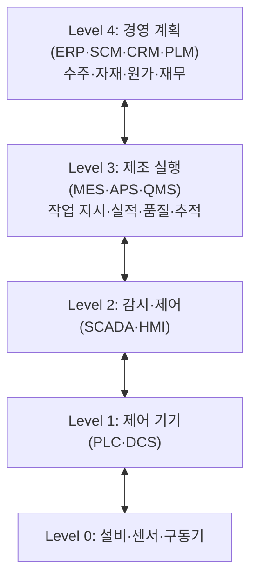

# 7.1 정보화활용기술(스마트팩토리 및 AI 등)

!!! info "출제기준"
    **7. 생산지원기술 및 기타** › **1. 정보화활용기술(스마트팩토리 및 AI 등)**

## 출제 경향

총 **32문항** 출제 (1교시 단답형 22 · 2~4교시 논술형 10) · 최근 10개 회차(109~139회) 14문항 · 최근 출제 제139회

| 주제 | 출제 수 | 출제 회차 |
|---|:-:|---|
| 7.1.1 경영정보시스템(ERP·SCM·CRM·KMS) | 17 | 63회, 65회, 68회, 71회, 79회, 85회, 94회, 97회, 109회, 130회 |
| 7.1.2 스마트공장 | 5 | 112회, 127회, 133회, 136회, 139회 |
| 7.1.3 사물인터넷과 센서 네트워크 | 3 | 82회, 106회, 127회 |
| 7.1.4 인공지능과 기계학습 | 4 | 121회, 130회, 139회 |
| 7.1.5 가상현실·증강현실 | 2 | 109회, 115회 |
| 7.1.6 APS(Advanced Planning & Scheduling) | 1 | 106회 |

## 목차

1. [경영정보시스템(ERP·SCM·CRM·KMS)](#t71-1)
2. [스마트공장](#t71-2)
3. [사물인터넷과 센서 네트워크](#t71-3)
4. [인공지능과 기계학습](#t71-4)
5. [가상현실·증강현실](#t71-5)
6. [APS(Advanced Planning & Scheduling)](#t71-6)

## 7.1.1 경영정보시스템(ERP·SCM·CRM·KMS) {#t71-1}

### 디지털 경영을 지원하는 정보시스템 (109회)

| 시스템 | 정의 | 핵심 기능 | 효과 |
|---|---|---|---|
| **ERP**(전사적 자원관리) | 생산·물류·영업·재무·인사 등 기업의 모든 자원과 업무를 **하나의 통합 데이터베이스**로 관리하는 시스템 | 통합 DB, 실시간 처리, 모듈 간 연계 | 업무 표준화, 정보의 일관성, 의사결정 신속화 |
| **SCM**(공급망관리) | 공급자–제조–유통–고객의 물자·정보·자금 흐름을 통합 관리 | 수요·공급 계획, 재고·물류 최적화 | 재고 감소, 리드타임 단축 |
| **CRM**(고객관계관리) | 고객 데이터를 분석해 고객의 획득·유지·수익성을 극대화하는 경영 기법·시스템 | 고객 정보 통합, 세분화, 캠페인 | 고객 충성도, 고객 생애가치 향상 |
| **KMS**(지식관리시스템) | 조직 구성원의 지식을 체계적으로 창출·저장·공유·활용하도록 지원하는 시스템 | 지식 저장소, 검색, 협업 | 지식 재사용, 혁신 촉진 |

### ERP (63·130회)

**발전 과정**: MRP(자재소요계획) → MRP II(제조자원계획) → **ERP**(전사적 자원관리) → 확장형 ERP(SCM·CRM·클라우드 연계)

**특징**: 통합 데이터베이스, 실시간 정보 처리, 업무 프로세스의 표준화(Best Practice 내장), 모듈의 유연한 조합, 개방형 시스템

**4대 핵심 모듈 중 재무·회계를 뺀 3가지 (130회)**: ① **생산·물류**(생산계획, 자재·구매, 재고) ② **영업·판매**(수주, 출하, 매출) ③ **인사**(인사·급여·근태)

### CRM (65·68·71·97회)

- **정의**: 고객에 관한 정보를 통합·분석해 고객별로 차별화된 서비스를 제공하고 **장기적인 고객 관계**를 구축하는 경영 활동
- **목적**: 신규 고객 획득, 기존 고객 유지(이탈 방지), 고객 가치 증대(교차·상향 판매), 고객 생애가치(LTV) 극대화
- **유형**: 분석 CRM(데이터웨어하우스·데이터마이닝), 운영 CRM(영업·마케팅·서비스 자동화), 협업 CRM(콜센터·웹 등 채널 통합)

### 지식경영과 KMS (71·85회)

**지식경영**: 조직 안팎의 지식을 체계적으로 창출·공유·활용해 경쟁력을 높이는 경영 방식이다. 노나카의 **SECI 모델**은 암묵지와 형식지가 공동화(S) → 표출화(E) → 연결화(C) → 내면화(I)로 순환하며 지식이 창조된다고 본다.

**관리 대상 지식 활동의 단계 (71회)**

| 단계 | 주요 활동(예) |
|---|---|
| ① 지식 획득·창출 | 개선 활동·실험·외부 벤치마킹으로 새로운 지식 생성 |
| ② 지식 저장 | 작업 노하우·불량 사례를 문서·데이터베이스로 축적 |
| ③ 지식 공유·이전 | 사내 포털·커뮤니티·교육으로 확산 |
| ④ 지식 활용 | 문제 해결·신제품 개발에 재사용 |
| ⑤ 지식 평가·갱신 | 활용 실적 평가, 낡은 지식 폐기·보완 |

**지식관리에 활용하는 정보기술 (85회)**: ① 그룹웨어·협업 도구 ② 전자문서관리시스템(EDMS) ③ 데이터웨어하우스·데이터마이닝 ④ 기업 정보 포털(EIP)·검색 엔진 ⑤ 인공지능(챗봇·생성형 AI 기반 지식 검색)

### 기타 정보시스템과 전자상거래

| 용어 | 내용 |
|---|---|
| **DSS**(의사결정지원시스템) (71회) | 데이터·모델·대화 관리 기능으로 관리자의 **비정형 의사결정**을 지원하는 대화형 시스템 |
| **SIS**(전략정보시스템) (94회) | 정보기술을 **경쟁우위 확보**에 직접 활용하는 정보시스템(예: 항공사 예약 시스템). MIS가 내부 관리의 효율화가 목적이라면 SIS는 고객·시장에서의 전략적 우위가 목적 — 아래 비교표 참고 |
| **e-Business** (68회) | 인터넷을 기반으로 상거래뿐 아니라 조달·생산·마케팅·고객 서비스 등 기업 활동 전반을 수행하는 것(B2B·B2C 등) |
| **전자화폐** (65회) | 화폐 가치를 전자적으로 저장해 결제에 쓰는 수단 — IC카드형·네트워크형 |
| **CPC**(협업적 제품 상거래) (79회) | 제품 개발 단계에서 고객·협력사가 인터넷으로 설계·제품 정보를 공유하며 협업하는 체계(PLM의 협업 영역) |
| **소셜 커머스** (94회) | SNS를 활용한 전자상거래 — 공동 구매·추천 기반 판매 |

### SIS와 MIS의 비교 (94회)

정보시스템의 역할은 1950~60년대 **거래처리(TPS)** → 1960~70년대 **MIS**(관리 보고) → 1970년대 **DSS**(의사결정 지원) → 1980년대 **SIS**(전략적 활용, C. Wiseman 등) → 1990년대 이후 ERP·e-Business·플랫폼으로 확대되었다.

**SIS 도입 이유**: ① 경쟁 심화 속에서 IT로 **차별화·원가우위**(포터의 본원적 전략, [1.1.3](../01-production-strategy/01-competitive-strategy.md#t11-3)) 확보 ② 고객·공급자를 시스템으로 묶어 **전환 비용(Lock-in)** 형성 ③ 신규 진입 장벽 구축 ④ 새로운 사업·서비스 창출

| 구분 | MIS(관리정보시스템) | SIS(전략정보시스템) |
|---|---|---|
| 목적 | 내부 업무의 **효율화**, 관리 통제 | **경쟁우위** 확보, 사업 전략 실현 |
| 대상 | 기업 내부(관리자) | 고객·공급자·경쟁자 등 외부 포함 |
| 관점 | 비용 절감, 정보 보고 | 매출·시장점유율, 차별화 |
| 주도 | 정보시스템 부서 | 최고경영층·사업 부서 |
| 성과 평가 | 투자 대비 효율(비용) | 전략적 효과(시장 지위) |
| 예 | 급여·재고·생산 실적 보고 | 항공 예약(SABRE), 온라인 주문 연결 시스템 |

### 정보시스템의 통합 구조: ERP–MES–제어 계층

제조업의 정보시스템은 국제 표준 **ISA-95(IEC 62264)**의 계층으로 정리하면 이해가 쉽다. ERP는 "무엇을 얼마나 만들 것인가(계획)", MES는 "현장에서 어떻게 만들고 있는가(실행)"를 담당한다. MES는 [2.5.1](../02-operations-logistics/05-mes.md#t25-1), SCM은 [2.3.1](../02-operations-logistics/03-scm.md#t23-1)을 참고한다.

**최근 동향**: 클라우드(SaaS) ERP, ERP에 내장된 AI(수요 예측·이상 거래 탐지), 생성형 AI 기반 지식 검색(KMS의 진화), 데이터 플랫폼으로의 통합

### 생산정보관리 (97회)

| 구분 | 세부 정보 항목 |
|---|---|
| **생산계획 정보** | 수요예측, 기준생산계획(MPS), BOM, 라우팅, 표준시간, 생산능력, 자재소요계획 |
| **생산통제 정보** | 작업 지시, 진도(실적), 재공품 현황, 설비 가동 상태, 품질 검사 결과, 자재 입출고 |
| **생산성 정보** | 생산량, 가동률, 작업 능률, 설비종합효율, 불량률, 단위원가, 노동생산성 |

!!! tip "답안 작성 포인트"
    - 정보시스템 단답형은 **정의 → 특징·구성 → 효과**로 쓰고, 109회처럼 여러 시스템을 함께 물으면 비교표로 정리한다.
    - ERP는 **MRP → MRP II → ERP**의 발전 과정과 통합 DB라는 핵심을 반드시 언급한다.
    - 109회형(여러 시스템 설명)은 각 시스템 설명 뒤에 **ISA-95 계층 그림**으로 ERP–SCM–CRM–KMS–MES의 연계를 보여 주면 차별화된다.
    - 결론 예: "정보시스템은 개별 도입보다 **단일 데이터 기반의 통합**이 성과를 좌우하므로, ERP–MES–PLM 연계와 데이터 표준화를 먼저 갖추고 AI 활용으로 고도화해야 한다."

??? example "관련 기출 17문항 (63회, 65회, 68회, 71회, 79회, 85회, 94회, 97회, 109회, 130회)"

    - **제63회(2001) 1교시 9번** · 10점  
      ERP
    - **제65회(2001) 1교시 10번** · 10점  
      전자화폐(Cyber Money)
    - **제65회(2001) 3교시 1번** · 25점  
      CRM(Customer Relation Management)의 정의와 목적을 기술하시오.
    - **제68회(2002) 1교시 12번** · 10점  
      eBiz(e-Business)
    - **제68회(2002) 1교시 13번** · 10점  
      CRM(Customer Relationship Management)
    - **제71회(2003) 1교시 1번** · 10점  
      KMS
    - **제71회(2003) 1교시 4번** · 10점  
      DSS
    - **제71회(2003) 1교시 10번** · 10점  
      CRM
    - **제71회(2003) 2교시 5번** · 25점  
      지식경영에서 관리대상이 되는 지식활동을 단계적으로 열거하고 주요 활동 내용을 예를 들어 설명하시오.
    - **제79회(2006) 1교시 5번** · 10점  
      CPC(Collaborate Product Commerce)
    - **제85회(2008) 4교시 2번** · 25점  
      최근 기업에 강조되고 있는 1) 지식경영의 정의를 쓰고, 2)지식관리에 활용하는 주요 정보기술을 5가지 쓰시오.
    - **제94회(2011) 1교시 2번** · 10점  
      소셜커머스(Social Commerce)
    - **제94회(2011) 4교시 1번** · 25점  
      SIS(Strategic Information System)의 정의, 도입이유와 기존의 관리정보시스템(Management Information System)과의 차이점에 대하여 설명하시오.
    - **제97회(2012) 1교시 8번** · 10점  
      고객관계관리(CRM: Customer Relationship Management)에 대하여 설명하시오.
    - **제97회(2012) 2교시 6번** · 25점  
      생산 공장의 생산정보관리에 있어서 생산정보를 생산계획 정보, 생산통제 정보, 생산성 정보로 구분하였을 때, 각각의 세부적인 정보의 항목과 내용을 설명하시오.
    - **제109회(2016) 2교시 1번** · 25점  
      기업의 디지털경영을 효율적으로 지원하는 정보화 활용기술인 SCM, CRM, ERP, KMS에 대하여 각각 설명하시오.
    - **제130회(2023) 1교시 6번** · 10점  
      ERP 4대 핵심모듈 중, 재무/회계 부문을 제외한 3가지 부문을 쓰시오.

## 7.1.2 스마트공장 {#t71-2}

### 스마트공장의 정의 (127·133회)

**스마트공장(Smart Factory)**은 제품의 기획·설계부터 생산·유통·판매까지 전 과정에 **ICT를 융합**해, 데이터를 기반으로 스스로 최적화하는 **지능형 공장**이다.

**배경**: 독일이 2011년 하노버 산업박람회에서 제시하고 국가 전략으로 추진한 **인더스트리 4.0**이 출발점이다. 미국은 산업인터넷(GE 등), 한국은 2014년 **제조업 혁신 3.0** 전략 이후 중소기업 스마트공장 보급 사업을 추진해 왔다. 인건비 상승, 다품종 소량·대량맞춤 수요, 숙련 인력 부족, 공급망 리스크, 탄소중립 요구가 도입 배경이다.

**수준 단계(국내 기준)**: ICT 미적용 → **기초**(바코드·RFID로 실적 집계, 이력 관리) → **중간 1**(설비 데이터 실시간 모니터링) → **중간 2**(데이터 분석·제어) → **고도화**(AI 기반 최적화·자율 운영)

### 주요 핵심 기술

| 기술 | 스마트공장에서의 역할 |
|---|---|
| **IoT**(사물인터넷) | 설비·제품·작업자의 데이터를 실시간으로 수집 |
| **CPS**(사이버물리시스템) | 물리 공정과 가상 모델을 실시간으로 연결해 감지–분석–제어 |
| **빅데이터·AI** | 대량의 데이터로 품질 예측, 예지보전, 최적 조건 도출 |
| **클라우드** | 데이터 저장·분석 인프라, 시스템의 유연한 확장 |
| **디지털 트윈** | 실제 공장을 가상 공간에 복제해 시뮬레이션·최적화 |
| **로봇·자동화** | 협동 로봇, 자율 이동 로봇(AMR) |
| **5G·산업용 네트워크** | 초저지연 무선 통신으로 설비 연결 |
| **AR·VR** | 작업 지시, 원격 지원, 교육 |
| **보안** | OT(운영기술) 사이버 보안 |

**ICBM (136회)**: **I**oT(데이터 수집) – **C**loud(데이터 저장·처리) – **B**ig Data(분석·예측) – **M**obile(언제 어디서나 정보 접근·제어)

**CPS (112회)**: 센서·구동기를 가진 물리 시스템과 컴퓨팅·네트워크로 이뤄진 사이버 시스템이 실시간으로 결합해, 물리 세계의 상태를 감지하고 분석해 다시 제어하는 시스템이다. 스마트공장과 디지털 트윈의 기반 개념이다.

**CPS의 구성 요소**: ① 감지(센서) ② 통신(산업용 네트워크) ③ 연산·분석(엣지·클라우드, AI) ④ 제어(구동기) — **실시간성·자율성·연결성**이 특징이다.

### 디지털 트윈

**정의**: 물리적 설비·공정·공장을 가상 공간에 **동일하게 복제**하고, 실시간 데이터로 동기화해 상태 감시·시뮬레이션·예측·최적화에 쓰는 기술이다. 2002년 무렵 M. Grieves가 제품수명주기관리(PLM) 맥락에서 개념을 제시했고, NASA가 우주선 관리에 이 용어를 쓰며 확산되었다.

| 구분 | 시뮬레이션(기존) | 디지털 트윈 |
|---|---|---|
| 데이터 | 가정된 입력값 | 실제 설비의 **실시간 데이터** |
| 연결 | 일회성 분석 | 물리–가상의 **지속적 양방향 동기화** |
| 용도 | 설계 단계 검토 | 설계·운영·보전 전 수명주기 |

**발전 단계(일반적 구분)**: ① 가시화(형상·상태 모니터링) → ② 분석(원인 진단) → ③ 예측(시뮬레이션·What-if) → ④ 최적화·자율 제어(가상에서 찾은 최적 조건을 현장에 자동 반영)

**제조 활용**: 가상 시운전(라인 설치 전 검증), 공정 조건 최적화, 예지보전, 생산 계획 시뮬레이션, 작업자 교육 — 디지털 스레드는 [7.5.2](05-trends.md#t75-2), 가상제조는 [4.5.3](../04-facility-management/05-factory-automation.md#t45-3)을 참고한다.

### 스마트공장의 기대효과와 추진 시 문제점

| 관점 | 기대효과 |
|---|---|
| **P** 생산성 | 설비종합효율(OEE) 향상, 리드타임 단축, 자동화 |
| **Q** 품질 | 실시간 SPC·AI 검사로 불량 감소, 제품 이력 추적 |
| **C** 원가 | 재고·에너지·인건비 감소 |
| **D** 납기 | 실시간 진도 관리, 납기 준수율 향상 |
| **S·E** 안전·환경 | 위험 작업 자동화, 에너지·탄소 데이터 관리 |

| 추진 시 문제점(특히 중소기업) | 대응 방안 |
|---|---|
| 목적 없는 시스템 도입(솔루션 중심) | 현장 문제(병목·불량) 중심의 과제 선정, 단계적 로드맵 |
| 기초 관리 수준 미흡(표준·기준정보 부재) | 5S·표준화·기준정보(BOM·라우팅) 정비 먼저 |
| 투자 재원·전문 인력 부족 | 정부 지원 사업 활용, 클라우드(SaaS)형 솔루션, 내부 인재 육성 |
| 구축 후 활용 저조 | 현장 참여 설계, KPI 연계, 지속적 개선 체계 |
| 설비 연결·데이터 표준 문제, 보안 위협 | 표준 프로토콜(OPC UA 등), OT 보안 체계 |

### 일반공장 대비 스마트공장의 차별화 특징 (133회)

| 구분 | 일반공장 | 스마트공장 |
|---|---|---|
| 정보 | 수기·사후 집계 | **실시간 데이터 가시화** |
| 의사결정 | 경험·직관 | **데이터·AI 기반 자율 최적화** |
| 생산 방식 | 대량 생산 중심 | **유연 생산·대량 맞춤** |
| 설비 관리 | 사후·정기 보전 | **예지보전** |
| 연결성 | 부서·공장별 단절 | **가치사슬의 수평·수직 통합**(설계–생산–공급망 연결) |

### 스마트공장 추진 협업팀 구성 (139회)

| 구성 부서 | 업무 분장 |
|---|---|
| 경영기획·재무 | 추진 전략·투자 계획, 정부 지원 사업 활용, 효과(ROI) 분석 |
| 생산(현장) | 현 공정의 문제점 진단, 현장 요구사항 정의, 시범 라인 운영 |
| 생산기술·설비 | 설비 연결(PLC·센서), 자동화 범위 결정, 설비 데이터 수집 |
| 정보시스템(IT) | MES·ERP 연계, 데이터 플랫폼·네트워크·보안 구축 |
| 품질 | 품질 데이터 수집·SPC, 검사 자동화(비전), 추적성 |
| 구매·물류 | 자재 입출고 자동화(바코드·RFID), 협력사 연계 |
| 연구개발 | 설계 데이터(PLM) 연계, 디지털 트윈 모델 |
| 인사·교육 | 디지털 역량 교육, 직무 재설계 |

**추진 단계**: ① 현 수준 진단 → ② 목표 수준과 로드맵 수립 → ③ 우선 과제 선정(병목·품질 문제 공정) → ④ 시스템 구축(MES·IoT·데이터 수집) → ⑤ 시범 운영과 효과 검증 → ⑥ 전 공장 확산과 고도화(AI 분석)

!!! tip "답안 작성 포인트"
    - 스마트공장은 **정의 → 수준 단계 → 핵심 기술 표 → 일반공장과의 비교 → 추진 체계**를 기본 틀로 쓴다.
    - ICBM·CPS 같은 약어는 **풀이와 스마트공장에서의 역할**을 함께 쓴다.
    - 개요에 **인더스트리 4.0(2011, 독일)** 배경을, 본론에 **CPS 순환 그림·ISA-95 계층 그림** 중 하나를 넣으면 고득점 답안의 형태가 된다.
    - 139회형(협업팀)은 부서별 업무 분장 표에 **추진 단계와 KPI(OEE·불량률·리드타임)**를 붙이고, 추진 시 문제점·대응으로 마무리한다.
    - 결론 예: "스마트공장은 솔루션 도입이 아니라 **현장 문제 해결을 위한 데이터 기반 운영 혁신**이므로, 기초 관리(5S·표준·기준정보) → 연결·가시화(DX) → AI 최적화(AX)로 단계적으로 추진하고 디지털 인재를 함께 키워야 한다."

??? example "관련 기출 5문항 (112회, 127회, 133회, 136회, 139회)"

    - **제112회(2017) 1교시 5번** · 10점  
      CPS(Cyber Physical System)
    - **제127회(2022) 4교시 4번** · 25점  
      스마트공장의 정의와 주요 핵심기술을 설명하시오.
    - **제133회(2024) 4교시 6번** · 25점  
      스마트공장에 대하여 다음을 설명하시오.

        ??? quote "문제 전문"

            스마트공장에 대하여 다음을 설명하시오.  
            1) 스마트공장 구축에 활용될 수 있는 주요 정보통신기술 5가지  
            2) 일반공장 대비 스마트공장의 차별화된 특징 5가지  
    - **제136회(2025) 1교시 10번** · 10점  
      스마트팩토리를 구성하는 기술요소를 ICBM으로 요약하고, 각 요소의 특성을 설명하시오.
    - **제139회(2026) 2교시 4번** · 25점  
      가전부품 중견기업인 A사는 생산공정을 스마트공장으로 개선하려고 한다. 개선 활동을 위해 협업팀을 편성하고자 할 때 어떤 관련부서 직원들로 구성하면 효율적인지를 설명하고, 이 팀원들의 업무를 분장하여 추진사항을 설명하시오.

## 7.1.3 사물인터넷과 센서 네트워크 {#t71-3}

### 사물인터넷(IoT) (106회)

**정의**: 사물에 센서·통신 기능을 넣어 인터넷으로 연결하고, 사물 간·사람과 사물 간에 정보를 주고받으며 서비스를 제공하는 기술 환경이다.

- **구성**: 센서·디바이스(감지) → 네트워크(유·무선 통신) → 플랫폼(데이터 저장·처리) → 서비스·애플리케이션
- **제조업 적용**: 설비 상태 감시와 예지보전, 에너지 관리, 자재·제품 위치 추적, 작업자 안전 관리
- **과제**: 보안, 표준화, 대량 데이터 처리, 배터리·통신 비용

### USN과 EDI (82·127회)

| 구분 | USN(Ubiquitous Sensor Network) | EDI(Electronic Data Interchange) |
|---|---|---|
| 정의 | 곳곳에 설치된 **센서 노드가 무선 네트워크**로 연결되어 환경·사물의 상태 정보를 실시간으로 수집하는 망 | 기업 간 거래 문서(주문서·송장 등)를 **표준화된 전자 문서**로 컴퓨터 간에 교환하는 방식 |
| 구성 | 센서 노드, 싱크 노드, 게이트웨이, 서버 | 표준 문서 양식, 변환 소프트웨어, 통신망(VAN·인터넷) |
| 활용 | 설비·환경 모니터링, 물류 추적, 시설 안전 관리 | 발주·납품·대금 처리 자동화, SCM·QR·VMI의 기반 |
| 효과 | 상황 인지, 실시간 감시 | 서류·입력 오류 감소, 처리 시간 단축, 비용 절감 |

USN은 오늘날 IoT의 기반 기술로 발전했다.

### 산업용 IoT(IIoT)의 최근 기술

| 기술 | 내용 |
|---|---|
| **엣지 컴퓨팅** | 데이터를 클라우드로 모두 보내지 않고 설비 가까이에서 처리 — 지연 감소, 실시간 제어, 통신 비용·보안 부담 감소 |
| **산업용 통신 표준** | OPC UA(설비 간 데이터 교환 표준), MQTT(경량 메시지 전송) — 이기종 설비 연결 |
| **5G 특화망** | 공장 단위의 전용 5G 망 — 초저지연·대량 연결로 무선 설비·AMR 운용(국내 명칭: 이음5G) |
| **RFID·RTLS** | 자재·재공·작업자의 위치와 이력 자동 추적 — [2.4.6](../02-operations-logistics/04-materials-inventory.md#t24-6) 참고 |

!!! tip "답안 작성 포인트"
    - IoT는 **구성 4계층 → 제조 적용 사례 → 과제**로 쓴다. USN·EDI는 비교표로 정리한다.

??? example "관련 기출 3문항 (82회, 106회, 127회)"

    - **제82회(2007) 1교시 6번** · 10점  
      USN(Ubiquitous Sensor Network)
    - **제106회(2015) 1교시 1번** · 10점  
      IoT(Internet of Things)
    - **제127회(2022) 1교시 8번** · 10점  
      USN(Ubiquitous Sensor Network)와 EDI(Electronic Data Exchange)

## 7.1.4 인공지능과 기계학습 {#t71-4}

### 인공지능과 기계학습 (121·130·139회)

**인공지능(AI)**: 학습·추론·인식 같은 인간의 지적 능력을 컴퓨터로 구현하는 기술이다. 1956년 다트머스 회의에서 J. McCarthy 등이 용어를 처음 사용했다. 규칙 기반 전문가 시스템(1980년대) → 기계학습 → 딥러닝(2010년대, 이미지 인식 성능의 비약적 향상) → **생성형 AI**(2020년대, 대규모 언어 모델)로 발전했다.

**기계학습의 3가지 학습 방법 (130회)**

| 학습 방법 | 내용 | 제조 적용 예 |
|---|---|---|
| **지도학습** | 정답(레이블)이 있는 데이터로 입력–출력 관계를 학습(분류·회귀) | 비전 검사의 양·불 판정, 품질 예측 |
| **비지도학습** | 정답 없이 데이터의 구조·패턴을 찾음(군집·차원 축소·이상 탐지) | 설비 이상 징후 탐지, 고객·제품 군집화 |
| **강화학습** | 환경과 상호작용하며 **보상을 최대화**하는 행동을 학습 | 로봇 동작 제어, 생산 일정 최적화 |

**기계학습과 딥러닝 (139회)**

| 구분 | 기계학습 | 딥러닝 |
|---|---|---|
| 정의 | 데이터에서 패턴을 학습해 예측·판단하는 알고리즘 | 여러 층의 **인공신경망**으로 학습하는 기계학습의 한 분야 |
| 특징 추출 | 사람이 특징(변수)을 설계 | 데이터에서 **특징을 자동 추출** |
| 데이터·연산 | 비교적 적은 데이터 | 대량 데이터, GPU 연산 필요 |
| 강점 | 정형 데이터, 해석 용이 | 이미지·음성·텍스트 등 비정형 데이터 |
| 대표 기법 | 회귀, 의사결정나무, 랜덤 포레스트, SVM, k-평균 | CNN(이미지), RNN·LSTM(시계열), 트랜스포머(언어·생성형 AI) |

### 제조업의 AI 적용 영역과 산업용 생성형 AI

| 영역 | 적용 예 | 주로 쓰는 기법 |
|---|---|---|
| 품질 | 비전 검사(외관 불량 판정), 공정 데이터로 품질 예측 | 지도학습(CNN) |
| 설비 | 이상 징후 감지, 잔여 수명 예측(예지보전) — [3.5.1](../03-process-control/05-maintenance.md#t35-1) 참고 | 비지도학습, 시계열 모델 |
| 공정 | 최적 공정 조건 도출, 자동 보정 | 회귀·최적화, 강화학습 |
| 계획 | 수요 예측, 생산 일정 최적화 | 시계열 예측, 강화학습·최적화 |
| 업무 지원 | 작업 표준·매뉴얼 검색, 보고서 작성, 코드(PLC) 생성 지원 | **생성형 AI**(LLM) |
| 로봇 | 비정형 물체 집기, 자율 이동 | 딥러닝·강화학습 → 피지컬 AI([7.5.2](05-trends.md#t75-2)) |

**산업용 생성형 AI**: 대규모 언어 모델(LLM)을 사내 문서·설비 데이터와 연결(검색 증강 생성, RAG)해 작업자 질의응답, 고장 조치 안내, 품질 보고서 작성 등에 쓴다. 최근에는 여러 도구를 스스로 호출해 업무를 수행하는 **AI 에이전트**로 발전하고 있다.

**AI 도입 시 과제**: ① 데이터 품질·양(불량 데이터 부족, 레이블링 비용) ② **설명 가능성**(XAI — 판단 근거 제시) ③ 현장 적용·유지보수(모델 성능 저하 감시, MLOps) ④ 보안·기술 유출, 생성형 AI의 오답(환각) ⑤ AI 인재와 조직 문화 ⑥ 윤리·규제(EU AI Act 등, 최신 자료 확인 필요)

### DX와 AX (139회)

| 구분 | DX(Digital Transformation) | AX(AI Transformation) |
|---|---|---|
| 정의 | 디지털 기술로 업무 프로세스·비즈니스 모델을 근본적으로 전환 | **AI를 핵심**으로 의사결정·운영을 지능화·자동화하는 전환 |
| 중심 | 데이터 수집·연결·가시화 | 데이터 기반 예측·최적화·자율 실행 |
| 제조 예 | MES·IoT·ERP 통합, 스마트공장 | AI 품질 예측, 예지보전, 자율 공정 제어, 생성형 AI 업무 지원 |

**생산전략 관점의 단계별 연결성**: ① **디지털화**(아날로그 정보를 데이터로) → ② **DX**(프로세스와 시스템의 디지털 연결 — 가시성·효율 향상) → ③ **AX**(축적된 데이터로 AI가 예측·최적화·자율 운영 — 원가·품질·유연성 경쟁우위 강화). DX로 쌓은 데이터 기반이 없으면 AX가 불가능하므로 단계적으로 추진한다.

!!! tip "답안 작성 포인트"
    - AI 용어는 **포함 관계 그림(AI ⊃ ML ⊃ DL)**으로 시작하고, 학습 방법·차이는 표로 정리한다.
    - DX·AX는 **정의 비교 + 단계적 연결(디지털화 → DX → AX)**을 쓰고 생산전략(경쟁우위)과 연결한다.
    - 학습 방법마다 **제조 적용 예**를 붙이고, AI 도입 과제(데이터·설명 가능성·보안)를 한 줄 덧붙이면 기술사다운 의견이 된다.
    - 결론 예: "AI는 데이터가 쌓인 공정부터 **작은 과제(비전 검사·예지보전)로 성과를 검증**한 뒤 확산해야 하며, 데이터 거버넌스와 현장 인력의 AI 역량이 성패를 좌우한다."

??? example "관련 기출 4문항 (121회, 130회, 139회)"

    - **제121회(2020) 1교시 7번** · 10점  
      인공지능(Artificial Intelligence)
    - **제130회(2023) 3교시 3번** · 25점  
      인공지능 기계학습의 3가지 학습 방법 모델을 제시하고 설명하시오.
    - **제139회(2026) 1교시 5번** · 10점  
      DX(Digital Transformation)와 AX(AI Transformation)를 각각 설명하고, 생산전략 관점에서 단계별 연결성을 설명하시오.
    - **제139회(2026) 1교시 7번** · 10점  
      인공지능 관련 용어 중에서 기계학습(Machine Learning)과 딥러닝(Deep Learning)에 대하여 각각 설명하시오.

## 7.1.5 가상현실·증강현실 {#t71-5}

### 가상현실과 증강현실 (109·115회)

| 구분 | 가상현실(VR) | 증강현실(AR) |
|---|---|---|
| 개념 | 컴퓨터로 만든 **완전한 가상 환경**에 사용자가 몰입 | **현실 세계 위에 디지털 정보**(그래픽·텍스트)를 겹쳐 보여 줌 |
| 장치 | HMD(헤드셋), 컨트롤러 | 스마트 글라스, 태블릿·스마트폰 |
| 제조 적용 | 설비 운전·안전 교육, 공장 배치·제품 설계 검토, 가상 시운전 | 작업 지시(조립 순서 표시), 원격 전문가 지원, 설비 점검·보전 안내, 검사 |
| 장점 | 위험·고비용 상황을 안전하게 체험 | 현장 작업 중 필요한 정보를 즉시 제공 |

VR과 AR을 결합한 **혼합현실(MR)**, 이를 통칭하는 **확장현실(XR)**로 발전하고 있으며, 디지털 트윈과 연계해 활용된다.

| 구분 | 내용 |
|---|---|
| **MR**(혼합현실) | 현실과 가상 객체가 **상호작용**(가상 부품을 실제 설비 위에 놓고 조작) |
| **XR**(확장현실) | VR·AR·MR을 아우르는 용어 |
| **산업용 메타버스** | 디지털 트윈 + XR + 협업 플랫폼 — 원격지 인력이 가상 공장에서 함께 설계 검토·교육·운영 |

**도입 시 과제**: 장비 착용 피로·멀미, 콘텐츠 제작 비용, 실시간 데이터 연동(디지털 트윈), 현장 네트워크 환경

!!! tip "답안 작성 포인트"
    - **개념 → 장치 → 제조업 적용 사례**로 쓰고, VR과 AR의 차이(가상 몰입 vs 현실 위 정보)를 분명히 한다.

??? example "관련 기출 2문항 (109회, 115회)"

    - **제109회(2016) 1교시 1번** · 10점  
      가상현실(virtual reality)의 개념에 대하여 설명하시오.
    - **제115회(2018) 1교시 1번** · 10점  
      증강현실(Augmented Reality)

## 7.1.6 APS(Advanced Planning & Scheduling) {#t71-6}

### APS(Advanced Planning and Scheduling) (106회)

**정의**: 자재와 생산능력 같은 **여러 제약 조건을 동시에 고려**해, 실행 가능한 최적의 생산계획과 상세 일정을 빠르게 수립하는 시스템이다.

**도입 배경**: MRP는 생산능력이 무한하다고 가정(무한 능력 계획)하고 리드타임을 고정해 현실성이 떨어지고, 계획 변경에 오래 걸린다.

| 구분 | MRP | APS |
|---|---|---|
| 능력 | 무한 능력 가정 | **유한 능력**(제약 기반) |
| 계획 방식 | 자재 계획 후 능력 검토(순차) | 자재와 능력을 **동시** 고려 |
| 계산 | 배치 처리, 느림 | 메모리 기반 고속 처리, **실시간 재계획** |
| 기법 | 단순 전개 | 최적화 알고리즘·휴리스틱 |

**주요 기능**: 수요 계획, 공급망 계획, 생산계획, 상세 일정계획(설비별 작업 순서), 납기 약속(ATP·CTP), 시뮬레이션(What-if 분석)

**효과**: 납기 준수율 향상, 설비 가동률 향상, 재고 감소, 긴급 주문·변동에 대한 신속한 재계획

**시스템 연계**: ERP(수요·자재·MPS) → **APS**(유한 능력 계획·일정) → MES(작업 지시·실적) → 실적을 APS에 피드백해 재계획한다. MRP는 [2.4.5](../02-operations-logistics/04-materials-inventory.md#t24-5), 능력 계획(CRP)은 [3.1.3](../03-process-control/01-production-planning.md#t31-3), 병목 중심 일정(DBR)은 [7.4.3](04-production-innovation.md#t74-3)을 참고한다. 최근에는 AI·디지털 트윈 기반 일정 최적화로 발전하고 있다.

!!! tip "답안 작성 포인트"
    - APS는 **MRP의 한계(무한 능력 가정) → APS의 정의 → MRP와의 비교표 → 기능·효과** 순으로 쓴다.

??? example "관련 기출 1문항 (106회)"

    - **제106회(2015) 1교시 5번** · 10점  
      APS(Advanced Planning and Scheduling) 시스템

## 답안 작성 예시

!!! example "25점 예시: 제133회 4교시 6번 — 스마트공장 구축 정보통신기술 5가지와 일반공장 대비 차별화 특징 5가지"
    **1. 개요**

    - 스마트공장 정의(ICT 융합, 데이터 기반 자율 최적화) + 배경(인더스트리 4.0, 인력 부족·대량맞춤·공급망 리스크)
    - [그림] CPS 순환(물리 → 감지 → 분석 → 제어)으로 개념을 한눈에 제시

    **2. 본론**

    - (1) 주요 정보통신기술 5가지: [표] IoT·CPS·빅데이터/AI·클라우드·디지털 트윈(+5G·보안) — 기술별 "스마트공장에서의 역할"을 한 줄씩
    - (1-1) ICBM으로 묶어 요약하고 ISA-95 계층 그림(ERP–MES–SCADA–PLC)에 기술 위치를 표시하면 차별화
    - (2) 차별화 특징 5가지: [표] 일반공장 vs 스마트공장(정보·의사결정·생산 방식·설비 관리·연결성)
    - (2-1) 각 특징에 효과 지표 연결(OEE·불량률·리드타임·재고)
    - (3) 수준 단계(기초 → 중간1·2 → 고도화)로 현 위치 진단의 필요성 언급

    **3. 결론(기술사 의견)**

    - 기초 관리(5S·표준·기준정보) 없는 시스템 도입은 실패 요인 → 현장 문제 중심의 단계적 로드맵(DX → AX)
    - 최근 경향: 디지털 트윈·생성형 AI·피지컬 AI, OT 보안, 탄소 데이터 관리까지 확장

!!! example "25점 예시: 제139회 2교시 4번 — 가전부품 중견기업 A사의 스마트공장 협업팀 구성과 업무 분장"
    **1. 개요**

    - 스마트공장은 IT 부서 단독이 아니라 **전 부문 협업 과제**임을 제시 — 부서 횡단팀(CFT)과 PMO 필요성

    **2. 본론**

    - (1) 추진 조직: [그림] CEO(스폰서) – 추진위원회 – PMO(경영기획) – 부서별 팀원 구조
    - (2) 구성 부서와 업무 분장: [표] 경영기획·생산·생산기술·IT·품질·구매물류·연구개발·인사교육
    - (3) 추진 단계: 수준 진단 → 로드맵 → 우선 과제(가전부품: 사출·프레스 불량, 설비 비가동) → MES·IoT 구축 → 시범 라인 → 확산
    - (4) 단계별 KPI: OEE, 불량률, 리드타임, 재고 회전율, 에너지 원단위
    - (5) 예상 문제점과 대응: [표] 기초 관리 미흡·활용 저조·인력 부족 → 표준화·현장 참여·교육

    **3. 결론(기술사 의견)**

    - 중견기업은 정부 지원 사업·클라우드 솔루션으로 투자 부담을 낮추고, 내부 디지털 인재를 육성해 **자율 추진 체제**로 이관해야 한다.
