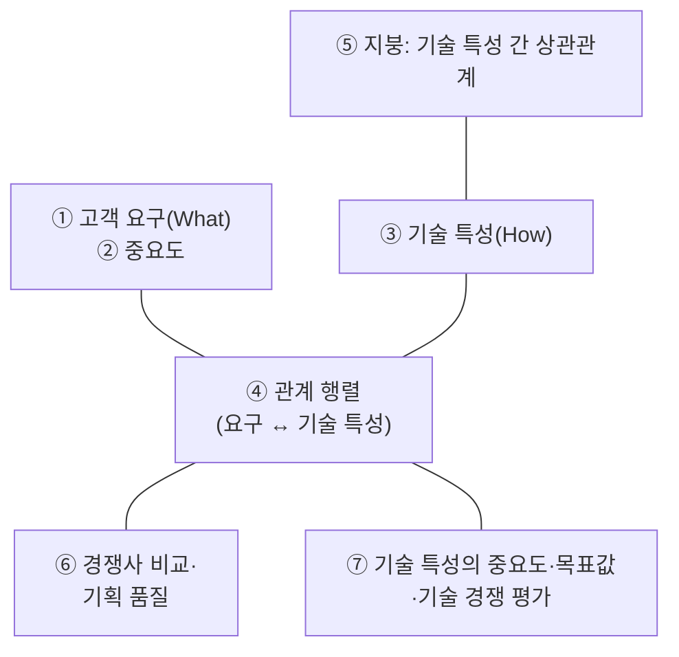

# 7.2 제품개발기술

!!! info "출제기준"
    **7. 생산지원기술 및 기타** › **2. 제품개발기술**

## 출제 경향

총 **46문항** 출제 (1교시 단답형 21 · 2~4교시 논술형 25) · 최근 10개 회차(109~139회) 17문항 · 최근 출제 제139회

| 주제 | 출제 수 | 출제 회차 |
|---|:-:|---|
| 7.2.1 신제품 개발 프로세스 | 10 | 65회, 68회, 70회, 73회, 79회, 91회, 100회, 109회, 130회 |
| 7.2.2 품질기능전개(QFD·HOQ) | 5 | 65회, 70회, 76회, 82회, 121회 |
| 7.2.3 동시공학(CE) | 5 | 73회, 94회, 97회, 100회, 124회 |
| 7.2.4 제조용이성 설계(DFM)와 원가지향 설계 | 5 | 65회, 82회, 94회, 124회, 127회 |
| 7.2.5 모듈러 설계·VRP·제품 플랫폼 | 7 | 79회, 85회, 97회, 115회, 136회 |
| 7.2.6 DFSS와 설계 검토 | 4 | 63회, 65회, 115회 |
| 7.2.7 창의적 설계 기법(TRIZ·Pugh·디자인 사고) | 5 | 82회, 100회, 112회, 121회 |
| 7.2.8 제품 데이터·수명주기관리(PDM·PLM·BOM) | 3 | 65회, 133회, 139회 |
| 7.2.9 기타 설계 기법(유니버설 디자인·역설계) | 2 | 85회, 115회 |

## 목차

1. [신제품 개발 프로세스](#t72-1)
2. [품질기능전개(QFD·HOQ)](#t72-2)
3. [동시공학(CE)](#t72-3)
4. [제조용이성 설계(DFM)와 원가지향 설계](#t72-4)
5. [모듈러 설계·VRP·제품 플랫폼](#t72-5)
6. [DFSS와 설계 검토](#t72-6)
7. [창의적 설계 기법(TRIZ·Pugh·디자인 사고)](#t72-7)
8. [제품 데이터·수명주기관리(PDM·PLM·BOM)](#t72-8)
9. [기타 설계 기법(유니버설 디자인·역설계)](#t72-9)

## 7.2.1 신제품 개발 프로세스 {#t72-1}

### 신제품 개발 과정 (68·100·109회)

| 단계 | 주요 내용 |
|---|---|
| 아이디어 창출 | 고객 요구(VOC), 연구개발, 경쟁사, 영업·현장 제안에서 아이디어 수집 |
| 아이디어 선별 | 전략 적합성·시장성·실현 가능성으로 걸러냄 |
| 개념 개발·타당성 | 제품 개념 정의, 시장성·기술성·경제성 검토 |
| 예비 설계 | 대안 개념 비교, 핵심 기능·구조 결정 |
| **최종 설계** | 상세 사양·도면 확정 — 아래 세부 과정 |
| 시제품·시험 | 성능·신뢰성 시험, 설계 검증·유효성 확인 |
| 시험 마케팅 | 일부 시장에서 반응 확인 |
| 상업화 | 양산 준비, 출시 |

**최종 설계의 세부 과정 (109·130회)**: ① **기능 설계**(성능·신뢰성·보전성 등 기능 요구를 충족) → ② **형태 설계**(외관·형상·크기·색상 등 사용자 관점) → ③ **생산 설계**(제조 용이성, 표준 부품, 공차, 원가) → 시제품 시험 → 설계 확정

**예비 설계와 최종 설계 (130회)**: 예비 설계는 **여러 개념 대안 중 최선안을 고르고 기본 구조를 정하는** 단계이고, 최종 설계는 선택된 안을 **상세 사양·도면·공차까지 확정**해 생산할 수 있게 만드는 단계다. 제품수명주기(PLC)는 [1.5.2](../01-production-strategy/05-business-environment.md#t15-2)를 참고한다.

**단계-관문(Stage-Gate) 관리**: 각 단계 끝에 관문(Gate) 심사를 두어 계속·보류·중단을 결정해 개발 위험을 관리한다.

### 신제품 아이디어의 타당성 검토 (70회)

| 평가 | 내용 |
|---|---|
| 시장성 | 시장 규모·성장성, 고객 수요, 경쟁 상황 |
| 기술성 | 기술 확보 가능성, 개발 난이도·기간 |
| 경제성 | 개발비·투자비, 예상 매출·이익, 회수기간 |
| 생산성(제조 가능성) | 기존 설비·공정 활용 가능성, 원자재 조달 |
| 전략 적합성 | 기업의 핵심역량·제품 포트폴리오와의 적합성 |
| 법·환경 | 규제·인증, 특허, 환경 영향 |

### 고객 요구 파악 기법 (65회)

① **설문조사**(정량적으로 다수 고객의 의견 수집) ② **포커스 그룹 인터뷰(FGI)**(소수 고객과 심층 토론) ③ **관찰·에스노그래피**(실제 사용 환경 관찰로 숨은 요구 발견) — 이 밖에 심층 면접, 클레임·VOC 분석, 컨조인트 분석

### 기타 개념

- **MGPP & TD (65회)**: **다세대 제품 계획(MGPP)**은 제품을 여러 세대에 걸쳐 기능을 진화시키는 장기 로드맵이고, **선행 기술 개발(TD)**은 제품 개발에 앞서 필요한 기술을 미리 확보하는 활동이다. 목적: 장기적인 제품 경쟁력의 지속, 세대별 출시 시기와 자원의 계획적 배분, 제품 개발 단계의 기술 위험·개발 기간 감소
- **R&BD (79회)**: 연구개발 단계부터 **시장과 사업화를 염두에 두고** 기술 개발 → 제품화 → 사업화까지 연계하는 연구개발(Research & Business Development)
- **신제품 개발의 마케팅 전략 (73회)**: 시장 세분화·표적시장·포지셔닝(STP) → 제품 컨셉 → 가격·유통·촉진(4P) → 시험 마케팅 → 출시 시기 전략(선발자·후발자)
- **제품 디자인에 활용되는 기법 (91회)**: QFD, 동시공학, DFM·DFA, 모듈러 설계, VE, 강건 설계, FMEA, CAD·CAE

!!! tip "답안 작성 포인트"
    - 신제품 개발 과정은 **단계 흐름도 + 단계별 내용 표**로 쓴다. 문제가 설계 과정을 강조하면 **예비 설계 / 최종 설계(기능·형태·생산 설계)**를 자세히 쓴다.

??? example "관련 기출 10문항 (65회, 68회, 70회, 73회, 79회, 91회, 100회, 109회, 130회)"

    - **제65회(2001) 2교시 6번** · 25점  
      제품개발에서 다세대상품 및 선행개발(MGPP & TD) 기획을 하는 목적을 설명하시오.
    - **제65회(2001) 4교시 4번** · 25점  
      소비자 needs 파악을 위한 기법 3가지를 설명하시오.
    - **제68회(2002) 3교시 1번** · 25점  
      신제품개발과정을 단계적으로 설명하시오.
    - **제70회(2003) 4교시 6번** · 25점  
      새로운 제품개발을 위한 아이디어가 창출되었을 때, 이 아이디어를 제품개발로 곧장 선정하는 것은 아니다. 새로운 제품아이디어에 대해 타당성 검토과정을 적용한다. 타당성 검토는 일반적으로 어떤 평가들을 한는가 ?
    - **제73회(2004) 3교시 6번** · 25점  
      신제품 개발시 마케팅측면의 전략과 개발절차를 단계별로 설명하시오.
    - **제79회(2006) 1교시 12번** · 10점  
      R&BD(Research & Business Development)의 정의
    - **제91회(2010) 4교시 2번** · 25점  
      제품의 디자인 및 개발과정과 제품디자인에 활용되는 기법들을 설명하시오.
    - **제100회(2013) 3교시 4번** · 25점  
      제품개발과정의 단계별 주요 내용을 설명하시오.
    - **제109회(2016) 4교시 2번** · 25점  
      신제품의 개발 및 설계에 대하여 아래 물음에 답하시오.

        ??? quote "문제 전문"

            신제품의 개발 및 설계에 대하여 아래 물음에 답하시오.  
            (1) 신제품의 개발과정을 설명하시오.  
            (2) 최종설계의 세부과정을 설명하시오.  
    - **제130회(2023) 4교시 5번** · 25점  
      제품 라이프 사이클(PLC)에 대하여 각 단계별로 그림을 그려서 설명하고, 제품설계 과정에 대하여 예비설계와 최종설계(세부설계)로 나누어 각 단계별로 설명하시오.

## 7.2.2 품질기능전개(QFD·HOQ) {#t72-2}

### 품질기능전개(QFD) (65·70·85회)

**정의**: **고객의 요구(VOC)**를 제품의 **기술 특성(설계 품질)**으로 바꾸고, 이를 부품 특성 → 공정 조건 → 생산 계획까지 단계적으로 전개하는 품질 설계 기법이다(아카오 요지, 일본).

**4단계 전개**: ① 제품 계획(품질의 집, HOQ) → ② 부품 전개 → ③ 공정 계획 → ④ 생산 계획

**효과**: 고객 요구에 맞는 제품 개발, 설계 변경·개발 기간 감소, 부서 간 의사소통 향상, 개발 지식의 축적

### 품질의 집(House of Quality) (76·121회)

| 구성 요소 | 내용 |
|---|---|
| ① 고객 요구(What) | 고객이 원하는 품질을 고객의 언어로 정리 |
| ② 중요도 | 각 요구의 상대적 중요도 |
| ③ 기술 특성(How) | 요구를 실현하는 측정 가능한 설계 특성 |
| ④ 관계 행렬 | 요구와 기술 특성의 관계 강도(강 ◎ 9, 중 ○ 3, 약 △ 1) |
| ⑤ 상관 행렬(지붕) | 기술 특성끼리의 상충·보완 관계 |
| ⑥ 고객 경쟁 평가 | 자사·경쟁사 제품에 대한 고객 평가, 기획 품질 설정 |
| ⑦ 기술 평가·목표값 | 기술 특성의 중요도(관계 점수 × 요구 중요도의 합), 목표값 |

**신제품 개발 사례 – 승용차 문**

| 고객 요구(중요도) | 닫는 힘(N) | 차음 성능(dB) | 밀폐 압력 | 무게(kg) |
|---|:-:|:-:|:-:|:-:|
| 쉽게 닫힌다 (5) | ◎ 9 | | ○ 3 | ○ 3 |
| 바깥 소음이 적다 (4) | | ◎ 9 | ◎ 9 | |
| 비가 새지 않는다 (4) | | | ◎ 9 | |
| **기술 중요도** | 45 | 36 | 87 | 15 |
| 목표값 | 30N 이하 | 45dB 이하 | 기준 이상 | 20kg 이하 |

→ "밀폐 압력"의 기술 중요도가 가장 높다. 지붕에서는 밀폐 압력을 높이면 닫는 힘이 커지는 **상충 관계**가 드러나므로, 두 특성을 함께 만족하는 설계 개선(공기 배출 구조 등)이 과제가 된다. (점수는 설명용 예시)

### Design Planning 단계의 고객 요구 파악과 요구 품질 전개 (82회)

1. **고객 요구 수집**: 인터뷰·설문·클레임·관찰로 VOC 수집
2. **요구 품질 전개표 작성**: 원시 VOC를 요구 품질로 바꾸고 친화도법으로 1차 → 2차 → 3차 항목으로 계층화
3. **중요도 평가**: 설문·AHP로 요구 품질의 중요도 산정
4. **기획 품질 설정**: 자사·경쟁사 비교, 목표 수준·개선율·세일즈 포인트 결정
5. **품질 특성 전개**: 요구 품질을 측정 가능한 품질 특성으로 변환하고 관계 행렬 작성

!!! tip "답안 작성 포인트"
    - QFD는 **정의 → 4단계 전개 → 품질의 집 그림(7개 구성 요소) → 사례 표** 순서로 쓴다. 121회처럼 사례를 요구하면 간단한 HOQ 표를 직접 만든다.

??? example "관련 기출 5문항 (65회, 70회, 76회, 82회, 121회)"

    - **제65회(2001) 1교시 1번** · 10점  
      QFD(Quality Function Deployment)
    - **제70회(2003) 1교시 12번** · 10점  
      QFD(Quality Function Deployment)
    - **제76회(2005) 1교시 10번** · 10점  
      품질의 집(HOQ)의 개념.
    - **제82회(2007) 4교시 6번** · 25점  
      신제품 개발시에 QFD의 Design Planning 단계에서 고객요구파악 및 요구품질전개에 대해 설명하시오.
    - **제121회(2020) 4교시 3번** · 25점  
      품질기능전개(Quality Function Deployment)에서 활용하는 방법인 품질의 집(House of Quality)을 신제품 개발 사례를 들어서 설명하시오.

## 7.2.3 동시공학(CE) {#t72-3}

### 동시공학(CE)과 순차공학(SE) (94·124회)

**동시공학(Concurrent Engineering)**은 제품 개발 초기부터 설계·생산기술·품질·구매·마케팅·협력사가 **부서 횡단팀으로 동시에 참여**해, 제품과 공정을 **병행 설계**하는 개발 방식이다.

| 구분 | 순차공학(SE) | 동시공학(CE) |
|---|---|---|
| 진행 방식 | 기획 → 설계 → 생산기술 → 생산을 **차례로** 넘김("담장 너머로 던지기") | 여러 단계를 **겹쳐서 병행** |
| 조직 | 기능 부서별 | 부서 횡단팀(CFT) |
| 설계 변경 | 후반에 문제가 드러나 변경이 많음 | 초기에 문제를 반영해 변경 감소 |
| 개발 기간·비용 | 길고 큼 | 짧고 작음 |
| 정보 공유 | 단계 끝에 일괄 전달 | 실시간 공유(PDM·PLM) |

### 동시공학의 구성 요소와 효과를 얻기 위한 요소 (73·100회)

1. **부서 횡단팀(CFT)**과 강한 프로젝트 관리
2. **정보 공유 체계**: CAD·CAE, PDM·PLM, 공용 데이터베이스
3. **설계 도구**: QFD, DFM·DFA, FMEA, 강건 설계
4. **공급자 조기 참여(ESI)**
5. 경영층의 지원과 협업 조직 문화, 개발 프로세스의 표준화

### 스톨(Stoll)의 4C 원칙 (97회)

| 원칙 | 내용 |
|---|---|
| **Concurrence**(동시성) | 제품 설계와 공정 설계를 같은 시간대에 동시에 진행 |
| **Constraints**(제약) | 제품과 공정의 제약 조건을 설계에 함께 반영 |
| **Coordination**(조정) | 제품과 공정이 서로 맞도록 긴밀히 조정 |
| **Consensus**(합의) | 주요 의사결정에 팀 전원이 참여해 합의 |

!!! tip "답안 작성 포인트"
    - CE는 **SE와의 비교표(개발 기간 단축 그림 포함)**와 성공 요소를 쓴다. 겹쳐진 막대 그림으로 병행 진행을 보여 주면 효과적이다.

??? example "관련 기출 5문항 (73회, 94회, 97회, 100회, 124회)"

    - **제73회(2004) 4교시 2번** · 25점  
      동시공학(CE : Concurrent Engineering)을 도입하여 효과를 얻기 위한 요소에 대하여 설명하시오.
    - **제94회(2011) 1교시 7번** · 10점  
      CE(Concurrent Engineering)
    - **제97회(2012) 1교시 6번** · 10점  
      동시병행설계/공학(Concurrent Engineering)에 대해 ITI(Industrial Technology Institute)의 스톨은 설계를 보다 효과적으로 수행하는 원칙을 4가지로 설명하였는데, 이 4가지(4C)에 대하여 설명하시오.
    - **제100회(2013) 1교시 8번** · 10점  
      동시공학(Concurrent Engineering)의 구성요소
    - **제124회(2021) 2교시 2번** · 25점  
      동시공학(Concurrent Engineering, CE)과 순차공학(Sequential Engineering, SE)에 대하여 각각의 개념과 차이점을 설명하시오.

## 7.2.4 제조용이성 설계(DFM)와 원가지향 설계 {#t72-4}

### 제조용이성 설계(DFM) (82·94·124회)

**정의**: 제조 공정의 능력과 제약을 **설계 단계에서 반영**해, 제품을 쉽고 경제적이며 품질 좋게 만들 수 있도록 설계하는 방법이다. 제품 원가의 대부분이 설계 단계에서 결정되기 때문에 필요하다.

**필요한 개념과 방법론**

| 원칙 | 내용 |
|---|---|
| 부품 수 감소 | 기능을 통합한 다기능 부품, 일체 성형 |
| 표준·공용 부품 | 표준 체결 부품, 기존 부품 재사용 |
| 모듈화 | 하위 조립 단위로 분리해 병렬 조립 |
| 조립 용이 설계(DFA) | 위에서 아래로 한 방향 조립, 스냅핏으로 나사 축소, 자가 위치 결정 |
| 공차 적정화 | 공정 능력에 맞는 공차(과잉 정밀도 배제) |
| 가공 용이 형상 | 금형·가공에 맞는 형상(구배·두께 균일) |
| 실수방지 설계 | 잘못 조립할 수 없는 비대칭 형상 |

**방법론**: Boothroyd-Dewhurst의 **DFA 조립 효율 지수**, 설계 검토(DR), 동시공학 팀, CAD 기반 제조성 분석 — 서비스성·환경까지 확장한 개념을 **DFX**라 한다.

### 원가 절감을 위한 설계 방식 (127회)

| 설계 방식 | 내용 |
|---|---|
| DFM·DFA | 제조·조립 용이성 반영 |
| VE(가치공학) | 기능 대비 원가 최적화 |
| 목표원가 설계(Design to Cost) | 목표원가를 설계 목표로 설정해 달성 |
| 모듈러 설계·부품 공용화(VRP) | 부품 종류 축소, 규모의 경제 |
| 표준화 설계 | 표준 부품·재질·공정 사용 |
| 동시공학 | 설계 변경 감소, 개발 기간 단축 |
| 강건 설계·공차 설계 | 값싼 부품으로도 품질 확보 |

### 모델 다양화로 손익이 악화된 A전자 (65회)

**현행 개발상의 문제점**: 모델 수 증가에 따른 부품·금형·재고의 증가, 모델별 개별 설계로 부품 공용화 부족, 개발 단계의 원가 검토 부족, 설계 변경 반복과 개발 기간 장기화 → 원가 증가율(15%)이 매출 증가율(10%)을 웃돎

**개선 전략**: ① **플랫폼·모듈화**로 공통 부분과 차별 부분 분리 ② **VRP**로 부품 종류 축소·공용화 ③ **목표원가 기획**과 VE ④ DFM·DFA ⑤ 동시공학과 설계 표준·재사용 체계

!!! tip "답안 작성 포인트"
    - DFM은 **정의(왜 설계 단계인가) → 설계 원칙 표 → 방법론(DFA 지수·DR)** 순서로 쓴다.
    - 원가 절감 설계 방식은 "모두 쓰라"는 문제가 많으므로 **7가지 정도를 표로** 정리해 둔다.

??? example "관련 기출 5문항 (65회, 82회, 94회, 124회, 127회)"

    - **제65회(2001) 4교시 2번** · 25점  
      Global Market을 대상으로 성장전략을 전개하는 A전자는 참여시장의 증가로 Model수의 다양화가 진행되고 있다. 지난 1년간의 경영 실적을 분석하니 전년대비 매출액은 10% 증가하였으나 매출총원가는 15%가 증가하여 손익이 악화되고 있다. 귀하가 제품개발을 담당하는 임원이라면 현행 개발상의 문제점을 나열하고 개선전략을 제시하시오.
    - **제82회(2007) 4교시 1번** · 25점  
      제조용이성 설계(Design for Manufacturability : DFM)에 대하여 정의하고 필요한 개념과 방법론을 설명하시오.
    - **제94회(2011) 1교시 9번** · 10점  
      제조용이성 설계(DFM: Design For Manufacturability)
    - **제124회(2021) 1교시 5번** · 10점  
      DFM(Design For Manufacturability)
    - **제127회(2022) 2교시 5번** · 25점  
      신제품을 개발하고 설계하는 과정에서 원가절감을 위한 설계방식을 모두 쓰고, 각각에 대하여 설명하시오.

## 7.2.5 모듈러 설계·VRP·제품 플랫폼 {#t72-5}

### 모듈러 설계 (97·115·136회)

**개념**: 제품을 **표준화된 인터페이스를 가진 독립 기능 단위(모듈)**로 나눠 설계하고, 모듈의 조합으로 다양한 제품을 만드는 설계 방식이다.

**모듈화의 목적 (136회)**: ① 다양한 고객 요구에 적은 원가로 대응(대량맞춤) ② 부품 공용화로 규모의 경제와 원가 절감 ③ 병렬 개발·생산으로 개발·생산 기간 단축

| 관점 | 장점 (136회) |
|---|---|
| **Q** 품질 | 검증된 모듈 재사용과 모듈 단위 검사로 품질 안정 |
| **D** 납기 | 모듈 병렬 생산·조립으로 리드타임 단축 |
| **F** 유연성 | 모듈 조합으로 다양한 사양에 신속 대응 |
| **R** 위험 | 설계 변경·고장의 영향이 해당 모듈에 국한 |
| **C** 원가 | 공용화·대량 생산으로 원가 절감, 재고 감소 |

| 관점 | 단점 (136회) |
|---|---|
| **Q** 품질 | 모듈 간 인터페이스 문제, 전체 최적보다 성능이 낮을 수 있음 |
| **C** 원가 | 모듈 표준 개발에 초기 투자, 과잉 사양으로 일부 제품 원가 상승 |
| 기타 | 제품 간 차별성 약화, 경쟁사의 모방 용이, 아키텍처가 고착되어 혁신 제약 |

### VRP(Variety Reduction Program) (85·115회)

**필요성**: 고객 요구 다양화로 제품 종류가 늘면 부품 수·금형·재고·관리 비용이 급증한다. VRP는 **제품 다양성은 유지하면서 부품·공정의 다양성을 줄이는** 활동이다.

| VRP 5대 개념 | 내용 | 예 |
|---|---|---|
| ① **고정과 변동** | 변하지 않는 부분은 고정·표준화하고, 바뀌는 부분만 분리 | 휴대폰 본체 공통, 외장 커버만 변경 |
| ② **편성의 조합**(모듈화) | 적은 수의 모듈 조합으로 많은 제품 구성 | 모듈 3종 × 4종 = 12개 모델 |
| ③ **다기능의 집약**(GT) | 여러 부품의 기능을 하나로 통합, 유사 부품을 그룹화 | 브래킷 3개를 하나의 공용 브래킷으로 |
| ④ **범위**(Range) | 사양의 적용 범위를 넓혀 부품 종류 축소 | 전압 범위가 넓은 전원부 하나로 여러 국가 대응 |
| ⑤ **계열**(Series) | 크기·용량을 표준수(등비 수열)로 계열화 | 모터 용량을 1·2·4·8kW 계열로 정리 |

### 제품 플랫폼 (79회)

**의미**: 여러 파생 제품이 공유하는 **공통 부품·구조·기술의 집합**이다. 플랫폼을 바탕으로 짧은 기간에 다양한 제품을 만든다.

**전략 유형**: 세분시장 특화, 수평적 활용, 수직적 확장(상향·하향·양방향), 교두보(Beach Head) — 자세한 내용은 [1.1.5](../01-production-strategy/01-competitive-strategy.md#t11-5)를 참고한다.

### 베네통의 차별화 지연 (115회)

베네통은 실을 먼저 염색한 뒤 스웨터를 짜던 공정을 바꿔, **염색하지 않은 스웨터를 먼저 짜 두고 판매 시즌에 유행 색상이 확인되면 염색**했다. 제품의 차별화(색상) 시점을 늦춰 공통 반제품 단계에서 수요를 합쳐 관리하므로 예측 오차·재고·품절이 줄었다. 이를 위해 공정 순서를 바꾸고 염색 기술을 개발하는 **제품·공정의 재설계**가 필요했다.

!!! tip "답안 작성 포인트"
    - 136회처럼 관점(QDFRC)을 지정하면 **그 관점을 표의 행**으로 그대로 쓴다.
    - VRP 5대 개념은 **개념 + 구체적 예**를 함께 쓴다.

??? example "관련 기출 7문항 (79회, 85회, 97회, 115회, 136회)"

    - **제79회(2006) 4교시 5번** · 25점  
      Global Marketing을 위한 생산공급체제에서 제품플랫폼(Product Platform)의 선정은 주요 성공요건이다. 제품플랫폼의 의미를 정의하고 전략유형 3가지 이상을 기술하시오.
    - **제85회(2008) 4교시 6번** · 25점  
      부품수 삭감 및 공용화계획(Variety Reduction Planning)의 필요성과 VR의 5대 개념(분석방법)에 대하여 설명하시오.
    - **제97회(2012) 1교시 4번** · 10점  
      모듈러 설계(Modular Design)의 개념을 설명하고, 장단점을 각각 3가지씩 쓰시오.
    - **제115회(2018) 1교시 8번** · 10점  
      제품설계기법의 하나인 베네통(Benetton)의 차별화 지연(Delayed differentiation)
    - **제115회(2018) 3교시 1번** · 25점  
      제품과 생산의 관련성에서 표면화되는 다양성의 문제는 VRP(Variety Reduction Program)의 5대 개념을 적용시켜 해결할 수 있다. 다음 VRP의 5대 개념에 대하여 예를 들어 설명하시오.

        ??? quote "문제 전문"

            제품과 생산의 관련성에서 표면화되는 다양성의 문제는 VRP(Variety Reduction Program)의 5대 개념을 적용시켜 해결할 수 있다. 다음 VRP의 5대 개념에 대하여 예를 들어 설명하시오.  
            1) 고정과 변동  
            2) 편성의 조합(모듈화)  
            3) 다기능의 집약(GT)  
            4) 범위(Range)  
            5) 계열  
    - **제115회(2018) 3교시 6번** · 25점  
      모듈러 설계의 정의, 장점 및 한계점에 대하여 설명하시오.
    - **제136회(2025) 2교시 4번** · 25점  
      모듈화의 목적 3가지와 모듈화의 장점을 Q(Quality), D(Delivery), F(Flexibility), R(Risk), C(Cost) 관점에서 설명하고, 단점을 Q, C, 기타(일반) 관점에서 설명하시오.

## 7.2.6 DFSS와 설계 검토 {#t72-6}

### 설계 검토·검증·유효성 확인 (63회, ISO 9001)

| 구분 | 설계 검토(Design Review) | 설계 검증(Verification) | 설계 유효성 확인(Validation) |
|---|---|---|---|
| 목적 | 설계 결과가 요구사항을 충족할 **능력을 평가**하고 문제를 찾아 대책 | 설계 출력이 **설계 입력(요구사항)을 충족**하는지 확인 | 완성된 제품이 **의도한 용도·사용 요구를 충족**하는지 확인 |
| 질문 | 설계가 제대로 진행되고 있는가? | 제대로 만들었는가?(Built it right) | 올바른 것을 만들었는가?(Built the right thing) |
| 방법 | 단계별 검토 회의(관련 부서 참여) | 계산 검토, 시험, 도면·사양 대조, 시제품 시험 | 실제 사용 조건 시험, 시범 사용, 고객 평가 |
| 시점 | 설계의 적절한 단계마다 | 설계 출력이 나온 후 | 출하·사용 전 |

### DFSS와 Design Scorecard (65·115회)

**DFSS(Design for Six Sigma)**는 신제품·신공정을 설계 단계부터 6시그마 품질 수준으로 만드는 방법론이다(DMADV·IDOV). 자세한 내용은 [5.4.5](../05-work-measurement/04-quality-management.md#t54-5)를 참고한다.

**Design Scorecard (65회)**: DFSS에서 설계의 품질 수준을 **예측·평가하는 점수표**다. 고객 핵심 특성(CTQ)별로 설계의 예측 성능, 부품·공정의 공정능력(시그마 수준), 예상 결함률을 집계해 설계가 목표 품질을 달성할 수 있는지 판단하고, 약한 부분을 설계 개선 대상으로 삼는다. 보통 성능·부품·공정·소프트웨어 점수표로 나눈다.

!!! tip "답안 작성 포인트"
    - 설계 검토·검증·유효성 확인은 **목적·방법·시점 비교표**와 "Built it right vs Built the right thing"의 구분이 핵심이다.

??? example "관련 기출 4문항 (63회, 65회, 115회)"

    - **제63회(2001) 4교시 6번** · 25점  
      ISO 9001에서 요구하는 제품설계시 고려해야 할 설계검토(Design Review), 설계검증(Design Verification), 설계 유효성 확인(Design Validation)에 대하여 설명하시오
    - **제65회(2001) 1교시 2번** · 10점  
      Design Score Card
    - **제65회(2001) 1교시 13번** · 10점  
      DFSS(Design for 6σ)
    - **제115회(2018) 1교시 4번** · 10점  
      DFSS(Design For Six Sigma)

## 7.2.7 창의적 설계 기법(TRIZ·Pugh·디자인 사고) {#t72-7}

### TRIZ (82·100·121회)

**개념**: 러시아의 알츠슐러(G. Altshuller)가 수십만 건의 특허를 분석해, 발명 문제를 해결하는 **보편적 원리와 패턴**을 정리한 창의적 문제해결 이론이다. 시행착오가 아니라 **모순을 해결**하는 체계적 방법이다.

**핵심 개념**

- **모순**: 기술적 모순(한 특성을 좋게 하면 다른 특성이 나빠짐) / 물리적 모순(한 특성이 서로 반대인 두 상태를 동시에 가져야 함)
- **40가지 발명 원리**와 기술적 모순을 연결한 **모순 행렬**
- **이상적 최종 결과(IFR)**, 자원 활용, 기술 시스템 진화의 법칙, 물질-장 분석

**물리적 모순의 4가지 분리 원리 (100회)**

| 분리 원리 | 내용 | 적용 예 |
|---|---|---|
| **시간에 의한 분리** | 서로 반대인 요구를 다른 시간에 충족 | 이착륙 때만 펼치는 비행기 바퀴 |
| **공간에 의한 분리** | 서로 다른 장소(부위)에서 충족 | 다초점 안경(위는 원거리, 아래는 근거리) |
| **조건에 의한 분리** | 조건에 따라 성질이 바뀌게 함 | 온도에 따라 색이 변하는 소재 |
| **전체와 부분에 의한 분리** | 전체와 부분이 서로 다른 성질을 가짐 | 자전거 체인(부분은 단단, 전체는 유연) |

**진행 절차 (121회)**: ① 문제 정의(기능·문제점 분석) → ② 모순 정의(기술적·물리적) → ③ 해결 도구 적용(모순 행렬·발명 원리·분리 원리) → ④ 해결안 도출 → ⑤ 평가·구체화

**적용 분야**: 제품·공정 설계, 품질 문제 해결, 원가 절감, 특허 회피·신기술 개발, 경영·서비스 문제

### 디자인 사고(Design Thinking) (112회)

사용자에 대한 **공감**에서 출발해 문제를 재정의하고, 빠른 시제품과 시험을 반복해 혁신적 해결책을 찾는 인간 중심의 문제해결 방법이다.

**5단계**: ① 공감(Empathize) → ② 문제 정의(Define) → ③ 아이디어 발상(Ideate) → ④ 시제품(Prototype) → ⑤ 테스트(Test) — 반복

### Pugh Matrix와 Must-Want Matrix (121회)

**제품 재료 선택 사례**(경량 하우징 재료 선택)

**① Must-Want 방법(Kepner-Tregoe)**: 먼저 **Must(필수) 조건**으로 대안을 걸러낸 뒤, **Want(희망) 조건**에 가중치를 주어 점수가 가장 높은 대안을 선택한다.

| 조건 | 알루미늄 | 강철 | 엔지니어링 플라스틱 | 탄소섬유 |
|---|:-:|:-:|:-:|:-:|
| Must: 내열 120°C 이상 | 충족 | 충족 | 충족 | 충족 |
| Must: 단가 기준 이내 | 충족 | 충족 | 충족 | **탈락** |
| Want: 경량성 (가중치 5) | 8 → 40 | 3 → 15 | 9 → 45 | – |
| Want: 강성 (가중치 3) | 7 → 21 | 9 → 27 | 5 → 15 | – |
| Want: 가공성 (가중치 2) | 7 → 14 | 6 → 12 | 9 → 18 | – |
| **합계** | **75** | 54 | **78** | – |

→ 엔지니어링 플라스틱(78점)을 1순위로 선택

**② Pugh Matrix**: 기준안(Datum, 예: 현행 강철)과 비교해 각 대안을 기준별로 **더 좋음(+), 같음(S), 더 나쁨(−)**으로 평가하고 합산한다. 점수가 높은 대안을 고르거나, 대안들의 장점을 결합해 새 개념을 만든다.

| 기준 | 강철(기준안) | 알루미늄 | 플라스틱 |
|---|:-:|:-:|:-:|
| 경량성 | S | + | + |
| 강성 | S | − | − |
| 가공성 | S | + | + |
| 원가 | S | − | S |
| **합계(+ / −)** | 0 | +2 / −2 | +2 / −1 |

(점수는 설명용 예시)

!!! tip "답안 작성 포인트"
    - TRIZ는 **창시 배경(특허 분석) → 모순 개념 → 40가지 발명 원리·분리 원리 → 절차 → 적용 분야**로 쓴다.
    - Pugh·Must-Want는 문제에서 준 사례(재료 선택)로 **평가 표를 직접 작성**하는 것이 핵심이다.

??? example "관련 기출 5문항 (82회, 100회, 112회, 121회)"

    - **제82회(2007) 1교시 12번** · 10점  
      러시아의 알츠슐러(Genrich Altshuller)가 개발한 창의적 문제해결기법인 TRIZ (Teoriva Reshniva Izobretatelskikh Zadatch)
    - **제100회(2013) 2교시 2번** · 25점  
      TRIZ 문제해결 원리 4가지와 그 적용내용을 설명하시오.
    - **제112회(2017) 1교시 6번** · 10점  
      디자인사고(Design Thinking)
    - **제121회(2020) 2교시 6번** · 25점  
      문제 해결 방법인 Pugh Matrix와 Must-want Matrix 방법을 제품 재료 선택 과정사례를 들어 설명하시오.
    - **제121회(2020) 4교시 2번** · 25점  
      러시아의 알츠슐러(Genrich Altshuller)가 개발한 창의적 문제해결기법인 TRIZ기법의 개념, 진행절차 및 적용분야에 대하여 설명하시오.

## 7.2.8 제품 데이터·수명주기관리(PDM·PLM·BOM) {#t72-8}

### PDM과 PLM (65·139회)

| 구분 | PDM(Product Data Management) | PLM(Product Lifecycle Management) |
|---|---|---|
| 정의 | 도면·BOM·사양·설계 변경 이력 등 **제품 데이터를 통합 관리**하는 시스템 | 제품의 기획·설계부터 생산·서비스·폐기까지 **수명주기 전체의 정보와 프로세스**를 관리하는 전략·시스템 |
| 범위 | 주로 설계 부서 | 전사·협력사(공급망) |
| 기능 | 문서·버전 관리, BOM 관리, 설계 변경 관리, 워크플로 | PDM 기능 + 협업, 프로젝트·포트폴리오, 품질·규제 준수, 서비스 정보 |

**PLM의 중요 기능 (139회)**

1. **제품 데이터·BOM 관리**: 설계 데이터와 BOM을 단일 정보원으로 관리
2. **설계 변경(ECO)·형상 관리**: 변경 요청–검토–승인–반영의 워크플로와 이력 추적
3. **협업·개발 프로세스 관리**: 부서·협력사 간 실시간 정보 공유, 개발 일정·관문(Gate) 관리

### 설계 BOM과 제조 BOM (133회)

| 구분 | 설계 BOM(E-BOM) | 제조 BOM(M-BOM) |
|---|---|---|
| 관점 | 설계(기능) 관점 — 제품을 이루는 부품 구조 | 제조(조립 순서) 관점 — 실제 생산 공정에 맞춘 구조 |
| 내용 | 부품과 사양, 도면 번호 | 공정별 소요 자재, 반제품(중간 조립품), 포장재·소모품 |
| 관리 부서 | 설계(연구개발) | 생산기술·생산관리 |
| 활용 | 설계 검토, 원가 견적 | **MRP 입력**, 작업 지시, 원가 계산 |

E-BOM을 공정에 맞게 변환한 것이 M-BOM이며, PLM과 ERP의 연계로 두 BOM의 일관성을 유지하는 것이 중요하다.

!!! tip "답안 작성 포인트"
    - PDM과 PLM은 **범위의 차이(설계 데이터 vs 수명주기 전체)**로 비교하고, 설계 BOM과 제조 BOM은 **관점과 활용**의 차이로 비교한다.

??? example "관련 기출 3문항 (65회, 133회, 139회)"

    - **제65회(2001) 1교시 9번** · 10점  
      PDM(Product Data Management)
    - **제133회(2024) 1교시 13번** · 10점  
      설계 BOM(Bill of Material)과 제조 BOM
    - **제139회(2026) 1교시 13번** · 10점  
      PLM(Products Lifecycle Management)의 중요기능을 3가지만 설명하시오.

## 7.2.9 기타 설계 기법(유니버설 디자인·역설계) {#t72-9}

### 유니버설 디자인 (85회)

**정의**: 연령·성별·장애 여부·국적과 관계없이 **누구나 쉽고 편리하게 사용할 수 있도록** 처음부터 설계하는 것이다(R. Mace).

**7원칙**: ① 공평한 사용 ② 사용의 유연성 ③ 간단하고 직관적인 사용 ④ 인지하기 쉬운 정보 ⑤ 오류에 대한 포용력 ⑥ 적은 신체적 노력 ⑦ 접근과 사용에 알맞은 크기와 공간

**대상 분야**: 생활용품·가전(큰 버튼, 음성 안내), 건축·공공 환경(경사로, 자동문), 교통(저상 버스), 정보·서비스(웹 접근성, 키오스크), 산업 현장(작업대 높이 조절, 시각 표시)

### 역설계(Reverse Engineering) (115회)

**정의**: 완성된 제품을 분해·측정·분석해 **설계 정보(형상·구조·작동 원리)를 거꾸로 추출**하는 기술이다. 3D 스캐너로 형상을 측정하고 CAD 모델을 다시 만든다.

**용도**: 도면이 없는 단종 부품·금형의 복원, 경쟁 제품 분석(벤치마킹), 시제품과 설계 데이터의 비교 검사, 성능 개선 설계의 출발점

**유의점**: 특허·디자인권·영업비밀 등 **지식재산권 침해**에 주의해야 한다.

!!! tip "답안 작성 포인트"
    - 유니버설 디자인은 **정의 → 7원칙 → 대상 분야**로, 역설계는 **정의 → 절차(측정·모델링) → 용도 → 유의점**으로 쓴다.

??? example "관련 기출 2문항 (85회, 115회)"

    - **제85회(2008) 1교시 2번** · 10점  
      유니버셜 디자인(Universal Design)의 정의와 대상분야에 대해서 설명하시오.
    - **제115회(2018) 1교시 5번** · 10점  
      Reverse Engineering
