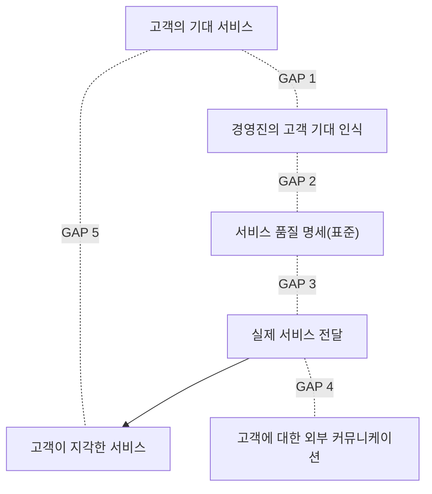

# 7.3 서비스운영관리

!!! info "출제기준"
    **7. 생산지원기술 및 기타** › **3. 서비스운영관리**

## 출제 경향

총 **10문항** 출제 (1교시 단답형 5 · 2~4교시 논술형 5) · 최근 10개 회차(109~139회) 4문항 · 최근 출제 제115회

| 주제 | 출제 수 | 출제 회차 |
|---|:-:|---|
| 7.3.1 서비스 운영의 특성과 설계 | 4 | 67회, 70회, 112회, 115회 |
| 7.3.2 서비스 품질(SERVQUAL·서비스 격차) | 2 | 109회, 112회 |
| 7.3.3 고객접점관리(MOT) | 3 | 68회, 79회, 103회 |
| 7.3.4 수익관리(PRM) | 1 | 106회 |

## 목차

1. [서비스 운영의 특성과 설계](#t73-1)
2. [서비스 품질(SERVQUAL·서비스 격차)](#t73-2)
3. [고객접점관리(MOT)](#t73-3)
4. [수익관리(PRM)](#t73-4)

## 7.3.1 서비스 운영의 특성과 설계 {#t73-1}

### 서비스의 특성과 제조와의 비교 (112회)

**서비스의 특성**: ① **무형성**(보거나 저장할 수 없음) ② **동시성**(생산과 소비가 동시에 일어남) ③ **이질성**(제공자·시점에 따라 품질이 달라짐) ④ **소멸성**(재고로 저장할 수 없음) ⑤ **고객 참여**

| 구분 | 제조 프로세스 | 서비스 프로세스 |
|---|---|---|
| 산출물 | 유형의 제품 | 무형의 경험·활동 |
| 재고 | 저장 가능 → 수요 변동을 재고로 흡수 | 저장 불가 → 능력(인력·시설)으로 대응 |
| 고객 참여 | 낮음(생산 과정과 분리) | 높음(고객이 프로세스에 참여) |
| 품질 측정 | 객관적 규격으로 측정 | 고객의 주관적 지각, 측정 어려움 |
| 입지 | 원자재·노동·물류 비용 중심 | 고객 근접성 중심 |
| 생산성 측정 | 쉬움 | 어려움 |
| 자동화 | 쉬움 | 상대적으로 어려움(셀프서비스·디지털화로 확대) |

### 서비스 공정의 분류: 서비스 프로세스 매트릭스 (67회)

R. Schmenner는 **노동 집약도**와 **고객 접촉(상호작용)·고객화 정도**로 서비스를 네 가지로 분류했다.

| 노동 집약도 \ 고객 상호작용·고객화 | 낮음 | 높음 |
|---|---|---|
| **낮음** | **서비스 공장**(항공사, 운송, 호텔, 리조트) | **서비스 숍**(병원, 자동차 정비, 수리점) |
| **높음** | **대량 서비스**(소매점, 학교, 은행 창구) | **전문 서비스**(의사, 변호사, 회계사, 컨설턴트) |

| 구분 | 관리 문제 |
|---|---|
| 노동 집약도가 **낮음**(공장·숍) | 설비 투자 결정, 기술 발전 대응, 피크 수요 관리, 서비스 일정 계획 |
| 노동 집약도가 **높음**(대량·전문) | 채용·교육·인력 개발, 작업 방법·통제, 인력 일정 계획, 성장과 다점포 관리 |
| 상호작용·고객화가 **낮음**(공장·대량) | 마케팅, 서비스의 "따뜻함" 유지, 물리적 환경, 표준 절차 |
| 상호작용·고객화가 **높음**(숍·전문) | 원가 상승 억제, 품질 유지, 고객 개입에 대한 대응, 직원의 승진·이직 관리 |

### 고접촉 vs 저접촉 서비스 시스템의 설계 (70회)

R. Chase는 고객과의 접촉 정도에 따라 서비스 시스템 설계의 전략 요소가 달라진다고 보았다.

| 설계 요소 | 고접촉 서비스 시스템 | 저접촉 서비스 시스템 |
|---|---|---|
| 입지 | **고객 가까이** | 공급원·노동력·운송 비용 중심 |
| 시설 배치 | 고객의 편의·분위기 중심 | 생산 효율 중심 |
| 제품(서비스) 설계 | 환경 자체가 서비스의 일부 | 고객이 보지 않으므로 효율 중심 |
| 공정 설계 | 공정 단계가 고객에게 직접 영향 | 고객은 대부분의 단계에 관여하지 않음 |
| 일정 계획 | 고객이 일정을 결정 | 납기만 지키면 됨 |
| 생산 계획 | 저장 불가 — 수요에 맞춘 능력 | 잔고·평준화 가능 |
| 작업자 기술 | **대인 관계 기술** 중요 | 기술적 숙련 중요 |
| 품질 관리 | 품질 기준이 주관적·변동 큼 | 측정 가능한 고정 기준 |
| 시간 표준 | 고객 요구에 따라 느슨 | 엄격 |
| 능력 계획 | 피크 수요에 맞춤 | 평균 수요 수준 |

→ 고접촉 부분(프론트 오피스)과 저접촉 부분(백 오피스)을 **분리해 설계**하면 고객 만족과 효율을 함께 얻을 수 있다.

### 서비스 설계 시 고려사항 (115회)

1. **서비스 개념**: 표적 고객과 제공할 핵심 가치 정의
2. **고객 접촉 정도**: 프론트·백 오피스 구분
3. **서비스 청사진**(Service Blueprint): 고객 행동–접점 직원–후방 지원을 **가시선**으로 나눠 흐름과 실패 가능 지점 표시
4. **수요–능력 관리**: 수요 변동에 맞는 인력·시설, 예약·대기 관리
5. **품질과 회복**: 품질 표준, 실수방지, 서비스 회복 절차
6. **기술 활용**: 셀프서비스, 디지털 채널
7. **직원**: 채용·교육·권한 위양
8. **물리적 환경**(서비스스케이프): 분위기·편의시설

!!! tip "답안 작성 포인트"
    - 서비스 분류는 **2×2 매트릭스 그림과 사분면별 예**를 반드시 쓰고, 관리 문제를 축별로 정리한다.
    - 고접촉·저접촉 비교는 설계 요소(입지·배치·인력·품질·능력 등)를 표의 행으로 쓴다.

??? example "관련 기출 4문항 (67회, 70회, 112회, 115회)"

    - **제67회(2002) 4교시 6번** · 25점  
      서비스 공정의 분류를 고객 접촉과 노동집약도 측면에서 설명하고 관리 문제를 기술하시오.
    - **제70회(2003) 4교시 4번** · 25점  
      서비스 시스템은 고객과서비스 제공자와의 접촉도에 따라 고접촉 서비스시스템과 저접촉서비스시스템으로 나누어진다. 이 두 서비스시스템 설계시 고려해야 할 전략적 요소를 비교하여 설명하시오.
    - **제112회(2017) 4교시 5번** · 25점  
      제조와 서비스 프로세스를 비교하여 설명하시오.
    - **제115회(2018) 1교시 7번** · 10점  
      서비스설계 시 고려사항

## 7.3.2 서비스 품질(SERVQUAL·서비스 격차) {#t73-2}

### 서비스 품질의 5가지 차원: SERVQUAL (109·112회)

Parasuraman·Zeithaml·Berry(1988)는 고객이 서비스 품질을 판단하는 다섯 가지 차원을 제시했다.

| 차원 | 의미 | 예(은행) |
|---|---|---|
| **유형성**(Tangibles) | 물리적 시설·장비·직원의 외양 | 깔끔한 점포, 최신 ATM |
| **신뢰성**(Reliability) | 약속한 서비스를 정확하게 제공하는 능력 | 거래 처리의 정확성 |
| **응답성**(Responsiveness) | 고객을 기꺼이 돕고 신속히 서비스하는 자세 | 짧은 대기 시간, 빠른 문의 응답 |
| **확신성**(Assurance) | 직원의 지식·예의, 믿음을 주는 능력 | 전문적인 상담, 정중한 태도 |
| **공감성**(Empathy) | 고객 개개인에 대한 배려와 관심 | 고객 상황에 맞춘 상품 안내 |

### 서비스 품질 격차(GAP) 모형 (109·112회)

| 격차 | 내용 | 원인 | 대책 |
|---|---|---|---|
| **GAP 1** | 고객 기대 ↔ 경영진의 인식 | 시장 조사 부족, 상향 의사소통 부족 | 고객 조사, VOC 수집 |
| **GAP 2** | 경영진의 인식 ↔ 서비스 품질 명세 | 품질 표준 미설정, 경영진 의지 부족 | 서비스 표준화, 목표 설정 |
| **GAP 3** | 품질 명세 ↔ 실제 전달 | 직원 역량·권한 부족, 지원 시스템 미비 | 교육, 권한 위양, 시스템 개선 |
| **GAP 4** | 실제 전달 ↔ 외부 커뮤니케이션 | 과장 광고, 부서 간 의사소통 부족 | 정확한 약속, 수평적 의사소통 |
| **GAP 5** | 기대 서비스 ↔ 지각 서비스 | GAP 1~4의 결과 | GAP 1~4 해소 |

(109회 "서비스 격차 4가지"는 제공자 측 격차인 GAP 1~4로 답한다.)

### 기대와 지각의 차이에 따른 결과 (112회)

| 지각 vs 기대 | 결과 |
|---|---|
| 지각 > 기대 | **고객 감동**(이상적 품질) — 충성 고객, 긍정적 구전 |
| 지각 = 기대 | **고객 만족**(수용 가능한 품질) |
| 지각 < 기대 | **불만족**(수용 불가능한 품질) — 이탈, 부정적 구전 |

고객이 받아들이는 기대의 범위를 **허용 영역(Zone of Tolerance)**이라 한다.

**SERVQUAL 측정 절차**: 5개 차원 22개 문항에 대해 기대와 지각을 각각 7점 척도로 설문 → 문항별 **(지각 − 기대) 점수** 계산 → 차원별 가중 평균 → 음의 격차가 큰 차원을 개선 우선순위로 선정

!!! tip "답안 작성 포인트"
    - SERVQUAL은 **5개 차원 표 → GAP 모형 그림 → 격차별 원인·대책 표 → 측정 절차** 순으로 쓴다. GAP 모형 그림을 반드시 그린다.

??? example "관련 기출 2문항 (109회, 112회)"

    - **제109회(2016) 4교시 5번** · 25점  
      고객만족도를 결정하는 5가지 차원의 일반적 요인을 분류하여 제시하고, 고객의 사전 기대수준과 사후 인지수준의 차이를 발생하는 서비스격차(service gap) 4가지를 설명하시오.
    - **제112회(2017) 4교시 6번** · 25점  
      서비스품질의 향상을 위한 첫 단계로 서비스품질 측정의 대상과 방법을 결정하는 것이 필요하다. 이때, 서비스품질 결정요인의 차원을 확인하고 서비스품질 측정 모델을 선정하여 실제로 서비스품질을 측정하는 절차를 취한다. SERVQUAL 모형을 중심으로 다음을 각각 설명하시오.

        ??? quote "문제 전문"

            서비스품질의 향상을 위한 첫 단계로 서비스품질 측정의 대상과 방법을 결정하는 것이 필요하다. 이때, 서비스품질 결정요인의 차원을 확인하고 서비스품질 측정 모델을 선정하여 실제로 서비스품질을 측정하는 절차를 취한다. SERVQUAL 모형을 중심으로 다음을 각각 설명하시오.  
            (1) 고객이 서비스품질을 판단할 때의 5가지 차원  
            (2) 서비스 품질 격차(GAP) 5가지  
            (3) 고객의 기대한 서비스 수준과 지각한 서비스 수준의 차이로 나타나는 결과  

## 7.3.3 고객접점관리(MOT) {#t73-3}

### MOT(Moment of Truth, 진실의 순간) (68·79·103회)

**의미**: 고객이 서비스 직원이나 서비스 시스템과 **접촉해 서비스 품질을 판단하는 결정적 순간**이다. 스칸디나비아 항공(SAS)의 얀 칼슨 사장이 "고객과 직원이 만나는 약 15초가 회사의 인상을 결정한다"며 경영에 도입했다.

- **곱셈의 법칙**: 여러 접점 중 **하나라도 0점이면 전체 서비스 품질은 0**이 된다 → 모든 접점을 관리해야 한다.
- **MOT 사이클**: 고객이 서비스를 받는 과정의 접점(예약 → 도착 → 응대 → 대기 → 서비스 → 결제 → 사후 관리)을 원형으로 그려 각 접점의 품질을 관리한다.
- **고객접점관리 방안**: 접점 직원 교육과 권한 위양, 접점 표준(응대 매뉴얼), 접점별 고객 만족 측정, 서비스 회복 절차

### 서비스 인카운터를 결정하는 3가지 요소 (103회)

서비스 인카운터(서비스 접점)는 다음 세 주체의 상호작용으로 결정된다(서비스 인카운터 삼각형).

| 요소 | 역할 |
|---|---|
| **서비스 조직** | 서비스 전략·표준·지원 시스템·물리적 환경을 제공하고 효율을 추구 |
| **접점 직원** | 고객을 직접 응대 — 재량과 역량이 서비스 품질을 좌우 |
| **고객** | 서비스에 참여하며 자신의 요구에 맞는 결과를 기대 |

세 요소의 목표가 균형을 이룰 때 바람직한 서비스 인카운터가 된다. 조직이 효율만 강조하면 직원과 고객이 불만을 갖고, 고객 요구만 따르면 효율이 떨어진다.

!!! tip "답안 작성 포인트"
    - MOT는 **정의(SAS 사례) → 곱셈의 법칙 → MOT 사이클 → 관리 방안**으로 쓴다.
    - 서비스 인카운터는 **삼각형 그림(조직·직원·고객)**과 각 요소의 역할로 설명한다.

??? example "관련 기출 3문항 (68회, 79회, 103회)"

    - **제68회(2002) 1교시 1번** · 10점  
      MOT(Moment Of Trues) : 고객접점관리
    - **제79회(2006) 1교시 3번** · 10점  
      MOT(Moment of Trues)
    - **제103회(2014) 1교시 13번** · 10점  
      서비스 생산에서 MOT(Moment of Truth)의 의미와 서비스 인카운터(service encounter)를 결정하는 3가지 요소에 대하여 설명하시오.

## 7.3.4 수익관리(PRM) {#t73-4}

### PRM(Pricing and Revenue Management, 가격·수익관리) (106회)

**정의**: 능력이 한정되어 있고 저장할 수 없는 자원(좌석·객실·생산능력)을, **고객 세분·시점별로 가격과 판매량을 달리 배분**해 수익을 극대화하는 기법이다. 수율관리(Yield Management)라고도 한다.

**적용 조건**: ① 능력이 고정되어 있음 ② 상품이 소멸성(팔지 못하면 사라짐) ③ 고객을 지불 의사에 따라 세분할 수 있음 ④ 사전 판매(예약) 가능 ⑤ 수요 변동이 큼 ⑥ 고정비가 크고 변동비가 작음

| 기법 | 내용 |
|---|---|
| 차등 가격 | 고객군·예약 시점·요일·시간대별로 다른 가격(조기 할인, 성수기 할증) |
| 능력 할당 | 고가 고객을 위해 일정 능력을 보호하고 저가 판매량을 제한 |
| 초과 예약 | 예약 취소·미출현을 감안해 능력보다 많이 예약을 받음 |
| 동적 가격 | 실시간 수요·재고에 따라 가격 조정 |

**적용 분야**: 항공·호텔·렌터카·공연, 그리고 제조업의 생산능력 판매(긴급 주문 할증, 비수기 할인) — 공급사슬에서 수요와 공급을 맞추는 수단으로 쓰인다.

!!! tip "답안 작성 포인트"
    - **정의 → 적용 조건 → 기법 표 → 적용 분야**로 쓰고, 항공사 사례로 설명하면 이해가 쉽다.

??? example "관련 기출 1문항 (106회)"

    - **제106회(2015) 1교시 8번** · 10점  
      PRM(Pricing and Revenue Management)
