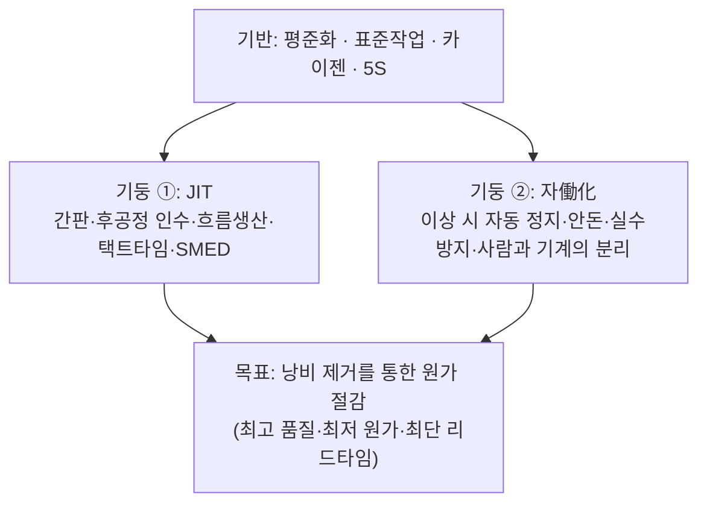
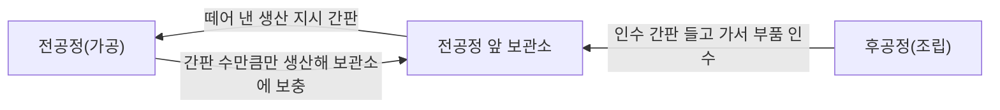
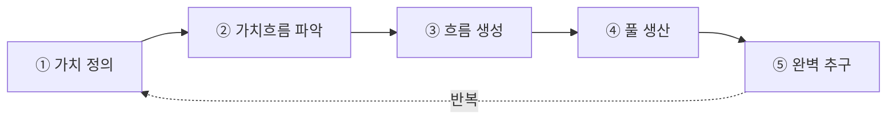
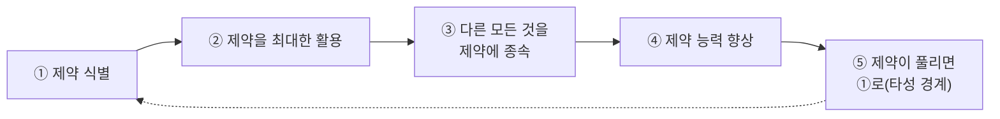
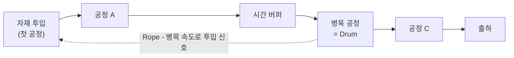

# 7.4 생산혁신기술

!!! info "출제기준"
    **7. 생산지원기술 및 기타** › **4. 생산혁신기술**

## 출제 경향

총 **38문항** 출제 (1교시 단답형 11 · 2~4교시 논술형 27) · 최근 10개 회차(109~139회) 12문항 · 최근 출제 제136회

| 주제 | 출제 수 | 출제 회차 |
|---|:-:|---|
| 7.4.1 도요타 생산방식과 JIT | 14 | 63회, 71회, 73회, 76회, 85회, 88회, 91회, 97회, 100회, 103회, 106회, 109회, 115회, 133회 |
| 7.4.2 린 생산과 린 6시그마 | 3 | 79회, 106회, 115회 |
| 7.4.3 제약이론(TOC·OPT·DBR) | 15 | 70회, 73회, 76회, 82회, 91회, 94회, 100회, 103회, 112회, 121회, 124회, 136회 |
| 7.4.4 혁신활동과 변화관리(BPR·TQM·카이젠) | 6 | 71회, 85회, 112회, 121회, 133회 |

## 목차

1. [도요타 생산방식과 JIT](#t74-1)
2. [린 생산과 린 6시그마](#t74-2)
3. [제약이론(TOC·OPT·DBR)](#t74-3)
4. [혁신활동과 변화관리(BPR·TQM·카이젠)](#t74-4)

## 7.4.1 도요타 생산방식과 JIT {#t74-1}

### 도요타 생산방식(TPS)의 구조 (91·133회)

**TPS**는 철저한 **낭비 제거**로 원가를 낮추는 도요타의 생산방식으로, 오노 다이이치가 체계화했다. **JIT**와 **자働化(인변 자동화)**의 두 기둥 위에 평준화·표준작업·개선(카이젠)이 기반을 이룬다.

**배경**: 자働化는 도요다 사키치의 자동 직기(실이 끊어지면 멈춤)에서, JIT는 도요다 기이치로의 구상에서 비롯되었고, 오노 다이이치가 1950~70년대에 현장에서 체계화했다. 1973년 석유 위기 이후 도요타가 불황에도 높은 수익을 내면서 주목받았고, 이후 서구에서 **린 생산**([7.4.2](#t74-2))으로 일반화되었다. 낭비의 종류는 [3.6.1](../03-process-control/06-process-improvement.md#t36-1), SMED는 [3.6.2](../03-process-control/06-process-improvement.md#t36-2)를 참고한다.

**원가 사고의 전환**: 원가주의(원가 + 이익 = 판매가)가 아니라 **판매가 − 원가 = 이익** — 판매가는 시장이 정하므로 이익은 원가 절감(낭비 제거)으로만 늘릴 수 있다는 것이 TPS의 출발점이다.

**두 기둥의 하위 운영 방법 (91회)**

| 기둥 | 하위 시스템 |
|---|---|
| **JIT** | 간판 방식, 후공정 인수(풀), 흐름생산(1개 흐름), 택트타임 생산, 생산 평준화, 준비교체 단축(SMED), 다기능공·U라인 |
| **자働化** | 이상 시 자동 정지 장치, 안돈(이상 표시), 실수방지(포카요케), 정위치 정지, 사람과 기계의 분리(1인 다기계 담당) |

### TPS의 핵심 구성 요소 (76·91·133회)

| 요소 | 내용 |
|---|---|
| **흐름생산** | 설비를 공정 순서대로 배치하고 **1개씩(소로트) 흘려** 정체를 없앰 — 공정 순서 배치, 1개 흐름, 다공정 담당, 택트타임 |
| **평준화(평활화) 생산** | 생산의 **양과 종류를 일·시간 단위로 고르게** 해 전 공정과 협력사의 부하를 안정시킴(혼류 생산) — 아래 상세 |
| **표준작업** | ① **택트타임** ② **작업 순서** ③ **표준 재공**의 3요소로 가장 낭비 없는 작업 방법을 정함 — 개선의 기준 |

### 생산 평준화(평활화, Heijunka) (133회)

**개념**: 최종 조립 라인이 생산하는 제품의 **총량과 품종 구성을 일정 기간(일·시간) 동안 고르게** 하는 것이다. 후공정이 들쭉날쭉하게 인수하면 전공정·협력사는 최대 부하에 맞춰 설비·인원·재고를 갖춰야 하므로(낭비, 채찍효과), 간판 시스템이 작동하려면 평준화가 전제되어야 한다.

| 구분 | 내용 |
|---|---|
| **총량 평준화** | 월 생산량을 가동일로 나눠 매일 같은 양을 생산 |
| **품종(종류) 평준화** | 품종을 섞어 일정한 순서로 반복 생산(혼류) |

**예**: 월 수요 A 10,000대, B 5,000대, C 5,000대, 가동 20일 → 일 A 500·B 250·C 250대 → 비율 2:1:1이므로 **A-B-A-C**를 반복 (로트 생산: AAAA…BBBB…CCCC…)

| 효과 | 전제 조건 |
|---|---|
| 전공정·협력사 부하 안정, 재고·인원 감소 | **준비교체 시간 단축(SMED)** |
| 고객 요구 품종을 매일 공급(리드타임 단축) | 다기능 작업자, 혼류 가능한 설비·라인 |
| 문제의 조기 노출, 간판 운용의 기반 | 평준화 계획 도구(평준화 박스, 혼류 순서 계획) |

### 간판(Kanban) 시스템 (97·109·133회)

**간판**은 무엇을·언제·얼마나 생산·운반할지 알려 주는 정보 카드로, **후공정이 필요한 만큼 가져가는(풀) 방식**을 실현한다. 종류: 인수(운반) 간판, 생산 지시 간판, 신호 간판

**간판의 기능 (109회)**: ① **생산·운반 지시 정보** ② **눈으로 보는 관리**(진척·재고 수준 가시화) ③ **과잉생산 방지**(간판 수가 재고 상한) — 아울러 간판 수를 줄여 문제를 드러내는 **개선의 도구**

**간판의 운영 규칙 (97회)**

1. 후공정은 필요한 것을 필요한 때 필요한 만큼 전공정에서 **인수**한다.
2. 전공정은 후공정이 인수해 간 **만큼만 생산**한다.
3. **불량품을 후공정에 보내지 않는다.**
4. 간판의 수를 **최소화**한다.
5. 간판은 수요의 **미세 조정** 수단으로 쓴다(큰 변동은 계획으로 조정).
6. 간판 없이는 생산·운반하지 않는다.

\[
\text{간판 수 } N = \frac{\text{일 수요} \times \text{리드타임} \times (1 + \text{안전계수})}{\text{용기당 수량}}
\]

**계산 예**: 일 수요 400개, 리드타임 0.5일, 안전계수 0.1, 용기당 20개 → \( N = 400 \times 0.5 \times 1.1 / 20 = 11 \)매

**최근 동향**: 바코드·RFID를 이용한 **전자 간판(e-Kanban)**으로 협력사에 실시간 발주 신호를 보내고, MES와 연계해 재고 상한을 자동 관리한다. 디지털화되어도 **풀 원칙과 간판 수 축소를 통한 개선**이라는 본질은 같다.

### 자働化와 자동화 (63·103·115회)

| 구분 | 자동화(Automation) | 자働化(Autonomation, JIDOKA) |
|---|---|---|
| 개념 | 사람의 작업을 기계가 대신함 | **사람의 지혜(판단)를 부여한 자동화** — 이상을 스스로 감지해 **멈춤** |
| 이상 발생 시 | 계속 작동해 불량을 대량 생산 | 즉시 정지 → 불량 방지, 원인 개선 |
| 사람의 역할 | 기계를 감시 | 기계와 분리되어 여러 대 담당 |

**JIDOKA에서의 역할 (115회)**

- **작업자**: 이상을 발견하면 라인을 멈추고(안돈) 알린다, 표준작업을 지킨다, 불량을 다음 공정에 보내지 않는다
- **감독자**: 즉시 현장에 가서 대응한다, 원인을 규명하고 재발 방지 대책을 세운다, 표준을 개선하고 작업자를 지원·교육한다

### 동기생산 시스템 구축 4단계 (71회)

| 단계 | 키포인트 |
|---|---|
| ① 생산의 평균화·평준화 | 월 생산량을 일 단위로 나누고 품종을 섞어 고르게(혼류) — 부하 안정 |
| ② 흐름생산 | 공정 순서대로 배치, 정체 제거, 다공정 담당 |
| ③ 소로트화 | 준비교체 시간 단축(SMED)으로 로트를 작게 |
| ④ 택트타임 생산 | 필요 수량에서 정한 택트타임에 맞춰 전 공정이 같은 속도로 생산 |

### 택트타임 생산방식 (106회)

**개념**: 고객 수요로 정한 **택트타임(가용시간 ÷ 필요 수량)**에 맞춰 전 공정이 동기화되어 생산하는 방식이다.

| 장점 | 단점 |
|---|---|
| 과잉생산 방지, 재공 감소 | 수요가 변하면 라인 재편성 필요 |
| 공정 흐름의 동기화 | 설비 고장·품질 문제에 취약(라인 전체 정지) |
| 문제(지연)가 즉시 드러남 | 공정이 불안정하면 운영 곤란 |

**구축을 위한 8가지 전제조건**: ① 평준화된 생산계획 ② 공정 순서의 흐름 배치 ③ 라인밸런싱 ④ 준비교체 시간 단축 ⑤ 설비 신뢰성(TPM) ⑥ 품질 안정(공정 내 품질 보증) ⑦ 다기능 작업자와 표준작업 ⑧ 자재의 정시·정량 공급(간판·물류)

### JIT와 MRP 비교 (73회)

| 비교 항목 | JIT | MRP |
|---|---|---|
| 재고 | 낭비로 보고 최소화 | 불확실성에 대비한 버퍼로 허용 |
| 로트 크기 | 소로트(가능하면 1개) | 경제적 로트 |
| 생산준비 | 준비교체를 계속 단축 | 주어진 조건으로 봄 |
| 품질 | 무결점 지향, 공정 내 보증 | 일부 불량 허용(여유) |
| 조달 리드타임 | 계속 단축 | 고정된 값으로 계획 |
| 방식 | 풀(Pull), 간판 | 푸시(Push), 계획 |
| 적합 환경 | 반복·안정 수요 | 다품종·비반복, 복잡한 BOM |

### JIT의 성공 조건 (88·100회)

① 평준화된 안정 수요 ② 준비교체 시간 단축 ③ 품질 안정(불량 제로 지향) ④ 설비 신뢰성(TPM) ⑤ 다기능 작업자와 참여 문화 ⑥ 공급자 협력(근거리·소로트 다빈도 납품) ⑦ 경영층의 의지와 5S·표준작업

### TQM·TPM·JIT의 적용 순서 (85회)

| 기법 | 특징 |
|---|---|
| TQM | 전원 참여의 품질경영, 고객 만족, 공정 내 품질 확보 |
| TPM | 설비 효율 극대화, 고장·불량 제로, 자주보전 |
| JIT | 낭비 제거, 흐름생산, 재고 최소화 |

**권장 순서: TPM → TQM → JIT** — JIT로 재고를 줄이면 설비 고장과 품질 문제가 곧바로 라인 정지로 이어진다. 따라서 먼저 **5S와 TPM으로 설비를 안정**시키고, **TQM으로 공정 품질을 안정**시킨 뒤, 마지막으로 **JIT로 흐름을 만들고 재고를 줄이는** 것이 효과적이다("안정화 후 흐름화"). 실제로는 세 기법이 서로 보완하므로 기반이 갖춰지면 병행 추진한다.

!!! tip "답안 작성 포인트"
    - TPS는 **집 모양의 구조도(목표·두 기둥·기반)**를 먼저 그리고 요소별로 설명한다. 7.4에서 가장 많이 나온 주제다(14문항).
    - 간판은 **종류·기능·운영 규칙·간판 수 공식**을, 자働化는 **자동화와의 비교표**를 준비한다.
    - 평준화는 **총량·품종 평준화 + 혼류 순서 계산 예(A-B-A-C)**와 "평준화 없이는 간판이 작동하지 않는다"는 연결을 쓴다.
    - 결론 예: "TPS의 본질은 도구가 아니라 **문제를 드러내 개선하는 사람 중심의 시스템**이므로, 기반(5S·TPM·표준작업)부터 구축하고 e-Kanban·MES 등 디지털 기술로 보완하되 공급망 리스크에 대비한 전략적 재고 기준을 함께 설계해야 한다."

??? example "관련 기출 14문항 (63회, 71회, 73회, 76회, 85회, 88회, 91회, 97회, 100회, 103회, 106회, 109회, 115회, 133회)"

    - **제63회(2001) 1교시 3번** · 10점  
      Autonomation
    - **제71회(2003) 2교시 4번** · 25점  
      동기생산시스템의 구축을 위하여 필요한 다음 4단계에 대한 키포인트를 설명하시오.

        ??? quote "문제 전문"

            동기생산시스템의 구축을 위하여 필요한 다음 4단계에 대한 키포인트를 설명하시오.  
            \- 제1단계 : 생산의 평균화/평준화  
            \- 제2단계 : 흐름생산  
            \- 제3단계 : 소 Lot화  
            \- 제4단계 : 택트타임 생산  
    - **제73회(2004) 2교시 3번** · 25점  
      JIT시스템과 MRP시스템을 재고, 로트크기, 생산준비, 품질 및 조달기간(lead time)등에 대하여 비교 설명하시오.
    - **제76회(2005) 1교시 6번** · 10점  
      도요타 생산시스템(TPS)에서 흐름생산의 핵심요소(3가지 이상).
    - **제85회(2008) 4교시 3번** · 25점  
      TQM(Total Quality Management), TPM(Total Productive Maintenance), JIT(Just In Time)와 같은 생산혁신기법의 특징을 설명하고, 당신이 컨설턴트라면 제조업을 지도할 때 이들 기법을 동시에 적용하지 않는다면 어떠한 순서로 적용하면 보다 운영성과가 효과적일지를 설명하시오.
    - **제88회(2009) 4교시 1번** · 25점  
      H기업에서 생산라인에 JIT(Just In Time) 시스템을 도입 한 후, JIT시스템을 지속적이고 성공적으로 운영하기 위해서 H기업이 갖추어야 할 조건 4가지를 설명하시오.
    - **제91회(2010) 4교시 6번** · 25점  
      도요타 생산방식에 대한 다음 각 물음에 답하시오.

        ??? quote "문제 전문"

            도요타 생산방식에 대한 다음 각 물음에 답하시오.  
            (1) 도요타 생산방식의 두 기둥인 JIT생산과 (인변)자동화에 대하여 각각의 하위시스템으로써 운영관리 방법을 열거하시오.  
            (2) 도요타 생산방식의 핵심 구성요소로서 흐름생산, 평준화생산, 표준작업에 대하여 설명하시오.  
    - **제97회(2012) 1교시 5번** · 10점  
      간판생산방식에 있어서 간판의 운영규칙을 설명하시오.
    - **제100회(2013) 1교시 13번** · 10점  
      JIT 시스템의 성공전제 조건(제조업 중심)
    - **제103회(2014) 1교시 4번** · 10점  
      TPS(Toyota Production System)에서 Automation과 Autonomation을 비교하여 설명하시오.
    - **제106회(2015) 4교시 3번** · 25점  
      택트타임(tact time) 생산방식과 관련하여 다음 각 물음에 답하시오.

        ??? quote "문제 전문"

            택트타임(tact time) 생산방식과 관련하여 다음 각 물음에 답하시오.  
            (1) 택트타임 생산방식이란 무엇을 말하는지 설명하시오.  
            (2) 택트타임 생산시스템의 장단점에 대하여 설명하시오.  
            (3) 택트타임 생산시스템 구축을 위한 8가지 전제조건에 대하여 설명하시오.  
    - **제109회(2016) 1교시 4번** · 10점  
      도요타 생산시스템의 간판(Kanban)의 기능 3가지를 쓰고, 그 내용을 각각 설명하시오.
    - **제115회(2018) 3교시 2번** · 25점  
      오노다이이찌가 제시한 Automation with a human touch(自働化: JIDOKA)에 대하여 다음 물음에 답하시오.

        ??? quote "문제 전문"

            오노다이이찌가 제시한 Automation with a human touch(自働化: JIDOKA)에 대하여 다음 물음에 답하시오.  
            1) JIDOKA(自働化)의 개념  
            2) JIDOKA와 연관된 작업자 및 감독자 각각의 역할  
    - **제133회(2024) 4교시 2번** · 25점  
      도요타 생산방식에 대하여 다음을 설명하시오.

        ??? quote "문제 전문"

            도요타 생산방식에 대하여 다음을 설명하시오.  
            1) 칸반 시스템(Kanban System)  
            2) 생산 평활화  

## 7.4.2 린 생산과 린 6시그마 {#t74-2}

### 린 생산방식 (79회)

**정의**: MIT의 국제자동차프로그램(IMVP) 연구진(Womack 등, 1990)이 도요타 생산방식을 일반화해 붙인 이름으로, **모든 낭비를 없애 적은 자원으로 고객 가치를 최대화**하는 생산·경영 방식이다. "Lean"이라는 용어는 IMVP 연구원 J. Krafcik(1988)이 처음 썼고, 『The Machine That Changed the World』(Womack·Jones·Roos, 1990)로 널리 알려졌다.

| 구분 | 대량 생산(포드 방식) | 린 생산 |
|---|---|---|
| 목표 | 규모의 경제, "충분히 좋은" 품질 | 낭비 제거, 무결점·고객 가치 |
| 재고 | 대량 버퍼 | 최소화(문제를 드러냄) |
| 작업자 | 단능공, 분업 | 다기능공, 팀·개선 참여 |
| 설비 | 전용 대형 설비, 대로트 | 유연 설비, 소로트·빠른 준비교체 |
| 공급자 | 가격 중심, 다수 거래 | 장기 협력, 소수 정예 |

**특성**: 고객 가치 중심, 낭비 제거, 흐름과 풀(Pull) 생산, 소로트·짧은 리드타임, 지속적 개선(카이젠), 다기능·전원 참여, 공급자와의 협력, 적은 재고·공간·인력

### 린 사고의 5원칙 (115회)

| 원칙 | 내용 | 예 |
|---|---|---|
| ① **가치**(Value) | 고객 관점에서 가치를 정의 | 고객이 돈을 내는 기능만 가치 |
| ② **가치흐름**(Value Stream) | 제품이 고객에게 가기까지의 모든 활동을 파악해 낭비 제거 | 가치흐름도(VSM) 작성 |
| ③ **흐름**(Flow) | 가치를 만드는 활동이 끊김 없이 흐르게 함 | 공정 간 정체 제거, 셀 생산 |
| ④ **풀**(Pull) | 고객이 원할 때 원하는 만큼만 생산 | 간판, 후공정 인수 |
| ⑤ **완벽 추구**(Perfection) | 낭비가 없어질 때까지 끊임없이 개선 | 카이젠, 표준 개선 |

(5원칙은 Womack·Jones의 『Lean Thinking』(1996)에서 제시되었다.)

### 린 6시그마 (106회)

**기본적 사고**: 린의 **속도·낭비 제거**와 6시그마의 **변동 감소·데이터 기반 문제 해결**을 결합한다. 린만으로는 프로세스의 산포를 통계적으로 줄이기 어렵고, 6시그마만으로는 프로세스 속도(리드타임)를 크게 줄이기 어렵기 때문이다.

**린 6시그마의 법칙(M. George)**

1. **시장의 법칙**: 고객의 핵심 요구(CTQ)가 개선의 최우선 기준이다.
2. **유연성의 법칙**: 프로세스의 속도는 유연성(준비교체 능력)에 비례한다.
3. **집중의 법칙**: 지연의 대부분은 소수의 활동(시간 함정)에서 생기므로 그곳에 집중한다.
4. **속도의 법칙**: 프로세스의 속도는 재공(WIP)에 반비례한다(Little의 법칙).
(5. **복잡성과 원가의 법칙**: 제품·서비스의 복잡성이 원가를 더 크게 늘린다.)

**속도의 법칙(Little의 법칙)**

\[
\text{리드타임} = \frac{\text{재공(WIP)}}{\text{산출률(Throughput)}}, \qquad \text{프로세스 사이클 효율(PCE)} = \frac{\text{부가가치 시간}}{\text{총 리드타임}}
\]

예: 재공 600개, 산출률 100개/일 → 리드타임 6일. 부가가치 시간이 0.3일이면 PCE = 5%로, 개선 여지가 큼을 보여 준다.

| 구분 | 린 | 6시그마 | 린 6시그마 |
|---|---|---|---|
| 목표 | 낭비 제거, **속도** | 변동 감소, **품질** | 빠르고 산포 없는 프로세스 |
| 방법 | VSM, 5S, 간판, SMED | DMAIC, 통계 분석 | DMAIC 안에서 린 도구 병행 |
| 추진 | 현장 전원, 단기 개선 이벤트 | 벨트 전문가, 프로젝트 | 벨트 + 현장 참여 |
| 한계 | 통계적 근본 원인 분석 약함 | 흐름·속도 개선 약함 | 상호 보완 |

**DLSS(Design for Lean Six Sigma)**: 신제품·신프로세스를 설계하는 단계부터 **린(낭비 없는 흐름)과 6시그마(산포 최소)**를 함께 반영하는 설계 방법론이다.

**최근 동향(디지털 린)**: IoT·MES 데이터로 실시간 가치흐름도(디지털 VSM)를 만들고, AI로 변동 원인을 분석해 린 6시그마의 속도와 정확도를 높인다.

!!! tip "답안 작성 포인트"
    - 린은 **기원(MIT·TPS) → 특성 → 5원칙 표(예 포함)**로 쓴다. 린 6시그마는 두 방법의 **상호 보완성**을 핵심으로 쓴다.
    - 린 특성은 **대량 생산과의 비교표**로, 속도의 법칙은 **Little의 법칙 식과 계산 예**로 쓰면 고득점이다.
    - 결론 예: "린은 속도, 6시그마는 정확성을 담당하므로 두 방법을 하나의 개선 체계로 통합하고, 디지털 VSM·AI 분석으로 개선 주기를 단축해야 한다."

??? example "관련 기출 3문항 (79회, 106회, 115회)"

    - **제79회(2006) 3교시 2번** · 25점  
      Lean 생산방식을 정의하고 그 특성을 기술하시오.
    - **제106회(2015) 2교시 5번** · 25점  
      린 6시그마와 관련하여 다음 각 물음에 답하시오.

        ??? quote "문제 전문"

            린 6시그마와 관련하여 다음 각 물음에 답하시오.  
            (1) 린 6시그마의 기본적 사고에 대하여 설명하시오.  
            (2) 린 6시그마의 4가지 법칙에 대하여 설명하시오.  
            (3) 린 6시그마 설계(DLSS)의 정의를 쓰시오.  
    - **제115회(2018) 4교시 3번** · 25점  
      Lean Thinking의 5가지 사고(원리)를 제시하고, 각 사고(원리)별로 예를 들어 설명하시오.

## 7.4.3 제약이론(TOC·OPT·DBR) {#t74-3}

### 제약이론(TOC)의 개념 (73·94·100회)

**TOC(Theory of Constraints)**는 골드랫(E. Goldratt)이 소설 『The Goal』(1984)로 소개한 경영 이론이다. 시스템의 성과는 **가장 약한 고리(제약)**가 결정하므로, 제약을 찾아 집중적으로 관리·개선해야 한다는 것이다.

- **목표**: 현재와 미래에 **돈을 버는 것**
- **운영 지표**: 쓰루풋(T: 판매를 통해 돈을 버는 속도), 재고·투자(I), 운영비(OE) → T를 늘리고 I와 OE를 줄임
- **재무 지표**: 순이익(T − OE), 투자수익률((T − OE) ÷ I), 현금흐름

**지속적 개선의 5단계**

**쓰루풋 계산 (124회)**: 쓰루풋 = 판매액 − 완전 변동비(판매된 수량 기준)

\[
T = (100 - 35) \times 450 = \mathbf{29{,}250\text{달러}}
\]

생산했지만 팔리지 않은 50개는 쓰루풋이 아니라 재고(I)다.

### 병목 공정과 DBR (73·112·121·136회)

**병목(Bottleneck) (136회)**: 능력이 수요보다 작은 자원 — 시스템 전체의 산출량을 결정한다. 능력 제약 자원(CCR)은 병목이 될 가능성이 큰 자원이다.

| DBR 요소 | 역할 |
|---|---|
| **Drum**(드럼) | 병목 공정의 생산 일정 — 시스템 전체의 생산 속도(박자)를 결정 |
| **Buffer**(버퍼) | 병목 앞의 시간 버퍼 — 앞 공정의 변동으로부터 병목이 멈추지 않도록 보호 |
| **Rope**(로프) | 첫 공정의 자재 투입을 병목 속도에 묶음 — 과잉 투입·재공 증가 방지 |

### 병목 공정의 식별과 관리 (136회)

| 구분 | 병목(Bottleneck) | 능력 제약 자원(CCR) | 비병목(Non-bottleneck) |
|---|---|---|---|
| 능력과 수요 | 능력 **<** 수요 | 능력 ≒ 수요(잘못 관리하면 병목화) | 능력 **>** 수요 |
| 관리 원칙 | 100% 활용, 정지 방지 | 일정·로트 관리로 병목화 방지 | 병목에 종속, 여유 능력은 버퍼 역할 |

**병목 식별 방법**: ① 공정별 **부하율(필요 시간 ÷ 가용 능력)** 비교 — 100%를 넘는 공정 ② 공정 앞 **재공 적체** 관찰 ③ 설비 가동률·OEE 데이터 ④ 공정별 사이클타임과 택트타임 비교 ⑤ 시뮬레이션·MES 실시간 데이터(제품 구성 변화에 따른 **이동 병목**도 확인)

**병목 개선 방안(5단계에 따른 예)**

| 단계 | 개선 방안 |
|---|---|
| 최대 활용 | 휴식·교대 시간 무정지 운영, 준비교체 단축(SMED), 병목 앞 품질 검사로 불량 투입 방지, 예방보전(TPM) |
| 종속 | DBR로 투입 통제, 병목 일정에 맞춘 비병목 운영 |
| 능력 향상 | 작업 일부를 비병목으로 이관, 외주, 잔업, 설비 증설·자동화 |
| 재확인 | 병목 이동 확인, 타성 경계 |

라인 차원의 병목 개선은 [3.6.3](../03-process-control/06-process-improvement.md#t36-3), 쓰루풋 회계와 제품 믹스 결정(병목 시간당 쓰루풋)은 [6.2.5](../06-cost-engineering-economy/02-cost-management.md#t62-5)를 참고한다.

**『The Goal』의 행군 비유 (91회)**

| 행군 | 생산 현장 |
|---|---|
| 가장 느린 학생 | ① **병목 공정(CCR, 제약 자원)** |
| 학생 A와 앞사람 사이의 간격 | ② **공정 간 재공품(재고)** |
| 학생 B가 넘어지거나 지체 | ③ **통계적 변동(설비 고장·작업 편차 등의 불확실성)** |
| 드럼 | ④ **병목 공정의 생산 일정(전체 생산 속도 결정)** |
| 가장 느린 학생이 쉰다 | ⑤ **병목의 정지 = 시스템 전체 산출의 손실**(병목의 1시간 손실은 공장 전체의 1시간 손실) |

### TOC의 버퍼 (124회)

| 버퍼 | 위치·역할 |
|---|---|
| **공급 버퍼**(Feeding Buffer) | 비제약 경로(부품 공정)가 제약 경로·조립에 **합류하는 지점 앞**에 두어, 비제약 경로의 지연이 제약을 멈추지 않게 함 |
| **공간 버퍼**(Space Buffer) | 병목 **뒤에 물리적 공간**을 두어, 후공정이 멈춰도 병목이 계속 작업하도록 함 |
| **능력 버퍼**(Capacity Buffer) | 비제약 자원이 가진 **여유 능력** — 변동이 생겼을 때 따라잡아 병목에 공급을 회복 |

(시간 버퍼는 시간으로, 공간 버퍼는 장소로, 능력 버퍼는 여유 능력으로 병목을 보호한다는 점이 다르다.)

### 동시생산과 OPT (70·76·103회)

**동시생산(Synchronous Manufacturing)**: 모든 공정이 병목의 속도에 맞춰 조화롭게 생산하도록 하는 TOC의 생산 방식이다.

**OPT의 9가지 원칙(동시생산의 기본 원칙)**

1. 능력이 아니라 **흐름**을 균형시킨다.
2. 비병목의 이용률은 자신의 능력이 아니라 **제약**이 결정한다.
3. 자원의 활용(Utilization)과 활성화(Activation)는 같지 않다.
4. **병목의 1시간 손실은 시스템 전체의 1시간 손실**이다.
5. 비병목에서 절약한 1시간은 신기루일 뿐이다.
6. 병목이 처리량과 재고를 결정한다.
7. 이동 로트는 가공 로트와 같지 않아도 된다(같지 않은 편이 좋다).
8. 가공 로트는 고정이 아니라 가변적이어야 한다.
9. 일정은 모든 제약을 동시에 고려해 세우며, 리드타임은 일정의 결과다.

**관련 용어**: 병목 자원, 비병목 자원, 능력 제약 자원(CCR), 처리량(쓰루풋), 가공 로트, 이동 로트, 시간 버퍼

**OPT의 4가지 기본 모듈 (103회)**: ① **BUILDNET**(제품·공정 네트워크 구성) ② **SERVE**(초기 일정과 병목 파악) ③ **SPLIT**(병목·비병목 자원 분리) ④ **BRAIN**(병목의 정밀 일정 최적화) — 전개 과정은 [3.6.3](../03-process-control/06-process-improvement.md#t36-3)을 참고한다.

### TOC와 JIT, 카이젠 (70·82회)

| 구분 | JIT | TOC(동시생산) |
|---|---|---|
| 유사점 | 재고·리드타임 감소, 흐름 중시, 소로트, 품질 중시 | (좌동) |
| 균형 | 모든 공정의 능력·부하를 **균형**(평준화) | 능력의 불균형을 인정, **흐름**을 균형 |
| 개선 초점 | 모든 곳의 낭비 제거 | **제약에 집중** |
| 버퍼 | 최소화(재고는 낭비) | 제약 앞에만 **전략적 버퍼** |
| 통제 | 간판(풀) | DBR |
| 적합 환경 | 반복·안정 수요 | 다품종·변동 환경에도 적용 |

**카이젠과 TOC의 융합 필요성 (82회)**: 카이젠은 전 공정의 낭비를 줄이지만, 비병목의 개선은 시스템 산출을 늘리지 못할 수 있다("비병목의 절약은 신기루"). TOC는 **어디를 개선해야 하는지(제약)**를 알려 주고, 카이젠·린 도구는 **어떻게 개선할지**를 제공한다. 두 방법을 결합하면 개선 노력이 곧바로 쓰루풋 증가로 이어진다.

### TOC의 확장: 사고 프로세스와 CCPM

| 구분 | 내용 |
|---|---|
| **사고 프로세스(TP)** | 정책·관행 같은 **비물리적 제약**을 다루는 논리 도구 — "무엇을 바꿀 것인가(현상 문제 구조도, CRT) → 무엇으로 바꿀 것인가(대립 해소도, EC·미래 구조도, FRT) → 어떻게 바꿀 것인가(전제 조건도·전환 계획도)" |
| **CCPM**(Critical Chain Project Management) | 자원 경쟁까지 고려한 **주공정 사슬**을 관리하고, 개별 작업의 여유를 모아 **프로젝트 버퍼·합류 버퍼**로 관리 — 학생 증후군·파킨슨 법칙 방지([6.4.5](../06-cost-engineering-economy/04-operations-research.md#t64-5) PERT/CPM과 비교) |
| **물류·유통** | 재고를 중앙에 두고 소비된 만큼 보충하는 TOC 보충 방식 |

**제약의 유형**: 물리적 제약(설비·인력·자재), 시장 제약(수요 부족), 정책 제약(규칙·평가 지표) — 실무에서는 정책 제약이 가장 흔하다고 본다.

!!! tip "답안 작성 포인트"
    - TOC는 **목표·지표(T·I·OE) → 5단계 → DBR 그림** 순서로 쓴다. 쓰루풋 계산은 **판매된 수량만** 계산하는 점에 주의한다.
    - 비교 문제(JIT·카이젠)는 **유사점·차이점 표**와 결합의 시너지로 결론을 맺는다.
    - 136회형(병목)은 **정의 → 병목·CCR·비병목 비교표 → 식별 방법 → 5단계별 개선 방안 → DBR 그림**으로 쓰고, OPT 원칙 ④·⑤(병목 1시간 = 시스템 1시간)를 인용한다.
    - 결론 예: "개선 자원은 한정되어 있으므로 **제약에 집중**해야 하며, MES·디지털 트윈으로 이동 병목을 실시간 파악하고 TOC(어디를) + 린·6시그마(어떻게)를 결합해야 한다."

??? example "관련 기출 15문항 (70회, 73회, 76회, 82회, 91회, 94회, 100회, 103회, 112회, 121회, 124회, 136회)"

    - **제70회(2003) 1교시 7번** · 10점  
      OPT(Optimized Production Technology)
    - **제70회(2003) 4교시 3번** · 25점  
      제약이론(TOC)을 토대로 한 동시생산과 JIT 생산에 대하여 유사점과 차이점을 들어 설명하시오.
    - **제73회(2004) 1교시 7번** · 10점  
      DBR
    - **제73회(2004) 2교시 1번** · 25점  
      TOC의 개념과 특징을 설명하시오.(TOC : Theory Of Constraints)
    - **제76회(2005) 3교시 1번** · 25점  
      TOC에서 동시생산의 정의, 기본원칙 및 관련용어에 대하여 설명하시오.
    - **제82회(2007) 3교시 6번** · 25점  
      카이젠(改善:개선) 생산방식과 TOC(Theory Of Constraints:제약이론)의 융합 필요성을 설명하시오.
    - **제91회(2010) 1교시 9번** · 10점  
      골드렛의 “The Goal”에 나오는 행군의 내용을 참고로 생산 현장에서 같은 의미를 가지는 내용으로 ①～⑤에 해당되는 내용을 쓰시오.

        ??? quote "문제 전문"

            골드렛의 “The Goal”에 나오는 행군의 내용을 참고로 생산 현장에서 같은 의미를 가지는 내용으로 ①～⑤에 해당되는 내용을 쓰시오.  
            [표] 행군 | 생산 현장  
            가장 앞에서 걷는 소년 | 첫 공정  
            가장 뒤에서 걷는 소년 | 마지막 공정  
            가장 느린 학생 | ①  
            학생 A와 그 앞사람과의 간격 | ②  
            학생 B가 넘어지거나 신발끈을 고쳐매는 등의 지체 | ③  
            로프(Rope) | 자재 투입시기를 결정  
            드럼(Drum) | ④  
            버퍼(Buffer) | 시간 버퍼(공장 스루풋, 보호), 비축버퍼  
            행군의 출발 | 첫 공정에 자재 투입  
            가장 느린 학생이 쉰다 | ⑤  
            가장 느린 학생의 배낭짐을 들어 준다. | CCR의 설비 증설  
    - **제94회(2011) 4교시 5번** · 25점  
      TOC(Theory of Constraints)의 정의, 목표, 주요요소에 대하여 설명하시오.
    - **제100회(2013) 3교시 6번** · 25점  
      TOC(Theory of constraints)의 개념과 생성배경, 핵심요소에 대하여 기술하시오.
    - **제103회(2014) 2교시 6번** · 25점  
      OPT(Optimized Production Technology)에 대한 다음 각 물음에 답하시오.

        ??? quote "문제 전문"

            OPT(Optimized Production Technology)에 대한 다음 각 물음에 답하시오.  
            1) OPT의 개념과 4가지 기본모듈을 설명하시오.  
            2) OPT의 원칙과 전개과정을 설명하시오.  
    - **제112회(2017) 4교시 3번** · 25점  
      제약이론(Theory Of Constraints)에서 DBR(Drum-Buffer-Rope)의 역할에 대하여 설명하시오.
    - **제121회(2020) 1교시 12번** · 10점  
      Drum-Buffer-Rope Mechanism
    - **제124회(2021) 3교시 1번** · 25점  
      다음 질문에 답하시오.

        ??? quote "문제 전문"

            다음 질문에 답하시오.  
            1) TOC(Theory Of Constraints)의 쓰루풋(Throughput)에 대한 정의를 설명하시오.  
            2) 제품의 판매가격은 100달러, 순수 변동원가는 개당 35달러인 경우에 한 주에 500개를 생산하여 450개를 판매했을 때, 쓰루풋을 구하시오.  
    - **제124회(2021) 4교시 1번** · 25점  
      TOC(Theory Of Constraints)에서 공급버퍼(Feeding Buffer), 공간버퍼(Space Buffer), 능력버퍼(Capacity Buffer)에 대하여 각각을 비교하여 설명하시오.
    - **제136회(2025) 2교시 2번** · 25점  
      제약이론(TOC, Theory of Constraints)에서의 병목공정(Bottleneck)을 설명하시오.

## 7.4.4 혁신활동과 변화관리(BPR·TQM·카이젠) {#t74-4}

### BPR(Business Process Reengineering) (71·112회)

**정의**: 원가·품질·서비스·속도 같은 핵심 성과를 **극적으로 향상**시키기 위해, 업무 프로세스를 **근본적으로 다시 생각하고 급진적으로 재설계**하는 것이다(Hammer & Champy, 1993).

**BPR의 목적과 달성 방법 (71회)**

| 목적 | 달성 방법 |
|---|---|
| 원가 절감 | 불필요한 단계·결재·검사 제거, 업무 통합 |
| 처리 시간(속도) 단축 | 순차 업무의 병렬화, 한 사람(케이스 매니저)이 일괄 처리 |
| 품질·서비스 향상 | 고객 접점에서 바로 결정할 수 있도록 권한 위양 |
| 고객 가치 중심 | 기능 부서 중심에서 고객 프로세스 중심 조직으로 |
| 정보 활용 | IT로 정보를 발생지에서 한 번만 입력·공유 |

### 프로세스 혁신 (133회)

**개념**: 업무 프로세스를 근본적으로 재설계하거나(BPR) 지속적으로 개선해(PI) 고객 가치와 경영 성과를 높이는 활동이다.

**기대효과**: 리드타임·원가 감소, 품질·고객 만족 향상, 업무 표준화, 조직의 유연성

### 혁신 접근 방식의 비교: 카이젠·TQM·BPR

**카이젠(改善)**: 현장의 전원이 작은 개선을 **끊임없이** 쌓아 가는 일본식 개선 활동으로, 이마이 마사아키가 『Kaizen』(1986)으로 서구에 알렸다. PDCA·5S·제안 제도·QC 서클이 주요 수단이다. TQM은 [5.4.1](../05-work-measurement/04-quality-management.md#t54-1)을 참고한다.

| 구분 | 카이젠 | TQM | BPR |
|---|---|---|---|
| 변화 정도 | 점진적 | 점진적·지속적 | **급진적·근본적** |
| 출발점 | 현행 프로세스 | 현행 프로세스(품질 중심) | **백지 상태**(Clean Slate) |
| 추진 방향 | 상향식(현장) | 전원 참여 | **하향식**(경영층) |
| 범위 | 작업·공정 단위 | 전사 품질 시스템 | 부서를 가로지르는 핵심 프로세스 |
| 위험 | 낮음 | 중간 | 높음 |
| IT 역할 | 보조 | 보조 | **핵심 수단** |

**[그림] 성과 곡선**: 카이젠은 완만한 계단식 상승, BPR은 한 번의 급격한 도약 — 실무에서는 BPR로 도약한 뒤 카이젠으로 유지·향상하는 **결합**이 바람직하다.

**최근 동향(디지털 프로세스 혁신)**: 시스템 로그로 실제 업무 흐름을 자동으로 그려 병목을 찾는 **프로세스 마이닝**, 반복 사무 업무를 자동화하는 **RPA**, 생성형 AI·AI 에이전트에 의한 업무 재설계 — DX 시대의 BPR로 볼 수 있다.

**추진 절차 5단계**: ① 혁신 대상 프로세스 선정(고객 영향·개선 여지) → ② 현행(As-Is) 프로세스 분석 → ③ 미래(To-Be) 프로세스 설계 → ④ 실행(시범 적용 → 전사 확산) → ⑤ 성과 평가와 정착·지속 개선

### 혁신 활동의 성공 요건 (71회)

① 명확한 비전과 최고경영자의 강한 의지 ② 위기의식의 공유 ③ 전원 참여와 소통 ④ 전담 조직과 변화 리더 육성 ⑤ 체계적인 방법론과 교육 ⑥ 성과 측정과 보상 연계 ⑦ 단기 성과로 신뢰 확보 ⑧ 지속성과 학습 문화

### 중소기업 공장혁신 컨설팅 (85회)

| 예상 문제점 | 해결 방안 |
|---|---|
| 열악한 근무 환경과 낮은 의욕, 변화에 대한 저항 | 작업 환경 개선부터 착수(가시적 성과), 참여·포상 |
| 인력·자금 등 자원 부족 | 저비용 개선(5S·작업 개선) 중심, 정부 지원 사업 활용 |
| 낮은 기초 관리 수준(표준·데이터 부재) | 표준화와 기초 데이터 수집부터 |
| 경영층의 조급함 | 단계별 목표와 단기 성과 공유 |
| 혁신 역량 부족 | 핵심 인력 교육, 내부 추진자 육성 |

**프로젝트 진행 순서**: ① 현장 진단(문제·수준 파악) → ② 비전·목표 합의와 추진 조직 구성 → ③ **기초 다지기**(5S·안전·작업 환경) → ④ 표준화(표준작업·품질 기준) → ⑤ 설비·품질 안정(TPM·품질 개선) → ⑥ 흐름 개선(라인밸런싱·JIT) → ⑦ 성과 평가·정착과 자율 추진 체제 이관

### 변화관리 모델 (121회)

**① 쿠르트 레빈의 3단계 프로세스**

| 단계 | 내용 |
|---|---|
| **해빙**(Unfreezing) | 현 상태의 문제를 인식시키고 변화의 필요성을 공유해 기존 관행을 녹임 |
| **변화**(Changing) | 새로운 방식·행동을 도입하고 교육·지원 |
| **재동결**(Refreezing) | 새로운 방식을 제도·문화로 굳혀 정착 |

**② 존 코터의 변화관리 8단계**

1. **위기감 조성**
2. **변화 추진 연합(선도팀) 구축**
3. **비전과 전략 수립**
4. **비전의 전달·공유**
5. **장애물 제거와 권한 부여**
6. **단기 성과 창출**
7. **성과의 통합과 추가 변화 추진**
8. **새로운 방식을 조직 문화로 정착**

코터의 8단계는 레빈의 3단계를 구체화한 것으로 볼 수 있다(1~4단계 해빙, 5~7단계 변화, 8단계 재동결).

!!! tip "답안 작성 포인트"
    - BPR은 **정의(근본적·급진적·극적·프로세스) → 목적별 달성 방법 → 사례(1.1.8의 Ford·IBM Credit)**로 쓴다.
    - 변화관리 문제는 **레빈 3단계와 코터 8단계의 대응 관계**를 함께 쓰면 깊이가 생긴다.
    - 133회형(프로세스 혁신)은 **카이젠·TQM·BPR 비교표**와 프로세스 마이닝·RPA 같은 디지털 수단을 넣어 차별화한다.
    - 결론 예: "혁신의 실패 원인은 기법보다 **사람의 저항과 정착 실패**에 있으므로, 변화관리(코터 8단계)를 추진 절차에 내장하고 성과 지표·보상과 연계해 재동결해야 한다."

??? example "관련 기출 6문항 (71회, 85회, 112회, 121회, 133회)"

    - **제71회(2003) 2교시 1번** · 25점  
      프로세스의 혁신을 위한 방법으로 BPR을 전개하는 경우에 그 목적을 명확히 하는 것이 중요합니다. BPR의 목적을 열거하고 BPR을 통해서 어떻게 목적을 달성할 수 있는지 설명하시오.
    - **제71회(2003) 4교시 1번** · 25점  
      기업의 혁신활동을 성공적으로 수행하기 위해서 필요한 기본적인 요건을 열거하고 설명하시오.
    - **제85회(2008) 2교시 6번** · 25점  
      귀하는 종업원 120명정도 되는 근무여건과 환경이 열악한 중소기업의 공장혁신 프로젝트를 담당하는 컨설턴트이다. 귀하가 본 프로젝트를 진행함에 있어서 예상되는 문제점과 해결방안을 제시하고 프로젝트 진행순서를 지식과 경험위주로 기술해보시오.
    - **제112회(2017) 1교시 3번** · 10점  
      BPR(Business Process Reengineering)
    - **제121회(2020) 4교시 6번** · 25점  
      전략을 수립, 실행할 때 필요한 2가지 혁신모델에 대하여 설명하시오.

        ??? quote "문제 전문"

            전략을 수립, 실행할 때 필요한 2가지 혁신모델에 대하여 설명하시오.  
            1) 쿠르트 레빈(Kurt Lewin)의 혁신성공 3단계 프로세스  
            2) 존 코터(John Kotter)의 혁신성공을 위한 변화관리 8단계 프로세스  
    - **제133회(2024) 3교시 2번** · 25점  
      프로세스 혁신의 개념, 기대효과와 추진절차 5단계에 대하여 설명하시오.

## 답안 작성 예시

!!! example "25점 예시: 제133회 4교시 2번 — 도요타 생산방식의 칸반 시스템과 생산 평활화"
    **1. 개요**

    - TPS 정의(오노 다이이치, 낭비 제거를 통한 원가 절감) + [그림] TPS 집 구조(JIT·자働化 두 기둥, 평준화 기반)에서 칸반과 평활화의 위치 표시

    **2. 본론**

    - (1) 칸반 시스템: 정의(풀 방식의 정보 카드) → 종류(인수·생산 지시·신호) → [그림] 간판 순환도
    - (1-1) 기능 3가지(지시 정보·눈으로 보는 관리·과잉생산 방지)와 운영 규칙 6가지
    - (1-2) 간판 수 공식과 계산 예 → "간판 수를 줄여 문제를 드러내는 개선 도구"
    - (2) 생산 평활화: 정의 → [표] 총량·품종 평준화 → 혼류 순서 예(2:1:1 → A-B-A-C)
    - (2-1) 효과와 전제 조건(SMED·다기능공) — **평활화가 칸반의 전제**임을 명시해 두 소문항을 연결

    **3. 결론(기술사 의견)**

    - 칸반·평활화는 기반(5S·TPM·표준작업) 위에서만 작동 → 단계적 도입
    - e-Kanban·MES 연계로 협력사까지 실시간 풀 체계 확장, 공급망 리스크에는 전략 품목 버퍼 병행

!!! example "25점 예시: 제136회 2교시 2번 — 제약이론(TOC)에서의 병목공정"
    **1. 개요**

    - TOC 정의(골드랫, 『The Goal』 1984): 시스템 성과는 가장 약한 고리(제약)가 결정 / 병목 = 능력 < 수요인 자원

    **2. 본론**

    - (1) 병목의 의미: [표] 병목·CCR·비병목 비교, OPT 원칙 ④·⑤ 인용(병목 1시간 손실 = 시스템 1시간 손실)
    - (2) 병목 식별 방법: 부하율 비교, 재공 적체, 가동률·OEE, 사이클타임 vs 택트타임, 이동 병목
    - (3) 병목 관리: [그림] 5단계 지속적 개선 흐름 + [표] 단계별 개선 방안
    - (4) 병목 일정 통제: [그림] DBR(드럼·버퍼·로프), 버퍼 3종(공급·공간·능력)
    - (5) 성과 지표: T·I·OE와 쓰루풋 계산 예(판매된 수량만)

    **3. 결론(기술사 의견)**

    - "모든 곳의 개선"이 아니라 **제약 집중 개선**으로 쓰루풋 증대 / MES·디지털 트윈으로 이동 병목 실시간 관리, 린·6시그마 도구와 결합
