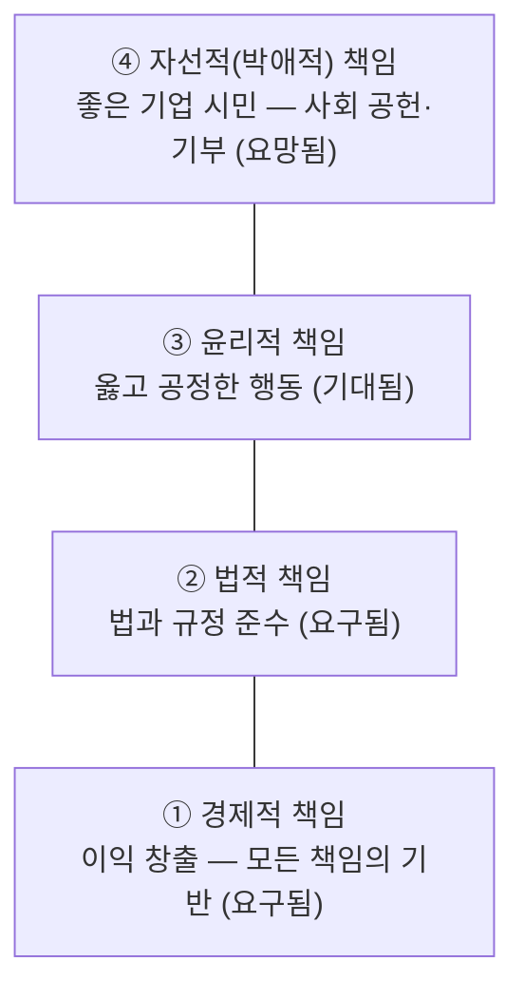

# 7.5 공장관리 신기술 및 경향에 관한 사항

!!! info "출제기준"
    **7. 생산지원기술 및 기타** › **5. 공장관리 신기술 및 경향에 관한 사항**

## 출제 경향

총 **13문항** 출제 (1교시 단답형 9 · 2~4교시 논술형 4) · 최근 10개 회차(109~139회) 12문항 · 최근 출제 제139회

| 주제 | 출제 수 | 출제 회차 |
|---|:-:|---|
| 7.5.1 ESG·지속가능경영·통상규제 | 7 | 109회, 112회, 124회, 130회, 136회, 139회 |
| 7.5.2 미래 공장(등대공장·SDF·다크팩토리·자율공장) | 5 | 127회, 139회 |
| 7.5.3 기술경영 | 1 | 91회 |

## 목차

1. [ESG·지속가능경영·통상규제](#t75-1)
2. [미래 공장(등대공장·SDF·다크팩토리·자율공장)](#t75-2)
3. [기술경영](#t75-3)

## 7.5.1 ESG·지속가능경영·통상규제 {#t75-1}

### 지속가능성과 ESG (112·136회)

**지속가능성(Sustainability)**: "미래 세대의 필요를 충족할 능력을 해치지 않으면서 현재 세대의 필요를 충족하는 발전"(1987년 브룬틀란 보고서). 기업 차원에서는 **경제·사회·환경**의 세 성과를 함께 추구하는 **트리플 바텀 라인**(Elkington, 3P: Profit·People·Planet)으로 구체화된다.

**ESG**: 기업의 지속가능성을 평가하는 **비재무적 요소**인 환경(Environmental)·사회(Social)·지배구조(Governance)를 말한다. 투자자·고객·규제기관이 기업을 평가하는 핵심 기준이 되었다.

| 요소 | 주요 항목 | 공장관리 관점의 실천 |
|---|---|---|
| **E** 환경 | 온실가스 배출, 에너지, 자원 순환, 오염물질, 생물다양성 | 탄소 배출량 관리(Scope 1·2·3), 에너지 효율화·재생에너지, 폐기물 감축, 친환경 설계 |
| **S** 사회 | 산업안전·보건, 인권·노동, 공급망 관리, 지역사회, 제품 안전 | 중대재해 예방(ISO 45001), 협력사 ESG 실사, 공정한 노동 조건 |
| **G** 지배구조 | 이사회 독립성, 윤리·준법, 투명한 공시, 주주 권리 | 윤리 경영, ESG 정보 공시, 리스크 관리 |

### CSR 피라미드 (109회)

A. Carroll(1991)은 기업의 사회적 책임(CSR)을 네 단계 피라미드로 설명했다.

아래 단계가 충족되어야 위 단계가 의미를 가지며, 기업은 네 가지 책임을 **동시에** 수행해야 한다.

### 기업윤리 (124회)

**정의**: 기업 활동에서 지켜야 할 **도덕적 가치와 행동 기준** — 무엇이 옳고 그른지 판단하는 원칙이다.

**지속 성장 측면의 중요성**: ① 이해관계자(고객·투자자·직원)의 **신뢰** 확보 ② 법적·평판 **리스크 감소**(부정·담합·품질 은폐 방지) ③ 우수 인재 확보와 조직 몰입 ④ ESG 평가와 투자 유치 ⑤ 장기적 기업 가치 향상 — 윤리 강령, 윤리 교육, 내부 신고 제도, 준법 감시 체계로 실천한다.

### RE100 (136회)

**Full Name**: **Renewable Electricity 100%**

**개념**: 기업이 사용하는 **전력의 100%를 재생에너지로 조달**하겠다고 약속하는 국제 자발적 캠페인이다(2014년 The Climate Group과 CDP가 시작).

**목적**: 온실가스(Scope 2) 감축과 탄소중립, 글로벌 고객사의 공급망 요구 대응, 기업 이미지·ESG 평가 향상

**이행 수단**: 자가 발전(태양광 등), 전력구매계약(PPA), 재생에너지 공급인증서(REC) 구매, 녹색 프리미엄 요금제, 지분 투자

### IRA(인플레이션 감축법) (130회)

**정의**: 2022년 8월 미국이 제정한 법으로, 기후 변화 대응·청정에너지 투자와 인플레이션 완화를 목적으로 대규모 세액공제·보조금을 제공한다. 특히 **전기차 세액공제의 조건으로 북미 최종 조립, 배터리 부품·핵심 광물의 원산지 요건**을 두었다.

| 구분 | 국내 기업에 대한 영향 |
|---|---|
| 자동차 | 한국에서 만든 전기차는 세액공제 대상에서 제외되어 가격 경쟁력 약화 → 미국 현지 생산 확대 |
| 배터리 | 미국 현지 공장 생산에 대한 세액공제 혜택 → 현지 투자 확대 |
| 소재·광물 | 핵심 광물의 공급망 재편(중국 의존도 축소) 요구 |
| 태양광·풍력·수소 | 현지 생산 시 혜택, 미국 시장 진출 기회 |

**연관성이 큰 업종**: 전기차, 2차전지(배터리), 양극재 등 배터리 소재, 태양광, 풍력, 수소

(미국의 정책 변화로 IRA의 일부 세액공제는 이후 축소·조정되었으므로, 답안에는 최신 동향을 확인해 덧붙인다.)

### ESG 관련 글로벌 무역 규제와 대응 전략 (139회)

| 규제 | 내용 |
|---|---|
| **EU 탄소국경조정제도(CBAM)** | 철강·알루미늄·시멘트·비료·전력·수소 등 수입품의 탄소 배출량에 비용 부과 |
| **EU 공급망 실사 지침(CSDDD)** | 기업이 공급망 전체의 인권·환경 영향을 실사하고 개선할 의무 |
| **EU 배터리 규정** | 배터리 탄소발자국 신고, 재활용 원료 사용, 배터리 여권 |
| **EU 에코디자인 규정(ESPR)** | 제품의 내구성·재활용성 요건, 디지털 제품 여권(DPP) |
| **미국 IRA·위구르 강제노동방지법** | 원산지·공급망 요건, 강제노동 연계 제품 수입 금지 |

**기업의 대응 전략**

1. **탄소 측정·관리**: Scope 1·2·3 배출량과 제품 탄소발자국(LCA) 산정 체계 구축
2. **탄소 감축**: 에너지 효율화, 재생에너지 전환(RE100), 저탄소 공정·원료
3. **공급망 실사**: 협력사 ESG 평가, 원자재 원산지 추적, 공급망 다변화
4. **디지털 대응**: 제품 이력·탄소 데이터를 담은 디지털 제품 여권 준비
5. **공시와 인증**: ESG 정보 공시, 국제 인증 취득
6. **현지화**: 주요 시장의 현지 생산·조달로 규제 대응

!!! tip "답안 작성 포인트"
    - ESG·RE100·CSR은 **정의(유래·약어 풀이) → 구성 요소 → 공장관리 관점의 실천**으로 쓴다.
    - 통상 규제는 **규제별 내용 표 + 대응 전략**으로 쓰고, 연도·대상 등 최신 정보를 확인해 보완한다.

??? example "관련 기출 7문항 (109회, 112회, 124회, 130회, 136회, 139회)"

    - **제109회(2016) 1교시 7번** · 10점  
      CSR(corporate social responsibility) 피라미드에 대하여 설명하시오.
    - **제112회(2017) 1교시 9번** · 10점  
      지속가능성(Sustainability)
    - **제124회(2021) 4교시 2번** · 25점  
      기업윤리(Business Ethics)에 대하여 정의하고, 기업의 지속적인 성장과 발전 측면에서 기업윤리 경영의 중요성을 설명하시오.
    - **제130회(2023) 1교시 10번** · 10점  
      IRA법(Inflation Reduction Act)의 정의를 설명하고, IRA법으로 인한 국내기업이 받을 영향과, 연관성이 큰 업종에 대하여 설명하시오.
    - **제136회(2025) 1교시 6번** · 10점  
      ESG 개념에 대하여 설명하시오.
    - **제136회(2025) 1교시 7번** · 10점  
      RE100의 Full Name을 쓰고, RE100의 개념 및 목적을 설명하시오.
    - **제139회(2026) 3교시 4번** · 25점  
      ESG와 관련하여 글로벌 무역규제 종류와 기업의 대응 전략을 설명하시오.

## 7.5.2 미래 공장(등대공장·SDF·다크팩토리·자율공장) {#t75-2}

### 다크 팩토리(Dark Factory) (127회)

**개념**: 사람의 개입 없이 **완전 자동화**되어 조명을 꺼도 24시간 가동할 수 있는 공장이다(Lights-out Manufacturing). 로봇, AI, IoT, 자율 물류(AGV·AMR), 자동 검사로 구현된다. 로봇이 로봇을 생산하는 FANUC 공장이 대표 사례로 알려져 있다.

| 장점 | 단점·과제 |
|---|---|
| 24시간 무인 가동, 인건비 절감 | 매우 큰 초기 투자 |
| 품질 일관성, 생산성 향상 | 예외 상황·고장 대응의 어려움 |
| 위험 작업에서 사람 제외 | 제품 변경에 대한 유연성 확보 필요 |
| 조명·공조 에너지 절감 | 고용 감소, 고급 기술 인력 필요 |

### 등대공장(Lighthouse Factory) (139회)

**개념**: 세계경제포럼(WEF)과 맥킨지가 2018년부터 선정하는, **4차 산업혁명 기술(AI·IoT·빅데이터 등)을 적극 도입해 제조업의 미래를 이끄는 공장**이다. 어두운 바다에서 길을 밝히는 등대처럼 다른 공장의 모범이 된다는 뜻이다. 국내에서는 포스코(2019년), LS일렉트릭 청주 공장(2021년) 등이 선정되었다.

| 구분 | 전통적인 공장 | 등대공장 |
|---|---|---|
| 기술 | 부분 자동화 | AI·IoT·빅데이터·디지털 트윈의 대규모 적용 |
| 의사결정 | 경험 기반 | 데이터·AI 기반 |
| 성과 | 점진적 개선 | 생산성·품질·에너지 등 핵심 지표의 획기적 개선 |
| 범위 | 공장 내부 | 공급망·고객까지 연결된 가치사슬 |
| 인력 | 단순 작업 중심 | 디지털 역량을 갖춘 인력, 지속적 재교육 |
| 확장 | 개별 시범 적용 | 전사·다공장으로 확산(스케일업) |

### 소프트웨어 정의 공장(SDF) (139회)

**개념**: 공장의 설비·공정 기능을 하드웨어가 아니라 **소프트웨어로 정의하고 변경**하는 공장이다. 소프트웨어 정의 차량(SDV)처럼 업데이트만으로 공정과 제품을 바꿀 수 있다.

**주요 특징 5가지**

1. **하드웨어와 소프트웨어의 분리**: 가상화된 제어기(소프트웨어 PLC), 범용 하드웨어 활용
2. **소프트웨어 업데이트에 의한 변경**: 라인을 다시 깔지 않고 공정·제품 전환(높은 유연성)
3. **데이터·디지털 트윈 기반 운영**: 가상 공간에서 검증한 뒤 실제 공장에 반영
4. **IT·OT 융합과 클라우드·엣지 통합**: 개방형·표준화된 아키텍처, 모듈화
5. **AI 기반 자율 최적화**: 실시간 데이터로 공정 조건을 스스로 조정

### 피지컬 AI(Physical AI) (139회)

**개념**: AI가 로봇·자율주행차·드론 같은 **물리적 실체를 통해 현실 세계를 인지하고 판단해 직접 행동**하는 AI다. 디지털 공간에 머물던 AI가 물리적 작업(조립·운반·검사)을 수행하게 된다.

**핵심 수단 5가지**

1. **센서·비전**: 카메라·라이다 등으로 환경 인지
2. **로봇·구동기**: 휴머노이드, 협동 로봇, 자율이동로봇(AMR)
3. **AI 모델**: 파운데이션 모델, 시각-언어-행동(VLA) 모델, 강화학습
4. **시뮬레이션·디지털 트윈**: 가상 환경에서 학습·검증, 합성 데이터 생성
5. **엣지 컴퓨팅·고성능 반도체**: 현장에서의 실시간 추론, 고속 통신(5G)

### 자율 운영 공장을 위한 디지털 스레드 전략 (139회)

**디지털 스레드(Digital Thread)**: 제품의 설계–제조–보전 전 수명주기에 걸쳐 **데이터를 끊김 없이 연결**하는 정보 흐름 체계다. 디지털 트윈이 "복제된 모델"이라면 디지털 스레드는 그 모델들을 잇는 "실"이다.

| 부문 전략 | 세부 활동 추진 방안 |
|---|---|
| **설계**: AX-PLM 기반 원천 트러블 차단 | ① 과거 품질·고장·보전 데이터를 PLM으로 피드백해 설계에 반영 ② AI 기반 설계 검증과 가상 시뮬레이션(제조성·신뢰성) ③ 설계 FMEA의 자동화·지식화 ④ 설계 변경의 영향을 제조·보전까지 자동 추적 |
| **제조**: 디지털 스레드 연계형 자율 최적화 | ① PLM–MES–설비(PLC) 데이터의 실시간 연계 ② 공정 디지털 트윈으로 조건 최적화 ③ AI 품질 예측과 공정 조건 자동 보정(폐루프 제어) ④ 제품 단위 이력 추적(Traceability) |
| **보전**: 지능형 데이터 기반 예지보전·자율 대응 | ① IoT 센서로 설비 상태 상시 수집 ② AI로 고장 징후 감지·잔여 수명 예측 ③ 보전관리시스템(CMMS)과 연계한 자동 작업 지시·부품 확보 ④ 이상 시 자동 감속·정지·대체 설비 전환 등 자율 대응 ⑤ 보전 결과를 설계로 피드백 |

**공통 기반**: 데이터 표준과 통합 플랫폼, OT 사이버 보안, 디지털 인재 육성, 단계적 로드맵(DX → AX)

!!! tip "답안 작성 포인트"
    - 신기술 용어(다크 팩토리·등대공장·SDF·피지컬 AI)는 **개념(유래) → 특징·구성 요소 → 전통 공장과의 비교 또는 사례**로 쓴다. 최근 출제 비중이 늘고 있는 영역이다.
    - 139회처럼 전략별 세부 방안을 물으면 문제가 준 **전략명을 표의 행**으로 그대로 쓰고, 부문 간 데이터 연결(피드백 루프)을 강조한다.

??? example "관련 기출 5문항 (127회, 139회)"

    - **제127회(2022) 1교시 6번** · 10점  
      Dark Factory
    - **제139회(2026) 1교시 4번** · 10점  
      등대공장(Lighthouse Factory)의 개념을 설명하고, 전통적인 공장과 비교하여 설명하시오.
    - **제139회(2026) 1교시 6번** · 10점  
      제조 패러다임의 혁명적인 전환으로 소프트웨어 정의 공장(Software-Defined Factory; SDF)이 등장하고 있다. 소프트웨어 정의 공장의 주요 특징 5가지만 설명하시오.
    - **제139회(2026) 1교시 12번** · 10점  
      Physical AI를 설명하고, 핵심 수단을 5가지만 쓰시오.
    - **제139회(2026) 4교시 6번** · 25점  
      지능형 자율 운영 공장(Autonomous Factory) 구현을 위한 디지털 스레드(Digital Thread) 구축 전략에 대하여 다음 각 전략별 세부 활동추진 방안을 설명하시오.

        ??? quote "문제 전문"

            지능형 자율 운영 공장(Autonomous Factory) 구현을 위한 디지털 스레드(Digital Thread) 구축 전략에 대하여 다음 각 전략별 세부 활동추진 방안을 설명하시오.  
            [표] 설계 부문 전략 | AX-PLM 기반 원천 트러블 차단 전략  
            제조 부문 전략 | 디지털 스레드 연계형 자율 최적화 전략  
            보전 부문 전략 | 지능형 데이터 기반 예지보전 및 자율 대응 전략  

## 7.5.3 기술경영 {#t75-3}

### 기술의 종류와 의의 (91회)

| 기술 | 의의 | 세부 내용 |
|---|---|---|
| **제품기술** | 제품의 기능·성능을 실현하는 기술 | 제품 설계, 소재, 핵심 부품, 임베디드 소프트웨어 |
| **공정기술** | 제품을 효율적으로 만드는 방법에 관한 기술 | 가공·조립, 자동화·로봇, 품질·검사, 설비 기술 |
| **정보기술** | 정보를 수집·처리·전달하는 기술 | 컴퓨터·소프트웨어, 네트워크, 데이터베이스, AI |

### 세 기술의 결합과 정보기술의 역할: 과거와 현재

| 구분 | 과거 | 현재 |
|---|---|---|
| 결합 형태 | 세 기술이 **분리**되어 각각 발전 | 세 기술이 **융합** — 제품·공정 안에 정보기술이 내장 |
| 정보기술의 역할 | 계산·기록 같은 **사무 지원**(보조적) | 제품(IoT·SW 정의 제품)과 공정(스마트공장·CPS)의 **핵심 경쟁력 원천** |
| 예 | 수작업 설계와 별도의 전산 처리 | CAD–CAM–MES 연계, 디지털 트윈, AI 공정 제어 |

### 급진적 혁신과 점진적 혁신

| 구분 | 급진적(Radical) 혁신 | 점진적(Incremental) 혁신 |
|---|---|---|
| 내용 | 기존 기술을 **대체**하는 획기적 변화 | 기존 기술을 **조금씩 개선** |
| 시장 영향 | 새로운 시장·산업 창출, 기존 강자의 몰락 가능 | 기존 시장에서 경쟁력 유지·강화 |
| 위험 | 크고 불확실 | 작음 |
| 조직 | 별도 조직·탐색적 연구 | 현장 개선 활동(카이젠), 제품 개량 |
| 예 | 필름 카메라 → 디지털 카메라, 내연기관 → 전기차 | 엔진 연비 개선, 공정 수율 향상 |

기업은 점진적 혁신으로 현재의 경쟁력을 지키면서, 급진적 혁신에 대비하는 **양손잡이 조직(Ambidexterity)**을 갖춰야 한다.

!!! tip "답안 작성 포인트"
    - 91회형은 소문항(의의·세부 분류·과거와 현재·급진적과 점진적)을 **번호대로 표**로 쓴다.

??? example "관련 기출 1문항 (91회)"

    - **제91회(2010) 4교시 3번** · 25점  
      기술의 종류는 크게 제품기술, 공정기술, 정보기술로 분류할 수도 있다. 이들 기술에 대한 다음 각 물음에 답하시오.

        ??? quote "문제 전문"

            기술의 종류는 크게 제품기술, 공정기술, 정보기술로 분류할 수도 있다. 이들 기술에 대한 다음 각 물음에 답하시오.  
            (1) 각각의 기술의 의의를 설명하시오.  
            (2) 기술의 종류별 그 세부내용을 분류하시오.  
            (3) 3가지 기술의 결합과 정보기술의 역할에 대하여 과거와 현재를 비교하시오.  
            (4) 기술혁신의 급진적 변화와 점진적 변화를 비교하여 설명하시오.  
